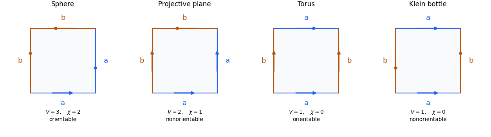

<h1 id="3/b/iii/solution">Solution</h1>

↑ **Parent:** [Iii](../iii.md)

There are **exactly four homeomorphism types**: the [two-sphere](../../../../../two-sphere.md), [real projective plane](../../../../../real-projective-plane.md), [torus](../../../../../torus.md), and [Klein bottle](../../../../../klein-bottle.md).

For completeness, enumerate all pairings. Four sides have three pairings; each pair can be matched in either direction, giving twelve signed pairings before symmetries. Up to cyclic relabelling, the repeated labels are either adjacent, of form $aa^sbb^t$, or alternating, of form $aba^sb^t$, where $s,t\in\{1,-1\}$. The second adjacent pattern $abba$ rotates to the first. Endpoint identification gives the following table:

$$
\begin{array}{c|c|c|c|c}
\text{pattern}&(s,t)&V&\chi=V-1&\text{surface}\\\hline
\text{adjacent}&(-1,-1)&3&2&S^2\\
\text{adjacent}&(1,-1)\text{ or }(-1,1)&2&1&\mathbb{RP}^2\\
\text{adjacent}&(1,1)&1&0&\text{Klein bottle}\\
\text{alternating}&(-1,-1)&1&0&\text{torus}\\
\text{alternating}&(1,-1)\text{ or }(-1,1)&1&0&\text{Klein bottle}\\
\text{alternating}&(1,1)&2&1&\mathbb{RP}^2
\end{array}
$$

Here the quotient always has two edge classes and one face, so its [Euler characteristic](../../../../../euler-characteristic.md) is $V-2+1=V-1$. To reproduce the vertex count, label consecutive square vertices $0,1,2,3$. For paired sides $i,j$, a same-direction pairing identifies $i$ with $j$ and $i+1$ with $j+1$; a reversed-direction pairing identifies $i$ with $j+1$ and $i+1$ with $j$, with indices modulo four. Taking the generated equivalence classes gives exactly the displayed values of $V$.

The quotient is [orientable](../../../../../orientable-surface.md) precisely when each label is traversed once positively and once negatively around the boundary: then the face orientation extends across every paired edge. A same-direction pair obstructs such an orientation. Thus the two $\chi=0$ possibilities are distinguished as the orientable [torus](../../../../../torus.md) and nonorientable [Klein bottle](../../../../../klein-bottle.md); the other rows are fixed by [Euler characteristic](../../../../../euler-characteristic.md) and the [classification theorem for surfaces](../../../../../classification-theorem-for-surfaces.md).

Explicit square representatives are

$$
\boxed{S^2:aa^{-1}bb^{-1},\quad\mathbb{RP}^2:aabb^{-1},\quad T^2:aba^{-1}b^{-1},\quad K:aba^{-1}b.}
$$

All edge interior points have disk neighbourhoods by joining two half-disks, and each identified vertex has a cyclic sequence of corner sectors, again a disk neighbourhood. There are no leftover boundary edges. The enumeration therefore describes closed surfaces, and the twelve signed pairings leave no additional cases.

**[Figure 1](#3/b/iii/image-four-closed-surfaces-obtained-by-pairing-the-sides-of-a-square). Four closed surfaces obtained by pairing the sides of a square**. Arrows and labels specify complete side-identifications. The examples realize the sphere, real projective plane, torus and Klein bottle; vertex counts and orientability distinguish their types.

## ↑ Ancestors (13)

1. [Iii](../iii.md)
2. [B](../../b.md)
3. [3](../../../3.md)
4. [2015](../../../../2015-split.md)
5. [Past exam of the topology course of the University of Oxford](../../../../split.md)
6. [Topology course of the University of Oxford](../../../../../topology-course-of-the-university-of-oxford.md)
7. [Year 2 of the mathematics course of the University of Oxford](../../../../../year-2-of-the-mathematics-course-of-the-university-of-oxford.md)
8. [Mathematics course of the University of Oxford](../../../../../mathematics-course-of-the-university-of-oxford.md)
9. [Undergraduate course of the University of Oxford](../../../../../undergraduate-course-of-the-university-of-oxford.md)
10. [Course of the University of Oxford](../../../../../course-of-the-university-of-oxford.md)
11. [University of Oxford](../../../../../university-of-oxford-split.md)
12. [List of universities](../../../../../list-of-universities.md)
13. [Codex Wiki](../../../../../split.md)
