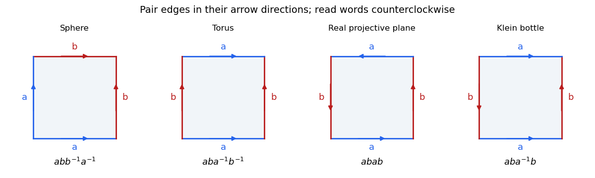
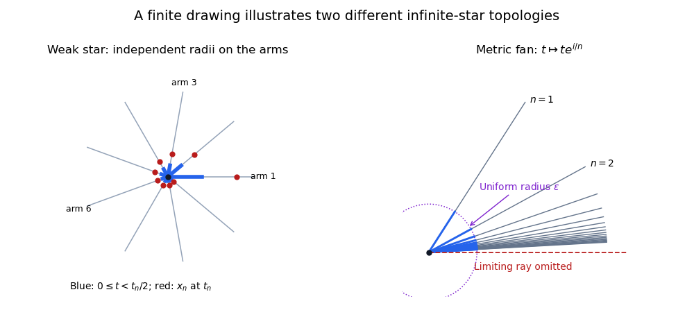
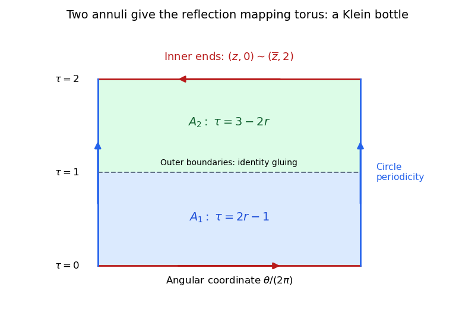

# 2017

↑ **Parent:** [Past exam of the topology course of the University of Oxford](../past-exam-of-the-topology-course-of-the-university-of-oxford.md)

Source paper: [released examination archive](https://www.whatdotheyknow.com/request/ba_computer_science_past_papers/response/2577745/attach/2/202402%20183%20CS%20Papers.zip?cookie_passthrough=1), member `2016/T/a13757w1.pdf`. The printed cover dates the examination to 21 June 2017.

Complete source recovery: [additional Oxford examination release](https://www.whatdotheyknow.com/request/maths_papers_2/response/1850333/attach/3/FOI%2020210708%201%20Data.zip?cookie_passthrough=1), member `FOI-20210708-1 - Data/a13757w1 (2).pdf`, supplies all four printed pages, including questions 1–2 missing from the earlier copy. Questions 1–2 are solved below; the five existing solutions to question 3 are retained unchanged.

Answer availability checked on 28 October 2026: no exact-paper or selected-part solution advertisement was found in a bounded search of official Oxford sources. Oxford states that odd-year examination solutions are not released apart from the 2019 exception.[Mathematical Institute, “Past papers and model solutions”: release policy for odd examination years and the 2019 exception](https://www.maths.ox.ac.uk/members/students/undergraduate-courses/examinations-assessments/overview-examinations)

**Table of contents**

- [1](#1)
  - [a](#1/a)
    - [i](#1/a/i)
      - [Solution](#1/a/i/solution)
    - [ii](#1/a/ii)
      - [Solution](#1/a/ii/solution)
    - [iii](#1/a/iii)
      - [Solution](#1/a/iii/solution)
  - [b](#1/b)
    - [Solution](#1/b/solution)
  - [c](#1/c)
    - [Solution](#1/c/solution)
  - [d](#1/d)
    - [Solution](#1/d/solution)
- [2](#2)
  - [a](#2/a)
    - [i](#2/a/i)
      - [Solution](#2/a/i/solution)
    - [ii](#2/a/ii)
      - [Solution](#2/a/ii/solution)
  - [b](#2/b)
    - [i](#2/b/i)
      - [Solution](#2/b/i/solution)
    - [ii](#2/b/ii)
      - [Solution](#2/b/ii/solution)
  - [c](#2/c)
    - [i](#2/c/i)
      - [Solution](#2/c/i/solution)
    - [ii](#2/c/ii)
      - [Solution](#2/c/ii/solution)
- [3](#3)
  - [a](#3/a)
    - [i](#3/a/i)
      - [Solution](#3/a/i/solution)
    - [ii](#3/a/ii)
      - [Solution](#3/a/ii/solution)
    - [iii](#3/a/iii)
      - [Solution](#3/a/iii/solution)
    - [iv](#3/a/iv)
      - [Solution](#3/a/iv/solution)
  - [b](#3/b)
    - [Solution](#3/b/solution)

## 1

↑ **Parent:** [2017](2017.md)

<h3 id="1/a">a</h3>

↑ **Parent:** [1](#1)

<h4 id="1/a/i">i</h4>

↑ **Parent:** [A](#1/a)

<h5 id="1/a/i/solution">Solution</h5>

↑ **Parent:** [I](#1/a/i)

A [subset](../set.md#subset) $K$ is **[compact](../topology.md#compact-space) if every [open cover](../topology.md#open-cover) has a [finite subcover](../topology.md#finite-subcover)**. Explicitly, if $U_i$ are [open sets](../topology.md#open-set) of $X$ and $K\subseteq\bigcup_{i\in I}U_i$, there are finitely many indices $i_1,\ldots,i_m$ such that

$$
K\subseteq U_{i_1}\cup\cdots\cup U_{i_m}.
$$

Equivalently, the [subspace topology](../topology.md#subspace-topology) makes $K$ a [compact space](../topology.md#compact-space). An [open set](../topology.md#open-set) in this [subspace topology](../topology.md#subspace-topology) is $K\cap U$ for an ambient [open set](../topology.md#open-set) $U$, which proves equivalence of the two [open cover](../topology.md#open-cover) formulations. The [empty set](../set.md#empty-set) is [compact](../topology.md#compact-space): the empty selection is a [finite subcover](../topology.md#finite-subcover).

<h4 id="1/a/ii">ii</h4>

↑ **Parent:** [A](#1/a)

<h5 id="1/a/ii/solution">Solution</h5>

↑ **Parent:** [Ii](#1/a/ii)

Assume $K$ is [compact](../topology.md#compact-space), and let the [closed subsets](../topology.md#closed-set) $F_i$ of $K$ have the [finite intersection property](../topology.md#finite-intersection-property). If their total [intersection](../set.md#set-intersection) were empty, their [complements](../set.md#complement-of-a-set) $K\setminus F_i$ would form an [open cover](../topology.md#open-cover) of $K$. A [finite subcover](../topology.md#finite-subcover) would give

$$
K=\bigcup_{j=1}^m(K\setminus F_{i_j})
\quad\Longrightarrow\quad
\bigcap_{j=1}^mF_{i_j}=\varnothing,
$$

contradicting the [finite intersection property](../topology.md#finite-intersection-property). Therefore the total [intersection](../set.md#set-intersection) is nonempty.

Conversely, assume the stated nonempty-[intersection](../set.md#set-intersection) property for every family of [closed subsets](../topology.md#closed-set) of $K$. Given an [open cover](../topology.md#open-cover) $\{V_i:i\in I\}$ of $K$ in its [subspace topology](../topology.md#subspace-topology), set $F_i=K\setminus V_i$. Their total [intersection](../set.md#set-intersection) is empty. By the contrapositive of the assumed property, this family fails the [finite intersection property](../topology.md#finite-intersection-property); hence some finite $J\subseteq I$ satisfies

$$
\bigcap_{j\in J}F_j=\varnothing
\quad\Longrightarrow\quad
K=\bigcup_{j\in J}V_j.
$$

This is a [finite subcover](../topology.md#finite-subcover), proving [compactness](../topology.md#compact-space). Both directions are instances of [De Morgan's laws](../theoretical-computer-science.md#de-morgan-s-laws). Thus **[compactness](../topology.md#compact-space) is equivalent to the [finite intersection characterization of compactness](../topology.md#finite-intersection-characterization-of-compactness)**.

For completeness, the [intersection](../set.md#set-intersection) of the empty family of [subsets](../set.md#subset) of $K$ is $K$. If $K$ is empty, no family has the [finite intersection property](../topology.md#finite-intersection-property) when the empty finite subfamily is included, so the implication remains valid.

<h4 id="1/a/iii">iii</h4>

↑ **Parent:** [A](#1/a)

<h5 id="1/a/iii/solution">Solution</h5>

↑ **Parent:** [Iii](#1/a/iii)

Let $F$ be a [closed subset](../topology.md#closed-set) of the [compact space](../topology.md#compact-space) $X$. Express an arbitrary [open cover](../topology.md#open-cover) of $F$ in its [subspace topology](../topology.md#subspace-topology) as $\{F\cap U_i:i\in I\}$, where the $U_i$ are [open sets](../topology.md#open-set) of $X$. Since $X\setminus F$ is [open](../topology.md#open-set), the family

$$
\{U_i:i\in I\}\cup\{X\setminus F\}
$$

is an [open cover](../topology.md#open-cover) of $X$. Take a [finite subcover](../topology.md#finite-subcover) and discard $X\setminus F$ if it occurs. The remaining finitely many $U_i$ still cover $F$, since the discarded [set](../set.md) contains no point of $F$. Their traces on $F$ give the required [finite subcover](../topology.md#finite-subcover). Hence **every [closed subset of a compact space](../topology.md#closed-subset-of-a-compact-space) is [compact](../topology.md#compact-space)**, with no [Hausdorff](../topology.md#hausdorff-space) assumption.

<h3 id="1/b">b</h3>

↑ **Parent:** [1](#1)

<h4 id="1/b/solution">Solution</h4>

↑ **Parent:** [B](#1/b)

For every $k\in K$, the [Hausdorff condition](../topology.md#hausdorff-space) gives [disjoint](../set.md#disjoint-sets) [open neighbourhoods](../topology.md#open-neighbourhood) $U_k$ of $k$ and $V_k$ of $x$. The $U_k$ form an [open cover](../topology.md#open-cover) of $K$, so choose a [finite subcover](../topology.md#finite-subcover) $U_{k_1},\ldots,U_{k_m}$. Put

$$
U=\bigcup_{j=1}^mU_{k_j},\qquad V=\bigcap_{j=1}^mV_{k_j}.
$$

Then $U,V$ are [open sets](../topology.md#open-set), $K\subseteq U$ and $x\in V$. If a point belonged to $U\cap V$, it would belong to some $U_{k_j}$ and to $V_{k_j}$, contrary to their choice. Thus

$$
\boxed{K\subseteq U,\qquad x\in V,\qquad U\cap V=\varnothing.}
$$

The finiteness matters: a finite [intersection](../set.md#set-intersection) of [open sets](../topology.md#open-set) is [open](../topology.md#open-set). This is [separation of a point and a compact set](../topology.md#separation-of-a-point-and-a-compact-set). If $K=\varnothing$, use $U=\varnothing$, $V=X$.

Every $x\in X\setminus K$ consequently has an [open neighbourhood](../topology.md#open-neighbourhood) $V$ contained in $X\setminus K$. The [complement](../set.md#complement-of-a-set) is [open](../topology.md#open-set), so **a [compact subset of a Hausdorff space](../topology.md#compact-subset-of-a-hausdorff-space) is [closed](../topology.md#closed-set)**.

**The conclusion can fail without the [Hausdorff condition](../topology.md#hausdorff-space).** Take the two-point [set](../set.md) $X=\{0,1\}$ with the [indiscrete topology](../topology.md#indiscrete-topology) $\{\varnothing,X\}$. The [singleton](../set.md#singleton-mathematics) $K=\{0\}$ is [compact](../topology.md#compact-space), since one member of any [open cover](../topology.md#open-cover) suffices. It is not [closed](../topology.md#closed-set), because its [complement](../set.md#complement-of-a-set) $\{1\}$ is not [open](../topology.md#open-set). The two points cannot have [disjoint](../set.md#disjoint-sets) [open neighbourhoods](../topology.md#open-neighbourhood), so this example is indeed not [Hausdorff](../topology.md#hausdorff-space).

<h3 id="1/c">c</h3>

↑ **Parent:** [1](#1)

<h4 id="1/c/solution">Solution</h4>

↑ **Parent:** [C](#1/c)

A [subset](../set.md#subset) $A$ is [connected](../geometry-and-topology.md#connected-space) when it is a [connected space](../geometry-and-topology.md#connected-space) in its [subspace topology](../topology.md#subspace-topology): there is no [separation of a topological space](../geometry-and-topology.md#separation-of-a-topological-space)

$$
A=P\sqcup Q
$$

into two nonempty [disjoint](../set.md#disjoint-sets) [open subsets](../topology.md#open-set) of $A$. Equivalently, the only [clopen sets](../topology.md#clopen-set) of $A$ are $\varnothing$ and $A$.

Since the given $A$ is not [connected](../geometry-and-topology.md#connected-space), choose such $P,Q$. Each is the [complement](../set.md#complement-of-a-set) of the other in $A$, so both are also [closed subsets](../topology.md#closed-set) of $A$. They are [compact](../topology.md#compact-space) by the [closed subset of a compact space](../topology.md#closed-subset-of-a-compact-space) result. We now separate these two [compact subsets](../topology.md#compact-space) by ambient [open sets](../topology.md#open-set).

For each $p\in P$, part (b), applied to $Q$ and $p$, gives [disjoint](../set.md#disjoint-sets) ambient [open sets](../topology.md#open-set) $G_p,H_p$ with $p\in G_p$ and $Q\subseteq H_p$. Choose $p_1,\ldots,p_m$ such that the $G_{p_j}$ cover $P$, using its [compactness](../topology.md#compact-space). Define

$$
U=\bigcup_{j=1}^mG_{p_j},\qquad
V=\bigcap_{j=1}^mH_{p_j}.
$$

Then $P\subseteq U$, $Q\subseteq V$, and $U,V$ are [disjoint](../set.md#disjoint-sets) [open sets](../topology.md#open-set). Indeed a point of $U$ lies in some $G_{p_j}$, whereas every point of $V$ lies in the corresponding $H_{p_j}$. Consequently

$$
\boxed{A\subseteq U\cup V,\qquad A\cap U=P\ne\varnothing,\qquad A\cap V=Q\ne\varnothing.}
$$

This proves the requested ambient separation, using the more general [separation of disjoint compact subsets](../topology.md#separation-of-disjoint-compact-subsets). The initially given relatively [open sets](../topology.md#open-set) $P,Q$ need not themselves be [open](../topology.md#open-set) in $X$; the finite construction supplies ambient [open neighbourhoods](../topology.md#open-neighbourhood).

<h3 id="1/d">d</h3>

↑ **Parent:** [1](#1)

<h4 id="1/d/solution">Solution</h4>

↑ **Parent:** [D](#1/d)

Write $K=\bigcap_{i\in I}K_i$. Each $K_i$ is [closed](../topology.md#closed-set) in $X$, by the [compact subset of a Hausdorff space](../topology.md#compact-subset-of-a-hausdorff-space) theorem. Therefore $K$ is [closed](../topology.md#closed-set), and is [compact](../topology.md#compact-space) because $X$ is [compact](../topology.md#compact-space). The nonempty finite [intersections](../set.md#set-intersection) give the [finite intersection property](../topology.md#finite-intersection-property), so part (a)(ii) also yields $K\ne\varnothing$.

Suppose $K$ were not [connected](../geometry-and-topology.md#connected-space). Part (c) would give [disjoint](../set.md#disjoint-sets) [open sets](../topology.md#open-set) $U,V$ containing $K$ in their [union](../set.md#set-union) and each meeting $K$. Let

$$
C=X\setminus(U\cup V).
$$

This is a [closed subset](../topology.md#closed-set) of the [compact space](../topology.md#compact-space) $X$, and $C\cap\bigcap_{i\in I}K_i=\varnothing$. Apply the contrapositive of the [finite intersection characterization of compactness](../topology.md#finite-intersection-characterization-of-compactness) to the family of [closed sets](../topology.md#closed-set) $\{C\}\cup\{K_i:i\in I\}$. Some finite subfamily has empty [intersection](../set.md#set-intersection). Since every finite [intersection](../set.md#set-intersection) of just the $K_i$ is nonempty, that subfamily must include $C$. Thus for some finite $J\subseteq I$,

$$
C\cap\bigcap_{j\in J}K_j=\varnothing,
\qquad\text{or equivalently}\qquad
K_J:=\bigcap_{j\in J}K_j\subseteq U\cup V.
$$

But $K\subseteq K_J$ and $K$ meets both $U$ and $V$. Therefore $K_J\cap U$ and $K_J\cap V$ are nonempty [disjoint](../set.md#disjoint-sets) relatively [open sets](../topology.md#open-set) covering $K_J$, contradicting its assumed [connectedness](../geometry-and-topology.md#connected-space). This proves

$$
\boxed{\bigcap_{i\in I}K_i\text{ is nonempty, compact and connected}.}
$$

This is [connectedness of an intersection from connected finite intersections](../geometry-and-topology.md#connectedness-of-an-intersection-from-connected-finite-intersections). If $I=\varnothing$, its [intersection](../set.md#set-intersection) is $X$; the stated hypothesis for the finite [set](../set.md) $J=\varnothing$ already makes $X$ nonempty and [connected](../geometry-and-topology.md#connected-space), so that case is included.

## 2

↑ **Parent:** [2017](2017.md)

<h3 id="2/a">a</h3>

↑ **Parent:** [2](#2)

<h4 id="2/a/i">i</h4>

↑ **Parent:** [A](#2/a)

<h5 id="2/a/i/solution">Solution</h5>

↑ **Parent:** [I](#2/a/i)

A [topological space](../topology.md#topological-space) is [Hausdorff](../topology.md#hausdorff-space) when any two distinct points have [disjoint](../set.md#disjoint-sets) [open neighbourhoods](../topology.md#open-neighbourhood).

Any two nonempty [open sets](../topology.md#open-set) of the infinite [cofinite topology](../topology.md#cofinite-topology) intersect: their [complements](../set.md#complement-of-a-set) are [finite sets](../set.md#finite-set), so the [complement](../set.md#complement-of-a-set) of their [intersection](../set.md#set-intersection) is a [finite union](../set.md#finite-union) of [finite sets](../set.md#finite-set) and cannot be all of $Z$. Thus $Z$ is a [hyperconnected space](../topology.md#hyperconnected-space).

If the [continuous map](../topology.md#continuous-map) $f$ took distinct values at $s,t\in Z$, choose [disjoint](../set.md#disjoint-sets) [open neighbourhoods](../topology.md#open-neighbourhood) $G,H$ of $f(s),f(t)$ in the [Hausdorff space](../topology.md#hausdorff-space) $Y$. By [continuity](../calculus.md#continuous-function), $f^{-1}(G)$ and $f^{-1}(H)$ would be nonempty [disjoint](../set.md#disjoint-sets) [open sets](../topology.md#open-set) of $Z$, a contradiction. Therefore

$$
\boxed{f\text{ is constant}.}
$$

The proof establishes the general fact that [continuous maps from an infinite cofinite space to a Hausdorff space are constant](../topology.md#continuous-maps-from-an-infinite-cofinite-space-to-a-hausdorff-space-are-constant).

<h4 id="2/a/ii">ii</h4>

↑ **Parent:** [A](#2/a)

<h5 id="2/a/ii/solution">Solution</h5>

↑ **Parent:** [Ii](#2/a/ii)

A [homeomorphism](../topology.md#homeomorphism) is a [bijection](../function.md#bijection) for which both the [function](../function.md) and its inverse are [continuous maps](../topology.md#continuous-map).

Let $f:X\to Y$ satisfy the given assumptions. For a [closed subset](../topology.md#closed-set) $F$ of $X$, the [closed subset of a compact space](../topology.md#closed-subset-of-a-compact-space) theorem makes $F$ [compact](../topology.md#compact-space). The [continuous image of a compact space](../topology.md#continuous-image-of-a-compact-space) theorem makes $f(F)$ [compact](../topology.md#compact-space). Because $Y$ is [Hausdorff](../topology.md#hausdorff-space), its [compact subset](../topology.md#compact-space) $f(F)$ is [closed](../topology.md#closed-set). Thus $f$ is a [closed map](../topology.md#closed-map).

For $g=f^{-1}:Y\to X$, the [inverse image](../set-theory.md#preimage) of a [closed set](../topology.md#closed-set) $F\subseteq X$ is

$$
g^{-1}(F)=f(F),
$$

which is [closed](../topology.md#closed-set) in $Y$. The [closed-set criterion for continuity](../topology.md#closed-set-criterion-for-continuity) therefore makes $g$ [continuous](../calculus.md#continuous-function). Hence **$f$ is a [homeomorphism](../topology.md#homeomorphism)**, proving the [compact-to-Hausdorff continuous bijection theorem](../topology.md#compact-to-hausdorff-continuous-bijection-theorem).

<h3 id="2/b">b</h3>

↑ **Parent:** [2](#2)

<h4 id="2/b/i">i</h4>

↑ **Parent:** [B](#2/b)

<h5 id="2/b/i/solution">Solution</h5>

↑ **Parent:** [I](#2/b/i)

The [set](../set.md) $X/\mathcal R$ consists of the [equivalence classes](../set-theory.md#equivalence-class) $[x]$ for $\mathcal R$. The canonical [surjection](../algebra.md#surjective-function) $q:X\to X/\mathcal R$, $q(x)=[x]$, defines its [quotient topology](../topology.md#quotient-topology):

$$
O\subseteq X/\mathcal R\text{ is open}\quad\Longleftrightarrow\quad q^{-1}(O)\text{ is open in }X.
$$

The [quotient space](../topology.md#quotient-topological-space) includes this [topology](../topology.md), not just the collection of [equivalence classes](../set-theory.md#equivalence-class).

Regard the [circle](../topology.md#circle) as $S^1=\{z\in\mathbb C:|z|=1\}$ and use the [continuous](../calculus.md#continuous-function) [surjection](../algebra.md#surjective-function)

$$
h:S^1\longrightarrow[0,1],\qquad h(z)=\frac{1+\operatorname{Re}z}{2}.
$$

Define $z\mathcal R w$ precisely when $h(z)=h(w)$. This is an [equivalence relation](../set-theory.md#equivalence-relation), being equality of [function](../function.md) values. Equivalently $w=z$ or $w=\overline z$, so the construction is the [circle modulo reflection](../topology.md#circle-modulo-reflection).

Since $h$ is constant on each [equivalence class](../set-theory.md#equivalence-class), it induces a [bijection](../function.md#bijection)

$$
\overline h:S^1/\mathcal R\longrightarrow[0,1],\qquad [z]\longmapsto h(z).
$$

It is [continuous](../calculus.md#continuous-function) by the [universal property of the quotient topology](../topology.md#universal-property-of-the-quotient-topology), because $\overline h\circ q=h$ is [continuous](../calculus.md#continuous-function). The [circle](../topology.md#circle) is [compact](../topology.md#compact-space) by the [Heine-Borel theorem](../topology.md#heine-borel-theorem), and its [quotient space](../topology.md#quotient-topological-space) is a [continuous image of a compact space](../topology.md#continuous-image-of-a-compact-space), hence [compact](../topology.md#compact-space). The [closed interval](../real-analysis.md#closed-real-interval) is [Hausdorff](../topology.md#hausdorff-space). Part (a)(ii) therefore proves

$$
\boxed{S^1/\mathcal R\cong[0,1].}
$$

Geometrically, the [equivalence relation](../set-theory.md#equivalence-relation) folds the upper and lower semicircles together, retaining the two real endpoints separately.

<h4 id="2/b/ii">ii</h4>

↑ **Parent:** [B](#2/b)

<h5 id="2/b/ii/solution">Solution</h5>

↑ **Parent:** [Ii](#2/b/ii)

The [product topology](../geometry-and-topology.md#product-topology) on the [Cartesian product](../set-theory.md#cartesian-product) $X\times Y$ has a [basis of a topology](../topology.md#basis-of-a-topology) consisting of all rectangles $U\times V$, where $U$ is [open](../topology.md#open-set) in $X$ and $V$ is [open](../topology.md#open-set) in $Y$. Equivalently, it is the smallest [topology](../topology.md) making the two [coordinate projections](../projective-space.md#coordinate-projection) [continuous](../calculus.md#continuous-function).

Take distinct points $(x_1,y_1)$ and $(x_2,y_2)$. If $x_1\ne x_2$, use the [Hausdorff condition](../topology.md#hausdorff-space) in $X$ to find [disjoint](../set.md#disjoint-sets) [open neighbourhoods](../topology.md#open-neighbourhood) $U_1,U_2$. Then $U_1\times Y$ and $U_2\times Y$ are [disjoint](../set.md#disjoint-sets) [open neighbourhoods](../topology.md#open-neighbourhood) of the two points. If $x_1=x_2$, then $y_1\ne y_2$; [disjoint](../set.md#disjoint-sets) [open neighbourhoods](../topology.md#open-neighbourhood) $V_1,V_2$ in $Y$ give $X\times V_1$ and $X\times V_2$. Thus **$X\times Y$ is [Hausdorff](../topology.md#hausdorff-space)**, as established by the forward implication of the [Hausdorff property of a nonempty product](../geometry-and-topology.md#hausdorff-property-of-a-nonempty-product). An empty [Cartesian product](../set-theory.md#cartesian-product) is automatically [Hausdorff](../topology.md#hausdorff-space).

<h3 id="2/c">c</h3>

↑ **Parent:** [2](#2)

<h4 id="2/c/i">i</h4>

↑ **Parent:** [C](#2/c)

<h5 id="2/c/i/solution">Solution</h5>

↑ **Parent:** [I](#2/c/i)

Fix $x_0,y_0\in Z$. For a [continuous function](../calculus.md#continuous-function) $f:Z\times Z\to\mathbb R$, every coordinate slice is [continuous](../calculus.md#continuous-function), because the maps $x\mapsto(x,y)$ and $y\mapsto(x_0,y)$ into the [product topology](../geometry-and-topology.md#product-topology) are [continuous](../calculus.md#continuous-function). Their target $\mathbb R$ is [Hausdorff](../topology.md#hausdorff-space). Part (a)(i) gives

$$
f(x,y)=f(x_0,y)=f(x_0,y_0)\qquad\text{for every }(x,y).
$$

Therefore **every such $f$ is a [constant function](../function.md#constant-function)**. This is the two-factor case of [continuous maps from products of cofinite spaces to Hausdorff spaces are constant](../topology.md#continuous-maps-from-products-of-cofinite-spaces-to-hausdorff-spaces-are-constant).

The second [coordinate projection](../projective-space.md#coordinate-projection) $\pi_2:Z\times\mathbb R\to\mathbb R$ is [continuous](../calculus.md#continuous-function) and nonconstant. If a [homeomorphism](../topology.md#homeomorphism) $H:Z\times Z\to Z\times\mathbb R$ existed, $\pi_2\circ H$ would be a nonconstant [continuous function](../calculus.md#continuous-function), contradicting the preceding conclusion. Hence

$$
\boxed{Z\times Z\not\cong Z\times\mathbb R.}
$$

For the half-plane, put $H_+=[0,\infty)$ as a [set](../set.md), so $K=\mathbb R\times H_+$. Its two ambient [topologies](../topology.md) give different answers:

$$
\begin{array}{c|cc}
\text{ambient space}&K\text{ closed?}&K\text{ compact?}\\\hline
Z\times Z&\text{no}&\text{yes}\\
Z\times\mathbb R&\text{yes}&\text{no}.
\end{array}
$$

In $Z\times Z$, if $K$ were [closed](../topology.md#closed-set), its [inverse image](../set-theory.md#preimage) under the [continuous map](../topology.md#continuous-map) $y\mapsto(x_0,y)$ would be [closed](../topology.md#closed-set) in $Z$. That [inverse image](../set-theory.md#preimage) is $H_+$, which is neither a [finite set](../set.md#finite-set) nor all of $Z$, so it is not [closed](../topology.md#closed-set) in the [cofinite topology](../topology.md#cofinite-topology). Thus $K$ is **not [closed](../topology.md#closed-set)**.

To establish [compactness](../topology.md#compact-space), note that the [subspace topology](../topology.md#subspace-topology) on any [subset](../set.md#subset) $A$ of a [topological space](../topology.md#topological-space) with the [cofinite topology](../topology.md#cofinite-topology) is again cofinite. An [open cover](../topology.md#open-cover) of a nonempty such $A$ has a nonempty member omitting at most finitely many points; finitely many more members cover those points. Hence [every subset of a cofinite space is compact](../topology.md#every-subset-of-a-cofinite-space-is-compact). In particular both $Z$ and $H_+$ with its cofinite [subspace topology](../topology.md#subspace-topology) are [compact](../topology.md#compact-space). The [subspace topology](../topology.md#subspace-topology) on $K\subseteq Z\times Z$ is their [product topology](../geometry-and-topology.md#product-topology), as one checks by tracing basis rectangles. The [product of two compact spaces](../geometry-and-topology.md#product-of-two-compact-spaces) is [compact](../topology.md#compact-space), so $K$ is **[compact](../topology.md#compact-space)** here.

For clarity, the finite-product [compactness](../topology.md#compact-space) result needs no [Hausdorff condition](../topology.md#hausdorff-space). Given an [open cover](../topology.md#open-cover) of $A\times B$, cover each point by a basis rectangle lying in one covering member. For fixed $a\in A$, use [compactness](../topology.md#compact-space) of $B$ to select finitely many rectangles whose second factors cover $B$, and intersect their first factors to get an [open neighbourhood](../topology.md#open-neighbourhood) $U_a$ of $a$. Those finitely many original members cover $U_a\times B$. Finally finitely many $U_a$ cover $A$, producing a [finite subcover](../topology.md#finite-subcover) of $A\times B$.

In $Z\times\mathbb R$, the second [coordinate projection](../projective-space.md#coordinate-projection) has

$$
K=\pi_2^{-1}([0,\infty)).
$$

Since the ray is [closed](../topology.md#closed-set) in the usual [real line](../real-analysis.md#real-line), $K$ is **[closed](../topology.md#closed-set)**. It is **not [compact](../topology.md#compact-space)**: its [image](../set-theory.md#image-of-a-function) under a [continuous map](../topology.md#continuous-map) under $\pi_2$ is $[0,\infty)$, which is not [compact](../topology.md#compact-space). For an explicit obstruction, the [open intervals](../topology.md#open-interval) $(-1,n)$, $n\geq1$, cover this ray but have no [finite subcover](../topology.md#finite-subcover).

Finally consider the diagonal $W$ in $Z\times\mathbb R$. Define

$$
\varphi:\mathbb R\longrightarrow W,\qquad \varphi(t)=(t,t).
$$

This is a [bijection](../function.md#bijection). The identity [function](../function.md) from the usual [real line](../real-analysis.md#real-line) to $Z$ is [continuous](../calculus.md#continuous-function): each nonempty cofinite [open set](../topology.md#open-set) is the [complement](../set.md#complement-of-a-set) of a [finite set](../set.md#finite-set), and [finite sets](../set.md#finite-set) are [closed](../topology.md#closed-set) in the usual [real line](../real-analysis.md#real-line). Both coordinates of $\varphi$ are therefore [continuous](../calculus.md#continuous-function), so $\varphi$ is [continuous](../calculus.md#continuous-function) for the [product topology](../geometry-and-topology.md#product-topology) and the [subspace topology](../topology.md#subspace-topology) of $W$. Its inverse is the restricted second [coordinate projection](../projective-space.md#coordinate-projection), which is [continuous](../calculus.md#continuous-function). Therefore

$$
\boxed{W\cong\mathbb R,\qquad W\not\cong Z.}
$$

For the second conclusion, $Z$ is [compact](../topology.md#compact-space) whereas $W\cong\mathbb R$ is not [compact](../topology.md#compact-space); [homeomorphisms](../topology.md#homeomorphism) preserve [compactness](../topology.md#compact-space). The [diagonal in a product with cofinite and Euclidean topologies](../topology.md#diagonal-in-a-product-with-cofinite-and-euclidean-topologies) thus inherits the usual [topology](../topology.md), despite one cofinite factor.

<h4 id="2/c/ii">ii</h4>

↑ **Parent:** [C](#2/c)

<h5 id="2/c/ii/solution">Solution</h5>

↑ **Parent:** [Ii](#2/c/ii)

Write $Q=(Z\times I)/\mathcal R$. Since $Q$ is [homeomorphic](../topology.md#homeomorphism) to the [circle](../topology.md#circle), it is [Hausdorff](../topology.md#hausdorff-space). For fixed $t\in I$, the [function](../function.md)

$$
Z\longrightarrow Q,\qquad x\longmapsto p(x,t)
$$

is [continuous](../calculus.md#continuous-function), being a coordinate slice of the [quotient map](../topology.md#quotient-map). Part (a)(i) therefore makes it constant. Choose $x_0\in Z$ and set

$$
g:I\longrightarrow Q,\qquad g(t)=p(x_0,t).
$$

Then $g$ is [continuous](../calculus.md#continuous-function) and

$$
p(x,t)=g(t)\qquad\text{for every }x\in Z,\ t\in I.
$$

Since the [quotient map](../topology.md#quotient-map) $p$ is a [surjection](../algebra.md#surjective-function), so is $g$. This is [Hausdorff factorization through a cofinite product factor](../topology.md#hausdorff-factorization-through-a-cofinite-product-factor): a [continuous map](../topology.md#continuous-map) into a [Hausdorff space](../topology.md#hausdorff-space) cannot distinguish the points of the coordinate with the [cofinite topology](../topology.md#cofinite-topology).

If $g$ were injective, it would be a [continuous bijection](../topology.md#continuous-bijection) from the [compact](../topology.md#compact-space) [closed interval](../real-analysis.md#closed-real-interval) $I$ to the [Hausdorff space](../topology.md#hausdorff-space) $Q$. Part (a)(ii) would make it a [homeomorphism](../topology.md#homeomorphism), contradicting the fact that the [circle and interval are not homeomorphic](../topology.md#circle-and-interval-are-not-homeomorphic).

To recall that obstruction explicitly, remove the interior point $1/2$ from $I$. The resulting [topological subspace](../topology.md#topological-subspace) is separated by the nonempty relatively [open sets](../topology.md#open-set) $[0,1/2)$ and $(1/2,1]$, so it is not [connected](../geometry-and-topology.md#connected-space). The [circle](../topology.md#circle) with any one point removed is [connected](../geometry-and-topology.md#connected-space): after a rotation, it is the [image](../set-theory.md#image-of-a-function) under a [continuous map](../topology.md#continuous-map) of the [connected](../geometry-and-topology.md#connected-space) [open interval](../topology.md#open-interval) $(0,2\pi)$ under $t\mapsto(\cos t,\sin t)$. A [homeomorphism](../topology.md#homeomorphism) and its restriction preserve [connectedness](../geometry-and-topology.md#connected-space), giving a contradiction.

Thus $g$ is not injective. Choose distinct $a,b\in I$ with $g(a)=g(b)$. Then

$$
\boxed{p(x,a)=g(a)=g(b)=p(x,b)\quad\text{for every }x\in Z.}
$$

In particular the requested $x,a,b$ exist. The argument proves the stronger conclusion that the same two interval coordinates work for every $x$.

## 3

↑ **Parent:** [2017](2017.md)

<h3 id="3/a">a</h3>

↑ **Parent:** [3](#3)

<h4 id="3/a/i">i</h4>

↑ **Parent:** [A](#3/a)

<h5 id="3/a/i/solution">Solution</h5>

↑ **Parent:** [I](#3/a/i)

An [abstract simplicial complex](../algebraic-topology.md#simplicial-complex) is a pair $K=(V,\Sigma)$, where $V$ is a [set](../set.md) of vertices and $\Sigma$ is a family of finite nonempty [subsets](../set.md#subset) of $V$ satisfying two conditions: every singleton $\{v\}$ is in $\Sigma$, and every nonempty subset of a member of $\Sigma$ is again in $\Sigma$. Its members are the [simplexes](../algebraic-topology.md#simplex); a face with $n+1$ vertices has dimension $n$.

To form its [topological realization](../algebraic-topology.md#geometric-realization-of-a-simplicial-complex), take a disjoint copy of the standard geometric simplex $\Delta^{|\sigma|-1}$ for every $\sigma\in\Sigma$, label its vertices by $\sigma$, and identify shared labelled faces using affine face inclusions. Give the resulting space $|K|$ the [quotient topology](../topology.md#quotient-topology) of this disjoint union. Equivalently, its points have finite-support [barycentric coordinates](../algebraic-topology.md#barycentric-coordinate-system) $\lambda_v\geq0$ with $\sum_v\lambda_v=1$ and positive support belonging to $\Sigma$.

The topology is part of the definition: $U\subseteq|K|$ is open exactly when $U\cap|\sigma|$ is open in each closed geometric simplex. This is the [weak topology of a simplicial realization](../algebraic-topology.md#weak-topology-of-a-simplicial-realization), used below for the infinite complex. For finite complexes it coincides with the usual Euclidean realization topology.[Definitions I.17–I.18, printed pp. 8–9: abstract complexes and face-gluing realization](../mathematics-bibliography.md#topology-and-groups-by-marc-lackenby)

<h4 id="3/a/ii">ii</h4>

↑ **Parent:** [A](#3/a)

<h5 id="3/a/ii/solution">Solution</h5>

↑ **Parent:** [Ii](#3/a/ii)

A [topological surface](../topological-surface.md) is a [Hausdorff space](../topology.md#hausdorff-space) with a countable [basis of a topology](../topology.md#basis-of-a-topology) in which each point has a neighbourhood [homeomorphic](../topology.md#homeomorphism) to an open subset of $\mathbb R^2$. This definition has no boundary; allowing half-plane charts gives a [surface with boundary](../topological-surface.md#surface-with-boundary). A closed surface is compact and has no boundary.

The [classification theorem for closed combinatorial surfaces](../topological-surface.md#classification-theorem-for-closed-combinatorial-surfaces) states that the realization of a finite connected closed combinatorial surface is homeomorphic to exactly one of:

- the [sphere](../euclidean-geometry.md#sphere) $S^2$;
- a [connected sum of surfaces](../topological-surface.md#connected-sum-of-surfaces) of $g\geq1$ [tori](../topological-surface.md#torus), the orientable surface of genus $g$;
- a connected sum of $k\geq1$ [real projective planes](../differential-geometry.md#real-projective-plane), a [nonorientable surface](../topological-surface.md#non-orientable-surface) with $k$ crosscaps.

The orientable family, including the sphere at $g=0$, has [Euler characteristic](../homology.md#euler-characteristic) $2-2g$; the nonorientable family has characteristic $2-k$. If disconnected complexes are permitted, apply the list to each connected component.

For polygon descriptions, read the boundary counterclockwise and pair equally labelled edges in the direction of their arrows. An inverse exponent means that the arrow runs against this boundary traversal. The following [standard polygon words for closed surfaces](../topological-surface.md#standard-polygon-words-for-closed-surfaces) give the required models:

$$
\begin{array}{c|c}
\text{surface}&\text{boundary word}\\\hline
S^2&abb^{-1}a^{-1}\\
\#^gT^2&\displaystyle\prod_{j=1}^g a_jb_ja_j^{-1}b_j^{-1}\quad(g\geq1)\\
\#^k\mathbb{RP}^2&c_1c_1c_2c_2\cdots c_kc_k\quad(k\geq1).
\end{array}
$$

For $k=1$ the last model is a digon; alternatively the square word $abab$, identifying antipodal boundary points, gives the [real projective plane](../differential-geometry.md#real-projective-plane). A square with word $aba^{-1}b$ gives the [Klein bottle](../topological-surface.md#klein-bottle), the case $k=2$. All polygon sides are paired, so these models have no boundary.

**[Figure 1](#3/a/ii/image-polygonal-models-of-the-sphere-torus-projective-plane-and-klein-bottle). Polygonal models of the sphere, torus, projective plane and Klein bottle**. Boundary words are read counterclockwise. Each pair of equal labels is glued in its arrow direction; an inverse in the word records an arrow opposing the boundary traversal. The real-projective-plane panel uses its square model.

<h4 id="3/a/iii">iii</h4>

↑ **Parent:** [A](#3/a)

<h5 id="3/a/iii/solution">Solution</h5>

↑ **Parent:** [Iii](#3/a/iii)

Use a convex representative of the marked [polygonal schema](../topological-surface.md#polygonal-schema), retaining the side-pairing parametrizations. This does not change the quotient up to homeomorphism: a matching boundary homeomorphism extends over the two polygonal discs by radial extension in disc coordinates. Join an interior point to every vertex, producing finitely many triangles. Orient radial edges away from the interior point and choose boundary-edge orientations consistently with the side identifications. Each triangle then has a local vertex ordering with the centre first; the other two vertices are ordered along its boundary-edge arrow. These orderings agree on shared edges, so the quotient is a finite [delta-complex](../algebraic-topology.md#delta-complex) $X$ whose underlying space is the prescribed polygon quotient.

This need not yet be an [abstract simplicial complex](../algebraic-topology.md#simplicial-complex): two vertices of a triangle may become identified, or different triangles may have the same vertex set. Apply [barycentric subdivision](../homology.md#barycentric-subdivision) twice.

In the first subdivision, every small simplex corresponds to a flag of faces of strictly increasing dimensions. Identifications preserve dimension, so its vertices are distinct. In the second subdivision, a vertex records an actual cell of the first subdivision. A set of such vertices determines their order by dimension. Inside any one first-subdivision simplex, distinct vertices make each face inclusion uniquely determined by its vertex subset; hence a flag has at most one realization. Therefore different second-subdivision simplexes cannot share the same vertex set, and they meet in precisely their common faces. Thus the second subdivision is an abstract simplicial complex $L$.

The affine subdivision maps are compatible with every face identification, so their realizations are homeomorphisms. Consequently

$$
\boxed{P/{\sim}\ \cong\ |X|\ \cong\ |L|,}
$$

where $L$ is finite. This proves [triangulation of a polygon with paired sides](../topological-surface.md#triangulation-of-a-polygon-with-paired-sides) by the [second barycentric subdivision of a delta-complex](../homology.md#second-barycentric-subdivision-of-a-delta-complex) construction.[§2.1, exercise 23, p. 133: distinct vertices after one subdivision and a simplicial complex after two](../mathematics-bibliography.md#algebraic-topology-by-allen-hatcher)

<h4 id="3/a/iv">iv</h4>

↑ **Parent:** [A](#3/a)

<h5 id="3/a/iv/solution">Solution</h5>

↑ **Parent:** [Iv](#3/a/iv)

With the quotient realization defined in part (i), **the answers are no and no**. Write $W=|K|$ as countably many closed arms $[0,1]_n$ with all their zero endpoints identified to $v$.

First, the outer vertices $D=\{u_n:n\geq1\}$ form a [closed discrete subset](../topology.md#closed-discrete-subset). Its intersection with every closed arm is the closed singleton at coordinate one, so $D$ is closed by the weak topology. The terminal half-arm $(1/2,1]_n$ is an open neighbourhood of $u_n$ meeting $D$ only there. Thus $D$ is infinite, closed and discrete. Since [closed discrete subsets of compact spaces are finite](../topology.md#closed-discrete-subsets-of-compact-spaces-are-finite), $W$ is not compact. A [homeomorphism](../topology.md#homeomorphism) to a compact subset of the plane would make $W$ compact, which is impossible.

For the stronger obstruction, suppose $(U_n)$ were a countable [neighbourhood basis](../topology.md#neighbourhood-basis) at $v$. Each $U_n$ contains an initial interval in arm $n$, so choose $x_n\in U_n$ on that arm with coordinate $t_n\in(0,1)$. Define $V$ to meet arm $n$ in $[0,t_n/2)$. It is an open neighbourhood of $v$, because each of these intersections is open in the closed interval $[0,1]$. But $x_n\in U_n\setminus V$ for every $n$, so no $U_n$ is contained in $V$. This contradicts the basis condition.

Hence $W$ is not [first countable](../topology.md#first-countable-space). Every metric space is first-countable, with local basis of balls of radius $1/n$, and this property passes to subsets with the [subspace topology](../topology.md#subspace-topology). Thus $W$ is not homeomorphic to any subset of $\mathbb R^2$. This is the [weak realization of a countable star](../algebraic-topology.md#weak-realization-of-a-countable-star).

The realization convention matters. For the [metric realization of a simplicial complex](../algebraic-topology.md#metric-realization-of-a-simplicial-complex) using Euclidean distance on barycentric coordinates, the second answer would be **yes**: map the point on arm $n$ at parameter $t$ to $te^{i/n}$. Each ray is isolated away from zero, and at zero both spaces have neighbourhood bases given by a single radius on all arms. This gives the [metric realization of a countable star](../algebraic-topology.md#metric-realization-of-a-countable-star) as a planar subset, still noncompact. It does not give the quotient topology used in part (i).

**[Figure 2](#3/a/iv/image-independent-arm-radii-in-a-weak-star-and-uniform-radii-in-a-metric-planar-fan). Independent arm radii in a weak star and uniform radii in a metric planar fan**. Only finitely many arms are drawn. The left panel is a schematic of a weak neighbourhood and the diagonal points excluded from it, rather than an embedding of the whole weak realization. The right panel is a finite part of the planar metric realization; its limiting positive real ray is omitted.

<h3 id="3/b">b</h3>

↑ **Parent:** [3](#3)

<h4 id="3/b/solution">Solution</h4>

↑ **Parent:** [B](#3/b)

The quotient is a **[Klein bottle](../topological-surface.md#klein-bottle)**, equivalently a connected sum of two [real projective planes](../differential-geometry.md#real-projective-plane).

Use $z\in S^1$ for the angular coordinate and $r\in[1/2,1]$ for the radius. Parametrize the first annulus by $\tau=2r-1\in[0,1]$, running from its inner to its outer boundary. Parametrize the second by $\tau=3-2r\in[1,2]$, running from its outer to its inner boundary. The outer-boundary identity gluing puts them together at $\tau=1$. The remaining inner-boundary identification reverses the angle, so the entire quotient is

$$
M=(S^1\times[0,2])/((z,0)\sim(\overline z,2)).
$$

This is the [mapping torus](../algebraic-topology.md#mapping-torus) of reflection of a circle, after rescaling the interval.

To verify the homeomorphism, send $rz$ in the first annulus to $[z,2r-1]$ in $M$, and $rz$ in the second to $[z,3-2r]$. Both formulas are continuous, agree under the outer gluing, and agree under the reflected inner gluing. They therefore descend by the [universal property of the quotient topology](../topology.md#universal-property-of-the-quotient-topology). Conversely, on the lower half of the cylinder send $(z,\tau)$ to the class of $((1+\tau)/2)z$ in the first annulus; on the upper half send it to the class of $((3-\tau)/2)z$ in the second. The formulas agree at $\tau=1$, and at the identified endpoints. The [pasting lemma](../topology.md#pasting-lemma-for-closed-subspaces) and the quotient property give a continuous inverse. Thus the two quotient descriptions are homeomorphic.

The quotient $M$ is compact. Its equivalence relation on the compact Hausdorff cylinder is closed: it is the union of the diagonal and the two graphs of the boundary reflection. Therefore $M$ is Hausdorff by [compact Hausdorff quotient by a closed equivalence relation](../topology.md#compact-hausdorff-quotient-by-a-closed-equivalence-relation). Away from the seam its local charts are circle arcs times open intervals. At the seam, an arc near $z$ at $\tau=0$ glues to its conjugate arc at $\tau=2$; using the reflection as the transition gives another open rectangle. These are disc neighbourhoods, and a finite choice of such charts gives a countable basis. Hence $M$ is a closed [surface](../topological-surface.md).

Cutting the circle coordinate gives a rectangle with its vertical sides matched and its horizontal sides reflected. The reflection changes the sign of the angular coordinate while leaving the interval direction unchanged, so an orientation transported around the interval loop comes back reversed. Thus $M$ is a [nonorientable surface](../topological-surface.md#non-orientable-surface). The rectangle quotient has one vertex, two edges and one face, giving [Euler characteristic](../homology.md#euler-characteristic) zero. By the [classification theorem for closed combinatorial surfaces](../topological-surface.md#classification-theorem-for-closed-combinatorial-surfaces), the nonorientable genus is $k=2-\chi(M)=2$, so $M\cong\mathbb{RP}^2\#\mathbb{RP}^2$. This is the [gluing annuli with one reflected boundary](../topological-surface.md#gluing-annuli-with-one-reflected-boundary) construction.

**[Figure 3](#3/b/image-the-two-annuli-become-one-cylinder-with-a-reflected-end-identification). The two annuli become one cylinder with a reflected end identification**. The lower band parametrizes the first annulus from inner to outer boundary, and the upper band the second from outer to inner boundary. Their common middle level is the identity gluing. Identifying the remaining ends by reflection gives the Klein bottle.

## ↑ Ancestors (9)

1. [Past exam of the topology course of the University of Oxford](../past-exam-of-the-topology-course-of-the-university-of-oxford.md)
2. [Topology course of the University of Oxford](../university-of-oxford.md#topology-course-of-the-university-of-oxford)
3. [Year 2 of the mathematics course of the University of Oxford](../university-of-oxford.md#year-2-of-the-mathematics-course-of-the-university-of-oxford)
4. [Mathematics course of the University of Oxford](../university-of-oxford.md#mathematics-course-of-the-university-of-oxford)
5. [Undergraduate course of the University of Oxford](../university-of-oxford.md#undergraduate-course-of-the-university-of-oxford)
6. [Course of the University of Oxford](../university-of-oxford.md#course-of-the-university-of-oxford)
7. [University of Oxford](../university-of-oxford.md)
8. [List of universities](../README.md#list-of-universities)
9. [Codex Wiki](../README.md)
