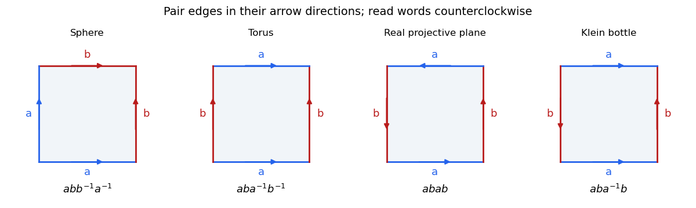

<h1 id="3/a/ii/solution">Solution</h1>

↑ **Parent:** [Ii](../ii.md)

A [topological surface](../../../../../topological-surface-split.md) is a [Hausdorff space](../../../../../hausdorff-space.md) with a countable [basis of a topology](../../../../../basis-of-a-topology.md) in which each point has a neighbourhood [homeomorphic](../../../../../homeomorphism.md) to an open subset of $\mathbb R^2$. This definition has no boundary; allowing half-plane charts gives a [surface with boundary](../../../../../surface-with-boundary.md). A closed surface is compact and has no boundary.

The [classification theorem for closed combinatorial surfaces](../../../../../classification-theorem-for-closed-combinatorial-surfaces.md) states that the realization of a finite connected closed combinatorial surface is homeomorphic to exactly one of:

- the [sphere](../../../../../sphere.md) $S^2$;
- a [connected sum of surfaces](../../../../../connected-sum-of-surfaces.md) of $g\geq1$ [tori](../../../../../torus.md), the orientable surface of genus $g$;
- a connected sum of $k\geq1$ [real projective planes](../../../../../real-projective-plane.md), a [nonorientable surface](../../../../../non-orientable-surface.md) with $k$ crosscaps.

The orientable family, including the sphere at $g=0$, has [Euler characteristic](../../../../../euler-characteristic.md) $2-2g$; the nonorientable family has characteristic $2-k$. If disconnected complexes are permitted, apply the list to each connected component.

For polygon descriptions, read the boundary counterclockwise and pair equally labelled edges in the direction of their arrows. An inverse exponent means that the arrow runs against this boundary traversal. The following [standard polygon words for closed surfaces](../../../../../standard-polygon-words-for-closed-surfaces.md) give the required models:

$$
\begin{array}{c|c}
\text{surface}&\text{boundary word}\\\hline
S^2&abb^{-1}a^{-1}\\
\#^gT^2&\displaystyle\prod_{j=1}^g a_jb_ja_j^{-1}b_j^{-1}\quad(g\geq1)\\
\#^k\mathbb{RP}^2&c_1c_1c_2c_2\cdots c_kc_k\quad(k\geq1).
\end{array}
$$

For $k=1$ the last model is a digon; alternatively the square word $abab$, identifying antipodal boundary points, gives the [real projective plane](../../../../../real-projective-plane.md). A square with word $aba^{-1}b$ gives the [Klein bottle](../../../../../klein-bottle.md), the case $k=2$. All polygon sides are paired, so these models have no boundary.

**[Figure 1](#3/a/ii/image-polygonal-models-of-the-sphere-torus-projective-plane-and-klein-bottle). Polygonal models of the sphere, torus, projective plane and Klein bottle**. Boundary words are read counterclockwise. Each pair of equal labels is glued in its arrow direction; an inverse in the word records an arrow opposing the boundary traversal. The real-projective-plane panel uses its square model.

## ↑ Ancestors (13)

1. [Ii](../ii.md)
2. [A](../../a.md)
3. [3](../../../3.md)
4. [2017](../../../../2017-split.md)
5. [Past exam of the topology course of the University of Oxford](../../../../split.md)
6. [Topology course of the University of Oxford](../../../../../topology-course-of-the-university-of-oxford.md)
7. [Year 2 of the mathematics course of the University of Oxford](../../../../../year-2-of-the-mathematics-course-of-the-university-of-oxford.md)
8. [Mathematics course of the University of Oxford](../../../../../mathematics-course-of-the-university-of-oxford.md)
9. [Undergraduate course of the University of Oxford](../../../../../undergraduate-course-of-the-university-of-oxford.md)
10. [Course of the University of Oxford](../../../../../course-of-the-university-of-oxford.md)
11. [University of Oxford](../../../../../university-of-oxford-split.md)
12. [List of universities](../../../../../list-of-universities.md)
13. [Codex Wiki](../../../../../split.md)
