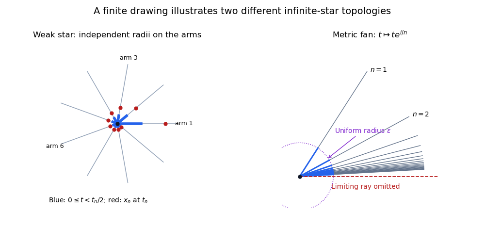

<h1 id="3/a/iv/solution">Solution</h1>

↑ **Parent:** [Iv](../iv.md)

With the quotient realization defined in part (i), **the answers are no and no**. Write $W=|K|$ as countably many closed arms $[0,1]_n$ with all their zero endpoints identified to $v$.

First, the outer vertices $D=\{u_n:n\geq1\}$ form a [closed discrete subset](../../../../../closed-discrete-subset.md). Its intersection with every closed arm is the closed singleton at coordinate one, so $D$ is closed by the weak topology. The terminal half-arm $(1/2,1]_n$ is an open neighbourhood of $u_n$ meeting $D$ only there. Thus $D$ is infinite, closed and discrete. Since [closed discrete subsets of compact spaces are finite](../../../../../closed-discrete-subsets-of-compact-spaces-are-finite.md), $W$ is not compact. A [homeomorphism](../../../../../homeomorphism.md) to a compact subset of the plane would make $W$ compact, which is impossible.

For the stronger obstruction, suppose $(U_n)$ were a countable [neighbourhood basis](../../../../../neighbourhood-basis.md) at $v$. Each $U_n$ contains an initial interval in arm $n$, so choose $x_n\in U_n$ on that arm with coordinate $t_n\in(0,1)$. Define $V$ to meet arm $n$ in $[0,t_n/2)$. It is an open neighbourhood of $v$, because each of these intersections is open in the closed interval $[0,1]$. But $x_n\in U_n\setminus V$ for every $n$, so no $U_n$ is contained in $V$. This contradicts the basis condition.

Hence $W$ is not [first countable](../../../../../first-countable-space.md). Every metric space is first-countable, with local basis of balls of radius $1/n$, and this property passes to subsets with the [subspace topology](../../../../../subspace-topology.md). Thus $W$ is not homeomorphic to any subset of $\mathbb R^2$. This is the [weak realization of a countable star](../../../../../weak-realization-of-a-countable-star.md).

The realization convention matters. For the [metric realization of a simplicial complex](../../../../../metric-realization-of-a-simplicial-complex.md) using Euclidean distance on barycentric coordinates, the second answer would be **yes**: map the point on arm $n$ at parameter $t$ to $te^{i/n}$. Each ray is isolated away from zero, and at zero both spaces have neighbourhood bases given by a single radius on all arms. This gives the [metric realization of a countable star](../../../../../metric-realization-of-a-countable-star.md) as a planar subset, still noncompact. It does not give the quotient topology used in part (i).

**[Figure 2](#3/a/iv/image-independent-arm-radii-in-a-weak-star-and-uniform-radii-in-a-metric-planar-fan). Independent arm radii in a weak star and uniform radii in a metric planar fan**. Only finitely many arms are drawn. The left panel is a schematic of a weak neighbourhood and the diagonal points excluded from it, rather than an embedding of the whole weak realization. The right panel is a finite part of the planar metric realization; its limiting positive real ray is omitted.

## ↑ Ancestors (13)

1. [Iv](../iv.md)
2. [A](../../a.md)
3. [3](../../../3.md)
4. [2017](../../../../2017-split.md)
5. [Past exam of the topology course of the University of Oxford](../../../../split.md)
6. [Topology course of the University of Oxford](../../../../../topology-course-of-the-university-of-oxford.md)
7. [Year 2 of the mathematics course of the University of Oxford](../../../../../year-2-of-the-mathematics-course-of-the-university-of-oxford.md)
8. [Mathematics course of the University of Oxford](../../../../../mathematics-course-of-the-university-of-oxford.md)
9. [Undergraduate course of the University of Oxford](../../../../../undergraduate-course-of-the-university-of-oxford.md)
10. [Course of the University of Oxford](../../../../../course-of-the-university-of-oxford.md)
11. [University of Oxford](../../../../../university-of-oxford-split.md)
12. [List of universities](../../../../../list-of-universities.md)
13. [Codex Wiki](../../../../../split.md)
