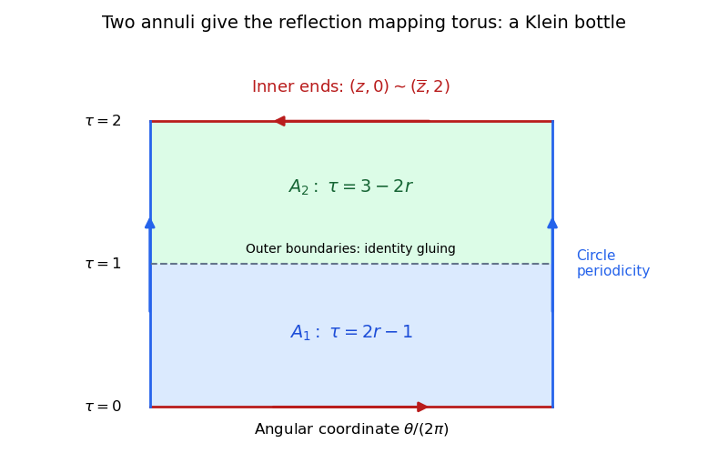

<h1 id="3/b/solution">Solution</h1>

↑ **Parent:** [B](../b.md)

The quotient is a **[Klein bottle](../../../../klein-bottle.md)**, equivalently a connected sum of two [real projective planes](../../../../real-projective-plane.md).

Use $z\in S^1$ for the angular coordinate and $r\in[1/2,1]$ for the radius. Parametrize the first annulus by $\tau=2r-1\in[0,1]$, running from its inner to its outer boundary. Parametrize the second by $\tau=3-2r\in[1,2]$, running from its outer to its inner boundary. The outer-boundary identity gluing puts them together at $\tau=1$. The remaining inner-boundary identification reverses the angle, so the entire quotient is

$$
M=(S^1\times[0,2])/((z,0)\sim(\overline z,2)).
$$

This is the [mapping torus](../../../../mapping-torus.md) of reflection of a circle, after rescaling the interval.

To verify the homeomorphism, send $rz$ in the first annulus to $[z,2r-1]$ in $M$, and $rz$ in the second to $[z,3-2r]$. Both formulas are continuous, agree under the outer gluing, and agree under the reflected inner gluing. They therefore descend by the [universal property of the quotient topology](../../../../universal-property-of-the-quotient-topology.md). Conversely, on the lower half of the cylinder send $(z,\tau)$ to the class of $((1+\tau)/2)z$ in the first annulus; on the upper half send it to the class of $((3-\tau)/2)z$ in the second. The formulas agree at $\tau=1$, and at the identified endpoints. The [pasting lemma](../../../../pasting-lemma-for-closed-subspaces.md) and the quotient property give a continuous inverse. Thus the two quotient descriptions are homeomorphic.

The quotient $M$ is compact. Its equivalence relation on the compact Hausdorff cylinder is closed: it is the union of the diagonal and the two graphs of the boundary reflection. Therefore $M$ is Hausdorff by [compact Hausdorff quotient by a closed equivalence relation](../../../../compact-hausdorff-quotient-by-a-closed-equivalence-relation.md). Away from the seam its local charts are circle arcs times open intervals. At the seam, an arc near $z$ at $\tau=0$ glues to its conjugate arc at $\tau=2$; using the reflection as the transition gives another open rectangle. These are disc neighbourhoods, and a finite choice of such charts gives a countable basis. Hence $M$ is a closed [surface](../../../../topological-surface-split.md).

Cutting the circle coordinate gives a rectangle with its vertical sides matched and its horizontal sides reflected. The reflection changes the sign of the angular coordinate while leaving the interval direction unchanged, so an orientation transported around the interval loop comes back reversed. Thus $M$ is a [nonorientable surface](../../../../non-orientable-surface.md). The rectangle quotient has one vertex, two edges and one face, giving [Euler characteristic](../../../../euler-characteristic.md) zero. By the [classification theorem for closed combinatorial surfaces](../../../../classification-theorem-for-closed-combinatorial-surfaces.md), the nonorientable genus is $k=2-\chi(M)=2$, so $M\cong\mathbb{RP}^2\#\mathbb{RP}^2$. This is the [gluing annuli with one reflected boundary](../../../../gluing-annuli-with-one-reflected-boundary.md) construction.

**[Figure 3](#3/b/image-the-two-annuli-become-one-cylinder-with-a-reflected-end-identification). The two annuli become one cylinder with a reflected end identification**. The lower band parametrizes the first annulus from inner to outer boundary, and the upper band the second from outer to inner boundary. Their common middle level is the identity gluing. Identifying the remaining ends by reflection gives the Klein bottle.

## ↑ Ancestors (12)

1. [B](../b.md)
2. [3](../../3.md)
3. [2017](../../../2017-split.md)
4. [Past exam of the topology course of the University of Oxford](../../../split.md)
5. [Topology course of the University of Oxford](../../../../topology-course-of-the-university-of-oxford.md)
6. [Year 2 of the mathematics course of the University of Oxford](../../../../year-2-of-the-mathematics-course-of-the-university-of-oxford.md)
7. [Mathematics course of the University of Oxford](../../../../mathematics-course-of-the-university-of-oxford.md)
8. [Undergraduate course of the University of Oxford](../../../../undergraduate-course-of-the-university-of-oxford.md)
9. [Course of the University of Oxford](../../../../course-of-the-university-of-oxford.md)
10. [University of Oxford](../../../../university-of-oxford-split.md)
11. [List of universities](../../../../list-of-universities.md)
12. [Codex Wiki](../../../../split.md)
