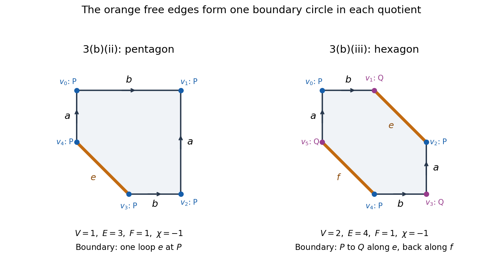

# 2021

↑ **Parent:** [Past exam of the topology course of the University of Oxford](../past-exam-of-the-topology-course-of-the-university-of-oxford.md)

Original solutions to all three questions of the [University of Oxford](../university-of-oxford.md) Part A [topology](../topology.md) examination, sat on 25 June 2021. Source: [officially released examination PDF, parent PDF pages 94–96; printed paper pages 1–3](https://www.whatdotheyknow.com/request/bsc_mathematics_part_a_examinati/response/2820674/attach/3/FOI%20202410%20944%20Data.pdf#page=94). All 25 answer parts are covered, including every alternative. Only the best two questions counted towards the examination mark.

**Table of contents**

- [1](#1)
  - [a](#1/a)
    - [Solution](#1/a/solution)
  - [b](#1/b)
    - [i](#1/b/i)
      - [Solution](#1/b/i/solution)
    - [ii](#1/b/ii)
      - [Solution](#1/b/ii/solution)
    - [iii](#1/b/iii)
      - [Solution](#1/b/iii/solution)
    - [iv](#1/b/iv)
      - [Solution](#1/b/iv/solution)
  - [c](#1/c)
    - [Solution](#1/c/solution)
  - [d](#1/d)
    - [Solution](#1/d/solution)
  - [e](#1/e)
    - [i](#1/e/i)
      - [Solution](#1/e/i/solution)
    - [ii](#1/e/ii)
      - [Solution](#1/e/ii/solution)
  - [f](#1/f)
    - [i](#1/f/i)
      - [Solution](#1/f/i/solution)
    - [ii](#1/f/ii)
      - [Solution](#1/f/ii/solution)
- [2](#2)
  - [a](#2/a)
    - [i](#2/a/i)
      - [Solution](#2/a/i/solution)
    - [ii](#2/a/ii)
      - [Solution](#2/a/ii/solution)
  - [b](#2/b)
    - [i](#2/b/i)
      - [Solution](#2/b/i/solution)
    - [ii](#2/b/ii)
      - [Solution](#2/b/ii/solution)
  - [c](#2/c)
    - [Solution](#2/c/solution)
  - [d](#2/d)
    - [i](#2/d/i)
      - [Solution](#2/d/i/solution)
    - [ii](#2/d/ii)
      - [Solution](#2/d/ii/solution)
- [3](#3)
  - [a](#3/a)
    - [i](#3/a/i)
      - [Solution](#3/a/i/solution)
    - [ii](#3/a/ii)
      - [Solution](#3/a/ii/solution)
  - [b](#3/b)
    - [i](#3/b/i)
      - [Solution](#3/b/i/solution)
    - [ii](#3/b/ii)
      - [Solution](#3/b/ii/solution)
    - [iii](#3/b/iii)
      - [Solution](#3/b/iii/solution)
  - [c](#3/c)
    - [i](#3/c/i)
      - [Solution](#3/c/i/solution)
    - [ii](#3/c/ii)
      - [Solution](#3/c/ii/solution)

## 1

↑ **Parent:** [2021](2021.md)

<h3 id="1/a">a</h3>

↑ **Parent:** [1](#1)

<h4 id="1/a/solution">Solution</h4>

↑ **Parent:** [a](#1/a)

The two conditions for a [basis of a topology](../topology.md#basis-of-a-topology) both hold. First, every [real number](../arithmetic.md#real-number) $x$ belongs to $[x,x+1)$, so the proposed basic [intervals](../real-analysis.md#interval-mathematics) cover the [real line](../real-analysis.md#real-line). Second, if

$$
x\in[a,b)\cap[c,d),
$$

then $\max(a,c)\leq x<\min(b,d)$, and

$$
[a,b)\cap[c,d)=[\max(a,c),\min(b,d))
$$

is itself one of the proposed basic [intervals](../real-analysis.md#interval-mathematics). Thus every point in an [intersection](../set.md#set-intersection) of two basic [sets](../set.md) has a basic [neighbourhood](../topology.md#neighbourhood-mathematics) contained in that [intersection](../set.md#set-intersection).

Consequently the arbitrary [unions](../set.md#set-union) of members of $\mathcal B$, including the [empty union](../set.md#empty-union), form a [topology](../topology.md) $\mathcal T$. The [basis of a topology](../topology.md#basis-of-a-topology) conditions give closure under finite [intersections](../set.md#set-intersection); arbitrary [unions](../set.md#set-union) are built into the definition. **This is the [lower limit topology](../topology.md#lower-limit-topology), also called the [Sorgenfrey line](../topology.md#lower-limit-topology).**

<h3 id="1/b">b</h3>

↑ **Parent:** [1](#1)

<h4 id="1/b/i">i</h4>

↑ **Parent:** [b](#1/b)

<h5 id="1/b/i/solution">Solution</h5>

↑ **Parent:** [i](#1/b/i)

**Yes, $[0,1]$ is [closed](../topology.md#closed-set).** Its [complement](../set.md#complement-of-a-set) is $(-\infty,0)\cup(1,\infty)$. Every $x<0$ has the basic [open](../topology.md#open-set) [neighbourhood](../topology.md#neighbourhood-mathematics) $[x,0)$ contained in this [complement](../set.md#complement-of-a-set), and every $x>1$ has $[x,x+1)$ contained in it. Hence the [complement](../set.md#complement-of-a-set) is [open](../topology.md#open-set) in $\mathbb R_{\mathcal T}$.

<h4 id="1/b/ii">ii</h4>

↑ **Parent:** [b](#1/b)

<h5 id="1/b/ii/solution">Solution</h5>

↑ **Parent:** [ii](#1/b/ii)

**No, $[0,1]$ is not [open](../topology.md#open-set).** Every basic [neighbourhood](../topology.md#neighbourhood-mathematics) $[a,b)$ of $1$ has $b>1$, so it contains points larger than $1$. Therefore $1$ has no [open](../topology.md#open-set) [neighbourhood](../topology.md#neighbourhood-mathematics) contained in $[0,1]$.

<h4 id="1/b/iii">iii</h4>

↑ **Parent:** [b](#1/b)

<h5 id="1/b/iii/solution">Solution</h5>

↑ **Parent:** [iii](#1/b/iii)

The [interval](../real-analysis.md#interval-mathematics) $[0,1)$ is a basic [open set](../topology.md#open-set) contained in $[0,1]$. The remaining point $1$ is not an [interior](../topology.md#interior-topology) point, by the preceding argument. Thus

$$
\boxed{\operatorname{int}_{\mathcal T}[0,1]=[0,1).}
$$

<h4 id="1/b/iv">iv</h4>

↑ **Parent:** [b](#1/b)

<h5 id="1/b/iv/solution">Solution</h5>

↑ **Parent:** [iv](#1/b/iv)

**The only [isolated point](../topological-analysis.md#isolated-point) of the [subset](../set.md#subset) $[0,1]$ is $1$.** Indeed,

$$
[1,2)\cap[0,1]=\{1\},
$$

so $\{1\}$ is [open](../topology.md#open-set) in the [subspace topology](../topology.md#subspace-topology). If $0\leq x<1$, every basic [neighbourhood](../topology.md#neighbourhood-mathematics) $[a,b)$ containing $x$ also contains a point strictly between $x$ and $\min(b,1)$, hence another point of $[0,1]$. Such an $x$ is not an [isolated point](../topological-analysis.md#isolated-point) of the [subset](../set.md#subset). Here isolation refers to $[0,1]$ with its [subspace topology](../topology.md#subspace-topology); $1$ is not an [isolated point](../topological-analysis.md#isolated-point) of the ambient [Sorgenfrey line](../topology.md#lower-limit-topology).

<h3 id="1/c">c</h3>

↑ **Parent:** [1](#1)

<h4 id="1/c/solution">Solution</h4>

↑ **Parent:** [c](#1/c)

Let $U$ be [open](../topology.md#open-set) in the [Euclidean topology](../topological-analysis.md#euclidean-topology) on the [real line](../real-analysis.md#real-line), and let $x\in U$. There is an $\varepsilon>0$ with $(x-\varepsilon,x+\varepsilon)\subseteq U$. The basic [open set](../topology.md#open-set) $[x,x+\varepsilon)$ contains $x$ and is contained in $U$. Taking the [union](../set.md#set-union) of these basic [neighbourhoods](../topology.md#neighbourhood-mathematics) over $x\in U$ shows that $U\in\mathcal T$. Thus

$$
\boxed{\mathcal T_{\mathrm{usual}}\subseteq\mathcal T.}
$$

In fact this is a strictly [finer topology](../topology.md#finer-topology): $[0,1)$ is [open](../topology.md#open-set) in $\mathcal T$ but not in the [Euclidean topology](../topological-analysis.md#euclidean-topology), since no usual [open ball](../topology.md#open-ball) about $0$ is contained in it.

<h3 id="1/d">d</h3>

↑ **Parent:** [1](#1)

<h4 id="1/d/solution">Solution</h4>

↑ **Parent:** [d](#1/d)

The usual [real line](../real-analysis.md#real-line) is [connected](../geometry-and-topology.md#connected-space). In contrast,

$$
\mathbb R_{\mathcal T}=(-\infty,0)\sqcup[0,\infty)
$$

is a [separation of a topological space](../geometry-and-topology.md#separation-of-a-topological-space). Both pieces are nonempty and disjoint; the first is [open](../topology.md#open-set) by part (c), and the second is the [open](../topology.md#open-set) [union](../set.md#set-union) $\bigcup_{n\geq1}[0,n)$. Thus the [Sorgenfrey line](../topology.md#lower-limit-topology) is not [connected](../geometry-and-topology.md#connected-space). Since a [homeomorphism](../topology.md#homeomorphism) preserves [connectedness](../geometry-and-topology.md#connected-space), **the two [topological spaces](../topology.md#topological-space) are not [homeomorphic](../topology.md#homeomorphism).** Merely showing that their [topologies](../topology.md) differ would not by itself exclude some other [homeomorphism](../topology.md#homeomorphism) between them.

<h3 id="1/e">e</h3>

↑ **Parent:** [1](#1)

<h4 id="1/e/i">i</h4>

↑ **Parent:** [e](#1/e)

<h5 id="1/e/i/solution">Solution</h5>

↑ **Parent:** [i](#1/e/i)

**$X$ is not [compact](../topology.md#compact-space).** In the [subspace topology](../topology.md#subspace-topology) on $X=[0,1]$, consider the [open cover](../topology.md#open-cover)

$$
\mathcal U=\{[0,1-1/n):n\geq2\}\cup\{\{1\}\}.
$$

The [intervals](../real-analysis.md#interval-mathematics) are basic [open sets](../topology.md#open-set) in the ambient [Sorgenfrey line](../topology.md#lower-limit-topology), and $\{1\}=X\cap[1,2)$ is [open](../topology.md#open-set) in $X$. Every $x<1$ belongs to one of those [intervals](../real-analysis.md#interval-mathematics), while the [singleton](../set.md#singleton-mathematics) covers $1$.

A [finite subcover](../topology.md#finite-subcover) would have to include $\{1\}$. Among its finitely many other members, let $N$ be the largest index. Their [union](../set.md#set-union) is $[0,1-1/N)$, leaving $1-1/N$ uncovered. Selecting no such member also fails to cover $0$. Hence no [finite subcover](../topology.md#finite-subcover) exists.

<h4 id="1/e/ii">ii</h4>

↑ **Parent:** [e](#1/e)

<h5 id="1/e/ii/solution">Solution</h5>

↑ **Parent:** [ii](#1/e/ii)

**$X$ does not have [sequential compactness](../geometry-and-topology.md#sequentially-compact-space).** Take the [sequence](../sequence-and-series.md#sequence)

$$
x_n=1-\frac1n\qquad(n\geq1).
$$

Every [subsequence](../sequence-and-series.md#subsequence) has usual [limit of a sequence](../sequence-and-series.md#limit-of-a-sequence) $1$. If a [subsequence](../sequence-and-series.md#subsequence) converged in the [subspace topology](../topology.md#subspace-topology) of the [Sorgenfrey line](../topology.md#lower-limit-topology), it would also converge in the usual [subspace topology](../topology.md#subspace-topology), since part (c) makes the [identity function](../function.md#identity-function) from the former to the latter [continuous](../calculus.md#continuous-function). Uniqueness of a [limit of a sequence](../sequence-and-series.md#limit-of-a-sequence) in the usual [Hausdorff space](../topology.md#hausdorff-space) therefore forces that [limit of a sequence](../sequence-and-series.md#limit-of-a-sequence) to be $1$.

But $\{1\}$ is an [open](../topology.md#open-set) [neighbourhood](../topology.md#neighbourhood-mathematics) of $1$ in $X$, and no term $x_n$ belongs to it. Thus no [subsequence](../sequence-and-series.md#subsequence) converges to $1$ in $X$, proving the assertion.

<h3 id="1/f">f</h3>

↑ **Parent:** [1](#1)

<h4 id="1/f/i">i</h4>

↑ **Parent:** [f](#1/f)

<h5 id="1/f/i/solution">Solution</h5>

↑ **Parent:** [i](#1/f/i)

Use the [Heaviside step function](../integral-transform.md#heaviside-step-function) with the value at the jump chosen as follows:

$$
\boxed{f(x)=\begin{cases}0,&x<0,\\1,&x\geq0.\end{cases}}
$$

For any [open set](../topology.md#open-set) in the target [Sorgenfrey line](../topology.md#lower-limit-topology), its [preimage](../set-theory.md#preimage) is one of $\varnothing$, $\mathbb R$, $(-\infty,0)$, and $[0,\infty)$. All four are [open](../topology.md#open-set) in the source [Sorgenfrey line](../topology.md#lower-limit-topology), so $f$ is [continuous](../calculus.md#continuous-function). In the [Euclidean topology](../topological-analysis.md#euclidean-topology), the [preimage](../set-theory.md#preimage) of $(1/2,3/2)$ is $[0,\infty)$, which is not [open](../topology.md#open-set). Hence the same [function](../function.md) is not [continuous](../calculus.md#continuous-function) as a usual real-to-real [map](../function.md#function-class).

<h4 id="1/f/ii">ii</h4>

↑ **Parent:** [f](#1/f)

<h5 id="1/f/ii/solution">Solution</h5>

↑ **Parent:** [ii](#1/f/ii)

Take

$$
\boxed{g(x)=-x.}
$$

It is [continuous](../calculus.md#continuous-function) for the [Euclidean metric](../riemannian-metric.md#euclidean-metric), since $|g(x)-g(y)|=|x-y|$. But the basic [open set](../topology.md#open-set) $[0,1)$ of the target [Sorgenfrey line](../topology.md#lower-limit-topology) has [preimage](../set-theory.md#preimage)

$$
g^{-1}([0,1))=(-1,0].
$$

This is not [open](../topology.md#open-set) in the source [Sorgenfrey line](../topology.md#lower-limit-topology): every basic [neighbourhood](../topology.md#neighbourhood-mathematics) of $0$ contains positive points. Thus $g$ is not [continuous](../calculus.md#continuous-function) for the [lower limit topology](../topology.md#lower-limit-topology).

## 2

↑ **Parent:** [2021](2021.md)

<h3 id="2/a">a</h3>

↑ **Parent:** [2](#2)

<h4 id="2/a/i">i</h4>

↑ **Parent:** [a](#2/a)

<h5 id="2/a/i/solution">Solution</h5>

↑ **Parent:** [i](#2/a/i)

For the [sphere](../euclidean-geometry.md#sphere) model of the [real projective plane](../differential-geometry.md#real-projective-plane), let

$$
S^2=\{u\in\mathbb R^3:\|u\|=1\},\qquad u\sim_S v\Longleftrightarrow v=u\text{ or }v=-u.
$$

Then $\mathbb{RP}^2=S^2/{\sim_S}$ with the [quotient topology](../topology.md#quotient-topology): each [equivalence class](../set-theory.md#equivalence-class) is an [antipodal pair](../euclidean-geometry.md#antipodal-pair).

For the [closed disc](../topology.md#closed-disc) model, let

$$
D^2=\{(x,y)\in\mathbb R^2:x^2+y^2\leq1\},\qquad u\sim_D v\Longleftrightarrow u=v\text{ or }(u,v\in\partial D^2\text{ and }v=-u).
$$

Give $D^2/{\sim_D}$ the [quotient topology](../topology.md#quotient-topology). **Only [antipodal pairs](../euclidean-geometry.md#antipodal-pair) on the [boundary](../topology.md#boundary-of-a-set) [circle](../topology.md#circle) are identified in the [closed disc](../topology.md#closed-disc) model; interior points remain distinct.**

<h4 id="2/a/ii">ii</h4>

↑ **Parent:** [a](#2/a)

<h5 id="2/a/ii/solution">Solution</h5>

↑ **Parent:** [ii](#2/a/ii)

Let $q_S:S^2\to S^2/{\sim_S}$ and $q_D:D^2\to D^2/{\sim_D}$ be the [quotient maps](../topology.md#quotient-map). The [continuous map](../topology.md#continuous-map)

$$
h:D^2\longrightarrow S^2,\qquad h(x,y)=\left(x,y,\sqrt{1-x^2-y^2}\right)
$$

is a [homeomorphism](../topology.md#homeomorphism) onto the upper [hemisphere](../euclidean-geometry.md#hemisphere); its [inverse function](../function.md#inverse-function) is the [restriction](../function.md#restriction-mathematics) of the [projection map](../function.md#projection-map) $(x,y,z)\mapsto(x,y)$. Every [antipodal pair](../euclidean-geometry.md#antipodal-pair) on $S^2$ meets that [hemisphere](../euclidean-geometry.md#hemisphere). Moreover, two points of this [hemisphere](../euclidean-geometry.md#hemisphere) are antipodal only if both lie on the [equator](../euclidean-geometry.md#equator). Thus

$$
q_S(h(u))=q_S(h(v))\quad\Longleftrightarrow\quad u\sim_D v.
$$

By the [universal property of the quotient topology](../topology.md#universal-property-of-the-quotient-topology), $q_S\circ h$ induces a [continuous bijection](../topology.md#continuous-bijection)

$$
H:D^2/{\sim_D}\longrightarrow S^2/{\sim_S},\qquad H(q_D(u))=q_S(h(u)).
$$

To justify [continuity](../calculus.md#continuous-function) of the [inverse function](../function.md#inverse-function), the source is [compact](../topology.md#compact-space), being a [continuous image of a compact space](../topology.md#continuous-image-of-a-compact-space) $D^2$; the [Heine-Borel theorem](../topology.md#heine-borel-theorem) gives [compactness](../topology.md#compact-space) of $D^2$. The target is [Hausdorff](../topology.md#hausdorff-space), as follows. For distinct [equivalence classes](../set-theory.md#equivalence-class) $[u]\neq[v]$, put

$$
\delta=\min(\|u-v\|,\|u+v\|)>0.
$$

In $S^2$, take the [union](../set.md#set-union) $U$ of the two relative [open balls](../topology.md#open-ball) of radius $\delta/3$ about $u,-u$, and similarly take $V$ about $v,-v$. Every distance between their respective centres is at least $\delta$, so the [triangle inequality](../topological-analysis.md#triangle-inequality) gives $U\cap V=\varnothing$. These [open sets](../topology.md#open-set) contain entire [antipodal pairs](../euclidean-geometry.md#antipodal-pair), hence $q_S^{-1}(q_S(U))=U$ and similarly for $V$. The [quotient topology](../topology.md#quotient-topology) therefore makes $q_S(U)$ and $q_S(V)$ disjoint [open](../topology.md#open-set) [neighbourhoods](../topology.md#neighbourhood-mathematics) of the two classes.

The [compact-to-Hausdorff continuous bijection theorem](../topology.md#compact-to-hausdorff-continuous-bijection-theorem) now gives **the required [homeomorphism](../topology.md#homeomorphism) $H$**.

<h3 id="2/b">b</h3>

↑ **Parent:** [2](#2)

<h4 id="2/b/i">i</h4>

↑ **Parent:** [b](#2/b)

<h5 id="2/b/i/solution">Solution</h5>

↑ **Parent:** [i](#2/b/i)

The [sphere](../euclidean-geometry.md#sphere) $S^2$ is [path-connected](../geometry-and-topology.md#path-connected-space). For $u,v\in S^2$ which are not an [antipodal pair](../euclidean-geometry.md#antipodal-pair), a [continuous path](../geometry-and-topology.md#continuous-path) is

$$
\gamma(t)=\frac{(1-t)u+tv}{\|(1-t)u+tv\|},\qquad 0\leq t\leq1.
$$

The denominator never vanishes: a zero would make $u$ and $v$ antipodal. If $v=-u$, choose a [unit vector](../vector-space.md#unit-vector) $w$ perpendicular to $u$ and concatenate the paths from $u$ to $w$ and from $w$ to $v$ of the same form. Thus $S^2$ is [connected](../geometry-and-topology.md#connected-space). The [quotient map](../topology.md#quotient-map) $q_S$ is [continuous](../calculus.md#continuous-function) and [surjective](../algebra.md#surjective-function), so the [continuous image of a connected space](../geometry-and-topology.md#continuous-image-of-a-connected-space) theorem proves that **$\mathbb{RP}^2$ is [connected](../geometry-and-topology.md#connected-space)**. In fact composing the paths above with $q_S$ also proves [path connectedness](../geometry-and-topology.md#path-connected-space).

<h4 id="2/b/ii">ii</h4>

↑ **Parent:** [b](#2/b)

<h5 id="2/b/ii/solution">Solution</h5>

↑ **Parent:** [ii](#2/b/ii)

**False**, with “[disjoint union](../set-theory.md#disjoint-union)” understood as a [topological disjoint union](../topology.md#topological-disjoint-union). Take the [rational numbers](../number-theory.md#rational-number) $\mathbb Q$ with the usual [subspace topology](../topology.md#subspace-topology) from the [real line](../real-analysis.md#real-line).

Every [connected subset](../geometry-and-topology.md#connected-subset) of $\mathbb Q$ has at most one point. Indeed, if it contained $r<s$, choose an [irrational number](../algebra.md#irrational-number) $t\in(r,s)$. The two relatively [open sets](../topology.md#open-set)

$$
\mathbb Q\cap(-\infty,t),\qquad \mathbb Q\cap(t,\infty)
$$

partition $\mathbb Q$ and separate any [subset](../set.md#subset) containing both $r$ and $s$. Hence the [connected components](../geometry-and-topology.md#connected-component) of $\mathbb Q$ are [singletons](../set.md#singleton-mathematics).

If a [topological disjoint union](../topology.md#topological-disjoint-union) of nonempty [connected spaces](../geometry-and-topology.md#connected-space) were [homeomorphic](../topology.md#homeomorphism) to $\mathbb Q$, the [image](../set-theory.md#image-of-a-function) of each summand would be [connected](../geometry-and-topology.md#connected-space), hence a [singleton](../set.md#singleton-mathematics). Every summand would therefore be a one-point [topological space](../topology.md#topological-space). Their [topological disjoint union](../topology.md#topological-disjoint-union) is a [discrete space](../topology.md#discrete-space), since each summand is [open](../topology.md#open-set). But $\mathbb Q$ is not a [discrete space](../topology.md#discrete-space): for each $r\in\mathbb Q$, the distinct [rational numbers](../number-theory.md#rational-number) $r+1/n$ approach $r$, so $r$ is not an [isolated point](../topological-analysis.md#isolated-point). This is a contradiction. The [set](../set.md) decomposition into [connected components](../geometry-and-topology.md#connected-component) always exists; giving those pieces the [topological disjoint union](../topology.md#topological-disjoint-union) topology need not recover the original [topology](../topology.md).

<h3 id="2/c">c</h3>

↑ **Parent:** [2](#2)

<h4 id="2/c/solution">Solution</h4>

↑ **Parent:** [c](#2/c)

Write $Z=\coprod_{n\in\mathbb N}X_n$, where each $X_n$ is a labelled copy of the [topological space](../topology.md#topological-space) $X$, with its [topological disjoint union](../topology.md#topological-disjoint-union) topology. Define the [bijection](../function.md#bijection)

$$
\boxed{F:Z\longrightarrow\mathbb N\times X,\qquad F(x\text{ in }X_n)=(n,x).}
$$

For a [subset](../set.md#subset) $U\subseteq\mathbb N\times X$, let $U_n=\{x\in X:(n,x)\in U\}$. By definition of the [topological disjoint union](../topology.md#topological-disjoint-union), $F^{-1}(U)$ is [open](../topology.md#open-set) in $Z$ exactly when each $U_n$ is [open](../topology.md#open-set) in $X$.

The same condition characterizes [open sets](../topology.md#open-set) in the [product topology](../geometry-and-topology.md#product-topology) on $\mathbb N\times X$. If $U$ is [open](../topology.md#open-set), the map $x\mapsto(n,x)$ is [continuous](../calculus.md#continuous-function), so each $U_n$ is [open](../topology.md#open-set). Conversely, if each $U_n$ is [open](../topology.md#open-set), then

$$
U=\bigcup_{n\in\mathbb N}(\{n\}\times U_n)
$$

is [open](../topology.md#open-set), since the [discrete topology](../topology.md#discrete-space) makes every $\{n\}$ [open](../topology.md#open-set) in $\mathbb N$. Hence $F$ and its [inverse function](../function.md#inverse-function) are [continuous](../calculus.md#continuous-function), proving the required [homeomorphism](../topology.md#homeomorphism). This also covers the case $X=\varnothing$.

<h3 id="2/d">d</h3>

↑ **Parent:** [2](#2)

<h4 id="2/d/i">i</h4>

↑ **Parent:** [d](#2/d)

<h5 id="2/d/i/solution">Solution</h5>

↑ **Parent:** [i](#2/d/i)

Use positive indices $n\geq1$ and write $p=(0,-1)\in S^1$. Set

$$
\boxed{A=\mathbb N\times\{p\},\qquad f(n,(u,v))=\left(\frac un,\frac{v+1}{n}\right).}
$$

For fixed $n$, this [function](../function.md) is a [homeomorphism](../topology.md#homeomorphism) from the [unit circle](../complex-analysis.md#complex-unit-circle) to $C_n$: it scales its [radius](../topology.md#radius) to $1/n$ and translates its centre to $(0,1/n)$. Thus it takes values in the [Hawaiian earring](../topology.md#hawaiian-earring) $X$ and is [surjective](../algebra.md#surjective-function) onto $X$. It is [continuous](../calculus.md#continuous-function) on each [open](../topology.md#open-set) slice $\{n\}\times S^1$; since these slices form an [open cover](../topology.md#open-cover) of $\mathbb N\times S^1$, $f$ is [continuous](../calculus.md#continuous-function) on the whole [product topology](../geometry-and-topology.md#product-topology).

Distinct [circles](../topology.md#circle) $C_n,C_m$ meet only at $o=(0,0)$. To see this directly, their equations are

$$
x^2+y^2=\frac{2y}{n},\qquad x^2+y^2=\frac{2y}{m}.
$$

For $m\neq n$, subtraction gives $y=0$, then $x=0$. Each slice contains exactly one [preimage](../set-theory.md#preimage) of $o$, namely $(n,p)$. Therefore the only nonsingleton [fibre](../function.md#fiber-of-a-function) of $f$ is $A$.

Let $q:\mathbb N\times S^1\to(\mathbb N\times S^1)/A$ be the [quotient map](../topology.md#quotient-map) collapsing $A$. The [universal property of the quotient topology](../topology.md#universal-property-of-the-quotient-topology) supplies a unique [continuous map](../topology.md#continuous-map) $\bar f$ with $f=\bar f\circ q$. The [fibre](../function.md#fiber-of-a-function) calculation proves [injectivity](../algebra.md#injective-function), and [surjectivity](../algebra.md#surjective-function) follows from that of $f$. Hence **$\bar f$ is the required [continuous bijection](../topology.md#continuous-bijection)**.

<h4 id="2/d/ii">ii</h4>

↑ **Parent:** [d](#2/d)

<h5 id="2/d/ii/solution">Solution</h5>

↑ **Parent:** [ii](#2/d/ii)

Let $W=(\mathbb N\times S^1)/A$, and choose in each [circle](../topology.md#circle) the point opposite $o$:

$$
z_n=(0,2/n)\in C_n,\qquad B=\{z_n:n\geq1\}\subseteq X.
$$

In the [subspace topology](../topology.md#subspace-topology) from the [Euclidean plane](../geometry-and-topology.md#euclidean-plane), the [sequence](../sequence-and-series.md#sequence) $z_n$ converges to $o$, which does not belong to $B$. Thus $B$ is not [closed](../topology.md#closed-set) in $X$.

On the other hand, let $D=\bar f^{-1}(B)\subseteq W$. With the [quotient map](../topology.md#quotient-map) $q$ from part (i),

$$
q^{-1}(D)=\mathbb N\times\{(0,1)\}.
$$

This is [closed](../topology.md#closed-set) in $\mathbb N\times S^1$: its [complement](../set.md#complement-of-a-set) is the [open set](../topology.md#open-set) $\mathbb N\times(S^1\setminus\{(0,1)\})$. The definition of the [quotient topology](../topology.md#quotient-topology), applied to [complements](../set.md#complement-of-a-set), says that $D$ is [closed](../topology.md#closed-set) in $W$. A [homeomorphism](../topology.md#homeomorphism) would carry this [closed set](../topology.md#closed-set) to the [closed set](../topology.md#closed-set) $B$, a contradiction. Therefore **$\bar f$ is not a [homeomorphism](../topology.md#homeomorphism)**.

The obstruction occurs at the common point. The [open set](../topology.md#open-set) $W\setminus D$ contains the collapsed point, but its [image](../set-theory.md#image-of-a-function) $X\setminus B$ contains no [neighbourhood](../topology.md#neighbourhood-mathematics) of $o$, since $z_n\to o$. The [wedge sum](../topology.md#wedge-sum) topology allows a separate small [neighbourhood](../topology.md#neighbourhood-mathematics) on each [circle](../topology.md#circle); a [neighbourhood](../topology.md#neighbourhood-mathematics) of $o$ in the [Hawaiian earring](../topology.md#hawaiian-earring) must contain all sufficiently small whole [circles](../topology.md#circle).

## 3

↑ **Parent:** [2021](2021.md)

<h3 id="3/a">a</h3>

↑ **Parent:** [3](#3)

<h4 id="3/a/i">i</h4>

↑ **Parent:** [a](#3/a)

<h5 id="3/a/i/solution">Solution</h5>

↑ **Parent:** [i](#3/a/i)

The [unit circle](../complex-analysis.md#complex-unit-circle) is [Hausdorff](../topology.md#hausdorff-space) and [second countable](../topology.md#second-countable-space), since both properties pass to [topological subspaces](../topology.md#topological-subspace) of the [Euclidean plane](../geometry-and-topology.md#euclidean-plane). To exhibit its local [coordinate charts](../differential-geometry.md#manifold-chart), consider the four [open](../topology.md#open-set) [semicircles](../topology.md#semicircle)

$$
U_{y,+}=S^1\cap\{y>0\},\quad U_{y,-}=S^1\cap\{y<0\},\quad U_{x,+}=S^1\cap\{x>0\},\quad U_{x,-}=S^1\cap\{x<0\}.
$$

They cover $S^1$. On $U_{y,\pm}$, the [projection map](../function.md#projection-map) $(x,y)\mapsto x$ is a [homeomorphism](../topology.md#homeomorphism) onto the [open interval](../topology.md#open-interval) $(-1,1)$, with [continuous](../calculus.md#continuous-function) [inverse function](../function.md#inverse-function)

$$
t\longmapsto(t,\pm\sqrt{1-t^2}).
$$

On $U_{x,\pm}$, use $(x,y)\mapsto y$, with [inverse function](../function.md#inverse-function) $t\mapsto(\pm\sqrt{1-t^2},t)$. These [coordinate charts](../differential-geometry.md#manifold-chart) show that **$S^1$ is a one-dimensional [topological manifold](../topological-manifold.md) with empty [manifold boundary](../topological-manifold.md#manifold-boundary).**

<h4 id="3/a/ii">ii</h4>

↑ **Parent:** [a](#3/a)

<h5 id="3/a/ii/solution">Solution</h5>

↑ **Parent:** [ii](#3/a/ii)

Let $o=(0,0)$ be the common point of the two [circles](../topology.md#circle). For sufficiently small $\varepsilon>0$, the [open](../topology.md#open-set) [neighbourhood](../topology.md#neighbourhood-mathematics)

$$
W=X\cap B_\varepsilon(o)
$$

has the following local structure: $W\setminus\{o\}$ consists of four disjoint [open arcs](../geometry-and-topology.md#open-arc), an upper and a lower branch from each [circle](../topology.md#circle). These are its four [connected components](../geometry-and-topology.md#connected-component), each [open](../topology.md#open-set) and [closed](../topology.md#closed-set) relative to $W\setminus\{o\}$.

Suppose a [coordinate chart](../differential-geometry.md#manifold-chart) of some [dimension of a manifold](../topological-manifold.md#dimension-of-a-manifold) $n$ existed at $o$. The case $n=0$ would make $o$ an [isolated point](../topological-analysis.md#isolated-point), which it is not. For $n\geq1$, shrink the chart inside $W$ so that its [image](../set-theory.md#image-of-a-function) is an [open ball](../topology.md#open-ball) centred at the [image](../set-theory.md#image-of-a-function) of $o$. Its [domain of a function](../function.md#domain-of-a-function) $V$ is an [open](../topology.md#open-set) [neighbourhood](../topology.md#neighbourhood-mathematics) of $o$, so it meets all four arms of $W$. Intersecting those arms with $V\setminus\{o\}$ gives four disjoint nonempty [clopen sets](../topology.md#clopen-set) partitioning $V\setminus\{o\}$; hence there are at least four [connected components](../geometry-and-topology.md#connected-component).

But a [punctured ball](../topology.md#punctured-ball) in $\mathbb R$ has exactly two [connected components](../geometry-and-topology.md#connected-component), and a [punctured ball](../topology.md#punctured-ball) in $\mathbb R^n$ for $n\geq2$ is [path-connected](../geometry-and-topology.md#path-connected-space). A [homeomorphism](../topology.md#homeomorphism) preserves [connected components](../geometry-and-topology.md#connected-component), giving a contradiction in every [dimension of a manifold](../topological-manifold.md#dimension-of-a-manifold). Thus **$X$ is not a [topological manifold](../topological-manifold.md)**. The argument uses arbitrarily small [coordinate charts](../differential-geometry.md#manifold-chart); the fact that the whole $X\setminus\{o\}$ has two pieces alone would not be a local obstruction.

<h3 id="3/b">b</h3>

↑ **Parent:** [3](#3)

<h4 id="3/b/i">i</h4>

↑ **Parent:** [b](#3/b)

<h5 id="3/b/i/solution">Solution</h5>

↑ **Parent:** [i](#3/b/i)

Label the [hexagon](../euclidean-geometry.md#hexagon) [polygon vertices](../euclidean-geometry.md#vertex-of-a-polygon) $v_0,\ldots,v_5$ in the direction in which its boundary word is $abca^{-1}b^{-1}c^{-1}$, with the first side running from $v_0$ to $v_1$. Matching the endpoints according to the arrows gives

$$
\begin{aligned}
a:&\quad v_0\sim v_4,\quad v_1\sim v_3,\\
b:&\quad v_1\sim v_5,\quad v_2\sim v_4,\\
c:&\quad v_2\sim v_0,\quad v_3\sim v_5.
\end{aligned}
$$

Thus the two vertex [equivalence classes](../set-theory.md#equivalence-class) are $\{v_0,v_2,v_4\}$ and $\{v_1,v_3,v_5\}$.

The [polygonal schema](../topological-surface.md#polygonal-schema) gives a [compact](../topology.md#compact-space) [connected](../geometry-and-topology.md#connected-space) [surface](../topological-surface.md) with empty [manifold boundary](../topological-manifold.md#manifold-boundary). Interior points have [disc](../topology.md#topological-disc) [neighbourhoods](../topology.md#neighbourhood-mathematics); a paired [polygon edge](../euclidean-geometry.md#side-of-a-polygon) glues two half-[disc](../topology.md#topological-disc) [neighbourhoods](../topology.md#neighbourhood-mathematics) into a [disc](../topology.md#topological-disc). At each of the two vertex [equivalence classes](../set-theory.md#equivalence-class), its three corner sectors join cyclically, so the [vertex link in a polygonal schema](../topological-surface.md#vertex-link-in-a-polygonal-schema) is a [circle](../topology.md#circle), again giving a [disc](../topology.md#topological-disc) [neighbourhood](../topology.md#neighbourhood-mathematics). Pairing every label once positively and once negatively makes these gluings consistent with an [orientation](../algebraic-topology.md#orientation-of-a-simplex), so the resulting [surface](../topological-surface.md) is [orientable](../differential-geometry.md#orientable-surface).

The resulting [CW complex](../algebraic-topology.md#cw-complex) has [CW cells](../algebraic-topology.md#topological-cell) comprising two vertices, three edges and one face. Its [Euler characteristic](../homology.md#euler-characteristic) is

$$
\chi=V-E+F=2-3+1=0.
$$

By the [classification of compact surfaces](../topological-surface.md#classification-of-compact-surfaces), a [connected](../geometry-and-topology.md#connected-space) [closed orientable surface](../topological-surface.md#closed-orientable-surface) with $\chi=0$ has [genus](../topological-surface.md#genus-of-a-surface) $g$ satisfying $2-2g=0$, hence $g=1$. **The [quotient space](../topology.md#quotient-topological-space) is a [torus](../topological-surface.md#torus).**

<h4 id="3/b/ii">ii</h4>

↑ **Parent:** [b](#3/b)

<h5 id="3/b/ii/solution">Solution</h5>

↑ **Parent:** [ii](#3/b/ii)

**True.** Label the [pentagon](../euclidean-geometry.md#pentagon) [polygon vertices](../euclidean-geometry.md#vertex-of-a-polygon) clockwise from the upper left as

$$
v_0=(0,2),\quad v_1=(2,2),\quad v_2=(2,0),\quad v_3=(1,0),\quad v_4=(0,1).
$$

Use $a$ for the upward single arrows and $b$ for the rightward double arrows in the original diagram. Their endpoint identifications are

$$
\begin{aligned}
a:&\quad v_4\sim v_2,\quad v_0\sim v_1,\\
b:&\quad v_0\sim v_3,\quad v_1\sim v_2.
\end{aligned}
$$

All five [polygon vertices](../euclidean-geometry.md#vertex-of-a-polygon) are therefore identified. The remaining diagonal [polygon edge](../euclidean-geometry.md#side-of-a-polygon), from $v_3$ to $v_4$, has its endpoints identified and is the only [boundary component of a surface](../topological-surface.md#boundary-component-of-a-surface).

The paired [polygon edges](../euclidean-geometry.md#side-of-a-polygon) join half-[disc](../topology.md#topological-disc) [neighbourhoods](../topology.md#neighbourhood-mathematics) into [disc](../topology.md#topological-disc) [neighbourhoods](../topology.md#neighbourhood-mathematics). At the common vertex, the five corner sectors join in one chain whose two free ends lie on the unpaired [polygon edge](../euclidean-geometry.md#side-of-a-polygon): its [vertex link in a polygonal schema](../topological-surface.md#vertex-link-in-a-polygonal-schema) is a [closed interval](../real-analysis.md#closed-real-interval). Hence that point has a half-[disc](../topology.md#topological-disc) [neighbourhood](../topology.md#neighbourhood-mathematics). This verifies that the [quotient space](../topology.md#quotient-topological-space) is a [surface with boundary](../topological-surface.md#surface-with-boundary), rather than merely counting its [CW cells](../algebraic-topology.md#topological-cell). The paired [polygon edges](../euclidean-geometry.md#side-of-a-polygon) are oppositely traversed around the [polygon](../euclidean-geometry.md#polygon), so this [surface](../topological-surface.md) is [orientable](../differential-geometry.md#orientable-surface).

Its [CW cells](../algebraic-topology.md#topological-cell) comprise one vertex, three edges (the $a$ pair, the $b$ pair, and the free [polygon edge](../euclidean-geometry.md#side-of-a-polygon)), and one face. Therefore

$$
\chi=1-3+1=-1,\qquad b=1,\qquad 2-2g-b=-1\Longrightarrow g=1.
$$

The [classification of compact surfaces](../topological-surface.md#classification-of-compact-surfaces) identifies it as **a [torus](../topological-surface.md#torus) with an [open disc](../topology.md#open-disc) removed**.

<h4 id="3/b/iii">iii</h4>

↑ **Parent:** [b](#3/b)

<h5 id="3/b/iii/solution">Solution</h5>

↑ **Parent:** [iii](#3/b/iii)

**False: the result is again a [torus](../topological-surface.md#torus) with one [open disc](../topology.md#open-disc) removed.** Label the [hexagon](../euclidean-geometry.md#hexagon) [polygon vertices](../euclidean-geometry.md#vertex-of-a-polygon) clockwise from the upper left as

$$
v_0=(0,2),\quad v_1=(1,2),\quad v_2=(2,1),\quad v_3=(2,0),\quad v_4=(1,0),\quad v_5=(0,1).
$$

With the same arrow labels as in part (ii),

$$
\begin{aligned}
a:&\quad v_5\sim v_3,\quad v_0\sim v_2,\\
b:&\quad v_0\sim v_4,\quad v_1\sim v_3.
\end{aligned}
$$

There are two vertex [equivalence classes](../set-theory.md#equivalence-class), $P=\{v_0,v_2,v_4\}$ and $Q=\{v_1,v_3,v_5\}$. The free diagonal [polygon edges](../euclidean-geometry.md#side-of-a-polygon) are $v_1v_2$ and $v_4v_5$. Each joins $P$ to $Q$, so together they form **one [boundary component of a surface](../topological-surface.md#boundary-component-of-a-surface), not two**. At each vertex [equivalence class](../set-theory.md#equivalence-class) the three corner sectors join in a single chain between these two free [polygon edges](../euclidean-geometry.md#side-of-a-polygon). Thus each [vertex link in a polygonal schema](../topological-surface.md#vertex-link-in-a-polygonal-schema) is a [closed interval](../real-analysis.md#closed-real-interval), and the [quotient space](../topology.md#quotient-topological-space) is an [orientable](../differential-geometry.md#orientable-surface) [surface with boundary](../topological-surface.md#surface-with-boundary).

Its [CW complex](../algebraic-topology.md#cw-complex) has [CW cells](../algebraic-topology.md#topological-cell) comprising two vertices, four edges and one face, giving

$$
\chi=2-4+1=-1,\qquad b=1,\qquad g=1.
$$

In contrast, a [torus](../topological-surface.md#torus) with two disjoint [open discs](../topology.md#open-disc) removed has two [boundary components of a surface](../topological-surface.md#boundary-component-of-a-surface) and [Euler characteristic](../homology.md#euler-characteristic) $2-2-2=-2$. Either [topological invariant](../topology.md#topological-invariant) rules out the proposed [homeomorphism](../topology.md#homeomorphism).

**[Figure 1](#3/b/iii/image-after-identifying-equally-labelled-arrows-both-polygons-have-one-boundary-circle-in-the-hexagon-the-two-free-edges-join-the-two-vertex-classes). After identifying equally labelled arrows, both polygons have one boundary circle; in the hexagon the two free edges join the two vertex classes**.

<h3 id="3/c">c</h3>

↑ **Parent:** [3](#3)

<h4 id="3/c/i">i</h4>

↑ **Parent:** [c](#3/c)

<h5 id="3/c/i/solution">Solution</h5>

↑ **Parent:** [i](#3/c/i)

A complete pairing of the six [polygon edges](../euclidean-geometry.md#side-of-a-polygon) leaves three edges and one face as [CW cells](../algebraic-topology.md#topological-cell), together with the vertex [equivalence classes](../set-theory.md#equivalence-class). If $V$ denotes their number, then $V\geq1$ and the [polygonal-schema Euler count](../topological-surface.md#polygonal-schema-euler-count) gives

$$
\boxed{\chi=V-3+1=V-2\geq-1.}
$$

A [closed orientable surface](../topological-surface.md#closed-orientable-surface) of [genus](../topological-surface.md#genus-of-a-surface) two has [Euler characteristic](../homology.md#euler-characteristic) $2-2\cdot2=-2$. Since the [Euler characteristic](../homology.md#euler-characteristic) is a [topological invariant](../topology.md#topological-invariant), **no complete pairing of a [hexagon](../euclidean-geometry.md#hexagon) can give that [surface](../topological-surface.md)**. Equivalently, the [polygonal-schema Euler count](../topological-surface.md#polygonal-schema-euler-count) bounds the [genus](../topological-surface.md#genus-of-a-surface) of an [orientable](../differential-geometry.md#orientable-surface) result by $2g\leq3$, so $g\leq1$.

<h4 id="3/c/ii">ii</h4>

↑ **Parent:** [c](#3/c)

<h5 id="3/c/ii/solution">Solution</h5>

↑ **Parent:** [ii](#3/c/ii)

Every complete [polygon edge](../euclidean-geometry.md#side-of-a-polygon) pairing gives a [compact](../topology.md#compact-space) [connected](../geometry-and-topology.md#connected-space) [surface](../topological-surface.md) with empty [manifold boundary](../topological-manifold.md#manifold-boundary). Here is the local reason at the vertices. Replace each [polygon](../euclidean-geometry.md#polygon) corner by a small link [interval](../real-analysis.md#interval-mathematics). The [polygon edge](../euclidean-geometry.md#side-of-a-polygon) pairings identify all endpoints of these link [intervals](../real-analysis.md#interval-mathematics) in pairs. In a given vertex [equivalence class](../set-theory.md#equivalence-class), the resulting [graph](../graph.md) is [connected](../geometry-and-topology.md#connected-space): the endpoint identifications generating that vertex [equivalence class](../set-theory.md#equivalence-class) also connect its corner [intervals](../real-analysis.md#interval-mathematics). Every link [graph vertex](../graph.md#vertex-graph-theory) has [degree of a vertex](../graph-theory.md#degree-graph-theory) two, so the [graph](../graph.md) is a [circle](../topology.md#circle). Its [topological cone](../algebraic-topology.md#cone-topology) is a [disc](../topology.md#topological-disc), giving the required local [surface](../topological-surface.md) model. Edge and face [CW cell](../algebraic-topology.md#topological-cell) interiors have the usual [disc](../topology.md#topological-disc) [neighbourhoods](../topology.md#neighbourhood-mathematics) as well. A finite [triangulation](../algebraic-topology.md#triangulation) compatible with the [polygon edge](../euclidean-geometry.md#side-of-a-polygon) pairings realizes the result as a finite [simplicial complex](../algebraic-topology.md#simplicial-complex), giving a [Hausdorff](../topology.md#hausdorff-space), [second-countable space](../topology.md#second-countable-space).

For every such [surface](../topological-surface.md), $\chi=V-2\geq-1$. If it is [orientable](../differential-geometry.md#orientable-surface), the [classification of compact surfaces](../topological-surface.md#classification-of-compact-surfaces) gives $\chi=2-2g$, so $g=0$ or $1$. If it is a [nonorientable surface](../topological-surface.md#non-orientable-surface), write $k\geq1$ for its [nonorientable genus](../topological-surface.md#nonorientable-genus); then $\chi=2-k\geq-1$ gives $k\leq3$. The exhaustive list is therefore

- the [sphere](../euclidean-geometry.md#sphere) $S^2$;
- the [torus](../topological-surface.md#torus) $T^2$;
- the [real projective plane](../differential-geometry.md#real-projective-plane) $\mathbb{RP}^2$;
- the [Klein bottle](../topological-surface.md#klein-bottle) $\mathbb{RP}^2\mathbin\#\mathbb{RP}^2$;
- the [connected sum of surfaces](../topological-surface.md#connected-sum-of-surfaces) $\mathbb{RP}^2\mathbin\#\mathbb{RP}^2\mathbin\#\mathbb{RP}^2$, a [nonorientable surface](../topological-surface.md#non-orientable-surface) of [nonorientable genus](../topological-surface.md#nonorientable-genus) three.

To prove that every listed possibility actually occurs, the following six-letter boundary words specify complete pairings of a [hexagon](../euclidean-geometry.md#hexagon):

$$
\begin{array}{c|c|c|c}
\text{surface}&\text{boundary word}&V&\chi=V-2\\\hline
S^2&aa^{-1}bb^{-1}cc^{-1}&4&2\\
\mathbb{RP}^2&aabb^{-1}cc^{-1}&3&1\\
T^2&abca^{-1}b^{-1}c^{-1}&2&0\\
\text{Klein bottle}&aba^{-1}bcc^{-1}&2&0\\
\mathbb{RP}^2\#\mathbb{RP}^2\#\mathbb{RP}^2&aabbcc&1&-1
\end{array}
$$

The vertex counts follow by matching starts and ends of equally directed arrows, just as in part (b). The first and third words pair every letter with its inverse, giving [orientable](../differential-geometry.md#orientable-surface) [surfaces](../topological-surface.md). Each other word contains a letter twice with the same sign, giving a [nonorientable surface](../topological-surface.md#non-orientable-surface): an [orientation](../algebraic-topology.md#orientation-of-a-simplex) on the face would induce equal, rather than opposite, boundary directions along that glued pair. With the displayed [Euler characteristics](../homology.md#euler-characteristic), the [classification of compact surfaces](../topological-surface.md#classification-of-compact-surfaces) identifies the examples exactly as listed. **All five types occur, and no others occur.**

## ↑ Ancestors (9)

1. [Past exam of the topology course of the University of Oxford](../past-exam-of-the-topology-course-of-the-university-of-oxford.md)
2. [Topology course of the University of Oxford](../university-of-oxford.md#topology-course-of-the-university-of-oxford)
3. [Year 2 of the mathematics course of the University of Oxford](../university-of-oxford.md#year-2-of-the-mathematics-course-of-the-university-of-oxford)
4. [Mathematics course of the University of Oxford](../university-of-oxford.md#mathematics-course-of-the-university-of-oxford)
5. [Undergraduate course of the University of Oxford](../university-of-oxford.md#undergraduate-course-of-the-university-of-oxford)
6. [Course of the University of Oxford](../university-of-oxford.md#course-of-the-university-of-oxford)
7. [University of Oxford](../university-of-oxford.md)
8. [List of universities](../README.md#list-of-universities)
9. [Codex Wiki](../README.md)
