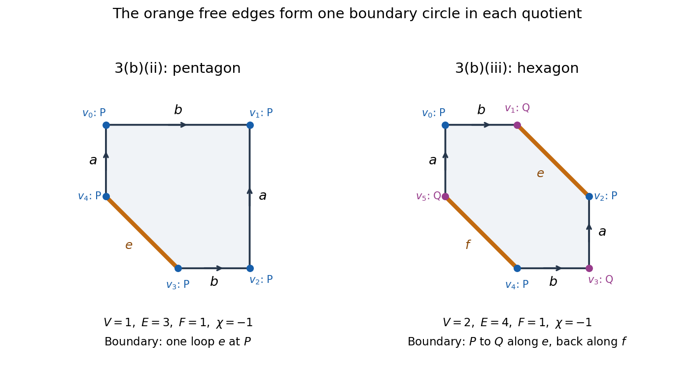

<h1 id="3/b/iii/solution">Solution</h1>

↑ **Parent:** [iii](../iii.md)

**False: the result is again a [torus](../../../../../torus.md) with one [open disc](../../../../../open-disc.md) removed.** Label the [hexagon](../../../../../hexagon.md) [polygon vertices](../../../../../vertex-of-a-polygon.md) clockwise from the upper left as

$$
v_0=(0,2),\quad v_1=(1,2),\quad v_2=(2,1),\quad v_3=(2,0),\quad v_4=(1,0),\quad v_5=(0,1).
$$

With the same arrow labels as in part (ii),

$$
\begin{aligned}
a:&\quad v_5\sim v_3,\quad v_0\sim v_2,\\
b:&\quad v_0\sim v_4,\quad v_1\sim v_3.
\end{aligned}
$$

There are two vertex [equivalence classes](../../../../../equivalence-class.md), $P=\{v_0,v_2,v_4\}$ and $Q=\{v_1,v_3,v_5\}$. The free diagonal [polygon edges](../../../../../side-of-a-polygon.md) are $v_1v_2$ and $v_4v_5$. Each joins $P$ to $Q$, so together they form **one [boundary component of a surface](../../../../../boundary-component-of-a-surface.md), not two**. At each vertex [equivalence class](../../../../../equivalence-class.md) the three corner sectors join in a single chain between these two free [polygon edges](../../../../../side-of-a-polygon.md). Thus each [vertex link in a polygonal schema](../../../../../vertex-link-in-a-polygonal-schema.md) is a [closed interval](../../../../../closed-real-interval.md), and the [quotient space](../../../../../quotient-topological-space.md) is an [orientable](../../../../../orientable-surface.md) [surface with boundary](../../../../../surface-with-boundary.md).

Its [CW complex](../../../../../cw-complex.md) has [CW cells](../../../../../topological-cell.md) comprising two vertices, four edges and one face, giving

$$
\chi=2-4+1=-1,\qquad b=1,\qquad g=1.
$$

In contrast, a [torus](../../../../../torus.md) with two disjoint [open discs](../../../../../open-disc.md) removed has two [boundary components of a surface](../../../../../boundary-component-of-a-surface.md) and [Euler characteristic](../../../../../euler-characteristic.md) $2-2-2=-2$. Either [topological invariant](../../../../../topological-invariant.md) rules out the proposed [homeomorphism](../../../../../homeomorphism.md).

**[Figure 1](#3/b/iii/image-after-identifying-equally-labelled-arrows-both-polygons-have-one-boundary-circle-in-the-hexagon-the-two-free-edges-join-the-two-vertex-classes). After identifying equally labelled arrows, both polygons have one boundary circle; in the hexagon the two free edges join the two vertex classes**.

## ↑ Ancestors (13)

1. [iii](../iii.md)
2. [b](../../b.md)
3. [3](../../../3.md)
4. [2021](../../../../2021-split.md)
5. [Past exam of the topology course of the University of Oxford](../../../../split.md)
6. [Topology course of the University of Oxford](../../../../../topology-course-of-the-university-of-oxford.md)
7. [Year 2 of the mathematics course of the University of Oxford](../../../../../year-2-of-the-mathematics-course-of-the-university-of-oxford.md)
8. [Mathematics course of the University of Oxford](../../../../../mathematics-course-of-the-university-of-oxford.md)
9. [Undergraduate course of the University of Oxford](../../../../../undergraduate-course-of-the-university-of-oxford.md)
10. [Course of the University of Oxford](../../../../../course-of-the-university-of-oxford.md)
11. [University of Oxford](../../../../../university-of-oxford-split.md)
12. [List of universities](../../../../../list-of-universities.md)
13. [Codex Wiki](../../../../../split.md)
