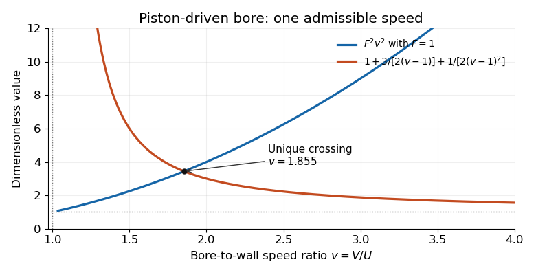

# 2023

↑ **Parent:** [Past exam of the waves and compressible flow course of the University of Oxford](../past-exam-of-the-waves-and-compressible-flow-course-of-the-university-of-oxford.md)

Source: [released examination PDF, pages 232–235](https://www.whatdotheyknow.com/request/request_for_mathematics_examinat/response/3129786/attach/3/FOI%20202507%20740%20Data.pdf#page=232). Solutions follow the numbering of the 12 June 2023 paper. Oscillating-wall formulas describe a periodic particular solution away from resonance; inviscid transients need not decay. The large-time propagation region in 2(c) is an asymptotic concentration region, not a claim that all disturbance outside it vanishes.

**Table of contents**

- [1](#1)
  - [a](#1/a)
    - [i](#1/a/i)
      - [Solution](#1/a/i/solution)
    - [ii](#1/a/ii)
      - [Solution](#1/a/ii/solution)
  - [b](#1/b)
    - [i](#1/b/i)
      - [Solution](#1/b/i/solution)
    - [ii](#1/b/ii)
      - [Solution](#1/b/ii/solution)
    - [iii](#1/b/iii)
      - [Solution](#1/b/iii/solution)
- [2](#2)
  - [a](#2/a)
    - [i](#2/a/i)
      - [Solution](#2/a/i/solution)
    - [ii](#2/a/ii)
      - [Solution](#2/a/ii/solution)
  - [b](#2/b)
    - [i](#2/b/i)
      - [Solution](#2/b/i/solution)
    - [ii](#2/b/ii)
      - [Solution](#2/b/ii/solution)
  - [c](#2/c)
    - [i](#2/c/i)
      - [Solution](#2/c/i/solution)
    - [ii](#2/c/ii)
      - [Solution](#2/c/ii/solution)
- [3](#3)
  - [a](#3/a)
    - [i](#3/a/i)
      - [Solution](#3/a/i/solution)
    - [ii](#3/a/ii)
      - [Solution](#3/a/ii/solution)
    - [iii](#3/a/iii)
      - [Solution](#3/a/iii/solution)
  - [b](#3/b)
    - [i](#3/b/i)
      - [Solution](#3/b/i/solution)
    - [ii](#3/b/ii)
      - [Solution](#3/b/ii/solution)

## 1

↑ **Parent:** [2023](2023.md)

<h3 id="1/a">a</h3>

↑ **Parent:** [1](#1)

<h4 id="1/a/i">i</h4>

↑ **Parent:** [A](#1/a)

<h5 id="1/a/i/solution">Solution</h5>

↑ **Parent:** [I](#1/a/i)

The [velocity potential](../fluid-mechanics.md#velocity-potential) gives horizontal and vertical [velocity](../classical-mechanics.md#velocity) components $(\phi_x,\phi_z)$. The [kinematic boundary condition](../fluid-mechanics.md#kinematic-boundary-condition) at each fixed impermeable wall is zero normal fluid velocity, hence

$$
\boxed{\phi_x=0\text{ at }x=0,L,\qquad\phi_z=0\text{ at }z=-h}.
$$

Let $\eta(x,t)$ be the [surface elevation](../fluid-mechanics.md#surface-elevation). To first order in its [amplitude](../wave.md#wave-amplitude), the [kinematic boundary condition for a free-surface graph](../fluid-mechanics.md#kinematic-boundary-condition-for-a-free-surface-graph) gives $\eta_t=\phi_z$ at $z=0$. The [dynamic boundary condition for an inviscid interface](../fluid-mechanics.md#dynamic-boundary-condition-for-an-inviscid-interface) fixes the surface [pressure](../pressure.md) to atmospheric pressure. The unsteady [Bernoulli equation](../euler-equations-for-an-inviscid-fluid.md#bernoulli-equation), after choosing the time-dependent gauge of $\phi$, then gives $\phi_t+g\eta=0$ at $z=0$: the quadratic velocity term is second order in [amplitude](../wave.md#wave-amplitude). Differentiate this last equation in time and eliminate $\eta_t$ to obtain the [linearized free-surface boundary conditions](../fluid-mechanics.md#linearized-free-surface-boundary-conditions) in combined form,

$$
\boxed{\phi_{tt}+g\phi_z=0\qquad(z=0)}.
$$

<h4 id="1/a/ii">ii</h4>

↑ **Parent:** [A](#1/a)

<h5 id="1/a/ii/solution">Solution</h5>

↑ **Parent:** [Ii](#1/a/ii)

Apply [separation of variables](../partial-differential-equation.md#separation-of-variables) to [Laplace's equation](../partial-differential-equation.md#laplace-equation). The side-wall [Neumann boundary conditions](../differential-equation.md#neumann-boundary-condition) give horizontal factors $\cos(k_nx)$ with $k_n=n\pi/L$. The bottom condition fixes the vertical factor to $\cosh(k_n(z+h))$. Substitution into the surface condition in [i](#1/a/i) gives the [normal modes of surface gravity waves in a rectangular tank](../fluid-mechanics.md#normal-modes-of-surface-gravity-waves-in-a-rectangular-tank):

$$
\boxed{\phi_n=\cos(k_nx)\cosh(k_n(z+h))\,[A_n\cos(\omega_nt)+B_n\sin(\omega_nt)],\qquad\omega_n^2=gk_n\tanh(k_nh),\quad n\geq1}.
$$

The corresponding [surface elevation](../fluid-mechanics.md#surface-elevation) follows from $\eta_n=-\partial_t\phi_n(x,0,t)/g$. The spatially uniform $n=0$ mode has zero frequency; its constant elevation changes total fluid volume, so it is absent when that volume is fixed. An additive constant in $\phi$ changes no fluid [velocity](../classical-mechanics.md#velocity).

<h3 id="1/b">b</h3>

↑ **Parent:** [1](#1)

<h4 id="1/b/i">i</h4>

↑ **Parent:** [B](#1/b)

<h5 id="1/b/i/solution">Solution</h5>

↑ **Parent:** [I](#1/b/i)

The wall position is $x_w(t)=\operatorname{Re}(ce^{-i\omega t})$, so its [velocity](../classical-mechanics.md#velocity) is $\operatorname{Re}(-i\omega ce^{-i\omega t})$. The [kinematic boundary condition](../fluid-mechanics.md#kinematic-boundary-condition) equates the normal fluid [velocity](../classical-mechanics.md#velocity) to the normal wall [velocity](../classical-mechanics.md#velocity). Linearizing the evaluation point to the mean wall position gives

$$
\boxed{\phi_x(0,z,t)=\operatorname{Re}(-i\omega ce^{-i\omega t}),\qquad f_x(0,z)=-i\omega c}.
$$

The other wall and bottom retain $f_x(L,z)=0$ and $f_z(x,-h)=0$, while the free surface gives $f_z(x,0)=(\omega^2/g)f(x,0)$.

<h4 id="1/b/ii">ii</h4>

↑ **Parent:** [B](#1/b)

<h5 id="1/b/ii/solution">Solution</h5>

↑ **Parent:** [Ii](#1/b/ii)

Put $\lambda=\omega^2/g$ and

$$
Q=\frac{i\omega c}{2L}\big[(z+h)^2-(L-x)^2\big],\qquad G=f+Q.
$$

This polynomial is a [harmonic function](../partial-differential-equation.md#harmonic-function): $Q_{xx}+Q_{zz}=0$. Also $Q_x(0,z)=i\omega c$, $Q_x(L,z)=0$ and $Q_z(x,-h)=0$. Thus $G$ satisfies [Laplace's equation](../partial-differential-equation.md#laplace-equation) with homogeneous [Neumann boundary conditions](../differential-equation.md#neumann-boundary-condition) on both side walls and the bottom. Its [Fourier cosine series](../fourier-series.md#fourier-cosine-series) consequently has the form

$$
\boxed{G(x,z)=\frac{a_0}{2}+\sum_{n=1}^{\infty}a_n\cos(k_nx)\cosh(k_n(z+h)),\qquad k_n=\frac{n\pi}{L}}.
$$

The surface condition becomes $G_z-\lambda G=H(x)$, where

$$
H(x)=\frac{i\omega c}{L}\left[h-\frac\lambda2\big(h^2-(L-x)^2\big)\right].
$$

For a nonzero forcing frequency away from the natural frequencies, the coefficients of the [oscillating-wall forcing of a rectangular tank](../fluid-mechanics.md#oscillating-wall-forcing-of-a-rectangular-tank) are

$$
H_n=\frac2L\int_0^L H(x)\cos(k_nx)\,dx,\qquad a_0=-\frac{H_0}{\lambda},\qquad a_n=\frac{H_n}{k_n\sinh(k_nh)-\lambda\cosh(k_nh)}\quad(n\geq1).
$$

Here $k_0=0$ in the definition of $H_0$. In fact $H_n=2i\omega c\lambda/(Lk_n^2)$ for $n\geq1$, since $\int_0^L(L-x)^2\cos(k_nx)dx=2L/k_n^2$. The zero-mode coefficient ensures that the mean [surface elevation](../fluid-mechanics.md#surface-elevation) is $hc/L$ in complex amplitude, exactly the first-order [volume conservation](../mathematical-physics.md#volume-conservation) adjustment to the moving wall.

<h4 id="1/b/iii">iii</h4>

↑ **Parent:** [B](#1/b)

<h5 id="1/b/iii/solution">Solution</h5>

↑ **Parent:** [Iii](#1/b/iii)

For the $n$th [normal mode](../wave-equation.md#normal-mode), the denominator just obtained is

$$
k_n\sinh(k_nh)-\frac{\omega^2}{g}\cosh(k_nh)=\frac{\cosh(k_nh)}g(\omega_n^2-\omega^2).
$$

Its forcing coefficient is nonzero for $c\ne0$ and $\omega>0$. Therefore the periodic response grows like $(\omega_n^2-\omega^2)^{-1}$ as $\omega$ approaches $\omega_n$: this is [resonance](../dynamical-systems.md#resonance). At exact resonance there is no bounded periodic particular solution in the linear inviscid model; the resonant amplitude instead contains a secular term proportional to $t\sin(\omega_nt)$ or $t\cos(\omega_nt)$. Physical damping and nonlinear effects eventually matter. Away from resonance, undamped free oscillations can persist alongside the periodic particular solution.

## 2

↑ **Parent:** [2023](2023.md)

<h3 id="2/a">a</h3>

↑ **Parent:** [2](#2)

<h4 id="2/a/i">i</h4>

↑ **Parent:** [A](#2/a)

<h5 id="2/a/i/solution">Solution</h5>

↑ **Parent:** [I](#2/a/i)

Write the density and pressure as $\rho_0(z)+\rho'(x,z,t)$ and $p_0(z)+p'(x,z,t)$, respectively. The background satisfies [hydrostatic balance](../fluid-mechanics.md#hydrostatic-balance), $p_0'=-g\rho_0$, and $\rho_0'/\rho_0=-\alpha$. Linearizing the [Euler equations for an inviscid fluid](../euler-equations-for-an-inviscid-fluid.md), [incompressibility](../fluid-mechanics.md#incompressible-flow) and advection of density gives

$$
u_x+w_z=0,\qquad \rho_0u_t=-p'_x,\qquad \rho_0w_t=-p'_z-g\rho',\qquad \rho'_t=\alpha\rho_0w.
$$

Differentiate the horizontal equation in $x$ and use [incompressibility](../fluid-mechanics.md#incompressible-flow) to obtain $p'_{xx}=\rho_0w_{zt}$. Differentiate the vertical equation in time and twice in $x$:

$$
\rho_0w_{ttxx}=-\partial_z(\rho_0w_{ztt})-\alpha g\rho_0w_{xx}.
$$

Dividing by $\rho_0>0$ gives the equation for [internal waves in an exponentially stratified incompressible fluid](../gravity-wave.md#internal-waves-in-an-exponentially-stratified-incompressible-fluid),

$$
\boxed{\partial_t^2(\nabla^2w-\alpha w_z)+\alpha g\,w_{xx}=0}.
$$

The first-derivative term retains the variation of inertial density with height; no [Boussinesq approximation](../geophysical-fluid-dynamics.md#boussinesq-approximation) has been made.

<h4 id="2/a/ii">ii</h4>

↑ **Parent:** [A](#2/a)

<h5 id="2/a/ii/solution">Solution</h5>

↑ **Parent:** [Ii](#2/a/ii)

For $w=e^{\alpha z/2}W$, direct [differentiation](../calculus.md#differentiation) gives

$$
w_{zz}-\alpha w_z=e^{\alpha z/2}\left(W_{zz}-\frac{\alpha^2}{4}W\right),\qquad w_{xx}=e^{\alpha z/2}W_{xx}.
$$

Thus the transformed [partial differential equation](../partial-differential-equation.md) and its impermeable-wall [boundary conditions](../differential-equation.md#boundary-condition) are

$$
\boxed{\partial_t^2\left(\nabla^2W-\frac{\alpha^2}{4}W\right)+\alpha g W_{xx}=0,\qquad W(x,0,t)=W(x,h,t)=0}.
$$

The positive exponential factor does not change where the vertical [velocity](../classical-mechanics.md#velocity) vanishes.

<h3 id="2/b">b</h3>

↑ **Parent:** [2](#2)

<h4 id="2/b/i">i</h4>

↑ **Parent:** [B](#2/b)

<h5 id="2/b/i/solution">Solution</h5>

↑ **Parent:** [I](#2/b/i)

Substitute $W=f(z)e^{i(kx-\omega t)}$ into the transformed equation. It yields

$$
f''+\left(\frac{\alpha g k^2}{\omega^2}-k^2-\frac{\alpha^2}{4}\right)f=0,\qquad f(0)=f(h)=0.
$$

The nonzero [eigenfunctions](../linear-operator-theory.md#eigenfunction) of this [Dirichlet boundary value problem](../analysis.md#dirichlet-problem) are $f=A\sin(n\pi z/h)$, $n\geq1$. Hence, with $N=\sqrt{\alpha g}$ and $b_n^2=(n\pi/h)^2+\alpha^2/4$,

$$
\boxed{\omega^2=\frac{N^2k^2}{k^2+b_n^2}=\frac{4\alpha gh^2k^2}{4n^2\pi^2+h^2(\alpha^2+4k^2)}}.
$$

The physical vertical [velocity](../classical-mechanics.md#velocity) includes the factor $e^{\alpha z/2}\sin(n\pi z/h)$. The zero horizontal wavenumber is the zero-frequency limiting case, not a propagating oscillation.

<h4 id="2/b/ii">ii</h4>

↑ **Parent:** [B](#2/b)

<h5 id="2/b/ii/solution">Solution</h5>

↑ **Parent:** [Ii](#2/b/ii)

Choose the rightgoing signed [dispersion relation](../dispersion-relation.md) $\omega(k)=Nk/\sqrt{k^2+b_n^2}$. The horizontal [phase velocity](../dispersion-relation.md#phase-velocity) and [group velocity](../dispersion-relation.md#group-velocity) are

$$
\boxed{c_p=\frac\omega k=\frac{N}{\sqrt{k^2+b_n^2}},\qquad c_g=\frac{d\omega}{dk}=\frac{Nb_n^2}{(k^2+b_n^2)^{3/2}}}.
$$

The leftgoing branch has their negatives. For a convention using positive frequency at both signs of $k$, multiply each displayed speed by $\operatorname{sgn}k$. For every nonzero $k$, $0<c_g<c_p$ on the rightgoing branch; the [horizontal group-speed bound for a confined internal wave](../gravity-wave.md#horizontal-group-speed-bound-for-a-confined-internal-wave) is $c_g\leq N/b_n$, approached as $k\to0$.

<h3 id="2/c">c</h3>

↑ **Parent:** [2](#2)

<h4 id="2/c/i">i</h4>

↑ **Parent:** [C](#2/c)

<h5 id="2/c/i/solution">Solution</h5>

↑ **Parent:** [I](#2/c/i)

Use the [Fourier transform](../fourier-transform.md) convention $\widehat W(k,z,t)=\int_{\mathbb R}W(x,z,t)e^{-ikx}dx$, with inverse factor $1/(2\pi)$. The initial profile occupies only the vertical mode $\sin(\pi z/h)$. Its transform is

$$
\widehat W(k,z,0)=\pi hC e^{-\epsilon h|k|}\sin(\pi z/h),\qquad \widehat W_t(k,z,0)=0.
$$

The transformed evolution is a [harmonic oscillator](../classical-mechanics.md#simple-harmonic-motion) for each $k$, with

$$
\omega(k)=\frac{\sqrt{\alpha g}\,k}{\sqrt{k^2+\pi^2/h^2+\alpha^2/4}}.
$$

Therefore inversion gives

$$
\boxed{W(x,z,t)=\frac{hC}{2}\sin\!\left(\frac{\pi z}{h}\right)\int_{-\infty}^{\infty}e^{-\epsilon h|k|}\cos(\omega(k)t)e^{ikx}\,dk}.
$$

Using the nonnegative even frequency instead gives the same cosine. At $t=0$, $\int_{\mathbb R}e^{-a|k|}e^{ikx}dk=2a/(a^2+x^2)$ with $a=\epsilon h$, recovering the specified initial profile and its zero time derivative.

<h4 id="2/c/ii">ii</h4>

↑ **Parent:** [C](#2/c)

<h5 id="2/c/ii/solution">Solution</h5>

↑ **Parent:** [Ii](#2/c/ii)

Write the cosine in [i](#2/c/i) as two complex exponentials. On a ray $x=vt$, the oscillatory phases are $kv\pm\omega(k)$. The [stationary phase method](../analysis.md#stationary-phase-method) requires $v=\mp\omega'(k)$. By [ii](#2/b/ii), the largest absolute horizontal [group velocity](../dispersion-relation.md#group-velocity) for the occupied $n=1$ mode is

$$
\boxed{\frac{|x|}{t}\leq\frac{N}{b_1}=\frac{2h\sqrt{\alpha g}}{\sqrt{4\pi^2+\alpha^2h^2}}}.
$$

Inside this region there are stationary wavenumbers supporting appreciable [wave packet](../dispersion-relation.md#wave-packet) contributions. Outside it no stationary wavenumber exists; oscillatory cancellation suppresses the large-time response. This explains "mainly confined": the initial Lorentzian profile already has nonzero algebraic tails, so the displayed region is not the exact support of the solution. Near its boundary the stationary points meet $k=0$ and the usual nondegenerate stationary-phase formula needs a transition approximation.

## 3

↑ **Parent:** [2023](2023.md)

<h3 id="3/a">a</h3>

↑ **Parent:** [3](#3)

<h4 id="3/a/i">i</h4>

↑ **Parent:** [A](#3/a)

<h5 id="3/a/i/solution">Solution</h5>

↑ **Parent:** [I](#3/a/i)

Take a unit-width [control volume](../fluid-mechanics.md#control-volume) spanning the stationary [hydraulic jump](../mathematical-physics.md#hydraulic-jump). [Mass conservation](../continuum-mechanics.md#mass-conservation) makes the discharge $q=hu$ constant. The horizontal [momentum flux](../mathematical-physics.md#momentum-flux) is $\rho h u^2$, and the integrated [hydrostatic pressure](../fluid-mechanics.md#hydrostatic-pressure) force on a vertical cross-section is $\int_0^h\rho g(h-z)dz=\rho gh^2/2$. [Momentum conservation](../momentum.md#momentum-conservation) therefore gives

$$
\boxed{[hu]_-^+=[hu^2+gh^2/2]_-^+=0}.
$$

These are the [Rankine-Hugoniot conditions](../transport-equation.md#rankine-hugoniot-conditions) for the [shallow water equations](../mathematical-physics.md#shallow-water-equations) in the stationary [shock frame](../compressible-flow.md#shock-frame). With depths $h_1\ne h_2$ on the two sides, eliminating the [velocity](../classical-mechanics.md#velocity) gives

$$
q^2=\frac g2h_1h_2(h_1+h_2).
$$

<h4 id="3/a/ii">ii</h4>

↑ **Parent:** [A](#3/a)

<h5 id="3/a/ii/solution">Solution</h5>

↑ **Parent:** [Ii](#3/a/ii)

Orient the flow so $q>0$, and let subscripts 1 and 2 denote upstream and downstream. The mechanical [energy flux](../mathematical-physics.md#energy-flux) is $\rho q B$, where $B=u^2/2+gh$. Inserting the relation for $q^2$ in [i](#3/a/i) gives the [hydraulic jump head loss](../mathematical-physics.md#hydraulic-jump-head-loss),

$$
B_1-B_2=\frac{q^2}{2}\left(\frac1{h_1^2}-\frac1{h_2^2}\right)+g(h_1-h_2)=\frac{g(h_2-h_1)^3}{4h_1h_2}.
$$

An admissible jump dissipates mechanical [energy](../energy.md), so $\rho q(B_1-B_2)>0$. The denominator is positive, hence

$$
\boxed{h_2>h_1}.
$$

The zero depth-change case is continuous flow. A depth-decreasing discontinuity would require an energy input at the jump; it is not the dissipative [hydraulic jump](../mathematical-physics.md#hydraulic-jump) selected by this model.

<h4 id="3/a/iii">iii</h4>

↑ **Parent:** [A](#3/a)

<h5 id="3/a/iii/solution">Solution</h5>

↑ **Parent:** [Iii](#3/a/iii)

Put $R=h_2/h_1>1$. The squared [Froude numbers](../reduced-gravity.md#froude-number) follow directly from the discharge relation:

$$
\boxed{\mathrm{Fr}_1^2=\frac{u_1^2}{gh_1}=\frac{R(1+R)}2>1,\qquad \mathrm{Fr}_2^2=\frac{u_2^2}{gh_2}=\frac{1+R}{2R^2}<1}.
$$

Thus the jump connects [supercritical flow](../reduced-gravity.md#supercritical-flow) to [subcritical flow](../reduced-gravity.md#subcritical-flow). Long [surface gravity waves](../fluid-mechanics.md#surface-gravity-wave) have speed $\sqrt{gh}$ relative to the fluid, so the [characteristic speeds](../transport-equation.md#characteristic-speed) in the stationary frame are $u\pm\sqrt{gh}$. Upstream both point with the flow; downstream one points against it. The jump changes whether long-wave information can propagate upstream through the local flow.

<h3 id="3/b">b</h3>

↑ **Parent:** [3](#3)

<h4 id="3/b/i">i</h4>

↑ **Parent:** [B](#3/b)

<h5 id="3/b/i/solution">Solution</h5>

↑ **Parent:** [I](#3/b/i)

Let $H$ be the depth behind the bore. The wall's [kinematic boundary condition](../fluid-mechanics.md#kinematic-boundary-condition) makes the [velocity](../classical-mechanics.md#velocity) there $U$; ahead of the bore the depth and [velocity](../classical-mechanics.md#velocity) are $h_0$ and zero. Across a rightward [hydraulic bore](../mathematical-physics.md#hydraulic-bore) moving at $V$, the [Rankine-Hugoniot conditions](../transport-equation.md#rankine-hugoniot-conditions) are

$$
V(H-h_0)=HU,\qquad VHU=HU^2+\frac g2(H^2-h_0^2).
$$

The first gives $R=H/h_0=V/(V-U)=v/(v-1)>1$. Substituting into the second gives $F^2v=(R^2-1)/2$, where $v=V/U$ and $F=U/\sqrt{gh_0}$. Hence the [piston-driven shallow-water bore](../mathematical-physics.md#piston-driven-shallow-water-bore) obeys

$$
\boxed{F^2v^2=\frac{v(2v-1)}{2(v-1)^2}=1+\frac{3}{2(v-1)}+\frac1{2(v-1)^2},\qquad v>1}.
$$

The positive depth increase is consistent with the energy-loss condition in [ii](#3/a/ii), now viewed in the bore's own [shock frame](../compressible-flow.md#shock-frame).

<h4 id="3/b/ii">ii</h4>

↑ **Parent:** [B](#3/b)

<h5 id="3/b/ii/solution">Solution</h5>

↑ **Parent:** [Ii](#3/b/ii)

For fixed $F>0$, the left side $L(v)=F^2v^2$ is a [strictly increasing function](../calculus.md#strictly-increasing-function) on $v>1$, with limit $F^2$ at $1$ and unbounded growth. The right side $R(v)=1+3/[2(v-1)]+1/[2(v-1)^2]$ is a [strictly decreasing function](../calculus.md#strictly-decreasing-function), since

$$
R'(v)=-\frac{3}{2(v-1)^2}-\frac1{(v-1)^3}<0.
$$

It tends to infinity as $v\downarrow1$ and to one as $v\to\infty$. Their [continuity](../calculus.md#continuous-function) and the [intermediate value theorem](../calculus.md#intermediate-value-theorem) give a crossing, and strict opposite [monotonicity](../calculus.md#monotonic-function) makes it unique. **There is exactly one admissible bore speed $V>U$ for every $F>0$.**

**[Figure 1](#3/b/ii/image-unique-intersection-determining-the-piston-driven-hydraulic-bore-speed-illustrated-for-froude-parameter-one). Unique intersection determining the piston-driven hydraulic-bore speed, illustrated for Froude parameter one**.

The illustrated case is $F=1$; changing $F>0$ moves the increasing curve without changing the existence or uniqueness argument. The vertical asymptote at $v=1$ expresses the growing depth ratio $H/h_0=v/(v-1)$.

## ↑ Ancestors (9)

1. [Past exam of the waves and compressible flow course of the University of Oxford](../past-exam-of-the-waves-and-compressible-flow-course-of-the-university-of-oxford.md)
2. [Waves and compressible flow course of the University of Oxford](../university-of-oxford.md#waves-and-compressible-flow-course-of-the-university-of-oxford)
3. [Year 3 of the mathematics course of the University of Oxford](../university-of-oxford.md#year-3-of-the-mathematics-course-of-the-university-of-oxford)
4. [Mathematics course of the University of Oxford](../university-of-oxford.md#mathematics-course-of-the-university-of-oxford)
5. [Undergraduate course of the University of Oxford](../university-of-oxford.md#undergraduate-course-of-the-university-of-oxford)
6. [Course of the University of Oxford](../university-of-oxford.md#course-of-the-university-of-oxford)
7. [University of Oxford](../university-of-oxford.md)
8. [List of universities](../README.md#list-of-universities)
9. [Codex Wiki](../README.md)
