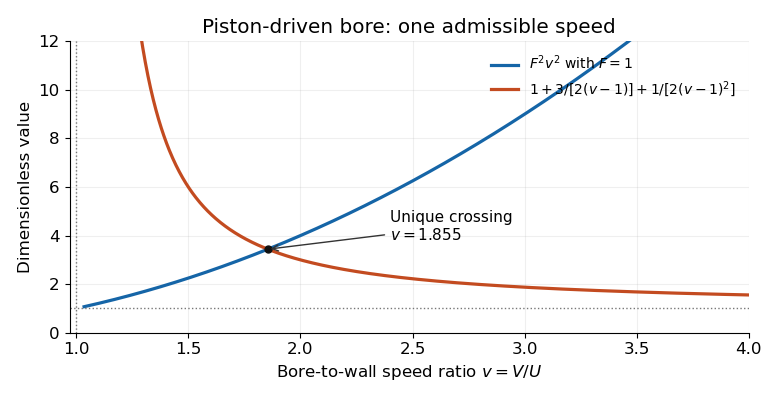

<h1 id="3/b/ii/solution">Solution</h1>

↑ **Parent:** [Ii](../ii.md)

For fixed $F>0$, the left side $L(v)=F^2v^2$ is a [strictly increasing function](../../../../../strictly-increasing-function.md) on $v>1$, with limit $F^2$ at $1$ and unbounded growth. The right side $R(v)=1+3/[2(v-1)]+1/[2(v-1)^2]$ is a [strictly decreasing function](../../../../../strictly-decreasing-function.md), since

$$
R'(v)=-\frac{3}{2(v-1)^2}-\frac1{(v-1)^3}<0.
$$

It tends to infinity as $v\downarrow1$ and to one as $v\to\infty$. Their [continuity](../../../../../continuous-function.md) and the [intermediate value theorem](../../../../../intermediate-value-theorem.md) give a crossing, and strict opposite [monotonicity](../../../../../monotonic-function.md) makes it unique. **There is exactly one admissible bore speed $V>U$ for every $F>0$.**

**[Figure 1](#3/b/ii/image-unique-intersection-determining-the-piston-driven-hydraulic-bore-speed-illustrated-for-froude-parameter-one). Unique intersection determining the piston-driven hydraulic-bore speed, illustrated for Froude parameter one**.

The illustrated case is $F=1$; changing $F>0$ moves the increasing curve without changing the existence or uniqueness argument. The vertical asymptote at $v=1$ expresses the growing depth ratio $H/h_0=v/(v-1)$.

## ↑ Ancestors (13)

1. [Ii](../ii.md)
2. [B](../../b.md)
3. [3](../../../3.md)
4. [2023](../../../../2023-split.md)
5. [Past exam of the waves and compressible flow course of the University of Oxford](../../../../split.md)
6. [Waves and compressible flow course of the University of Oxford](../../../../../waves-and-compressible-flow-course-of-the-university-of-oxford.md)
7. [Year 3 of the mathematics course of the University of Oxford](../../../../../year-3-of-the-mathematics-course-of-the-university-of-oxford.md)
8. [Mathematics course of the University of Oxford](../../../../../mathematics-course-of-the-university-of-oxford.md)
9. [Undergraduate course of the University of Oxford](../../../../../undergraduate-course-of-the-university-of-oxford.md)
10. [Course of the University of Oxford](../../../../../course-of-the-university-of-oxford.md)
11. [University of Oxford](../../../../../university-of-oxford-split.md)
12. [List of universities](../../../../../list-of-universities.md)
13. [Codex Wiki](../../../../../split.md)
