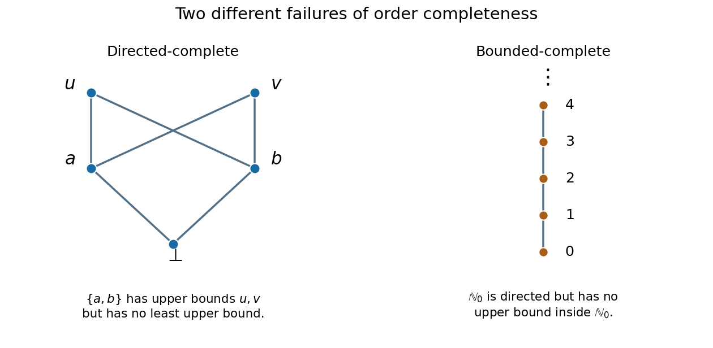

# Calculus, probability, linear algebra, discrete mathematics, logic and proof, and models of computation

↑ **Parent:** [2003](../2003.md)

Original examination: [Calculus, probability, linear algebra, discrete mathematics, logic and proof, and models of computation examination paper by the University of Oxford (2003)](../../computer-science-bibliography.md#calculus-probability-linear-algebra-discrete-mathematics-logic-and-proof-and-models-of-computation-examination-paper-by-the-university-of-oxford-2003).

**Table of contents**

- [1](#1)
  - [a](#1/a)
    - [i](#1/a/i)
      - [Solution](#1/a/i/solution)
    - [ii](#1/a/ii)
      - [Solution](#1/a/ii/solution)
  - [b](#1/b)
    - [Solution](#1/b/solution)
- [2](#2)
  - [a](#2/a)
    - [i](#2/a/i)
      - [Solution](#2/a/i/solution)
    - [ii](#2/a/ii)
      - [Solution](#2/a/ii/solution)
  - [b](#2/b)
    - [Solution](#2/b/solution)
- [3](#3)
  - [a](#3/a)
    - [i](#3/a/i)
      - [Solution](#3/a/i/solution)
    - [ii](#3/a/ii)
      - [Solution](#3/a/ii/solution)
  - [b](#3/b)
    - [i](#3/b/i)
      - [Solution](#3/b/i/solution)
    - [ii](#3/b/ii)
      - [Solution](#3/b/ii/solution)
- [4](#4)
  - [a](#4/a)
    - [i](#4/a/i)
      - [Solution](#4/a/i/solution)
    - [ii](#4/a/ii)
      - [Solution](#4/a/ii/solution)
    - [iii](#4/a/iii)
      - [Solution](#4/a/iii/solution)
  - [b](#4/b)
    - [i](#4/b/i)
      - [Solution](#4/b/i/solution)
    - [ii](#4/b/ii)
      - [Solution](#4/b/ii/solution)
- [5](#5)
  - [a](#5/a)
    - [i](#5/a/i)
      - [Solution](#5/a/i/solution)
    - [ii](#5/a/ii)
      - [Solution](#5/a/ii/solution)
    - [iii](#5/a/iii)
      - [Solution](#5/a/iii/solution)
  - [b](#5/b)
    - [i](#5/b/i)
      - [Solution](#5/b/i/solution)
    - [ii](#5/b/ii)
      - [Solution](#5/b/ii/solution)
- [6](#6)
  - [a](#6/a)
    - [i](#6/a/i)
      - [Solution](#6/a/i/solution)
    - [ii](#6/a/ii)
      - [Solution](#6/a/ii/solution)
    - [iii](#6/a/iii)
      - [Solution](#6/a/iii/solution)
    - [iv](#6/a/iv)
      - [Solution](#6/a/iv/solution)
    - [v](#6/a/v)
      - [Solution](#6/a/v/solution)
  - [b](#6/b)
    - [i](#6/b/i)
      - [Solution](#6/b/i/solution)
    - [ii](#6/b/ii)
      - [Solution](#6/b/ii/solution)
    - [iii](#6/b/iii)
      - [Solution](#6/b/iii/solution)
    - [iv](#6/b/iv)
      - [Solution](#6/b/iv/solution)
    - [v](#6/b/v)
      - [Solution](#6/b/v/solution)
- [7](#7)
  - [a](#7/a)
    - [Solution](#7/a/solution)
  - [b](#7/b)
    - [Solution](#7/b/solution)
  - [c](#7/c)
    - [Solution](#7/c/solution)
- [8](#8)
  - [a](#8/a)
    - [Solution](#8/a/solution)
  - [b](#8/b)
    - [Solution](#8/b/solution)
  - [c](#8/c)
    - [Solution](#8/c/solution)
- [9](#9)
  - [a](#9/a)
    - [Solution](#9/a/solution)
  - [b](#9/b)
    - [Solution](#9/b/solution)
  - [c](#9/c)
    - [Solution](#9/c/solution)
  - [d](#9/d)
    - [Solution](#9/d/solution)
- [10](#10)
  - [a](#10/a)
    - [i](#10/a/i)
      - [Solution](#10/a/i/solution)
    - [ii](#10/a/ii)
      - [Solution](#10/a/ii/solution)
  - [b](#10/b)
    - [i](#10/b/i)
      - [Solution](#10/b/i/solution)
    - [ii](#10/b/ii)
      - [Solution](#10/b/ii/solution)

## 1

↑ **Parent:** [Calculus, probability, linear algebra, discrete mathematics, logic and proof, and models of computation](calculus-probability-linear-algebra-discrete-mathematics-logic-and-proof-and-models-of-computation.md)

<h3 id="1/a">a</h3>

↑ **Parent:** [1](#1)

<h4 id="1/a/i">i</h4>

↑ **Parent:** [A](#1/a)

<h5 id="1/a/i/solution">Solution</h5>

↑ **Parent:** [I](#1/a/i)

The repeated root of the [characteristic equation](../../linear-ordinary-differential-equation.md#characteristic-equation-of-a-constant-coefficient-differential-equation) suggests factoring out $e^x$. Set $y=e^xu$. The [product rule](../../calculus.md#product-rule) gives

$$
y'=e^x(u+u'),\qquad y''=e^x(u+2u'+u''),\qquad y''-2y'+y=e^xu''.
$$

Thus the [ordinary differential equation](../../differential-equation.md#ordinary-differential-equation) reduces to $u''=1$, with [general solution](../../linear-ordinary-differential-equation.md#general-solution) $u=x^2/2+Ax+B$. The first [initial condition](../../differential-equation.md#initial-condition) gives $B=1$. Since $y'(0)=A+B=2$, the other [initial condition](../../differential-equation.md#initial-condition) gives $A=1$. Therefore

$$
\boxed{y(x)=e^x\left(1+x+\frac{x^2}{2}\right),\qquad x\in\mathbb R.}
$$

Substitution into the reduced [ordinary differential equation](../../differential-equation.md#ordinary-differential-equation) and the two [initial conditions](../../differential-equation.md#initial-condition) verifies the result.

<h4 id="1/a/ii">ii</h4>

↑ **Parent:** [A](#1/a)

<h5 id="1/a/ii/solution">Solution</h5>

↑ **Parent:** [Ii](#1/a/ii)

For $y_1=(1-x)^{-1}$, the [derivatives](../../calculus.md#derivative) are $y_1'=(1-x)^{-2}$ and $y_1''=2(1-x)^{-3}$. Consequently the left-hand side of the [ordinary differential equation](../../differential-equation.md#ordinary-differential-equation) is

$$
\frac{2}{1-x}-\frac{4}{1-x}+\frac{2}{1-x}=0
$$

where $x\ne1$.

Use [reduction of order](../../linear-ordinary-differential-equation.md#reduction-of-order), writing $y=u/(1-x)$. A direct application of the [product rule](../../calculus.md#product-rule) gives

$$
(1-x)^2y''-4(1-x)y'+2y=(1-x)u''-2u'.
$$

For $v=u'$ the resulting [first-order ordinary differential equation](../../differential-equation.md#first-order-ordinary-differential-equation) is $v'/v=2/(1-x)$ whenever $v\ne0$. [Integration](../../integral.md) yields $v=C(1-x)^{-2}$ and $u=A+B/(1-x)$; the case $v=0$ is already included. Hence

$$
\boxed{y(x)=\frac{A}{1-x}+\frac{B}{(1-x)^2}}
$$

on either interval $x<1$ or $x>1$. The two displayed [solutions of a differential equation](../../differential-equation.md#solution-of-a-differential-equation) are [linearly independent](../../vector-space.md#linear-independence), so they span the [solution space of a homogeneous linear differential equation](../../differential-equation.md#solution-space-of-a-homogeneous-linear-differential-equation) on either interval. The point $x=1$ is a [singular point of a differential equation](../../differential-equation.md#singular-point-of-a-differential-equation) and cannot be crossed by a nonzero member of this family that remains finite there.

<h3 id="1/b">b</h3>

↑ **Parent:** [1](#1)

<h4 id="1/b/solution">Solution</h4>

↑ **Parent:** [B](#1/b)

Multiplying the [ordinary differential equation](../../differential-equation.md#ordinary-differential-equation) by two suggests using the [dependent variable](../../function.md#dependent-variable) $Y=y^2$, whose [derivative](../../calculus.md#derivative) is $Y'=2yy'$. On the interval through $x=1$, this gives the [linear ordinary differential equation](../../linear-ordinary-differential-equation.md)

$$
xY'=Y+x^2,\qquad \left(\frac Yx\right)'=1.
$$

After [integration](../../integral.md), $Y=x^2+Cx$. The [initial condition](../../differential-equation.md#initial-condition) $Y(1)=4$ gives $C=3$. As $y(1)>0$, [continuity](../../calculus.md#continuous-function) selects the positive branch:

$$
\boxed{y(x)=\sqrt{x^2+3x}\quad(x>0),\qquad y(2)=\sqrt{10}.}
$$

The interval $x>0$ is the maximal real interval through the given [initial condition](../../differential-equation.md#initial-condition): at $x=0$ the formula approaches $0$, but its [derivative](../../calculus.md#derivative) is unbounded, so it does not extend through zero as a differentiable [solution of a differential equation](../../differential-equation.md#solution-of-a-differential-equation).

## 2

↑ **Parent:** [Calculus, probability, linear algebra, discrete mathematics, logic and proof, and models of computation](calculus-probability-linear-algebra-discrete-mathematics-logic-and-proof-and-models-of-computation.md)

<h3 id="2/a">a</h3>

↑ **Parent:** [2](#2)

<h4 id="2/a/i">i</h4>

↑ **Parent:** [A](#2/a)

<h5 id="2/a/i/solution">Solution</h5>

↑ **Parent:** [I](#2/a/i)

Assume all [partial derivatives](../../multivariable-calculus.md#partial-derivative) needed below are continuous. The [multivariable chain rule](../../calculus.md#multivariable-chain-rule) is

$$
\boxed{f_x=g_uu_x+g_vv_x,}
$$

where the [partial derivatives](../../multivariable-calculus.md#partial-derivative) of $g$ are evaluated at $(u(x,y),v(x,y))$. Apply the [product rule](../../calculus.md#product-rule) and the [multivariable chain rule](../../calculus.md#multivariable-chain-rule) once more:

$$
\begin{aligned}
f_{xx}&=(g_{uu}u_x+g_{uv}v_x)u_x+g_uu_{xx}\\
&\quad +(g_{vu}u_x+g_{vv}v_x)v_x+g_vv_{xx}.
\end{aligned}
$$

[Clairaut's theorem](../../multivariable-calculus.md#symmetry-of-second-derivatives) gives $g_{vu}=g_{uv}$, so

$$
\boxed{f_{xx}=g_uu_{xx}+g_vv_{xx}+g_{uu}u_x^2+2g_{uv}u_xv_x+g_{vv}v_x^2.}
$$

Differentiating $f_x$ with respect to $y$ instead gives

$$
\boxed{f_{xy}=g_uu_{xy}+g_vv_{xy}+g_{uu}u_xu_y+g_{uv}(u_xv_y+v_xu_y)+g_{vv}v_xv_y.}
$$

<h4 id="2/a/ii">ii</h4>

↑ **Parent:** [A](#2/a)

<h5 id="2/a/ii/solution">Solution</h5>

↑ **Parent:** [Ii](#2/a/ii)

For this [change of variables](../../multivariable-calculus.md#change-of-variables-formula),

$$
u_x=2x,\quad u_y=-2y,\quad v_x=2y,\quad v_y=2x,
$$

and $u_{xx}+u_{yy}=0=v_{xx}+v_{yy}$. The [second derivative chain rule](../../calculus.md#second-derivative-chain-rule) therefore gives

$$
\begin{aligned}
f_{xx}+f_{yy}
&=g_{uu}(4x^2+4y^2)+2g_{uv}(4xy-4xy)+g_{vv}(4y^2+4x^2)\\
&=4(x^2+y^2)(g_{uu}+g_{vv}).
\end{aligned}
$$

Thus the transformation rule for the [Laplacian](../../multivariable-calculus.md#laplacian) is

$$
\boxed{\Delta_{x,y}f=4(x^2+y^2)\Delta_{u,v}g.}
$$

For $f=x+y$, its [Laplacian](../../multivariable-calculus.md#laplacian) is zero. At every point with $(x,y)\ne(0,0)$, division by $4(x^2+y^2)$ proves

$$
\boxed{g_{uu}+g_{vv}=0.}
$$

This conclusion applies to each local inverse branch of the [change of variables](../../multivariable-calculus.md#change-of-variables-formula): its [Jacobian determinant](../../multivariable-calculus.md#jacobian-determinant) is $4(x^2+y^2)$, so such a branch exists away from the origin by the [inverse function theorem](../../multivariable-calculus.md#inverse-function-theorem). A single globally defined $g$ cannot represent $x+y$ on the entire plane, since $(x,y)$ and $(-x,-y)$ give the same $(u,v)$ but generally opposite values of $x+y$. Nor can a differentiable $g$ represent this $f$ in a neighborhood of the origin: the [multivariable chain rule](../../calculus.md#multivariable-chain-rule) there would give $f_x=f_y=0$, contradicting $f_x=f_y=1$. The requested [harmonic function](../../partial-differential-equation.md#harmonic-function) conclusion is therefore a local statement on nonsingular branches.[Printed p. 2, Question 2(a)(ii)](../../computer-science-bibliography.md#calculus-probability-linear-algebra-discrete-mathematics-logic-and-proof-and-models-of-computation-examination-paper-by-the-university-of-oxford-2003)

<h3 id="2/b">b</h3>

↑ **Parent:** [2](#2)

<h4 id="2/b/solution">Solution</h4>

↑ **Parent:** [B](#2/b)

Write $z(x,y)=Z(r,s)$ in the new [coordinates](../../vector-space.md#coordinate-linear-algebra). Since

$$
\partial_x=\partial_r-\partial_s,\qquad \partial_y=\partial_r+\partial_s,
$$

the [partial differential equation](../../partial-differential-equation.md) becomes

$$
z_{xx}-z_{yy}=-4Z_{rs}=0.
$$

For a twice continuously differentiable [solution of a differential equation](../../differential-equation.md#solution-of-a-differential-equation), $Z_r$ is independent of $s$, so [integration](../../integral.md) first in $r$ and then in $s$ gives

$$
\boxed{z(x,y)=\phi(y+x)+\psi(y-x).}
$$

This is the decomposition of the [one-dimensional wave equation](../../wave-equation.md#one-dimensional-wave-equation) into waves traveling in opposite directions.

The first [initial condition](../../differential-equation.md#initial-condition) gives $\phi(y)+\psi(y)=\cos y$. The second [initial condition](../../differential-equation.md#initial-condition) gives $\phi'(y)-\psi'(y)=0$. Differentiating the first relation and combining the two relations yields $\phi'=psi'=-\tfrac12\sin y$. Thus $\phi(y)=\tfrac12\cos y+C$ and $\psi(y)=\tfrac12\cos y-C$. The constants cancel, and the [cosine addition formula](../../geometry-and-topology.md#cosine-addition-formula) gives

$$
\boxed{z(x,y)=\frac{\cos(y+x)+\cos(y-x)}2=\cos x\cos y.}
$$

Both [initial conditions](../../differential-equation.md#initial-condition) and the [partial differential equation](../../partial-differential-equation.md) follow directly by differentiation.

## 3

↑ **Parent:** [Calculus, probability, linear algebra, discrete mathematics, logic and proof, and models of computation](calculus-probability-linear-algebra-discrete-mathematics-logic-and-proof-and-models-of-computation.md)

<h3 id="3/a">a</h3>

↑ **Parent:** [3](#3)

<h4 id="3/a/i">i</h4>

↑ **Parent:** [A](#3/a)

<h5 id="3/a/i/solution">Solution</h5>

↑ **Parent:** [I](#3/a/i)

For a [linear map](../../vector-space.md#linear-map) $T:V\to W$, its [image of a linear map](../../vector-space.md#image-of-a-linear-map) and [kernel of a linear map](../../kernel-of-a-linear-map.md) are

$$
\boxed{\operatorname{im}T=\{T(v):v\in V\}\subseteq W,\qquad \ker T=\{v\in V:T(v)=0_W\}\subseteq V.}
$$

Their [dimensions](../../vector-space.md#dimension-vector-space) define the [rank of a linear map](../../vector-space.md#rank-of-a-linear-map) and [nullity](../../kernel-of-a-linear-map.md#nullity-of-a-linear-map):

$$
\boxed{\operatorname{rank}T=\dim(\operatorname{im}T),\qquad\operatorname{nullity}T=\dim(\ker T).}
$$

The [image of a linear map](../../vector-space.md#image-of-a-linear-map) measures which output [vectors](../../vector-space.md#vector) can occur, while the [kernel of a linear map](../../kernel-of-a-linear-map.md) measures which input [vectors](../../vector-space.md#vector) are sent to zero.

<h4 id="3/a/ii">ii</h4>

↑ **Parent:** [A](#3/a)

<h5 id="3/a/ii/solution">Solution</h5>

↑ **Parent:** [Ii](#3/a/ii)

The [rank-nullity theorem](../../kernel-of-a-linear-map.md#rank-nullity-theorem) states that a [linear map](../../vector-space.md#linear-map) $T:V\to W$ with finite-dimensional $V$ satisfies

$$
\boxed{\dim V=\operatorname{nullity}T+\operatorname{rank}T.}
$$

Choose a [basis](../../vector-space.md#basis) $k_1,\ldots,k_r$ of $\ker T$ and use [basis extension](../../vector-space.md#basis-extension) to obtain a [basis](../../vector-space.md#basis) $k_1,\ldots,k_r,u_1,\ldots,u_s$ of $V$. We prove that $Tu_1,\ldots,Tu_s$ is a [basis](../../vector-space.md#basis) of $\operatorname{im}T$.

Every $v\in V$ is a [linear combination](../../vector-space.md#linear-combination) of the extended [basis](../../vector-space.md#basis). Applying $T$ kills the $k_i$ terms, so $Tv$ is a [linear combination](../../vector-space.md#linear-combination) of $Tu_1,\ldots,Tu_s$. This proves the [linear span](../../vector-space.md#linear-span) assertion. For [linear independence](../../vector-space.md#linear-independence), if $\sum_j b_jTu_j=0$, then $\sum_j b_ju_j$ belongs to the [kernel of a linear map](../../kernel-of-a-linear-map.md). Hence $\sum_j b_ju_j=\sum_i a_ik_i$ for some [scalars](../../vector-space.md#scalar) $a_i$. The [linear independence](../../vector-space.md#linear-independence) of the extended [basis](../../vector-space.md#basis) forces every $a_i$ and $b_j$ to vanish. Consequently $\operatorname{rank}T=s$ and $\operatorname{nullity}T=r$, while $\dim V=r+s$, proving the theorem.

<h3 id="3/b">b</h3>

↑ **Parent:** [3](#3)

<h4 id="3/b/i">i</h4>

↑ **Parent:** [B](#3/b)

<h5 id="3/b/i/solution">Solution</h5>

↑ **Parent:** [I](#3/b/i)

By [diagonalizability](../../linear-operator-theory.md#diagonalizable-matrix), $V$ has an [eigenbasis](../../linear-operator-theory.md#eigenbasis) $e_1,\ldots,e_m$ with $Te_j=\lambda_je_j$. Arrange the [basis](../../vector-space.md#basis) so that $\lambda_1=\cdots=\lambda_r=0$ and the remaining [eigenvalues](../../linear-operator-theory.md#eigenvalue) are nonzero. If there are no zero or no nonzero [eigenvalues](../../linear-operator-theory.md#eigenvalue), the corresponding [linear span](../../vector-space.md#linear-span) below is simply the zero [vector subspace](../../vector-space.md#vector-subspace).

For $v=\sum_j a_je_j$, the equation $Tv=0$ holds precisely when $a_j=0$ for every $j>r$. Thus

$$
\ker T=\operatorname{span}\{e_1,\ldots,e_r\}.
$$

Every output is in $\operatorname{span}\{e_{r+1},\ldots,e_m\}$, and conversely $e_j=T(\lambda_j^{-1}e_j)$ for each $j>r$. Therefore

$$
\operatorname{im}T=\operatorname{span}\{e_{r+1},\ldots,e_m\}.
$$

These two disjoint parts of a [basis](../../vector-space.md#basis) span $V$ and their [linear spans](../../vector-space.md#linear-span) intersect only at zero. This is exactly the [direct sum of vector spaces](../../vector-space.md#direct-sum) assertion

$$
\boxed{V=\ker T\oplus\operatorname{im}T.}
$$

<h4 id="3/b/ii">ii</h4>

↑ **Parent:** [B](#3/b)

<h5 id="3/b/ii/solution">Solution</h5>

↑ **Parent:** [Ii](#3/b/ii)

Take the [linear map](../../vector-space.md#linear-map)

$$
\boxed{T(x,y)=(y,0),\qquad [T]=\begin{pmatrix}0&1\\0&0\end{pmatrix}.}
$$

Its [kernel of a linear map](../../kernel-of-a-linear-map.md) consists of all $(x,0)$, and its [image of a linear map](../../vector-space.md#image-of-a-linear-map) is the same line:

$$
\ker T=\operatorname{im}T=\operatorname{span}\{(1,0)\}.
$$

Their [set intersection](../../set.md#set-intersection) is nonzero and their sum is only one-dimensional. In particular, $(0,1)$ cannot be written as a sum of one [vector](../../vector-space.md#vector) from each of these [vector subspaces](../../vector-space.md#vector-subspace). The nonzero [set intersection](../../set.md#set-intersection) also prevents an internal [direct sum of vector spaces](../../vector-space.md#direct-sum). Thus

$$
\boxed{\mathbb R^2\ne\ker T\oplus\operatorname{im}T.}
$$

The [matrix](../../vector-space.md#matrix) is a nonzero [nilpotent matrix](../../linear-operator-theory.md#nilpotent-matrix); its failure of [diagonalizability](../../linear-operator-theory.md#diagonalizable-matrix) explains why the preceding result does not apply.

## 4

↑ **Parent:** [Calculus, probability, linear algebra, discrete mathematics, logic and proof, and models of computation](calculus-probability-linear-algebra-discrete-mathematics-logic-and-proof-and-models-of-computation.md)

<h3 id="4/a">a</h3>

↑ **Parent:** [4](#4)

<h4 id="4/a/i">i</h4>

↑ **Parent:** [A](#4/a)

<h5 id="4/a/i/solution">Solution</h5>

↑ **Parent:** [I](#4/a/i)

The three [elementary row operations](../../numerical-linear-algebra.md#elementary-row-operation) are:

- interchange two distinct rows, $R_i\leftrightarrow R_j$;
- multiply a row by a nonzero [scalar](../../vector-space.md#scalar), $R_i\leftarrow cR_i$ with $c\ne0$;
- add a [scalar multiple](../../vector-space.md#scalar-multiple) of another row, $R_i\leftarrow R_i+cR_j$ with $i\ne j$.

The nonzero requirement in the second operation ensures that each [elementary row operation](../../numerical-linear-algebra.md#elementary-row-operation) is reversible.

$$
\boxed{R_i\leftrightarrow R_j;\qquad R_i\leftarrow cR_i\ (c\ne0);\qquad R_i\leftarrow R_i+cR_j\ (i\ne j).}
$$

<h4 id="4/a/ii">ii</h4>

↑ **Parent:** [A](#4/a)

<h5 id="4/a/ii/solution">Solution</h5>

↑ **Parent:** [Ii](#4/a/ii)

For a square [matrix](../../vector-space.md#matrix), the corresponding changes in its [determinant](../../multilinear-algebra.md#determinant) are

$$
\boxed{\begin{aligned}
R_i\leftrightarrow R_j &: \quad \det\longmapsto-\det,\\
R_i\leftarrow cR_i &: \quad \det\longmapsto c\det,\\
R_i\leftarrow R_i+cR_j &: \quad \det\longmapsto\det.
\end{aligned}}
$$

These follow respectively from the alternating property, [multilinearity](../../multilinear-algebra.md#multilinearity) in the rows, and the fact that a [determinant](../../multilinear-algebra.md#determinant) with two equal rows vanishes.

<h4 id="4/a/iii">iii</h4>

↑ **Parent:** [A](#4/a)

<h5 id="4/a/iii/solution">Solution</h5>

↑ **Parent:** [Iii](#4/a/iii)

If a square [matrix](../../vector-space.md#matrix) $A$ is an [invertible matrix](../../linear-algebra.md#invertible-matrix), [multiplicativity of the determinant](../../multilinear-algebra.md#multiplicativity-of-the-determinant) gives

$$
1=\det I=\det(AA^{-1})=(\det A)(\det A^{-1}),
$$

so $\det A\ne0$.

Conversely, suppose $\det A\ne0$. Use [Gaussian elimination](../../numerical-linear-algebra.md#gaussian-elimination) to reduce $A$ to [row echelon form](../../numerical-linear-algebra.md#row-echelon-form) $U$. Each [elementary row operation](../../numerical-linear-algebra.md#elementary-row-operation) multiplies the [determinant](../../multilinear-algebra.md#determinant) by a nonzero factor, so $\det U\ne0$. If this square [matrix](../../vector-space.md#matrix) had fewer than $n$ [pivots](../../probability-and-statistics.md#pivotal-quantity), its [row echelon form](../../numerical-linear-algebra.md#row-echelon-form) would have a zero row and hence zero [determinant](../../multilinear-algebra.md#determinant), a contradiction. Therefore it has a [pivot](../../probability-and-statistics.md#pivotal-quantity) in every row and column, and further [elementary row operations](../../numerical-linear-algebra.md#elementary-row-operation) reduce it to $I$.

Each [elementary row operation](../../numerical-linear-algebra.md#elementary-row-operation) is multiplication on the left by an [invertible matrix](../../linear-algebra.md#invertible-matrix), its inverse being the reverse operation. Thus $E_k\cdots E_1A=I$ implies $A=E_1^{-1}\cdots E_k^{-1}$, a product of [invertible matrices](../../linear-algebra.md#invertible-matrix). Hence

$$
\boxed{A\text{ is invertible}\iff\det A\ne0.}
$$

<h3 id="4/b">b</h3>

↑ **Parent:** [4](#4)

<h4 id="4/b/i">i</h4>

↑ **Parent:** [B](#4/b)

<h5 id="4/b/i/solution">Solution</h5>

↑ **Parent:** [I](#4/b/i)

Let $A_n$ denote the given [tridiagonal matrix](../../vector-space.md#tridiagonal-matrix) and put $D_n=\det A_n$, including $D_0=1$ for the empty [determinant](../../multilinear-algebra.md#determinant). The starting values are

$$
D_0=1,\qquad D_1=1,\qquad D_2=\det\begin{pmatrix}1&1\\1&1\end{pmatrix}=0.
$$

For $n\ge3$, apply the following [elementary row operations](../../numerical-linear-algebra.md#elementary-row-operation) in the indicated order, always using the updated rows:

$$
R_2\leftarrow R_2-R_1,\qquad R_3\leftarrow R_3-R_2,\qquad R_2\leftrightarrow R_3.
$$

The first three rows now begin

$$
\begin{pmatrix}
1&1&0&0&\cdots\\
0&1&0&1&\cdots\\
0&0&1&0&\cdots
\end{pmatrix},
$$

with the fourth column omitted if $n=3$. When $n\ge4$, also use $R_4\leftarrow R_4-R_3$. The resulting [block upper triangular matrix](../../linear-algebra.md#block-upper-triangular-matrix) has a $3\times3$ [upper triangular matrix](../../linear-algebra.md#upper-triangular-matrix) with diagonal entries all one in its top left corner, and $A_{n-3}$ in its bottom right corner. All [elementary row operations](../../numerical-linear-algebra.md#elementary-row-operation) preserved the [determinant](../../multilinear-algebra.md#determinant) except the single row interchange. Therefore

$$
\boxed{D_n=-D_{n-3}\quad(n\ge3).}
$$

Applying this [recurrence relation](../../sequence-and-series.md#recurrence-relation) to the three starting values proves by [mathematical induction](../../foundations-of-mathematics.md#mathematical-induction) that

$$
\boxed{D_n=\begin{cases}
(-1)^k,&n=3k,\\
(-1)^k,&n=3k+1,\\
0,&n=3k+2.
\end{cases}}
$$

Equivalently, the sequence is periodic with period six, with values $1,1,0,-1,-1,0$ starting at $n=0$. A compact closed form is $D_n=\sin((n+1)\pi/3)/\sin(\pi/3)$.

<h4 id="4/b/ii">ii</h4>

↑ **Parent:** [B](#4/b)

<h5 id="4/b/ii/solution">Solution</h5>

↑ **Parent:** [Ii](#4/b/ii)

A square [matrix](../../vector-space.md#matrix) is an [invertible matrix](../../linear-algebra.md#invertible-matrix) exactly when its [determinant](../../multilinear-algebra.md#determinant) is nonzero. The preceding [recurrence relation](../../sequence-and-series.md#recurrence-relation) therefore gives

$$
\boxed{A_n\text{ is invertible}\iff n\not\equiv2\pmod3.}
$$

## 5

↑ **Parent:** [Calculus, probability, linear algebra, discrete mathematics, logic and proof, and models of computation](calculus-probability-linear-algebra-discrete-mathematics-logic-and-proof-and-models-of-computation.md)

<h3 id="5/a">a</h3>

↑ **Parent:** [5](#5)

<h4 id="5/a/i">i</h4>

↑ **Parent:** [A](#5/a)

<h5 id="5/a/i/solution">Solution</h5>

↑ **Parent:** [I](#5/a/i)

For [events](../../probability-space.md#event) $A,B$ with $\mathbb P(B)>0$, the [conditional probability](../../probability-theory.md#conditional-probability) is

$$
\boxed{\mathbb P(A\mid B)=\frac{\mathbb P(A\cap B)}{\mathbb P(B)}.}
$$

It measures the [probability](../../probability-theory.md#probability) of $A$ after restricting the [sample space](../../probability-space.md#sample-space) to $B$ and renormalizing. This quotient does not define [conditional probability](../../probability-theory.md#conditional-probability) given an [event](../../probability-space.md#event) of zero [probability](../../probability-theory.md#probability).

<h4 id="5/a/ii">ii</h4>

↑ **Parent:** [A](#5/a)

<h5 id="5/a/ii/solution">Solution</h5>

↑ **Parent:** [Ii](#5/a/ii)

The partition theorem is the [law of total probability](../../probability-space.md#law-of-total-probability). If $B_1,B_2,\ldots$ form a finite or countable [partition of a sample space](../../probability-space.md#partition-of-a-sample-space) into pairwise [disjoint events](../../probability-space.md#disjoint-events) with positive [probabilities](../../probability-theory.md#probability), then for any [event](../../probability-space.md#event) $A$,

$$
\boxed{\mathbb P(A)=\sum_j\mathbb P(A\mid B_j)\mathbb P(B_j).}
$$

Indeed, $A$ is the [disjoint union](../../set-theory.md#disjoint-union) of the [events](../../probability-space.md#event) $A\cap B_j$, so [countable additivity](../../measure.md#countable-additivity) gives the formula after applying the definition of [conditional probability](../../probability-theory.md#conditional-probability). Zero-probability members can be omitted.

<h4 id="5/a/iii">iii</h4>

↑ **Parent:** [A](#5/a)

<h5 id="5/a/iii/solution">Solution</h5>

↑ **Parent:** [Iii](#5/a/iii)

Let $X_j$ be the [indicator random variable](../../expected-value.md#indicator-random-variable) that coin $j$ shows a head. Each [expectation](../../expected-value.md) is $\mathbb E X_j=1/2$, so [linearity of expectation](../../expected-value.md#linearity-of-expectation) gives the expected number of heads:

$$
\boxed{\mathbb E\left[\sum_{j=1}^nX_j\right]=\frac n2.}
$$

For the game, write $p_i$ for the [probability](../../probability-theory.md#probability) that $H$ eventually holds all $n$ coins when starting with $i$. The states $0,n$ are absorbing, so $p_0=0$ and $p_n=1$. Conditioning on the first toss and using the [law of total probability](../../probability-space.md#law-of-total-probability) gives

$$
p_i=\frac12p_{i-1}+\frac12p_{i+1},\qquad 1\le i\le n-1.
$$

Thus $p_{i+1}-p_i=p_i-p_{i-1}$: successive differences are constant, and $p_i=A+Bi$. The boundary values give $A=0$, $B=1/n$, hence the [gambler's ruin](../../markov-chain.md#gambler-s-ruin) answer is

$$
\boxed{p_i=\frac in.}
$$

For completeness, the game terminates with [probability](../../probability-theory.md#probability) one. From any nonabsorbing state, a run of $n$ consecutive heads would reach $n$ within the next $n$ tosses, and that run has [probability](../../probability-theory.md#probability) $2^{-n}$. Conditional on survival, the same bound applies to the next block. Therefore the [probability](../../probability-theory.md#probability) of surviving $kn$ tosses is at most $(1-2^{-n})^k$, which tends to zero.

<h3 id="5/b">b</h3>

↑ **Parent:** [5](#5)

<h4 id="5/b/i">i</h4>

↑ **Parent:** [B](#5/b)

<h5 id="5/b/i/solution">Solution</h5>

↑ **Parent:** [I](#5/b/i)

Let $W$ be the [event](../../probability-space.md#event) that $H$ wins, and $F$ the [event](../../probability-space.md#event) that his first toss is a tail. For a nontrivial starting state $1\le i\le n-1$, a first tail has [probability](../../probability-theory.md#probability) $1/2$ and changes his holding to $i-1$. By the [chain rule for probabilities](../../probability-theory.md#chain-rule-for-probabilities),

$$
\mathbb P(F\cap W)=\frac12p_{i-1}=\frac{i-1}{2n}.
$$

Since $\mathbb P(W)=i/n>0$, the definition of [conditional probability](../../probability-theory.md#conditional-probability) gives

$$
\boxed{\mathbb P(F\mid W)=\frac{i-1}{2i}.}
$$

In particular, when $i=1$, losing the first coin would end the game in defeat, so the conditional answer is zero. At $i=0$ conditioning on victory is undefined, while at $i=n$ the game has already ended and no first toss occurs.

<h4 id="5/b/ii">ii</h4>

↑ **Parent:** [B](#5/b)

<h5 id="5/b/ii/solution">Solution</h5>

↑ **Parent:** [Ii](#5/b/ii)

Let $I$ be the number of heads in the initial allocation tosses. Then $I$ has the [binomial distribution](../../discrete-probability-distribution.md#binomial-distribution) with parameters $n$ and $1/2$. Given $I=i$, the winning [probability](../../probability-theory.md#probability) is $i/n$, including the already finished games $i=0,n$. The [law of total probability](../../probability-space.md#law-of-total-probability) and [linearity of expectation](../../expected-value.md#linearity-of-expectation) give

$$
\begin{aligned}
\mathbb P(W)&=\sum_{i=0}^n\mathbb P(I=i)\frac in
=\frac{\mathbb E I}{n}
=\frac{n/2}{n}.
\end{aligned}
$$

Thus, for $n\ge1$,

$$
\boxed{\mathbb P(H\text{ finishes with all coins})=\frac12.}
$$

## 6

↑ **Parent:** [Calculus, probability, linear algebra, discrete mathematics, logic and proof, and models of computation](calculus-probability-linear-algebra-discrete-mathematics-logic-and-proof-and-models-of-computation.md)

<h3 id="6/a">a</h3>

↑ **Parent:** [6](#6)

<h4 id="6/a/i">i</h4>

↑ **Parent:** [A](#6/a)

<h5 id="6/a/i/solution">Solution</h5>

↑ **Parent:** [I](#6/a/i)

The [binary relation](../../set-theory.md#binary-relation) $x\le y$ on the [natural numbers](../../arithmetic.md#natural-number) is **not** a [Euclidean relation](../../set-theory.md#euclidean-relation). Choose $x=1$, $y=3$, $z=2$. Then $1\le3$ and $1\le2$, but $3\not\le2$. Thus

$$
\boxed{\le\text{ is not Euclidean}.}
$$

<h4 id="6/a/ii">ii</h4>

↑ **Parent:** [A](#6/a)

<h5 id="6/a/ii/solution">Solution</h5>

↑ **Parent:** [Ii](#6/a/ii)

The [divisibility](../../divisibility.md) [binary relation](../../set-theory.md#binary-relation) on positive [natural numbers](../../arithmetic.md#natural-number) is **not** a [Euclidean relation](../../set-theory.md#euclidean-relation). With $x=1$, $y=2$, $z=3$, we have $1\mid2$ and $1\mid3$ but $2\nmid3$. Therefore

$$
\boxed{\mid\text{ is not Euclidean}.}
$$

<h4 id="6/a/iii">iii</h4>

↑ **Parent:** [A](#6/a)

<h5 id="6/a/iii/solution">Solution</h5>

↑ **Parent:** [Iii](#6/a/iii)

Equality of [remainders](../../integer.md#remainder) after division by eight is a [Euclidean relation](../../set-theory.md#euclidean-relation). If $x$, $y$ have the same remainder and $x$, $z$ have the same remainder, then $y$, $z$ have the same remainder. In the notation of [modular arithmetic](../../modular-arithmetic.md),

$$
x\equiv y\pmod8,\quad x\equiv z\pmod8\quad\Longrightarrow\quad y\equiv z\pmod8.
$$

Hence

$$
\boxed{\mathrm{MOD}\ 8\text{ is Euclidean}.}
$$

<h4 id="6/a/iv">iv</h4>

↑ **Parent:** [A](#6/a)

<h5 id="6/a/iv/solution">Solution</h5>

↑ **Parent:** [Iv](#6/a/iv)

Inequality on a domain containing at least two people is **not** a [Euclidean relation](../../set-theory.md#euclidean-relation). Choose distinct people $a,b$ and put $x=a$, $y=z=b$. Both premises $a\ne b$ hold, but the conclusion would be $b\ne b$. Thus

$$
\boxed{\ne\text{ is not Euclidean on the domain of people}.}
$$

The possibility $y=z$ matters: the defining [universal quantifiers](../../mathematical-logic.md#universal-quantification) do not require distinct arguments. On a domain with at most one element the inequality [binary relation](../../set-theory.md#binary-relation) is empty and the condition holds by [vacuous truth](../../mathematical-logic.md#vacuous-truth).

<h4 id="6/a/v">v</h4>

↑ **Parent:** [A](#6/a)

<h5 id="6/a/v/solution">Solution</h5>

↑ **Parent:** [V](#6/a/v)

The “same age” [binary relation](../../set-theory.md#binary-relation) is a [Euclidean relation](../../set-theory.md#euclidean-relation), with age understood as one consistently measured value at a fixed time. If $x$ has the same age as both $y$ and $z$, the ages of $y$ and $z$ are equal. Hence

$$
\boxed{\text{same age is Euclidean}.}
$$

This is another instance of equality of the values of a [function](../../function.md) inducing an [equivalence relation](../../set-theory.md#equivalence-relation).

<h3 id="6/b">b</h3>

↑ **Parent:** [6](#6)

<h4 id="6/b/i">i</h4>

↑ **Parent:** [B](#6/b)

<h5 id="6/b/i/solution">Solution</h5>

↑ **Parent:** [I](#6/b/i)

A [binary relation](../../set-theory.md#binary-relation) $R$ on a [set](../../set.md) $X$ is an [equivalence relation](../../set-theory.md#equivalence-relation) when it is a [reflexive relation](../../set-theory.md#reflexive-relation), a [symmetric relation](../../set-theory.md#symmetric-relation), and a [transitive relation](../../set-theory.md#transitive-relation). In [first-order logic](../../mathematical-logic.md#first-order-logic), these three requirements are

$$
\boxed{\begin{aligned}
&\forall x\in X\;xRx,\\
&\forall x,y\in X\;(xRy\Rightarrow yRx),\\
&\forall x,y,z\in X\;((xRy\land yRz)\Rightarrow xRz).
\end{aligned}}
$$

<h4 id="6/b/ii">ii</h4>

↑ **Parent:** [B](#6/b)

<h5 id="6/b/ii/solution">Solution</h5>

↑ **Parent:** [Ii](#6/b/ii)

Suppose $R$ is an [equivalence relation](../../set-theory.md#equivalence-relation), and $xRy$, $xRz$. Since it is a [symmetric relation](../../set-theory.md#symmetric-relation), $yRx$. Since it is a [transitive relation](../../set-theory.md#transitive-relation), $yRx$ together with $xRz$ implies $yRz$. This proves

$$
\boxed{R\text{ an equivalence relation}\Longrightarrow R\text{ Euclidean}.}
$$

<h4 id="6/b/iii">iii</h4>

↑ **Parent:** [B](#6/b)

<h5 id="6/b/iii/solution">Solution</h5>

↑ **Parent:** [Iii](#6/b/iii)

Suppose $R$ is a [reflexive relation](../../set-theory.md#reflexive-relation) and a [Euclidean relation](../../set-theory.md#euclidean-relation). To prove it is a [symmetric relation](../../set-theory.md#symmetric-relation), assume $xRy$. Reflexivity gives $xRx$, so applying the Euclidean implication to $xRy$ and $xRx$ gives $yRx$.

To prove it is a [transitive relation](../../set-theory.md#transitive-relation), assume $xRy$ and $yRz$. The symmetry just established gives $yRx$. Apply the Euclidean implication with common predecessor $y$ to $yRx$ and $yRz$; the conclusion is $xRz$. Thus all three requirements hold:

$$
\boxed{R\text{ reflexive and Euclidean}\Longrightarrow R\text{ an equivalence relation}.}
$$

<h4 id="6/b/iv">iv</h4>

↑ **Parent:** [B](#6/b)

<h5 id="6/b/iv/solution">Solution</h5>

↑ **Parent:** [Iv](#6/b/iv)

On the nonempty [set](../../set.md) $X=\{a\}$ take the empty [binary relation](../../set-theory.md#binary-relation) $R=\varnothing$. There are no triples for which $xRy\land xRz$ holds. The defining implication is therefore true for every triple by [vacuous truth](../../mathematical-logic.md#vacuous-truth), making $R$ a [Euclidean relation](../../set-theory.md#euclidean-relation).

But $aRa$ is false, so $R$ is not a [reflexive relation](../../set-theory.md#reflexive-relation) and hence is not an [equivalence relation](../../set-theory.md#equivalence-relation):

$$
\boxed{(X,R)=(\{a\},\varnothing)\text{ is a counterexample}.}
$$

<h4 id="6/b/v">v</h4>

↑ **Parent:** [B](#6/b)

<h5 id="6/b/v/solution">Solution</h5>

↑ **Parent:** [V](#6/b/v)

The answer is **no**, even when both original [binary relations](../../set-theory.md#binary-relation) are [equivalence relations](../../set-theory.md#equivalence-relation). On $X=\{a,b,c\}$, let $R_1$ have [equivalence classes](../../set-theory.md#equivalence-class) $\{a,b\},\{c\}$ and $R_2$ have [equivalence classes](../../set-theory.md#equivalence-class) $\{a\},\{b,c\}$. Each is a [transitive relation](../../set-theory.md#transitive-relation) and, by the earlier proof, a [Euclidean relation](../../set-theory.md#euclidean-relation).

Use exactly the paper's convention for [composition of relations](../../set-theory.md#composition-of-relations): $xRy$ means $xR_1z$ and $zR_2y$ for some $z$. The possible successors are

$$
R(a)=R(b)=\{a,b,c\},\qquad R(c)=\{b,c\}.
$$

Indeed, from $a$ or $b$ the first step can reach $a$ or $b$, whose $R_2$ successors together exhaust $X$; from $c$ the first step must stay at $c$, whose $R_2$ successors are only $b,c$. Consequently $cRb$ and $bRa$, but not $cRa$. Therefore

$$
\boxed{R_1\text{ and }R_2\text{ transitive and Euclidean does not force }R\text{ transitive}.}
$$

## 7

↑ **Parent:** [Calculus, probability, linear algebra, discrete mathematics, logic and proof, and models of computation](calculus-probability-linear-algebra-discrete-mathematics-logic-and-proof-and-models-of-computation.md)

<h3 id="7/a">a</h3>

↑ **Parent:** [7](#7)

<h4 id="7/a/solution">Solution</h4>

↑ **Parent:** [A](#7/a)

First, the [product order](../../set.md#product-order) is a [partial order](../../set.md#partially-ordered-set). Reflexivity and transitivity hold in each coordinate. If $(p,q)\le_R(p',q')$ and $(p',q')\le_R(p,q)$, antisymmetry in $P,Q$ gives $p=p'$ and $q=q'$, proving antisymmetry in the product.

Let $D$ be a nonempty [directed set](../../set.md#directed-set) in $P\times Q$. Its coordinate projections

$$
D_P=\{p:\exists q\;(p,q)\in D\},\qquad D_Q=\{q:\exists p\;(p,q)\in D\}
$$

are [directed sets](../../set.md#directed-set). For example, if $p_1,p_2\in D_P$, choose $(p_1,q_1),(p_2,q_2)\in D$. Directedness supplies $(p_3,q_3)\in D$ above both, so $p_3\in D_P$ is a common [upper bound](../../set.md#upper-bound-in-a-partially-ordered-set) of $p_1,p_2$ inside $D_P$. The argument for $D_Q$ is identical.

By the assumed [directed-complete partial order](../../set.md#directed-complete-partial-order) property, $p_* =\sup D_P$ and $q_* =\sup D_Q$ exist. Every $(p,q)\in D$ satisfies $p\le_Pp_*$ and $q\le_Qq_*$, so $(p_*,q_*)$ is an [upper bound](../../set.md#upper-bound-in-a-partially-ordered-set) of $D$. If $(u,v)$ is any other [upper bound](../../set.md#upper-bound-in-a-partially-ordered-set), then $u$ bounds $D_P$ and $v$ bounds $D_Q$. Hence $p_*\le_Pu$, $q_*\le_Qv$, proving leastness. Thus

$$
\boxed{\sup D=(\sup D_P,\sup D_Q),\qquad P\times Q\text{ is directed-complete}.}
$$

The printed definition of a [directed set](../../set.md#directed-set) also permits $D=\varnothing$.[Printed p. 5, definitions preceding Question 7](../../computer-science-bibliography.md#calculus-probability-linear-algebra-discrete-mathematics-logic-and-proof-and-models-of-computation-examination-paper-by-the-university-of-oxford-2003) Under that convention, the hypotheses require $P,Q$ to have [least elements](../../set.md#least-element), namely the [least upper bounds](../../set.md#least-upper-bound-in-a-partially-ordered-set) of their empty subsets. Their pair is the [least element](../../set.md#least-element) of the product and is $\sup\varnothing$ there. This handles the empty case as well; under the convention restricting [directed sets](../../set.md#directed-set) to nonempty sets, only the preceding nonempty argument is needed.

<h3 id="7/b">b</h3>

↑ **Parent:** [7](#7)

<h4 id="7/b/solution">Solution</h4>

↑ **Parent:** [B](#7/b)

Take the five-element [partially ordered set](../../set.md#partially-ordered-set) $P=\{\bot,a,b,u,v\}$. Its strict comparisons are $\bot

**[Figure 1](#7/b/image-two-different-failures-of-order-completeness). Two different failures of order completeness**.

A [finite directed set has a greatest element](../../set.md#finite-directed-set-has-a-greatest-element) whenever it is nonempty: list its elements and repeatedly use directedness to find an internal [upper bound](../../set.md#upper-bound-in-a-partially-ordered-set) of the previously chosen element and the next one. The final element is above every member of the [directed set](../../set.md#directed-set), and is its [least upper bound](../../set.md#least-upper-bound-in-a-partially-ordered-set). Thus every nonempty [directed set](../../set.md#directed-set) in $P$ has a [least upper bound](../../set.md#least-upper-bound-in-a-partially-ordered-set). The empty subset also has a [least upper bound](../../set.md#least-upper-bound-in-a-partially-ordered-set), namely $\bot$. Therefore $P$ satisfies the paper's completeness condition under either convention.

However, $\{a,b\}$ is bounded above by both $u$ and $v$. A [least upper bound](../../set.md#least-upper-bound-in-a-partially-ordered-set) would have to be an [upper bound](../../set.md#upper-bound-in-a-partially-ordered-set) lying below both $u$ and $v$. Neither $u$ nor $v$ has that property, and none of $\bot,a,b$ is an [upper bound](../../set.md#upper-bound-in-a-partially-ordered-set) of $\{a,b\}$. Hence

$$
\boxed{P\text{ is directed-complete but not bounded-complete}.}
$$

<h3 id="7/c">c</h3>

↑ **Parent:** [7](#7)

<h4 id="7/c/solution">Solution</h4>

↑ **Parent:** [C](#7/c)

Take the [natural numbers](../../arithmetic.md#natural-number) including zero with their usual [total order](../../set.md#total-order):

$$
\boxed{P=(\{0,1,2,\ldots\},\le).}
$$

A nonempty subset with an [upper bound](../../set.md#upper-bound-in-a-partially-ordered-set) $m\in P$ is contained in the finite [set](../../set.md) $\{0,1,\ldots,m\}$. It therefore has a [greatest element](../../set.md#greatest-element), which is its [least upper bound](../../set.md#least-upper-bound-in-a-partially-ordered-set). The empty subset has [least upper bound](../../set.md#least-upper-bound-in-a-partially-ordered-set) $0$. Thus $P$ is a [bounded-complete partially ordered set](../../set.md#bounded-complete-partially-ordered-set).

But $D=P$ is a [directed set](../../set.md#directed-set), since $\max(x,y)\in P$ is above any two members. It has no [upper bound](../../set.md#upper-bound-in-a-partially-ordered-set) in $P$: for any proposed bound $m$, the member $m+1$ is larger. It therefore has no [least upper bound](../../set.md#least-upper-bound-in-a-partially-ordered-set). Hence

$$
\boxed{P\text{ is bounded-complete but not directed-complete}.}
$$

## 8

↑ **Parent:** [Calculus, probability, linear algebra, discrete mathematics, logic and proof, and models of computation](calculus-probability-linear-algebra-discrete-mathematics-logic-and-proof-and-models-of-computation.md)

<h3 id="8/a">a</h3>

↑ **Parent:** [8](#8)

<h4 id="8/a/solution">Solution</h4>

↑ **Parent:** [A](#8/a)

With all variables ranging over the domain of the [partially ordered set](../../set.md#partially-ordered-set), the three [first-order logic](../../mathematical-logic.md#first-order-logic) formulas are

$$
\boxed{\begin{aligned}
\text{reflexivity: }&\forall x\;R(x,x),\\
\text{antisymmetry: }&\forall x\forall y\;((R(x,y)\land R(y,x))\Rightarrow x=y),\\
\text{transitivity: }&\forall x\forall y\forall z\;((R(x,y)\land R(y,z))\Rightarrow R(x,z)).
\end{aligned}}
$$

The middle formula defines an [antisymmetric relation](../../set-theory.md#antisymmetric-relation); it does not forbid $R(x,y)$ for distinct $x,y$, but forbids both directions simultaneously for distinct elements.

<h3 id="8/b">b</h3>

↑ **Parent:** [8](#8)

<h4 id="8/b/solution">Solution</h4>

↑ **Parent:** [B](#8/b)

Let $\mathbf A$ be the one-element [partially ordered set](../../set.md#partially-ordered-set) $\{a\}$ with $R(a,a)$. Taking $x=a$ witnesses the [existential quantifier](../../mathematical-logic.md#existential-quantification), and the only $y$ is comparable with $a$. Thus $\mathbf A\models\varphi$.

Let $\mathbf B$ be the two-element [antichain](../../extremal-set-theory.md#antichain) $\{a,b\}$, with $R$ consisting only of $(a,a)$ and $(b,b)$. This is a [partial order](../../set.md#partially-ordered-set). If $x=a$, choose $y=b$, and if $x=b$, choose $y=a$. In either case both $R(x,y)$ and $R(y,x)$ are false. Therefore no witness for the [existential quantifier](../../mathematical-logic.md#existential-quantification) exists:

$$
\boxed{\mathbf A=(\{a\},=)\models\varphi,\qquad\mathbf B=(\{a,b\},=)\not\models\varphi.}
$$

<h3 id="8/c">c</h3>

↑ **Parent:** [8](#8)

<h4 id="8/c/solution">Solution</h4>

↑ **Parent:** [C](#8/c)

In the language of [first-order logic](../../mathematical-logic.md#first-order-logic), define

$$
\boxed{\operatorname{Bottom}(b)\;\equiv\;\forall y\;R(b,y),\qquad\operatorname{Minimal}(b)\;\equiv\;\forall y\;(R(y,b)\Rightarrow y=b).}
$$

Thus a [least element](../../set.md#least-element) lies below every element, whereas a [minimal element](../../set.md#minimal-element-of-a-partially-ordered-set) merely has no distinct element below it. The latter definition allows multiple incomparable [minimal elements](../../set.md#minimal-element-of-a-partially-ordered-set).

Here is a formal [natural deduction](../../mathematical-logic.md#natural-deduction) proof, with the antisymmetry axiom available as a premise. Assume $\operatorname{Bottom}(b)$ and take a fresh arbitrary variable $t$. Assume $R(t,b)$. By [universal elimination](../../mathematical-logic.md#universal-quantifier-elimination-rule) applied to $\operatorname{Bottom}(b)$, obtain $R(b,t)$. By [conjunction introduction](../../mathematical-logic.md#conjunction-introduction-rule), obtain $R(t,b)\land R(b,t)$. Instantiate antisymmetry at $t,b$, and use [modus ponens rule](../../mathematical-logic.md#implication-elimination-rule) to obtain $t=b$. Discharge the assumption $R(t,b)$ by [implication introduction](../../mathematical-logic.md#implication-introduction-rule), obtaining $R(t,b)\Rightarrow t=b$. Since $t$ was arbitrary and is free in no undischarged assumption, [universal introduction](../../mathematical-logic.md#universal-quantifier-introduction-rule) gives $\operatorname{Minimal}(b)$. Discharge the initial assumption and universally quantify $b$ to conclude

$$
\boxed{\forall b\;\bigl(\operatorname{Bottom}(b)\Rightarrow\operatorname{Minimal}(b)\bigr).}
$$

Only antisymmetry was needed for this implication; reflexivity and transitivity are part of the ambient [partial order](../../set.md#partially-ordered-set) axioms.

## 9

↑ **Parent:** [Calculus, probability, linear algebra, discrete mathematics, logic and proof, and models of computation](calculus-probability-linear-algebra-discrete-mathematics-logic-and-proof-and-models-of-computation.md)

<h3 id="9/a">a</h3>

↑ **Parent:** [9](#9)

<h4 id="9/a/solution">Solution</h4>

↑ **Parent:** [A](#9/a)

The assertion is **true**. Every single finite [string](../../foundations-of-mathematics.md#string) $w=b_1\cdots b_k$ over $\{0,1\}$ is denoted by the [regular expression](../../foundations-of-mathematics.md#regular-expression) $b_1\cdots b_k$. The empty [string](../../foundations-of-mathematics.md#string) is denoted by $\epsilon$. Hence if $F=\{w_1,\ldots,w_m\}$ is a finite [formal language](../../theoretical-computer-science.md#formal-language), the [regular expression](../../foundations-of-mathematics.md#regular-expression)

$$
\boxed{w_1+w_2+\cdots+w_m}
$$

denotes precisely $F$, with each $w_j$ read as its concatenation of symbols. This uses the defining union and concatenation operations for [regular expressions](../../foundations-of-mathematics.md#regular-expression). For $F=\varnothing$, use the [regular expression](../../foundations-of-mathematics.md#regular-expression) $\varnothing$. Therefore

$$
\boxed{\text{Every finite binary language is regular}.}
$$

<h3 id="9/b">b</h3>

↑ **Parent:** [9](#9)

<h4 id="9/b/solution">Solution</h4>

↑ **Parent:** [B](#9/b)

The assertion is **false**. Use the [pumping lemma for regular languages](../../foundations-of-mathematics.md#pumping-lemma-for-regular-languages): if $L$ is a [regular language](../../foundations-of-mathematics.md#regular-language), there is $p\ge1$ such that every $w\in L$ with $|w|\ge p$ admits a factorization $w=xyz$ with $|xy|\le p$, $|y|\ge1$, and $xy^kz\in L$ for every integer $k\ge0$.

Suppose the stated [formal language](../../theoretical-computer-science.md#formal-language) were a [regular language](../../foundations-of-mathematics.md#regular-language), and take $w=0^{2p}1^p$. This [string](../../foundations-of-mathematics.md#string) has twice as many zeros as ones, so it belongs to $L$. In every allowed factorization, the first $p$ positions are all zeros, forcing $y=0^d$ with $1\le d\le p$. Pumping down with $k=0$ produces

$$
xz=0^{2p-d}1^p.
$$

It still has $p$ ones but fewer than $2p$ zeros, contradicting the [pumping lemma for regular languages](../../foundations-of-mathematics.md#pumping-lemma-for-regular-languages). Thus

$$
\boxed{\{w:|w|_0=2|w|_1\}\text{ is not regular}.}
$$

<h3 id="9/c">c</h3>

↑ **Parent:** [9](#9)

<h4 id="9/c/solution">Solution</h4>

↑ **Parent:** [C](#9/c)

The assertion is **false**. Suppose the [formal language](../../theoretical-computer-science.md#formal-language) $L=\{ww:w\in\{0,1\}^*\}$ were a [regular language](../../foundations-of-mathematics.md#regular-language), and let $p$ be its constant from the [pumping lemma for regular languages](../../foundations-of-mathematics.md#pumping-lemma-for-regular-languages). Consider

$$
t=0^p1\,0^p1\in L.
$$

In every decomposition $t=xyz$ with $|xy|\le p$ and $|y|\ge1$, the pumped factor is $y=0^d$ with $1\le d\le p$. Pumping down gives

$$
xz=0^{p-d}1\,0^p1.
$$

This [string](../../foundations-of-mathematics.md#string) has exactly two ones and ends in a one. If it were $vv$, each copy of $v$ would contain exactly one one, and each copy would end in a one. The first copy would consequently be $0^{p-d}1$, while the second would be $0^p1$. They have different lengths because $d>0$, so they cannot be equal. This contradiction to the [pumping lemma for regular languages](../../foundations-of-mathematics.md#pumping-lemma-for-regular-languages) proves

$$
\boxed{\{ww:w\in\{0,1\}^*\}\text{ is not regular}.}
$$

<h3 id="9/d">d</h3>

↑ **Parent:** [9](#9)

<h4 id="9/d/solution">Solution</h4>

↑ **Parent:** [D](#9/d)

The assertion is **true**. Write $A=L(\alpha)$ and $B=L(\beta)$. The semantics of [regular expressions](../../foundations-of-mathematics.md#regular-expression) reduce the claim to

$$
(A^*B^*)^*=(A\cup B)^*,
$$

where juxtaposition is [concatenation of formal languages](../../theoretical-computer-science.md#concatenation-of-formal-languages) and a star is the [Kleene star](../../foundations-of-mathematics.md#kleene-star).

Every element of $A^*B^*$ is a finite concatenation of members of $A\cup B$, so belongs to $(A\cup B)^*$. Concatenating any finite number of such elements still belongs to $(A\cup B)^*$, proving $(A^*B^*)^*\subseteq(A\cup B)^*$.

Conversely, $A\subseteq A^*B^*$ because one may take a single member of $A$ followed by the empty [string](../../foundations-of-mathematics.md#string) from $B^*$. Likewise $B\subseteq A^*B^*$ by taking the empty [string](../../foundations-of-mathematics.md#string) from $A^*$. Hence any finite concatenation of members of $A\cup B$ lies in $(A^*B^*)^*$. The empty [string](../../foundations-of-mathematics.md#string) belongs to both sides. Thus

$$
\boxed{L((\alpha^*\beta^*)^*)=L((\alpha+\beta)^*).}
$$

## 10

↑ **Parent:** [Calculus, probability, linear algebra, discrete mathematics, logic and proof, and models of computation](calculus-probability-linear-algebra-discrete-mathematics-logic-and-proof-and-models-of-computation.md)

<h3 id="10/a">a</h3>

↑ **Parent:** [10](#10)

<h4 id="10/a/i">i</h4>

↑ **Parent:** [A](#10/a)

<h5 id="10/a/i/solution">Solution</h5>

↑ **Parent:** [I](#10/a/i)

A [context-free grammar](../../foundations-of-mathematics.md#context-free-grammar) with start symbol $P$, terminal [alphabet](../../information-theory.md#alphabet) $\{0,1\}$, and the following productions generates all binary [palindromes](../../foundations-of-mathematics.md#palindrome):

$$
\boxed{P\longrightarrow\epsilon\mid0\mid1\mid0P0\mid1P1.}
$$

Each production preserves the [palindrome](../../foundations-of-mathematics.md#palindrome) property: it either supplies a central [string](../../foundations-of-mathematics.md#string) of length zero or one, or wraps the same symbol around a shorter [palindrome](../../foundations-of-mathematics.md#palindrome). This proves soundness by [structural induction](../../foundations-of-mathematics.md#structural-induction) on the [parse tree](../../foundations-of-mathematics.md#parse-tree).

Conversely, any [palindrome](../../foundations-of-mathematics.md#palindrome) of length at least two has equal first and last symbols. Remove them to obtain a shorter [palindrome](../../foundations-of-mathematics.md#palindrome), apply [mathematical induction](../../foundations-of-mathematics.md#mathematical-induction) on length, and then use the corresponding wrapping production. The three base cases are $\epsilon$, $0$, and $1$, proving completeness.

<h4 id="10/a/ii">ii</h4>

↑ **Parent:** [A](#10/a)

<h5 id="10/a/ii/solution">Solution</h5>

↑ **Parent:** [Ii](#10/a/ii)

Use start symbol $S$ and an auxiliary symbol $A$ in the [context-free grammar](../../foundations-of-mathematics.md#context-free-grammar)

$$
\boxed{S\longrightarrow A1A1A1A,\qquad A\longrightarrow0A\mid1A\mid\epsilon.}
$$

The symbol $A$ generates exactly $\{0,1\}^*$, so every generated [string](../../foundations-of-mathematics.md#string) has the three explicitly displayed ones. Conversely, any [string](../../foundations-of-mathematics.md#string) with at least three ones can be split at any three of them as $u_0\,1\,u_1\,1\,u_2\,1\,u_3$, and each $u_j$ can be generated by $A$. This proves both inclusions. For example,

$$
S\Rightarrow A1A1A1A\Rightarrow^*00101110
$$

by taking the four $A$ substrings to be $00$, $0$, $1$, and $0$ respectively.

<h3 id="10/b">b</h3>

↑ **Parent:** [10](#10)

<h4 id="10/b/i">i</h4>

↑ **Parent:** [B](#10/b)

<h5 id="10/b/i/solution">Solution</h5>

↑ **Parent:** [I](#10/b/i)

Use the following [context-free grammar](../../foundations-of-mathematics.md#context-free-grammar), with start symbol $S$:

$$
\boxed{S\longrightarrow\epsilon\mid S0\mid S1B0,\qquad B\longrightarrow\epsilon\mid B1B0.}
$$

The symbol $B$ generates the balanced members of the [suffix-nonnegative binary language](../../foundations-of-mathematics.md#suffix-nonnegative-binary-language), while $S$ permits extra zeros. To prove the claim and prepare the ambiguity argument, reverse every generated [string](../../foundations-of-mathematics.md#string). The reversed productions are

$$
U\longrightarrow\epsilon\mid0U\mid0D1U,\qquad D\longrightarrow\epsilon\mid0D1D.
$$

Here $U$ represents the reversals of the $S$ [strings](../../foundations-of-mathematics.md#string), and $D$ represents the reversals of the $B$ [strings](../../foundations-of-mathematics.md#string). A [string](../../foundations-of-mathematics.md#string) belongs to the desired [formal language](../../theoretical-computer-science.md#formal-language) precisely when its reversal has no [string prefix](../../data-structure.md#string-prefix) with more ones than zeros. Associate a path with each reversed [string](../../foundations-of-mathematics.md#string), counting a zero as a step $+1$ and a one as a step $-1$.

The nonterminal $D$ generates exactly the paths that stay nonnegative and finish at zero. The production $0D1D$ consists of an initial up-step, a balanced path one level higher, a down-step to zero, and another balanced path. Conversely, any nonempty balanced nonnegative path has a first return to zero, and splitting there gives exactly this form. [Mathematical induction](../../foundations-of-mathematics.md#mathematical-induction) on length proves the characterization.

The productions for $U$ generate nonnegative paths: $0U$ stays strictly above zero after its first step, while $0D1U$ first executes a balanced excursion and then another nonnegative path. Conversely, a nonempty nonnegative path starts with zero. If it never returns to height zero, removing that initial zero leaves a nonnegative path, giving $0U$. If it does return, split at its first return to obtain $0D1U$. These shorter components can be generated by [mathematical induction](../../foundations-of-mathematics.md#mathematical-induction). This proves that the original [context-free grammar](../../foundations-of-mathematics.md#context-free-grammar) generates exactly the required [formal language](../../theoretical-computer-science.md#formal-language).

For instance, in the original [context-free grammar](../../foundations-of-mathematics.md#context-free-grammar),

$$
S\Rightarrow S1B0\Rightarrow S01B0\Rightarrow01B0\Rightarrow01B1B00\Rightarrow011B00\Rightarrow01100,
$$

while $S\Rightarrow S1B0\Rightarrow S1B01B0\Rightarrow^*1010$. The [string](../../foundations-of-mathematics.md#string) $110$ is excluded since its entire length is a [string suffix](../../foundations-of-mathematics.md#string-suffix) having two ones and only one zero.

<h4 id="10/b/ii">ii</h4>

↑ **Parent:** [B](#10/b)

<h5 id="10/b/ii/solution">Solution</h5>

↑ **Parent:** [Ii](#10/b/ii)

A [context-free grammar](../../foundations-of-mathematics.md#context-free-grammar) is an [ambiguous grammar](../../foundations-of-mathematics.md#ambiguous-grammar) if some terminal [string](../../foundations-of-mathematics.md#string) has two distinct [parse trees](../../foundations-of-mathematics.md#parse-tree), equivalently two distinct leftmost derivations. Different orders of expanding independent nonterminals do not by themselves constitute ambiguity.

The [context-free grammar](../../foundations-of-mathematics.md#context-free-grammar) just given is **unambiguous**. It suffices to prove this for the reversed productions, because reversing a [parse tree](../../foundations-of-mathematics.md#parse-tree) preserves whether two [parse trees](../../foundations-of-mathematics.md#parse-tree) are distinct.

For $D$, the empty [string](../../foundations-of-mathematics.md#string) forces the empty production. A nonempty [string](../../foundations-of-mathematics.md#string) must use $D\to0D1D$. In any resulting nonnegative balanced path, the displayed one is the unique first return to zero. It therefore uniquely determines the two shorter substrings generated by $D$. [Mathematical induction](../../foundations-of-mathematics.md#mathematical-induction) on length makes both smaller [parse trees](../../foundations-of-mathematics.md#parse-tree) unique.

For $U$, the empty [string](../../foundations-of-mathematics.md#string) again forces the empty production. A nonempty path with no return to zero must use $U\to0U$, since $0D1U$ always returns to zero. A path with a return must use $U\to0D1U$, since $0U$ stays positive after its first step. In the latter case, the first return uniquely determines the $D$ substring and the remaining $U$ substring. Applying [mathematical induction](../../foundations-of-mathematics.md#mathematical-induction) to these shorter substrings proves uniqueness throughout. Hence

$$
\boxed{\text{The grammar in part (b)(i) is unambiguous}.}
$$

## ↑ Ancestors (9)

1. [2003](../2003.md)
2. [Past exam of the year 1 of the computer science course of the University of Oxford](../../past-exam-of-the-year-1-of-the-computer-science-course-of-the-university-of-oxford.md)
3. [Year 1 of the computer science course of the University of Oxford](../../university-of-oxford.md#year-1-of-the-computer-science-course-of-the-university-of-oxford)
4. [Computer science course of the University of Oxford](../../university-of-oxford.md#computer-science-course-of-the-university-of-oxford)
5. [Undergraduate course of the University of Oxford](../../university-of-oxford.md#undergraduate-course-of-the-university-of-oxford)
6. [Course of the University of Oxford](../../university-of-oxford.md#course-of-the-university-of-oxford)
7. [University of Oxford](../../university-of-oxford.md)
8. [List of universities](../../README.md#list-of-universities)
9. [Codex Wiki](../../README.md)
