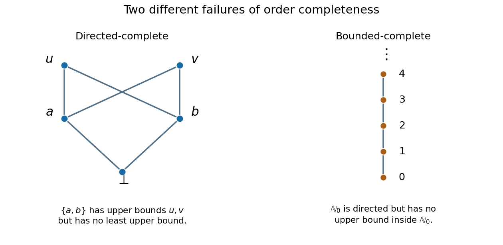

<h1 id="7/b/solution">Solution</h1>

↑ **Parent:** [B](../b.md)

Take the five-element [partially ordered set](../../../../../partially-ordered-set.md) $P=\{\bot,a,b,u,v\}$. Its strict comparisons are $\bot

**[Figure 1](#7/b/image-two-different-failures-of-order-completeness). Two different failures of order completeness**.

A [finite directed set has a greatest element](../../../../../finite-directed-set-has-a-greatest-element.md) whenever it is nonempty: list its elements and repeatedly use directedness to find an internal [upper bound](../../../../../upper-bound-in-a-partially-ordered-set.md) of the previously chosen element and the next one. The final element is above every member of the [directed set](../../../../../directed-set.md), and is its [least upper bound](../../../../../least-upper-bound-in-a-partially-ordered-set.md). Thus every nonempty [directed set](../../../../../directed-set.md) in $P$ has a [least upper bound](../../../../../least-upper-bound-in-a-partially-ordered-set.md). The empty subset also has a [least upper bound](../../../../../least-upper-bound-in-a-partially-ordered-set.md), namely $\bot$. Therefore $P$ satisfies the paper's completeness condition under either convention.

However, $\{a,b\}$ is bounded above by both $u$ and $v$. A [least upper bound](../../../../../least-upper-bound-in-a-partially-ordered-set.md) would have to be an [upper bound](../../../../../upper-bound-in-a-partially-ordered-set.md) lying below both $u$ and $v$. Neither $u$ nor $v$ has that property, and none of $\bot,a,b$ is an [upper bound](../../../../../upper-bound-in-a-partially-ordered-set.md) of $\{a,b\}$. Hence

$$
\boxed{P\text{ is directed-complete but not bounded-complete}.}
$$

## ↑ Ancestors (12)

1. [B](../b.md)
2. [7](../../7.md)
3. [Calculus, probability, linear algebra, discrete mathematics, logic and proof, and models of computation](../../../calculus-probability-linear-algebra-discrete-mathematics-logic-and-proof-and-models-of-computation-split.md)
4. [2003](../../../split.md)
5. [Past exam of the year 1 of the computer science course of the University of Oxford](../../../../split.md)
6. [Year 1 of the computer science course of the University of Oxford](../../../../../year-1-of-the-computer-science-course-of-the-university-of-oxford.md)
7. [Computer science course of the University of Oxford](../../../../../computer-science-course-of-the-university-of-oxford.md)
8. [Undergraduate course of the University of Oxford](../../../../../undergraduate-course-of-the-university-of-oxford.md)
9. [Course of the University of Oxford](../../../../../course-of-the-university-of-oxford.md)
10. [University of Oxford](../../../../../university-of-oxford-split.md)
11. [List of universities](../../../../../list-of-universities.md)
12. [Codex Wiki](../../../../../split.md)
