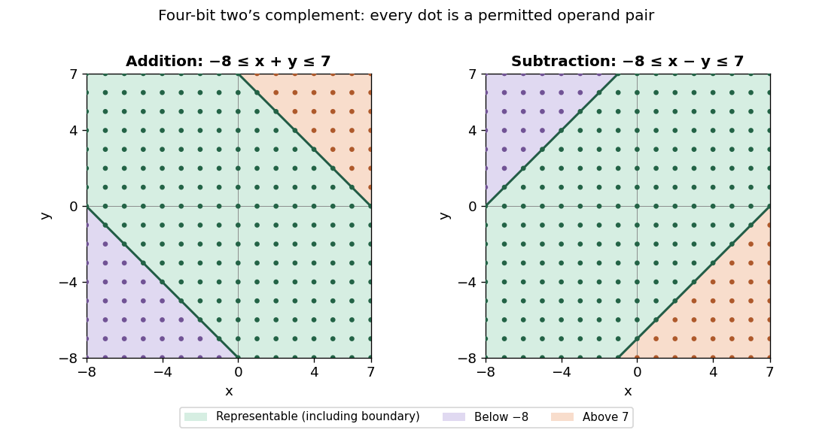

<h1 id="10/a/ii/solution">Solution</h1>

↑ **Parent:** [Ii](../ii.md)

Write $H=2^{n-1}$ and $U=H-1$. The operands occupy the [integer](../../../../../../integer-split.md) points of the square $[-H,U]^2$. The exact sum is representable precisely when

$$
\boxed{-H\leq x+y\leq U.}
$$

The upper boundary is $y=U-x$, and the lower boundary is $y=-H-x$. Within the operand square, the closed band between these lines is representable. The triangle below the lower line has negative overflow, and the triangle above the upper line has positive overflow. The boundary lines themselves are included.

**[Figure 2](#10/a/ii/image-exact-addition-and-subtraction-ranges-for-four-bit-two-s-complement-operands). Exact addition and subtraction ranges for four-bit two's complement operands**.

Consequently overflow occurs exactly when $x+y<-H$ or $x+y>U$. Negative overflow requires two negative operands; positive overflow requires two nonnegative operands. Same-sign operands alone are not sufficient: their exact sum must cross a range endpoint. Opposite-sign operands never overflow on addition. In terms of the stored wrapped result, addition overflows exactly when the operands have equal sign [bits](../../../../../../bit.md) and the result has the opposite sign [bit](../../../../../../bit.md).

The illustration uses $n=4$, so $H=8$ and $U=7$, and marks every permissible operand pair. The general region follows from the same two inequalities for arbitrary $n\geq1$.

## ↑ Ancestors (13)

1. [Ii](../ii.md)
2. [A](../../a.md)
3. [10](../../../10.md)
4. [Functional programming, data structures and algorithms, procedural programming, and digital hardware](../../../../functional-programming-data-structures-and-algorithms-procedural-programming-and-digital-hardware-split.md)
5. [2003](../../../../split.md)
6. [Past exam of the year 1 of the computer science course of the University of Oxford](../../../../../split.md)
7. [Year 1 of the computer science course of the University of Oxford](../../../../../../year-1-of-the-computer-science-course-of-the-university-of-oxford.md)
8. [Computer science course of the University of Oxford](../../../../../../computer-science-course-of-the-university-of-oxford.md)
9. [Undergraduate course of the University of Oxford](../../../../../../undergraduate-course-of-the-university-of-oxford.md)
10. [Course of the University of Oxford](../../../../../../course-of-the-university-of-oxford.md)
11. [University of Oxford](../../../../../../university-of-oxford-split.md)
12. [List of universities](../../../../../../list-of-universities.md)
13. [Codex Wiki](../../../../../../split.md)
