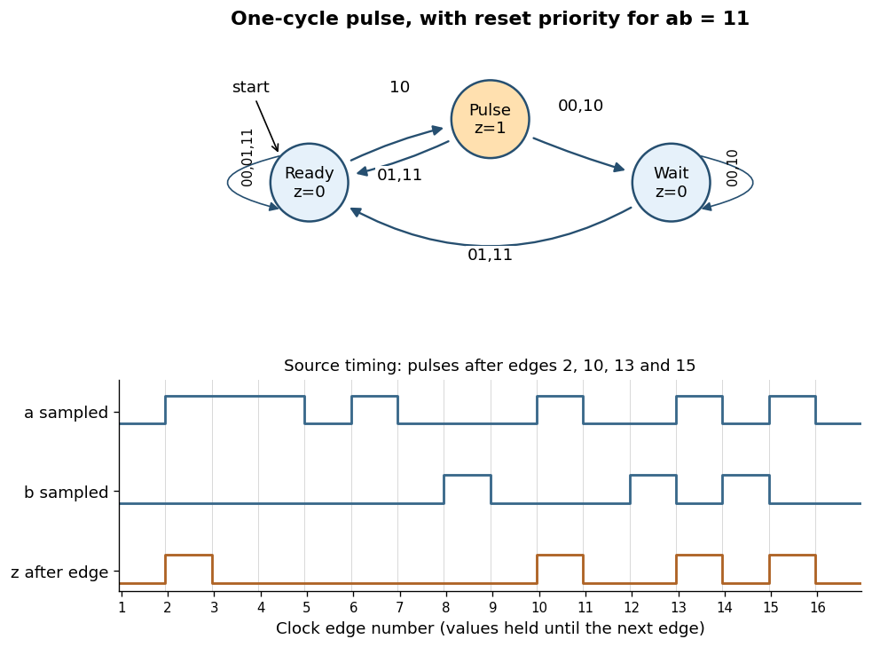

<h1 id="10/b/iii/solution">Solution</h1>

↑ **Parent:** [Iii](../iii.md)

Use a three-state [Moore machine](../../../../../../moore-machine.md) for a [rearmable one-cycle pulse generator](../../../../../../rearmable-one-cycle-pulse-generator.md). Call the states `Ready`, `Pulse`, and `Wait`. Their outputs are respectively $z=0,1,0$, and initialize in `Ready`. Labels below are the sampled input pair `ab`; because simultaneous ones are unspecified, choose reset priority for `11`.

**[Figure 3](#10/b/iii/image-rearmable-one-cycle-pulse-generator-and-reproduction-of-the-specified-timing-behavior). Rearmable one-cycle pulse generator and reproduction of the specified timing behavior**.

The complete chosen [state transition table](../../../../../../state-transition-table.md) is

| State | $z$ | $ab=00$ | $ab=01$ | $ab=10$ | $ab=11$ |
| --- | --- | --- | --- | --- | --- |
| `Ready` | $0$ | `Ready` | `Ready` | `Pulse` | `Ready` |
| `Pulse` | $1$ | `Wait` | `Ready` | `Wait` | `Ready` |
| `Wait` | $0$ | `Wait` | `Ready` | `Wait` | `Ready` |

A sampled trigger `10` causes a pulse only in `Ready`. Leaving `Pulse` unconditionally on the next edge keeps its output high for exactly one [clock period](../../../../../../clock-period.md), even if `a` remains high. In `Wait`, further triggers are ignored until a sampled reset rearms the [finite-state machine](../../../../../../finite-state-machine.md).

The crucial transition is `Pulse --01--> Ready`. If reset occurs in the cycle immediately following a trigger, this transition both ends the current pulse and rearms the circuit. The next trigger then produces a pulse after just one intervening low-output cycle. Sending every exit from `Pulse` to `Wait` would lose that reset and fail the alternate-cycle requirement. This behavior is explicitly visible in the last three pulses of the original timing diagram.[Printed p. 8, Question 10(b)(iii), last reset and trigger alternations](../../../../../../functional-programming-data-structures-and-algorithms-procedural-programming-and-digital-hardware-examination-paper-by-the-university-of-oxford-2003.md)

For the sixteen sampled pairs in that diagram, numbering the first edge as 1, `z` is high just after edges $2,10,13,15$ and low after every other edge. Equivalently,

$$
\boxed{z_k=1\iff s_k=\mathrm{Pulse},\quad
\mathrm{Pulse}\xrightarrow{b=1}\mathrm{Ready},\quad
\mathrm{Ready}\xrightarrow{a=1,b=0}\mathrm{Pulse}.}
$$

The two low-output states cannot be merged: the same future trigger must produce a pulse from `Ready` and be ignored from `Wait`. A separate high-output state is needed to hold the one-cycle pulse, explaining the three-state design.

## ↑ Ancestors (13)

1. [Iii](../iii.md)
2. [B](../../b.md)
3. [10](../../../10.md)
4. [Functional programming, data structures and algorithms, procedural programming, and digital hardware](../../../../functional-programming-data-structures-and-algorithms-procedural-programming-and-digital-hardware-split.md)
5. [2003](../../../../split.md)
6. [Past exam of the year 1 of the computer science course of the University of Oxford](../../../../../split.md)
7. [Year 1 of the computer science course of the University of Oxford](../../../../../../year-1-of-the-computer-science-course-of-the-university-of-oxford.md)
8. [Computer science course of the University of Oxford](../../../../../../computer-science-course-of-the-university-of-oxford.md)
9. [Undergraduate course of the University of Oxford](../../../../../../undergraduate-course-of-the-university-of-oxford.md)
10. [Course of the University of Oxford](../../../../../../course-of-the-university-of-oxford.md)
11. [University of Oxford](../../../../../../university-of-oxford-split.md)
12. [List of universities](../../../../../../list-of-universities.md)
13. [Codex Wiki](../../../../../../split.md)
