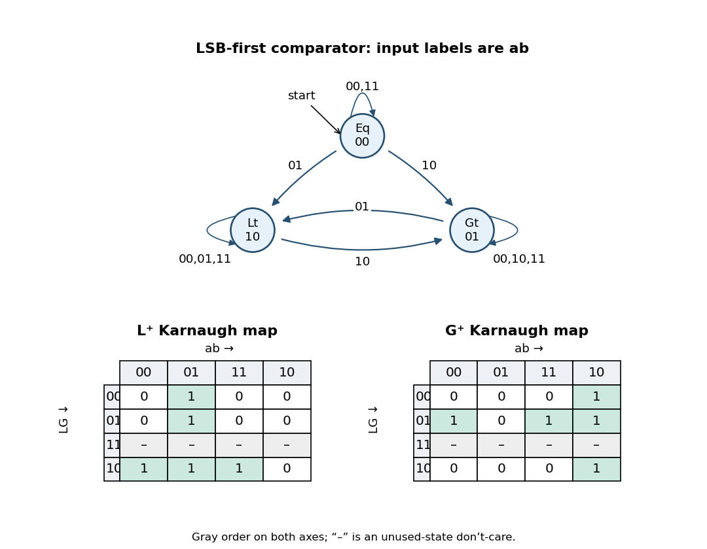

<h1 id="9/c/solution">Solution</h1>

↑ **Parent:** [C](../c.md)

The [finite-state machine](../../../../../finite-state-machine.md) retains its state on input `00` or `11`, moves to `Lt` on `01`, and moves to `Gt` on `10`. Here each input label is the pair `ab`, not a pair of outputs. The following [state-transition diagram](../../../../../state-transition-diagram.md) shows every valid-state transition; a diagonal input is stronger than all previous comparison history because it arrives at a more significant position.

**[Figure 1](#9/c/image-least-significant-first-comparator-transitions-and-karnaugh-maps). Least-significant-first comparator transitions and Karnaugh maps**.

Equivalently the complete transition rule is

$$
\boxed{\delta(s,a,b)=\begin{cases}\mathrm{Lt}&a=0,\ b=1,\\
\mathrm{Gt}&a=1,\ b=0,\\
s&a=b.\end{cases}}
$$

The [state-transition diagram](../../../../../state-transition-diagram.md) starts at `Eq`, representing the comparison of two empty, hence zero-valued, bit strings.

## ↑ Ancestors (12)

1. [C](../c.md)
2. [9](../../9.md)
3. [Functional programming, data structures and algorithms, procedural programming, and digital hardware](../../../functional-programming-data-structures-and-algorithms-procedural-programming-and-digital-hardware-split.md)
4. [2003](../../../split.md)
5. [Past exam of the year 1 of the computer science course of the University of Oxford](../../../../split.md)
6. [Year 1 of the computer science course of the University of Oxford](../../../../../year-1-of-the-computer-science-course-of-the-university-of-oxford.md)
7. [Computer science course of the University of Oxford](../../../../../computer-science-course-of-the-university-of-oxford.md)
8. [Undergraduate course of the University of Oxford](../../../../../undergraduate-course-of-the-university-of-oxford.md)
9. [Course of the University of Oxford](../../../../../course-of-the-university-of-oxford.md)
10. [University of Oxford](../../../../../university-of-oxford-split.md)
11. [List of universities](../../../../../list-of-universities.md)
12. [Codex Wiki](../../../../../split.md)
