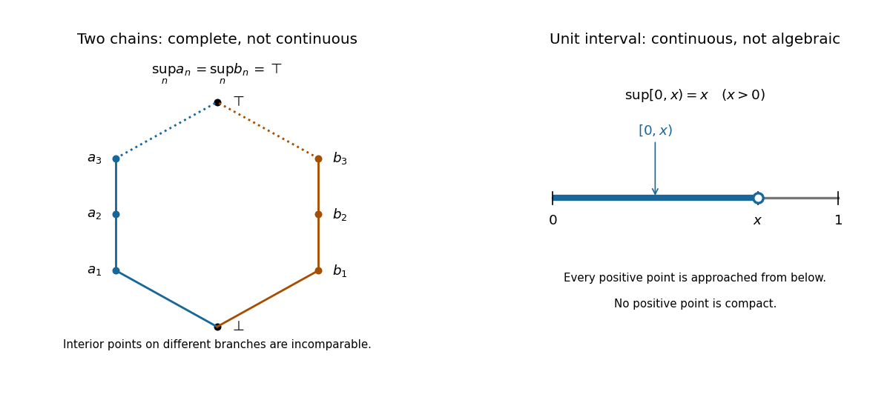

# Calculus, linear algebra, discrete mathematics, logic and proof, and models of computation

↑ **Parent:** [2005](../2005.md)

Original examination: [Calculus, linear algebra, discrete mathematics, logic and proof, and models of computation examination paper by the University of Oxford (2005)](../../computer-science-bibliography.md#calculus-linear-algebra-discrete-mathematics-logic-and-proof-and-models-of-computation-examination-paper-by-the-university-of-oxford-2005).

**Table of contents**

- [1](#1)
  - [a](#1/a)
    - [Solution](#1/a/solution)
  - [b](#1/b)
    - [Solution](#1/b/solution)
  - [c](#1/c)
    - [Solution](#1/c/solution)
  - [d](#1/d)
    - [Solution](#1/d/solution)
- [2](#2)
  - [a](#2/a)
    - [Solution](#2/a/solution)
  - [b](#2/b)
    - [Solution](#2/b/solution)
  - [c](#2/c)
    - [Solution](#2/c/solution)
- [3](#3)
  - [a](#3/a)
    - [i](#3/a/i)
      - [Solution](#3/a/i/solution)
    - [ii](#3/a/ii)
      - [Solution](#3/a/ii/solution)
  - [b](#3/b)
    - [Solution](#3/b/solution)
- [4](#4)
  - [a](#4/a)
    - [i](#4/a/i)
      - [Solution](#4/a/i/solution)
    - [ii](#4/a/ii)
      - [Solution](#4/a/ii/solution)
  - [b](#4/b)
    - [i](#4/b/i)
      - [Solution](#4/b/i/solution)
    - [ii](#4/b/ii)
      - [Solution](#4/b/ii/solution)
    - [iii](#4/b/iii)
      - [Solution](#4/b/iii/solution)
- [5](#5)
  - [b](#5/b)
    - [i](#5/b/i)
      - [Solution](#5/b/i/solution)
    - [ii](#5/b/ii)
      - [Solution](#5/b/ii/solution)
    - [iii](#5/b/iii)
      - [Solution](#5/b/iii/solution)
    - [iv](#5/b/iv)
      - [Solution](#5/b/iv/solution)
- [6](#6)
  - [a](#6/a)
    - [Solution](#6/a/solution)
  - [b](#6/b)
    - [Solution](#6/b/solution)
  - [c](#6/c)
    - [Solution](#6/c/solution)
- [7](#7)
  - [a](#7/a)
    - [Solution](#7/a/solution)
  - [b](#7/b)
    - [Solution](#7/b/solution)
  - [c](#7/c)
    - [Solution](#7/c/solution)
- [8](#8)
  - [a](#8/a)
    - [Solution](#8/a/solution)
  - [b](#8/b)
    - [Solution](#8/b/solution)
  - [c](#8/c)
    - [Solution](#8/c/solution)
  - [d](#8/d)
    - [Solution](#8/d/solution)
- [9](#9)
  - [a](#9/a)
    - [Solution](#9/a/solution)
  - [b](#9/b)
    - [i](#9/b/i)
      - [Solution](#9/b/i/solution)
    - [ii](#9/b/ii)
      - [Solution](#9/b/ii/solution)
    - [iii](#9/b/iii)
      - [Solution](#9/b/iii/solution)
    - [iv](#9/b/iv)
      - [Solution](#9/b/iv/solution)
  - [c](#9/c)
    - [Solution](#9/c/solution)
- [10](#10)
  - [a](#10/a)
    - [Solution](#10/a/solution)
  - [b](#10/b)
    - [Solution](#10/b/solution)
  - [c](#10/c)
    - [Solution](#10/c/solution)

## 1

↑ **Parent:** [Calculus, linear algebra, discrete mathematics, logic and proof, and models of computation](calculus-linear-algebra-discrete-mathematics-logic-and-proof-and-models-of-computation.md)

<h3 id="1/a">a</h3>

↑ **Parent:** [1](#1)

<h4 id="1/a/solution">Solution</h4>

↑ **Parent:** [A](#1/a)

The [image of a linear map](../../vector-space.md#image-of-a-linear-map) and [kernel of a linear map](../../kernel-of-a-linear-map.md) are

$$
\boxed{\operatorname{im}T=\{T(v):v\in V\}\subseteq W,\qquad\ker T=\{v\in V:T(v)=0\}\subseteq V.}
$$

A [linear map](../../vector-space.md#linear-map) sends zero to zero, since $T(0)=T(0+0)=T(0)+T(0)$. Thus both displayed [sets](../../set.md) contain zero. If $w_1=T(v_1)$ and $w_2=T(v_2)$ belong to the [image of a linear map](../../vector-space.md#image-of-a-linear-map), then for any real [scalars](../../vector-space.md#scalar) $a,b$,

$$
aw_1+bw_2=T(av_1+bv_2)\in\operatorname{im}T.
$$

If $v_1,v_2$ belong to the [kernel of a linear map](../../kernel-of-a-linear-map.md), then

$$
T(av_1+bv_2)=aT(v_1)+bT(v_2)=0,
$$

so $av_1+bv_2\in\ker T$. Containing zero and being closed under [linear combinations](../../vector-space.md#linear-combination) is the [vector subspace](../../vector-space.md#vector-subspace) criterion. Hence the [image of a linear map](../../vector-space.md#image-of-a-linear-map) is a [vector subspace](../../vector-space.md#vector-subspace) of $W$, and the [kernel of a linear map](../../kernel-of-a-linear-map.md) is a [vector subspace](../../vector-space.md#vector-subspace) of $V$.

<h3 id="1/b">b</h3>

↑ **Parent:** [1](#1)

<h4 id="1/b/solution">Solution</h4>

↑ **Parent:** [B](#1/b)

The [rank-nullity theorem](../../kernel-of-a-linear-map.md#rank-nullity-theorem) says that for a [linear map](../../vector-space.md#linear-map) $T:V\to W$ with finite-dimensional [domain of a function](../../function.md#domain-of-a-function) $V$,

$$
\boxed{\dim V=\dim\ker T+\dim\operatorname{im}T=\operatorname{nullity}T+\operatorname{rank}T.}
$$

Take a [basis](../../vector-space.md#basis) $k_1,\ldots,k_r$ of the [kernel of a linear map](../../kernel-of-a-linear-map.md) and use [basis extension](../../vector-space.md#basis-extension) to obtain a [basis](../../vector-space.md#basis) $k_1,\ldots,k_r,u_1,\ldots,u_s$ of $V$. We show that $T(u_1),\ldots,T(u_s)$ is a [basis](../../vector-space.md#basis) of the [image of a linear map](../../vector-space.md#image-of-a-linear-map).

Every $v\in V$ is a [linear combination](../../vector-space.md#linear-combination) of the extended [basis](../../vector-space.md#basis), and its $k_i$ terms vanish under $T$. Therefore $T(v)$ is a [linear combination](../../vector-space.md#linear-combination) of the $T(u_j)$, proving the required [linear span](../../vector-space.md#linear-span) property. For [linear independence](../../vector-space.md#linear-independence), suppose $\sum_j b_jT(u_j)=0$. Then $\sum_j b_ju_j\in\ker T$, so $\sum_j b_ju_j=\sum_i a_ik_i$ for some real [scalars](../../vector-space.md#scalar) $a_i$. The extended [basis](../../vector-space.md#basis) is [linearly independent](../../vector-space.md#linear-independence), forcing every $a_i$ and $b_j$ to be zero. Thus the [image of a linear map](../../vector-space.md#image-of-a-linear-map) has [dimension](../../vector-space.md#dimension-vector-space) $s$, the [kernel of a linear map](../../kernel-of-a-linear-map.md) has [dimension](../../vector-space.md#dimension-vector-space) $r$, and $\dim V=r+s$ proves the result.

<h3 id="1/c">c</h3>

↑ **Parent:** [1](#1)

<h4 id="1/c/solution">Solution</h4>

↑ **Parent:** [C](#1/c)

A [basis](../../vector-space.md#basis) provides unique coordinates. Define

$$
\boxed{\alpha(a_1e_1+a_2e_2+a_3e_3)=a_1v_1+a_2v_2+a_3v_3.}
$$

The uniqueness of the coordinates makes this a well-defined [function](../../function.md). Adding coordinates and multiplying them by a real [scalar](../../vector-space.md#scalar) shows directly that $\alpha(au+bw)=a\alpha(u)+b\alpha(w)$, so it is a [linear map](../../vector-space.md#linear-map). Substituting $e_i$ gives $\alpha(e_i)=v_i$.

Conversely, every [linear map](../../vector-space.md#linear-map) with those three values must send $\sum_i a_ie_i$ to $\sum_i a_iv_i$, by preservation of [linear combinations](../../vector-space.md#linear-combination). This determines its value on every element of $V$, proving uniqueness. No [linear independence](../../vector-space.md#linear-independence) of $v_1,v_2,v_3$ is needed.

<h3 id="1/d">d</h3>

↑ **Parent:** [1](#1)

<h4 id="1/d/solution">Solution</h4>

↑ **Parent:** [D](#1/d)

Here $v_3=2v_1-v_2$, so the [image of a linear map](../../vector-space.md#image-of-a-linear-map) is the [linear span](../../vector-space.md#linear-span) of $v_1,v_2$. These two [vectors](../../vector-space.md#vector) are [linearly independent](../../vector-space.md#linear-independence): if $av_1+bv_2=0$, the $e_1$ and $e_2$ coordinates give $a+b=0$ and $a-b=0$, hence $a=b=0$. Consequently the [rank of a linear map](../../vector-space.md#rank-of-a-linear-map) is two. By the [rank-nullity theorem](../../kernel-of-a-linear-map.md#rank-nullity-theorem), the [nullity](../../kernel-of-a-linear-map.md#nullity-of-a-linear-map) is $3-2=1$:

$$
\boxed{\operatorname{rank}\alpha=2,\qquad\operatorname{nullity}\alpha=1.}
$$

More explicitly, the relation $-2v_1+v_2+v_3=0$ gives the [kernel of a linear map](../../kernel-of-a-linear-map.md)

$$
\ker\alpha=\operatorname{span}\{-2e_1+e_2+e_3\}.
$$

## 2

↑ **Parent:** [Calculus, linear algebra, discrete mathematics, logic and proof, and models of computation](calculus-linear-algebra-discrete-mathematics-logic-and-proof-and-models-of-computation.md)

<h3 id="2/a">a</h3>

↑ **Parent:** [2](#2)

<h4 id="2/a/solution">Solution</h4>

↑ **Parent:** [A](#2/a)

The printed word “eigenvalues” must read “eigenvectors”: [eigenvalues](../../linear-operator-theory.md#eigenvalue) are real numbers, whereas a [basis](../../vector-space.md#basis) of $\mathbb R^n$ consists of [vectors](../../vector-space.md#vector). The intended assertion is

$$
\boxed{A\text{ is diagonalizable over }\mathbb R\iff\mathbb R^n\text{ has a basis of eigenvectors of }A.}
$$

This wording error is present in the original scan.[Printed p. 2, Q2(a), “basis consisting of eigenvalues”](../../computer-science-bibliography.md#calculus-linear-algebra-discrete-mathematics-logic-and-proof-and-models-of-computation-examination-paper-by-the-university-of-oxford-2005)

If $X^{-1}AX=D=\operatorname{diag}(\lambda_1,\ldots,\lambda_n)$ for an [invertible matrix](../../linear-algebra.md#invertible-matrix) $X$, write $x_i$ for its columns. The [matrix](../../vector-space.md#matrix) identity $AX=XD$ says $Ax_i=\lambda_ix_i$. The columns of an [invertible matrix](../../linear-algebra.md#invertible-matrix) are a [basis](../../vector-space.md#basis), hence they give the required [basis](../../vector-space.md#basis) of [eigenvectors](../../linear-operator-theory.md#eigenvector).

Conversely, put a [basis](../../vector-space.md#basis) of real [eigenvectors](../../linear-operator-theory.md#eigenvector) $x_1,\ldots,x_n$ into the columns of $X$, with corresponding [eigenvalues](../../linear-operator-theory.md#eigenvalue) $\lambda_i$. The [basis](../../vector-space.md#basis) property makes $X$ an [invertible matrix](../../linear-algebra.md#invertible-matrix). The equations $Ax_i=\lambda_ix_i$ give $AX=XD$, so $X^{-1}AX=D$. This is precisely [diagonalizability](../../linear-operator-theory.md#diagonalizable-matrix) over the real numbers.

<h3 id="2/b">b</h3>

↑ **Parent:** [2](#2)

<h4 id="2/b/solution">Solution</h4>

↑ **Parent:** [B](#2/b)

For the first [matrix](../../vector-space.md#matrix), the [characteristic polynomial](../../linear-operator-theory.md#characteristic-polynomial) is

$$
\det(tI-A)=(t-3)\big((t-2)(t-1)-6\big)=(t-3)(t-4)(t+1).
$$

Thus the real [eigenvalues](../../linear-operator-theory.md#eigenvalue) are $4,-1,3$. Corresponding [eigenvectors](../../linear-operator-theory.md#eigenvector) are $(3,1,0)^\mathsf T$, $(-2,1,0)^\mathsf T$ and $(0,0,1)^\mathsf T$. They are [linearly independent](../../vector-space.md#linear-independence); the [determinant](../../multilinear-algebra.md#determinant) of the [matrix](../../vector-space.md#matrix) with these columns is $5$. Therefore

$$
\boxed{X=\begin{pmatrix}3&-2&0\\1&1&0\\0&0&1\end{pmatrix},\qquad X^{-1}AX=\operatorname{diag}(4,-1,3).}
$$

For example, multiplying the first column by $A$ gives $(12,4,0)^\mathsf T$, four times that column; multiplying the second gives $(2,-1,0)^\mathsf T$, its negative. These also check the chosen [eigenvectors](../../linear-operator-theory.md#eigenvector) directly.

For the second [matrix](../../vector-space.md#matrix),

$$
\det(tI-A)=t^3-1=(t-1)(t^2+t+1).
$$

The quadratic factor has negative [discriminant](../../polynomial.md#discriminant) $-3$, so $1$ is the only real [eigenvalue](../../linear-operator-theory.md#eigenvalue). Solving $Av=v$ gives $v=(a,a,a)^\mathsf T$, a one-dimensional [eigenspace](../../linear-operator-theory.md#eigenspace). It cannot provide a [basis](../../vector-space.md#basis) of $\mathbb R^3$, so

$$
\boxed{\text{the only real eigenvalue is }1;\quad A\text{ is not diagonalizable over }\mathbb R.}
$$

<h3 id="2/c">c</h3>

↑ **Parent:** [2](#2)

<h4 id="2/c/solution">Solution</h4>

↑ **Parent:** [C](#2/c)

Let $\lambda$ be the single [eigenvalue](../../linear-operator-theory.md#eigenvalue). By [diagonalizability](../../linear-operator-theory.md#diagonalizable-matrix), there is a [basis](../../vector-space.md#basis) $v_1,\ldots,v_n$ of [eigenvectors](../../linear-operator-theory.md#eigenvector), and every corresponding [eigenvalue](../../linear-operator-theory.md#eigenvalue) is $\lambda$. For any $v=\sum_i a_iv_i$, [linearity](../../vector-space.md#linearity) gives

$$
T(v)=\sum_i a_iT(v_i)=\sum_i a_i\lambda v_i=\lambda v.
$$

Thus $\boxed{T=\lambda I}$, a [scalar multiple](../../vector-space.md#scalar-multiple) of the [identity map](../../function.md#identity-function).

A counterexample to the conclusion without [diagonalizability](../../linear-operator-theory.md#diagonalizable-matrix) is

$$
\boxed{J=\begin{pmatrix}2&1\\0&2\end{pmatrix}.}
$$

Its [characteristic polynomial](../../linear-operator-theory.md#characteristic-polynomial) is $(t-2)^2$, but $(J-2I)(a,b)^\mathsf T=(b,0)^\mathsf T$. The [eigenspace](../../linear-operator-theory.md#eigenspace) for $2$ is therefore $\operatorname{span}\{(1,0)^\mathsf T\}$, of [dimension](../../vector-space.md#dimension-vector-space) one. There is no [basis](../../vector-space.md#basis) of [eigenvectors](../../linear-operator-theory.md#eigenvector) in [dimension](../../vector-space.md#dimension-vector-space) two, so $J$ is not [diagonalizable](../../linear-operator-theory.md#diagonalizable-matrix).

## 3

↑ **Parent:** [Calculus, linear algebra, discrete mathematics, logic and proof, and models of computation](calculus-linear-algebra-discrete-mathematics-logic-and-proof-and-models-of-computation.md)

<h3 id="3/a">a</h3>

↑ **Parent:** [3](#3)

<h4 id="3/a/i">i</h4>

↑ **Parent:** [A](#3/a)

<h5 id="3/a/i/solution">Solution</h5>

↑ **Parent:** [I](#3/a/i)

The [homogeneous linear differential equation](../../differential-equation.md#homogeneous-linear-differential-equation) has solutions $\cos x$ and $\sin x$. Since the forcing is already a homogeneous solution, seek a [particular solution](../../linear-ordinary-differential-equation.md#particular-solution) proportional to $x\cos x$. Direct [differentiation](../../calculus.md#differentiation) gives

$$
\left(-\tfrac12x\cos x\right)''-\tfrac12x\cos x=\sin x.
$$

Thus the general solution of the [linear ordinary differential equation](../../linear-ordinary-differential-equation.md) is

$$
y=A\cos x+B\sin x-\tfrac12x\cos x.
$$

The first [initial condition](../../differential-equation.md#initial-condition) gives $A=0$. Also

$$
y'=-A\sin x+B\cos x-\tfrac12\cos x+\tfrac12x\sin x,
$$

so the second [initial condition](../../differential-equation.md#initial-condition) gives $B-\tfrac12=-\tfrac12$, hence $B=0$. Therefore

$$
\boxed{y(x)=-\tfrac12x\cos x.}
$$

<h4 id="3/a/ii">ii</h4>

↑ **Parent:** [A](#3/a)

<h5 id="3/a/ii/solution">Solution</h5>

↑ **Parent:** [Ii](#3/a/ii)

For $y_1=e^x/x$, on an [interval](../../real-analysis.md#interval-mathematics) avoiding zero,

$$
y_1'=e^x\left(\frac1x-\frac1{x^2}\right),\qquad y_1''=e^x\left(\frac1x-\frac2{x^2}+\frac2{x^3}\right).
$$

Substitution into the [ordinary differential equation](../../differential-equation.md#ordinary-differential-equation) gives

$$
xy_1''+2y_1'-xy_1=e^x\left(1-\frac2x+\frac2{x^2}+\frac2x-\frac2{x^2}-1\right)=0.
$$

To find an independent solution, put $v=xy$. The [product rule](../../calculus.md#product-rule) gives $v''=xy''+2y'$, so the [ordinary differential equation](../../differential-equation.md#ordinary-differential-equation) becomes $v''-v=0$. Its independent solutions are $e^x$ and $e^{-x}$. Hence

$$
\boxed{y_2(x)=\frac{e^{-x}}x,\qquad y(x)=\frac{Ae^x+Be^{-x}}x\quad(x\ne0).}
$$

The two displayed solutions are [linearly independent](../../vector-space.md#linear-independence), since their ratio $e^{2x}$ is nonconstant on any open [interval](../../real-analysis.md#interval-mathematics). Constants can be chosen separately on the two sides of the singular point $x=0$.

<h3 id="3/b">b</h3>

↑ **Parent:** [3](#3)

<h4 id="3/b/solution">Solution</h4>

↑ **Parent:** [B](#3/b)

The [logarithm](../../calculus.md#logarithm) requires $y>0$, and $x>0$ is given. Set $z=\log(y/x)$, so $y=xe^z$ and the [chain rule](../../calculus.md#chain-rule) yields $xy'/y=1+xz'$. Dividing the [ordinary differential equation](../../differential-equation.md#ordinary-differential-equation) by $y$ therefore gives

$$
1+xz'=1+z,\qquad xz'=z.
$$

Since $(z/x)'=(xz'-z)/x^2=0$, we obtain $z=Cx$, including the case $z=0$. Thus the general positive solution is $y=xe^{Cx}$. The [initial condition](../../differential-equation.md#initial-condition) $y(1)=e$ gives $C=1$:

$$
\boxed{y(x)=xe^x.}
$$

For the separate decay requirement, $xe^{Cx}\to0$ precisely when $C<0$: if $C=0$, the result is $x$, and if $C>0$, it grows. Consequently the full family with the stated [limit](../../calculus.md#limit-of-a-function) is

$$
\boxed{y(x)=xe^{-ax},\qquad a>0,\quad x>0.}
$$

This latter family does not also satisfy $y(1)=e$; the solution selected by that [initial condition](../../differential-equation.md#initial-condition) grows. The identically zero [function](../../function.md) is excluded by the original [logarithm](../../calculus.md#logarithm).

## 4

↑ **Parent:** [Calculus, linear algebra, discrete mathematics, logic and proof, and models of computation](calculus-linear-algebra-discrete-mathematics-logic-and-proof-and-models-of-computation.md)

<h3 id="4/a">a</h3>

↑ **Parent:** [4](#4)

<h4 id="4/a/i">i</h4>

↑ **Parent:** [A](#4/a)

<h5 id="4/a/i/solution">Solution</h5>

↑ **Parent:** [I](#4/a/i)

For $r>0$, the [chain rule](../../calculus.md#chain-rule) gives $r_x=x/r$ and $r_y=y/r$. Applying it twice to the [radial function](../../partial-differential-equation.md#radial-function) $u=f(r)$ gives

$$
u_{xx}=f''\frac{x^2}{r^2}+f'\left(\frac1r-\frac{x^2}{r^3}\right),\qquad u_{yy}=f''\frac{y^2}{r^2}+f'\left(\frac1r-\frac{y^2}{r^3}\right).
$$

Using $x^2+y^2=r^2$, [Laplace's equation](../../partial-differential-equation.md#laplace-equation) becomes

$$
f''+\frac1rf'=0,\qquad (rf')'=0.
$$

Two [integrations](../../integral.md) now give

$$
\boxed{u(x,y)=A\log r+B,\qquad r=\sqrt{x^2+y^2}>0.}
$$

These are the general solutions of the specified [radial function](../../partial-differential-equation.md#radial-function) form on an [annulus](../../topology.md#annulus-mathematics) or a punctured plane. If the solution must extend continuously to the origin, the [logarithm](../../calculus.md#logarithm) term forces $A=0$, leaving only a constant [function](../../function.md).

<h4 id="4/a/ii">ii</h4>

↑ **Parent:** [A](#4/a)

<h5 id="4/a/ii/solution">Solution</h5>

↑ **Parent:** [Ii](#4/a/ii)

Use the [product rule](../../calculus.md#product-rule) for the [Laplace operator](../../partial-differential-equation.md#laplace-operator):

$$
\Delta(xg(r))=x\Delta g(r)+2\partial_xg(r)=x\left(g''+\frac{g'}r\right)+2\frac{x}{r}g'=x\left(g''+\frac{3g'}r\right).
$$

Thus [Laplace's equation](../../partial-differential-equation.md#laplace-equation), away from the origin, reduces to $g''+3g'/r=0$. On the line $x=0$ the displayed expression vanishes automatically; requiring the equation on an open region gives the same radial equation by continuity from $x\ne0$. Multiplying by $r^3$ gives $(r^3g')'=0$, so $g'=Cr^{-3}$ and $g=A+Br^{-2}$. Therefore

$$
\boxed{u(x,y)=Ax+B\frac{x}{x^2+y^2},\qquad r>0.}
$$

If extension through the origin is required, $B=0$: along the horizontal axis the second term is $B/x$. The remaining [harmonic function](../../partial-differential-equation.md#harmonic-function) is $Ax$.

<h3 id="4/b">b</h3>

↑ **Parent:** [4](#4)

<h4 id="4/b/i">i</h4>

↑ **Parent:** [B](#4/b)

<h5 id="4/b/i/solution">Solution</h5>

↑ **Parent:** [I](#4/b/i)

For the [wave equation](../../wave-equation.md) with wave speed one, [D'Alembert's formula](../../wave-equation.md#d-alembert-s-formula) with arbitrary twice continuously differentiable initial displacement $h(x)=u(x,0)$ is

$$
u(x,t)=\frac{h(x+t)+h(x-t)}2+\frac12\int_{x-t}^{x+t}g(s)\,ds.
$$

The arbitrary [function](../../function.md) $h$ is essential: only the initial velocity is prescribed. For $g=0$, this gives

$$
\boxed{u(x,t)=\frac{h(x+t)+h(x-t)}2.}
$$

Both travelling terms solve the [wave equation](../../wave-equation.md), and their [time derivatives](../../multivariable-calculus.md#time-derivative) cancel at $t=0$. Conversely every classical solution has this form for its initial displacement $h$.

<h4 id="4/b/ii">ii</h4>

↑ **Parent:** [B](#4/b)

<h5 id="4/b/ii/solution">Solution</h5>

↑ **Parent:** [Ii](#4/b/ii)

The velocity contribution in [D'Alembert's formula](../../wave-equation.md#d-alembert-s-formula) is $\tfrac12\int_{x-t}^{x+t}1\,ds=t$. Hence, with arbitrary twice continuously differentiable $h$,

$$
\boxed{u(x,t)=\frac{h(x+t)+h(x-t)}2+t.}
$$

The added term has both second [partial derivatives](../../multivariable-calculus.md#partial-derivative) zero and has [time derivative](../../multivariable-calculus.md#time-derivative) one, so it supplies precisely the required [initial condition](../../differential-equation.md#initial-condition) while preserving the [wave equation](../../wave-equation.md).

<h4 id="4/b/iii">iii</h4>

↑ **Parent:** [B](#4/b)

<h5 id="4/b/iii/solution">Solution</h5>

↑ **Parent:** [Iii](#4/b/iii)

Here the velocity contribution in [D'Alembert's formula](../../wave-equation.md#d-alembert-s-formula) is

$$
\frac12\int_{x-t}^{x+t}e^s\,ds=\frac{e^{x+t}-e^{x-t}}2=e^x\sinh t.
$$

Thus, with arbitrary twice continuously differentiable $h$,

$$
\boxed{u(x,t)=\frac{h(x+t)+h(x-t)}2+e^x\sinh t.}
$$

For the added term, $u_{tt}=e^x\sinh t=u_{xx}$ and $u_t(x,0)=e^x\cosh0=e^x$. Its displacement at $t=0$ is zero, leaving $h$ free as required.

## 5

↑ **Parent:** [Calculus, linear algebra, discrete mathematics, logic and proof, and models of computation](calculus-linear-algebra-discrete-mathematics-logic-and-proof-and-models-of-computation.md)

<h3 id="5/b">b</h3>

↑ **Parent:** [5](#5)

<h4 id="5/b/i">i</h4>

↑ **Parent:** [B](#5/b)

<h5 id="5/b/i/solution">Solution</h5>

↑ **Parent:** [I](#5/b/i)

The [domain of a function](../../function.md#domain-of-a-function) is fixed by its declared type, so

$$
\boxed{\operatorname{dom}f=(0,\infty).}
$$

Although the rational expression also has values at some negative arguments, they are not in the specified [domain of a function](../../function.md#domain-of-a-function). Part (a) of the printed question only supplies the definition used in these four subparts.[Printed p. 4, Q5(a)–(b)](../../computer-science-bibliography.md#calculus-linear-algebra-discrete-mathematics-logic-and-proof-and-models-of-computation-examination-paper-by-the-university-of-oxford-2005)

<h4 id="5/b/ii">ii</h4>

↑ **Parent:** [B](#5/b)

<h5 id="5/b/ii/solution">Solution</h5>

↑ **Parent:** [Ii](#5/b/ii)

For $r>0$, solve $f(s)=r$ with $s>0$. Multiplying by the positive denominator gives $s^2+s=1/r$, so the [quadratic formula](../../polynomial.md#quadratic-formula) gives

$$
s=\frac{-1\pm\sqrt{1+4/r}}2.
$$

The minus sign gives a negative number and is inadmissible. The plus sign gives a positive number for every $r>0$, and it is the unique positive solution. Hence the [inverse function](../../function.md#inverse-function) is

$$
\boxed{g(r)=\frac{\sqrt{1+4/r}-1}{2},\qquad r>0.}
$$

Indeed $g(r)(g(r)+1)=1/r$, so $f(g(r))=r$. Conversely, for $s>0$, $\sqrt{1+4/f(s)}=\sqrt{(2s+1)^2}=2s+1$, giving $g(f(s))=s$. These verify both [inverse function](../../function.md#inverse-function) identities.

<h4 id="5/b/iii">iii</h4>

↑ **Parent:** [B](#5/b)

<h5 id="5/b/iii/solution">Solution</h5>

↑ **Parent:** [Iii](#5/b/iii)

For $s>0$, the denominator $s(s+1)$ is positive, so every value of $f$ is positive. Conversely, for every $r>0$, the positive number $s=(\sqrt{1+4/r}-1)/2$ satisfies $f(s)=r$. Thus its [image of a function](../../set-theory.md#image-of-a-function), or range, is

$$
\boxed{f((0,\infty))=(0,\infty).}
$$

One can also see the full range from [continuity](../../calculus.md#continuous-function) and [monotonicity](../../calculus.md#monotonic-function): $f$ is a [continuous function](../../calculus.md#continuous-function) with $f'(s)=-(2s+1)/(s^2+s)^2<0$, and its endpoint [limits](../../calculus.md#limit-of-a-function) are $+\infty$ as $s\to0^+$ and $0$ as $s\to\infty$. The endpoints themselves are not attained.

<h4 id="5/b/iv">iv</h4>

↑ **Parent:** [B](#5/b)

<h5 id="5/b/iv/solution">Solution</h5>

↑ **Parent:** [Iv](#5/b/iv)

The [partial fraction decomposition](../../isolated-singularity.md#partial-fraction-decomposition)

$$
f(i)=\frac1{i(i+1)}=\frac1i-\frac1{i+1}
$$

makes the sum a [telescoping sum](../../arithmetic.md#telescoping-sum). All interior terms cancel:

$$
\boxed{\sum_{i=1}^nf(i)=\left(1-\frac12\right)+\left(\frac12-\frac13\right)+\cdots+\left(\frac1n-\frac1{n+1}\right)=1-\frac1{n+1}=\frac n{n+1}.}
$$

## 6

↑ **Parent:** [Calculus, linear algebra, discrete mathematics, logic and proof, and models of computation](calculus-linear-algebra-discrete-mathematics-logic-and-proof-and-models-of-computation.md)

<h3 id="6/a">a</h3>

↑ **Parent:** [6](#6)

<h4 id="6/a/solution">Solution</h4>

↑ **Parent:** [A](#6/a)

Use the [two-chain noncontinuous complete partial order](../../set.md#two-chain-noncontinuous-complete-partial-order)

$$
\boxed{P=\{\bot,\top\}\cup\{a_n:n\geq1\}\cup\{b_n:n\geq1\},}
$$

where $\bot<a_1<a_2<\cdots<\top$ and $\bot<b_1<b_2<\cdots<\top$, with no comparisons between the two interiors. In this solution $\sup D$ denotes the [least upper bound](../../set.md#least-upper-bound-in-a-partially-ordered-set) printed as $\sqcap D$ in the question.[Printed p. 4, Q6, definitions preceding (a)](../../computer-science-bibliography.md#calculus-linear-algebra-discrete-mathematics-logic-and-proof-and-models-of-computation-examination-paper-by-the-university-of-oxford-2005)

Every nonempty [directed set](../../set.md#directed-set) containing $\top$ has [least upper bound](../../set.md#least-upper-bound-in-a-partially-ordered-set) $\top$. A [directed set](../../set.md#directed-set) omitting $\top$ cannot contain both an $a_i$ and a $b_j$, because their only common [upper bound](../../set.md#upper-bound-in-a-partially-ordered-set) in $P$ is $\top$, which would have to belong to that [directed set](../../set.md#directed-set). It therefore lies in one [chain](../../set.md#chain-in-a-partial-order), possibly with $\bot$. If its indices are bounded it has a greatest element, which is its [least upper bound](../../set.md#least-upper-bound-in-a-partially-ordered-set); if they are unbounded its [least upper bound](../../set.md#least-upper-bound-in-a-partially-ordered-set) is $\top$. Thus $P$ is a [directed-complete partial order](../../set.md#directed-complete-partial-order).

No element other than $\bot$ is [way-below](../../set.md#way-below-relation) $\top$. For $a_i$, the [directed set](../../set.md#directed-set) $\{b_n:n\geq1\}$ has [least upper bound](../../set.md#least-upper-bound-in-a-partially-ordered-set) $\top$, but none of its members is above $a_i$. Interchanging the two [chains](../../set.md#chain-in-a-partial-order) excludes every $b_i$. Either [chain](../../set.md#chain-in-a-partial-order) excludes $\top$ itself. On the other hand, $\bot\ll\top$: every [directed set](../../set.md#directed-set) whose [least upper bound](../../set.md#least-upper-bound-in-a-partially-ordered-set) is above $\top$ is nonempty, and any member is above $\bot$. Hence

$$
\{y:y\ll\top\}=\{\bot\},\qquad\sup\{y:y\ll\top\}=\bot\ne\top.
$$

So $P$ is **not a [continuous directed-complete partial order](../../set.md#continuous-directed-complete-partial-order)**.

There is a small convention issue in the printed definitions. Our usual [directed set](../../set.md#directed-set) is nonempty, but the question's pairwise condition also allows the empty [set](../../set.md). Taken literally, the empty [set](../../set.md) has [least upper bound](../../set.md#least-upper-bound-in-a-partially-ordered-set) $\bot$, and the preceding example and failure of continuity still work. Under this literal convention $\bot\not\ll\bot$, because the empty [set](../../set.md) supplies no witness. We retain this qualification in the next parts.

**[Figure 1](#6/a/image-two-branches-with-a-common-supremum-compared-with-continuous-approximation-in-the-unit-interval). Two branches with a common supremum, compared with continuous approximation in the unit interval**.

<h3 id="6/b">b</h3>

↑ **Parent:** [6](#6)

<h4 id="6/b/solution">Solution</h4>

↑ **Parent:** [B](#6/b)

The [continuous nonalgebraic unit interval](../../set.md#continuous-nonalgebraic-unit-interval) is

$$
\boxed{P=[0,1]\text{ with its usual order}.}
$$

Every nonempty [directed set](../../set.md#directed-set) has a [least upper bound](../../set.md#least-upper-bound-in-a-partially-ordered-set) by completeness of the real numbers, and that [least upper bound](../../set.md#least-upper-bound-in-a-partially-ordered-set) lies in $[0,1]$. Thus this is a [directed-complete partial order](../../set.md#directed-complete-partial-order).

For $0\leq a<b\leq1$, we have $a\ll b$. Indeed, if $b\leq\sup D$ and no $d\in D$ were at least $a$, then $a$ would be an [upper bound](../../set.md#upper-bound-in-a-partially-ordered-set) for $D$, implying $\sup D\leq a<b$, a contradiction. If $a>b$, the singleton [directed set](../../set.md#directed-set) $\{b\}$ excludes $a\ll b$. If $a=b>0$, the increasing [sequence](../../sequence-and-series.md#sequence) $d_n=b(1-1/n)$, $n\geq1$, has [least upper bound](../../set.md#least-upper-bound-in-a-partially-ordered-set) $b$ and has no member at least $b$, so $b\not\ll b$.

Under the usual nonempty convention, $0\ll0$. Therefore the elements [way-below](../../set.md#way-below-relation) $b>0$ form $[0,b)$, and those [way-below](../../set.md#way-below-relation) $0$ form $\{0\}$. These are [directed sets](../../set.md#directed-set) with [least upper bounds](../../set.md#least-upper-bound-in-a-partially-ordered-set) $b$ and $0$, respectively, proving that $[0,1]$ is a [continuous directed-complete partial order](../../set.md#continuous-directed-complete-partial-order). Its only [compact element](../../set.md#compact-element) is $0$. For any $b>0$, the [compact elements](../../set.md#compact-element) below $b$ have [least upper bound](../../set.md#least-upper-bound-in-a-partially-ordered-set) $0$, rather than $b$, so it is not an [algebraic partially ordered set](../../set.md#algebraic-partially-ordered-set).

Under the literal empty-set convention of the paper, $0\not\ll0$ as well. The elements [way-below](../../set.md#way-below-relation) zero then form the empty [set](../../set.md), which is directed in that convention and has [least upper bound](../../set.md#least-upper-bound-in-a-partially-ordered-set) zero. There are no [compact elements](../../set.md#compact-element), and their empty [set](../../set.md) still fails to approximate any positive $b$. Thus both conventions give the same requested classification:

$$
\boxed{[0,1]\text{ is continuous but not algebraic}.}
$$

<h3 id="6/c">c</h3>

↑ **Parent:** [6](#6)

<h4 id="6/c/solution">Solution</h4>

↑ **Parent:** [C](#6/c)

We prove the result [algebraic partially ordered sets are continuous](../../set.md#algebraic-partially-ordered-sets-are-continuous) directly from the definitions. First, $a\ll b$ implies $a\leq b$, by applying the [way-below relation](../../set.md#way-below-relation) to the singleton [directed set](../../set.md#directed-set) $\{b\}$. Also,

$$
a\ll b\leq c\quad\Longrightarrow\quad a\ll c:
$$

if $c\leq\sup D$, then $b\leq\sup D$, so the witness required for $a\ll b$ also works for $a\ll c$.

Fix $x$ and put

$$
K_x=\{k:k\leq x,\ k\ll k\},\qquad A_x=\{a:a\ll x\}.
$$

By algebraicity, $K_x$ is a [directed set](../../set.md#directed-set) with [least upper bound](../../set.md#least-upper-bound-in-a-partially-ordered-set) $x$. Every $k\in K_x$ satisfies $k\ll k\leq x$, hence $k\ll x$. Thus $K_x\subseteq A_x\subseteq\{a:a\leq x\}$.

To prove that $A_x$ is a [directed set](../../set.md#directed-set), take $a,b\in A_x$. Applying $a\ll x$ and $b\ll x$ to $x=\sup K_x$ gives $k_a,k_b\in K_x$ such that $a\leq k_a$ and $b\leq k_b$. Directedness of $K_x$ gives $k\in K_x$ above both. Since $k\in A_x$, it is the required common [upper bound](../../set.md#upper-bound-in-a-partially-ordered-set) inside $A_x$. With the usual nonempty convention, $A_x$ is nonempty since it contains $K_x$.

By directed completeness $A_x$ has a [least upper bound](../../set.md#least-upper-bound-in-a-partially-ordered-set). The inclusions above give

$$
x=\sup K_x\leq\sup A_x\leq x,
$$

so

$$
\boxed{A_x\text{ is directed and }x=\sup A_x;\text{ hence the order is continuous}.}
$$

The same proof handles the paper's literal empty-set convention. If $K_x=\varnothing$, then $x=\sup\varnothing=\bot$, and the defining implication for $a\ll x$, applied to $D=K_x$, shows that $A_x$ must also be empty. Its [least upper bound](../../set.md#least-upper-bound-in-a-partially-ordered-set) is again $x$. If $K_x$ is nonempty, the argument already given applies without change.

## 7

↑ **Parent:** [Calculus, linear algebra, discrete mathematics, logic and proof, and models of computation](calculus-linear-algebra-discrete-mathematics-logic-and-proof-and-models-of-computation.md)

<h3 id="7/a">a</h3>

↑ **Parent:** [7](#7)

<h4 id="7/a/solution">Solution</h4>

↑ **Parent:** [A](#7/a)

In [first-order logic](../../mathematical-logic.md#first-order-logic) with equality, the three [first-order sentences](../../mathematical-logic.md#first-order-sentence) are

$$
\boxed{\begin{aligned}
\text{reflexivity: }&\forall x\,R(x,x),\\
\text{antisymmetry: }&\forall x\forall y\,((R(x,y)\land R(y,x))\to x=y),\\
\text{transitivity: }&\forall x\forall y\forall z\,((R(x,y)\land R(y,z))\to R(x,z)).
\end{aligned}}
$$

A [reflexive relation](../../set-theory.md#reflexive-relation) relates each element to itself. An [antisymmetric relation](../../set-theory.md#antisymmetric-relation) forbids distinct elements from relating in both directions. A [transitive relation](../../set-theory.md#transitive-relation) contains every composite of two successive related pairs. Together these axioms define a [partially ordered set](../../set.md#partially-ordered-set).

<h3 id="7/b">b</h3>

↑ **Parent:** [7](#7)

<h4 id="7/b/solution">Solution</h4>

↑ **Parent:** [B](#7/b)

The requested examples are [binary relations](../../set-theory.md#binary-relation) on [sets](../../set.md), rather than [partially ordered sets](../../set.md#partially-ordered-set): a [partially ordered set](../../set.md#partially-ordered-set) necessarily has all three properties. This corrects the wording of the source.[Printed p. 5, Q7(b), requesting a “partially ordered set” without the third axiom](../../computer-science-bibliography.md#calculus-linear-algebra-discrete-mathematics-logic-and-proof-and-models-of-computation-examination-paper-by-the-university-of-oxford-2005)

For an [antisymmetric relation](../../set-theory.md#antisymmetric-relation) and [transitive relation](../../set-theory.md#transitive-relation) that is not a [reflexive relation](../../set-theory.md#reflexive-relation), take $S=\{0,1\}$ and $R=\{(0,1)\}$. No distinct pair relates both ways, so the [antisymmetric relation](../../set-theory.md#antisymmetric-relation) condition holds. There are no composable pairs, so the [transitive relation](../../set-theory.md#transitive-relation) condition holds vacuously. Neither $(0,0)$ nor $(1,1)$ belongs to $R$, so the [reflexive relation](../../set-theory.md#reflexive-relation) condition fails.

For a [reflexive relation](../../set-theory.md#reflexive-relation) and [transitive relation](../../set-theory.md#transitive-relation) that is not an [antisymmetric relation](../../set-theory.md#antisymmetric-relation), take $S=\{0,1\}$ and $R=S\times S$. All diagonal pairs and all composite pairs belong to $R$, but $R(0,1)$ and $R(1,0)$ both hold with $0\ne1$.

For a [reflexive relation](../../set-theory.md#reflexive-relation) and [antisymmetric relation](../../set-theory.md#antisymmetric-relation) that is not a [transitive relation](../../set-theory.md#transitive-relation), take

$$
S=\{0,1,2\},\qquad R=\{(0,0),(1,1),(2,2),(0,1),(1,2)\}.
$$

All diagonal pairs are present, and no off-diagonal pair has its reverse present. However $R(0,1)$ and $R(1,2)$ hold while $R(0,2)$ fails. Thus each pair of axioms can hold without the third.

<h3 id="7/c">c</h3>

↑ **Parent:** [7](#7)

<h4 id="7/c/solution">Solution</h4>

↑ **Parent:** [C](#7/c)

Totality of the [binary relation](../../set-theory.md#binary-relation) is expressed by

$$
\boxed{\tau=\forall x\forall y\,(R(x,y)\lor R(y,x)).}
$$

When $R$ is already an order, this adds comparability and makes it a [total order](../../set.md#total-order). In fact this [first-order sentence](../../mathematical-logic.md#first-order-sentence) alone entails $\rho=\forall xR(x,x)$.

By the definition of [semantic entailment](../../mathematical-logic.md#semantic-entailment), $\tau\models\rho$ means that every [first-order structure](../../mathematical-logic.md#first-order-structure) satisfying $\tau$ also satisfies $\rho$. Let $\mathcal M$ be any such [first-order structure](../../mathematical-logic.md#first-order-structure), and let $a$ be any element of its [domain of a first-order structure](../../mathematical-logic.md#domain-of-a-first-order-structure). The instance of $\tau$ with $x=y=a$ gives $R(a,a)\lor R(a,a)$, which is true only if $R(a,a)$ is true. Since $a$ was arbitrary, $\mathcal M\models\forall xR(x,x)$. Therefore

$$
\boxed{\tau\models\rho.}
$$

There is no exception for $x=y$ in the displayed totality axiom; that case is exactly what forces the [reflexive relation](../../set-theory.md#reflexive-relation) property.

## 8

↑ **Parent:** [Calculus, linear algebra, discrete mathematics, logic and proof, and models of computation](calculus-linear-algebra-discrete-mathematics-logic-and-proof-and-models-of-computation.md)

<h3 id="8/a">a</h3>

↑ **Parent:** [8](#8)

<h4 id="8/a/solution">Solution</h4>

↑ **Parent:** [A](#8/a)

In this [first-order structure](../../mathematical-logic.md#first-order-structure), $R(x,z)\land R(y,z)$ says $x\leq z$ and $y\leq z$. Thus $z$ is an [upper bound](../../set.md#upper-bound-in-a-partially-ordered-set) of $x,y$. The universally quantified clause says that if $w$ is any other [upper bound](../../set.md#upper-bound-in-a-partially-ordered-set), then $z\leq w$. Therefore $z$ is their [least upper bound](../../set.md#least-upper-bound-in-a-partially-ordered-set). In the usual [total order](../../set.md#total-order) on the [natural numbers](../../arithmetic.md#natural-number), this is their [maximum](../../set.md#maximum-of-a-subset-of-a-total-order):

$$
\boxed{\phi(x,y,z)\iff z=\max\{x,y\}.}
$$

This describes a condition on the values assigned to the free variables $x,y,z$; $\phi$ itself is not a closed [first-order sentence](../../mathematical-logic.md#first-order-sentence).

<h3 id="8/b">b</h3>

↑ **Parent:** [8](#8)

<h4 id="8/b/solution">Solution</h4>

↑ **Parent:** [B](#8/b)

Every pair of [natural numbers](../../arithmetic.md#natural-number) has a [maximum](../../set.md#maximum-of-a-subset-of-a-total-order), itself a [natural number](../../arithmetic.md#natural-number). Given arbitrary $x,y$, choose $z=\max\{x,y\}$. Then $x,y\leq z$, and any $w$ satisfying $x,y\leq w$ also satisfies $z\leq w$. All three clauses of $\phi$ hold. Thus

$$
\boxed{\mathbf N\models\psi.}
$$

This explicitly supplies the witness required by the [existential quantifier](../../mathematical-logic.md#existential-quantification) for every pair chosen by the two [universal quantifiers](../../mathematical-logic.md#universal-quantification).

<h3 id="8/c">c</h3>

↑ **Parent:** [8](#8)

<h4 id="8/c/solution">Solution</h4>

↑ **Parent:** [C](#8/c)

Here the direction of the [divisibility](../../divisibility.md) relation matters: $R(x,z)$ means $z\mid x$. The first two clauses say that $z$ is a common [divisor](../../divisibility.md#divisor) of $x,y$. The last clause says that every common [divisor](../../divisibility.md#divisor) $w$ divides $z$. These are precisely the defining properties of the [greatest common divisor](../../divisibility.md#greatest-common-divisor). Choose $z=\gcd(x,y)$; then

$$
z\mid x,\quad z\mid y,\qquad (w\mid x\land w\mid y)\Longrightarrow w\mid z.
$$

Hence

$$
\boxed{\mathbf N'\models\psi.}
$$

This also holds if the [natural numbers](../../arithmetic.md#natural-number) include zero: use $\gcd(x,0)=x$ and $\gcd(0,0)=0$. Every [natural number](../../arithmetic.md#natural-number) divides zero, so for $x=y=z=0$ the last clause remains true. In the order obtained by reversing [divisibility](../../divisibility.md), the [greatest common divisor](../../divisibility.md#greatest-common-divisor) is the [least upper bound](../../set.md#least-upper-bound-in-a-partially-ordered-set).

<h3 id="8/d">d</h3>

↑ **Parent:** [8](#8)

<h4 id="8/d/solution">Solution</h4>

↑ **Parent:** [D](#8/d)

The first two clauses now require $x=2z$ and $y=2z$. Thus they already imply $x=y$. Choose, for example, $x=1,y=2$; no [natural number](../../arithmetic.md#natural-number) $z$ can satisfy both equations. Consequently the [existential quantifier](../../mathematical-logic.md#existential-quantification) fails for this pair, irrespective of the universally quantified final clause, and

$$
\boxed{\mathbf N''\not\models\psi.}
$$

In fact even $x=y=1$ fails, since $1=2z$ has no solution among the [natural numbers](../../arithmetic.md#natural-number).

## 9

↑ **Parent:** [Calculus, linear algebra, discrete mathematics, logic and proof, and models of computation](calculus-linear-algebra-discrete-mathematics-logic-and-proof-and-models-of-computation.md)

<h3 id="9/a">a</h3>

↑ **Parent:** [9](#9)

<h4 id="9/a/solution">Solution</h4>

↑ **Parent:** [A](#9/a)

A [regular language](../../foundations-of-mathematics.md#regular-language) over a finite [alphabet](../../information-theory.md#alphabet) is a [formal language](../../theoretical-computer-science.md#formal-language) recognized by a [deterministic finite automaton](../../foundations-of-mathematics.md#deterministic-finite-automaton); equivalently it is described by a [regular expression](../../foundations-of-mathematics.md#regular-expression). A [nondeterministic finite automaton](../../foundations-of-mathematics.md#nondeterministic-finite-automaton) accepts an input [string](../../foundations-of-mathematics.md#string) if at least one permitted computation consumes that [string](../../foundations-of-mathematics.md#string) and reaches an accepting state. The connection is the equivalence

$$
\boxed{L\text{ is regular}\iff L\text{ is recognized by some nondeterministic finite automaton}.}
$$

Every [deterministic finite automaton](../../foundations-of-mathematics.md#deterministic-finite-automaton) is a special case of a [nondeterministic finite automaton](../../foundations-of-mathematics.md#nondeterministic-finite-automaton). Conversely, the [subset construction](../../foundations-of-mathematics.md#subset-construction-with-epsilon-transitions) makes a [deterministic finite automaton](../../foundations-of-mathematics.md#deterministic-finite-automaton) whose states record the [set](../../set.md) of all possible current states of a [nondeterministic finite automaton](../../foundations-of-mathematics.md#nondeterministic-finite-automaton). After each input symbol, update that [set](../../set.md) by taking all permitted transitions, also including any [epsilon closure](../../foundations-of-mathematics.md#epsilon-closure). A new state is accepting exactly when it contains an old accepting state. A finite state [set](../../set.md) has finitely many [subsets](../../set.md#subset), so this really is a [deterministic finite automaton](../../foundations-of-mathematics.md#deterministic-finite-automaton) recognizing the same [formal language](../../theoretical-computer-science.md#formal-language).

<h3 id="9/b">b</h3>

↑ **Parent:** [9](#9)

<h4 id="9/b/i">i</h4>

↑ **Parent:** [B](#9/b)

<h5 id="9/b/i/solution">Solution</h5>

↑ **Parent:** [I](#9/b/i)

Every finite [formal language](../../theoretical-computer-science.md#formal-language) is a [regular language](../../foundations-of-mathematics.md#regular-language). A single [string](../../foundations-of-mathematics.md#string) $a_1\cdots a_k$ is described by the [regular expression](../../foundations-of-mathematics.md#regular-expression) formed by concatenating its symbols; the empty [string](../../foundations-of-mathematics.md#string) is described by $\varepsilon$. A finite [union](../../set.md#set-union) of these [regular expressions](../../foundations-of-mathematics.md#regular-expression) describes any specified finite collection of [strings](../../foundations-of-mathematics.md#string). The empty collection is described by $\varnothing$. Thus

$$
\boxed{\text{every finite subset of }\{0,1\}^*\text{ is regular}.}
$$

Equivalently, a [deterministic finite automaton](../../foundations-of-mathematics.md#deterministic-finite-automaton) can remember which [prefix](../../data-structure.md#prefix-of-a-list) of one of the finitely many accepted [strings](../../foundations-of-mathematics.md#string) has been read, moving to a rejecting dead state when no such [prefix](../../data-structure.md#prefix-of-a-list) remains possible.

<h4 id="9/b/ii">ii</h4>

↑ **Parent:** [B](#9/b)

<h5 id="9/b/ii/solution">Solution</h5>

↑ **Parent:** [Ii](#9/b/ii)

These [strings](../../foundations-of-mathematics.md#string) are the even-length [palindromes](../../foundations-of-mathematics.md#palindrome) $uu^R$. Suppose this were a [regular language](../../foundations-of-mathematics.md#regular-language), and let $p$ be its length from the [pumping lemma for regular languages](../../foundations-of-mathematics.md#pumping-lemma-for-regular-languages). The [string](../../foundations-of-mathematics.md#string)

$$
w=0^p110^p
$$

belongs to the [formal language](../../theoretical-computer-science.md#formal-language), with $u=0^p1$. In any allowed decomposition $w=abc$, where $|ab|\leq p$ and $|b|>0$, the pumped block is $b=0^k$ with $1\leq k\leq p$. Pumping it away gives

$$
ac=0^{p-k}110^p.
$$

This is not a [palindrome](../../foundations-of-mathematics.md#palindrome): its initial and final runs of zeros have different lengths. Hence it cannot have the form $uu^R$, contradicting the [pumping lemma for regular languages](../../foundations-of-mathematics.md#pumping-lemma-for-regular-languages). Therefore

$$
\boxed{\{uu^R:u\in\{0,1\}^*\}\text{ is not regular}.}
$$

<h4 id="9/b/iii">iii</h4>

↑ **Parent:** [B](#9/b)

<h5 id="9/b/iii/solution">Solution</h5>

↑ **Parent:** [Iii](#9/b/iii)

This is a [regular language](../../foundations-of-mathematics.md#regular-language). A [deterministic finite automaton](../../foundations-of-mathematics.md#deterministic-finite-automaton) needs only to remember the number of consecutive trailing ones, up to three, and whether a forbidden run of four has already occurred. Use states $q_0,q_1,q_2,q_3,q_\times$, start at $q_0$, and accept in $q_0,q_1,q_2,q_3$. Its [transition function of a finite automaton](../../foundations-of-mathematics.md#transition-function-of-a-finite-automaton) is:

| State | On $0$ | On $1$ |
| --- | --- | --- |
| $q_0$ | $q_0$ | $q_1$ |
| $q_1$ | $q_0$ | $q_2$ |
| $q_2$ | $q_0$ | $q_3$ |
| $q_3$ | $q_0$ | $q_\times$ |
| $q_\times$ | $q_\times$ | $q_\times$ |

Reading a zero resets the trailing count unless rejection has already occurred. A fourth successive one enters the permanent rejecting state $q_\times$. Thus the accepted [strings](../../foundations-of-mathematics.md#string) are exactly those with no substring $1111$, and

$$
\boxed{\text{the bounded-run language is regular}.}
$$

<h4 id="9/b/iv">iv</h4>

↑ **Parent:** [B](#9/b)

<h5 id="9/b/iv/solution">Solution</h5>

↑ **Parent:** [Iv](#9/b/iv)

Let $L=\{0^m1^n:m,n\geq0,\ m\ne n\}$, and suppose it were a [regular language](../../foundations-of-mathematics.md#regular-language). The [formal language](../../theoretical-computer-science.md#formal-language) $B=0^*1^*$ is a [regular language](../../foundations-of-mathematics.md#regular-language). By closure of [regular languages](../../foundations-of-mathematics.md#regular-language) under [set difference](../../set.md#set-difference),

$$
B\setminus L=\{0^n1^n:n\geq0\}
$$

would be a [regular language](../../foundations-of-mathematics.md#regular-language). But the [pumping lemma for regular languages](../../foundations-of-mathematics.md#pumping-lemma-for-regular-languages) rules this out: for pumping length $p$, every permitted pumped block in $0^p1^p$ consists of $k>0$ zeros, and deleting it produces $0^{p-k}1^p$, with unequal counts. This contradiction proves

$$
\boxed{\{0^m1^n:m\ne n\}\text{ is not regular}.}
$$

The closure step can also be realized by a [product automaton](../../foundations-of-mathematics.md#product-automaton) accepting when the automaton for $B$ accepts and the automaton for $L$ rejects. If the exponents are instead required to be positive, use $B=0^+1^+$; the same argument applies.

<h3 id="9/c">c</h3>

↑ **Parent:** [9](#9)

<h4 id="9/c/solution">Solution</h4>

↑ **Parent:** [C](#9/c)

A [context-free grammar](../../foundations-of-mathematics.md#context-free-grammar) is a quadruple $(N,\Sigma,P,S)$: $N$ is a finite [set](../../set.md) of nonterminal symbols, $\Sigma$ is a disjoint finite [alphabet](../../information-theory.md#alphabet) of terminal symbols, $S\in N$ is the start symbol, and $P$ is a finite [set](../../set.md) of productions $A\to\alpha$, with $A\in N$ and $\alpha\in(N\cup\Sigma)^*$. Its [formal language](../../theoretical-computer-science.md#formal-language) consists of the terminal [strings](../../foundations-of-mathematics.md#string) derivable from $S$.

For the even-length [palindromes](../../foundations-of-mathematics.md#palindrome) in (b)(ii), take terminal [alphabet](../../information-theory.md#alphabet) $\{0,1\}$ and the [context-free grammar](../../foundations-of-mathematics.md#context-free-grammar)

$$
\boxed{S\to0S0\mid1S1\mid\varepsilon.}
$$

Every production adds identical symbols at the two ends, so every generated [string](../../foundations-of-mathematics.md#string) is an even-length [palindrome](../../foundations-of-mathematics.md#palindrome). Conversely, remove the matching outer pair of any nonempty even-length [palindrome](../../foundations-of-mathematics.md#palindrome) and repeat; this constructs its derivation, ending with $\varepsilon$.

For the unequal-block [formal language](../../theoretical-computer-science.md#formal-language) in (b)(iv), use

$$
\boxed{\begin{aligned}
S&\to A\mid B,\\
A&\to0A1\mid Z,& Z&\to0Z\mid0,\\
B&\to0B1\mid O,& O&\to1O\mid1.
\end{aligned}}
$$

After $k$ uses of $A\to0A1$, and $j\geq1$ zeros from $Z$, the resulting [string](../../foundations-of-mathematics.md#string) is $0^{k+j}1^k$, so its zero count is larger. Every such unequal pair with $m>n$ occurs by choosing $k=n,j=m-n$. Similarly $B$ generates exactly $0^k1^{k+j}$ with $j\geq1$, covering precisely $m<n$. The start alternatives cover both possibilities and never equal counts. If positive exponents are required, replace the start productions by $S\to0A1\mid0B1$, which adds one matched pair and ensures both counts are positive.

## 10

↑ **Parent:** [Calculus, linear algebra, discrete mathematics, logic and proof, and models of computation](calculus-linear-algebra-discrete-mathematics-logic-and-proof-and-models-of-computation.md)

<h3 id="10/a">a</h3>

↑ **Parent:** [10](#10)

<h4 id="10/a/solution">Solution</h4>

↑ **Parent:** [A](#10/a)

A [Turing machine](../../theoretical-computer-science.md#turing-machine) has a finite control, an unbounded tape divided into cells over a finite tape [alphabet](../../information-theory.md#alphabet) including a blank symbol, and a head that reads one cell at a time. For a deterministic [Turing machine](../../theoretical-computer-science.md#turing-machine), the current state and scanned symbol determine the replacement symbol, a head move one cell left or right, and the next state. The input occupies finitely many cells initially; all other cells are blank. Distinguished halting states report acceptance or rejection.

A [formal language](../../theoretical-computer-science.md#formal-language) is a [decidable language](../../foundations-of-mathematics.md#recursive-language) if some [Turing machine](../../theoretical-computer-science.md#turing-machine) halts on every input [string](../../foundations-of-mathematics.md#string), accepting exactly the members and rejecting all nonmembers:

$$
\boxed{L\text{ is decidable}\iff\exists M\ \forall w,\ M(w)\text{ halts and accepts exactly when }w\in L.}
$$

Halting on the nonmembers is part of the requirement; a machine that merely runs forever on some nonmembers need not decide the [formal language](../../theoretical-computer-science.md#formal-language).

<h3 id="10/b">b</h3>

↑ **Parent:** [10](#10)

<h4 id="10/b/solution">Solution</h4>

↑ **Parent:** [B](#10/b)

Cancel one unary symbol from each block at each round. Mark the first, middle and last delimiters by $L,C,E$, respectively; use $X$ for a cancelled symbol in the left block and $Y$ for one in the right block. These are extra tape symbols of the [Turing machine](../../theoretical-computer-science.md#turing-machine), all distinct from $0,1$ and blank. No numerical counter is needed in the finite control.

Starting on the first zero, replace it by $L$, scan right through the first block of ones to replace the next zero by $C$, then scan right through the second block and replace its terminal zero by $E$. Move left to $C$. If the initial head is on a blank immediately before the first zero, first move right to that zero. The cancellation loop always starts with the head at $C$:

- Move right past the $Y$ symbols. If the next symbol is $E$, all right-hand ones have been cancelled; enter the successful cleanup below.
- Otherwise that symbol is $1$. Replace it by $Y$, move left past right-block symbols to $C$, and continue left past any $X$ symbols.
- If the next symbol is $1$, replace it by $X$. Move right past the $X$ symbols back to $C$ and repeat the loop.
- If instead the next symbol is $L$, the left block is exhausted while the right block still needed a cancellation. Enter the zero-result cleanup below.

After $k$ completed rounds, the invariant is

$$
L1^{m-k}X^kCY^k1^{n-k}E,\qquad0\leq k\leq\min\{m,n\}.
$$

It holds initially with $k=0$, and each completed round changes exactly one remaining $1$ in each block into the corresponding marker. This proves the cancellation count and preserves the locations of all delimiters.

For successful cleanup, the right block is entirely $Y$ symbols. From $C$, sweep right, erasing all $Y$ symbols and finally $E$, then move left across the erased blanks back to the still-present $C$. Erase $C$ and continue left, erasing each $X$, until reaching either the last surviving $1$ or $L$. Move one cell right and write the new terminal zero there. Move left through the surviving ones to $L$, replace $L$ by $0$, and halt. The remaining nonblank tape is exactly

$$
\boxed{01^{m-n}0\quad\text{if }m>n.}
$$

For example, $0111110110$ represents $m=5,n=2$ and becomes $01110$, representing three.

For zero-result cleanup, the head has reached $L$. Sweep right, erasing everything through $E$ while retaining $L$; after erasing $E$, move left across the blanks to $L$. Replace $L$ by $0$, write a second zero in the next cell, and halt. Thus if $m<n$ the machine returns $00$. If $m=n$, successful cleanup also leaves $00$. With this explicit choice of behaviour,

$$
\boxed{\text{the machine always halts and returns }01^{\max\{m-n,0\}}0.}
$$

Each sweep seeks a retained delimiter or an end marker a finite distance away. Each completed round removes one right-block $1$; after at most $n$ completed rounds either cleanup or left-block exhaustion occurs. The stated scans, writes and single-cell moves are implementable by finitely many states, so this is an implementation-level [Turing machine](../../theoretical-computer-science.md#turing-machine) construction. The output $00$ represents zero; a negative integer cannot be represented in the unsigned [unary numeral system](../../mathematics.md#unary-numeral-system) specified here.

<h3 id="10/c">c</h3>

↑ **Parent:** [10](#10)

<h4 id="10/c/solution">Solution</h4>

↑ **Parent:** [C](#10/c)

The [halting problem](../../foundations-of-mathematics.md#halting-problem) asks, given the encoding $\langle M,w\rangle$ of a [Turing machine](../../theoretical-computer-science.md#turing-machine) and an input [string](../../foundations-of-mathematics.md#string), whether that machine eventually halts on that input. Its [formal language](../../theoretical-computer-science.md#formal-language) is

$$
\operatorname{HALT}=\{\langle M,w\rangle:M\text{ halts on }w\}.
$$

Suppose a [Turing machine](../../theoretical-computer-science.md#turing-machine) $H$ decided this [formal language](../../theoretical-computer-science.md#formal-language). Construct another [Turing machine](../../theoretical-computer-science.md#turing-machine) $D$ that, on an input encoding $\langle M\rangle$, runs $H$ on $\langle M,\langle M\rangle\rangle$. If $H$ answers that $M$ halts on its own encoding, $D$ enters an infinite loop. If $H$ answers that $M$ does not halt, $D$ halts. Handling malformed encodings by immediate rejection makes $D$ well-defined on arbitrary [strings](../../foundations-of-mathematics.md#string).

Now run $D$ on its own encoding. If $H$ says that $D$ halts, the construction makes $D$ loop; if $H$ says that $D$ does not halt, the construction makes $D$ halt. Either answer contradicts the assumed correctness of $H$. Therefore

$$
\boxed{\operatorname{HALT}\text{ is not a decidable language}.}
$$

The contradiction concerns a decider that must give a correct terminating answer for every encoded machine and input. Simulating $M$ does detect a halt when one occurs, but cannot in general certify that a running computation will continue forever.

## ↑ Ancestors (9)

1. [2005](../2005.md)
2. [Past exam of the year 1 of the computer science course of the University of Oxford](../../past-exam-of-the-year-1-of-the-computer-science-course-of-the-university-of-oxford.md)
3. [Year 1 of the computer science course of the University of Oxford](../../university-of-oxford.md#year-1-of-the-computer-science-course-of-the-university-of-oxford)
4. [Computer science course of the University of Oxford](../../university-of-oxford.md#computer-science-course-of-the-university-of-oxford)
5. [Undergraduate course of the University of Oxford](../../university-of-oxford.md#undergraduate-course-of-the-university-of-oxford)
6. [Course of the University of Oxford](../../university-of-oxford.md#course-of-the-university-of-oxford)
7. [University of Oxford](../../university-of-oxford.md)
8. [List of universities](../../README.md#list-of-universities)
9. [Codex Wiki](../../README.md)
