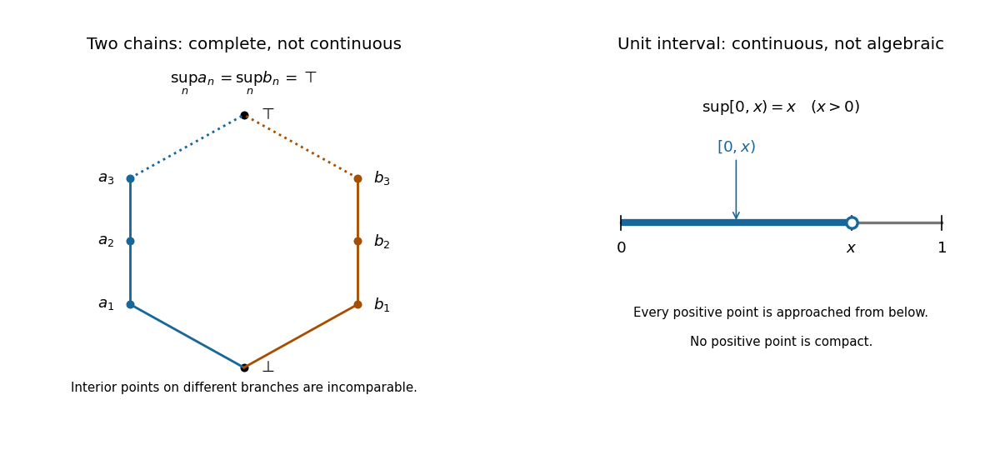

<h1 id="6/a/solution">Solution</h1>

↑ **Parent:** [A](../a.md)

Use the [two-chain noncontinuous complete partial order](../../../../../two-chain-noncontinuous-complete-partial-order.md)

$$
\boxed{P=\{\bot,\top\}\cup\{a_n:n\geq1\}\cup\{b_n:n\geq1\},}
$$

where $\bot<a_1<a_2<\cdots<\top$ and $\bot<b_1<b_2<\cdots<\top$, with no comparisons between the two interiors. In this solution $\sup D$ denotes the [least upper bound](../../../../../least-upper-bound-in-a-partially-ordered-set.md) printed as $\sqcap D$ in the question.[Printed p. 4, Q6, definitions preceding (a)](../../../../../calculus-linear-algebra-discrete-mathematics-logic-and-proof-and-models-of-computation-examination-paper-by-the-university-of-oxford-2005.md)

Every nonempty [directed set](../../../../../directed-set.md) containing $\top$ has [least upper bound](../../../../../least-upper-bound-in-a-partially-ordered-set.md) $\top$. A [directed set](../../../../../directed-set.md) omitting $\top$ cannot contain both an $a_i$ and a $b_j$, because their only common [upper bound](../../../../../upper-bound-in-a-partially-ordered-set.md) in $P$ is $\top$, which would have to belong to that [directed set](../../../../../directed-set.md). It therefore lies in one [chain](../../../../../chain-in-a-partial-order.md), possibly with $\bot$. If its indices are bounded it has a greatest element, which is its [least upper bound](../../../../../least-upper-bound-in-a-partially-ordered-set.md); if they are unbounded its [least upper bound](../../../../../least-upper-bound-in-a-partially-ordered-set.md) is $\top$. Thus $P$ is a [directed-complete partial order](../../../../../directed-complete-partial-order.md).

No element other than $\bot$ is [way-below](../../../../../way-below-relation.md) $\top$. For $a_i$, the [directed set](../../../../../directed-set.md) $\{b_n:n\geq1\}$ has [least upper bound](../../../../../least-upper-bound-in-a-partially-ordered-set.md) $\top$, but none of its members is above $a_i$. Interchanging the two [chains](../../../../../chain-in-a-partial-order.md) excludes every $b_i$. Either [chain](../../../../../chain-in-a-partial-order.md) excludes $\top$ itself. On the other hand, $\bot\ll\top$: every [directed set](../../../../../directed-set.md) whose [least upper bound](../../../../../least-upper-bound-in-a-partially-ordered-set.md) is above $\top$ is nonempty, and any member is above $\bot$. Hence

$$
\{y:y\ll\top\}=\{\bot\},\qquad\sup\{y:y\ll\top\}=\bot\ne\top.
$$

So $P$ is **not a [continuous directed-complete partial order](../../../../../continuous-directed-complete-partial-order.md)**.

There is a small convention issue in the printed definitions. Our usual [directed set](../../../../../directed-set.md) is nonempty, but the question's pairwise condition also allows the empty [set](../../../../../set-split.md). Taken literally, the empty [set](../../../../../set-split.md) has [least upper bound](../../../../../least-upper-bound-in-a-partially-ordered-set.md) $\bot$, and the preceding example and failure of continuity still work. Under this literal convention $\bot\not\ll\bot$, because the empty [set](../../../../../set-split.md) supplies no witness. We retain this qualification in the next parts.

**[Figure 1](#6/a/image-two-branches-with-a-common-supremum-compared-with-continuous-approximation-in-the-unit-interval). Two branches with a common supremum, compared with continuous approximation in the unit interval**.

## ↑ Ancestors (12)

1. [A](../a.md)
2. [6](../../6.md)
3. [Calculus, linear algebra, discrete mathematics, logic and proof, and models of computation](../../../calculus-linear-algebra-discrete-mathematics-logic-and-proof-and-models-of-computation-split.md)
4. [2005](../../../split.md)
5. [Past exam of the year 1 of the computer science course of the University of Oxford](../../../../split.md)
6. [Year 1 of the computer science course of the University of Oxford](../../../../../year-1-of-the-computer-science-course-of-the-university-of-oxford.md)
7. [Computer science course of the University of Oxford](../../../../../computer-science-course-of-the-university-of-oxford.md)
8. [Undergraduate course of the University of Oxford](../../../../../undergraduate-course-of-the-university-of-oxford.md)
9. [Course of the University of Oxford](../../../../../course-of-the-university-of-oxford.md)
10. [University of Oxford](../../../../../university-of-oxford-split.md)
11. [List of universities](../../../../../list-of-universities.md)
12. [Codex Wiki](../../../../../split.md)
