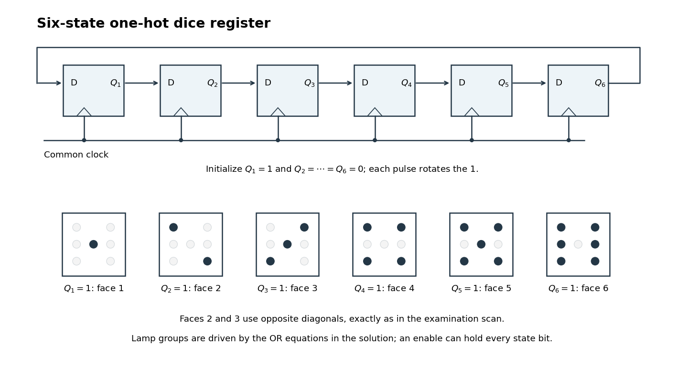

<h1 id="10/b/solution">Solution</h1>

↑ **Parent:** [B](../b.md)

A particularly transparent design uses six [D flip-flops](../../../../../d-flip-flop.md) in a [one-hot encoding](../../../../../one-hot-encoding.md). Let $Q_i=1$ mean that face $i$ is displayed. Initialize $Q_1=1$ and $Q_2=\cdots=Q_6=0$, and wire the next-state inputs as a ring:

$$
\boxed{D_1=Q_6,\quad D_2=Q_1,\quad D_3=Q_2,\quad
D_4=Q_3,\quad D_5=Q_4,\quad D_6=Q_5.}
$$

All six [D flip-flops](../../../../../d-flip-flop.md) share the same active [clock edge](../../../../../clock-edge.md). Each pulse moves the single stored $1$ to the next position, giving the [state-transition diagram](../../../../../state-transition-diagram.md) cycle $1\to2\to3\to4\to5\to6\to1$. The [representation invariant](../../../../../representation-invariant.md) “exactly one $Q_i$ is high” holds after initialization and is preserved by rotation. Six [D flip-flops](../../../../../d-flip-flop.md) are more than the three-[bit](../../../../../bit.md) theoretical minimum, but their simple wiring gives a complete implementation without requiring that minimum.

**[Figure 2](#10/b/image-one-hot-ring-state-register-and-the-six-lamp-patterns-including-the-original-opposite-diagonals-on-faces-2-and-3). One-hot ring state register and the six lamp patterns, including the original opposite diagonals on faces 2 and 3**.

Decode the seven lamps by their positions, with $T,M,B$ denoting top, middle and bottom, and $L,R$ denoting left and right. Let $L_C$ be the center lamp. In the original figure, face 2 uses top-left and bottom-right, while face 3 uses top-right and bottom-left plus center; the two diagonals must therefore have different controls.[Printed p. 6, Figure 1(b), faces 2 and 3](../../../../../functional-programming-data-structures-and-algorithms-procedural-programming-and-digital-hardware-examination-paper-by-the-university-of-oxford-2005.md) The required [OR gate](../../../../../or-gate.md) decoder is

$$
\boxed{\begin{aligned}
L_{TL}=L_{BR}&=Q_2\lor Q_4\lor Q_5\lor Q_6,\\
L_{TR}=L_{BL}&=Q_3\lor Q_4\lor Q_5\lor Q_6,\\
L_{ML}=L_{MR}&=Q_6,\\
L_C&=Q_1\lor Q_3\lor Q_5.
\end{aligned}}
$$

For example, only the center is high in state $Q_1$, the first diagonal is high in state $Q_2$, and in state $Q_6$ both outer columns are high while the center is low. This verifies all six layouts directly.

To implement the switch behavior, use a rapid common [clock signal](../../../../../clock-signal.md) and a sampled enable $S$, high while the switch is pressed. Each next-state input is then selected between its advancing value and its own stored value:

$$
\boxed{D_i=(S\land Q_{\mathrm{prev}(i)})\lor
(\overline S\land Q_i),\qquad
\mathrm{prev}(1)=6,\quad\mathrm{prev}(i)=i-1\ (i>1).}
$$

One [multiplexer](../../../../../multiplexer.md) per [D flip-flop](../../../../../d-flip-flop.md) implements that selection. While enabled the [electronic dice](../../../../../electronic-dice.md) advances; otherwise every [D flip-flop](../../../../../d-flip-flop.md) reloads its own value and the display holds. The enable supplied to this synchronous design must be stable at sampling edges. A reset or preset facility must establish the specified one-hot initial state: an all-zero ring does not start itself.

With a rapid [clock signal](../../../../../clock-signal.md), uncertainty in human release timing makes the final face practically unpredictable. The [sequential circuit](../../../../../sequential-logic.md) itself is deterministic; this observation alone is not a proof that its six outcomes have equal probabilities.

## ↑ Ancestors (12)

1. [B](../b.md)
2. [10](../../10.md)
3. [Functional programming, data structures and algorithms, procedural programming, and digital hardware](../../../functional-programming-data-structures-and-algorithms-procedural-programming-and-digital-hardware-split.md)
4. [2005](../../../split.md)
5. [Past exam of the year 1 of the computer science course of the University of Oxford](../../../../split.md)
6. [Year 1 of the computer science course of the University of Oxford](../../../../../year-1-of-the-computer-science-course-of-the-university-of-oxford.md)
7. [Computer science course of the University of Oxford](../../../../../computer-science-course-of-the-university-of-oxford.md)
8. [Undergraduate course of the University of Oxford](../../../../../undergraduate-course-of-the-university-of-oxford.md)
9. [Course of the University of Oxford](../../../../../course-of-the-university-of-oxford.md)
10. [University of Oxford](../../../../../university-of-oxford-split.md)
11. [List of universities](../../../../../list-of-universities.md)
12. [Codex Wiki](../../../../../split.md)
