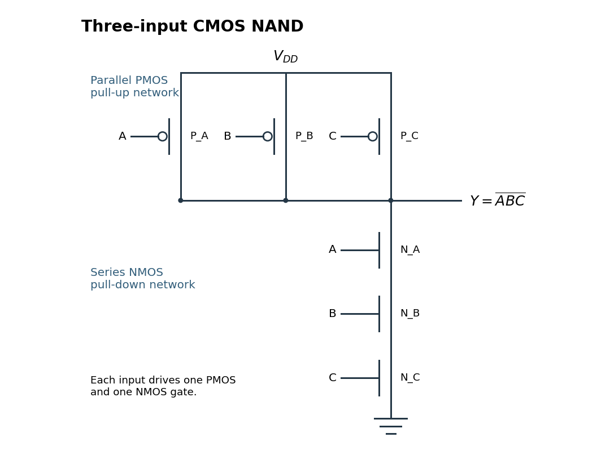

<h1 id="9/a/solution">Solution</h1>

↑ **Parent:** [A](../a.md)

Write $x\uparrow y=\neg(x\land y)$ for a two-input [NAND gate](../../../../../nand-gate.md). Three elementary constructions are

$$
\neg x=x\uparrow x,\qquad
x\land y=(x\uparrow y)\uparrow(x\uparrow y),\qquad
x\lor y=(x\uparrow x)\uparrow(y\uparrow y).
$$

The last identity is [De Morgan's laws](../../../../../de-morgan-s-laws.md). To see that these operations suffice from first principles, take any finite truth table. For each row whose output is $1$, form the conjunction of input literals that matches exactly that row: use $x_i$ when the row has $x_i=1$, and $\neg x_i$ when it has $x_i=0$. Disjoin all such conjunctions. On any input, precisely its matching row conjunction can be true, so this [disjunctive normal form](../../../../../disjunctive-normal-form.md) equals the desired [Boolean function](../../../../../boolean-function.md).

Replace each negation, conjunction and disjunction by the displayed [NAND gate](../../../../../nand-gate.md) constructions, nesting two-input gates for longer conjunctions or disjunctions. Constant outputs are available too: for any input $x$, $x\uparrow(x\uparrow x)=1$, and NANDing that value with itself gives $0$. Thus

$$
\boxed{\text{NAND alone is functionally complete for Boolean functions of positive arity}.}
$$

A zero-input constant circuit additionally needs a supplied constant signal, such as a fixed logic supply. The positive-arity construction already covers constant-valued [Boolean functions](../../../../../boolean-function.md) having one or more unused inputs.

For a three-input [CMOS NAND gate](../../../../../cmos-nand-gate.md), put three [PMOS transistors](../../../../../pmos-transistor.md) in parallel from the positive supply $V_{DD}$ to the output $Y$, and three [NMOS transistors](../../../../../nmos-transistor.md) in series from $Y$ to ground. Each input controls one device in each network:

**[Figure 1](#9/a/image-three-input-cmos-nand-parallel-pmos-pull-up-paths-and-a-series-nmos-pull-down-path). Three-input CMOS NAND: parallel PMOS pull-up paths and a series NMOS pull-down path**.

A high input turns on its [NMOS transistor](../../../../../nmos-transistor.md) and turns off its [PMOS transistor](../../../../../pmos-transistor.md); a low input does the opposite. If $A=B=C=1$, every series [NMOS transistor](../../../../../nmos-transistor.md) conducts and every [PMOS transistor](../../../../../pmos-transistor.md) is off, pulling $Y$ low. If any input is zero, its [NMOS transistor](../../../../../nmos-transistor.md) breaks the series path and its [PMOS transistor](../../../../../pmos-transistor.md) provides a path to $V_{DD}$, pulling $Y$ high. Consequently

$$
\boxed{Y=\overline{ABC}.}
$$

For ideal settled inputs, the complementary networks do not simultaneously connect supply to ground. The [CMOS](../../../../../cmos.md) arrangement gives a driven high or low output in every input case, rather than leaving the output floating.

## ↑ Ancestors (12)

1. [A](../a.md)
2. [9](../../9.md)
3. [Functional programming, data structures and algorithms, procedural programming, and digital hardware](../../../functional-programming-data-structures-and-algorithms-procedural-programming-and-digital-hardware-split.md)
4. [2005](../../../split.md)
5. [Past exam of the year 1 of the computer science course of the University of Oxford](../../../../split.md)
6. [Year 1 of the computer science course of the University of Oxford](../../../../../year-1-of-the-computer-science-course-of-the-university-of-oxford.md)
7. [Computer science course of the University of Oxford](../../../../../computer-science-course-of-the-university-of-oxford.md)
8. [Undergraduate course of the University of Oxford](../../../../../undergraduate-course-of-the-university-of-oxford.md)
9. [Course of the University of Oxford](../../../../../course-of-the-university-of-oxford.md)
10. [University of Oxford](../../../../../university-of-oxford-split.md)
11. [List of universities](../../../../../list-of-universities.md)
12. [Codex Wiki](../../../../../split.md)
