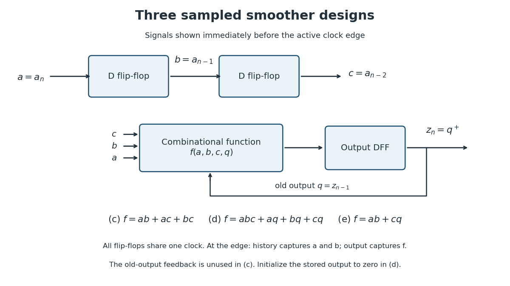

# Digital systems, linear algebra, introduction to formal proof

↑ **Parent:** [2013](../2013.md)

These solutions follow the original numbering and the supplied [natural deduction](../../mathematical-logic.md#natural-deduction) rules. The [datapath](../../computer-science.md#datapath) conventions are specified where the diagram leaves control polarity open; the repeated part 8(a)(iii) is treated exactly as printed.[Printed pp. 2–9, Questions 1–8 and Figures 1–2](../../computer-science-bibliography.md#digital-systems-linear-algebra-introduction-to-formal-proof-examination-paper-by-the-university-of-oxford-2013)

**Table of contents**

- [1](#1)
  - [a](#1/a)
    - [Solution](#1/a/solution)
  - [b](#1/b)
    - [Solution](#1/b/solution)
  - [c](#1/c)
    - [Solution](#1/c/solution)
  - [d](#1/d)
    - [Solution](#1/d/solution)
  - [e](#1/e)
    - [Solution](#1/e/solution)
- [2](#2)
  - [a](#2/a)
    - [Solution](#2/a/solution)
  - [b](#2/b)
    - [Solution](#2/b/solution)
  - [c](#2/c)
    - [Solution](#2/c/solution)
  - [d](#2/d)
    - [Solution](#2/d/solution)
  - [e](#2/e)
    - [Solution](#2/e/solution)
- [3](#3)
  - [a](#3/a)
    - [Solution](#3/a/solution)
  - [b](#3/b)
    - [Solution](#3/b/solution)
  - [c](#3/c)
    - [Solution](#3/c/solution)
  - [d](#3/d)
    - [Solution](#3/d/solution)
  - [e](#3/e)
    - [Solution](#3/e/solution)
  - [f](#3/f)
    - [Solution](#3/f/solution)
- [4](#4)
  - [a](#4/a)
    - [Solution](#4/a/solution)
  - [b](#4/b)
    - [Solution](#4/b/solution)
  - [c](#4/c)
    - [Solution](#4/c/solution)
  - [d](#4/d)
    - [Solution](#4/d/solution)
  - [e](#4/e)
    - [Solution](#4/e/solution)
- [5](#5)
  - [a](#5/a)
    - [Solution](#5/a/solution)
  - [b](#5/b)
    - [Solution](#5/b/solution)
  - [c](#5/c)
    - [Solution](#5/c/solution)
  - [d](#5/d)
    - [Solution](#5/d/solution)
  - [e](#5/e)
    - [Solution](#5/e/solution)
- [6](#6)
  - [a](#6/a)
    - [Solution](#6/a/solution)
  - [b](#6/b)
    - [Solution](#6/b/solution)
  - [c](#6/c)
    - [Solution](#6/c/solution)
  - [d](#6/d)
    - [Solution](#6/d/solution)
  - [e](#6/e)
    - [Solution](#6/e/solution)
  - [f](#6/f)
    - [Solution](#6/f/solution)
- [7](#7)
  - [a](#7/a)
    - [Solution](#7/a/solution)
  - [b](#7/b)
    - [Solution](#7/b/solution)
  - [c](#7/c)
    - [Solution](#7/c/solution)
  - [d](#7/d)
    - [i](#7/d/i)
      - [Solution](#7/d/i/solution)
    - [ii](#7/d/ii)
      - [Solution](#7/d/ii/solution)
- [8](#8)
  - [a](#8/a)
    - [i](#8/a/i)
      - [Solution](#8/a/i/solution)
    - [ii](#8/a/ii)
      - [Solution](#8/a/ii/solution)
    - [iii](#8/a/iii)
      - [Solution](#8/a/iii/solution)
  - [b](#8/b)
    - [i](#8/b/i)
      - [Solution](#8/b/i/solution)
    - [ii](#8/b/ii)
      - [Solution](#8/b/ii/solution)
    - [iii](#8/b/iii)
      - [Solution](#8/b/iii/solution)

## 1

↑ **Parent:** [Digital systems, linear algebra, introduction to formal proof](digital-systems-linear-algebra-introduction-to-formal-proof.md)

<h3 id="1/a">a</h3>

↑ **Parent:** [1](#1)

<h4 id="1/a/solution">Solution</h4>

↑ **Parent:** [A](#1/a)

A [disjunctive normal form](../../theoretical-computer-science.md#disjunctive-normal-form), also called a [sum of products](../../theoretical-computer-science.md#disjunctive-normal-form), is an OR of AND terms, each made from [Boolean literals](../../theoretical-computer-science.md#boolean-literal) such as $a$ or $\bar a$. For example,

$$
f(a,b,c)=ab+\bar a c.
$$

Here juxtaposition means [logical conjunction](../../mathematical-logic.md#logical-conjunction), $+$ means [logical disjunction](../../mathematical-logic.md#logical-disjunction), and a bar means [negation](../../theoretical-computer-science.md#negation). The expression need not be canonical: a term can omit variables, and need not name a single row of the [truth table](../../mathematical-logic.md#truth-table).

Implement each product by an [AND gate](../../mathematical-logic.md#and-gate) and combine the products with an [OR gate](../../mathematical-logic.md#or-gate). Supply complemented inputs with [NOT gates](../../theoretical-computer-science.md#not-gate). Thus

$$
\boxed{\text{sum of products}\quad\longleftrightarrow\quad\text{AND layer followed by OR layer}.}
$$

This is the usual two-level [combinational logic](../../theoretical-computer-science.md#combinational-logic) realization, counting complemented inputs as available. If [NOT gates](../../theoretical-computer-science.md#not-gate) are counted, a complemented input can traverse three gates. The two-level depth statement also assumes sufficiently large gate fan-in: using only two-input [logic gates](../../theoretical-computer-science.md#logic-gate) requires trees for long products or sums. Constant, single-product and single-literal [Boolean functions](../../analysis-of-boolean-functions.md#boolean-function) may need fewer levels, so the two-level construction is a general bound, not a claim that every expression requires exactly two layers.

<h3 id="1/b">b</h3>

↑ **Parent:** [1](#1)

<h4 id="1/b/solution">Solution</h4>

↑ **Parent:** [B](#1/b)

A [serial-in parallel-out shift register](../../electrical-engineering.md#serial-in-parallel-out-shift-register) is a chain of [digital registers](../../electrical-engineering.md#digital-register) driven by the same [clock signal](../../electrical-engineering.md#clock-signal). At each active [clock edge](../../computer-science.md#clock-edge), the first stage captures the input and every later stage captures the preceding stage's old value. Its parallel outputs expose the successive delayed samples simultaneously.

Let $a_n$ be the current sample and, immediately before its sampling edge, let $h_1=a_{n-1},\ldots,h_{k-1}=a_{n-k+1}$. Feed these signals to [combinational logic](../../theoretical-computer-science.md#combinational-logic) implementing $f$. Then

$$
\boxed{z_n=f(a_n,h_1,\ldots,h_{k-1})=f(a_n,a_{n-1},\ldots,a_{n-k+1}).}
$$

Only $k-1$ stored history stages are needed if the current input is used directly. Alternatively, a $k$-stage [shift register](../../electrical-engineering.md#shift-register) exposes all $k$ samples after the edge. A separate output [digital register](../../electrical-engineering.md#digital-register) can capture the first arrangement at the edge, giving a fully sampled output. Initialize the history, or regard the first $k-1$ cycles as a filling interval.

<h3 id="1/c">c</h3>

↑ **Parent:** [1](#1)

<h4 id="1/c/solution">Solution</h4>

↑ **Parent:** [C](#1/c)

Use two history [D flip-flops](../../electrical-engineering.md#d-flip-flop). Write $a=a_n$, $b=a_{n-1}$ and $c=a_{n-2}$ for the signals just before the active [clock edge](../../computer-science.md#clock-edge); update the history by $b^+=a$ and $c^+=b$. Two or more of the three samples are one exactly when some pair are both one, so the [majority function](../../theoretical-computer-science.md#majority-function) is

$$
\boxed{z_n=ab+ac+bc.}
$$

Three two-input [AND gates](../../mathematical-logic.md#and-gate) and one three-input [OR gate](../../mathematical-logic.md#or-gate) implement this [disjunctive normal form](../../theoretical-computer-science.md#disjunctive-normal-form). If a registered output is wanted, feed the expression to the D input of another [D flip-flop](../../electrical-engineering.md#d-flip-flop) and capture it at the same edge as the history update. All right-hand sides use the pre-edge values, so no extra sample of delay is introduced.

The three terms are necessary in a minimal [sum of products](../../theoretical-computer-science.md#disjunctive-normal-form): the input triples $110$, $101$ and $011$ must each be covered, and a single product covering two of them would also cover a triple having only one one. Thus the minimum is three products, each with two [Boolean literals](../../theoretical-computer-science.md#boolean-literal).

<a id="1/c/image-sample-history-and-registered-output-for-the-three-digital-smoother-designs"></a>


**[Figure 1](#1/c/image-sample-history-and-registered-output-for-the-three-digital-smoother-designs). Sample history and registered output for the three digital smoother designs**.

<h3 id="1/d">d</h3>

↑ **Parent:** [1](#1)

<h4 id="1/d/solution">Solution</h4>

↑ **Parent:** [D](#1/d)

Keep the two history [D flip-flops](../../electrical-engineering.md#d-flip-flop) and add an output [D flip-flop](../../electrical-engineering.md#d-flip-flop) with previous value $q=z_{n-1}$. Its next value $q^+=z_n$ is one if all three inputs are one, or if the output was one and at least one of the three inputs is one. In the latter case the samples are not all zero, so the previous one must be retained. This gives

$$
\boxed{q^+=abc+aq+bq+cq,\qquad q_{\rm initial}=0.}
$$

If $abc=111$, the first product sets the output. If $abc=000$, every product vanishes and the output clears. For every mixed input triple, at least one of $aq,bq,cq$ equals $q$, so the output is retained. Feed this [sum of products](../../theoretical-computer-science.md#disjunctive-normal-form) to the output D input, use $b^+=a,c^+=b$ for the history, and use [asynchronous clear](../../electrical-engineering.md#asynchronous-clear) or an appropriate initialization to establish $q=0$.

Minimality can be seen directly from the [truth table](../../mathematical-logic.md#truth-table). At $q=0$, the only one-entry is $abc=111$, forcing the product $abc$ or a narrower term. At $q=1$, the triples $100$, $010$ and $001$ must all produce one; combining any two in one product would also admit $000$, which must produce zero. Thus three more products are needed. The displayed four products achieve the minimum; removing any [Boolean literal](../../theoretical-computer-science.md#boolean-literal) from $abc,aq,bq,cq$ would include a zero-entry.

<h3 id="1/e">e</h3>

↑ **Parent:** [1](#1)

<h4 id="1/e/solution">Solution</h4>

↑ **Parent:** [E](#1/e)

The unconstrained cases can be treated as [don't-care conditions](../../analysis-of-boolean-functions.md#don-t-care-term) during [Boolean function](../../analysis-of-boolean-functions.md#boolean-function) minimization. One particularly small, deliberately asymmetric choice is

$$
\boxed{q^+=ab+cq.}
$$

Use the same two history [D flip-flops](../../electrical-engineering.md#d-flip-flop) and one output [D flip-flop](../../electrical-engineering.md#d-flip-flop), with this expression at the output D input. It requires two two-input [AND gates](../../mathematical-logic.md#and-gate) and one [OR gate](../../mathematical-logic.md#or-gate).

To verify every required case, first set $q=0$. If zero occurs at least twice among $a,b,c$, then $ab=0$, so $q^+=0$ as required. If all three samples are one, then $ab=1$, so $q^+=1$. The remaining triples have exactly two ones and hence exactly one sample agreeing with the old zero; either output is allowed.

Now set $q=1$. If at least two samples are one, either $c=1$ or $a=b=1$, giving $q^+=1$. If all three samples are zero, both terms vanish, giving $q^+=0$. The remaining triples have exactly one one and are the allowed [don't-care conditions](../../analysis-of-boolean-functions.md#don-t-care-term). Thus the expression meets both requirements, including every constant-input triple.

For minimality, consider these required one-entries in $(a,b,c,q)$ order: $1110$, $1101$, $1011$ and $0111$ have no common literal. Therefore a product covering all four would be the constant one, which violates required zero-entries. Also no single-literal product is safe: each of $a,b,c,q$ is one at some required zero-entry, and each complemented literal is one at $0000$. Hence at least two products with at least two [Boolean literals](../../theoretical-computer-science.md#boolean-literal) each are needed. The displayed expression attains two products and four literals.

## 2

↑ **Parent:** [Digital systems, linear algebra, introduction to formal proof](digital-systems-linear-algebra-introduction-to-formal-proof.md)

<h3 id="2/a">a</h3>

↑ **Parent:** [2](#2)

<h4 id="2/a/solution">Solution</h4>

↑ **Parent:** [A](#2/a)

Use the [MIPS zero register](../../computer-science.md#mips-zero-register) as a [write-suppression destination](../../computer-science.md#write-suppression-destination): encode $r_d=0$. There are only 31 stored [processor registers](../../computer-science.md#processor-register), and address zero denotes the constant-zero source rather than a writable storage cell. Its writes are discarded, so

$$
\boxed{r_d=0\quad\Longrightarrow\quad\text{no visible register change}.}
$$

This permits a `store` to write memory while its unavoidable [register file](../../computer-science.md#register-file) write has no effect. It also implements a no-operation by selecting no memory write and destination zero. The statement that reads of register zero return zero is realized consistently by this standard constant-zero, discard-writes implementation.

<h3 id="2/b">b</h3>

↑ **Parent:** [2](#2)

<h4 id="2/b/solution">Solution</h4>

↑ **Parent:** [B](#2/b)

The [opcode](../../computer-science.md#opcode) occupies bits $31:26$, the [arithmetic logic unit](../../computer-science.md#arithmetic-logic-unit) operation is wired directly to $15:10$, and an [immediate operand](../../computer-science.md#immediate-operand) uses all of $9:0$. A three-register instruction needs fifteen register-selection [bits](../../information-theory.md#bit), whereas an immediate instruction must retain independent source and destination selectors outside $9:0$.

Thus put $r_s$ and $r_d$ in the ten bits $25:16$, and place $r_t$ in five of $9:0$, where it can overlap the unused [immediate operand](../../computer-science.md#immediate-operand) of a register instruction. One valid [instruction encoding](../../computer-science.md#instruction-encoding) is

$$
\boxed{r_s=I[25:21],\qquad r_d=I[20:16],\qquad r_t=I[9:5].}
$$

Bits $4:0$ are unused for a three-register instruction. In an immediate instruction, $r_t$ has no effect because its read value is deselected by the `ToAlu` [multiplexer](../../theoretical-computer-science.md#multiplexer). In a `store`, $r_s$ selects the address and $r_t$ selects the data; $r_d$ must be zero to suppress the incidental register write. These observations follow the original [datapath](../../computer-science.md#datapath), particularly its direct $val_s$ memory-address connection and the connection from the `ToAlu` output to memory write data.[Printed p. 3, processor block diagram](../../computer-science-bibliography.md#digital-systems-linear-algebra-introduction-to-formal-proof-examination-paper-by-the-university-of-oxford-2013)

<h3 id="2/c">c</h3>

↑ **Parent:** [2](#2)

<h4 id="2/c/solution">Solution</h4>

↑ **Parent:** [C](#2/c)

Choose `ToAlu=0` for the $val_t$ input and `ToAlu=1` for the expanded [immediate operand](../../computer-science.md#immediate-operand). Choose `ToReg=0` for the [arithmetic logic unit](../../computer-science.md#arithmetic-logic-unit) result and `ToReg=1` for memory read data. The diagram does not label the [multiplexer](../../theoretical-computer-science.md#multiplexer) polarities, so these are explicit conventions.

Let $F_+$ and $F_{\lor}$ denote the six-bit [arithmetic logic unit](../../computer-science.md#arithmetic-logic-unit) operation codes for addition and [bitwise OR](../../programming-language.md#bitwise-or). Their numerical codes are not specified by the paper. The [opcode](../../computer-science.md#opcode) needs to distinguish register, immediate, load and store modes; `add` and `or` can share register mode, and `addi` and `ori` can share immediate mode, since $15:10$ selects the operation directly. For example, choose $o_R=000000$, $o_I=000001$, $o_L=000010$ and $o_S=000011$. With $X$ denoting a field whose bits do not matter, the formats are:

<a id="2/c/table-one-consistent-allocation-of-instruction-encoding-fields"></a>
| Instruction | $31:26$ | $25:21$ | $20:16$ | $15:10$ | $9:5$ | $4:0$ |
| --- | --- | --- | --- | --- | --- | --- |
| `add d,s,t` | $o_R$ | $s$ | $d$ | $F_+$ | $t$ | $X$ |
| `or d,s,t` | $o_R$ | $s$ | $d$ | $F_{\lor}$ | $t$ | $X$ |
| `addi d,s,x` | $o_I$ | $s$ | $d$ | $F_+$ | Upper five bits of $x$ | Lower five bits of $x$ |
| `ori d,s,x` | $o_I$ | $s$ | $d$ | $F_{\lor}$ | Upper five bits of $x$ | Lower five bits of $x$ |
| `load d,(s)` | $o_L$ | $s$ | $d$ | $X$ | $X$ | $X$ |
| `store t,(s)` | $o_S$ | $s$ | $0$ | $X$ | $t$ | $X$ |

The required [opcode](../../computer-science.md#opcode) control table is:

<a id="2/c/table-control-values-required-by-the-pictured-datapath"></a>
| Mode and instructions | `ToAlu` | `MemWr` | `MemRd` | `ToReg` |
| --- | --- | --- | --- | --- |
| $o_R$: `add`, `or` | $0$ | $0$ | $X$ | $0$ |
| $o_I$: `addi`, `ori` | $1$ | $0$ | $X$ | $0$ |
| $o_L$: `load` | $X$ | $0$ | $1$ | $1$ |
| $o_S$: `store` | $0$ | $1$ | $X$ | $X$ |

Here `MemRd` is irrelevant whenever read data is unused, under the ordinary side-effect-free memory interpretation of the diagram. It is sensible to choose zero for those $X$ entries to save activity; memory-mapped devices with read side effects would require that choice. For `store`, `ToReg` is irrelevant because $r_d=0$; `ToAlu` is essential because its output supplies **both** the second [arithmetic logic unit](../../computer-science.md#arithmetic-logic-unit) operand and memory write data. For `load`, the memory address is $val_s$ independently of `ToAlu` and of $15:10$.

The resulting effects, with 32-bit addition, are

$$
\boxed{\begin{aligned}
\operatorname{add}:&\quad R_d\gets R_s+R_t,&\operatorname{or}:&\quad R_d\gets R_s\mathbin{\vert}R_t,\\
\operatorname{addi}:&\quad R_d\gets R_s+E(x),&\operatorname{ori}:&\quad R_d\gets R_s\mathbin{\vert}E(x),\\
\operatorname{load}:&\quad R_d\gets M[R_s],&\operatorname{store}:&\quad M[R_s]\gets R_t,
\end{aligned}}
$$

where $E(x)=(x\bmod256)2^{8\lfloor x/256\rfloor}$ for the ten-bit field $x$.

<h3 id="2/d">d</h3>

↑ **Parent:** [2](#2)

<h4 id="2/d/solution">Solution</h4>

↑ **Parent:** [D](#2/d)

The `addi` [immediate operand](../../computer-science.md#immediate-operand) is a [byte-lane immediate](../../computer-science.md#byte-lane-immediate): an unsigned eight-bit quantity shifted by $0,8,16$ or $24$ positions. Thus

$$
\boxed{E(x)=b2^{8j},\qquad 0\leq b\leq255,\quad 0\leq j\leq3.}
$$

It is not the [sign extension](../../programming-language.md#sign-extension) of a 16-bit constant used by the [MIPS instruction](../../computer-science.md#mips-instruction) `addi`. For example, this design can add $\mathtt{0x12000000}$ directly, but cannot add $\mathtt{0x00000123}$ in a single immediate instruction. A field containing byte $\mathtt{FF}$ in the low lane adds 255, not $-1$.

The `load` and `store` memory address is exactly the content of $r_s$. The [arithmetic logic unit](../../computer-science.md#arithmetic-logic-unit) result is not connected to the memory-address input. Therefore

$$
\boxed{\text{native address}=R_s,\qquad\text{MIPS address}=R_s+\operatorname{signextend}_{16}(\text{offset}).}
$$

There is no native base-plus-offset calculation during either memory instruction. The paper does not specify exception behavior for signed overflow, so the representable constants and address calculation are the justified differences; the [datapath](../../computer-science.md#datapath) alone cannot establish MIPS-compatible overflow traps.

<h3 id="2/e">e</h3>

↑ **Parent:** [2](#2)

<h4 id="2/e/solution">Solution</h4>

↑ **Parent:** [E](#2/e)

Decompose the 32-bit pattern of $n$ into bytes:

$$
n\equiv b_0+2^8b_1+2^{16}b_2+2^{24}b_3\pmod{2^{32}},\qquad 0\leq b_j\leq255.
$$

Let $x_j=256j+b_j$ be its ten-bit encoding, so $E(x_j)=b_j2^{8j}$. The following custom-ISA [assembly language](../../programming-language.md#assembly-language) sequence implements the requested sum:

```
addi t,s,x0
addi t,t,x1
addi t,t,x2
addi t,t,x3
```

The symbols `x0` through `x3` stand for the **encoded ten-bit fields**, not for the expanded 32-bit values. After line $j+1$, the destination contains $R_s+\sum_{i=0}^jb_i2^{8i}$ [modulo](../../modular-arithmetic.md#modulo-operation) $2^{32}$. Hence

$$
\boxed{R_t\gets R_s+n\pmod{2^{32}}\quad\text{in at most four instructions}.}
$$

If $t=s$, each instruction correctly uses the preceding partial sum. Zero-byte additions can be omitted except that, when $t\ne s$, an initial instruction must still copy the original source if all earlier omitted bytes are zero. An [assembler](../../programming-language.md#assembler) can initialize `t` with `add t,s,0` instead and then emit only nonzero lanes. If $t=0$, the intended register effect is discarded.

For a [MIPS instruction](../../computer-science.md#mips-instruction) `lw t,k(s)`, first construct $R_u=R_s+\operatorname{signextend}_{16}(k)$ in a scratch [processor register](../../computer-science.md#processor-register) $u$, using the four-lane sequence above with destination $u$, and then issue

```
load t,(u)
```

For `sw t,k(s)`, construct the same address in $u$ and issue

```
store t,(u)
```

Choose $u\ne0,s,t$, or preserve a live scratch [processor register](../../computer-science.md#processor-register) according to the calling convention. In particular the store sequence must retain the original data in $t$, even when $s=t$. Both expansions need at most five custom instructions and have the same address and memory-word effects as the corresponding [MIPS instructions](../../computer-science.md#mips-instruction), assuming aligned valid memory and 32-bit modular address arithmetic. When $k=0$, the memory instruction alone suffices. These are listings for the examination's custom [instruction set architecture](../../computer-science.md#instruction-set-architecture), not native MIPS encodings; exact exception and pipeline behavior is outside the specified [datapath](../../computer-science.md#datapath).

## 3

↑ **Parent:** [Digital systems, linear algebra, introduction to formal proof](digital-systems-linear-algebra-introduction-to-formal-proof.md)

<h3 id="3/a">a</h3>

↑ **Parent:** [3](#3)

<h4 id="3/a/solution">Solution</h4>

↑ **Parent:** [A](#3/a)

A [hard disk drive](../../computer-science.md#hard-disk-drive) pays substantial [seek time](../../computer-science.md#seek-time) to position the head and [rotational latency](../../computer-science.md#rotational-latency) to reach the desired sector. After that positioning, neighboring bytes stream past the head quickly. A larger transfer therefore amortizes positioning and command overhead over many bytes.

The physical sector also needs framing, synchronization and error-correcting redundancy. Transferring one byte at a time would spend an excessive fraction of the medium and controller work on that overhead. A controller buffer and a block transfer can efficiently deliver the sector to [computer memory](../../computer-memory.md), often using [direct memory access](../../computer-science.md#direct-memory-access).

Thus

$$
\boxed{\text{larger transfers amortize positioning, framing and command costs}.}
$$

The choice is a compromise: excessively large blocks waste transfer time for small requests and can increase [internal fragmentation](../../file-system.md#internal-fragmentation) in a [file system](../../file-system.md).

<h3 id="3/b">b</h3>

↑ **Parent:** [3](#3)

<h4 id="3/b/solution">Solution</h4>

↑ **Parent:** [B](#3/b)

Reusing a block-oriented [file system](../../file-system.md) preserves existing operating-system interfaces, tools, consistency procedures and on-disk formats. It also permits common buffering and caching policies. Large transfers can still amortize software and controller overhead, and [flash memory](../../computer-memory.md#flash-memory) itself has page-program and erase-block constraints, so a [block device](../../computer-science.md#block-device) abstraction is often useful even without mechanical motion.

The costs are that a fine-grained change may require reading and rewriting a larger logical block, and a small [computer file](../../file-system.md#computer-file) can waste part of its final [file data block](../../file-system.md#file-data-block). Structures optimized to reduce [seek time](../../computer-science.md#seek-time) need not be best for [non-volatile memory](../../computer-memory.md#non-volatile-memory). For [flash memory](../../computer-memory.md#flash-memory), repeated metadata updates and erasing or relocating larger regions can increase physical writes and consume finite program/erase endurance. A translation layer can hide these constraints but adds mapping space and work.

Consequently

$$
\boxed{\text{compatibility and reuse trade against wasted space, extra writes and missed device-specific optimizations}.}
$$

The balance depends on the actual medium: byte-addressable [non-volatile memory](../../computer-memory.md#non-volatile-memory) and page/erase-based [flash memory](../../computer-memory.md#flash-memory) have different physical constraints.

<h3 id="3/c">c</h3>

↑ **Parent:** [3](#3)

<h4 id="3/c/solution">Solution</h4>

↑ **Parent:** [C](#3/c)

This is [linked file allocation](../../file-system.md#linked-file-allocation). A [file header](../../computer-science.md#file-header) holds the first and last [disk block numbers](../../file-system.md#disk-block-number), and the successor field in each block extends the chain. The header therefore does not impose a fixed small maximum number of blocks per file.

To state a numerical bound, suppose a physical block has $B$ bytes, the successor-or-final-count field occupies $h$ bytes, and $N$ distinct data blocks are both addressable and available. A full block then holds $C=B-h$ payload bytes. If the final count can represent every value up to $C$,

$$
\boxed{L\leq NC=N(B-h).}
$$

A smaller [computer file](../../file-system.md#computer-file) can use an arbitrary number of full payload blocks followed by a partial block, so allocation need not be contiguous. With a $p$-bit [disk block number](../../file-system.md#disk-block-number), $N\leq2^p$, reduced by reserved addresses and blocks consumed by other data and metadata. This gives the address-width bound as well as the actual device-space bound.

There is no positive minimum payload size: an empty [computer file](../../file-system.md#computer-file) can be represented by an empty-chain convention or a zero-count terminal block. The question does not specify which representation is used or the relevant field widths, so it does not determine an absolute byte limit or a particular empty-file encoding. Its description presupposes a convention that distinguishes a successor value from a terminal byte count.

<h3 id="3/d">d</h3>

↑ **Parent:** [3](#3)

<h4 id="3/d/solution">Solution</h4>

↑ **Parent:** [D](#3/d)

The predecessor [disk block number](../../file-system.md#disk-block-number) turns the forward chain into a [doubly linked list](../../data-structure.md#doubly-linked-list). Starting from the header's last block, one can traverse backwards; removing or detaching the current block can find its predecessor directly rather than scanning from the beginning. When modifying a chain, the affected predecessor and successor links must both be updated consistently.

The file number identifies the owner of each [file data block](../../file-system.md#file-data-block). A [file-system consistency checker](../../file-system.md#file-system-consistency-checker) can scan the medium, group blocks by owner, detect a cross-link between different files, and help reconstruct chains or headers after damage. It also lets the system check that a block reached through a chain belongs to the expected file.

Thus

$$
\boxed{\text{predecessor: reverse traversal and editing; owner: validation and recovery}.}
$$

The extra metadata aids recovery but does not by itself guarantee [file-system crash consistency](../../file-system.md#file-system-crash-consistency).

<h3 id="3/e">e</h3>

↑ **Parent:** [3](#3)

<h4 id="3/e/solution">Solution</h4>

↑ **Parent:** [E](#3/e)

A traditional UNIX-like [file system](../../file-system.md) identifies a [computer file](../../file-system.md#computer-file) by an [inode number](../../file-system.md#inode-number). Its [inode](../../file-system.md#inode) records [file metadata](../../file-system.md#file-metadata), such as byte length, ownership and permissions, and contains direct [file data block](../../file-system.md#file-data-block) addresses plus [indirect block pointers](../../file-system.md#indirect-block-pointer). A [file-system directory](../../file-system.md#file-system-directory) maps a name to the [inode number](../../file-system.md#inode-number); the filename need not be stored inside the [inode](../../file-system.md#inode).

In the familiar direct/single/double/triple scheme, a single [indirect block pointer](../../file-system.md#indirect-block-pointer) reaches a block of data-block addresses, a double [indirect block pointer](../../file-system.md#indirect-block-pointer) reaches blocks of those addresses, and a triple [indirect block pointer](../../file-system.md#indirect-block-pointer) adds one more level. If there are $d$ direct pointers, one pointer of each indirect level, block size $B$ bytes and pointer width $h$ bytes, put $q=\lfloor B/h\rfloor$. The index structure can name

$$
K=d+q+q^2+q^3
$$

data blocks, giving

$$
\boxed{L_{\rm index}=B(d+q+q^2+q^3).}
$$

The actual maximum is the minimum of this structural bound, the representable [file offset](../../file-system.md#file-offset)/length bound, the addressable data-block space, and the capacity left on the device after allocating metadata and index blocks. For an unsigned $\ell$-bit byte-length field, its bound is $2^\ell-1$ bytes. An empty [computer file](../../file-system.md#computer-file) is permitted and needs no data blocks in this scheme. Exact numerical limits cannot be given without the [inode](../../file-system.md#inode) layout and field widths; different UNIX-like implementations choose different layouts, and some use extent trees rather than this traditional scheme.

<h3 id="3/f">f</h3>

↑ **Parent:** [3](#3)

<h4 id="3/f/solution">Solution</h4>

↑ **Parent:** [F](#3/f)

Let a [disk block number](../../file-system.md#disk-block-number) and a file number each occupy $h$ bytes. System B spends about $3h$ bytes per physical block on successor/count, predecessor and owner, leaving $B-3h$ payload bytes. It also needs its per-file header. In the traditional [inode](../../file-system.md#inode) scheme, [file data blocks](../../file-system.md#file-data-block) are entirely payload; indexing occupies the fixed [inode](../../file-system.md#inode) and separate indirect blocks.

For $N$ data blocks in a large densely occupied indirect tree, about $N/q$ lowest-level index blocks, $N/q^2$ next-level blocks and so on are needed. With $q=B/h$, the asymptotic indexing space is approximately

$$
B\left(\frac Nq+\frac N{q^2}+\cdots\right)\approx\frac{NB}{q-1},
$$

or about $Nh$ bytes when $q$ is large. Thus

$$
\boxed{\text{large-file UNIX indexing is roughly one address per data block, versus three fields in System B}.}
$$

This is a comparison of typical densely used structures. For a small file, the fixed [inode](../../file-system.md#inode) dominates; near an indirect-level boundary, partly empty index blocks add overhead. Both schemes can waste part of the last block through [internal fragmentation](../../file-system.md#internal-fragmentation).

The main performance advantage is indexed access to an arbitrary [file offset](../../file-system.md#file-offset): the [inode](../../file-system.md#inode) finds the required data block with at most three indirect levels, whereas System B may need to follow a long chain from one end. Index blocks can be cached and scanned in batches, leaving complete data blocks for transfers. The [inode](../../file-system.md#inode) scheme also naturally supports [sparse files](../../file-system.md#sparse-file), where absent data-block pointers represent zero-filled holes without allocating every intervening block.

There are additional costs. A cold lookup can require separate index-block reads, allocation near a boundary can require allocating and updating several index blocks, and small files can pay more fixed metadata cost. System B already has a tail pointer and can append with local chain updates, while its owner and predecessor fields can help recovery from surviving blocks. Losing a UNIX indirect block can disconnect many data blocks, and those blocks do not automatically carry System B's owner information. Thus the space and [file offset](../../file-system.md#file-offset) access advantages do not imply uniformly cheaper updates or uniformly better recovery.

## 4

↑ **Parent:** [Digital systems, linear algebra, introduction to formal proof](digital-systems-linear-algebra-introduction-to-formal-proof.md)

<h3 id="4/a">a</h3>

↑ **Parent:** [4](#4)

<h4 id="4/a/solution">Solution</h4>

↑ **Parent:** [A](#4/a)

Apply the [elementary row operation](../../numerical-linear-algebra.md#elementary-row-operation) $R_1\gets R_1-R_2$, which preserves the [determinant](../../multilinear-algebra.md#determinant). Expanding along the new first row gives

$$
\begin{aligned}
\det A&=\det\begin{pmatrix}2-c&0&0\\c&c&c\\8&7&c\end{pmatrix}\\
&=(2-c)\det\begin{pmatrix}c&c\\7&c\end{pmatrix}=(2-c)c(c-7).
\end{aligned}
$$

A square [matrix](../../vector-space.md#matrix) is an [invertible matrix](../../linear-algebra.md#invertible-matrix) exactly when its [determinant](../../multilinear-algebra.md#determinant) is nonzero. Therefore

$$
\boxed{c=0,\quad c=2,\quad c=7}
$$

are precisely the three values making $A$ a [singular matrix](../../linear-algebra.md#singular-matrix). They also have direct explanations: at $c=0$ the second row is zero, at $c=2$ the first two rows coincide, and at $c=7$ the last two columns coincide.

<h3 id="4/b">b</h3>

↑ **Parent:** [4](#4)

<h4 id="4/b/solution">Solution</h4>

↑ **Parent:** [B](#4/b)

For either an [upper triangular matrix](../../linear-algebra.md#upper-triangular-matrix) or a [lower triangular matrix](../../linear-algebra.md#lower-triangular-matrix),

$$
\boxed{\det T=\prod_{i=1}^nT_{ii}.}
$$

In the permutation formula for the [determinant](../../multilinear-algebra.md#determinant), every contribution except the diagonal product includes an entry on the zero side of the diagonal. Equivalently, successive cofactor expansions along the first column of an [upper triangular matrix](../../linear-algebra.md#upper-triangular-matrix) prove the formula by [mathematical induction](../../foundations-of-mathematics.md#mathematical-induction).

<h3 id="4/c">c</h3>

↑ **Parent:** [4](#4)

<h4 id="4/c/solution">Solution</h4>

↑ **Parent:** [C](#4/c)

For $i\ne j$, the [elementary row operation](../../numerical-linear-algebra.md#elementary-row-operation) $R_i\gets R_i-kR_j$ leaves the [determinant](../../multilinear-algebra.md#determinant) unchanged:

$$
\boxed{\det(\ldots,R_i-kR_j,\ldots,R_j,\ldots)=\det A.}
$$

By multilinearity in row $i$, the left side is $\det A$ minus $k$ times a [determinant](../../multilinear-algebra.md#determinant) with row $j$ appearing twice. That second [determinant](../../multilinear-algebra.md#determinant) is zero by alternation. No row scaling or row interchange is involved.

<h3 id="4/d">d</h3>

↑ **Parent:** [4](#4)

<h4 id="4/d/solution">Solution</h4>

↑ **Parent:** [D](#4/d)

Perform the [elementary row operations](../../numerical-linear-algebra.md#elementary-row-operation) **from the bottom upwards**:

$$
R_4\gets R_4-tR_3,\qquad R_3\gets R_3-tR_2,\qquad R_2\gets R_2-tR_1.
$$

This order matters because each subtraction uses the predecessor's original row. For example,

$$
(t^3,t^2,t,1)-t(t^2,t,1,t)=(0,0,0,1-t^2).
$$

The other two differences are $(0,0,1-t^2,t-t^3)$ and $(0,1-t^2,t-t^3,t^2-t^4)$. Thus the required [upper triangular matrix](../../linear-algebra.md#upper-triangular-matrix) is

$$
\boxed{U=\begin{pmatrix}
1&t&t^2&t^3\\
0&1-t^2&t(1-t^2)&t^2(1-t^2)\\
0&0&1-t^2&t(1-t^2)\\
0&0&0&1-t^2
\end{pmatrix}.}
$$

These [elementary row operations](../../numerical-linear-algebra.md#elementary-row-operation) use no division, so the reduction remains valid for all [real numbers](../../arithmetic.md#real-number) $t$, including $t=\pm1$.

<h3 id="4/e">e</h3>

↑ **Parent:** [4](#4)

<h4 id="4/e/solution">Solution</h4>

↑ **Parent:** [E](#4/e)

The [elementary row operations](../../numerical-linear-algebra.md#elementary-row-operation) preserve the [determinant](../../multilinear-algebra.md#determinant), and the diagonal product of the [upper triangular matrix](../../linear-algebra.md#upper-triangular-matrix) found above is

$$
\det B=(1-t^2)^3.
$$

Consequently

$$
\boxed{B\text{ is not invertible exactly when }t=1\text{ or }t=-1.}
$$

At $t=1$, all four rows are equal. At $t=-1$, successive rows alternate between one row and its negative. In either case the [matrix rank](../../vector-space.md#matrix-rank) is one, confirming the vanishing [determinant](../../multilinear-algebra.md#determinant).

## 5

↑ **Parent:** [Digital systems, linear algebra, introduction to formal proof](digital-systems-linear-algebra-introduction-to-formal-proof.md)

<h3 id="5/a">a</h3>

↑ **Parent:** [5](#5)

<h4 id="5/a/solution">Solution</h4>

↑ **Parent:** [A](#5/a)

For an $m\times n$ [matrix](../../vector-space.md#matrix) $A$ over the [real numbers](../../arithmetic.md#real-number), write its rows as $r_1,\ldots,r_m$ and its columns as $c_1,\ldots,c_n$. Then

$$
\boxed{\begin{aligned}
\operatorname{Row}(A)&=\operatorname{span}\{r_1,\ldots,r_m\}\subseteq\mathbb R^n,\\
\operatorname{Col}(A)&=\operatorname{span}\{c_1,\ldots,c_n\}\subseteq\mathbb R^m,\\
\operatorname{Null}(A)&=\{x\in\mathbb R^n:Ax=0\},\\
\operatorname{rank}A&=\dim\operatorname{Row}(A)=\dim\operatorname{Col}(A).
\end{aligned}}
$$

Thus the [row space](../../vector-space.md#row-space) and [column space](../../vector-space.md#column-space) consist of all [linear combinations](../../vector-space.md#linear-combination) of the corresponding rows and columns; the [null space](../../kernel-of-a-linear-map.md) is the [kernel of a linear map](../../kernel-of-a-linear-map.md) represented by $A$. The [matrix rank](../../vector-space.md#matrix-rank) counts independent row or column directions, with row rank equal to column rank.

<h3 id="5/b">b</h3>

↑ **Parent:** [5](#5)

<h4 id="5/b/solution">Solution</h4>

↑ **Parent:** [B](#5/b)

If $x\in\operatorname{Null}(A)$, the $i$th entry of $Ax=0$ says $r_i\cdot x=0$. Any $y\in\operatorname{Row}(A)$ is a [linear combination](../../vector-space.md#linear-combination) $y=\sum_i\alpha_i r_i$, so bilinearity of the [dot product](../../inner-product.md#dot-product) gives

$$
y\cdot x=\sum_i\alpha_i(r_i\cdot x)=0.
$$

Hence

$$
\boxed{\operatorname{Row}(A)\perp\operatorname{Null}(A).}
$$

This proves the [orthogonality](../../inner-product.md#orthogonal-vectors) for every pair of [vectors](../../vector-space.md#vector) in the two [vector subspaces](../../vector-space.md#vector-subspace). In fact the [null space](../../kernel-of-a-linear-map.md) equals the [orthogonal complement](../../hilbert-space.md#orthogonal-complement) of the [row space](../../vector-space.md#row-space), since being [orthogonal](../../inner-product.md#orthogonal-vectors) to every row is exactly the system $Ax=0$.

<h3 id="5/c">c</h3>

↑ **Parent:** [5](#5)

<h4 id="5/c/solution">Solution</h4>

↑ **Parent:** [C](#5/c)

Use [Gaussian elimination](../../numerical-linear-algebra.md#gaussian-elimination). Subtract twice row 1 from rows 2 and 3:

$$
A\longrightarrow\begin{pmatrix}
1&1&0&2\\0&1&-1&1\\0&-2&2&-2\\0&1&-1&1
\end{pmatrix}.
$$

Now add twice the second row to the third, and subtract the second row from the fourth. This gives the [row echelon form](../../numerical-linear-algebra.md#row-echelon-form)

$$
\begin{pmatrix}1&1&0&2\\0&1&-1&1\\0&0&0&0\\0&0&0&0\end{pmatrix}.
$$

Its two nonzero rows span the original [row space](../../vector-space.md#row-space) because reversible [elementary row operations](../../numerical-linear-algebra.md#elementary-row-operation) preserve that space. They are [linearly independent](../../vector-space.md#linear-independence), as witnessed by their leading entries in different columns. Thus

$$
\boxed{\operatorname{Row}(A)\text{ has basis }\{(1,1,0,2),(0,1,-1,1)\},\qquad\operatorname{rank}A=2.}
$$

Subtracting the second nonzero row from the first also gives the reduced [row echelon form](../../numerical-linear-algebra.md#row-echelon-form)

$$
\begin{pmatrix}1&0&1&1\\0&1&-1&1\\0&0&0&0\\0&0&0&0\end{pmatrix},
$$

which is useful for the [null space](../../kernel-of-a-linear-map.md).

<h3 id="5/d">d</h3>

↑ **Parent:** [5](#5)

<h4 id="5/d/solution">Solution</h4>

↑ **Parent:** [D](#5/d)

The pivot columns in the [row echelon form](../../numerical-linear-algebra.md#row-echelon-form) are columns 1 and 2. Take the corresponding columns of the **original** [matrix](../../vector-space.md#matrix):

$$
\boxed{\operatorname{Col}(A)\text{ has basis }\left\{\begin{pmatrix}1\\2\\2\\0\end{pmatrix},\begin{pmatrix}1\\3\\0\\1\end{pmatrix}\right\}.}
$$

For a direct check, call these columns $c_1,c_2$. The other columns satisfy $c_3=c_1-c_2$ and $c_4=c_1+c_2$, so they are in the same [linear span](../../vector-space.md#linear-span). Also $c_1,c_2$ are [linearly independent](../../vector-space.md#linear-independence): their fourth entries force the coefficient of $c_2$ to vanish, then their first entries force the other coefficient to vanish. [Elementary row operations](../../numerical-linear-algebra.md#elementary-row-operation) preserve dependence relations among columns, but generally change the [column space](../../vector-space.md#column-space) itself, which is why the original columns must be used.

<h3 id="5/e">e</h3>

↑ **Parent:** [5](#5)

<h4 id="5/e/solution">Solution</h4>

↑ **Parent:** [E](#5/e)

The reduced [row echelon form](../../numerical-linear-algebra.md#row-echelon-form) gives

$$
x_1+x_3+x_4=0,\qquad x_2-x_3+x_4=0.
$$

Choose the free variables $x_3=s,x_4=t$. Then

$$
x=s\begin{pmatrix}-1\\1\\1\\0\end{pmatrix}+t\begin{pmatrix}-1\\-1\\0\\1\end{pmatrix}.
$$

The coefficient [vectors](../../vector-space.md#vector) are [linearly independent](../../vector-space.md#linear-independence), because their third and fourth entries give independent coordinates. Consequently

$$
\boxed{\operatorname{Null}(A)\text{ has basis }\left\{\begin{pmatrix}-1\\1\\1\\0\end{pmatrix},\begin{pmatrix}-1\\-1\\0\\1\end{pmatrix}\right\},\qquad\dim\operatorname{Null}(A)=2.}
$$

Substitution in the original [matrix](../../vector-space.md#matrix) verifies $Ax=0$ for both [basis vectors](../../vector-space.md#basis-vector). The [rank-nullity theorem](../../kernel-of-a-linear-map.md#rank-nullity-theorem) supplies the independent dimension check $2+2=4$.

## 6

↑ **Parent:** [Digital systems, linear algebra, introduction to formal proof](digital-systems-linear-algebra-introduction-to-formal-proof.md)

<h3 id="6/a">a</h3>

↑ **Parent:** [6](#6)

<h4 id="6/a/solution">Solution</h4>

↑ **Parent:** [A](#6/a)

With column [vectors](../../vector-space.md#vector), entry $P_{ij}$ is the fraction moving from region $j$ to region $i$. The first column is therefore $(1/2,1/4,1/4)^{\mathsf T}$, the second is $(1/2,1/2,0)^{\mathsf T}$, and the third is $(1/2,0,1/2)^{\mathsf T}$. Hence

$$
\boxed{A=\frac14,\qquad B=0,\qquad C=\frac12,\qquad P=\begin{pmatrix}1/2&1/2&1/2\\1/4&1/2&0\\1/4&0&1/2\end{pmatrix}.}
$$

Each column sums to one, as required for this convention for a [stochastic matrix](../../markov-chain.md#stochastic-matrix). Multiplying by $P$ conserves the total resources.

<h3 id="6/b">b</h3>

↑ **Parent:** [6](#6)

<h4 id="6/b/solution">Solution</h4>

↑ **Parent:** [B](#6/b)

For a square [matrix](../../vector-space.md#matrix) $M$, an [eigenvalue](../../linear-operator-theory.md#eigenvalue)–[eigenvector](../../linear-operator-theory.md#eigenvector) pair is a [scalar](../../vector-space.md#scalar) $\lambda$ and a nonzero [vector](../../vector-space.md#vector) $v$ satisfying

$$
\boxed{Mv=\lambda v,\qquad v\ne0.}
$$

Thus the [linear map](../../vector-space.md#linear-map) represented by $M$ scales this particular direction by $\lambda$. The nonzero condition excludes the zero [vector](../../vector-space.md#vector), which would otherwise satisfy the displayed equation for every [scalar](../../vector-space.md#scalar).

<h3 id="6/c">c</h3>

↑ **Parent:** [6](#6)

<h4 id="6/c/solution">Solution</h4>

↑ **Parent:** [C](#6/c)

Apply the [transition matrix](../../markov-chain.md#stochastic-matrix) once and then again:

$$
x(1)=P\begin{pmatrix}1\\1\\8\end{pmatrix}=\begin{pmatrix}1/2+1/2+4\\1/4+1/2\\1/4+4\end{pmatrix}=\begin{pmatrix}5\\3/4\\17/4\end{pmatrix},
$$


$$
x(2)=P\begin{pmatrix}5\\3/4\\17/4\end{pmatrix}=\begin{pmatrix}5\\5/4+3/8\\5/4+17/8\end{pmatrix}=\begin{pmatrix}5\\13/8\\27/8\end{pmatrix}.
$$

Therefore, in USA, Europe, Rest of World order and in trillions of dollars,

$$
\boxed{x(1)=(5,0.75,4.25)^{\mathsf T},\qquad x(2)=(5,1.625,3.375)^{\mathsf T}.}
$$

Each total remains ten, giving a quick check on the [matrix multiplication](../../vector-space.md#matrix-multiplication).

<h3 id="6/d">d</h3>

↑ **Parent:** [6](#6)

<h4 id="6/d/solution">Solution</h4>

↑ **Parent:** [D](#6/d)

Use the [characteristic polynomial](../../linear-operator-theory.md#characteristic-polynomial) convention $p(\lambda)=\det(\lambda I-P)$, with $I$ the [identity matrix](../../vector-space.md#identity-matrix). Put $u=\lambda-1/2$. Then

$$
\begin{aligned}
p(\lambda)&=\det\begin{pmatrix}u&-1/2&-1/2\\-1/4&u&0\\-1/4&0&u\end{pmatrix}\\
&=u^3-\frac18u-\frac18u=u\left(u^2-\frac14\right)\\
&=\lambda(\lambda-1/2)(\lambda-1).
\end{aligned}
$$

The required [characteristic polynomial](../../linear-operator-theory.md#characteristic-polynomial) equation for this [matrix](../../vector-space.md#matrix) is therefore

$$
\boxed{p(\lambda)=\lambda^3-\frac32\lambda^2+\frac12\lambda=0.}
$$

Using $\det(P-\lambda I)$ instead negates the cubic [polynomial](../../polynomial.md) and leaves the [eigenvalues](../../linear-operator-theory.md#eigenvalue) unchanged.

<h3 id="6/e">e</h3>

↑ **Parent:** [6](#6)

<h4 id="6/e/solution">Solution</h4>

↑ **Parent:** [E](#6/e)

The factor $(\lambda-1)$ proves that one is an [eigenvalue](../../linear-operator-theory.md#eigenvalue). To find its normalized [eigenvector](../../linear-operator-theory.md#eigenvector), solve $Pv=v$. The second and third rows give

$$
\frac14v_1+\frac12v_2=v_2,\qquad\frac14v_1+\frac12v_3=v_3,
$$

so $v_2=v_3=v_1/2$. The normalization $v_1+v_2+v_3=1$ now gives

$$
\boxed{v=(1/2,1/4,1/4)^{\mathsf T}.}
$$

Its entries are nonnegative and sum to one, and direct [matrix multiplication](../../vector-space.md#matrix-multiplication) verifies $Pv=v$. As a [probability vector](../../probability-distribution.md#probability-vector) it is the [stationary distribution](../../markov-chain.md#stationary-distribution); as resource shares it assigns half to the USA and a quarter to each other region.

<h3 id="6/f">f</h3>

↑ **Parent:** [6](#6)

<h4 id="6/f/solution">Solution</h4>

↑ **Parent:** [F](#6/f)

The other [eigenvalues](../../linear-operator-theory.md#eigenvalue) are $1/2$ and $0$. Their magnitudes are strictly less than one. All three [eigenvalues](../../linear-operator-theory.md#eigenvalue) are distinct, so their [eigenvectors](../../linear-operator-theory.md#eigenvector) form a [basis](../../vector-space.md#basis) and the [matrix](../../vector-space.md#matrix) is [diagonalizable](../../linear-operator-theory.md#diagonalizable-matrix). Every component outside the stationary direction therefore decays under repeated application of $P$.

For an explicit justification, choose

$$
w=(0,1,-1)^{\mathsf T},\qquad u=(-2,1,1)^{\mathsf T}.
$$

Then $Pw=w/2$, $Pu=0$, and

$$
x(0)=10v-\frac72w+2u.
$$

The zero-[eigenvalue](../../linear-operator-theory.md#eigenvalue) component disappears after one step. For every $n\geq1$,

$$
\boxed{x(n)=\begin{pmatrix}5\\5/2-(7/2)2^{-n}\\5/2+(7/2)2^{-n}\end{pmatrix}\ \longrightarrow\ \begin{pmatrix}5\\5/2\\5/2\end{pmatrix}.}
$$

Thus the shares converge to $v$ and the resource [vector](../../vector-space.md#vector) converges to $10v$, since the conserved total is ten. For any other initial resource [vector](../../vector-space.md#vector) of total $T$, the same [eigenvector](../../linear-operator-theory.md#eigenvector) argument gives the limit $Tv$.

## 7

↑ **Parent:** [Digital systems, linear algebra, introduction to formal proof](digital-systems-linear-algebra-introduction-to-formal-proof.md)

<h3 id="7/a">a</h3>

↑ **Parent:** [7](#7)

<h4 id="7/a/solution">Solution</h4>

↑ **Parent:** [A](#7/a)

The [conjunction introduction rule](../../mathematical-logic.md#conjunction-introduction-rule) combines derivations of $\phi$ and $\psi$ into a derivation of $\phi\land\psi$. Both conclusions must be available under the current assumptions.

The [disjunction elimination rule](../../mathematical-logic.md#disjunction-elimination-rule) is reasoning by cases: from $\phi\lor\psi$, a [subproof](../../mathematical-logic.md#subproof) deriving the same conclusion $\kappa$ under $\phi$, and another [subproof](../../mathematical-logic.md#subproof) deriving $\kappa$ under $\psi$, conclude $\kappa$. It discharges the two case assumptions, not any surrounding premises.

The [implication introduction rule](../../mathematical-logic.md#implication-introduction-rule) derives $\phi\to\psi$ by temporarily assuming $\phi$ and deriving $\psi$; it then discharges that occurrence of the assumption $\phi$.

Thus

$$
\boxed{\text{the boxes delimit temporary assumptions, their dependent subproofs, and their discharge}.}
$$

A conclusion inside a box cannot simply be reused outside it without an appropriate [inference rule](../../mathematical-logic.md#inference-rule). Any other undischarged assumptions continue to constrain the result. These are exactly the rules printed in Figure 1.[Printed p. 9, Figure 1](../../computer-science-bibliography.md#digital-systems-linear-algebra-introduction-to-formal-proof-examination-paper-by-the-university-of-oxford-2013)

<h3 id="7/b">b</h3>

↑ **Parent:** [7](#7)

<h4 id="7/b/solution">Solution</h4>

↑ **Parent:** [B](#7/b)

The following [natural deduction](../../mathematical-logic.md#natural-deduction) tables record the active assumption lines explicitly. A rule may use an earlier line only while all of that line's assumptions remain available; [assumption discharge](../../mathematical-logic.md#assumption-discharge) closes the indicated case or hypothesis. The first proof makes the case split first, constructs the whole required [logical conjunction](../../mathematical-logic.md#logical-conjunction) in each case, and then closes the cases.

<a id="7/b/table-first-proof-one-case-split-constructs-both-conjuncts"></a>
| Line | Open assumptions | Formula | Justification |
| --- | --- | --- | --- |
| 1 | 1 | $P\lor(Q\land R)$ | Premise |
| 2 | 1, 2 | $P$ | [Temporary assumption](../../mathematical-logic.md#temporary-assumption) |
| 3 | 1, 2 | $P\lor Q$ | [disjunction introduction](../../mathematical-logic.md#disjunction-introduction-rule) L 2 |
| 4 | 1, 2 | $P\lor R$ | [disjunction introduction](../../mathematical-logic.md#disjunction-introduction-rule) L 2 |
| 5 | 1, 2 | $(P\lor Q)\land(P\lor R)$ | [conjunction introduction](../../mathematical-logic.md#conjunction-introduction-rule) 3, 4 |
| 6 | 1, 6 | $Q\land R$ | [Temporary assumption](../../mathematical-logic.md#temporary-assumption) |
| 7 | 1, 6 | $Q$ | [conjunction elimination](../../mathematical-logic.md#conjunction-elimination-rule) L 6 |
| 8 | 1, 6 | $R$ | [conjunction elimination](../../mathematical-logic.md#conjunction-elimination-rule) R 6 |
| 9 | 1, 6 | $P\lor Q$ | [disjunction introduction](../../mathematical-logic.md#disjunction-introduction-rule) R 7 |
| 10 | 1, 6 | $P\lor R$ | [disjunction introduction](../../mathematical-logic.md#disjunction-introduction-rule) R 8 |
| 11 | 1, 6 | $(P\lor Q)\land(P\lor R)$ | [conjunction introduction](../../mathematical-logic.md#conjunction-introduction-rule) 9, 10 |
| 12 | 1 | $(P\lor Q)\land(P\lor R)$ | [disjunction elimination](../../mathematical-logic.md#disjunction-elimination-rule) 1, 2, 5, 6, 11 |

The second proof instead splits the goal first. It proves each required [logical disjunction](../../mathematical-logic.md#logical-disjunction) by a separate use of [disjunction elimination](../../mathematical-logic.md#disjunction-elimination-rule), then applies [conjunction introduction](../../mathematical-logic.md#conjunction-introduction-rule) at the end.

<a id="7/b/table-second-proof-separate-case-splits-establish-the-two-conjuncts"></a>
| Line | Open assumptions | Formula | Justification |
| --- | --- | --- | --- |
| 1 | 1 | $P\lor(Q\land R)$ | Premise |
| 2 | 1, 2 | $P$ | [Temporary assumption](../../mathematical-logic.md#temporary-assumption) |
| 3 | 1, 2 | $P\lor Q$ | [disjunction introduction](../../mathematical-logic.md#disjunction-introduction-rule) L 2 |
| 4 | 1, 4 | $Q\land R$ | [Temporary assumption](../../mathematical-logic.md#temporary-assumption) |
| 5 | 1, 4 | $Q$ | [conjunction elimination](../../mathematical-logic.md#conjunction-elimination-rule) L 4 |
| 6 | 1, 4 | $P\lor Q$ | [disjunction introduction](../../mathematical-logic.md#disjunction-introduction-rule) R 5 |
| 7 | 1 | $P\lor Q$ | [disjunction elimination](../../mathematical-logic.md#disjunction-elimination-rule) 1, 2, 3, 4, 6 |
| 8 | 1, 8 | $P$ | [Temporary assumption](../../mathematical-logic.md#temporary-assumption) |
| 9 | 1, 8 | $P\lor R$ | [disjunction introduction](../../mathematical-logic.md#disjunction-introduction-rule) L 8 |
| 10 | 1, 10 | $Q\land R$ | [Temporary assumption](../../mathematical-logic.md#temporary-assumption) |
| 11 | 1, 10 | $R$ | [conjunction elimination](../../mathematical-logic.md#conjunction-elimination-rule) R 10 |
| 12 | 1, 10 | $P\lor R$ | [disjunction introduction](../../mathematical-logic.md#disjunction-introduction-rule) R 11 |
| 13 | 1 | $P\lor R$ | [disjunction elimination](../../mathematical-logic.md#disjunction-elimination-rule) 1, 8, 9, 10, 12 |
| 14 | 1 | $(P\lor Q)\land(P\lor R)$ | [conjunction introduction](../../mathematical-logic.md#conjunction-introduction-rule) 7, 13 |

The essential difference is the order of proof construction: the first shares one case split between both goals, whereas the second duplicates that split and combines the results outside the cases. Both use only the stated [natural deduction](../../mathematical-logic.md#natural-deduction) rules, and both conclude

$$
\boxed{(P\lor Q)\land(P\lor R).}
$$

<h3 id="7/c">c</h3>

↑ **Parent:** [7](#7)

<h4 id="7/c/solution">Solution</h4>

↑ **Parent:** [C](#7/c)

In [proof by contradiction](../../foundations-of-mathematics.md#reductio-ad-absurdum), assume the [negation](../../theoretical-computer-science.md#negation) of a desired conclusion $A$, derive [logical falsity](../../mathematical-logic.md#logical-falsity), and discharge the assumption to infer $A$. A rule expressing this is

$$
\boxed{\frac{\begin{array}{c}[\neg A]^i\\\vdots\\\bot\end{array}}{A}\;\mathrm{RAA}\;(i).}
$$

Here the label $i$ identifies the assumption being discharged; any other open assumptions remain.

To derive this rule using the supplied rules, apply [negation introduction](../../mathematical-logic.md#negation-introduction-rule) to the [subproof](../../mathematical-logic.md#subproof) from $\neg A$ to $\bot$. This discharges $\neg A$ and yields $\neg\neg A$. Apply [double-negation elimination](../../mathematical-logic.md#double-negation-elimination) to obtain $A$. Thus the extra rule is admissible because Figure 1 explicitly includes [double-negation elimination](../../mathematical-logic.md#double-negation-elimination).[Printed p. 9, Figure 1, double-negation elimination](../../computer-science-bibliography.md#digital-systems-linear-algebra-introduction-to-formal-proof-examination-paper-by-the-university-of-oxford-2013)

This is the classical form of [proof by contradiction](../../foundations-of-mathematics.md#reductio-ad-absurdum); simply deriving $\neg A$ from an assumption $A$ leading to [logical falsity](../../mathematical-logic.md#logical-falsity) uses [negation introduction](../../mathematical-logic.md#negation-introduction-rule) alone.

<h3 id="7/d">d</h3>

↑ **Parent:** [7](#7)

<h4 id="7/d/i">i</h4>

↑ **Parent:** [D](#7/d)

<h5 id="7/d/i/solution">Solution</h5>

↑ **Parent:** [I](#7/d/i)

Under the premise, assuming either disjunct would introduce the forbidden [logical disjunction](../../mathematical-logic.md#logical-disjunction). Discharging those two assumptions gives the two separate [negations](../../theoretical-computer-science.md#negation), which can then be conjoined.

<a id="7/d/i/table-derivation-of-the-two-negated-disjuncts"></a>
| Line | Open assumptions | Formula | Justification |
| --- | --- | --- | --- |
| 1 | 1 | $\neg (P\lor Q)$ | Premise |
| 2 | 1, 2 | $P$ | [Temporary assumption](../../mathematical-logic.md#temporary-assumption) |
| 3 | 1, 2 | $P\lor Q$ | [disjunction introduction](../../mathematical-logic.md#disjunction-introduction-rule) L 2 |
| 4 | 1, 2 | $\bot$ | [negation elimination rule](../../mathematical-logic.md#negation-elimination-rule) 3, 1 |
| 5 | 1 | $\neg P$ | [negation introduction](../../mathematical-logic.md#negation-introduction-rule) 2, 4 |
| 6 | 1, 6 | $Q$ | [Temporary assumption](../../mathematical-logic.md#temporary-assumption) |
| 7 | 1, 6 | $P\lor Q$ | [disjunction introduction](../../mathematical-logic.md#disjunction-introduction-rule) R 6 |
| 8 | 1, 6 | $\bot$ | [negation elimination rule](../../mathematical-logic.md#negation-elimination-rule) 7, 1 |
| 9 | 1 | $\neg Q$ | [negation introduction](../../mathematical-logic.md#negation-introduction-rule) 6, 8 |
| 10 | 1 | $\neg P\land\neg Q$ | [conjunction introduction](../../mathematical-logic.md#conjunction-introduction-rule) 5, 9 |

Thus

$$
\boxed{\neg P\land\neg Q.}
$$

The redundant closing parenthesis printed after the conclusion on p. 8 does not alter the readable [propositional formula](../../mathematical-logic.md#propositional-formula).[Printed p. 8, Question 7(d)(i)](../../computer-science-bibliography.md#digital-systems-linear-algebra-introduction-to-formal-proof-examination-paper-by-the-university-of-oxford-2013)

<h4 id="7/d/ii">ii</h4>

↑ **Parent:** [D](#7/d)

<h5 id="7/d/ii/solution">Solution</h5>

↑ **Parent:** [Ii](#7/d/ii)

Temporarily deny the desired [logical disjunction](../../mathematical-logic.md#logical-disjunction). If $\neg P$ held, it would introduce that very [logical disjunction](../../mathematical-logic.md#logical-disjunction), producing [logical falsity](../../mathematical-logic.md#logical-falsity); [double-negation elimination](../../mathematical-logic.md#double-negation-elimination) therefore gives $P$. The same argument gives $Q$, contradicting the premise. The complete [natural deduction](../../mathematical-logic.md#natural-deduction) derivation is:

<a id="7/d/ii/table-classical-derivation-of-the-disjunction-of-negations"></a>
| Line | Open assumptions | Formula | Justification |
| --- | --- | --- | --- |
| 1 | 1 | $\neg (P\land Q)$ | Premise |
| 2 | 1, 2 | $\neg (\neg P\lor\neg Q)$ | [Temporary assumption](../../mathematical-logic.md#temporary-assumption) |
| 3 | 1, 2, 3 | $\neg P$ | [Temporary assumption](../../mathematical-logic.md#temporary-assumption) |
| 4 | 1, 2, 3 | $\neg P\lor\neg Q$ | [disjunction introduction](../../mathematical-logic.md#disjunction-introduction-rule) L 3 |
| 5 | 1, 2, 3 | $\bot$ | [negation elimination rule](../../mathematical-logic.md#negation-elimination-rule) 4, 2 |
| 6 | 1, 2 | $\neg \neg P$ | [negation introduction](../../mathematical-logic.md#negation-introduction-rule) 3, 5 |
| 7 | 1, 2 | $P$ | [double-negation elimination](../../mathematical-logic.md#double-negation-elimination) 6 |
| 8 | 1, 2, 8 | $\neg Q$ | [Temporary assumption](../../mathematical-logic.md#temporary-assumption) |
| 9 | 1, 2, 8 | $\neg P\lor\neg Q$ | [disjunction introduction](../../mathematical-logic.md#disjunction-introduction-rule) R 8 |
| 10 | 1, 2, 8 | $\bot$ | [negation elimination rule](../../mathematical-logic.md#negation-elimination-rule) 9, 2 |
| 11 | 1, 2 | $\neg \neg Q$ | [negation introduction](../../mathematical-logic.md#negation-introduction-rule) 8, 10 |
| 12 | 1, 2 | $Q$ | [double-negation elimination](../../mathematical-logic.md#double-negation-elimination) 11 |
| 13 | 1, 2 | $P\land Q$ | [conjunction introduction](../../mathematical-logic.md#conjunction-introduction-rule) 7, 12 |
| 14 | 1, 2 | $\bot$ | [negation elimination rule](../../mathematical-logic.md#negation-elimination-rule) 13, 1 |
| 15 | 1 | $\neg \neg (\neg P\lor\neg Q)$ | [negation introduction](../../mathematical-logic.md#negation-introduction-rule) 2, 14 |
| 16 | 1 | $\neg P\lor\neg Q$ | [double-negation elimination](../../mathematical-logic.md#double-negation-elimination) 15 |

Consequently

$$
\boxed{\neg P\lor\neg Q.}
$$

The uses of [double-negation elimination](../../mathematical-logic.md#double-negation-elimination) are justified by the supplied rules. This distinguishes the proof from the preceding constructive direction of [De Morgan's laws](../../theoretical-computer-science.md#de-morgan-s-laws).

## 8

↑ **Parent:** [Digital systems, linear algebra, introduction to formal proof](digital-systems-linear-algebra-introduction-to-formal-proof.md)

<h3 id="8/a">a</h3>

↑ **Parent:** [8](#8)

<h4 id="8/a/i">i</h4>

↑ **Parent:** [A](#8/a)

<h5 id="8/a/i/solution">Solution</h5>

↑ **Parent:** [I](#8/a/i)

Assume that every object fails $R$. A fresh [existential witness](../../mathematical-logic.md#existential-witness) for the premise then has both $R$ and its [negation](../../theoretical-computer-science.md#negation). Eliminate the witness before closing the assumption about all objects:

<a id="8/a/i/table-eliminate-the-witness-inside-the-negation-subproof"></a>
| Line | Open assumptions | Formula | Justification |
| --- | --- | --- | --- |
| 1 | 1 | $\exists x\, R(x)$ | Premise |
| 2 | 1, 2 | $\forall y\, \neg R(y)$ | [Temporary assumption](../../mathematical-logic.md#temporary-assumption) |
| 3 | 1, 2, 3 | $R(v)$ | [Temporary assumption](../../mathematical-logic.md#temporary-assumption) |
| 4 | 1, 2, 3 | $\neg R(v)$ | [universal elimination](../../mathematical-logic.md#universal-quantifier-elimination-rule) 2; term $v$ |
| 5 | 1, 2, 3 | $\bot$ | [negation elimination rule](../../mathematical-logic.md#negation-elimination-rule) 3, 4 |
| 6 | 1, 2 | $\bot$ | [existential elimination](../../mathematical-logic.md#existential-quantifier-elimination-rule) 1, 3, 5; fresh $v$ |
| 7 | 1 | $\neg (\forall y\, \neg R(y))$ | [negation introduction](../../mathematical-logic.md#negation-introduction-rule) 2, 6 |

The conclusion is

$$
\boxed{\neg\forall y\,\neg R(y).}
$$

The witness $v$ occurs neither in the conclusion of [existential elimination](../../mathematical-logic.md#existential-quantifier-elimination-rule) nor in its other open assumptions, so the [eigenvariable condition](../../mathematical-logic.md#eigenvariable-condition) holds.

<h4 id="8/a/ii">ii</h4>

↑ **Parent:** [A](#8/a)

<h5 id="8/a/ii/solution">Solution</h5>

↑ **Parent:** [Ii](#8/a/ii)

Choose an arbitrary fresh [eigenvariable](../../mathematical-logic.md#eigenvariable) $v$. If $\neg R(v)$ held, [existential quantifier introduction rule](../../mathematical-logic.md#existential-quantifier-introduction-rule) would contradict the premise. Derive $R(v)$ by [double-negation elimination](../../mathematical-logic.md#double-negation-elimination), then generalize:

<a id="8/a/ii/table-an-arbitrary-object-satisfies-the-relation"></a>
| Line | Open assumptions | Formula | Justification |
| --- | --- | --- | --- |
| 1 | 1 | $\neg (\exists x\, \neg R(x))$ | Premise |
| 2 | 1, 2 | $\neg R(v)$ | [Temporary assumption](../../mathematical-logic.md#temporary-assumption) |
| 3 | 1, 2 | $\exists x\, \neg R(x)$ | [existential quantifier introduction rule](../../mathematical-logic.md#existential-quantifier-introduction-rule) 2; term $v$ |
| 4 | 1, 2 | $\bot$ | [negation elimination rule](../../mathematical-logic.md#negation-elimination-rule) 3, 1 |
| 5 | 1 | $\neg \neg R(v)$ | [negation introduction](../../mathematical-logic.md#negation-introduction-rule) 2, 4 |
| 6 | 1 | $R(v)$ | [double-negation elimination](../../mathematical-logic.md#double-negation-elimination) 5 |
| 7 | 1 | $\forall y\, R(y)$ | [universal introduction](../../mathematical-logic.md#universal-quantifier-introduction-rule) 6; fresh $v$ |

Hence

$$
\boxed{\forall y\,R(y).}
$$

At the final [universal introduction](../../mathematical-logic.md#universal-quantifier-introduction-rule), $v$ is free in no open assumption: the only remaining premise is the closed [first-order formula](../../mathematical-logic.md#first-order-formula) $\neg\exists x\,\neg R(x)$. Thus the [eigenvariable condition](../../mathematical-logic.md#eigenvariable-condition) is satisfied. The passage from double [negation](../../theoretical-computer-science.md#negation) to the positive relation uses the paper's classical rule.

<h4 id="8/a/iii">iii</h4>

↑ **Parent:** [A](#8/a)

<h5 id="8/a/iii/solution">Solution</h5>

↑ **Parent:** [Iii](#8/a/iii)

The original scan repeats the premise and conclusion of part (i) exactly; it is not a missing or unreadable alternative exercise.[Printed p. 8, Question 8(a)(i) and (iii)](../../computer-science-bibliography.md#digital-systems-linear-algebra-introduction-to-formal-proof-examination-paper-by-the-university-of-oxford-2013) Here is a second formal ordering of the same argument. First introduce the fresh [existential witness](../../mathematical-logic.md#existential-witness), derive the desired [negation](../../theoretical-computer-science.md#negation) inside its scope, and then eliminate the witness:

<a id="8/a/iii/table-close-the-negation-subproof-before-eliminating-the-witness"></a>
| Line | Open assumptions | Formula | Justification |
| --- | --- | --- | --- |
| 1 | 1 | $\exists x\, R(x)$ | Premise |
| 2 | 1, 2 | $R(v)$ | [Temporary assumption](../../mathematical-logic.md#temporary-assumption) |
| 3 | 1, 2, 3 | $\forall y\, \neg R(y)$ | [Temporary assumption](../../mathematical-logic.md#temporary-assumption) |
| 4 | 1, 2, 3 | $\neg R(v)$ | [universal elimination](../../mathematical-logic.md#universal-quantifier-elimination-rule) 3; term $v$ |
| 5 | 1, 2, 3 | $\bot$ | [negation elimination rule](../../mathematical-logic.md#negation-elimination-rule) 2, 4 |
| 6 | 1, 2 | $\neg (\forall y\, \neg R(y))$ | [negation introduction](../../mathematical-logic.md#negation-introduction-rule) 3, 5 |
| 7 | 1 | $\neg (\forall y\, \neg R(y))$ | [existential elimination](../../mathematical-logic.md#existential-quantifier-elimination-rule) 1, 2, 6; fresh $v$ |

Thus, again,

$$
\boxed{\neg\forall y\,\neg R(y).}
$$

At the last [existential elimination](../../mathematical-logic.md#existential-quantifier-elimination-rule), $v$ occurs in neither the exported conclusion nor the remaining premise. The [eigenvariable condition](../../mathematical-logic.md#eigenvariable-condition) is therefore satisfied. This proof retains a different nesting of the [subproofs](../../mathematical-logic.md#subproof) from part (i).

<h3 id="8/b">b</h3>

↑ **Parent:** [8](#8)

<h4 id="8/b/i">i</h4>

↑ **Parent:** [B](#8/b)

<h5 id="8/b/i/solution">Solution</h5>

↑ **Parent:** [I](#8/b/i)

The [equality introduction rule](../../mathematical-logic.md#equality-introduction-rule) is reflexivity: any well-formed [first-order term](../../mathematical-logic.md#first-order-term) is equal to itself, with no premises. The [equality elimination rule](../../mathematical-logic.md#equality-elimination-rule) permits replacement of equals in a [first-order formula](../../mathematical-logic.md#first-order-formula):

$$
\boxed{\frac{}{T=T}\;{=I},\qquad\frac{S=T\qquad\phi(S)}{\phi(T)}\;{=E}.}
$$

In the second rule, write $\phi(S)$ and $\phi(T)$ as the results of substituting $S$ and $T$ into the same designated free occurrences of a variable in $\phi$. Both substitutions must avoid variable capture. The rule preserves the surrounding assumptions. This expresses [first-order equality](../../mathematical-logic.md#logical-equality) rather than treating equality as an arbitrary relation symbol.

<h4 id="8/b/ii">ii</h4>

↑ **Parent:** [B](#8/b)

<h5 id="8/b/ii/solution">Solution</h5>

↑ **Parent:** [Ii](#8/b/ii)

Use reflexivity to obtain $T_1=T_1$. In [equality elimination rule](../../mathematical-logic.md#equality-elimination-rule), take $\phi(z)$ to be $z=T_1$, and replace the designated first occurrence of $T_1$ using the premise $T_1=T_2$:

<a id="8/b/ii/table-symmetry-from-reflexivity-and-replacement"></a>
| Line | Open assumptions | Formula | Justification |
| --- | --- | --- | --- |
| 1 | 1 | $T_1=T_2$ | Premise |
| 2 | 1 | $T_1=T_1$ | [equality introduction rule](../../mathematical-logic.md#equality-introduction-rule) |
| 3 | 1 | $T_2=T_1$ | [equality elimination rule](../../mathematical-logic.md#equality-elimination-rule) 1, 2 |

Therefore

$$
\boxed{T_2=T_1.}
$$

The second occurrence of $T_1$ in $T_1=T_1$ is part of the fixed parameter in $\phi(z)$ and is not replaced.

<h4 id="8/b/iii">iii</h4>

↑ **Parent:** [B](#8/b)

<h5 id="8/b/iii/solution">Solution</h5>

↑ **Parent:** [Iii](#8/b/iii)

Introduce a fresh [existential witness](../../mathematical-logic.md#existential-witness) $v$ with $R(v)$. The universal premise gives $v=0\lor v=1$. In the first case, [equality elimination rule](../../mathematical-logic.md#equality-elimination-rule) gives $R(0)$. In the second, it gives $R(1)$, contradicting $\neg R(1)$; [explosion](../../mathematical-logic.md#logical-falsity-elimination-rule) then supplies the common case conclusion $R(0)$. Close both cases and then the witness scope:

<a id="8/b/iii/table-a-witness-must-yield-the-relation-at-zero"></a>
| Line | Open assumptions | Formula | Justification |
| --- | --- | --- | --- |
| 1 | 1 | $\forall x\, x=0\lor x=1$ | Premise |
| 2 | 1, 2 | $\exists x\, R(x)$ | Premise |
| 3 | 1, 2, 3 | $\neg R(1)$ | Premise |
| 4 | 1, 2, 3, 4 | $R(v)$ | [Temporary assumption](../../mathematical-logic.md#temporary-assumption) |
| 5 | 1, 2, 3, 4 | $v=0\lor v=1$ | [universal elimination](../../mathematical-logic.md#universal-quantifier-elimination-rule) 1; term $v$ |
| 6 | 1, 2, 3, 4, 6 | $v=0$ | [Temporary assumption](../../mathematical-logic.md#temporary-assumption) |
| 7 | 1, 2, 3, 4, 6 | $R(0)$ | [equality elimination rule](../../mathematical-logic.md#equality-elimination-rule) 6, 4 |
| 8 | 1, 2, 3, 4, 8 | $v=1$ | [Temporary assumption](../../mathematical-logic.md#temporary-assumption) |
| 9 | 1, 2, 3, 4, 8 | $R(1)$ | [equality elimination rule](../../mathematical-logic.md#equality-elimination-rule) 8, 4 |
| 10 | 1, 2, 3, 4, 8 | $\bot$ | [negation elimination rule](../../mathematical-logic.md#negation-elimination-rule) 9, 3 |
| 11 | 1, 2, 3, 4, 8 | $R(0)$ | [explosion](../../mathematical-logic.md#logical-falsity-elimination-rule) 10 |
| 12 | 1, 2, 3, 4 | $R(0)$ | [disjunction elimination](../../mathematical-logic.md#disjunction-elimination-rule) 5, 6, 7, 8, 11 |
| 13 | 1, 2, 3 | $R(0)$ | [existential elimination](../../mathematical-logic.md#existential-quantifier-elimination-rule) 2, 4, 12; fresh $v$ |

Hence

$$
\boxed{R(0).}
$$

For both uses of [equality elimination rule](../../mathematical-logic.md#equality-elimination-rule), the formula template is $R(z)$. At the final [existential elimination](../../mathematical-logic.md#existential-quantifier-elimination-rule), $v$ is fresh in all three original premises and absent from $R(0)$, so the [eigenvariable condition](../../mathematical-logic.md#eigenvariable-condition) holds. No additional assumption that the constants $0$ and $1$ denote distinct objects is needed.

## ↑ Ancestors (9)

1. [2013](../2013.md)
2. [Past exam of the year 1 of the computer science course of the University of Oxford](../../past-exam-of-the-year-1-of-the-computer-science-course-of-the-university-of-oxford.md)
3. [Year 1 of the computer science course of the University of Oxford](../../university-of-oxford.md#year-1-of-the-computer-science-course-of-the-university-of-oxford)
4. [Computer science course of the University of Oxford](../../university-of-oxford.md#computer-science-course-of-the-university-of-oxford)
5. [Undergraduate course of the University of Oxford](../../university-of-oxford.md#undergraduate-course-of-the-university-of-oxford)
6. [Course of the University of Oxford](../../university-of-oxford.md#course-of-the-university-of-oxford)
7. [University of Oxford](../../university-of-oxford.md)
8. [List of universities](../../README.md#list-of-universities)
9. [Codex Wiki](../../README.md)
