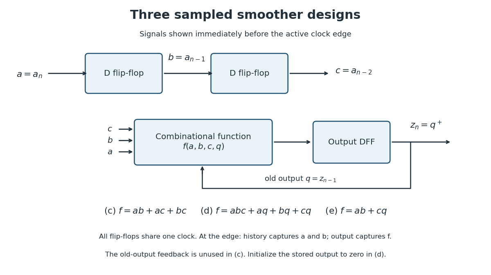

<h1 id="1/c/solution">Solution</h1>

↑ **Parent:** [C](../c.md)

Use two history [D flip-flops](../../../../../d-flip-flop.md). Write $a=a_n$, $b=a_{n-1}$ and $c=a_{n-2}$ for the signals just before the active [clock edge](../../../../../clock-edge.md); update the history by $b^+=a$ and $c^+=b$. Two or more of the three samples are one exactly when some pair are both one, so the [majority function](../../../../../majority-function.md) is

$$
\boxed{z_n=ab+ac+bc.}
$$

Three two-input [AND gates](../../../../../and-gate.md) and one three-input [OR gate](../../../../../or-gate.md) implement this [disjunctive normal form](../../../../../disjunctive-normal-form.md). If a registered output is wanted, feed the expression to the D input of another [D flip-flop](../../../../../d-flip-flop.md) and capture it at the same edge as the history update. All right-hand sides use the pre-edge values, so no extra sample of delay is introduced.

The three terms are necessary in a minimal [sum of products](../../../../../disjunctive-normal-form.md): the input triples $110$, $101$ and $011$ must each be covered, and a single product covering two of them would also cover a triple having only one one. Thus the minimum is three products, each with two [Boolean literals](../../../../../boolean-literal.md).

**[Figure 1](#1/c/image-sample-history-and-registered-output-for-the-three-digital-smoother-designs). Sample history and registered output for the three digital smoother designs**.

## ↑ Ancestors (12)

1. [C](../c.md)
2. [1](../../1.md)
3. [Digital systems, linear algebra, introduction to formal proof](../../../digital-systems-linear-algebra-introduction-to-formal-proof-split.md)
4. [2013](../../../split.md)
5. [Past exam of the year 1 of the computer science course of the University of Oxford](../../../../split.md)
6. [Year 1 of the computer science course of the University of Oxford](../../../../../year-1-of-the-computer-science-course-of-the-university-of-oxford.md)
7. [Computer science course of the University of Oxford](../../../../../computer-science-course-of-the-university-of-oxford.md)
8. [Undergraduate course of the University of Oxford](../../../../../undergraduate-course-of-the-university-of-oxford.md)
9. [Course of the University of Oxford](../../../../../course-of-the-university-of-oxford.md)
10. [University of Oxford](../../../../../university-of-oxford-split.md)
11. [List of universities](../../../../../list-of-universities.md)
12. [Codex Wiki](../../../../../split.md)
