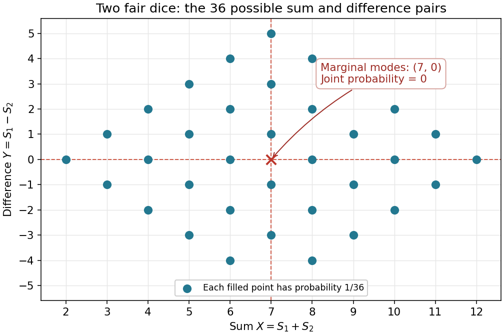

# Discrete mathematics, probability and continuous mathematics

↑ **Parent:** [2013](../2013.md)

Solutions to the nine questions in the original paper.[Printed pp. 2–9, Questions 1–9](../../computer-science-bibliography.md#discrete-mathematics-probability-and-continuous-mathematics-examination-paper-by-the-university-of-oxford-2013)

**Table of contents**

- [1](#1)
  - [a](#1/a)
    - [i](#1/a/i)
      - [Solution](#1/a/i/solution)
    - [ii](#1/a/ii)
      - [Solution](#1/a/ii/solution)
  - [b](#1/b)
    - [Solution](#1/b/solution)
  - [c](#1/c)
    - [i](#1/c/i)
      - [Solution](#1/c/i/solution)
    - [ii](#1/c/ii)
      - [Solution](#1/c/ii/solution)
    - [iii](#1/c/iii)
      - [Solution](#1/c/iii/solution)
  - [d](#1/d)
    - [i](#1/d/i)
      - [Solution](#1/d/i/solution)
    - [ii](#1/d/ii)
      - [Solution](#1/d/ii/solution)
    - [iii](#1/d/iii)
      - [Solution](#1/d/iii/solution)
    - [iv](#1/d/iv)
      - [Solution](#1/d/iv/solution)
  - [e](#1/e)
    - [Solution](#1/e/solution)
  - [f](#1/f)
    - [i](#1/f/i)
      - [Solution](#1/f/i/solution)
    - [ii](#1/f/ii)
      - [Solution](#1/f/ii/solution)
    - [iii](#1/f/iii)
      - [Solution](#1/f/iii/solution)
    - [iv](#1/f/iv)
      - [Solution](#1/f/iv/solution)
    - [v](#1/f/v)
      - [Solution](#1/f/v/solution)
- [2](#2)
  - [a](#2/a)
    - [Solution](#2/a/solution)
  - [b](#2/b)
    - [i](#2/b/i)
      - [Solution](#2/b/i/solution)
    - [ii](#2/b/ii)
      - [Solution](#2/b/ii/solution)
    - [iii](#2/b/iii)
      - [Solution](#2/b/iii/solution)
    - [iv](#2/b/iv)
      - [Solution](#2/b/iv/solution)
    - [v](#2/b/v)
      - [Solution](#2/b/v/solution)
  - [c](#2/c)
    - [Solution](#2/c/solution)
  - [d](#2/d)
    - [Solution](#2/d/solution)
  - [e](#2/e)
    - [Solution](#2/e/solution)
  - [f](#2/f)
    - [Solution](#2/f/solution)
  - [g](#2/g)
    - [Solution](#2/g/solution)
- [3](#3)
  - [a](#3/a)
    - [Solution](#3/a/solution)
  - [b](#3/b)
    - [Solution](#3/b/solution)
  - [c](#3/c)
    - [Solution](#3/c/solution)
  - [d](#3/d)
    - [Solution](#3/d/solution)
  - [e](#3/e)
    - [i](#3/e/i)
      - [Solution](#3/e/i/solution)
    - [ii](#3/e/ii)
      - [Solution](#3/e/ii/solution)
  - [f](#3/f)
    - [Solution](#3/f/solution)
- [4](#4)
  - [a](#4/a)
    - [Solution](#4/a/solution)
  - [b](#4/b)
    - [Solution](#4/b/solution)
  - [c](#4/c)
    - [Solution](#4/c/solution)
  - [d](#4/d)
    - [Solution](#4/d/solution)
- [5](#5)
  - [a](#5/a)
    - [i](#5/a/i)
      - [Solution](#5/a/i/solution)
    - [ii](#5/a/ii)
      - [Solution](#5/a/ii/solution)
  - [b](#5/b)
    - [i](#5/b/i)
      - [Solution](#5/b/i/solution)
    - [ii](#5/b/ii)
      - [Solution](#5/b/ii/solution)
    - [iii](#5/b/iii)
      - [Solution](#5/b/iii/solution)
- [6](#6)
  - [a](#6/a)
    - [Solution](#6/a/solution)
  - [b](#6/b)
    - [Solution](#6/b/solution)
  - [c](#6/c)
    - [Solution](#6/c/solution)
  - [d](#6/d)
    - [Solution](#6/d/solution)
- [7](#7)
  - [a](#7/a)
    - [i](#7/a/i)
      - [Solution](#7/a/i/solution)
    - [ii](#7/a/ii)
      - [Solution](#7/a/ii/solution)
  - [b](#7/b)
    - [i](#7/b/i)
      - [Solution](#7/b/i/solution)
    - [ii](#7/b/ii)
      - [Solution](#7/b/ii/solution)
  - [c](#7/c)
    - [i](#7/c/i)
      - [Solution](#7/c/i/solution)
    - [ii](#7/c/ii)
      - [Solution](#7/c/ii/solution)
- [8](#8)
  - [a](#8/a)
    - [Solution](#8/a/solution)
  - [b](#8/b)
    - [i](#8/b/i)
      - [Solution](#8/b/i/solution)
    - [ii](#8/b/ii)
      - [Solution](#8/b/ii/solution)
  - [c](#8/c)
    - [i](#8/c/i)
      - [Solution](#8/c/i/solution)
    - [ii](#8/c/ii)
      - [Solution](#8/c/ii/solution)
    - [iii](#8/c/iii)
      - [Solution](#8/c/iii/solution)
    - [iv](#8/c/iv)
      - [Solution](#8/c/iv/solution)
    - [v](#8/c/v)
      - [Solution](#8/c/v/solution)
- [9](#9)
  - [a](#9/a)
    - [i](#9/a/i)
      - [Solution](#9/a/i/solution)
    - [ii](#9/a/ii)
      - [Solution](#9/a/ii/solution)
  - [b](#9/b)
    - [i](#9/b/i)
      - [Solution](#9/b/i/solution)
    - [ii](#9/b/ii)
      - [Solution](#9/b/ii/solution)
  - [c](#9/c)
    - [Solution](#9/c/solution)

## 1

↑ **Parent:** [Discrete mathematics, probability and continuous mathematics](discrete-mathematics-probability-and-continuous-mathematics.md)

<h3 id="1/a">a</h3>

↑ **Parent:** [1](#1)

<h4 id="1/a/i">i</h4>

↑ **Parent:** [A](#1/a)

<h5 id="1/a/i/solution">Solution</h5>

↑ **Parent:** [I](#1/a/i)

Write each [set difference](../../set.md#set-difference) as an [intersection](../../set.md#set-intersection) with a [complement of a set](../../set.md#complement-of-a-set). Applying [De Morgan's laws](../../theoretical-computer-science.md#de-morgan-s-laws) and then the [distributive property](../../algebraic-operation.md#distributive-property) gives

$$
\begin{aligned}
A\setminus(B\cup C)&=A\cap\overline{B\cup C}=A\cap(\overline B\cap\overline C)=(A\setminus B)\cap(A\setminus C),\\
A\setminus(B\cap C)&=A\cap\overline{B\cap C}=A\cap(\overline B\cup\overline C)=(A\setminus B)\cup(A\setminus C).
\end{aligned}
$$

The [complements](../../set.md#complement-of-a-set) turn the inner [union](../../set.md#set-union) into an [intersection](../../set.md#set-intersection) and vice versa. Thus

$$
\boxed{A\setminus(B\cup C)=(A\setminus B)\cap(A\setminus C),\quad A\setminus(B\cap C)=(A\setminus B)\cup(A\setminus C).}
$$

<h4 id="1/a/ii">ii</h4>

↑ **Parent:** [A](#1/a)

<h5 id="1/a/ii/solution">Solution</h5>

↑ **Parent:** [Ii](#1/a/ii)

Apply the [distributive property](../../algebraic-operation.md#distributive-property) to the [intersection](../../set.md#set-intersection) with $\overline C$:

$$
\begin{aligned}
(A\cap B)\setminus C&=(A\cap B)\cap\overline C=(A\cap\overline C)\cap(B\cap\overline C),\\
(A\cup B)\setminus C&=(A\cup B)\cap\overline C=(A\cap\overline C)\cup(B\cap\overline C).
\end{aligned}
$$

In the first line the repeated factor $\overline C$ changes nothing. Rewriting in terms of [set differences](../../set.md#set-difference) yields

$$
\boxed{(A\cap B)\setminus C=(A\setminus C)\cap(B\setminus C),\quad(A\cup B)\setminus C=(A\setminus C)\cup(B\setminus C).}
$$

<h3 id="1/b">b</h3>

↑ **Parent:** [1](#1)

<h4 id="1/b/solution">Solution</h4>

↑ **Parent:** [B](#1/b)

Use [De Morgan's laws](../../theoretical-computer-science.md#de-morgan-s-laws) to remove the [complement of a set](../../set.md#complement-of-a-set), then distribute the two [unions](../../set.md#set-union):

$$
\begin{aligned}
(A\cup B)\setminus(A\cap B)
&=(A\cup B)\cap(\overline A\cup\overline B)\\
&=(A\cap\overline A)\cup(A\cap\overline B)\cup(B\cap\overline A)\cup(B\cap\overline B)\\
&=(A\cap\overline B)\cup(B\cap\overline A).
\end{aligned}
$$

The first and last [intersections](../../set.md#set-intersection) in the middle line are the [empty set](../../set.md#empty-set). The remaining [union](../../set.md#set-union) is precisely the collection of elements belonging to exactly one of the original [sets](../../set.md). Therefore both expressions define the same [symmetric difference](../../set.md#symmetric-difference):

$$
\boxed{(A\cup B)\setminus(A\cap B)=(A\setminus B)\cup(B\setminus A)=A\oplus B.}
$$

<h3 id="1/c">c</h3>

↑ **Parent:** [1](#1)

<h4 id="1/c/i">i</h4>

↑ **Parent:** [C](#1/c)

<h5 id="1/c/i/solution">Solution</h5>

↑ **Parent:** [I](#1/c/i)

An algebraic way to prove the [set identity](../../set.md#set-identity) is to show that $D=\overline A\cup\overline B$ is a [complement of a set](../../set.md#complement-of-a-set) for $A\cap B$. By the [distributive property](../../algebraic-operation.md#distributive-property),

$$
(A\cap B)\cap D=(A\cap B\cap\overline A)\cup(A\cap B\cap\overline B)=\varnothing,
$$

and

$$
(A\cap B)\cup D=(A\cup D)\cap(B\cup D)=\mathcal U\cap\mathcal U=\mathcal U.
$$

A [complement of a set](../../set.md#complement-of-a-set) is unique: if $D,E$ both complement $S$, then $D=D\cap(S\cup E)=D\cap E$, and similarly $E=D\cap E$. Consequently

$$
\boxed{\overline{A\cap B}=\overline A\cup\overline B.}
$$

<h4 id="1/c/ii">ii</h4>

↑ **Parent:** [C](#1/c)

<h5 id="1/c/ii/solution">Solution</h5>

↑ **Parent:** [Ii](#1/c/ii)

Write the [set difference](../../set.md#set-difference) as an [intersection](../../set.md#set-intersection) and use the fact that taking the [complement of a set](../../set.md#complement-of-a-set) twice returns that [set](../../set.md). The [commutativity](../../algebraic-operation.md#commutativity) of [intersection](../../set.md#set-intersection) gives the reversible calculation

$$
\boxed{\overline A\setminus\overline B=\overline A\cap\overline{\overline B}=\overline A\cap B=B\cap\overline A=B\setminus A.}
$$

<h4 id="1/c/iii">iii</h4>

↑ **Parent:** [C](#1/c)

<h5 id="1/c/iii/solution">Solution</h5>

↑ **Parent:** [Iii](#1/c/iii)

Use the [symmetric difference](../../set.md#symmetric-difference) formula from part (b), followed by the [set difference](../../set.md#set-difference) identity from part (c)(ii):

$$
\begin{aligned}
\overline A\oplus\overline B
&=(\overline A\setminus\overline B)\cup(\overline B\setminus\overline A)\\
&=(B\setminus A)\cup(A\setminus B)
=A\oplus B.
\end{aligned}
$$

Taking both [complements](../../set.md#complement-of-a-set) swaps the two ways to belong to exactly one [set](../../set.md), leaving their [union](../../set.md#set-union) unchanged:

$$
\boxed{\overline A\oplus\overline B=A\oplus B.}
$$

<h3 id="1/d">d</h3>

↑ **Parent:** [1](#1)

<h4 id="1/d/i">i</h4>

↑ **Parent:** [D](#1/d)

<h5 id="1/d/i/solution">Solution</h5>

↑ **Parent:** [I](#1/d/i)

The [image of a function](../../set-theory.md#image-of-a-function) is the [set](../../set.md) of values actually attained as its argument ranges over its [domain of a function](../../function.md#domain-of-a-function):

$$
\boxed{\operatorname{im}f=f(A)=\{f(a):a\in A\}=\{b\in B:\exists a\in A,\ f(a)=b\}.}
$$

It is a [subset](../../set.md#subset) of the [codomain](../../function.md#codomain) $B$, and need not equal $B$.

<h4 id="1/d/ii">ii</h4>

↑ **Parent:** [D](#1/d)

<h5 id="1/d/ii/solution">Solution</h5>

↑ **Parent:** [Ii](#1/d/ii)

The [function](../../function.md) is [surjective](../../algebra.md#surjective-function), also called onto, when every element of its [codomain](../../function.md#codomain) has at least one [preimage](../../set-theory.md#preimage):

$$
\boxed{f(A)=B\quad\Longleftrightarrow\quad\forall b\in B\ \exists a\in A:\ f(a)=b.}
$$

The condition concerns the specified [codomain](../../function.md#codomain), not just the formula defining the [function](../../function.md).

<h4 id="1/d/iii">iii</h4>

↑ **Parent:** [D](#1/d)

<h5 id="1/d/iii/solution">Solution</h5>

↑ **Parent:** [Iii](#1/d/iii)

The [function](../../function.md) is [injective](../../algebra.md#injective-function), also called one-to-one, when equal outputs force equal inputs:

$$
\boxed{\forall a,a'\in A,\quad f(a)=f(a')\Longrightarrow a=a'.}
$$

Equivalently, different elements of the [domain of a function](../../function.md#domain-of-a-function) always have different images.

<h4 id="1/d/iv">iv</h4>

↑ **Parent:** [D](#1/d)

<h5 id="1/d/iv/solution">Solution</h5>

↑ **Parent:** [Iv](#1/d/iv)

A [bijection](../../function.md#bijection) is a [function](../../function.md) that is both [injective](../../algebra.md#injective-function) and [surjective](../../algebra.md#surjective-function). Each element of the [codomain](../../function.md#codomain) then has exactly one [preimage](../../set-theory.md#preimage):

$$
\boxed{\forall b\in B\ \exists!a\in A:\ f(a)=b.}
$$

This unique-preimage property allows the [inverse function](../../function.md#inverse-function) $f^{-1}:B\to A$ to be defined on all of $B$.

<h3 id="1/e">e</h3>

↑ **Parent:** [1](#1)

<h4 id="1/e/solution">Solution</h4>

↑ **Parent:** [E](#1/e)

If $n$ is positive and odd, $n^2$ is odd. The [function](../../function.md) $x\mapsto x^{n^2}$ is a [strictly increasing function](../../calculus.md#strictly-increasing-function) on the [real numbers](../../arithmetic.md#real-number), so it is [injective](../../algebra.md#injective-function). Every real $y$ has the real odd root $\operatorname{sgn}(y)|y|^{1/n^2}$, so the [function](../../function.md) is also [surjective](../../algebra.md#surjective-function).

If $n$ is positive and even, the exponent is positive and even. Then $f(1)=f(-1)$, while $f(x)\geq0$ for all real $x$. These facts disprove [injectivity](../../algebra.md#injective-function) and [surjectivity](../../algebra.md#surjective-function), respectively. Therefore

$$
\boxed{f\text{ is onto iff }n\text{ is odd};\qquad f\text{ is one-to-one iff }n\text{ is odd}.}
$$

If the convention $0\in\mathbb N$ is used, $n=0$ gives exponent zero. Interpreting $x^0$ as the constant [polynomial](../../polynomial.md) $1$ makes the [function](../../function.md) neither [injective](../../algebra.md#injective-function) nor [surjective](../../algebra.md#surjective-function). If $0^0$ is left undefined, that case does not define the stated [function](../../function.md) on all the [real numbers](../../arithmetic.md#real-number). Neither convention adds a qualifying value of $n$.

<h3 id="1/f">f</h3>

↑ **Parent:** [1](#1)

<h4 id="1/f/i">i</h4>

↑ **Parent:** [F](#1/f)

<h5 id="1/f/i/solution">Solution</h5>

↑ **Parent:** [I](#1/f/i)

The [function composition](../../function.md#function-composition) of two [bijections](../../function.md#bijection) is a [bijection](../../function.md#bijection). Its [inverse function](../../function.md#inverse-function) is two-sided, so

$$
\boxed{\text{True: }(f\circ g)\circ(f\circ g)^{-1}=\operatorname{id}.}
$$

This is exactly the defining cancellation property of an [inverse function](../../function.md#inverse-function), with the whole [function composition](../../function.md#function-composition) regarded as one [function](../../function.md).

<h4 id="1/f/ii">ii</h4>

↑ **Parent:** [F](#1/f)

<h5 id="1/f/ii/solution">Solution</h5>

↑ **Parent:** [Ii](#1/f/ii)

The inverse factors are generally in the wrong order. For a counterexample, take the [bijections](../../function.md#bijection) $f(x)=x+1$ and $g(x)=2x$, with [inverse functions](../../function.md#inverse-function) $f^{-1}(x)=x-1$ and $g^{-1}(x)=x/2$. Then

$$
((f\circ g)\circ(f^{-1}\circ g^{-1}))(x)=2(x/2-1)+1=x-1.
$$

Thus

$$
\boxed{\text{False in general; the displayed composition need not be }\operatorname{id}.}
$$

For particular [bijections](../../function.md#bijection) that commute the equality can hold; the claim fails as a universal assertion.

<h4 id="1/f/iii">iii</h4>

↑ **Parent:** [F](#1/f)

<h5 id="1/f/iii/solution">Solution</h5>

↑ **Parent:** [Iii](#1/f/iii)

Use the [associativity](../../algebraic-operation.md#associative-property) of [function composition](../../function.md#function-composition) to cancel adjacent [inverse functions](../../function.md#inverse-function) in the right order:

$$
f\circ g\circ g^{-1}\circ f^{-1}=f\circ\operatorname{id}\circ f^{-1}=\operatorname{id}.
$$

Therefore

$$
\boxed{\text{True: }(f\circ g)\circ(g^{-1}\circ f^{-1})=\operatorname{id}.}
$$

<h4 id="1/f/iv">iv</h4>

↑ **Parent:** [F](#1/f)

<h5 id="1/f/iv/solution">Solution</h5>

↑ **Parent:** [Iv](#1/f/iv)

For the [bijections](../../function.md#bijection) $f(x)=x+1$ and $g(x)=2x$ used above, $f\circ g$ sends $x$ to $2x+1$. Its [inverse function](../../function.md#inverse-function) sends $x$ to $(x-1)/2$, whereas $f^{-1}\circ g^{-1}$ sends $x$ to $x/2-1$. Hence

$$
\boxed{\text{False in general: }(f\circ g)^{-1}\ne f^{-1}\circ g^{-1}.}
$$

<h4 id="1/f/v">v</h4>

↑ **Parent:** [F](#1/f)

<h5 id="1/f/v/solution">Solution</h5>

↑ **Parent:** [V](#1/f/v)

The proposed [inverse function](../../function.md#inverse-function) cancels on both sides:

$$
\begin{aligned}
(f\circ g)\circ(g^{-1}\circ f^{-1})&=\operatorname{id},\\
(g^{-1}\circ f^{-1})\circ(f\circ g)&=g^{-1}\circ(f^{-1}\circ f)\circ g=\operatorname{id}.
\end{aligned}
$$

The uniqueness of an [inverse function](../../function.md#inverse-function) therefore gives

$$
\boxed{\text{True: }(f\circ g)^{-1}=g^{-1}\circ f^{-1}.}
$$

The operation applied last must be undone first.

## 2

↑ **Parent:** [Discrete mathematics, probability and continuous mathematics](discrete-mathematics-probability-and-continuous-mathematics.md)

<h3 id="2/a">a</h3>

↑ **Parent:** [2](#2)

<h4 id="2/a/solution">Solution</h4>

↑ **Parent:** [A](#2/a)

The [Big O notation](../../real-analysis.md#big-o-notation) asserts an eventual uniform bound on the size of $f$ by a constant multiple of the size of $g$:

$$
\boxed{f(n)=O(g(n))\iff\exists C>0\ \exists n_0\ \forall n\geq n_0:\ |f(n)|\leq C|g(n)|.}
$$

The constants $C,n_0$ may depend on the two [functions](../../function.md) but cannot depend on $n$. Absolute values matter because the stated [functions](../../function.md) can be real-valued with either sign.

<h3 id="2/b">b</h3>

↑ **Parent:** [2](#2)

<h4 id="2/b/i">i</h4>

↑ **Parent:** [B](#2/b)

<h5 id="2/b/i/solution">Solution</h5>

↑ **Parent:** [I](#2/b/i)

The [logarithm](../../calculus.md#logarithm) identity $a^{\log_b n}=n^{\log_b a}$ rewrites the expression as $n^{\log_2 3}$. Since $3<4=2^2$, we have $\log_2 3<2$, and for $n\geq1$,

$$
3^{\log_2 n}=n^{\log_2 3}\leq n^2.
$$

Thus the [Big O notation](../../real-analysis.md#big-o-notation) bound holds with $C=1$:

$$
\boxed{\text{True: }3^{\log_2 n}=O(n^2).}
$$

<h4 id="2/b/ii">ii</h4>

↑ **Parent:** [B](#2/b)

<h5 id="2/b/ii/solution">Solution</h5>

↑ **Parent:** [Ii](#2/b/ii)

The [logarithm](../../calculus.md#logarithm) laws give

$$
n\log_2(5n)+\log_2(n^2)=n\log_2 n+n\log_2 5+2\log_2 n.
$$

For $n\geq2$, both $n\leq n\log_2 n$ and $\log_2 n\leq n\log_2 n$. The expression is therefore at most $(3+\log_2 5)n\log_2 n$. Consequently

$$
\boxed{\text{True: }n\log_2(5n)+\log_2(n^2)=O(n\log_2 n).}
$$

The [Big O notation](../../real-analysis.md#big-o-notation) concerns eventual behaviour; the zero value of $n\log_2 n$ at $n=1$ is irrelevant.

<h4 id="2/b/iii">iii</h4>

↑ **Parent:** [B](#2/b)

<h5 id="2/b/iii/solution">Solution</h5>

↑ **Parent:** [Iii](#2/b/iii)

Divide by the proposed comparison [function](../../function.md) $2^n$:

$$
\frac{n^2+n2^n}{2^n}=\frac{n^2}{2^n}+n\geq n.
$$

The ratio is unbounded, so no constant in the definition of [Big O notation](../../real-analysis.md#big-o-notation) can work:

$$
\boxed{\text{False: }n^2+n2^n\ne O(2^n).}
$$

<h4 id="2/b/iv">iv</h4>

↑ **Parent:** [B](#2/b)

<h5 id="2/b/iv/solution">Solution</h5>

↑ **Parent:** [Iv](#2/b/iv)

The [exponential function](../../calculus.md#exponential-function) eventually grows faster than the fixed [polynomial](../../polynomial.md). A direct justification uses the ratio $r_n=4^n/n^4$:

$$
\frac{r_{n+1}}{r_n}=4\left(\frac n{n+1}\right)^4\longrightarrow4.
$$

For all sufficiently large $n$, this ratio exceeds $2$, so $r_n$ grows without bound. The proposed [Big O notation](../../real-analysis.md#big-o-notation) bound is therefore impossible:

$$
\boxed{\text{False: }4^n\ne O(n^4).}
$$

<h4 id="2/b/v">v</h4>

↑ **Parent:** [B](#2/b)

<h5 id="2/b/v/solution">Solution</h5>

↑ **Parent:** [V](#2/b/v)

Treat $a,b$ as fixed positive [integers](../../integer.md). For $n\geq1$, $n^2+a\leq(1+a)n^2$. Raising this inequality to the positive power $b$ gives

$$
(n^2+a)^b\leq(1+a)^b n^{2b}.
$$

The factor $(1+a)^b$ is independent of $n$, as required by [Big O notation](../../real-analysis.md#big-o-notation). Hence

$$
\boxed{\text{True for fixed }a,b:\quad(n^2+a)^b=O(n^{2b}).}
$$

A bound uniform over varying $a,b$ is not what the notation here asserts.

<h3 id="2/c">c</h3>

↑ **Parent:** [2](#2)

<h4 id="2/c/solution">Solution</h4>

↑ **Parent:** [C](#2/c)

By [Big O notation](../../real-analysis.md#big-o-notation), there are $C_1,C_2>0$ and thresholds after which $f_1(n)\leq C_1g_1(n)$ and $f_2(n)\leq C_2g_2(n)$. Choose a common threshold and set $C=\max(C_1,C_2)$. The positivity assumption gives

$$
0\leq f_1(n)+f_2(n)\leq C(g_1(n)+g_2(n)).
$$

Squaring preserves this inequality, so

$$
\boxed{(f_1+f_2)^2\leq C^2(g_1+g_2)^2\text{ eventually},\qquad(f_1+f_2)^2=O((g_1+g_2)^2).}
$$

<h3 id="2/d">d</h3>

↑ **Parent:** [2](#2)

<h4 id="2/d/solution">Solution</h4>

↑ **Parent:** [D](#2/d)

First consider powers of four, with a fixed finite base value. For a [mathematical induction](../../foundations-of-mathematics.md#mathematical-induction) hypothesis $x_{n/4}\leq C(n/4)^2$, the [recurrence relation](../../sequence-and-series.md#recurrence-relation) gives

$$
x_n\leq4C(n/4)^2+n^2=(C/4+1)n^2\leq Cn^2
$$

provided $C\geq4/3$ and $C$ also covers the base value.

The allowed integer rounding needs a little more care. Suppose the [recurrence relation](../../sequence-and-series.md#recurrence-relation) is applied above fixed base cases, as usual; applying $x_1=4x_1+1$ with a ceiling would not define a positive sequence. For either rounding write $m=\lceil n/4\rceil$ or $m=\lfloor n/4\rfloor$. For $n\geq6$,

$$
m\leq\frac{n+3}{4},\qquad\frac{4m^2}{n^2}\leq\frac14\left(1+\frac3n\right)^2\leq\frac9{16},\qquad m<n.
$$

Choose $C\geq16/7$ large enough to bound all finitely many positive-index base values below $6$. By [strong induction](../../foundations-of-mathematics.md#strong-induction),

$$
x_n=4x_m+n^2\leq4Cm^2+n^2\leq(9C/16+1)n^2\leq Cn^2.
$$

This argument starts at $n=6$, so the floor convention's index zero, if used in an earlier base calculation, is absorbed into those fixed initial values. Thus, for either convention with a well-defined finite base,

$$
\boxed{x_n=O(n^2).}
$$

<h3 id="2/e">e</h3>

↑ **Parent:** [2](#2)

<h4 id="2/e/solution">Solution</h4>

↑ **Parent:** [E](#2/e)

In [modular arithmetic](../../modular-arithmetic.md), calculations may be performed after replacing each input by its remainder. For a positive modulus $m$, write $[a]_m$ for the remainder in $\{0,\ldots,m-1\}$. Then

$$
\boxed{\begin{aligned}
[a+b]_m&=[[a]_m+[b]_m]_m,\\
[ab]_m&=[[a]_m[b]_m]_m,\\
[a^k]_m&=[[a]_m^k]_m\qquad(k\geq0).
\end{aligned}}
$$

Equivalently, if $a\equiv a'\pmod m$ and $b\equiv b'\pmod m$, addition and multiplication give $a+b\equiv a'+b'$ and $ab\equiv a'b'$, and a fixed nonnegative integer exponent gives $a^k\equiv(a')^k$. One cannot in general reduce the exponent modulo $m$ by this rule.

<h3 id="2/f">f</h3>

↑ **Parent:** [2](#2)

<h4 id="2/f/solution">Solution</h4>

↑ **Parent:** [F](#2/f)

Use [modular arithmetic](../../modular-arithmetic.md) to keep all intermediate numbers small:

$$
34\equiv2,\quad45\equiv5,\quad55\equiv7,\quad89\equiv1\pmod8.
$$

Thus $34\cdot45\cdot55+89\equiv2\cdot5\cdot7+1=71\equiv7\equiv-1\pmod8$. Cubing gives

$$
\boxed{(34\cdot45\cdot55+89)^3\equiv(-1)^3\equiv7\pmod8;\quad\text{remainder }7.}
$$

<h3 id="2/g">g</h3>

↑ **Parent:** [2](#2)

<h4 id="2/g/solution">Solution</h4>

↑ **Parent:** [G](#2/g)

[Repeated squaring](../../number-theory.md#exponentiation-by-squaring) computes $a,a^2,a^4,a^8,\ldots$ by successively squaring. The [binary representation](../../arithmetic.md#binary-number) of the exponent specifies which of these values to multiply. For [modular exponentiation](../../number-theory.md#modular-exponentiation), reduce after every multiplication; only a number of steps proportional to the [logarithm](../../calculus.md#logarithm) of the exponent is needed.

Here $13\equiv2\pmod{11}$ and $17=16+1$. Successive squares give

$$
2^2\equiv4,\quad2^4\equiv16\equiv5,\quad2^8\equiv25\equiv3,\quad2^{16}\equiv9\pmod{11}.
$$

Therefore

$$
\boxed{13^{17}\equiv2^{16}2\equiv9\cdot2\equiv7\pmod{11};\quad\text{remainder }7.}
$$

## 3

↑ **Parent:** [Discrete mathematics, probability and continuous mathematics](discrete-mathematics-probability-and-continuous-mathematics.md)

<h3 id="3/a">a</h3>

↑ **Parent:** [3](#3)

<h4 id="3/a/solution">Solution</h4>

↑ **Parent:** [A](#3/a)

[Mathematical induction](../../foundations-of-mathematics.md#mathematical-induction) has two obligations. Establish the base case $S(0)$ if the [natural numbers](../../arithmetic.md#natural-number) start at zero, or $S(1)$ if they start at one. Then prove the induction step: for an arbitrary natural $k$ in the relevant range, assume $S(k)$ and deduce $S(k+1)$.

The base case starts the chain, and the step propagates truth to every subsequent [natural number](../../arithmetic.md#natural-number):

$$
\boxed{S(n_0)\ \land\ \bigl(\forall k\geq n_0,\ S(k)\Rightarrow S(k+1)\bigr)\ \Longrightarrow\ \forall n\geq n_0,\ S(n).}
$$

<h3 id="3/b">b</h3>

↑ **Parent:** [3](#3)

<h4 id="3/b/solution">Solution</h4>

↑ **Parent:** [B](#3/b)

The base case is $F_5=5$, so $5\mid F_5$. To relate successive blocks of five, use the [Fibonacci addition formula](../../sequence-and-series.md#fibonacci-addition-formula):

$$
F_{k+5}=F_5F_{k+1}+F_4F_k=5F_{k+1}+3F_k.
$$

This identity can also be obtained simply by applying the [Fibonacci recurrence](../../sequence-and-series.md#fibonacci-recurrence) five times. If the [mathematical induction](../../foundations-of-mathematics.md#mathematical-induction) hypothesis is $5\mid F_{5n}$, then

$$
F_{5(n+1)}=5F_{5n+1}+3F_{5n}
$$

is a sum of two multiples of five. Hence

$$
\boxed{F_5\mid F_{5n}\quad\text{for every integer }n>0.}
$$

The generalisation is [Fibonacci multiple-index divisibility](../../sequence-and-series.md#fibonacci-multiple-index-divisibility):

$$
\boxed{F_m\mid F_{mn}\quad(m,n\geq1).}
$$

Indeed, $F_{mn+m}=F_mF_{mn+1}+F_{m-1}F_{mn}$, so precisely the same [mathematical induction](../../foundations-of-mathematics.md#mathematical-induction) works with $5$ replaced by $m$.

<h3 id="3/c">c</h3>

↑ **Parent:** [3](#3)

<h4 id="3/c/solution">Solution</h4>

↑ **Parent:** [C](#3/c)

For finite [sets](../../set.md), the [inclusion-exclusion principle](../../combinatorics.md#inclusion-exclusion-principle) states

$$
\boxed{\left|\bigcup_{i=1}^n A_i\right|=\sum_{\varnothing\ne J\subseteq\{1,\ldots,n\}}(-1)^{|J|+1}\left|\bigcap_{j\in J}A_j\right|.}
$$

An element present in $r$ of the [sets](../../set.md) is counted $\sum_{k=1}^r(-1)^{k+1}\binom rk=1$ times, which explains the alternating corrections.

There are $\lfloor999/d\rfloor$ positive [integers](../../integer.md) strictly below $1000$ divisible by $d$. For the divisors $2,5,7$, the single counts are $499,199,142$. Their pairwise [intersections](../../set.md#set-intersection) correspond to divisibility by $10,14,35$, giving $99,71,28$. The triple [intersection](../../set.md#set-intersection) has $\lfloor999/70\rfloor=14$ elements. Therefore

$$
\boxed{499+199+142-99-71-28+14=656.}
$$

<h3 id="3/d">d</h3>

↑ **Parent:** [3](#3)

<h4 id="3/d/solution">Solution</h4>

↑ **Parent:** [D](#3/d)

A [binary relation](../../set-theory.md#binary-relation) $R$ on $A$ is a [subset](../../set.md#subset) of $A\times A$. Its properties are quantified over elements of $A$:

- A [reflexive relation](../../set-theory.md#reflexive-relation) satisfies $\forall a\in A,\ aRa$.
- A [symmetric relation](../../set-theory.md#symmetric-relation) satisfies $\forall a,b\in A,\ aRb\Rightarrow bRa$.
- An [antisymmetric relation](../../set-theory.md#antisymmetric-relation) satisfies $\forall a,b\in A,\ (aRb\land bRa)\Rightarrow a=b$.
- A [transitive relation](../../set-theory.md#transitive-relation) satisfies $\forall a,b,c\in A,\ (aRb\land bRc)\Rightarrow aRc$.
- An [irreflexive relation](../../set-theory.md#irreflexive-relation) satisfies $\forall a\in A,\ \neg(aRa)$.
- A [serial relation](../../set-theory.md#serial-relation) satisfies $\forall a\in A\ \exists b\in A,\ aRb$.

Thus an [equivalence relation](../../set-theory.md#equivalence-relation) is a [binary relation](../../set-theory.md#binary-relation) that is simultaneously reflexive, symmetric and transitive. The [equivalence class](../../set-theory.md#equivalence-class) of $a$ is the [set](../../set.md) of all elements related to it:

$$
\boxed{R\text{ is an equivalence relation}\iff R\text{ is reflexive, symmetric and transitive};\qquad[a]_R=\{b\in A:aRb\}.}
$$

[Antisymmetry](../../set-theory.md#antisymmetry) permits diagonal pairs and does not mean that a [binary relation](../../set-theory.md#binary-relation) fails to be a [symmetric relation](../../set-theory.md#symmetric-relation).

<h3 id="3/e">e</h3>

↑ **Parent:** [3](#3)

<h4 id="3/e/i">i</h4>

↑ **Parent:** [E](#3/e)

<h5 id="3/e/i/solution">Solution</h5>

↑ **Parent:** [I](#3/e/i)

The [binary relation](../../set-theory.md#binary-relation) $\leq$ is reflexive and transitive but is not a [symmetric relation](../../set-theory.md#symmetric-relation). For example, $1\leq2$ while $2\nleq1$. Therefore

$$
\boxed{\leq\text{ is not an equivalence relation on }\mathbb N.}
$$

There are consequently no [equivalence classes](../../set-theory.md#equivalence-class) for this [binary relation](../../set-theory.md#binary-relation) in the requested sense.

<h4 id="3/e/ii">ii</h4>

↑ **Parent:** [E](#3/e)

<h5 id="3/e/ii/solution">Solution</h5>

↑ **Parent:** [Ii](#3/e/ii)

This is equality of remainders in [modular arithmetic](../../modular-arithmetic.md). It is reflexive because $3\mid(n-n)=0$, symmetric because $3\mid(n-m)$ implies $3\mid(m-n)$, and transitive because $3\mid(n-m)$ and $3\mid(k-n)$ imply $3\mid(k-m)$ by addition. Thus

$$
\boxed{m\sim n\iff m\equiv n\pmod3\text{ is an equivalence relation}.}
$$

Its three [equivalence classes](../../set-theory.md#equivalence-class) are

$$
\boxed{C_r=\{n\in\mathbb N:n\equiv r\pmod3\},\qquad r=0,1,2.}
$$

If zero is included in $\mathbb N$, it belongs to $C_0$; otherwise that class starts at three.

<h3 id="3/f">f</h3>

↑ **Parent:** [3](#3)

<h4 id="3/f/solution">Solution</h4>

↑ **Parent:** [F](#3/f)

In a [symmetric relation](../../set-theory.md#symmetric-relation), each of the $n$ diagonal pairs $(a,a)$ can be chosen independently. For each of the $\binom n2$ unordered pairs of distinct elements, either both ordered pairs $(a,b),(b,a)$ occur or neither occurs. Every such choice is free and produces a distinct [symmetric relation](../../set-theory.md#symmetric-relation). Hence

$$
\boxed{2^n2^{\binom n2}=2^{n(n+1)/2}.}
$$

For the [empty set](../../set.md#empty-set) this correctly gives one [binary relation](../../set-theory.md#binary-relation), the empty one.

## 4

↑ **Parent:** [Discrete mathematics, probability and continuous mathematics](discrete-mathematics-probability-and-continuous-mathematics.md)

<h3 id="4/a">a</h3>

↑ **Parent:** [4](#4)

<h4 id="4/a/solution">Solution</h4>

↑ **Parent:** [A](#4/a)

Take each [partial derivative](../../multivariable-calculus.md#partial-derivative) while holding the other coordinate fixed. Differentiating the [polynomial](../../polynomial.md) term by term gives

$$
\boxed{\begin{aligned}
f_x&=2x(y^4+y^2+1),\\
f_y&=4x^2y^3+3y^2+2x^2y-3,\\
f_{xx}&=2(y^4+y^2+1),\\
f_{xy}&=8xy^3+4xy,\\
f_{yy}&=12x^2y^2+6y+2x^2.
\end{aligned}}
$$

Since the [function](../../function.md) is a [polynomial](../../polynomial.md), both orders of the [mixed partial derivative](../../multivariable-calculus.md#mixed-partial-derivative) agree everywhere.

<h3 id="4/b">b</h3>

↑ **Parent:** [4](#4)

<h4 id="4/b/solution">Solution</h4>

↑ **Parent:** [B](#4/b)

The [multivariable chain rule](../../calculus.md#multivariable-chain-rule) follows the change of both coordinates along the [parametric curve](../../topology.md#parametric-curve):

$$
\frac{df}{ds}=f_x\frac{dx}{ds}+f_y\frac{dy}{ds},\qquad\frac{dx}{ds}=2s,\quad\frac{dy}{ds}=e^s.
$$

Substituting the [partial derivatives](../../multivariable-calculus.md#partial-derivative) from part (a), with $x=1+s^2$ and $y=e^s$, yields

$$
\boxed{\frac{df}{ds}=4s(1+s^2)(e^{4s}+e^{2s}+1)+4(1+s^2)^2e^{4s}+3e^{3s}+2(1+s^2)^2e^{2s}-3e^s.}
$$

The first term comes from changing $x$, and the remaining terms from changing $y$.

<h3 id="4/c">c</h3>

↑ **Parent:** [4](#4)

<h4 id="4/c/solution">Solution</h4>

↑ **Parent:** [C](#4/c)

At the origin the needed [partial derivatives](../../multivariable-calculus.md#partial-derivative) are

$$
f(0,0)=1,\quad f_x(0,0)=0,\quad f_y(0,0)=-3,\quad f_{xx}(0,0)=2,\quad f_{xy}(0,0)=f_{yy}(0,0)=0.
$$

The [Taylor series](../../calculus.md#taylor-series) through total degree two is therefore

$$
f(0,0)+f_x(0,0)x+f_y(0,0)y+\tfrac12\bigl(f_{xx}(0,0)x^2+2f_{xy}(0,0)xy+f_{yy}(0,0)y^2\bigr),
$$

which gives

$$
\boxed{f(x,y)=1-3y+x^2+O(\|(x,y)\|^3)\quad\text{as }(x,y)\to(0,0).}
$$

Here total degree is what matters: $x^2y^2$ is quartic, not quadratic. The exact omitted [polynomial](../../polynomial.md) is $y^3+x^2y^2+x^2y^4$, which verifies the stated [Big O notation](../../real-analysis.md#big-o-notation) remainder directly.

<h3 id="4/d">d</h3>

↑ **Parent:** [4](#4)

<h4 id="4/d/solution">Solution</h4>

↑ **Parent:** [D](#4/d)

A [critical point](../../analysis.md#critical-point) requires $f_x=f_y=0$. Since $y^4+y^2+1>0$ for every real $y$, the first [partial derivative](../../multivariable-calculus.md#partial-derivative) forces $x=0$. The second then reduces to $3y^2-3=0$, so the only [critical points](../../analysis.md#critical-point) are $(0,1)$ and $(0,-1)$.

At these points the [Hessian matrix](../../multivariable-calculus.md#hessian-matrix) is diagonal:

$$
H_f(0,1)=\begin{pmatrix}6&0\\0&6\end{pmatrix},\qquad H_f(0,-1)=\begin{pmatrix}6&0\\0&-6\end{pmatrix}.
$$

The first is a [positive-definite matrix](../../quadratic-form.md#positive-definite-matrix), giving a strict local minimum; the second is an [indefinite matrix](../../quadratic-form.md#indefinite-matrix), giving a [saddle point](../../analysis.md#saddle-point). Their values are $f(0,1)=-1$ and $f(0,-1)=3$. Hence

$$
\boxed{(0,1):\text{ strict local minimum, value }-1;\qquad(0,-1):\text{ saddle point, value }3;\qquad\text{no local maxima}.}
$$

The minimum is local: along $x=0$, $f(0,y)=y^3-3y+1$ is unbounded below as $y\to-\infty$.

## 5

↑ **Parent:** [Discrete mathematics, probability and continuous mathematics](discrete-mathematics-probability-and-continuous-mathematics.md)

<h3 id="5/a">a</h3>

↑ **Parent:** [5](#5)

<h4 id="5/a/i">i</h4>

↑ **Parent:** [A](#5/a)

<h5 id="5/a/i/solution">Solution</h5>

↑ **Parent:** [I](#5/a/i)

Differentiate the product $4(x-1)^{-2}(x+1)^{-1}$ using the [product rule](../../calculus.md#product-rule) and [chain rule](../../calculus.md#chain-rule):

$$
f'(x)=-8(x-1)^{-3}(x+1)^{-1}-4(x-1)^{-2}(x+1)^{-2}.
$$

Combining terms over a common denominator gives

$$
\boxed{f'(x)=-\frac{4(3x+1)}{(x-1)^3(x+1)^2},\qquad x\ne\pm1.}
$$

<h4 id="5/a/ii">ii</h4>

↑ **Parent:** [A](#5/a)

<h5 id="5/a/ii/solution">Solution</h5>

↑ **Parent:** [Ii](#5/a/ii)

For a [partial fraction decomposition](../../isolated-singularity.md#partial-fraction-decomposition), write

$$
\frac4{(x-1)^2(x+1)}=\frac A{x-1}+\frac B{(x-1)^2}+\frac C{x+1}.
$$

Multiplying by $(x-1)^2(x+1)$ gives $4=A(x^2-1)+B(x+1)+C(x-1)^2$. Setting $x=1,-1$ gives $B=2,C=1$, and comparing the coefficient of $x^2$ gives $A=-1$. Thus

$$
f(x)=-\frac1{x-1}+\frac2{(x-1)^2}+\frac1{x+1}.
$$

Integrating each term gives the [antiderivative](../../integral.md#antiderivative)

$$
\boxed{\int f(x)\,dx=\log\left|\frac{x+1}{x-1}\right|-\frac2{x-1}+C.}
$$

The [constant of integration](../../integral.md#constant-of-integration) can be chosen independently on each interval separated by $-1$ and $1$.

<h3 id="5/b">b</h3>

↑ **Parent:** [5](#5)

<h4 id="5/b/i">i</h4>

↑ **Parent:** [B](#5/b)

<h5 id="5/b/i/solution">Solution</h5>

↑ **Parent:** [I](#5/b/i)

The power rule for a [definite integral](../../integral.md#definite-integral) gives

$$
\boxed{I=\left[\frac{x^3}{3}\right]_0^1=\frac13.}
$$

<h4 id="5/b/ii">ii</h4>

↑ **Parent:** [B](#5/b)

<h5 id="5/b/ii/solution">Solution</h5>

↑ **Parent:** [Ii](#5/b/ii)

With step size $h=1/4$, the [composite trapezoidal rule](../../runge-kutta-method.md#composite-trapezoidal-rule) gives half weight to the two endpoints:

$$
T_4=\frac14\left[\frac{0^2+1^2}{2}+\left(\frac14\right)^2+\left(\frac12\right)^2+\left(\frac34\right)^2\right]
=\frac14\left(\frac12+\frac{1+4+9}{16}\right).
$$

Therefore

$$
\boxed{T_4=\frac{11}{32}=0.34375.}
$$

It exceeds the exact [definite integral](../../integral.md#definite-integral) by $1/96$, as expected because $x^2$ is a [convex function](../../real-analysis.md#convex-function) and each trapezoid lies above the curve.

<h4 id="5/b/iii">iii</h4>

↑ **Parent:** [B](#5/b)

<h5 id="5/b/iii/solution">Solution</h5>

↑ **Parent:** [Iii](#5/b/iii)

For $N$ equal intervals, the [composite trapezoidal rule](../../runge-kutta-method.md#composite-trapezoidal-rule) is

$$
T_N=\frac1N\left[\frac12+\sum_{n=1}^{N-1}\left(\frac nN\right)^2\right]
=\frac1{N^3}\sum_{n=1}^{N-1}n^2+\frac1{2N}.
$$

Adding the missing $N^2/N^3$ term therefore gives the exact relation

$$
\frac1{N^3}\sum_{n=1}^N n^2=T_N+\frac1{2N}.
$$

Since $x^2$ is continuous, its [Riemann sums](../../real-analysis.md#riemann-sum), and hence its endpoint-averaged trapezoidal sums, converge to its [definite integral](../../integral.md#definite-integral). Thus $T_N\to1/3$ and $1/(2N)\to0$, giving

$$
\boxed{\lim_{N\to\infty}\frac1{N^3}\sum_{n=1}^N n^2=\frac13.}
$$

No pre-existing formula for the sum of squares is needed.

## 6

↑ **Parent:** [Discrete mathematics, probability and continuous mathematics](discrete-mathematics-probability-and-continuous-mathematics.md)

<h3 id="6/a">a</h3>

↑ **Parent:** [6](#6)

<h4 id="6/a/solution">Solution</h4>

↑ **Parent:** [A](#6/a)

For the suggested [substitution](../../algebra.md#substitution-algebra), put $y=xv(x)$. Then the [product rule](../../calculus.md#product-rule) gives $y'=v+xv'$, while the right side of the [ordinary differential equation](../../differential-equation.md#ordinary-differential-equation) becomes $v+v^{-3}$. Cancelling $v$ leaves the [separable differential equation](../../differential-equation.md#separable-differential-equation)

$$
x\frac{dv}{dx}=v^{-3},\qquad v^3\,dv=\frac{dx}{x}.
$$

Integration yields $v^4/4=\log x+C$. The [initial condition](../../differential-equation.md#initial-condition) gives $v(1)=1$, so $v^4=1+4\log x$. The positive root is forced by the initial value and continuity:

$$
\boxed{y(x)=x(1+4\log x)^{1/4},\qquad x>e^{-1/4}.}
$$

This is the maximal connected interval containing $1$ on which the real solution exists. At the left endpoint $y=0$, where the original [ordinary differential equation](../../differential-equation.md#ordinary-differential-equation) is undefined; extending the fourth-root formula further left would also cease to be real.

<h3 id="6/b">b</h3>

↑ **Parent:** [6](#6)

<h4 id="6/b/solution">Solution</h4>

↑ **Parent:** [B](#6/b)

Use the [substitution](../../algebra.md#substitution-algebra) $u=x^2$, so $du=2x\,dx$. The [antiderivative](../../integral.md#antiderivative) is

$$
\boxed{\int4xe^{x^2}\,dx=2\int e^u\,du=2e^{x^2}+C.}
$$

Differentiation by the [chain rule](../../calculus.md#chain-rule) gives $4xe^{x^2}$, verifying the result.

<h3 id="6/c">c</h3>

↑ **Parent:** [6](#6)

<h4 id="6/c/solution">Solution</h4>

↑ **Parent:** [C](#6/c)

Divide by $x^2$, which is allowed because $x>0$:

$$
y'+\frac1xy=4e^{x^2}.
$$

The [integrating factor](../../linear-ordinary-differential-equation.md#integrating-factor) for this [linear ordinary differential equation](../../linear-ordinary-differential-equation.md) is $e^{\int dx/x}=x$. Multiplying through makes the left side a [product rule](../../calculus.md#product-rule) derivative:

$$
(xy)'=4xe^{x^2}.
$$

Part (b) now gives $xy=2e^{x^2}+C$. Therefore

$$
\boxed{y(x)=\frac{2e^{x^2}+C}{x},\qquad x>0.}
$$

<h3 id="6/d">d</h3>

↑ **Parent:** [6](#6)

<h4 id="6/d/solution">Solution</h4>

↑ **Parent:** [D](#6/d)

For the homogeneous [linear ordinary differential equation](../../linear-ordinary-differential-equation.md), the [characteristic equation](../../linear-ordinary-differential-equation.md#characteristic-equation-of-a-constant-coefficient-differential-equation) is

$$
r^2+2r+2=0,\qquad r=-1\pm i.
$$

Its real solution is $y_h=e^{-x}(C_1\cos x+C_2\sin x)$. For a particular solution to the full [ordinary differential equation](../../differential-equation.md#ordinary-differential-equation), try $y_p=ax+b$. Substitution gives

$$
2a+2ax+2b=8x+4,
$$

so $a=4$ and $b=-2$. Adding the homogeneous and particular solutions yields

$$
\boxed{y(x)=e^{-x}(C_1\cos x+C_2\sin x)+4x-2.}
$$

The two arbitrary real constants account for the second order of the [ordinary differential equation](../../differential-equation.md#ordinary-differential-equation).

## 7

↑ **Parent:** [Discrete mathematics, probability and continuous mathematics](discrete-mathematics-probability-and-continuous-mathematics.md)

<h3 id="7/a">a</h3>

↑ **Parent:** [7](#7)

<h4 id="7/a/i">i</h4>

↑ **Parent:** [A](#7/a)

<h5 id="7/a/i/solution">Solution</h5>

↑ **Parent:** [I](#7/a/i)

For a [discrete random variable](../../random-variable.md#discrete-random-variable) taking nonnegative integer values, its [probability generating function](../../probability-distribution.md#probability-generating-function) is

$$
\boxed{G_X(s)=\mathbb E[s^X]=\sum_{k=0}^{\infty}\mathbb P(X=k)s^k.}
$$

It is defined at least for $|s|\leq1$. The usual [probability generating function](../../probability-distribution.md#probability-generating-function) is intended for nonnegative integer-valued [random variables](../../random-variable.md); a general discrete real-valued [random variable](../../random-variable.md) need not have this form. The coefficient of $s^k$ recovers $\mathbb P(X=k)$.

<h4 id="7/a/ii">ii</h4>

↑ **Parent:** [A](#7/a)

<h5 id="7/a/ii/solution">Solution</h5>

↑ **Parent:** [Ii](#7/a/ii)

For the [binomial distribution](../../discrete-probability-distribution.md#binomial-distribution), the [binomial theorem](../../binomial-coefficient.md#binomial-theorem) gives

$$
G_X(s)=\sum_{k=0}^n\binom nkp^k(1-p)^{n-k}s^k=(1-p+ps)^n.
$$

Differentiation of the [probability generating function](../../probability-distribution.md#probability-generating-function) recovers the first [expected value](../../expected-value.md) and second [factorial moment](../../continuous-time-markov-chain.md#factorial-moment):

$$
G_X'(1)=np,\qquad G_X''(1)=n(n-1)p^2=\mathbb E[X(X-1)].
$$

Since $X^2=X(X-1)+X$, the [variance](../../variance.md) is

$$
G_X''(1)+G_X'(1)-G_X'(1)^2=n(n-1)p^2+np-n^2p^2=np(1-p).
$$

Thus

$$
\boxed{G_X(s)=(1-p+ps)^n,\qquad\mathbb E[X]=np,\qquad\operatorname{var}(X)=np(1-p).}
$$

The formulas also hold for $n=0,1$ and the degenerate choices $p=0,1$, with derivatives read directly from the resulting [polynomial](../../polynomial.md).

<h3 id="7/b">b</h3>

↑ **Parent:** [7](#7)

<h4 id="7/b/i">i</h4>

↑ **Parent:** [B](#7/b)

<h5 id="7/b/i/solution">Solution</h5>

↑ **Parent:** [I](#7/b/i)

The [conditional probability](../../probability-theory.md#conditional-probability) rescales the [probability](../../probability-theory.md#probability) of the part of $A$ lying in $B$ by the [probability](../../probability-theory.md#probability) of $B$:

$$
\boxed{\mathbb P(A\mid B)=\frac{\mathbb P(A\cap B)}{\mathbb P(B)},\qquad\mathbb P(B)>0.}
$$

The denominator makes $B$ itself have [conditional probability](../../probability-theory.md#conditional-probability) one.

<h4 id="7/b/ii">ii</h4>

↑ **Parent:** [B](#7/b)

<h5 id="7/b/ii/solution">Solution</h5>

↑ **Parent:** [Ii](#7/b/ii)

The [events](../../probability-space.md#event) $A\cap B$ and $A\cap B^c$ are disjoint and their [union](../../set.md#set-union) is $A$. Additivity of [probability](../../probability-theory.md#probability) gives

$$
\mathbb P(A)=\mathbb P(A\cap B)+\mathbb P(A\cap B^c).
$$

Both conditioning [events](../../probability-space.md#event) have positive [probability](../../probability-theory.md#probability) because $0<\mathbb P(B)<1$. Apply the definition of [conditional probability](../../probability-theory.md#conditional-probability) to each term to obtain the [law of total probability](../../probability-space.md#law-of-total-probability):

$$
\boxed{\mathbb P(A)=\mathbb P(A\mid B)\mathbb P(B)+\mathbb P(A\mid B^c)\mathbb P(B^c).}
$$

<h3 id="7/c">c</h3>

↑ **Parent:** [7](#7)

<h4 id="7/c/i">i</h4>

↑ **Parent:** [C](#7/c)

<h5 id="7/c/i/solution">Solution</h5>

↑ **Parent:** [I](#7/c/i)

Let $H$ mean the added ball was red, and $D$ mean the first draw was red. Their relevant [probabilities](../../probability-theory.md#probability) are $\mathbb P(H)=\mathbb P(H^c)=1/2$, $\mathbb P(D\mid H)=1$, and $\mathbb P(D\mid H^c)=1/2$. The [law of total probability](../../probability-space.md#law-of-total-probability) gives $\mathbb P(D)=3/4$.

Given the observed red draw, the remaining ball is red precisely when $H$ occurred. [Bayes' theorem](../../probability-theory.md#bayes-theorem) therefore gives

$$
\boxed{\mathbb P(\text{remaining ball red}\mid D)=\mathbb P(H\mid D)=\frac{1\cdot(1/2)}{3/4}=\frac23.}
$$

The observation increases the weight of the two-red-ball box, because that box is more likely to yield a red first draw.

<h4 id="7/c/ii">ii</h4>

↑ **Parent:** [C](#7/c)

<h5 id="7/c/ii/solution">Solution</h5>

↑ **Parent:** [Ii](#7/c/ii)

Let $B$ count the red balls among the $n$ added balls. By [independence of random variables](../../random-variable.md#independent-random-variables), $B$ has a [binomial distribution](../../discrete-probability-distribution.md#binomial-distribution) with parameters $n,1/2$. The total red count is $R=1+B$, and the box has $n+1$ balls. Conditional on $R=r$, [sampling without replacement](../../statistical-inference.md#sampling-without-replacement) gives

$$
\mathbb P(D_1\mid R=r)=\frac r{n+1},\qquad\mathbb P(D_1\cap D_2\mid R=r)=\frac{r(r-1)}{n(n+1)},
$$

where $D_1,D_2$ denote red first and second draws. Averaging these [conditional probabilities](../../probability-theory.md#conditional-probability) and taking their ratio gives

$$
\mathbb P(D_2\mid D_1)=\frac{\mathbb E[R(R-1)]}{n\mathbb E[R]}.
$$

The [binomial distribution](../../discrete-probability-distribution.md#binomial-distribution) moments give $\mathbb E[B]=n/2$ and $\mathbb E[B^2]=n/4+n^2/4$. Consequently

$$
\mathbb E[R]=\frac{n+2}{2},\qquad\mathbb E[R(R-1)]=\mathbb E[B^2+B]=\frac{n(n+3)}4.
$$

Therefore the [red-ball prediction with one certain red ball](../../probability-theory.md#red-ball-prediction-with-one-certain-red-ball) is

$$
\boxed{\mathbb P(D_2\mid D_1)=\frac{n+3}{2(n+2)},\qquad n\geq1.}
$$

It reduces to $2/3$ at $n=1$ and approaches $1/2$ as the number of randomly coloured extra balls grows. Taking an unweighted average of the remaining red fractions would miss the change in weights caused by taking a [conditional probability](../../probability-theory.md#conditional-probability) given the first red draw.

## 8

↑ **Parent:** [Discrete mathematics, probability and continuous mathematics](discrete-mathematics-probability-and-continuous-mathematics.md)

<h3 id="8/a">a</h3>

↑ **Parent:** [8](#8)

<h4 id="8/a/solution">Solution</h4>

↑ **Parent:** [A](#8/a)

For the [discrete uniform distribution](../../discrete-probability-distribution.md#discrete-uniform-distribution), each value has [probability](../../probability-theory.md#probability) $1/n$. Using the given finite sums,

$$
\mathbb E[X]=\frac1n\sum_{r=1}^n r=\frac{n+1}{2},\qquad\mathbb E[X^2]=\frac1n\sum_{r=1}^n r^2=\frac{(n+1)(2n+1)}6.
$$

Subtracting the square of the [expected value](../../expected-value.md) gives the [variance](../../variance.md):

$$
\operatorname{var}(X)=\frac{(n+1)(2n+1)}6-\frac{(n+1)^2}4=\frac{(n+1)(n-1)}{12}.
$$

Hence

$$
\boxed{\mathbb E[X]=\frac{n+1}{2},\qquad\operatorname{var}(X)=\frac{n^2-1}{12}.}
$$

<h3 id="8/b">b</h3>

↑ **Parent:** [8](#8)

<h4 id="8/b/i">i</h4>

↑ **Parent:** [B](#8/b)

<h5 id="8/b/i/solution">Solution</h5>

↑ **Parent:** [I](#8/b/i)

[Independence of random variables](../../random-variable.md#independent-random-variables) factors the [joint probability mass function](../../random-variable.md#joint-probability-mass-function) as $\mathbb P(X=x,Y=y)=\mathbb P(X=x)\mathbb P(Y=y)$. Therefore

$$
\begin{aligned}
\mathbb E[f(X)g(Y)]
&=\sum_x\sum_y f(x)g(y)\mathbb P(X=x,Y=y)\\
&=\sum_x\sum_y f(x)\mathbb P(X=x)g(y)\mathbb P(Y=y)\\
&=\left(\sum_x f(x)\mathbb P(X=x)\right)\left(\sum_y g(y)\mathbb P(Y=y)\right).
\end{aligned}
$$

With finite [expected values](../../expected-value.md), these rearrangements are justified by absolute convergence: the analogous sum with absolute values equals $\mathbb E[|f(X)|]\mathbb E[|g(Y)|]<\infty$. Thus

$$
\boxed{\mathbb E[f(X)g(Y)]=\mathbb E[f(X)]\mathbb E[g(Y)].}
$$

<h4 id="8/b/ii">ii</h4>

↑ **Parent:** [B](#8/b)

<h5 id="8/b/ii/solution">Solution</h5>

↑ **Parent:** [Ii](#8/b/ii)

Assume the [variances](../../variance.md) are finite. Expand the square and apply [linearity of expectation](../../expected-value.md#linearity-of-expectation):

$$
\begin{aligned}
\operatorname{var}(X+Y)
&=\mathbb E[X^2]+2\mathbb E[XY]+\mathbb E[Y^2]-(\mathbb E[X]+\mathbb E[Y])^2\\
&=\operatorname{var}(X)+\operatorname{var}(Y)+2\bigl(\mathbb E[XY]-\mathbb E[X]\mathbb E[Y]\bigr).
\end{aligned}
$$

Part (i), applied to the identity [functions](../../function.md), makes the bracketed [covariance](../../variance.md#covariance) zero by [independence of random variables](../../random-variable.md#independent-random-variables). Hence

$$
\boxed{\operatorname{var}(X+Y)=\operatorname{var}(X)+\operatorname{var}(Y).}
$$

<h3 id="8/c">c</h3>

↑ **Parent:** [8](#8)

<h4 id="8/c/i">i</h4>

↑ **Parent:** [C](#8/c)

<h5 id="8/c/i/solution">Solution</h5>

↑ **Parent:** [I](#8/c/i)

This numbered item specifies the model used below. A convenient [sample space](../../probability-space.md#sample-space) is the collection of $36$ ordered pairs $(s_1,s_2)\in\{1,\ldots,6\}^2$, each with [probability](../../probability-theory.md#probability) $1/36$. The corresponding [random variables](../../random-variable.md) are determined by the sum and difference. Inverting the two equations gives

$$
\boxed{S_1=\frac{X+Y}{2},\qquad S_2=\frac{X-Y}{2}.}
$$

Thus a candidate pair $(X,Y)=(i,j)$ is possible exactly when $(i+j)/2$ and $(i-j)/2$ are both [integers](../../integer.md) between $1$ and $6$. In particular, $i$ and $j$ must have the same parity. This inverse description will determine the [joint probability mass function](../../random-variable.md#joint-probability-mass-function).

<h4 id="8/c/ii">ii</h4>

↑ **Parent:** [C](#8/c)

<h5 id="8/c/ii/solution">Solution</h5>

↑ **Parent:** [Ii](#8/c/ii)

Part (a) with $n=6$ gives $\mathbb E[S_1]=\mathbb E[S_2]=7/2$ and $\operatorname{var}(S_1)=\operatorname{var}(S_2)=35/12$. By [linearity of expectation](../../expected-value.md#linearity-of-expectation),

$$
\mathbb E[X]=7,\qquad\mathbb E[Y]=0.
$$

[Independence of random variables](../../random-variable.md#independent-random-variables) and $\operatorname{var}(-S_2)=\operatorname{var}(S_2)$ give the same [variance](../../variance.md) for the sum and difference:

$$
\boxed{\mathbb E[X]=7,\quad\mathbb E[Y]=0,\qquad\operatorname{var}(X)=\operatorname{var}(Y)=\frac{35}{6}.}
$$

<h4 id="8/c/iii">iii</h4>

↑ **Parent:** [C](#8/c)

<h5 id="8/c/iii/solution">Solution</h5>

↑ **Parent:** [Iii](#8/c/iii)

The identity $XY=(S_1+S_2)(S_1-S_2)=S_1^2-S_2^2$ gives $\mathbb E[XY]=0$, since the two rolls have the same [probability distribution](../../probability-distribution.md). Also $\mathbb E[X]\mathbb E[Y]=7\cdot0=0$. Therefore

$$
\boxed{\operatorname{cov}(X,Y)=\mathbb E[XY]-\mathbb E[X]\mathbb E[Y]=0.}
$$

The two [random variables](../../random-variable.md) are [uncorrelated random variables](../../variance.md#uncorrelated-random-variables), but that alone does not establish [independence of random variables](../../random-variable.md#independent-random-variables).

<h4 id="8/c/iv">iv</h4>

↑ **Parent:** [C](#8/c)

<h5 id="8/c/iv/solution">Solution</h5>

↑ **Parent:** [Iv](#8/c/iv)

Count the ordered roll pairs producing each value. The [probability mass functions](../../probability-distribution.md#probability-mass-function) are

$$
\mathbb P(X=i)=\frac{6-|i-7|}{36}\quad(i=2,\ldots,12),\qquad\mathbb P(Y=j)=\frac{6-|j|}{36}\quad(j=-5,\ldots,5),
$$

and are zero outside these ranges. Both counts have a unique peak:

$$
\boxed{i=7,\quad j=0;\qquad\mathbb P(X=7)=\mathbb P(Y=0)=\frac16.}
$$

However, $Y=0$ forces equal rolls, whose sum is even. Hence $\mathbb P(X=7,Y=0)=0$, whereas the product of the two marginal [probabilities](../../probability-theory.md#probability) is $1/36>0$. This disproves [independence of random variables](../../random-variable.md#independent-random-variables):

$$
\boxed{X\text{ and }Y\text{ are not independent}.}
$$

**[Figure 1](#8/c/iv/image-the-36-possible-sum-and-difference-pairs-for-two-independent-fair-dice-the-two-marginal-modes-cannot-occur-together). The 36 possible sum and difference pairs for two independent fair dice; the two marginal modes cannot occur together**.

<h4 id="8/c/v">v</h4>

↑ **Parent:** [C](#8/c)

<h5 id="8/c/v/solution">Solution</h5>

↑ **Parent:** [V](#8/c/v)

First restrict to [integers](../../integer.md) in the marginal supports: $2\leq i\leq12$ and $-5\leq j\leq5$. Their marginal [probabilities](../../probability-theory.md#probability) are positive. By part (i), a feasible joint pair identifies a unique ordered pair of rolls, so its joint [probability](../../probability-theory.md#probability) is $1/36$; an infeasible pair has joint [probability](../../probability-theory.md#probability) zero.

Put $a_i=6-|i-7|$ and $b_j=6-|j|$. If the two [events](../../probability-space.md#event) were independent, a feasible pair would require

$$
\frac1{36}=\frac{a_i}{36}\frac{b_j}{36},\qquad\text{so }a_ib_j=36.
$$

Since $1\leq a_i,b_j\leq6$, equality forces $a_i=b_j=6$, hence $(i,j)=(7,0)$. But that pair is infeasible. An infeasible pair cannot give independence either, since its joint [probability](../../probability-theory.md#probability) is zero while the product of its positive marginal [probabilities](../../probability-theory.md#probability) is positive. Thus

$$
\boxed{\text{There are no independent pairs of these events within the two marginal supports}.}
$$

If all real values of $i,j$ are allowed literally, an impossible [event](../../probability-space.md#event) is independent of every [event](../../probability-space.md#event). The complete answer without a support restriction is therefore

$$
\boxed{\{X=i\}\text{ and }\{Y=j\}\text{ are independent iff }i\notin\{2,\ldots,12\}\text{ or }j\notin\{-5,\ldots,5\}.}
$$

## 9

↑ **Parent:** [Discrete mathematics, probability and continuous mathematics](discrete-mathematics-probability-and-continuous-mathematics.md)

<h3 id="9/a">a</h3>

↑ **Parent:** [9](#9)

<h4 id="9/a/i">i</h4>

↑ **Parent:** [A](#9/a)

<h5 id="9/a/i/solution">Solution</h5>

↑ **Parent:** [I](#9/a/i)

On $0<x<2$, $2x-x^2=x(2-x)>0$. A valid [probability density function](../../continuous-probability-distribution.md#probability-density-function) must integrate to one, so

$$
1=\alpha\int_0^2(2x-x^2)\,dx=\alpha\left[x^2-\frac{x^3}{3}\right]_0^2=\frac43\alpha.
$$

Thus $\alpha=3/4$, which is positive and ensures nonnegativity. Its [expected value](../../expected-value.md) is

$$
\mathbb E[X]=\frac34\int_0^2(2x^2-x^3)\,dx=\frac34\left[\frac{2x^3}{3}-\frac{x^4}{4}\right]_0^2=1.
$$

Therefore

$$
\boxed{\text{Valid with }\alpha=\frac34,\qquad\mathbb E[X]=1.}
$$

The [probability density function](../../continuous-probability-distribution.md#probability-density-function) is symmetric around $1$, providing a second check on the [expected value](../../expected-value.md).

<h4 id="9/a/ii">ii</h4>

↑ **Parent:** [A](#9/a)

<h5 id="9/a/ii/solution">Solution</h5>

↑ **Parent:** [Ii](#9/a/ii)

The factor $2x-x^3=x(2-x^2)$ is positive on $(0,\sqrt2)$ and negative on $(\sqrt2,2)$. For every nonzero $\alpha$, the proposed [probability density function](../../continuous-probability-distribution.md#probability-density-function) is therefore negative on an interval. The choice $\alpha=0$ has total integral zero. In fact,

$$
\int_0^2(2x-x^3)\,dx=\left[x^2-\frac{x^4}{4}\right]_0^2=0,
$$

so no scaling could normalise it even without the sign obstruction. Consequently

$$
\boxed{\text{No value of }\alpha\text{ gives a probability density function; no corresponding expectation exists}.}
$$

<h3 id="9/b">b</h3>

↑ **Parent:** [9](#9)

<h4 id="9/b/i">i</h4>

↑ **Parent:** [B](#9/b)

<h5 id="9/b/i/solution">Solution</h5>

↑ **Parent:** [I](#9/b/i)

Assume $a<b$. An increasing [affine map](../../geometry-and-topology.md#affine-map) sends the two endpoints to zero and one when $ca+d=0$ and $cb+d=1$. Solving gives

$$
\boxed{c=\frac1{b-a},\qquad d=-\frac a{b-a}.}
$$

Indeed, for $0\leq t\leq1$, the [cumulative distribution function](../../probability-distribution.md#cumulative-distribution-function) of the transformed [random variable](../../random-variable.md) is

$$
\mathbb P\left(\frac{V-a}{b-a}\leq t\right)=\mathbb P(V\leq a+(b-a)t)=\frac{a+(b-a)t-a}{b-a}=t,
$$

which is the [cumulative distribution function](../../probability-distribution.md#cumulative-distribution-function) of the [continuous uniform distribution](../../continuous-probability-distribution.md#continuous-uniform-distribution) on $[0,1]$.

A decreasing [affine map](../../geometry-and-topology.md#affine-map) works too, by swapping the endpoints:

$$
\boxed{c=-\frac1{b-a},\qquad d=\frac b{b-a}.}
$$

These are the two possible choices, since the image interval must have endpoints zero and one. The case $a=b$ cannot be transformed into a nondegenerate [continuous uniform distribution](../../continuous-probability-distribution.md#continuous-uniform-distribution) by deterministic constants.

<h4 id="9/b/ii">ii</h4>

↑ **Parent:** [B](#9/b)

<h5 id="9/b/ii/solution">Solution</h5>

↑ **Parent:** [Ii](#9/b/ii)

Let $W=U^2$. On $0\leq U\leq1$, squaring preserves order. Therefore for $0\leq w\leq1$,

$$
F_W(w)=\mathbb P(U^2\leq w)=\mathbb P(U\leq\sqrt w)=\sqrt w.
$$

Including the tails gives the [cumulative distribution function](../../probability-distribution.md#cumulative-distribution-function)

$$
\boxed{F_W(w)=\begin{cases}0&w<0,\\\sqrt w&0\leq w\leq1,\\1&w>1.\end{cases}}
$$

Differentiating on the interior of the support gives the [probability density function](../../continuous-probability-distribution.md#probability-density-function)

$$
\boxed{f_W(w)=\begin{cases}\dfrac1{2\sqrt w}&0<w<1,\\0&\text{otherwise}.\end{cases}}
$$

The divergence near zero is integrable: $\int_0^1(2\sqrt w)^{-1}\,dw=1$. There is no point mass at zero, and the assigned value of a [probability density function](../../continuous-probability-distribution.md#probability-density-function) at a single endpoint does not affect the [probability distribution](../../probability-distribution.md).

<h3 id="9/c">c</h3>

↑ **Parent:** [9](#9)

<h4 id="9/c/solution">Solution</h4>

↑ **Parent:** [C](#9/c)

Complete the square in the transformation:

$$
Y=X(2-X)=1-(X-1)^2.
$$

Since $0<X<2$ almost surely, $0<Y\leq1$. For $0\leq y<1$, put $r=\sqrt{1-y}$. The [event](../../probability-space.md#event) $Y>y$ is equivalent to $1-r<X<1+r$. Integrating the given [probability density function](../../continuous-probability-distribution.md#probability-density-function) over both branches at once gives the [survival function](../../survival-analysis.md#survival-function)

$$
\begin{aligned}
\mathbb P(Y>y)&=\int_{1-r}^{1+r}\frac x2\,dx
=\frac{(1+r)^2-(1-r)^2}{4}=r.
\end{aligned}
$$

Thus, including the tails,

$$
\boxed{\mathbb P(Y>y)=\begin{cases}1&y<0,\\\sqrt{1-y}&0\leq y<1,\\0&y\geq1.\end{cases}}
$$

The [cumulative distribution function](../../probability-distribution.md#cumulative-distribution-function) on $(0,1)$ is $1-\sqrt{1-y}$. Differentiation gives

$$
\boxed{f_Y(y)=\begin{cases}\dfrac1{2\sqrt{1-y}}&0<y<1,\\0&\text{otherwise}.\end{cases}}
$$

Both inverse branches matter: $x=1\pm\sqrt{1-y}$. The endpoint divergence is integrable, and $\mathbb P(Y=1)=\mathbb P(X=1)=0$, so no endpoint atom is needed.

## ↑ Ancestors (9)

1. [2013](../2013.md)
2. [Past exam of the year 1 of the computer science course of the University of Oxford](../../past-exam-of-the-year-1-of-the-computer-science-course-of-the-university-of-oxford.md)
3. [Year 1 of the computer science course of the University of Oxford](../../university-of-oxford.md#year-1-of-the-computer-science-course-of-the-university-of-oxford)
4. [Computer science course of the University of Oxford](../../university-of-oxford.md#computer-science-course-of-the-university-of-oxford)
5. [Undergraduate course of the University of Oxford](../../university-of-oxford.md#undergraduate-course-of-the-university-of-oxford)
6. [Course of the University of Oxford](../../university-of-oxford.md#course-of-the-university-of-oxford)
7. [University of Oxford](../../university-of-oxford.md)
8. [List of universities](../../README.md#list-of-universities)
9. [Codex Wiki](../../README.md)
