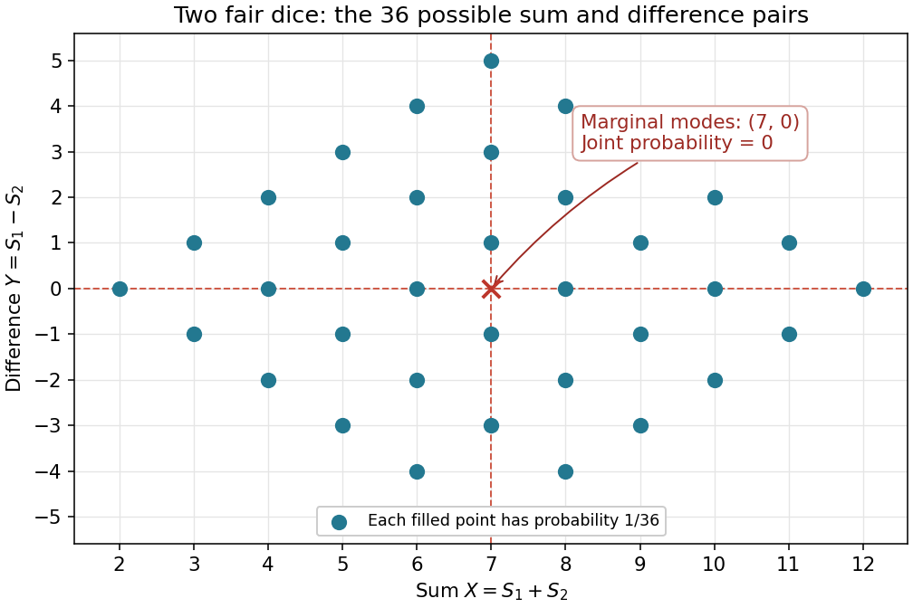

<h1 id="8/c/iv/solution">Solution</h1>

↑ **Parent:** [Iv](../iv.md)

Count the ordered roll pairs producing each value. The [probability mass functions](../../../../../../probability-mass-function.md) are

$$
\mathbb P(X=i)=\frac{6-|i-7|}{36}\quad(i=2,\ldots,12),\qquad\mathbb P(Y=j)=\frac{6-|j|}{36}\quad(j=-5,\ldots,5),
$$

and are zero outside these ranges. Both counts have a unique peak:

$$
\boxed{i=7,\quad j=0;\qquad\mathbb P(X=7)=\mathbb P(Y=0)=\frac16.}
$$

However, $Y=0$ forces equal rolls, whose sum is even. Hence $\mathbb P(X=7,Y=0)=0$, whereas the product of the two marginal [probabilities](../../../../../../probability.md) is $1/36>0$. This disproves [independence of random variables](../../../../../../independent-random-variables.md):

$$
\boxed{X\text{ and }Y\text{ are not independent}.}
$$

**[Figure 1](#8/c/iv/image-the-36-possible-sum-and-difference-pairs-for-two-independent-fair-dice-the-two-marginal-modes-cannot-occur-together). The 36 possible sum and difference pairs for two independent fair dice; the two marginal modes cannot occur together**.

## ↑ Ancestors (13)

1. [Iv](../iv.md)
2. [C](../../c.md)
3. [8](../../../8.md)
4. [Discrete mathematics, probability and continuous mathematics](../../../../discrete-mathematics-probability-and-continuous-mathematics-split.md)
5. [2013](../../../../split.md)
6. [Past exam of the year 1 of the computer science course of the University of Oxford](../../../../../split.md)
7. [Year 1 of the computer science course of the University of Oxford](../../../../../../year-1-of-the-computer-science-course-of-the-university-of-oxford.md)
8. [Computer science course of the University of Oxford](../../../../../../computer-science-course-of-the-university-of-oxford.md)
9. [Undergraduate course of the University of Oxford](../../../../../../undergraduate-course-of-the-university-of-oxford.md)
10. [Course of the University of Oxford](../../../../../../course-of-the-university-of-oxford.md)
11. [University of Oxford](../../../../../../university-of-oxford-split.md)
12. [List of universities](../../../../../../list-of-universities.md)
13. [Codex Wiki](../../../../../../split.md)
