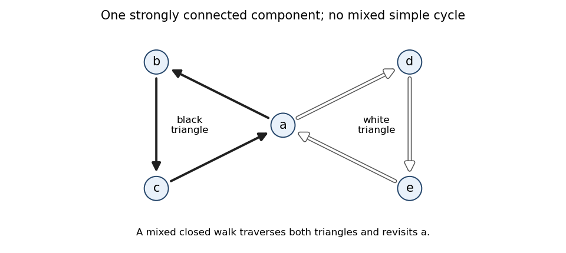

# Functional programming, design and analysis of algorithms

↑ **Parent:** [2013](../2013.md)

These solutions follow the original examination of 11 June 2013, code `4208`.[pp. 2–7, Questions 1–8](../../computer-science-bibliography.md#functional-programming-design-and-analysis-of-algorithms-examination-paper-by-the-university-of-oxford-2013) Each question's [Haskell](../../programming-language.md#haskell) definitions form a separate namespace; hide redefined [Standard Prelude](../../programming-language.md#standard-prelude) names when compiling them. Unless stated otherwise, arguments are finite and total. [Time complexity](../../theoretical-computer-science.md#time-complexity) counts primitive operations; the cost of comparing variable-length words and the growing bit cost of exact [integer](../../integer.md) arithmetic are stated separately where relevant.[§§3.1 and 4.1; Chapter 9, Standard Prelude](../../computer-science-bibliography.md#haskell-2010-language-report)

**Table of contents**

- [1](#1)
  - [a](#1/a)
    - [Solution](#1/a/solution)
  - [b](#1/b)
    - [i](#1/b/i)
      - [Solution](#1/b/i/solution)
    - [ii](#1/b/ii)
      - [Solution](#1/b/ii/solution)
  - [c](#1/c)
    - [Solution](#1/c/solution)
- [2](#2)
  - [a](#2/a)
    - [Solution](#2/a/solution)
  - [b](#2/b)
    - [Solution](#2/b/solution)
  - [c](#2/c)
    - [Solution](#2/c/solution)
  - [d](#2/d)
    - [Solution](#2/d/solution)
  - [e](#2/e)
    - [i](#2/e/i)
      - [Solution](#2/e/i/solution)
    - [ii](#2/e/ii)
      - [Solution](#2/e/ii/solution)
- [3](#3)
  - [a](#3/a)
    - [Solution](#3/a/solution)
  - [b](#3/b)
    - [Solution](#3/b/solution)
  - [c](#3/c)
    - [Solution](#3/c/solution)
- [4](#4)
  - [a](#4/a)
    - [Solution](#4/a/solution)
  - [b](#4/b)
    - [Solution](#4/b/solution)
  - [c](#4/c)
    - [Solution](#4/c/solution)
  - [d](#4/d)
    - [Solution](#4/d/solution)
  - [e](#4/e)
    - [Solution](#4/e/solution)
  - [f](#4/f)
    - [Solution](#4/f/solution)
  - [g](#4/g)
    - [Solution](#4/g/solution)
- [5](#5)
  - [a](#5/a)
    - [Solution](#5/a/solution)
  - [b](#5/b)
    - [Solution](#5/b/solution)
  - [c](#5/c)
    - [Solution](#5/c/solution)
  - [d](#5/d)
    - [Solution](#5/d/solution)
  - [e](#5/e)
    - [Solution](#5/e/solution)
- [6](#6)
  - [a](#6/a)
    - [Solution](#6/a/solution)
  - [b](#6/b)
    - [Solution](#6/b/solution)
  - [c](#6/c)
    - [i](#6/c/i)
      - [Solution](#6/c/i/solution)
    - [ii](#6/c/ii)
      - [Solution](#6/c/ii/solution)
    - [iii](#6/c/iii)
      - [Solution](#6/c/iii/solution)
- [7](#7)
  - [a](#7/a)
    - [Solution](#7/a/solution)
  - [b](#7/b)
    - [Solution](#7/b/solution)
  - [c](#7/c)
    - [Solution](#7/c/solution)
- [8](#8)
  - [a](#8/a)
    - [Solution](#8/a/solution)
  - [b](#8/b)
    - [Solution](#8/b/solution)
  - [c](#8/c)
    - [Solution](#8/c/solution)
  - [d](#8/d)
    - [Solution](#8/d/solution)
  - [e](#8/e)
    - [Solution](#8/e/solution)

## 1

↑ **Parent:** [Functional programming, design and analysis of algorithms](functional-programming-design-and-analysis-of-algorithms.md)

<h3 id="1/a">a</h3>

↑ **Parent:** [1](#1)

<h4 id="1/a/solution">Solution</h4>

↑ **Parent:** [A](#1/a)

The [map function](../../programming-language.md#map-higher-order-function) changes each element of a [list](../../data-structure.md#list-abstract-data-type) while preserving its order and length. [List concatenation](../../data-structure.md#list-concatenation) removes one level of nesting. [Currying](../../category.md#currying) changes a [function](../../function.md) on a pair into a [function](../../function.md) taking its two arguments separately; [uncurrying](../../category.md#uncurrying) reverses this conversion:

```
map :: (a -> b) -> [a] -> [b]
map f []     = []
map f (x:xs) = f x : map f xs

concat :: [[a]] -> [a]
concat []       = []
concat (xs:xss) = xs ++ concat xss

curry :: ((a, b) -> c) -> a -> b -> c
curry f x y = f (x, y)

uncurry :: (a -> b -> c) -> (a, b) -> c
uncurry f (x, y) = f x y
```

These [polymorphic](../../programming-language.md#programming-language-polymorphism) [type signatures](../../programming-language.md#type-signature) impose no numerical, equality or ordering constraints: the definitions only inspect [list](../../data-structure.md#list-abstract-data-type) or pair structure and apply a supplied [function](../../function.md). In particular,

$$
\boxed{\operatorname{curry}(f)\,x\,y=f(x,y),\qquad \operatorname{uncurry}(g)(x,y)=g\,x\,y.}
$$

The recursive equations describe the two possible [list](../../data-structure.md#list-abstract-data-type) constructors, so they also explain how the empty case terminates each finite computation.

<h3 id="1/b">b</h3>

↑ **Parent:** [1](#1)

<h4 id="1/b/i">i</h4>

↑ **Parent:** [B](#1/b)

<h5 id="1/b/i/solution">Solution</h5>

↑ **Parent:** [I](#1/b/i)

In the [type signature](../../programming-language.md#type-signature) `map :: (u -> v) -> [u] -> [v]`, the supplied [function](../../function.md) is `concat :: [[a]] -> [a]`. [Type inference](../../programming-language.md#type-inference) therefore identifies `u` with `[[a]]` and `v` with `[a]`. Consequently,

```
map concat :: [[[a]]] -> [[a]]
```

Thus $\boxed{[[[\alpha]]]\to[[\alpha]]}$ is the [principal type](../../programming-language.md#principal-type). For example, `map concat [[[1],[2,3]],[[4],[]]]` gives `[[1,2,3],[4]]`: it concatenates each inner group, preserving the outermost grouping.

<h4 id="1/b/ii">ii</h4>

↑ **Parent:** [B](#1/b)

<h5 id="1/b/ii/solution">Solution</h5>

↑ **Parent:** [Ii](#1/b/ii)

Both uses of `x` in this definition have the same [monomorphic type](../../programming-language.md#monomorphic-type) within the body. Write `x :: u -> v`. The inner application `x z` forces `z :: u` and has type `v`; the outer application `x (x z)` forces `v = u`. Thus `x :: u -> u`. Finally, `x (x z)` is applied to `y`, so `u` must itself be a [function type](../../programming-language.md#function-type), say `a -> b`. This gives

```
f :: ((a -> b) -> a -> b) -> a -> (a -> b) -> b
f x y z = x (x z) y
```

The [principal type](../../programming-language.md#principal-type) is therefore

$$
\boxed{((\alpha\to\beta)\to(\alpha\to\beta))\to\alpha\to(\alpha\to\beta)\to\beta.}
$$

The argument `x` transforms a [function](../../function.md) into another [function](../../function.md) of the same type. The body transforms `z` twice, then applies the resulting [function](../../function.md) to `y`; no recursive type equation is required.

<h3 id="1/c">c</h3>

↑ **Parent:** [1](#1)

<h4 id="1/c/solution">Solution</h4>

↑ **Parent:** [C](#1/c)

Represent [Pascal's triangle](../../binomial-coefficient.md#pascal-s-triangle) by an infinite outer [lazy list](../../data-structure.md#lazy-list), each of whose elements is one finite row. Pad the preceding row with zero on its left and on its right, then add corresponding entries:

```
pascal :: [[Integer]]
pascal = iterate next [1]
  where
    -- Padding supplies the two boundary entries as well as the interior sums.
    next :: [Integer] -> [Integer]
    next row = zipWith (+) (0 : row) (row ++ [0])
```

Here `iterate next [1]` begins `[[1],[1,1],[1,2,1],[1,3,3,1],...]`. Every call to `next` receives a finite row, so its final zero is reachable. [Lazy evaluation](../../programming-language.md#lazy-evaluation) produces any requested finite prefix without trying to finish the infinite outer [list](../../data-structure.md#list-abstract-data-type).

Indexing rows and columns from zero, [Pascal's rule](../../binomial-coefficient.md#pascal-s-rule) says

$$
\boxed{\operatorname{pascal}_n=\left[\binom n0,\binom n1,\ldots,\binom nn\right],\qquad \binom{n+1}j=\binom n{j-1}+\binom nj.}
$$

Take out-of-range [binomial coefficients](../../binomial-coefficient.md) to be zero. The seed is the zeroth row, and the padded [addition](../../arithmetic.md#addition) implements this identity at every position, including the two boundaries. [Mathematical induction](../../foundations-of-mathematics.md#mathematical-induction) therefore proves every generated row correct. Using unbounded [integers](../../integer.md) prevents overflow. Generating rows zero through $r$ takes $\Theta(r^2)$ arithmetic operations, with additional bit costs as the [binomial coefficients](../../binomial-coefficient.md) grow.

## 2

↑ **Parent:** [Functional programming, design and analysis of algorithms](functional-programming-design-and-analysis-of-algorithms.md)

<h3 id="2/a">a</h3>

↑ **Parent:** [2](#2)

<h4 id="2/a/solution">Solution</h4>

↑ **Parent:** [A](#2/a)

Use [structural induction](../../foundations-of-mathematics.md#structural-induction) on the finite [list](../../data-structure.md#list-abstract-data-type) `xs`, strengthening the [induction hypothesis](../../foundations-of-mathematics.md#induction-hypothesis) to hold for every accumulator value $y$. For the empty [list](../../data-structure.md#list-abstract-data-type), the defining equation of the [left fold](../../programming-language.md#left-fold) gives

$$
x\oplus\operatorname{foldl}(\otimes)\,y\,[]
=x\oplus y
=\operatorname{foldl}(\otimes)\,(x\oplus y)\,[].
$$

For the inductive step, suppose the identity holds for the tail `zs` and every accumulator. Expand the first [left fold](../../programming-language.md#left-fold), apply the [induction hypothesis](../../foundations-of-mathematics.md#induction-hypothesis) at accumulator $y\otimes z$, and then use the supplied compatibility law:

$$
\begin{aligned}
x\oplus\operatorname{foldl}(\otimes)\,y\,(z:\mathrm{zs})
&=x\oplus\operatorname{foldl}(\otimes)\,(y\otimes z)\,\mathrm{zs}\\
&=\operatorname{foldl}(\otimes)\,(x\oplus(y\otimes z))\,\mathrm{zs}\\
&=\operatorname{foldl}(\otimes)\,((x\oplus y)\otimes z)\,\mathrm{zs}\\
&=\operatorname{foldl}(\otimes)\,(x\oplus y)\,(z:\mathrm{zs}).
\end{aligned}
$$

Hence

$$
\boxed{x\oplus\operatorname{foldl}(\otimes)\,y\,\mathrm{xs}=\operatorname{foldl}(\otimes)\,(x\oplus y)\,\mathrm{xs}.}
$$

Only equation (1) is needed for this part; the seed condition in equation (2) enters the next proof. Quantifying over the accumulator is essential because the recursive call changes it.

<h3 id="2/b">b</h3>

↑ **Parent:** [2](#2)

<h4 id="2/b/solution">Solution</h4>

↑ **Parent:** [B](#2/b)

Again use [structural induction](../../foundations-of-mathematics.md#structural-induction) on the finite [list](../../data-structure.md#list-abstract-data-type). At `[]`, both the [right fold](../../programming-language.md#list-fold) and the [left fold](../../programming-language.md#left-fold) return the seed $a$. If they agree on `zs`, then

$$
\begin{aligned}
\operatorname{foldr}(\oplus)\,a\,(z:\mathrm{zs})
&=z\oplus\operatorname{foldr}(\oplus)\,a\,\mathrm{zs}\\
&=z\oplus\operatorname{foldl}(\otimes)\,a\,\mathrm{zs}\\
&=\operatorname{foldl}(\otimes)\,(z\oplus a)\,\mathrm{zs}\\
&=\operatorname{foldl}(\otimes)\,(a\otimes z)\,\mathrm{zs}\\
&=\operatorname{foldl}(\otimes)\,a\,(z:\mathrm{zs}).
\end{aligned}
$$

The third line uses part (a); the fourth uses equation (2). Thus the [left-right fold equivalence](../../programming-language.md#left-right-fold-equivalence) is

$$
\boxed{\operatorname{foldr}(\oplus)\,a\,\mathrm{xs}=\operatorname{foldl}(\otimes)\,a\,\mathrm{xs}.}
$$

This is a statement about values on finite, total inputs. It does not assert equal evaluation costs or equal behaviour on infinite [lists](../../data-structure.md#list-abstract-data-type).

<h3 id="2/c">c</h3>

↑ **Parent:** [2](#2)

<h4 id="2/c/solution">Solution</h4>

↑ **Parent:** [C](#2/c)

Use [list concatenation](../../data-structure.md#list-concatenation) as the combining operation and the empty [list](../../data-structure.md#list-abstract-data-type) as the seed:

```
concat :: [[a]] -> [a]
concat = foldr (++) []
```

For three inner [lists](../../data-structure.md#list-abstract-data-type), this constructs `xs ++ (ys ++ (zs ++ []))`, preserving the elements' original order. The concise answer is $\boxed{\operatorname{concat}=\operatorname{foldr}\,(\mathbin{+\!+})\,[\,]}$.

<h3 id="2/d">d</h3>

↑ **Parent:** [2](#2)

<h4 id="2/d/solution">Solution</h4>

↑ **Parent:** [D](#2/d)

Set both $\oplus$ and $\otimes$ equal to [list concatenation](../../data-structure.md#list-concatenation), with $a=[]$. [Associativity](../../algebraic-operation.md#associative-property) gives `xs ++ (ys ++ zs) = (xs ++ ys) ++ zs`, which is equation (1). The two identity laws give `xs ++ [] = [] ++ xs`, which is equation (2). Part (b) therefore yields

```
concat :: [[a]] -> [a]
concat = foldl (++) []
```

Thus $\boxed{\operatorname{concat}=\operatorname{foldl}\,(\mathbin{+\!+})\,[\,]}$ on finite [lists](../../data-structure.md#list-abstract-data-type). The argument order is unchanged: the accumulator is the already concatenated prefix, and the next inner [list](../../data-structure.md#list-abstract-data-type) is appended to its right. This preserves the order but repeatedly copies that prefix.

<h3 id="2/e">e</h3>

↑ **Parent:** [2](#2)

<h4 id="2/e/i">i</h4>

↑ **Parent:** [E](#2/e)

<h5 id="2/e/i/solution">Solution</h5>

↑ **Parent:** [I](#2/e/i)

Let there be $k$ inner [lists](../../data-structure.md#list-abstract-data-type), of lengths $\ell_1,\ldots,\ell_k$, and let $N=\sum_j\ell_j$. Evaluate the whole output [list](../../data-structure.md#list-abstract-data-type) spine, taking each input element as an already available value. The defining equation `(x:xs) ++ ys = x : (xs ++ ys)` shows that [list concatenation](../../data-structure.md#list-concatenation) traverses its left operand, sharing its right operand.

The [right fold](../../programming-language.md#list-fold) puts each original inner [list](../../data-structure.md#list-abstract-data-type) on the left of exactly one concatenation. Thus its total element traversal is proportional to $N$, and visiting the outer [list](../../data-structure.md#list-abstract-data-type) costs $k$:

$$
\boxed{T_{\mathrm{right}}=\Theta(k+N).}
$$

The $k$ term matters when many inner [lists](../../data-structure.md#list-abstract-data-type) are empty. With $k$ rows each of length $r$, the bound is $\Theta(k+kr)$. In particular, with uniformly bounded positive row length it is linear in $k$.

<h4 id="2/e/ii">ii</h4>

↑ **Parent:** [E](#2/e)

<h5 id="2/e/ii/solution">Solution</h5>

↑ **Parent:** [Ii](#2/e/ii)

Write $S_j=\ell_1+\cdots+\ell_j$, with $S_0=0$. At the $j$th step of the [left fold](../../programming-language.md#left-fold), the left operand of [list concatenation](../../data-structure.md#list-concatenation) is the accumulated prefix of length $S_{j-1}$. Fully forcing these concatenations repeatedly copies earlier elements. Including the traversal of the outer [list](../../data-structure.md#list-abstract-data-type) and the whole output spine gives

$$
\boxed{T_{\mathrm{left}}=\Theta\!\left(k+N+\sum_{j=1}^{k-1}S_j\right)
=\Theta\!\left(k+N+\sum_{t=1}^{k-1}(k-t)\ell_t\right).}
$$

For singleton inner [lists](../../data-structure.md#list-abstract-data-type), this becomes $\Theta(1+2+\cdots+(k-1))=\Theta(k^2)$, whereas the [right fold](../../programming-language.md#list-fold) takes $\Theta(k)$. More generally, for equal positive length $r$, the [left fold](../../programming-language.md#left-fold) takes $\Theta(rk^2+k)$.

An $O(kN+k)$ bound is tight in the worst case over length distributions, but is not a tight formula for every distribution: if all $N$ elements occur only in the final inner [list](../../data-structure.md#list-abstract-data-type), all earlier accumulators are empty and the cost is $\Theta(k+N)$. [Lazy evaluation](../../programming-language.md#lazy-evaluation) changes when the work happens; it does not remove repeated prefix traversal when the whole result is demanded.

## 3

↑ **Parent:** [Functional programming, design and analysis of algorithms](functional-programming-design-and-analysis-of-algorithms.md)

<h3 id="3/a">a</h3>

↑ **Parent:** [3](#3)

<h4 id="3/a/solution">Solution</h4>

↑ **Parent:** [A](#3/a)

A word can be a [string](../../foundations-of-mathematics.md#string), and the input text a [list](../../data-structure.md#list-abstract-data-type) of those [strings](../../foundations-of-mathematics.md#string). Use names that avoid clashing with the [Standard Prelude](../../programming-language.md#standard-prelude) machine-word type `Word`:

```
type TextWord = String
type Text = [TextWord]
```

Thus $\boxed{\mathrm{TextWord}=\mathrm{String},\quad\mathrm{Text}=[\mathrm{TextWord}]}$. These are [type synonyms](../../programming-language.md#type-synonym), so ordinary [string](../../foundations-of-mathematics.md#string) and [list](../../data-structure.md#list-abstract-data-type) operations remain available without wrapping or unwrapping constructors. They describe input that has already been tokenized; punctuation and word boundaries do not need a separate treatment here.

<h3 id="3/b">b</h3>

↑ **Parent:** [3](#3)

<h4 id="3/b/solution">Solution</h4>

↑ **Parent:** [B](#3/b)

Normalize each word once by applying `toLower` to its characters. Maintain an [association list](../../data-structure.md#association-list) whose keys are distinct normalized words and whose values are their frequencies:

```
import Data.Char (toLower)

type TextWord = String
type Text = [TextWord]
type Frequency = Integer
type Entry = (TextWord, Frequency)

count :: Text -> [Entry]
count = foldl addWord [] . map (map toLower)
  where
    -- Increment the unique matching key, or append a new key with count one.
    addWord :: [Entry] -> TextWord -> [Entry]
    addWord [] w = [(w, 1)]
    addWord ((v, n):rest) w
      | w == v    = (v, n + 1) : rest
      | otherwise = (v, n) : addWord rest w
```

After any input prefix, each normalized word seen so far occurs exactly once as a key, with its number of occurrences as value. This [loop invariant](../../algorithm.md#loop-invariant) holds initially for the empty [association list](../../data-structure.md#association-list). A step either increments the unique existing entry or introduces exactly one new entry, so [mathematical induction](../../foundations-of-mathematics.md#mathematical-induction) proves

$$
\boxed{\operatorname{lookup}\ w\ (\operatorname{count}\ \mathrm{input})=\operatorname{Just}(\text{number of normalized occurrences of }w)}
$$

for every word that occurs. In particular, `Baa` and `baa` contribute to the same key `baa`; the three frequency-two keys in the source example are `baa`, `yes` and `sir`.

The [association list](../../data-structure.md#association-list) preserves first-occurrence order, although the specification allows any order here. For $t$ input words and $d$ distinct normalized words, it performs $O(td)$ key comparisons in the worst case. Character normalization costs the total input character count, and a [string](../../foundations-of-mathematics.md#string) comparison can inspect multiple characters. Characterwise `toLower` supplies the intended [case-insensitive comparison](../../foundations-of-mathematics.md#case-insensitive-comparison) convention for the example; full Unicode case folding can require a different normalization policy.

<h3 id="3/c">c</h3>

↑ **Parent:** [3](#3)

<h4 id="3/c/solution">Solution</h4>

↑ **Parent:** [C](#3/c)

Compare frequencies in decreasing order and use [lexicographic order](../../extremal-set-theory.md#lexicographic-order) on words to break ties. Implement [merge sort](../../algorithm.md#merge-sort) explicitly, so no imported sorting routine is needed:

```
-- Entry, TextWord and Frequency are as in part (b).
before :: Entry -> Entry -> Bool
before (w, p) (v, q) = p > q || (p == q && w <= v)

sort :: [Entry] -> [Entry]
sort []  = []
sort [x] = [x]
sort xs  = merge (sort left) (sort right)
  where
    (left, right) = splitAt (length xs `div` 2) xs

merge :: [Entry] -> [Entry] -> [Entry]
merge [] ys = ys
merge xs [] = xs
merge xa@(x:xs) ya@(y:ys)
  | before x y = x : merge xs ya
  | otherwise  = y : merge xa ys
```

The [merge algorithm](../../algorithm.md#merge-algorithm) step always emits the smaller key under the ordering $(-\text{frequency},\text{word})$. The unchosen heads cannot precede that emitted entry because each input is already sorted. It preserves all entries, and each call removes one head, so it terminates with exactly the sorted union of the inputs. [Mathematical induction](../../foundations-of-mathematics.md#mathematical-induction) over the recursive splits establishes correctness of [merge sort](../../algorithm.md#merge-sort).

For $n$ entries, splitting and merging cost $\Theta(n)$ per level, and there are $\Theta(\log n)$ levels:

$$
\boxed{T(n)=T(\lfloor n/2\rfloor)+T(\lceil n/2\rceil)+\Theta(n)=\Theta(n\log n)\quad(n\geq2).}
$$

The base cases take constant time. This counts word comparisons as primitive operations, as in the question. If the maximum compared word length is $L$, the character-operation bound becomes $O(Ln\log n)$, in addition to frequency comparison costs.

For the supplied input, `sort . count` yields

```
[("baa",2),("sir",2),("yes",2),("any",1),("bags",1),("black",1),
 ("full",1),("have",1),("sheep",1),("three",1),("wool",1),("you",1)]
```

In particular, the secondary ordering places `sir` before `yes`, even though `yes` appears earlier in the original text. The $\Theta(n\log n)$ requirement concerns `sort`; the simpler [association list](../../data-structure.md#association-list) implementation of `count` has its own cost.

## 4

↑ **Parent:** [Functional programming, design and analysis of algorithms](functional-programming-design-and-analysis-of-algorithms.md)

<h3 id="4/a">a</h3>

↑ **Parent:** [4](#4)

<h4 id="4/a/solution">Solution</h4>

↑ **Parent:** [A](#4/a)

An empty constructor and a constructor containing a label and two subtrees give a [polymorphic](../../programming-language.md#programming-language-polymorphism) [algebraic data type](../../programming-language.md#algebraic-data-type):

```
data STree a = Empty | Node (STree a) a (STree a)
  deriving (Eq, Show)
```

The [binary search tree](../../data-structure.md#binary-search-tree) invariant is $\boxed{\text{every left label}<x<\text{every right label}}$ at each `Node left x right`, together with the same invariant recursively in both subtrees. Labels are distinct because the representation is of a [set](../../set.md). The declaration itself needs no ordering constraint; operations that compare labels require `Ord a` in their [type signatures](../../programming-language.md#type-signature).

<h3 id="4/b">b</h3>

↑ **Parent:** [4](#4)

<h4 id="4/b/solution">Solution</h4>

↑ **Parent:** [B](#4/b)

Follow the unique branch in which the new key could belong. At an equal key, keep the existing node so that duplicate insertion does not change the represented [set](../../set.md):

```
insert :: Ord a => a -> STree a -> STree a
insert y Empty = Node Empty y Empty
insert y (Node left x right) =
  case compare y x of
    LT -> Node (insert y left) x right
    EQ -> Node left x right
    GT -> Node left x (insert y right)
```

The [Haskell Ord class](../../programming-language.md#haskell-ord-class) supplies the three-way comparison. Each visited nonempty node costs one such comparison; rebuilding a node preserves all untouched subtrees. The inserted key satisfies every comparison along its search path, so it obeys both the local and ancestor [binary search tree](../../data-structure.md#binary-search-tree) inequalities.

For [height of a binary tree](../../data-structure.md#height-of-a-binary-tree) $h$, the worst search costs $\boxed{\Theta(h)\text{ comparisons}}$ when it reaches the bottom. With $n$ existing nodes, a chain can require $n$ comparisons, giving a worst case of $\Theta(n)$. Under the standard random-insertion model, distinct keys arrive in a uniformly random order and the expected path length is $\Theta(\log(n+1))$. Thus the usual average-case answer is $\boxed{\Theta(\log n)}$ for growing $n$, but this expectation needs the stated distribution: an arbitrary unbalanced [binary search tree](../../data-structure.md#binary-search-tree) has no logarithmic guarantee.

<h3 id="4/c">c</h3>

↑ **Parent:** [4](#4)

<h4 id="4/c/solution">Solution</h4>

↑ **Parent:** [C](#4/c)

A [tree fold](../../programming-language.md#tree-fold) replaces `Empty` by a seed and `Node` by a combining [function](../../function.md). The combining [function](../../function.md) receives the already folded left subtree, the node's label and the already folded right subtree:

```
foldSTree :: (b -> a -> b -> b) -> b -> STree a -> b
foldSTree combine empty Empty = empty
foldSTree combine empty (Node left x right) =
  combine (foldSTree combine empty left)
          x
          (foldSTree combine empty right)
```

Its [polymorphic](../../programming-language.md#programming-language-polymorphism) [type signature](../../programming-language.md#type-signature) is

$$
\boxed{(\beta\to\alpha\to\beta\to\beta)\to\beta\to\mathrm{STree}\ \alpha\to\beta.}
$$

The result type need not be the label type: it may be a [list](../../data-structure.md#list-abstract-data-type), a number or another structure. No ordering constraint is needed because this [tree fold](../../programming-language.md#tree-fold) follows constructors without comparing labels.

<h3 id="4/d">d</h3>

↑ **Parent:** [4](#4)

<h4 id="4/d/solution">Solution</h4>

↑ **Parent:** [D](#4/d)

Use the empty [list](../../data-structure.md#list-abstract-data-type) for an empty subtree, and join the left result, the current label and the right result:

```
flatten :: STree a -> [a]
flatten = foldSTree (\left x right -> left ++ (x : right)) []
```

Thus $\boxed{\operatorname{flatten}(\operatorname{Node}\ l\ x\ r)=\operatorname{flatten}(l)\mathbin{+\!+}[x]\mathbin{+\!+}\operatorname{flatten}(r)}$. This is an [inorder traversal](../../data-structure.md#inorder-traversal). By [structural induction](../../foundations-of-mathematics.md#structural-induction), each subtree produces its labels in order; the [binary search tree](../../data-structure.md#binary-search-tree) invariant places every left label below $x$ and every right label above $x$, proving that the whole result is increasing. The definition works for any binary-tree shape, although its result is sorted only when the ordering invariant holds. Repeated [list concatenation](../../data-structure.md#list-concatenation) can give quadratic cost on a left chain; the question asks for a [tree fold](../../programming-language.md#tree-fold) definition, rather than an optimal traversal implementation.

<h3 id="4/e">e</h3>

↑ **Parent:** [4](#4)

<h4 id="4/e/solution">Solution</h4>

↑ **Parent:** [E](#4/e)

An empty [binary search tree](../../data-structure.md#binary-search-tree) has zero nodes; a nonempty node contributes one in addition to the sizes of its two subtrees:

```
size :: STree a -> Integer
size = foldSTree (\left _ right -> 1 + left + right) 0
```

The answer is $\boxed{|\operatorname{Empty}|=0,\quad|\operatorname{Node}\ l\ x\ r|=1+|l|+|r|}$. The [tree fold](../../programming-language.md#tree-fold) visits every node once, so this takes $\Theta(n)$ arithmetic operations for $n$ nodes.

<h3 id="4/f">f</h3>

↑ **Parent:** [4](#4)

<h4 id="4/f/solution">Solution</h4>

↑ **Parent:** [F](#4/f)

Count the number of nonempty levels on the longest root-to-leaf branch, taking the empty [binary search tree](../../data-structure.md#binary-search-tree) to have depth zero:

```
depth :: STree a -> Integer
depth = foldSTree (\left _ right -> 1 + max left right) 0
```

Thus $\boxed{d(\operatorname{Empty})=0,\quad d(\operatorname{Node}\ l\ x\ r)=1+\max(d(l),d(r))}$. A singleton has depth one under this convention. If [height of a binary tree](../../data-structure.md#height-of-a-binary-tree) is instead counted in edges, subtract one for a nonempty [tree](../../tree-graph-theory.md). The complete [tree fold](../../programming-language.md#tree-fold) takes $\Theta(n)$ operations.

<h3 id="4/g">g</h3>

↑ **Parent:** [4](#4)

<h4 id="4/g/solution">Solution</h4>

↑ **Parent:** [G](#4/g)

Search as for insertion. Removing a node with at most one nonempty child leaves that child in its place. With two children, use the smallest key in the right subtree as the replacement and remove that occurrence from the right subtree:

```
delete :: Ord a => a -> STree a -> STree a
delete _ Empty = Empty
delete y (Node left x right) =
  case compare y x of
    LT -> Node (delete y left) x right
    GT -> Node left x (delete y right)
    EQ -> join left right
  where
    -- Join two search trees with every left key below every right key.
    join :: STree a -> STree a -> STree a
    join Empty r = r
    join l Empty = l
    join l r = let (smallest, rest) = takeMin r
               in Node l smallest rest

-- Precondition: the input tree is nonempty.
takeMin :: STree a -> (a, STree a)
takeMin Empty = error "takeMin: empty tree"
takeMin (Node Empty x right) = (x, right)
takeMin (Node left x right) =
  let (smallest, rest) = takeMin left
  in (smallest, Node rest x right)
```

The call to `takeMin` occurs only after both empty cases have been excluded. Its [structural recursion](../../programming-language.md#structural-recursion) follows left children until it reaches the minimum label and rebuilds the path with that occurrence removed.

For a matching label $x$ and successor $s$, all left labels are below $x<s$, while every label remaining on the right is strictly above $s$. Thus replacing $x$ by $s$ preserves the [binary search tree](../../data-structure.md#binary-search-tree) invariant. Every other branch preserves the invariant by [structural induction](../../foundations-of-mathematics.md#structural-induction). The resulting [set](../../set.md) is exactly

$$
\boxed{\operatorname{keys}(\operatorname{delete}\ y\ t)=\operatorname{keys}(t)\setminus\{y\}.}
$$

Whether the key is absent or present, untouched subtrees can be shared. The search path followed by the successor path uses $O(h)$ time and fresh nodes for original [height of a binary tree](../../data-structure.md#height-of-a-binary-tree) $h$, so the worst case is $O(n)$ without balancing. This is [persistent binary search tree deletion](../../data-structure.md#persistent-binary-search-tree-deletion): the original value remains available.

## 5

↑ **Parent:** [Functional programming, design and analysis of algorithms](functional-programming-design-and-analysis-of-algorithms.md)

<h3 id="5/a">a</h3>

↑ **Parent:** [5](#5)

<h4 id="5/a/solution">Solution</h4>

↑ **Parent:** [A](#5/a)

A length-zero [graph path](../../graph-theory.md#path-in-a-graph) starts and ends at the same [vertex](../../graph.md#vertex-graph-theory). Therefore $P_0$ is the [Boolean](../../programming-language.md#boolean-data-type) [identity matrix](../../vector-space.md#identity-matrix). A [graph path](../../graph-theory.md#path-in-a-graph) of length at most one is either such a stationary [graph path](../../graph-theory.md#path-in-a-graph) or one original directed [edge](../../graph-theory.md#edge-of-a-graph):

$$
\boxed{P_0[i,j]=(i=j),\qquad P_1[i,j]=(i=j)\lor E[i,j],\qquad P_1=I\lor E.}
$$

The logical disjunction is entrywise. Diagonal entries of $E$ may be false if there are no [self-loops](../../graph.md#loop-graph-theory), but every diagonal entry of $P_1$ is true because the zero-length [graph path](../../graph-theory.md#path-in-a-graph) is allowed.

<h3 id="5/b">b</h3>

↑ **Parent:** [5](#5)

<h4 id="5/b/solution">Solution</h4>

↑ **Parent:** [B](#5/b)

A [graph path](../../graph-theory.md#path-in-a-graph) of length at most $k+1$ either already has length at most $k$, or consists of a prefix of length at most $k$ followed by one [edge](../../graph-theory.md#edge-of-a-graph). Therefore

$$
\boxed{P_{k+1}[i,j]=P_k[i,j]\lor\bigvee_{t=0}^{n-1}\bigl(P_k[i,t]\land E[t,j]\bigr).}
$$

The forward implication follows by removing the final [edge](../../graph-theory.md#edge-of-a-graph) of a nonempty [graph path](../../graph-theory.md#path-in-a-graph). Conversely, concatenating the indicated prefix and [edge](../../graph-theory.md#edge-of-a-graph) gives a [walk](../../graph-theory.md#walk-in-a-graph) of length at most $k+1$, and removing repetitions if necessary gives a [graph path](../../graph-theory.md#path-in-a-graph) no longer than that [walk](../../graph-theory.md#walk-in-a-graph).

Writing $\odot$ for [Boolean matrix multiplication](../../vector-space.md#boolean-matrix-multiplication), the formula is $P_{k+1}=P_k\lor(P_k\odot E)$. Because $P_1$ includes the [identity matrix](../../vector-space.md#identity-matrix), an equivalent formula is

$$
\boxed{P_{k+1}=P_k\odot P_1.}
$$

Compute each new [matrix](../../vector-space.md#matrix) from an unchanged copy of the preceding [matrix](../../vector-space.md#matrix), so the subscript continues to specify exactly the length bound.

<h3 id="5/c">c</h3>

↑ **Parent:** [5](#5)

<h4 id="5/c/solution">Solution</h4>

↑ **Parent:** [C](#5/c)

Start with $P_1=I\lor E$ and repeatedly apply part (b), keeping a fresh output [matrix](../../vector-space.md#matrix). A simple implementation is

```
P := I OR E
repeat:
    Q := P OR boolean_product(P, E)
    if Q = P: return P
    P := Q
```

At the start of each iteration, $P=P_k$ for the current length bound $k$. The update produces $P_{k+1}$, proving the [loop invariant](../../algorithm.md#loop-invariant) by [mathematical induction](../../foundations-of-mathematics.md#mathematical-induction). If $Q=P$, every [edge](../../graph-theory.md#edge-of-a-graph) extension of a known [graph path](../../graph-theory.md#path-in-a-graph) is already known. Repeating the same update then makes no further change, so every longer [graph path](../../graph-theory.md#path-in-a-graph) is represented as well.

Every reachable pair of distinct [vertices](../../graph.md#vertex-graph-theory) has a [simple path](../../graph-theory.md#path-in-a-graph) of at most $n-1$ [edges](../../graph-theory.md#edge-of-a-graph): a repeated [vertex](../../graph.md#vertex-graph-theory) allows the intervening part to be deleted. Thus the process stabilizes after finitely many updates and returns

$$
\boxed{R[i,j]=\text{true precisely when }j\text{ is reachable from }i,\text{ including }i=j.}
$$

This is the [reflexive transitive closure](../../set-theory.md#reflexive-transitive-closure). An alternative stopping rule is to stop once the length bound is at least $n-1$, avoiding a final equality-detection iteration. For $n=0$ or $1$, $P_1$ already suffices.

<h3 id="5/d">d</h3>

↑ **Parent:** [5](#5)

<h4 id="5/d/solution">Solution</h4>

↑ **Parent:** [D](#5/d)

Interpret the source's $m$ as the maximum finite [shortest-path distance](../../shortest-path-problem.md#shortest-path-distance) among reachable pairs, taking $m=0$ when only length-zero [graph paths](../../graph-theory.md#path-in-a-graph) are needed. This is the length bound required for [reflexive transitive closure](../../set-theory.md#reflexive-transitive-closure). A directed [graph cycle](../../graph-theory.md#cycle-in-a-graph) permits arbitrarily long [walks](../../graph-theory.md#walk-in-a-graph), so the maximum length of all possible [walks](../../graph-theory.md#walk-in-a-graph) would not be a finite termination parameter.[p. 6, Question 5(d), phrase “maximum path length in the transitive closure”](../../computer-science-bibliography.md#functional-programming-design-and-analysis-of-algorithms-examination-paper-by-the-university-of-oxford-2013)

For the elementary dense implementation, each [Boolean matrix multiplication](../../vector-space.md#boolean-matrix-multiplication) evaluates all $n^3$ triples $(i,t,j)$, with no early exit. Each equality test costs $O(n^2)$. Starting from $P_1$, the algorithm reaches $P_m$ after $m-1$ updates when $m\geq1$, then performs one further update to detect stability. Consequently, for $n\geq2$,

$$
\boxed{T_{\mathrm{extend}}=\Theta(n^3\max\{1,m\}),\qquad \text{auxiliary space}=\Theta(n^2).}
$$

For the usual nontrivial case $m\geq1$, this is $\Theta(mn^3)$. Since $m\leq n-1$, the overall worst case is $\Theta(n^4)$. This bound is tight for this implementation: the directed chain $0\to1\to\cdots\to n-1$ has $m=n-1$ and gains previously unknown pairs at every length until then, while every update scans all triples. This tightness does not claim an inherent lower bound for the [reflexive transitive closure](../../set-theory.md#reflexive-transitive-closure) problem; it concerns the specified repeated-extension [algorithm](../../algorithm.md).

<h3 id="5/e">e</h3>

↑ **Parent:** [5](#5)

<h4 id="5/e/solution">Solution</h4>

↑ **Parent:** [E](#5/e)

Split a [graph path](../../graph-theory.md#path-in-a-graph) of length at most $2k$ into two consecutive parts of length at most $k$, allowing a zero-length part. Conversely, concatenating two such parts gives a [walk](../../graph-theory.md#walk-in-a-graph) of length at most $2k$ and hence the same [reachability](../../graph.md#reachability-in-a-graph). Therefore

$$
\boxed{P_{2k}=P_k\odot P_k.}
$$

Start at $P_1=I\lor E$, then square to obtain $P_2,P_4,P_8,\ldots$. Stop at equality of successive [matrices](../../vector-space.md#matrix), or after the length bound reaches $n-1$. The invariant is now $P=P_{2^r}$ after $r$ squarings. Equality implies closure under composition, and the included [identity matrix](../../vector-space.md#identity-matrix) ensures [reflexivity](../../set-theory.md#reflexive-relation).

For the same elementary dense [Boolean matrix multiplication](../../vector-space.md#boolean-matrix-multiplication) and equality stopping test, the cost is

$$
\boxed{T_{\mathrm{square}}=\Theta\!\left(n^3(1+\log(m+1))\right),\qquad \text{space}=\Theta(n^2).}
$$

The additive constant covers the final stability check and the cases $m=0,1$. Thus, with $m\geq2$, the number of cubic passes falls from $\Theta(m)$ to $\Theta(\log m)$. In terms of $n$ alone the worst-case bound improves from $\Theta(n^4)$ to $\Theta(n^3\log n)$ for these implementations. A directed chain also requires logarithmically many squarings. This comparison uses ordinary triple-loop multiplication, rather than a faster [matrix multiplication](../../vector-space.md#matrix-multiplication) method.

## 6

↑ **Parent:** [Functional programming, design and analysis of algorithms](functional-programming-design-and-analysis-of-algorithms.md)

<h3 id="6/a">a</h3>

↑ **Parent:** [6](#6)

<h4 id="6/a/solution">Solution</h4>

↑ **Parent:** [A](#6/a)

[Divide-and-conquer algorithms](../../algorithm.md#divide-and-conquer-algorithm) split a problem into smaller instances of the same kind, solve them recursively, and combine the solutions. A base case handles instances too small to split. For [merge sort](../../algorithm.md#merge-sort), divide the input into two halves, recursively sort both halves, and merge them by repeatedly taking the smaller current head. Empty and singleton inputs are already sorted.

The [merge algorithm](../../algorithm.md#merge-algorithm) step preserves sortedness because its chosen head is no larger than either remaining head; it also preserves every input occurrence. These facts and [mathematical induction](../../foundations-of-mathematics.md#mathematical-induction) on input length prove correctness. Splitting and merging take $\Theta(n)$ time, so

$$
\boxed{T(n)=T(\lfloor n/2\rfloor)+T(\lceil n/2\rceil)+\Theta(n)=\Theta(n\log n).}
$$

At each level the subproblem sizes sum to $n$, and there are $\Theta(\log n)$ levels. Part 3(c) supplies an explicit [Haskell](../../programming-language.md#haskell) implementation of this construction with a more specialized comparison rule. Standard [array](../../data-structure.md#array-data-structure) implementations use $O(n)$ auxiliary storage.

<h3 id="6/b">b</h3>

↑ **Parent:** [6](#6)

<h4 id="6/b/solution">Solution</h4>

↑ **Parent:** [B](#6/b)

Restrict attention to distinct keys; any [comparison sort](../../algorithm.md#comparison-sort) must handle these inputs. A deterministic [comparison sort](../../algorithm.md#comparison-sort) can be represented by a binary [decision tree](../../theoretical-computer-science.md#decision-tree): an internal node records a comparison and its two possible outcomes, and a leaf records the final ordering of the input positions.

There are $n!$ possible relative orders. Two different orders cannot finish at the same leaf, since the [algorithm](../../algorithm.md) would then output the same ordering of positions for both, making at least one result incorrect. A binary [decision tree](../../theoretical-computer-science.md#decision-tree) of height $h$ has at most $2^h$ leaves. Hence

$$
2^h\geq n!,\qquad h\geq\lceil\log_2(n!)\rceil.
$$

Using the given bound, or just the last $\lfloor n/2\rfloor$ factors of $n!$, gives

$$
\boxed{h\in\Omega(n\log n).}
$$

This is a worst-case [comparison sorting lower bound](../../algorithm.md#comparison-sorting-lower-bound), and [merge sort](../../algorithm.md#merge-sort) achieves the same order. The result concerns [comparison sorting](../../algorithm.md#comparison-sort); a procedure that uses numerical digits or bounded integer values has a different computational model.

<h3 id="6/c">c</h3>

↑ **Parent:** [6](#6)

<h4 id="6/c/i">i</h4>

↑ **Parent:** [C](#6/c)

<h5 id="6/c/i/solution">Solution</h5>

↑ **Parent:** [I](#6/c/i)

Assume $1\leq i\leq n$. Apply a worst-case $\Theta(n\log n)$ [comparison sort](../../algorithm.md#comparison-sort), such as [merge sort](../../algorithm.md#merge-sort) or [heapsort](../../algorithm.md#heapsort), to the whole [array](../../data-structure.md#array-data-structure), then copy its first $i$ entries to the output. The copying costs $\Theta(i)$, so

$$
\boxed{T_1(n,i)=\Theta(n\log n+i)=\Theta(n\log n)\quad(n\geq2).}
$$

The [comparison sorting lower bound](../../algorithm.md#comparison-sorting-lower-bound) makes the full-sort stage tight. For the sample [array](../../data-structure.md#array-data-structure), the sorted order begins $2,6,7$, which is the required prefix for $i=3$. This method spends time ordering all $n-i$ unreported elements as well.

<h4 id="6/c/ii">ii</h4>

↑ **Parent:** [C](#6/c)

<h5 id="6/c/ii/solution">Solution</h5>

↑ **Parent:** [Ii](#6/c/ii)

Store the [array](../../data-structure.md#array-data-structure) as a [binary heap](../../data-structure.md#binary-heap) with [min-heap](../../data-structure.md#min-heap) order. Build it bottom-up by sifting down internal nodes in reverse order, rather than inserting all $n$ values one at a time. The sum of subtree heights is $O(n)$, so construction costs $\Theta(n)$. Then perform $i$ minimum extractions: output the root, move the last remaining entry to the root, and sift it down to restore the [heap order](../../data-structure.md#heap-order).

Each extraction returns the smallest remaining key, so the outputs are the $i$ smallest keys in increasing order. For a heap of current size $s$, an extraction takes $O(\log(s+1))$ time. Hence

$$
T_2(n,i)=O\!\left(n+\sum_{j=0}^{i-1}\log(n-j+1)\right)
=O(n+i\log n).
$$

The tight worst-case bound for this ordinary [binary heap](../../data-structure.md#binary-heap) implementation is

$$
\boxed{T_2(n,i)=\Theta(n+i\log n).}
$$

When the extraction term is substantial, worst-case extractions follow root-to-leaf paths of logarithmic length; when $i$ is small, the linear construction already dominates. The bound stays valid at $i=n$, since $\log(n!)=\Theta(n\log n)$. Building by $n$ separate insertions would lose the linear construction bound and is unnecessary.

<h4 id="6/c/iii">iii</h4>

↑ **Parent:** [C](#6/c)

<h5 id="6/c/iii/solution">Solution</h5>

↑ **Parent:** [Iii](#6/c/iii)

Use deterministic [median of medians](../../algorithm.md#median-of-medians) to select the element of rank $i$ in worst-case $\Theta(n)$ time. Partition the [array](../../data-structure.md#array-data-structure) about that value, retaining the $i$ smallest elements. The input is a [set](../../set.md), so there are no equal-key ambiguities: take the $i-1$ smaller values and the selected value itself. Sort these $i$ elements with [merge sort](../../algorithm.md#merge-sort), then output them.

For completeness, [median of medians](../../algorithm.md#median-of-medians) groups values in fives, finds each small group's median, recursively selects a median of those medians as a pivot, and recurses only into the partition containing the requested rank. At least $3n/10-O(1)$ entries lie on each side of the pivot. Its worst-case recurrence is

$$
S(n)\leq S(\lceil n/5\rceil)+S(7n/10+O(1))+O(n)=O(n).
$$

Selection and partitioning cost $\Theta(n)$, and sorting the retained prefix costs $\Theta(i\log i)$ for $i\geq2$. Including output at $i=1$ gives

$$
\boxed{T_3(n,i)=\Theta(n+i\log(i+1)).}
$$

Scanning the input is necessary even to identify its minimum. Ordering the selected $i$ distinct values also has the [comparison sorting lower bound](../../algorithm.md#comparison-sorting-lower-bound) $\Omega(i\log i)$, so this is asymptotically optimal for the task. A usual randomized [Quickselect](../../algorithm.md#quickselect) gives linear expected selection time, but its quadratic worst case would not establish the requested worst-case guarantee.

## 7

↑ **Parent:** [Functional programming, design and analysis of algorithms](functional-programming-design-and-analysis-of-algorithms.md)

<h3 id="7/a">a</h3>

↑ **Parent:** [7](#7)

<h4 id="7/a/solution">Solution</h4>

↑ **Parent:** [A](#7/a)

[Dynamic programming](../../mathematical-optimization.md#dynamic-programming) specifies a collection of overlapping subproblems, expresses each answer using smaller subproblem answers, and stores answers so each subproblem is solved once. One may fill a table in dependency order or use [memoization](../../algorithm.md#memoization) to compute only requested entries. The key design choice is a state that retains every feature needed by later decisions.

The [principle of optimality](../../mathematical-optimization.md#principle-of-optimality) says that, after a decision in an optimal solution, the remaining decisions must solve the corresponding residual subproblem optimally. Otherwise, replacing that residual solution by a better one would improve the entire solution. This replacement argument requires the state to describe the residual constraints completely. Its useful form here is

$$
\boxed{\text{optimal value of a state}=\max_{\text{feasible first decisions}}\{\text{immediate value}+\text{optimal residual value}\}.}
$$

The maximization applies to these value-maximization problems; minimization uses the analogous minimum recurrence.

<h3 id="7/b">b</h3>

↑ **Parent:** [7](#7)

<h4 id="7/b/solution">Solution</h4>

↑ **Parent:** [B](#7/b)

In the [0-1 knapsack problem](../../mathematical-optimization.md#0-1-knapsack-problem), item $j$ has weight $w_j$ and value $v_j$. Choose a [subset](../../set.md#subset) of the $n$ items, using each at most once, whose total weight is at most $W$ and whose total value is as large as possible. For the capacity-indexed [dynamic program](../../mathematical-optimization.md#dynamic-program), take $W$ and the weights to be nonnegative [integers](../../integer.md). The empty choice is allowed.

Let $K[j,c]$ be the greatest value attainable using only items $1,\ldots,j$ with capacity $c$. The base case is $K[0,c]=0$. With item $j$ unavailable when it is too heavy, the recurrence is

$$
\boxed{K[j,c]=
\begin{cases}
K[j-1,c],&w_j>c,\\
\max\{K[j-1,c],\ v_j+K[j-1,c-w_j]\},&w_j\leq c.
\end{cases}}
$$

Every feasible optimum either excludes item $j$, giving the first candidate, or includes it exactly once, leaving capacity $c-w_j$ for earlier items. The [principle of optimality](../../mathematical-optimization.md#principle-of-optimality) proves that the remaining earlier items must attain the indicated residual optimum. Conversely, either candidate constructs a feasible solution, so taking the larger is both necessary and sufficient. [Mathematical induction](../../foundations-of-mathematics.md#mathematical-induction) on $j$ proves the table's meaning and the final answer $\boxed{K[n,W]}$.

Store item weights and values in [arrays](../../data-structure.md#array-data-structure) and the values in a two-dimensional [array](../../data-structure.md#array-data-structure) with $(n+1)(W+1)$ entries. Fill rows in increasing $j$; each entry uses at most two values from the previous row. There are $n(W+1)$ constant-work updates, giving

$$
\boxed{\text{time}=\Theta(n(W+1)),\qquad\text{table space}=\Theta((n+1)(W+1)).}
$$

For positive growing capacities this is the familiar $\Theta(nW)$ bound. The $+1$ terms also cover capacity zero and zero-weight items: one must not initialize every $K[j,0]$ to zero if zero-weight, positive-value items are allowed.

To recover an actual [subset](../../set.md#subset), store the chosen alternative at each entry or compare the two candidates while tracing backward from $(n,W)$. A selected item changes $(j,c)$ to $(j-1,c-w_j)$; an excluded item changes it to $(j-1,c)$. This takes $O(n)$ extra time.

If only the optimal value is needed, keep two rows, using $\Theta(W+1)$ space. With strictly positive weights, a single capacity row updated in decreasing capacity also prevents item reuse. The two-row version handles zero weights without special in-place reasoning. The running time is [pseudopolynomial](../../theoretical-computer-science.md#pseudopolynomial-time), since the binary input length of $W$ is only logarithmic in its numerical value.

<h3 id="7/c">c</h3>

↑ **Parent:** [7](#7)

<h4 id="7/c/solution">Solution</h4>

↑ **Parent:** [C](#7/c)

For the [two-bag 0-1 knapsack problem](../../mathematical-optimization.md#two-bag-0-1-knapsack-problem), let $D[j,a,b]$ be the maximum total value using the first $j$ items, with remaining capacity limits $a$ in the first bag and $b$ in the second. Initialize $D[0,a,b]=0$. Item $j$ has exactly three possible decisions: omit it, place it in bag one if it fits, or place it in bag two if it fits. Hence

$$
\boxed{D[j,a,b]=\max\!\left(
\{D[j-1,a,b]\}
\cup\{v_j+D[j-1,a-w_j,b]:w_j\leq a\}
\cup\{v_j+D[j-1,a,b-w_j]:w_j\leq b\}
\right).}
$$

A braced candidate with a false condition is omitted. All candidates refer to layer $j-1$, which prevents the same item from entering both bags. Combining two independently optimized single-bag [knapsacks](../../mathematical-optimization.md#knapsack-problem) would not enforce that restriction.

The [principle of optimality](../../mathematical-optimization.md#principle-of-optimality) proves correctness exactly as in part (b): condition on the location of the final item and replace the earlier items by the optimal feasible residual assignment. Every candidate is realizable, and every feasible assignment belongs to one of the three cases. The final answer is $\boxed{D[n,W_1,W_2]}$.

Fill the three-dimensional [array](../../data-structure.md#array-data-structure) in increasing item index. Each of its $n(W_1+1)(W_2+1)$ updates inspects at most three candidates:

$$
\boxed{\text{time}=\Theta(n(W_1+1)(W_2+1)),\quad\text{full space}=\Theta((n+1)(W_1+1)(W_2+1)).}
$$

For positive capacities the customary expression is $\Theta(nW_1W_2)$. Keeping only two item layers reduces space to $\Theta((W_1+1)(W_2+1))$ for the optimal value. Full decision storage also permits backward reconstruction of each item's bag assignment. Nonnegative [integer](../../integer.md) weights and capacities are the assumptions behind this capacity-indexed [dynamic programming](../../mathematical-optimization.md#dynamic-programming) table.

## 8

↑ **Parent:** [Functional programming, design and analysis of algorithms](functional-programming-design-and-analysis-of-algorithms.md)

<h3 id="8/a">a</h3>

↑ **Parent:** [8](#8)

<h4 id="8/a/solution">Solution</h4>

↑ **Parent:** [A](#8/a)

Use [Kahn's algorithm](../../combinatorics.md#kahn-s-algorithm) for [topological sorting](../../combinatorics.md#topological-sorting). With an [adjacency list](../../data-structure.md#adjacency-list) representation, count every [vertex](../../graph.md#vertex-graph-theory)'s [indegree](../../combinatorics.md#indegree) by scanning the [edges](../../graph-theory.md#edge-of-a-graph). Put all zero-[indegree](../../combinatorics.md#indegree) [vertices](../../graph.md#vertex-graph-theory) in a [queue](../../queueing-theory.md#queue-queueing-theory). Repeatedly remove one such [vertex](../../graph.md#vertex-graph-theory) $u$, append it to the output, and delete its outgoing [edges](../../graph-theory.md#edge-of-a-graph) by decrementing the stored [indegree](../../combinatorics.md#indegree) of each neighbour; enqueue a neighbour exactly when its count becomes zero.

The [loop invariant](../../algorithm.md#loop-invariant) is that stored counts are the [indegrees](../../combinatorics.md#indegree) in the unreported subgraph and the [queue](../../queueing-theory.md#queue-queueing-theory) contains exactly its unreported zero-[indegree](../../combinatorics.md#indegree) [vertices](../../graph.md#vertex-graph-theory). A nonempty finite [Directed acyclic graph](../../combinatorics.md#directed-acyclic-graph) always has such a [vertex](../../graph.md#vertex-graph-theory): otherwise following incoming [edges](../../graph-theory.md#edge-of-a-graph) would eventually repeat a [vertex](../../graph.md#vertex-graph-theory), creating a directed [graph cycle](../../graph-theory.md#cycle-in-a-graph). Thus the [queue](../../queueing-theory.md#queue-queueing-theory) cannot become empty while any [vertex](../../graph.md#vertex-graph-theory) remains.

For every original [edge](../../graph-theory.md#edge-of-a-graph) $u\to v$, $v$ cannot enter the output until that [edge](../../graph-theory.md#edge-of-a-graph) has been removed by outputting $u$. Therefore

$$
\boxed{u\to v\implies\operatorname{position}(u)<\operatorname{position}(v).}
$$

Each [vertex](../../graph.md#vertex-graph-theory) enters and leaves the [queue](../../queueing-theory.md#queue-queueing-theory) once, and every [edge](../../graph-theory.md#edge-of-a-graph) is scanned a constant number of times, giving $\boxed{\Theta(|V|+|E|)}$ time and $O(|V|)$ auxiliary space beyond the [adjacency lists](../../data-structure.md#adjacency-list). If given only an [adjacency matrix](../../graph-theory.md#adjacency-matrix), scanning neighbours instead takes $\Theta(|V|^2)$ time.

<h3 id="8/b">b</h3>

↑ **Parent:** [8](#8)

<h4 id="8/b/solution">Solution</h4>

↑ **Parent:** [B](#8/b)

Allow a zero-length [graph path](../../graph-theory.md#path-in-a-graph), as in Question 5. Then every [vertex](../../graph.md#vertex-graph-theory) $a$ reaches itself, proving [reflexivity](../../set-theory.md#reflexive-relation). If $a\equiv b$, its definition already includes both directions of [reachability](../../graph.md#reachability-in-a-graph), so interchanging $a,b$ proves [symmetry](../../physics.md#symmetry-physics).

If $a\equiv b$ and $b\equiv c$, concatenate the [graph paths](../../graph-theory.md#path-in-a-graph) $a\to b$ and $b\to c$ to obtain [reachability](../../graph.md#reachability-in-a-graph) from $a$ to $c$. Similarly concatenate $c\to b$ and $b\to a$ for the reverse direction. Repeated [vertices](../../graph.md#vertex-graph-theory) can be removed if [graph paths](../../graph-theory.md#path-in-a-graph) are required to be simple. Thus $a\equiv c$, proving [transitivity](../../set-theory.md#transitive-relation). Consequently

$$
\boxed{\equiv\text{ is an equivalence relation, whose classes are the strongly connected components.}}
$$

The zero-length convention matters for an isolated [vertex](../../graph.md#vertex-graph-theory): it is still a singleton [strongly connected component](../../graph-theory.md#strongly-connected-component).

<h3 id="8/c">c</h3>

↑ **Parent:** [8](#8)

<h4 id="8/c/solution">Solution</h4>

↑ **Parent:** [C](#8/c)

Here the source's unrestricted “cycle” means a [closed walk](../../graph-theory.md#closed-walk), permitting repeated [vertices](../../graph.md#vertex-graph-theory); part (d) explicitly separates this from a [simple cycle](../../graph-theory.md#cycle-in-a-graph).[p. 7, Questions 8(c)–(d)](../../computer-science-bibliography.md#functional-programming-design-and-analysis-of-algorithms-examination-paper-by-the-university-of-oxford-2013)

Suppose a [closed walk](../../graph-theory.md#closed-walk) contains both colours. Any two [vertices](../../graph.md#vertex-graph-theory) on it reach one another by following suitable portions of the [closed walk](../../graph-theory.md#closed-walk). All its [vertices](../../graph.md#vertex-graph-theory), and therefore all its [edges](../../graph-theory.md#edge-of-a-graph), lie inside one [strongly connected component](../../graph-theory.md#strongly-connected-component). That [strongly connected component](../../graph-theory.md#strongly-connected-component) contains internal [edges](../../graph-theory.md#edge-of-a-graph) of both colours.

Conversely, suppose one [strongly connected component](../../graph-theory.md#strongly-connected-component) contains a black [edge](../../graph-theory.md#edge-of-a-graph) $u\to v$ and a white [edge](../../graph-theory.md#edge-of-a-graph) $x\to y$. Its strong connectivity supplies a [graph path](../../graph-theory.md#path-in-a-graph) from $v$ to $x$ and another from $y$ to $u$, both inside the component. Concatenate

$$
u\xrightarrow{\mathrm{black}}v\leadsto x\xrightarrow{\mathrm{white}}y\leadsto u.
$$

This is a [closed walk](../../graph-theory.md#closed-walk) containing both chosen [edges](../../graph-theory.md#edge-of-a-graph). Either connecting [graph path](../../graph-theory.md#path-in-a-graph) may have length zero. Thus the [mixed-colour closed walk criterion](../../graph-theory.md#mixed-colour-closed-walk-criterion) is

$$
\boxed{\text{a mixed-colour closed walk exists}\iff\text{some SCC has internal edges of both colours}.}
$$

The [edges](../../graph-theory.md#edge-of-a-graph) must be internal: differently coloured [edges](../../graph-theory.md#edge-of-a-graph) merely leaving a [strongly connected component](../../graph-theory.md#strongly-connected-component) do not establish the claim.

<h3 id="8/d">d</h3>

↑ **Parent:** [8](#8)

<h4 id="8/d/solution">Solution</h4>

↑ **Parent:** [D](#8/d)

Take two directed triangles meeting only at a central [vertex](../../graph.md#vertex-graph-theory) $a$. Make $a\to b\to c\to a$ entirely black and $a\to d\to e\to a$ entirely white. All five [vertices](../../graph.md#vertex-graph-theory) lie in one [strongly connected component](../../graph-theory.md#strongly-connected-component), since every [vertex](../../graph.md#vertex-graph-theory) can reach $a$ and can be reached from $a$. It contains internal [edges](../../graph-theory.md#edge-of-a-graph) of both colours.

<a id="8/d/image-two-monochromatic-directed-triangles-sharing-one-vertex-give-a-mixed-closed-walk-but-no-mixed-simple-cycle"></a>


**[Figure 1](#8/d/image-two-monochromatic-directed-triangles-sharing-one-vertex-give-a-mixed-closed-walk-but-no-mixed-simple-cycle). Two monochromatic directed triangles sharing one vertex give a mixed closed walk but no mixed simple cycle**.

A [closed walk](../../graph-theory.md#closed-walk) can traverse the black triangle and then the white triangle. But a [simple cycle](../../graph-theory.md#cycle-in-a-graph) using [edges](../../graph-theory.md#edge-of-a-graph) from both triangles would have to pass through $a$ to change triangles and pass through $a$ again to return. It would repeat $a$ other than the single start/end identification, contradicting simplicity. Removing $a$ separates the two triangles, so no other transition between them is possible. Therefore

$$
\boxed{\text{one SCC can have both edge colours while every simple cycle is monochromatic}.}
$$

This example avoids [self-loops](../../graph.md#loop-graph-theory) and works even when a directed [simple cycle](../../graph-theory.md#cycle-in-a-graph) is required to have at least three [vertices](../../graph.md#vertex-graph-theory).

<h3 id="8/e">e</h3>

↑ **Parent:** [8](#8)

<h4 id="8/e/solution">Solution</h4>

↑ **Parent:** [E](#8/e)

Use the [two-pass strongly connected component algorithm](../../graph-theory.md#two-pass-strongly-connected-component-algorithm). First run a complete [depth-first search](../../algorithm.md#depth-first-search) of $G$, starting a new search at each unvisited [vertex](../../graph.md#vertex-graph-theory) as necessary. Append each [vertex](../../graph.md#vertex-graph-theory) to a [list](../../data-structure.md#list-abstract-data-type) when its recursive call finishes. Next construct the [graph transpose](../../graph-theory.md#graph-transpose) $G^T$ by reversing every [edge](../../graph-theory.md#edge-of-a-graph). Reset all visited flags. Process the [vertices](../../graph.md#vertex-graph-theory) in decreasing first-pass finishing order, running [depth-first search](../../algorithm.md#depth-first-search) in $G^T$ from each still-unvisited [vertex](../../graph.md#vertex-graph-theory). The newly reached [vertices](../../graph.md#vertex-graph-theory) in each such search form one [strongly connected component](../../graph-theory.md#strongly-connected-component).

To prove this, contract each [strongly connected component](../../graph-theory.md#strongly-connected-component) to one [vertex](../../graph.md#vertex-graph-theory). The resulting [condensation graph](../../graph-theory.md#condensation-graph) is a [Directed acyclic graph](../../combinatorics.md#directed-acyclic-graph), because a directed [graph cycle](../../graph-theory.md#cycle-in-a-graph) of distinct components would make them mutually reachable and hence a single component. For a component $C$, write $F(C)$ for its largest first-pass finishing time. If there is an [edge](../../graph-theory.md#edge-of-a-graph) $C\to D$ between distinct components, then $F(C)>F(D)$. Indeed, if the first search reaches $C$ before $D$, it can reach $D$, which must finish before the search in $C$ finishes. If it reaches $D$ first, $D$ cannot reach $C$ or they would be the same component, so $D$ finishes before $C$ is discovered.

Among unreported components, the one with greatest $F$ therefore has no incoming [edge](../../graph-theory.md#edge-of-a-graph) from another unreported component in $G$. In the [graph transpose](../../graph-theory.md#graph-transpose) it has no outgoing [edge](../../graph-theory.md#edge-of-a-graph) to any other unreported component. A second-pass search cannot escape it, while strong connectivity lets that search reach all its [vertices](../../graph.md#vertex-graph-theory). Earlier reported components are ignored by the visited flags. Repeating this argument proves

$$
\boxed{\text{each second-pass search returns exactly one SCC, and all SCCs are returned}.}
$$

Both [depth-first searches](../../algorithm.md#depth-first-search) visit every [vertex](../../graph.md#vertex-graph-theory) and scan every [edge](../../graph-theory.md#edge-of-a-graph) once, and transposition costs $\Theta(|V|+|E|)$. Therefore the total [time complexity](../../theoretical-computer-science.md#time-complexity) is $\boxed{\Theta(|V|+|E|)}$ with [adjacency lists](../../data-structure.md#adjacency-list). Storage for the transpose is $O(|V|+|E|)$, while visited flags, finishing order and the search stack use $O(|V|)$ additional space. No sorting is needed: reverse the [list](../../data-structure.md#list-abstract-data-type) recorded at finishing time.

## ↑ Ancestors (9)

1. [2013](../2013.md)
2. [Past exam of the year 1 of the computer science course of the University of Oxford](../../past-exam-of-the-year-1-of-the-computer-science-course-of-the-university-of-oxford.md)
3. [Year 1 of the computer science course of the University of Oxford](../../university-of-oxford.md#year-1-of-the-computer-science-course-of-the-university-of-oxford)
4. [Computer science course of the University of Oxford](../../university-of-oxford.md#computer-science-course-of-the-university-of-oxford)
5. [Undergraduate course of the University of Oxford](../../university-of-oxford.md#undergraduate-course-of-the-university-of-oxford)
6. [Course of the University of Oxford](../../university-of-oxford.md#course-of-the-university-of-oxford)
7. [University of Oxford](../../university-of-oxford.md)
8. [List of universities](../../README.md#list-of-universities)
9. [Codex Wiki](../../README.md)
