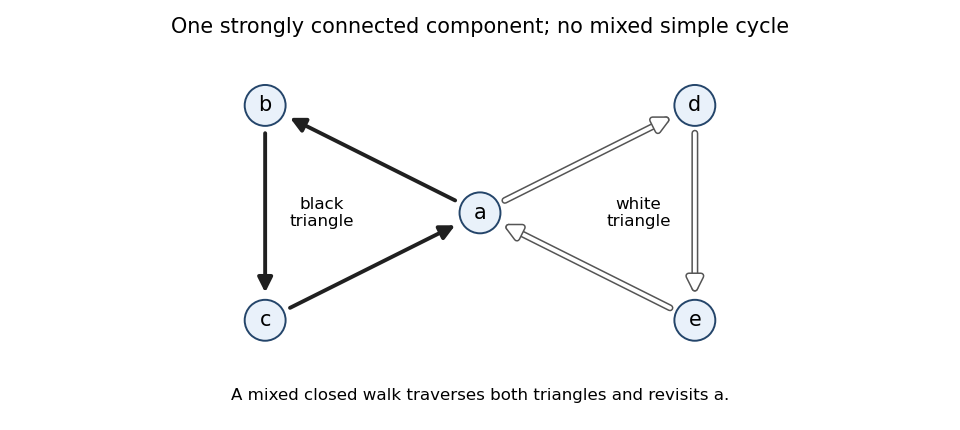

<h1 id="8/d/solution">Solution</h1>

↑ **Parent:** [D](../d.md)

Take two directed triangles meeting only at a central [vertex](../../../../../vertex-graph-theory.md) $a$. Make $a\to b\to c\to a$ entirely black and $a\to d\to e\to a$ entirely white. All five [vertices](../../../../../vertex-graph-theory.md) lie in one [strongly connected component](../../../../../strongly-connected-component.md), since every [vertex](../../../../../vertex-graph-theory.md) can reach $a$ and can be reached from $a$. It contains internal [edges](../../../../../edge-of-a-graph.md) of both colours.

**[Figure 1](#8/d/image-two-monochromatic-directed-triangles-sharing-one-vertex-give-a-mixed-closed-walk-but-no-mixed-simple-cycle). Two monochromatic directed triangles sharing one vertex give a mixed closed walk but no mixed simple cycle**.

A [closed walk](../../../../../closed-walk.md) can traverse the black triangle and then the white triangle. But a [simple cycle](../../../../../cycle-in-a-graph.md) using [edges](../../../../../edge-of-a-graph.md) from both triangles would have to pass through $a$ to change triangles and pass through $a$ again to return. It would repeat $a$ other than the single start/end identification, contradicting simplicity. Removing $a$ separates the two triangles, so no other transition between them is possible. Therefore

$$
\boxed{\text{one SCC can have both edge colours while every simple cycle is monochromatic}.}
$$

This example avoids [self-loops](../../../../../loop-graph-theory.md) and works even when a directed [simple cycle](../../../../../cycle-in-a-graph.md) is required to have at least three [vertices](../../../../../vertex-graph-theory.md).

## ↑ Ancestors (12)

1. [D](../d.md)
2. [8](../../8.md)
3. [Functional programming, design and analysis of algorithms](../../../functional-programming-design-and-analysis-of-algorithms-split.md)
4. [2013](../../../split.md)
5. [Past exam of the year 1 of the computer science course of the University of Oxford](../../../../split.md)
6. [Year 1 of the computer science course of the University of Oxford](../../../../../year-1-of-the-computer-science-course-of-the-university-of-oxford.md)
7. [Computer science course of the University of Oxford](../../../../../computer-science-course-of-the-university-of-oxford.md)
8. [Undergraduate course of the University of Oxford](../../../../../undergraduate-course-of-the-university-of-oxford.md)
9. [Course of the University of Oxford](../../../../../course-of-the-university-of-oxford.md)
10. [University of Oxford](../../../../../university-of-oxford-split.md)
11. [List of universities](../../../../../list-of-universities.md)
12. [Codex Wiki](../../../../../split.md)
