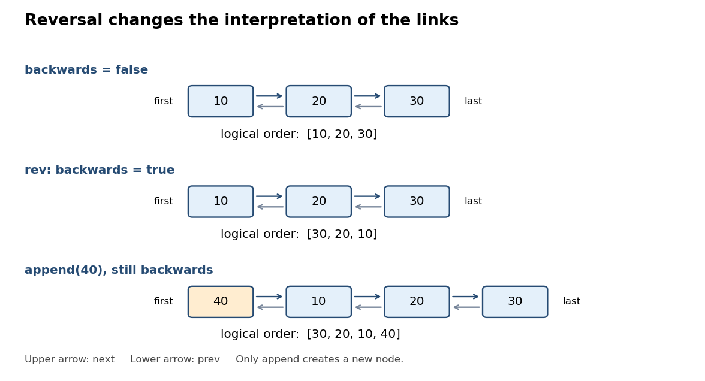

# Imperative programming

↑ **Parent:** [2013](../2013.md)

Solutions to all eight questions of the 12 June 2013 paper. The [Scala](../../programming-language.md#scala) code uses the paper's Scala 2 conventions. Arithmetic is exact unless a machine type is explicitly discussed; in particular, Question 1 permits ignoring [integer overflow](../../programming-language.md#integer-overflow). Each code block extends the implementation introduced in its question, unless it supplies a complete replacement.[Cover and printed pp. 2–11, Questions 1–8](../../computer-science-bibliography.md#imperative-programming-examination-paper-by-the-university-of-oxford-2013)

**Table of contents**

- [1](#1)
  - [a](#1/a)
    - [Solution](#1/a/solution)
  - [b](#1/b)
    - [Solution](#1/b/solution)
- [2](#2)
  - [a](#2/a)
    - [Solution](#2/a/solution)
  - [b](#2/b)
    - [i](#2/b/i)
      - [Solution](#2/b/i/solution)
    - [ii](#2/b/ii)
      - [Solution](#2/b/ii/solution)
- [3](#3)
  - [a](#3/a)
    - [Solution](#3/a/solution)
  - [b](#3/b)
    - [Solution](#3/b/solution)
  - [c](#3/c)
    - [Solution](#3/c/solution)
- [4](#4)
  - [a](#4/a)
    - [Solution](#4/a/solution)
  - [b](#4/b)
    - [Solution](#4/b/solution)
  - [c](#4/c)
    - [Solution](#4/c/solution)
- [5](#5)
  - [a](#5/a)
    - [Solution](#5/a/solution)
  - [b](#5/b)
    - [Solution](#5/b/solution)
  - [c](#5/c)
    - [Solution](#5/c/solution)
- [6](#6)
  - [a](#6/a)
    - [Solution](#6/a/solution)
  - [b](#6/b)
    - [Solution](#6/b/solution)
  - [c](#6/c)
    - [Solution](#6/c/solution)
  - [d](#6/d)
    - [Solution](#6/d/solution)
- [7](#7)
  - [a](#7/a)
    - [Solution](#7/a/solution)
  - [b](#7/b)
    - [Solution](#7/b/solution)
  - [c](#7/c)
    - [Solution](#7/c/solution)
  - [d](#7/d)
    - [Solution](#7/d/solution)
- [8](#8)
  - [a](#8/a)
    - [Solution](#8/a/solution)
  - [b](#8/b)
    - [Solution](#8/b/solution)
  - [c](#8/c)
    - [Solution](#8/c/solution)
  - [d](#8/d)
    - [Solution](#8/d/solution)

## 1

↑ **Parent:** [Imperative programming](imperative-programming.md)

<h3 id="1/a">a</h3>

↑ **Parent:** [1](#1)

<h4 id="1/a/solution">Solution</h4>

↑ **Parent:** [A](#1/a)

Evaluate the [mixed radix](../../integer.md#mixed-radix) representation from its most significant end, using [Horner's method](../../polynomial.md#horner-s-method). There is no need to compute the positional weights separately.
```
def digsToInt(xs: Array[Int], bs: Array[Int]): Int = {
  require(xs.length == bs.length)
  val N = xs.length
  var i = N
  var acc = 0
  while (i > 0) {
    i -= 1
    acc = xs(i) + bs(i) * acc
  }
  acc
}
```
The digit conditions $0\leq xs(i)<bs(i)$ are additional [preconditions](../../algorithm.md#precondition). The [loop invariant](../../algorithm.md#loop-invariant) at the loop test is

$$
0\leq i\leq N,\qquad
acc=\sum_{k=i}^{N-1}xs(k)\prod_{j=i}^{k-1}bs(j).
$$

An empty [sum](../../arithmetic.md#sum) is zero and an empty [product](../../arithmetic.md#product-of-numbers) is one, so initialization at $i=N$ is correct. For the next digit, writing $i'=i-1$ gives

$$
xs(i')+bs(i')acc
=\sum_{k=i'}^{N-1}xs(k)\prod_{j=i'}^{k-1}bs(j),
$$

which preserves the [loop invariant](../../algorithm.md#loop-invariant). The [loop variant](../../algorithm.md#loop-variant) is $i$. At termination $i=0$, giving

$$
\boxed{acc=xs\otimes bs.}
$$

The code executes exactly $N$ multiplications, meeting the bound, and uses $O(1)$ [auxiliary space](../../algorithm.md#auxiliary-space). When $N=0$ it returns zero. For the time representation in the source, it computes $s+60(m+60h)$.

<h3 id="1/b">b</h3>

↑ **Parent:** [1](#1)

<h4 id="1/b/solution">Solution</h4>

↑ **Parent:** [B](#1/b)

A suitable [precondition](../../algorithm.md#precondition), including the empty [array](../../data-structure.md#array-data-structure) case, is

$$
\boxed{bs(i)\geq1\ (0\leq i<N),\qquad 0\leq n<\prod_{i=0}^{N-1}bs(i).}
$$

A base of one is allowed: its only valid digit is zero. The empty [product](../../arithmetic.md#product-of-numbers) is one, so $N=0$ permits exactly $n=0$. Each [Euclidean division](../../integer.md#euclidean-division) extracts the next least significant digit.
```
def intToDigs(n: Int, bs: Array[Int]): Array[Int] = {
  // Pre: every base is positive, and 0 <= n < product(bs).
  val N = bs.length
  val xs = new Array[Int](N)
  var i = 0
  var q = n
  while (i < N) {
    xs(i) = q % bs(i)
    q = q / bs(i)
    i += 1
  }
  xs
}
```
The expensive [precondition](../../algorithm.md#precondition) is a caller obligation, rather than a separately computed [product](../../arithmetic.md#product-of-numbers) inside the conversion. Define $P_i=\prod_{j=0}^{i-1}bs(j)$. The [loop invariant](../../algorithm.md#loop-invariant) is

$$
0\leq i\leq N,\qquad
n=\sum_{k=0}^{i-1}xs(k)P_k+qP_i,\qquad
0\leq q<\prod_{j=i}^{N-1}bs(j),
$$

together with $0\leq xs(k)<bs(k)$ for each processed digit. The [Euclidean division](../../integer.md#euclidean-division) identity $q=(q\bmod bs(i))+bs(i)\lfloor q/bs(i)\rfloor$ proves preservation of the reconstruction equality. Positivity of the bases gives the digit bounds and the next bound on the quotient. The [loop variant](../../algorithm.md#loop-variant) is $N-i$. At exit, $0\leq q<1$ forces $q=0$, hence

$$
\boxed{xs\otimes bs=n,\qquad 0\leq xs(i)<bs(i).}
$$

There are exactly $N$ remainder operations and $N$ divisions, hence $2N$ counted operations. The returned [array](../../data-structure.md#array-data-structure) occupies $O(N)$ space and the remaining [auxiliary space](../../algorithm.md#auxiliary-space) is constant. A represented value can never exceed $\prod_i bs(i)-1$, as follows either by the same nested expansion or by telescoping $\sum_i(bs(i)-1)P_i=P_N-1$; thus the stated range is also necessary for positive bases.

## 2

↑ **Parent:** [Imperative programming](imperative-programming.md)

<h3 id="2/a">a</h3>

↑ **Parent:** [2](#2)

<h4 id="2/a/solution">Solution</h4>

↑ **Parent:** [A](#2/a)

Use an abstract finite [sequence](../../sequence-and-series.md#sequence) $s$ of [integers](../../integer.md), initially empty. In the following [trait](../../programming-language.md#trait), comments are the mathematical specification; $s_0$ means the abstract state on entry, and `result` means the returned value.
```
trait ReversableBuffer {
  // Abstract state s: finite sequence of Int, initially [].

  // Pre: true. Post: s = s0 ++ [x].
  def append(x: Int): Unit

  // Pre: true. Post: s = [x] ++ s0.
  def prepend(x: Int): Unit

  // Pre: 0 <= i < length(s0).
  // Post: result = s0 !! i,
  //       s = take i s0 ++ drop (i+1) s0.
  def get(i: Int): Int

  // Pre: true. Post: s = reverse(s0).
  def rev: Unit
}
```
The [postcondition](../../algorithm.md#postcondition) of `get` includes removal: it is not merely indexed reading. In particular,

$$
\boxed{\operatorname{get}(i)\text{ returns }s_{0,i}\text{ and deletes exactly that occurrence}.}
$$

Repeated equal values elsewhere in the [sequence](../../sequence-and-series.md#sequence) remain present. [List concatenation](../../data-structure.md#list-concatenation), indexing and [list reversal](../../data-structure.md#list-reversal) in the specification describe abstract behavior without committing to a physical representation.

<h3 id="2/b">b</h3>

↑ **Parent:** [2](#2)

<h4 id="2/b/i">i</h4>

↑ **Parent:** [B](#2/b)

<h5 id="2/b/i/solution">Solution</h5>

↑ **Parent:** [I](#2/b/i)

Use a [doubly linked list](../../data-structure.md#doubly-linked-list), store both physical endpoints and its length, and maintain a flag for [lazy reversal of a doubly linked list](../../data-structure.md#lazy-reversal-of-a-doubly-linked-list). This makes endpoint insertion and reversal constant time. Finding an arbitrary indexed element takes a traversal from whichever physical endpoint is nearer.
```
class LLBuffer extends ReversableBuffer {
  private class Node(val value: Int) {
    var prev: Node = null
    var next: Node = null
  }
  private var first: Node = null
  private var last: Node = null
  private var size = 0
  private var backwards = false

  // Methods from (ii) go here.
}
```
Define $F$ to be the [sequence](../../sequence-and-series.md#sequence) of values obtained by starting at `first` and repeatedly following `next` until null. The [representation invariant](../../computer-science.md#representation-invariant) says that `size` is nonnegative; `size == 0` holds exactly when both endpoints are null; otherwise there are exactly `size` distinct reachable [linked list nodes](../../data-structure.md#linked-list-node), the final one is `last`, `first.prev == null`, `last.next == null`, and all neighboring links are reciprocal. These conditions make $F$ finite and the physical [linked list](../../data-structure.md#linked-list) acyclic. The [abstraction function](../../computer-science.md#abstraction-function) is

$$
\boxed{s=\begin{cases}F&\text{if }\neg backwards,\\\operatorname{reverse}(F)&\text{if }backwards.\end{cases}}
$$

The flag does not change the [representation invariant](../../computer-science.md#representation-invariant). An empty physical [linked list](../../data-structure.md#linked-list) represents the empty [sequence](../../sequence-and-series.md#sequence) for either flag value. No client receives a [linked list node](../../data-structure.md#linked-list-node) reference, so clients cannot invalidate its links.

<a id="2/b/i/image-physical-doubly-linked-list-order-and-logical-sequence-order-under-lazy-reversal-of-a-doubly-linked-list"></a>


**[Figure 1](#2/b/i/image-physical-doubly-linked-list-order-and-logical-sequence-order-under-lazy-reversal-of-a-doubly-linked-list). Physical doubly linked list order and logical sequence order under lazy reversal of a doubly linked list**.

<h4 id="2/b/ii">ii</h4>

↑ **Parent:** [B](#2/b)

<h5 id="2/b/ii/solution">Solution</h5>

↑ **Parent:** [Ii](#2/b/ii)

Place these methods inside the `LLBuffer` class. The two private insertion methods operate on physical endpoints; the public methods interpret logical endpoints using the reversal flag.
```
private def addFirst(x: Int): Unit = {
  val q = new Node(x)
  q.next = first
  if (first == null) last = q else first.prev = q
  first = q
  size += 1
}

private def addLast(x: Int): Unit = {
  val q = new Node(x)
  q.prev = last
  if (last == null) first = q else last.next = q
  last = q
  size += 1
}

def append(x: Int): Unit = {
  if (backwards) addFirst(x) else addLast(x)
}

def prepend(x: Int): Unit = {
  if (backwards) addLast(x) else addFirst(x)
}

def get(i: Int): Int = {
  require(0 <= i && i < size)
  val j = if (backwards) size - 1 - i else i
  var q: Node = null
  if (j <= size - 1 - j) {
    q = first
    var k = 0
    while (k < j) { q = q.next; k += 1 }
  } else {
    q = last
    var k = size - 1
    while (k > j) { q = q.prev; k -= 1 }
  }
  val x = q.value
  if (q.prev == null) first = q.next else q.prev.next = q.next
  if (q.next == null) last = q.prev else q.next.prev = q.prev
  q.prev = null
  q.next = null
  size -= 1
  x
}

def rev: Unit = { backwards = !backwards }
```
In the forward traversal, the [loop invariant](../../algorithm.md#loop-invariant) is that `q` is physical node $k$, with $0\leq k\leq j$; its [loop variant](../../algorithm.md#loop-variant) is $j-k$. In the backward traversal, `q` is physical node $k$, with $j\leq k<size$; its [loop variant](../../algorithm.md#loop-variant) is $k-j$. Thus both locate physical index $j$, which is exactly logical index $i$ under the [abstraction function](../../computer-science.md#abstraction-function).

Deletion bypasses the chosen [linked list node](../../data-structure.md#linked-list-node) in both directions. Deleting the first or last [linked list node](../../data-structure.md#linked-list-node) updates the corresponding endpoint; deleting the only [linked list node](../../data-structure.md#linked-list-node) sets both endpoints to null. The surviving values keep their physical relative order, so the [abstraction function](../../computer-science.md#abstraction-function) gives precisely the required logical deletion. Each insertion preserves reciprocal links and adds its value at the physical end corresponding to the required logical end. Toggling the flag changes $s$ to its [list reversal](../../data-structure.md#list-reversal) without moving any [linked list nodes](../../data-structure.md#linked-list-node). Consequently

$$
\boxed{append,prepend,rev:O(1),\qquad get(i):O(1+\min(i,size_0-1-i)).}
$$

These are worst-case [time complexity](../../theoretical-computer-science.md#time-complexity) bounds in the constant-cost pointer model; total storage is $O(size)$ and each operation uses constant [auxiliary space](../../algorithm.md#auxiliary-space).

## 3

↑ **Parent:** [Imperative programming](imperative-programming.md)

<h3 id="3/a">a</h3>

↑ **Parent:** [3](#3)

<h4 id="3/a/solution">Solution</h4>

↑ **Parent:** [A](#3/a)

Let $a_0$ be a saved mathematical copy of the original [array](../../data-structure.md#array-data-structure). A precise [postcondition](../../algorithm.md#postcondition) for [sorting](../../algorithm.md#sorting) is

$$
\boxed{\begin{aligned}
&\forall i,j\in[0,N):\ i<j\Longrightarrow a(i)\leq a(j),\\
&\forall v\in\mathbb Z:\ \#\{i:a(i)=v\}=\#\{i:a_0(i)=v\}.
\end{aligned}}
$$

The [precondition](../../algorithm.md#precondition) is that `a` is a non-null [array](../../data-structure.md#array-data-structure) of length $N\geq0$. Its length and every unrelated object remain unchanged. The second clause preserves the [array multiset](../../set.md#array-multiset), including all multiplicities; ordering alone would also permit overwriting the entire [array](../../data-structure.md#array-data-structure) with zeros. The saved $a_0$ is a specification device and need not be allocated by the implementation.

<h3 id="3/b">b</h3>

↑ **Parent:** [3](#3)

<h4 id="3/b/solution">Solution</h4>

↑ **Parent:** [B](#3/b)

Use [three-way quicksort](../../algorithm.md#three-way-quicksort). Fix the pivot value before moving any entries, and group equal entries together so that none needs a recursive call. These helpers and the sorter belong inside an enclosing scope containing `a`.
```
def swap(i: Int, j: Int): Unit = {
  val t = a(i); a(i) = a(j); a(j) = t
}

def split(l: Int, r: Int): (Int, Int) = {
  // Pre: 0 <= l < r <= a.length.
  val p = a(l)
  var lt = l
  var i = l
  var gt = r
  while (i < gt) {
    if (a(i) < p) {
      swap(lt, i)
      lt += 1
      i += 1
    } else if (a(i) > p) {
      gt -= 1
      swap(i, gt)
    } else {
      i += 1
    }
  }
  (lt, gt)
}

def quicksort(l: Int, r: Int): Unit = {
  require(0 <= l && l <= r && r <= a.length)
  if (r - l > 1) {
    val (lt, gt) = split(l, r)
    quicksort(l, lt)
    quicksort(gt, r)
  }
}

// Sort the whole array with quicksort(0, a.length).
```
The [array partitioning](../../algorithm.md#two-way-array-partition) [loop invariant](../../algorithm.md#loop-invariant) is

$$
l\leq lt\leq i\leq gt\leq r,\qquad
a[l..lt)<p,\quad a[lt..i)=p,\quad a[gt..r)>p,
$$

with $a[i..gt)$ unclassified. Swaps preserve the segment's [array multiset](../../set.md#array-multiset) and leave all entries outside it unchanged. The [loop variant](../../algorithm.md#loop-variant) $gt-i$ decreases in every branch. When swapping an entry from the right into `i`, do not increment `i`, since the incoming entry still needs classification. At termination,

$$
\boxed{a[l..lt)<p=a[lt..gt)<a[gt..r).}
$$

Here the middle segment is nonempty because the original pivot occurs somewhere in the preserved [array multiset](../../set.md#array-multiset). Both recursive segments therefore have length strictly smaller than $r-l$. [Mathematical induction](../../foundations-of-mathematics.md#mathematical-induction) on segment length proves that the two recursive calls sort their segments, and their ordering relative to the middle segment proves the complete [sorting](../../algorithm.md#sorting) [postcondition](../../algorithm.md#postcondition).

There is no additional [array](../../data-structure.md#array-data-structure). The call stack and returned boundary pairs still use [auxiliary space](../../algorithm.md#auxiliary-space). An all-equal input takes one linear scan and no nontrivial recursive calls, so its [time complexity](../../theoretical-computer-science.md#time-complexity) is $\Theta(N)$ for $N\geq1$. Balanced partitions give $O(N\log N)$ [time complexity](../../theoretical-computer-science.md#time-complexity); a fixed first pivot can still give $O(N^2)$ on adversarial distinct inputs. The worst-case call stack has $O(N)$ entries.

<h3 id="3/c">c</h3>

↑ **Parent:** [3](#3)

<h4 id="3/c/solution">Solution</h4>

↑ **Parent:** [C](#3/c)

Reuse `split` and `swap`, but replace recursive calls with a [FIFO queue](../../data-structure.md#fifo-queue) of unresolved segments. Enqueue only segments of length at least two.
```
def quicksortLoop(): Unit = {
  val work = scala.collection.mutable.Queue[(Int, Int)]()
  if (a.length > 1) work.enqueue((0, a.length))
  while (!work.isEmpty) {
    val (l, r) = work.dequeue()
    val (lt, gt) = split(l, r)
    if (lt - l > 1) work.enqueue((l, lt))
    if (r - gt > 1) work.enqueue((gt, r))
  }
}
```
A useful [loop invariant](../../algorithm.md#loop-invariant) is that the pending segments are pairwise disjoint valid [array](../../data-structure.md#array-data-structure) segments of length at least two; the whole [array multiset](../../set.md#array-multiset) equals its original value; and every inverted pair of positions lies in a single pending segment. Explicitly, if $i<j$ and $a(i)>a(j)$, some queued $[l,r)$ contains both $i$ and $j$. Thus all ordering obligations are localized to queued segments.

Initially the only possible pending segment is the whole [array](../../data-structure.md#array-data-structure). One [array partitioning](../../algorithm.md#two-way-array-partition) confines all its remaining inversions to its two child segments. Its equal middle segment is ordered, the left/middle/right boundaries have the correct ordering, and segments of length at most one cannot contain an inversion. Because [array partitioning](../../algorithm.md#two-way-array-partition) only permutes the selected segment's entries, it cannot create an inversion across a boundary that previously had no inversions. This proves preservation of the [loop invariant](../../algorithm.md#loop-invariant).

The [loop variant](../../algorithm.md#loop-variant) is the total pending length

$$
V=\sum_{(l,r)\text{ in work}}(r-l).
$$

Processing one segment removes $r-l$ from $V$ and adds at most $(lt-l)+(r-gt)=(r-l)-(gt-lt)$, strictly less because $gt-lt\geq1$. Thus $V$ is a nonnegative [integer](../../integer.md) and decreases. At exit no pending segment exists, so no inversion exists:

$$
\boxed{\text{The original array is sorted in place and preserves every multiplicity}.}
$$

The [FIFO queue](../../data-structure.md#fifo-queue) itself can grow to $O(N)$ pairs. The [time complexity](../../theoretical-computer-science.md#time-complexity) is that of the corresponding recursive [quicksort](../../algorithm.md#quicksort), including linear behavior on equal input. Removing [recursion](../../algorithm.md#recursion-computer-science) does not make the worst-case [time complexity](../../theoretical-computer-science.md#time-complexity) linear or eliminate the work storage.

## 4

↑ **Parent:** [Imperative programming](imperative-programming.md)

<h3 id="4/a">a</h3>

↑ **Parent:** [4](#4)

<h4 id="4/a/solution">Solution</h4>

↑ **Parent:** [A](#4/a)

Traverse the [trie](../../data-structure.md#trie) along the input [string](../../foundations-of-mathematics.md#string), stopping as soon as the required child is absent. All words and letter collections in this question are assumed to use only lowercase letters `a` through `z`; this is the alphabet represented by the given child [array](../../data-structure.md#array-data-structure). Put the following methods inside the supplied `Trie` class.
```
def contains(w: String): Boolean = {
  var t: Trie = this
  var i = 0
  while (i < w.length && t != null) {
    t = t.children(toIndex(w.charAt(i)))
    i += 1
  }
  t != null && t.complete
}
```
The [loop invariant](../../algorithm.md#loop-invariant) is that `t` is the [trie](../../data-structure.md#trie) node reached by the prefix `w.take(i)`, or null if that prefix has no path, with $0\leq i\leq w.length$. If `t` is null, no extension can be a stored word. Otherwise, following the next character preserves the [loop invariant](../../algorithm.md#loop-invariant). The [loop variant](../../algorithm.md#loop-variant) is $w.length-i$. At exit,

$$
\boxed{contains(w)\iff\text{the full path exists and its terminal flag is true}.}
$$

A prefix that exists but is not complete must return false. The empty [string](../../foundations-of-mathematics.md#string) is present exactly when the root's `complete` flag is true. The [time complexity](../../theoretical-computer-science.md#time-complexity) is $O(1+|w|)$, with constant [auxiliary space](../../algorithm.md#auxiliary-space).

<h3 id="4/b">b</h3>

↑ **Parent:** [4](#4)

<h4 id="4/b/solution">Solution</h4>

↑ **Parent:** [B](#4/b)

Create only the missing nodes along the required [trie](../../data-structure.md#trie) path, and mark its last node complete.
```
def add(w: String): Unit = {
  var t: Trie = this
  var i = 0
  while (i < w.length) {
    val k = toIndex(w.charAt(i))
    if (t.children(k) == null) t.children(k) = new Trie
    t = t.children(k)
    i += 1
  }
  t.complete = true
}
```
The [loop invariant](../../algorithm.md#loop-invariant) is that the path for `w.take(i)` exists and ends at `t`, while the [set](../../set.md) of complete words remains unchanged from entry. A fresh node has all children null and `complete == false`, so creating an unfinished path introduces no stored word. The [loop variant](../../algorithm.md#loop-variant) is $w.length-i$. At termination the full path exists; setting its final flag gives

$$
\boxed{D_{\mathrm{after}}=D_{\mathrm{before}}\cup\{w\}.}
$$

Existing paths and terminal flags are untouched, so adding an existing word is idempotent. Adding the empty [string](../../foundations-of-mathematics.md#string) marks the root. The [time complexity](../../theoretical-computer-science.md#time-complexity) is $O(1+|w|)$ because the alphabet size is fixed; at most $|w|$ new [trie](../../data-structure.md#trie) nodes are allocated.

<h3 id="4/c">c</h3>

↑ **Parent:** [4](#4)

<h4 id="4/c/solution">Solution</h4>

↑ **Parent:** [C](#4/c)

Use [trie search with a letter multiset](../../data-structure.md#trie-search-with-a-letter-multiset). Counts avoid generating the same result repeatedly when the input contains equal letters. The [backtracking](../../algorithm.md#backtracking) explores a letter value once, irrespective of how many indistinguishable copies remain.
```
def allWords(ls: String): List[String] = {
  val left = new Array[Int](26)
  var i = 0
  while (i < ls.length) {
    left(toIndex(ls.charAt(i))) += 1
    i += 1
  }
  var out = List.empty[String]

  def visit(t: Trie, prefix: String): Unit = {
    if (t.complete) out = prefix :: out
    var k = 0
    while (k < 26) {
      val child = t.children(k)
      if (left(k) > 0 && child != null) {
        left(k) -= 1
        visit(child, prefix + toChar(k))
        left(k) += 1
      }
      k += 1
    }
  }

  visit(this, "")
  out.reverse
}
```
At entry to `visit`, `t` is reached by `prefix`, and `left(k)` is the input multiplicity of letter $k$ minus its multiplicity in `prefix`. All these counts are nonnegative. Each recursive call consumes one available letter, and restoration makes sibling calls see the same counts as before that child. The [recursion](../../algorithm.md#recursion-computer-science) therefore terminates at depth at most $|ls|$, even when the dictionary contains longer words.

A completed prefix is emitted once, and the traversal continues so that longer words with the same prefix are also found. Every emitted word is in the dictionary and uses at most the available multiplicities. Conversely, every dictionary word meeting those bounds has an existing [trie](../../data-structure.md#trie) path whose next letter has positive remaining count at every step; the traversal reaches its terminal node. A [trie](../../data-structure.md#trie) has a unique root path for each word, and each child is visited at most once per reached node. Therefore

$$
\boxed{out=\{w\in D:\forall c,\ \operatorname{count}_w(c)\leq\operatorname{count}_{ls}(c)\},\quad\text{without repetitions}.}
$$

The boxed expression specifies the [set](../../set.md) of entries in the returned [list](../../data-structure.md#list-abstract-data-type), rather than its ordering. If the dictionary includes the empty [string](../../foundations-of-mathematics.md#string), the method includes it once. Counting costs $O(|ls|+26)$; visiting $R$ reachable nodes costs $O(26R)$ apart from [string](../../foundations-of-mathematics.md#string) copying and output construction. The presented immutable-prefix construction additionally costs the sum of the prefix lengths it constructs. The recursion depth is at most $|ls|$, and the letter-count [array](../../data-structure.md#array-data-structure) has fixed size.

## 5

↑ **Parent:** [Imperative programming](imperative-programming.md)

<h3 id="5/a">a</h3>

↑ **Parent:** [5](#5)

<h4 id="5/a/solution">Solution</h4>

↑ **Parent:** [A](#5/a)

Use a [minimum stack](../../data-structure.md#minimum-stack): each [linked list node](../../data-structure.md#linked-list-node) caches the [minimum](../../set.md#minimum-of-a-subset-of-a-total-order) of all values from that node down to the bottom. This handles duplicate minima without searching when one is removed.
```
class Stack {
  private class Node(val value: Int, val least: Int, val next: Node)
  private var top: Node = null

  def push(x: Int): Unit = {
    val m = if (top == null) x else math.min(x, top.least)
    top = new Node(x, m, top)
  }

  def pop(): Int = {
    require(!isEmpty)
    val x = top.value
    top = top.next
    x
  }

  def isEmpty: Boolean = top == null

  def min: Int = {
    require(!isEmpty)
    top.least
  }
}
```
The [representation invariant](../../computer-science.md#representation-invariant) is that the chain from `top` is finite and acyclic, and every reachable node `q` satisfies

$$
q.least=\begin{cases}q.value&q.next=null,\\\min(q.value,q.next.least)&q.next\ne null.\end{cases}
$$

The [abstraction function](../../computer-science.md#abstraction-function) takes the values along this chain in top-to-bottom order. Thus pushing $x$ changes $s$ to $x:s$, and popping a nonempty $s$ returns its head and leaves its tail. The cached-minimum equation follows for a new node from the previously valid chain; removing a head leaves every surviving equation unchanged. Consequently

$$
\boxed{push,pop,isEmpty,min\text{ each take }O(1)\text{ worst-case time}.}
$$

The bounds use the usual constant-cost allocation and [integer arithmetic](../../arithmetic.md#integer-arithmetic) model. Storage is linear in the number of entries. `min` and `pop` require a nonempty [stack](../../data-structure.md#stack-data-structure); `min` leaves it unchanged.

<h3 id="5/b">b</h3>

↑ **Parent:** [5](#5)

<h4 id="5/b/solution">Solution</h4>

↑ **Parent:** [B](#5/b)

Keep a running total in the [mixin](../../programming-language.md#mixin), and use only the inherited public operations. Updating after a successful superclass operation leaves the total unchanged if an empty `pop` fails its [precondition](../../algorithm.md#precondition).
```
trait SumPlugin extends Stack {
  private var total = 0

  override def push(x: Int): Unit = {
    super.push(x)
    total += x
  }

  override def pop(): Int = {
    val x = super.pop()
    total -= x
    x
  }

  def sum: Int = total
}
```
For this [trait](../../programming-language.md#trait) mixed directly into `Stack`, its [representation invariant](../../computer-science.md#representation-invariant) is $total=\sum s$, where $s$ is the abstract [stack](../../data-structure.md#stack-data-structure) [sequence](../../sequence-and-series.md#sequence). A successful push adds exactly its argument and a successful pop removes exactly its returned value. Thus

$$
\boxed{sum=\text{the sum of the current stack entries},\qquad sum(\text{empty stack})=0.}
$$

The [mixin](../../programming-language.md#mixin) reads no private `Stack` fields. Its operations add constant [time complexity](../../theoretical-computer-science.md#time-complexity). As in the paper's `Int` interface, an unbounded mathematical total requires excluding [integer overflow](../../programming-language.md#integer-overflow), or replacing the accumulator with `BigInt` if the interface is allowed to change. A later [mixin](../../programming-language.md#mixin) can transform a pushed value at a different point in the [Scala trait linearization](../../programming-language.md#scala-trait-linearization); the effect is analyzed in the next part.

<h3 id="5/c">c</h3>

↑ **Parent:** [5](#5)

<h4 id="5/c/solution">Solution</h4>

↑ **Parent:** [C](#5/c)

The doubling [mixin](../../programming-language.md#mixin) delegates with a transformed argument.
```
trait DoublePlugin extends Stack {
  override def push(x: Int): Unit = super.push(2 * x)
}
```
For `A`, the relevant [Scala trait linearization](../../programming-language.md#scala-trait-linearization) is `A, DoublePlugin, SumPlugin, Stack`. A push first doubles the argument, then `SumPlugin` sees and sums that doubled value. The physical values are $2,4,6$ and the total is $12$.

For `B`, the [Scala trait linearization](../../programming-language.md#scala-trait-linearization) is `B, SumPlugin, DoublePlugin, Stack`. `SumPlugin` sums the original argument, while its `super.push` doubles the stored value. The physical values are still $2,4,6$, but the counter is $1+2+3=6$. Hence the two lines printed are
```
12
6
```
Equivalently,

$$
\boxed{a.sum=12,\qquad b.sum=6.}
$$

This is [stackable trait modification](../../programming-language.md#stackable-trait-modification): the order determines which arguments an outer [mixin](../../programming-language.md#mixin) observes. In particular, the running-total specification from part (b) holds for `A` but does not survive the transforming inner [mixin](../../programming-language.md#mixin) in `B`. With the given implementation, popping from `B` would subtract the doubled stored value, demonstrating why mixing individually sensible [traits](../../programming-language.md#trait) can break a combined [representation invariant](../../computer-science.md#representation-invariant).

## 6

↑ **Parent:** [Imperative programming](imperative-programming.md)

<h3 id="6/a">a</h3>

↑ **Parent:** [6](#6)

<h4 id="6/a/solution">Solution</h4>

↑ **Parent:** [A](#6/a)

A [prefix-dropping iterator](../../data-structure.md#prefix-dropping-iterator) must preserve the first satisfying element. Reading it to test the [predicate](../../analysis-of-boolean-functions.md#predicate) physically consumes it from the source, so keep it in a one-element buffer. Once a match is found, return the entire suffix without testing subsequent elements again.
```
trait Iter[T] {
  def hasNext: Boolean
  def next(): T
  def copy(): Iter[T]
}

class DropUntil[T](p: T => Boolean, iter: Iter[T]) extends Iter[T] {
  private var seeking = true
  private var saved: Option[T] = None

  private def prepare(): Unit = {
    if (seeking) {
      while (saved.isEmpty && iter.hasNext) {
        val x = iter.next()
        if (p(x)) saved = Some(x)
      }
      seeking = false
    }
  }

  def hasNext: Boolean = {
    prepare()
    saved.nonEmpty || iter.hasNext
  }

  def next(): T = {
    prepare()
    saved match {
      case Some(x) => saved = None; x
      case None =>
        if (!iter.hasNext) throw new NoSuchElementException("next")
        iter.next()
    }
  }

  def copy(): Iter[T] = {
    val result = new DropUntil[T](p, iter.copy())
    result.seeking = seeking
    result.saved = saved
    result
  }
}
```
Assume the source [iterator](../../data-structure.md#iterator) is owned by the wrapper, its `copy` meets the stated independent-cursor contract, and $p$ is a [pure function](../../programming-language.md#pure-function). Before preparation, the logical remainder is the source remainder with its maximal initial failing prefix removed. After preparation, it is the buffered match followed by the source remainder, or simply the source remainder when the buffer is empty. This describes the [abstraction function](../../computer-science.md#abstraction-function) and proves that repeated `hasNext` calls neither lose the match nor skip more values.

Copying preserves the phase flag and optional buffered value and independently copies the source [iterator](../../data-structure.md#iterator). It does not rerun the [predicate](../../analysis-of-boolean-functions.md#predicate) on an already accepted match. A shallow copy of the wrapper alone would give [shared iterator consumption](../../data-structure.md#shared-iterator-consumption), violating the specification. Therefore

$$
\boxed{\text{DropUntil returns the suffix starting at the first match, with independent copies}.}
$$

When no element satisfies $p$, a finite source yields an empty [iterator](../../data-structure.md#iterator). Seeking can diverge on an infinite source with no match; this is inherent in determining whether its required suffix begins anywhere. An element object is not deep-copied by this cursor operation.

<h3 id="6/b">b</h3>

↑ **Parent:** [6](#6)

<h4 id="6/b/solution">Solution</h4>

↑ **Parent:** [B](#6/b)

These operations consume the receiver, as expected for this destructive [iterator](../../data-structure.md#iterator) interface. `exists` stops immediately after the first successful test.
```
trait RichIter[T] extends Iter[T] {
  def foreach(f: T => Unit): Unit = {
    while (hasNext) f(next())
  }

  def exists(p: T => Boolean): Boolean = {
    while (hasNext) {
      if (p(next())) return true
    }
    false
  }

  def foldLeft[U](x: U)(f: (U, T) => U): U = {
    var acc = x
    while (hasNext) acc = f(acc, next())
    acc
  }
}
```
For `foreach`, after $k$ iterations the supplied [function](../../function.md) has been applied in order to exactly the first $k$ entries. For `exists`, every consumed entry has failed the [predicate](../../analysis-of-boolean-functions.md#predicate) unless the method is returning true. For the [left fold](../../programming-language.md#left-fold), the [loop invariant](../../algorithm.md#loop-invariant) after consuming $k$ entries is

$$
acc=f(\cdots f(f(x,a_1),a_2)\cdots,a_k).
$$

Each iteration extends the expression by the next entry on the right. For a finite remaining [sequence](../../sequence-and-series.md#sequence), its unconsumed length is a common [loop variant](../../algorithm.md#loop-variant). Thus

$$
\boxed{foreach\text{ visits in order};\quad exists\text{ short-circuits};\quad foldLeft\text{ associates to the left}.}
$$

An empty [iterator](../../data-structure.md#iterator) invokes no callback, gives false for `exists`, and returns $x$ from the [left fold](../../programming-language.md#left-fold). On an infinite [iterator](../../data-structure.md#iterator), `exists` can terminate when it finds a match; the other two operations ordinarily do not terminate. With constant-cost callbacks, finite input of length $n$ takes $O(n)$ [time complexity](../../theoretical-computer-science.md#time-complexity) and constant [auxiliary space](../../algorithm.md#auxiliary-space).

<h3 id="6/c">c</h3>

↑ **Parent:** [6](#6)

<h4 id="6/c/solution">Solution</h4>

↑ **Parent:** [C](#6/c)

A simple current-value implementation works when $f$ is a [pure function](../../programming-language.md#pure-function), but sharing a mutable [closure](../../topology.md#closure-topology) between copies would violate the independence requirement used in part (d). Use a [memoized successor chain for stateful iterator copies](../../data-structure.md#memoized-successor-chain-for-stateful-iterator-copies): the generated [sequence](../../sequence-and-series.md#sequence) has shared cells, and each [iterator](../../data-structure.md#iterator) has its own current-cell pointer.
```
object FunIter {
  final class Cell[T](val head: T, f: T => T) {
    lazy val tail: Cell[T] = new Cell[T](f(head), f)
  }
}

class FunIter[T](v: T, f: T => T) extends Iter[T] {
  private var cursor = new FunIter.Cell[T](v, f)

  def hasNext: Boolean = true

  def next(): T = {
    val x = cursor.head
    cursor = cursor.tail
    x
  }

  def copy(): Iter[T] = {
    val result = new FunIter[T](cursor.head, f)
    result.cursor = cursor
    result
  }
}
```
The [representation invariant](../../computer-science.md#representation-invariant) is that `cursor` points to the next cell to be returned, and each cell's lazy tail is computed at most once. The [abstraction function](../../computer-science.md#abstraction-function) is the infinite [sequence](../../sequence-and-series.md#sequence) of heads starting at that cell. Advancing changes only this [iterator](../../data-structure.md#iterator)'s pointer. A copy starts at the same cell, so both observe the same remaining heads even when their calls are interleaved:

$$
\boxed{next\text{ returns }v,f(v),f(f(v)),\ldots;\qquad copy\text{ preserves an independent position}.}
$$

For a stateful $f$, the generator state must be privately owned by this shared chain; unrelated external calls to $f$ must not change it. As usual, the values and transition must allow successive results to be observed without externally mutating old results. No interface can independently clone the hidden state of an arbitrary externally mutated [closure](../../topology.md#closure-topology) from its [function type](../../programming-language.md#function-type) alone. The chain avoids needing such cloning: a lagging copy reuses the already generated future instead of invoking $f$ again.

Each new cell needs one transition and constant bookkeeping, but retained slower copies can keep a long generated prefix alive. This is an intentional space tradeoff that permits the stateful generator in part (d). No output is possible if computing a demanded transition itself fails or diverges.

<h3 id="6/d">d</h3>

↑ **Parent:** [6](#6)

<h4 id="6/d/solution">Solution</h4>

↑ **Parent:** [D](#6/d)

Keep the neighboring [Fibonacci number](../../sequence-and-series.md#fibonacci-number) in a private [closure](../../topology.md#closure-topology). Before calling the transition with $x=F_n$, let its captured `following` equal $F_{n+1}$.
```
def fibonacci(): Iter[BigInt] = {
  var following = BigInt(1)
  val step: BigInt => BigInt = (x: BigInt) => {
    val result = following
    following = x + following
    result
  }
  new FunIter[BigInt](BigInt(0), step)
}
```
The transition returns $F_{n+1}$ and stores $F_n+F_{n+1}=F_{n+2}$, preserving the [paired Fibonacci recurrence](../../sequence-and-series.md#paired-fibonacci-recurrence). Initialization gives $F_0=0$ and $F_1=1$, so

$$
\boxed{0,1,1,2,3,5,8,13,21,\ldots.}
$$

Using `BigInt` allows all [Fibonacci numbers](../../sequence-and-series.md#fibonacci-number) rather than a finite prefix before [integer overflow](../../programming-language.md#integer-overflow). Replacing `BigInt` by `Int` gives the source's suggested machine-[integer](../../integer.md) interface with that limitation. With the `FunIter` implementation from part (c), each transition runs once per generated cell, and copied [iterators](../../data-structure.md#iterator) can advance independently while sharing the privately owned generator. A simpler alternative uses a [pure function](../../programming-language.md#pure-function) on pairs, $(a,b)\mapsto(b,a+b)$, and projects the first component; the [closure](../../topology.md#closure-topology) above follows the source's suggested single-value approach directly.

## 7

↑ **Parent:** [Imperative programming](imperative-programming.md)

<h3 id="7/a">a</h3>

↑ **Parent:** [7](#7)

<h4 id="7/a/solution">Solution</h4>

↑ **Parent:** [A](#7/a)

An ordinary call such as the unqualified `f` inside `A.g` uses [dynamic dispatch](../../programming-language.md#dynamic-dispatch) on the receiver. Thus `c.g` enters `A.g`, but its call to `f` reaches `C.f`. In contrast, `B.h` explicitly invokes `super.f`, which continues after `B` and therefore reaches `A.f`. Finally `A.k` dynamically dispatches its call to `h`, reaching `B.h` again. The output is
```
g in A, f in C
h in B, f in A
k in A, h in B, f in A
```
Hence

$$
\boxed{g:\ A\to C,\qquad h:\ B\to A,\qquad k:\ A\to B\to A.}
$$

These arrows describe the method bodies entered in order, not the [class inheritance](../../programming-language.md#class-inheritance) relation. An inherited method continues to use the dynamic receiver for ordinary calls; it does not acquire the defining [software class](../../programming-language.md#class-programming) as a new receiver.

<h3 id="7/b">b</h3>

↑ **Parent:** [7](#7)

<h4 id="7/b/solution">Solution</h4>

↑ **Parent:** [B](#7/b)

Ignoring predefined ancestors as permitted, the [Scala trait linearizations](../../programming-language.md#scala-trait-linearization) are

$$
\boxed{D1,B2,B1,A\qquad\text{and}\qquad D2,B1,B2,A.}
$$

A `super` call in a [trait](../../programming-language.md#trait) continues to the next applicable implementation in the receiver's [Scala trait linearization](../../programming-language.md#scala-trait-linearization). It is not permanently bound to the parent named when that [trait](../../programming-language.md#trait) was declared.

For `d1.h`, enter `B2.h`. Its `super.g` reaches `B1.g`, and that method's `super.f` reaches `A.f`. For `d2.h`, enter `B1.h`; its `super.g` reaches `B2.g`, whose `super.f` again reaches `A.f`. Therefore the two output lines are
```
h in B2, g in B1, f in A
h in B1, g in B2, f in A
```
The shared ancestor `A` occurs once in each [Scala trait linearization](../../programming-language.md#scala-trait-linearization), after the two specialized [traits](../../programming-language.md#trait). This accounts for the final `f in A` in both lines.

<h3 id="7/c">c</h3>

↑ **Parent:** [7](#7)

<h4 id="7/c/solution">Solution</h4>

↑ **Parent:** [C](#7/c)

[Method overloading](../../programming-language.md#method-overloading) chooses a signature using the [static types](../../programming-language.md#static-type) available at the call site. The receiver `m` has [static type](../../programming-language.md#static-type) `M`, whose visible overloads accept `X` and `Y`; the `Z` overload introduced only in `N` is not a candidate.

For `m.f(x)`, the argument's [static type](../../programming-language.md#static-type) is `X`, so the chosen signature is `f(X)`. `N` does not override it, and the inherited `M` body runs. For `m.f(y)`, the chosen signature is `f(Y)`, and [dynamic dispatch](../../programming-language.md#dynamic-dispatch) on the receiver chooses `N`'s override. For `m.f(z)`, both visible signatures apply, but `f(Y)` is more specific than `f(X)`. [Dynamic dispatch](../../programming-language.md#dynamic-dispatch) again chooses `N.f(Y)`. Thus
```
f with X at M
f with Y at N
f with Y at N
```
Equivalently,

$$
\boxed{X@M,\qquad Y@N,\qquad Y@N.}
$$

The [runtime type](../../programming-language.md#runtime-type) of every argument is `Z`, but ordinary single-receiver [dynamic dispatch](../../programming-language.md#dynamic-dispatch) does not redo [method overloading](../../programming-language.md#method-overloading) using that [runtime type](../../programming-language.md#runtime-type). This is [overload selection followed by dynamic dispatch](../../programming-language.md#overload-selection-followed-by-dynamic-dispatch).

<h3 id="7/d">d</h3>

↑ **Parent:** [7](#7)

<h4 id="7/d/solution">Solution</h4>

↑ **Parent:** [D](#7/d)

Use [double dispatch](../../programming-language.md#double-dispatch). Each original overload first sends a dynamically dispatched message to its argument. The argument's selected body then calls an overloaded receiver method with `this`, whose [static type](../../programming-language.md#static-type) inside that body is the desired argument [software class](../../programming-language.md#class-programming).
```
class X {
  def sendTo(m: M): String = m.receive(this)
}
class Y extends X {
  override def sendTo(m: M): String = m.receive(this)
}
class Z extends Y {
  override def sendTo(m: M): String = m.receive(this)
}

class M {
  def f(x: X): String = x.sendTo(this)
  def f(x: Y): String = x.sendTo(this)

  def receive(x: X): String = "f with X at M"
  def receive(x: Y): String = "f with Y at M"
  def receive(x: Z): String = "f with Z at M"
}

class N extends M {
  override def f(x: Y): String = x.sendTo(this)
  def f(x: Z): String = x.sendTo(this)

  override def receive(x: X): String = "f with X at N"
  override def receive(x: Y): String = "f with Y at N"
  override def receive(x: Z): String = "f with Z at N"
}
```
All three `receive` overloads must be declared in `M`, because `sendTo` receives a parameter with [static type](../../programming-language.md#static-type) `M`. Declaring the `Z` version only in `N` would repeat the original problem.

Whatever original `f` signature is selected, it invokes `sendTo` on the actual argument. For a `Z` object, [dynamic dispatch](../../programming-language.md#dynamic-dispatch) enters `Z.sendTo`; inside that body, `this` has [static type](../../programming-language.md#static-type) `Z`, so [method overloading](../../programming-language.md#method-overloading) selects `receive(Z)`. The final call dynamically dispatches on the actual `m`, giving `N.receive(Z)` when `m` refers to `N`. Hence
```
f with Z at N
f with Z at N
f with Z at N
```
The result depends on both [runtime types](../../programming-language.md#runtime-type):

$$
\boxed{\text{argument }Z\text{ selects }receive(Z),\qquad\text{receiver }N\text{ selects its override}.}
$$

For the stated `X`, `Y`, `Z` hierarchy, the same construction reports each argument [software class](../../programming-language.md#class-programming) correctly for either receiver [software class](../../programming-language.md#class-programming). Further subclasses would need their own dispatch protocol to distinguish additional [runtime types](../../programming-language.md#runtime-type).

## 8

↑ **Parent:** [Imperative programming](imperative-programming.md)

<h3 id="8/a">a</h3>

↑ **Parent:** [8](#8)

<h4 id="8/a/solution">Solution</h4>

↑ **Parent:** [A](#8/a)

Represent the [set](../../set.md) by a private [list](../../data-structure.md#list-abstract-data-type) containing each value once. Normalize the constructor input as well as checking future insertions; otherwise duplicate initial entries would violate the intended [set](../../set.md) behavior.
```
class Set[T](contents: List[T]) {
  protected var elems: List[T] = contents.distinct

  def add(x: T): Unit = {
    if (!elems.contains(x)) elems = x :: elems
  }

  def delete(): T = {
    require(elems.nonEmpty)
    val x = elems.head
    elems = elems.tail
    x
  }
}
```
The [representation invariant](../../computer-science.md#representation-invariant) is that `elems` contains no duplicates under the chosen stable value equality; the [abstraction function](../../computer-science.md#abstraction-function) forgets its ordering and returns its [set](../../set.md) of elements. The protected field allows the subclass in part (d) to inspect its contents; that subclass is responsible for preserving the [representation invariant](../../computer-science.md#representation-invariant) if it mutates them.

Insertion makes the represented [set](../../set.md) $S\cup\{x\}$. Deletion requires $S\ne\varnothing$, returns some $x\in S$, and leaves $S\setminus\{x\}$. Thus

$$
\boxed{add(x):S'=S\cup\{x\};\qquad delete():x\in S,\ S'=S\setminus\{x\}.}
$$

Deletion does not promise to choose a [minimum](../../set.md#minimum-of-a-subset-of-a-total-order). With this [linked list](../../data-structure.md#linked-list) representation, insertion takes $O(|S|)$ [time complexity](../../theoretical-computer-science.md#time-complexity) because of its membership check, while deletion takes $O(1)$. Values should not mutate in a way that changes their equality while stored.

<h3 id="8/b">b</h3>

↑ **Parent:** [8](#8)

<h4 id="8/b/solution">Solution</h4>

↑ **Parent:** [B](#8/b)

If the mutable [set](../../set.md) were allowed a [covariant type parameter](../../programming-language.md#covariant-type-parameter), both variables below could refer to the same mutable object:
```
val s1: Set[Int] = new Set[Int](List())
val s2: Set[Any] = s1             // hypothetically permitted
s2.add("not an integer")
val n: Int = s1.delete()         // cannot return an Int
```
The broad view accepts any value, including a [string](../../foundations-of-mathematics.md#string). The narrow view still promises that deletion returns an `Int`, yet the sole stored value is that [string](../../foundations-of-mathematics.md#string). This violates [type safety](../../programming-language.md#type-safety):

$$
\boxed{\text{A mutable collection that both accepts and returns }T\text{ cannot be covariant in }T.}
$$

This is [covariance failure for a mutable collection](../../programming-language.md#covariance-failure-for-a-mutable-collection). The input occurrence in `add(x: T)` conflicts with the positive occurrence in the result of `delete`. Keeping a [generic type invariance](../../programming-language.md#generic-type-invariance) restriction prevents the unsafe aliasing. The example uses an initially empty [set](../../set.md) so that the problematic deletion result is forced.

<h3 id="8/c">c</h3>

↑ **Parent:** [8](#8)

<h4 id="8/c/solution">Solution</h4>

↑ **Parent:** [C](#8/c)

An [immutable object](../../programming-language.md#immutable-object) can widen its element type when adding a value by returning a new object. Introduce a [lower type bound](../../programming-language.md#lower-type-bound) $U>:T$ on the method's fresh [type parameter](../../programming-language.md#type-parameter).
```
class ISet[+T](contents: List[T]) {
  private val elems: List[T] = contents.distinct

  def add[U >: T](x: U): ISet[U] = {
    val widened: List[U] = elems
    if (widened.contains(x)) new ISet[U](widened)
    else new ISet[U](x :: widened)
  }

  def delete(): (T, ISet[T]) = {
    require(elems.nonEmpty)
    (elems.head, new ISet[T](elems.tail))
  }
}
```
As before, the [representation invariant](../../computer-science.md#representation-invariant) excludes duplicates, and the [abstraction function](../../computer-science.md#abstraction-function) returns the unordered [set](../../set.md) of entries. The constructor normalization makes the [representation invariant](../../computer-science.md#representation-invariant) hold even for repeated initial entries. Both operations construct a fresh [set](../../set.md) object and leave the original object unchanged, including when addition finds an existing member.

For a receiver representing $S$, the new object returned by `add` represents $S\cup\{x\}$. Deletion returns a pair $(x,R)$ with $x\in S$ and $R$ representing $S\setminus\{x\}$. Crucially,

$$
\boxed{add[U>:T](x:U):ISet[U],\qquad delete():(T,ISet[T]).}
$$

The widened [list](../../data-structure.md#list-abstract-data-type) is valid because immutable `List` itself has a [covariant type parameter](../../programming-language.md#covariant-type-parameter). A client can view an `ISet[Int]` as `ISet[Any]`, but adding a [string](../../foundations-of-mathematics.md#string) creates a separate widened result; it cannot put a [string](../../foundations-of-mathematics.md#string) into the old [integer](../../integer.md) [set](../../set.md). This explains how using [immutable objects](../../programming-language.md#immutable-object) makes the desired [type variance](../../programming-language.md#type-variance) sound. A direct `add(x: T)` on a covariant [software class](../../programming-language.md#class-programming) would still violate the [variance-position rule](../../programming-language.md#variance-position-rule); immutability alone does not repair an incorrectly typed method signature.

<h3 id="8/d">d</h3>

↑ **Parent:** [8](#8)

<h4 id="8/d/solution">Solution</h4>

↑ **Parent:** [D](#8/d)

Use an [upper type bound](../../programming-language.md#upper-type-bound) requiring each element type to implement the supplied comparison interface for its own type. This is [F-bounded polymorphism](../../programming-language.md#f-bounded-polymorphism).
```
trait Ordered[T] {
  def <(that: T): Boolean
}

class MinSet[T <: Ordered[T]](contents: List[T])
    extends Set[T](contents) {
  def min: T = {
    require(elems.nonEmpty)
    var best = elems.head
    var rest = elems.tail
    while (rest.nonEmpty) {
      if (rest.head < best) best = rest.head
      rest = rest.tail
    }
    best
  }
}
```
Use this locally defined `Ordered`, rather than silently substituting the standard library's different comparison interface. The type bound makes `rest.head < best` well typed. To interpret the result as a [minimum](../../set.md#minimum-of-a-subset-of-a-total-order), require the comparison to be a consistent strict [total order](../../set.md#total-order); merely providing a method named `<` cannot establish its mathematical laws.

The [loop invariant](../../algorithm.md#loop-invariant) is that `best` is a [minimum](../../set.md#minimum-of-a-subset-of-a-total-order) among the entries already inspected, and `rest` is exactly the uninspected suffix. Comparing its next head with `best` preserves that property. The [loop variant](../../algorithm.md#loop-variant) is the length of `rest`. On termination,

$$
\boxed{min\in S,\qquad\forall x\in S,\ \neg(x<min).}
$$

The method leaves the [set](../../set.md) unchanged, takes $O(|S|)$ [time complexity](../../theoretical-computer-science.md#time-complexity) under constant-cost comparisons, and uses constant [auxiliary space](../../algorithm.md#auxiliary-space). It requires a nonempty [set](../../set.md); inherited insertion and deletion continue to preserve the duplicate-free [representation invariant](../../computer-science.md#representation-invariant).

## ↑ Ancestors (9)

1. [2013](../2013.md)
2. [Past exam of the year 1 of the computer science course of the University of Oxford](../../past-exam-of-the-year-1-of-the-computer-science-course-of-the-university-of-oxford.md)
3. [Year 1 of the computer science course of the University of Oxford](../../university-of-oxford.md#year-1-of-the-computer-science-course-of-the-university-of-oxford)
4. [Computer science course of the University of Oxford](../../university-of-oxford.md#computer-science-course-of-the-university-of-oxford)
5. [Undergraduate course of the University of Oxford](../../university-of-oxford.md#undergraduate-course-of-the-university-of-oxford)
6. [Course of the University of Oxford](../../university-of-oxford.md#course-of-the-university-of-oxford)
7. [University of Oxford](../../university-of-oxford.md)
8. [List of universities](../../README.md#list-of-universities)
9. [Codex Wiki](../../README.md)
