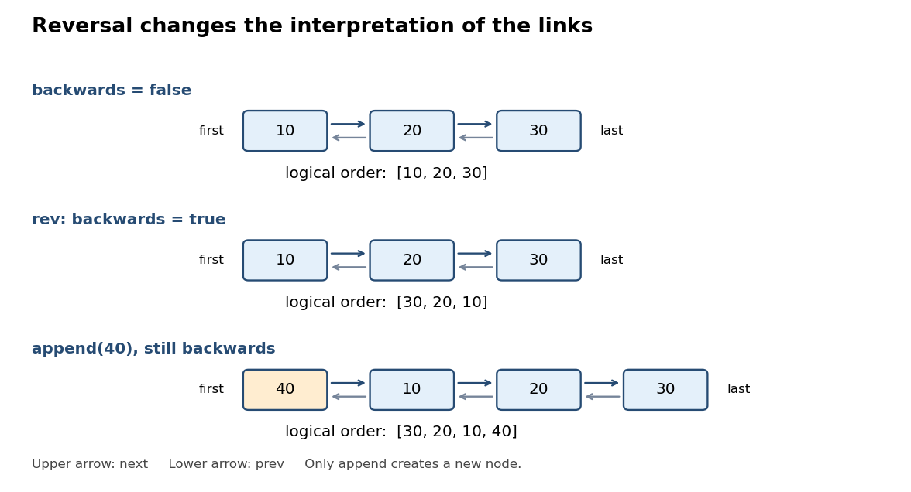

<h1 id="2/b/i/solution">Solution</h1>

↑ **Parent:** [I](../i.md)

Use a [doubly linked list](../../../../../../doubly-linked-list.md), store both physical endpoints and its length, and maintain a flag for [lazy reversal of a doubly linked list](../../../../../../lazy-reversal-of-a-doubly-linked-list.md). This makes endpoint insertion and reversal constant time. Finding an arbitrary indexed element takes a traversal from whichever physical endpoint is nearer.
```
class LLBuffer extends ReversableBuffer {
  private class Node(val value: Int) {
    var prev: Node = null
    var next: Node = null
  }
  private var first: Node = null
  private var last: Node = null
  private var size = 0
  private var backwards = false

  // Methods from (ii) go here.
}
```
Define $F$ to be the [sequence](../../../../../../sequence.md) of values obtained by starting at `first` and repeatedly following `next` until null. The [representation invariant](../../../../../../representation-invariant.md) says that `size` is nonnegative; `size == 0` holds exactly when both endpoints are null; otherwise there are exactly `size` distinct reachable [linked list nodes](../../../../../../linked-list-node.md), the final one is `last`, `first.prev == null`, `last.next == null`, and all neighboring links are reciprocal. These conditions make $F$ finite and the physical [linked list](../../../../../../linked-list.md) acyclic. The [abstraction function](../../../../../../abstraction-function.md) is

$$
\boxed{s=\begin{cases}F&\text{if }\neg backwards,\\\operatorname{reverse}(F)&\text{if }backwards.\end{cases}}
$$

The flag does not change the [representation invariant](../../../../../../representation-invariant.md). An empty physical [linked list](../../../../../../linked-list.md) represents the empty [sequence](../../../../../../sequence.md) for either flag value. No client receives a [linked list node](../../../../../../linked-list-node.md) reference, so clients cannot invalidate its links.

<a id="2/b/i/image-physical-doubly-linked-list-order-and-logical-sequence-order-under-lazy-reversal-of-a-doubly-linked-list"></a>


**[Figure 1](#2/b/i/image-physical-doubly-linked-list-order-and-logical-sequence-order-under-lazy-reversal-of-a-doubly-linked-list). Physical doubly linked list order and logical sequence order under lazy reversal of a doubly linked list**.

## ↑ Ancestors (13)

1. [I](../i.md)
2. [B](../../b.md)
3. [2](../../../2.md)
4. [Imperative programming](../../../../imperative-programming-split.md)
5. [2013](../../../../split.md)
6. [Past exam of the year 1 of the computer science course of the University of Oxford](../../../../../split.md)
7. [Year 1 of the computer science course of the University of Oxford](../../../../../../year-1-of-the-computer-science-course-of-the-university-of-oxford.md)
8. [Computer science course of the University of Oxford](../../../../../../computer-science-course-of-the-university-of-oxford.md)
9. [Undergraduate course of the University of Oxford](../../../../../../undergraduate-course-of-the-university-of-oxford.md)
10. [Course of the University of Oxford](../../../../../../course-of-the-university-of-oxford.md)
11. [University of Oxford](../../../../../../university-of-oxford-split.md)
12. [List of universities](../../../../../../list-of-universities.md)
13. [Codex Wiki](../../../../../../split.md)
