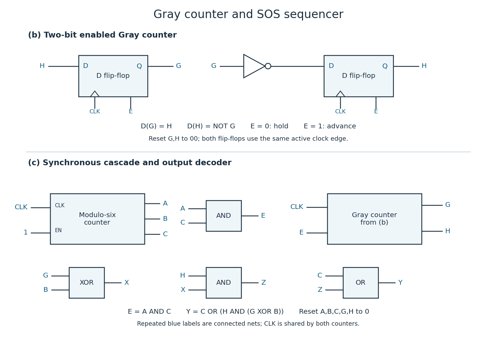

# Digital systems, linear algebra, introduction to formal proof

↑ **Parent:** [2014](../2014.md)

The original cover dates this paper to 20 June 2014. The solutions follow the printed numbering and use the supplied [natural deduction](../../mathematical-logic.md#natural-deduction) rules, including [double-negation elimination](../../mathematical-logic.md#double-negation-elimination). In the proof tables, the context column lists the numbered assumptions still in force; temporary assumptions are explicitly discharged by the indicated rule.[Cover and Figures 1–3, printed pages 1 and 9](../../computer-science-bibliography.md#digital-systems-linear-algebra-introduction-to-formal-proof-examination-paper-by-the-university-of-oxford-2014)

**Table of contents**

- [1](#1)
  - [a](#1/a)
    - [Solution](#1/a/solution)
  - [b](#1/b)
    - [Solution](#1/b/solution)
  - [c](#1/c)
    - [i](#1/c/i)
      - [Solution](#1/c/i/solution)
    - [ii](#1/c/ii)
      - [Solution](#1/c/ii/solution)
- [2](#2)
  - [a](#2/a)
    - [Solution](#2/a/solution)
  - [b](#2/b)
    - [Solution](#2/b/solution)
  - [c](#2/c)
    - [Solution](#2/c/solution)
  - [d](#2/d)
    - [Solution](#2/d/solution)
  - [e](#2/e)
    - [i](#2/e/i)
      - [Solution](#2/e/i/solution)
    - [ii](#2/e/ii)
      - [Solution](#2/e/ii/solution)
  - [f](#2/f)
    - [Solution](#2/f/solution)
- [3](#3)
  - [a](#3/a)
    - [Solution](#3/a/solution)
  - [b](#3/b)
    - [Solution](#3/b/solution)
  - [c](#3/c)
    - [Solution](#3/c/solution)
- [4](#4)
  - [a](#4/a)
    - [Solution](#4/a/solution)
  - [b](#4/b)
    - [Solution](#4/b/solution)
- [5](#5)
  - [a](#5/a)
    - [Solution](#5/a/solution)
  - [b](#5/b)
    - [Solution](#5/b/solution)
  - [c](#5/c)
    - [Solution](#5/c/solution)
  - [d](#5/d)
    - [Solution](#5/d/solution)
  - [e](#5/e)
    - [Solution](#5/e/solution)
  - [f](#5/f)
    - [Solution](#5/f/solution)
- [6](#6)
  - [a](#6/a)
    - [Solution](#6/a/solution)
  - [b](#6/b)
    - [Solution](#6/b/solution)
  - [c](#6/c)
    - [Solution](#6/c/solution)
  - [d](#6/d)
    - [Solution](#6/d/solution)
- [7](#7)
  - [a](#7/a)
    - [Solution](#7/a/solution)
  - [b](#7/b)
    - [Solution](#7/b/solution)
  - [c](#7/c)
    - [i](#7/c/i)
      - [Solution](#7/c/i/solution)
    - [ii](#7/c/ii)
      - [Solution](#7/c/ii/solution)
    - [iii](#7/c/iii)
      - [Solution](#7/c/iii/solution)
    - [iv](#7/c/iv)
      - [Solution](#7/c/iv/solution)
- [8](#8)
  - [a](#8/a)
    - [Solution](#8/a/solution)
  - [b](#8/b)
    - [i](#8/b/i)
      - [Solution](#8/b/i/solution)
    - [ii](#8/b/ii)
      - [Solution](#8/b/ii/solution)
  - [c](#8/c)
    - [i](#8/c/i)
      - [Solution](#8/c/i/solution)
    - [ii](#8/c/ii)
      - [Solution](#8/c/ii/solution)

## 1

↑ **Parent:** [Digital systems, linear algebra, introduction to formal proof](digital-systems-linear-algebra-introduction-to-formal-proof.md)

<h3 id="1/a">a</h3>

↑ **Parent:** [1](#1)

<h4 id="1/a/solution">Solution</h4>

↑ **Parent:** [A](#1/a)

A [MIPS R-type instruction](../../computer-science.md#mips-r-type-instruction) has the 32-[bit](../../information-theory.md#bit) [instruction encoding](../../computer-science.md#instruction-encoding)

$$
\underbrace{\mathrm{op}}_{6}\ \underbrace{\mathrm{rs}}_{5}\ \underbrace{\mathrm{rt}}_{5}\ \underbrace{\mathrm{rd}}_{5}\ \underbrace{\mathrm{shamt}}_{5}\ \underbrace{\mathrm{funct}}_{6}.
$$

For `add $x,$y,$z`, the [processor register](../../computer-science.md#processor-register) indices are $\mathrm{rs}=y$, $\mathrm{rt}=z$ and $\mathrm{rd}=x$, while $\mathrm{shamt}=0$. The main [opcode](../../computer-science.md#opcode) selects the R-type family and the function field selects addition. The [register file](../../computer-science.md#register-file) reads its two operands from instruction [bits](../../information-theory.md#bit) 25:21 and 20:16. In the original [datapath](../../computer-science.md#datapath), `RegDst=1` selects [bits](../../information-theory.md#bit) 15:11 as the destination, `ALUSrc=0` selects the second [register file](../../computer-science.md#register-file) output, and `ALUFunc=ADD` makes the [arithmetic logic unit](../../computer-science.md#arithmetic-logic-unit) add its inputs. The result returns to `wdata`; `RegWrite=1` writes it to $x$ at the active [clock edge](../../computer-science.md#clock-edge). The `zero` output is irrelevant here.[Question 1 datapath, printed page 2: the input-0 and input-1 multiplexer labels determine these control polarities](../../computer-science-bibliography.md#digital-systems-linear-algebra-introduction-to-formal-proof-examination-paper-by-the-university-of-oxford-2014)

A [MIPS I-type instruction](../../computer-science.md#mips-i-type-instruction) instead has the [instruction encoding](../../computer-science.md#instruction-encoding)

$$
\underbrace{\mathrm{op}}_{6}\ \underbrace{\mathrm{rs}}_{5}\ \underbrace{\mathrm{rt}}_{5}\ \underbrace{\mathrm{immediate}}_{16}.
$$

For `addi $x,$y,n`, $\mathrm{rs}=y$, $\mathrm{rt}=x$, and the low sixteen [bits](../../information-theory.md#bit) contain the [immediate operand](../../computer-science.md#immediate-operand). The [register file](../../computer-science.md#register-file) supplies $y$ to the first [arithmetic logic unit](../../computer-science.md#arithmetic-logic-unit) input. Set `RegDst=0` to select [bits](../../information-theory.md#bit) 20:16 for the destination, and `ALUSrc=1` to select the extended [immediate operand](../../computer-science.md#immediate-operand) for the second input. The [opcode](../../computer-science.md#opcode) directly requests addition, so `ALUFunc=ADD` and `RegWrite=1`. The second [register file](../../computer-science.md#register-file) read is unused. The returned result is written into $x$.

The [sign extension](../../programming-language.md#sign-extension) circuit retains the low sixteen [bits](../../information-theory.md#bit) and copies [bit](../../information-theory.md#bit) 15 into all sixteen new high positions:

$$
\boxed{\operatorname{sext}(n)_{15:0}=n,\qquad \operatorname{sext}(n)_{31:16}=\underbrace{n_{15}\cdots n_{15}}_{16\text{ copies}}.}
$$

Thus [sign extension](../../programming-language.md#sign-extension) preserves the signed [two's complement](../../programming-language.md#two-s-complement) value: `0x7fff` becomes `0x00007fff`, whereas `0x8000` becomes `0xffff8000`. For both instructions, the architectural result above assumes no signed overflow; the full [MIPS architecture](../../computer-science.md#mips-architecture) specifies an overflow exception, which is outside this simplified [datapath](../../computer-science.md#datapath).

<h3 id="1/b">b</h3>

↑ **Parent:** [1](#1)

<h4 id="1/b/solution">Solution</h4>

↑ **Parent:** [B](#1/b)

Add [zero extension](../../computer-science.md#zero-extension) alongside [sign extension](../../programming-language.md#sign-extension), and a [multiplexer](../../theoretical-computer-science.md#multiplexer) controlled by a new signal `ExtSign` to select between them before the existing immediate-input connection. Equivalently, make the extender itself selectable:

$$
\boxed{\mathrm{extended}_{15:0}=n,\qquad \mathrm{extended}_{31:16}=\begin{cases}n_{15}\cdots n_{15},&\mathrm{ExtSign}=1,\\0\cdots0,&\mathrm{ExtSign}=0.\end{cases}}
$$

Decode `ori` to `ExtSign=0`, `RegDst=0`, `ALUSrc=1`, `RegWrite=1` and `ALUFunc=OR`. The [arithmetic logic unit](../../computer-science.md#arithmetic-logic-unit) then performs [bitwise OR](../../programming-language.md#bitwise-or) between $y$ and the zero-extended [immediate operand](../../computer-science.md#immediate-operand) and writes the result to $x$. Extend the [arithmetic logic unit](../../computer-science.md#arithmetic-logic-unit)'s control decoding if OR was not already available. Decode `addi` to `ExtSign=1`; the new signal is irrelevant for [MIPS R-type instructions](../../computer-science.md#mips-r-type-instruction) because `ALUSrc=0`.

[Zero extension](../../computer-science.md#zero-extension) matters even when the most significant immediate [bit](../../information-theory.md#bit) is one: `ori` with `0x8000` must only affect the low half of the destination, whereas [sign extension](../../programming-language.md#sign-extension) would incorrectly force every high [bit](../../information-theory.md#bit) to one.[ORI instruction entry: the 16-bit immediate is zero-extended before the logical operation](../../computer-science-bibliography.md#mips32-architecture-for-programmers-volume-ii-by-mips-technologies)

<h3 id="1/c">c</h3>

↑ **Parent:** [1](#1)

<h4 id="1/c/i">i</h4>

↑ **Parent:** [C](#1/c)

<h5 id="1/c/i/solution">Solution</h5>

↑ **Parent:** [I](#1/c/i)

Use byte addresses, so adjacent 32-[bit](../../information-theory.md#bit) [array](../../data-structure.md#array-data-structure) elements are four bytes apart. The following [MIPS instructions](../../computer-science.md#mips-instruction) include harmless `sll $zero,$zero,0` instructions in every [branch delay slot](../../computer-science.md#branch-delay-slot); the second load is followed by another independent instruction before its value is consumed, also accommodating an early [MIPS architecture](../../computer-science.md#mips-architecture) with a load-use delay. All mnemonics here denote individual [machine instructions](../../computer-science.md#machine-instruction).

```
        beq   $t3,$zero,done  # n=0: do not access any array
        sll   $zero,$zero,0
loop:
        lw    $t4,0($t0)      # current a element
        lw    $t5,0($t1)      # current b element
        addiu $t0,$t0,4       # advance a; also separates lw from its use
        subu  $t6,$t4,$t5     # current difference, modulo 2^32
        sw    $t6,0($t2)      # store current c element
        addiu $t1,$t1,4
        addiu $t2,$t2,4
        addiu $t3,$t3,-1      # one fewer element remains
        bne   $t3,$zero,loop
        sll   $zero,$zero,0
done:
```

A [loop invariant](../../algorithm.md#loop-invariant) at the head of the loop, after $k$ completed iterations, is that the three addresses point to elements $k$, the count is $n-k$, and every output element before $k$ equals the corresponding difference. One iteration reads element $k$, stores its difference and advances to $k+1$, preserving the [loop invariant](../../algorithm.md#loop-invariant). The remaining count is a nonnegative [loop variant](../../algorithm.md#loop-variant) decreasing by one, so the loop ends with $k=n$.

The code uses `subu` to avoid signed-overflow traps: the suffix does not restrict the operands to unsigned values. Its precise result is

$$
\boxed{c_i\equiv a_i-b_i\pmod{2^{32}}\quad(0\leq i<n).}
$$

For representable signed differences this is exactly $c_i=a_i-b_i$. If trapping signed arithmetic is required instead, use `sub` and assume all differences are representable. The [arrays](../../data-structure.md#array-data-structure) must occupy valid word-aligned storage with no address wrap; the usual separate output [array](../../data-structure.md#array-data-structure) avoids overwriting unread inputs.

<h4 id="1/c/ii">ii</h4>

↑ **Parent:** [C](#1/c)

<h5 id="1/c/ii/solution">Solution</h5>

↑ **Parent:** [Ii](#1/c/ii)

Make the code a leaf procedure called `array_diff`, copy the four argument [processor registers](../../computer-science.md#processor-register) into the temporaries used above, and replace the final label by a return. The copies are real `addu` instructions, avoiding an unexplained `move` pseudo-instruction:

```
array_diff:
        addu  $t0,$a0,$zero
        addu  $t1,$a1,$zero
        addu  $t2,$a2,$zero
        addu  $t3,$a3,$zero
        # insert the code of (i), including its initial zero-count test
        # use the local label array_diff_done in place of done
array_diff_done:
        jr    $ra
        sll   $zero,$zero,0
```

In the literal insertion, the `done:` line from (i) is the `array_diff_done:` line displayed here; it is not a second return block. Under the usual [calling convention](../../programming-language.md#calling-convention), temporary [processor registers](../../computer-science.md#processor-register) are caller-saved. This procedure calls no other procedure and changes no saved [processor registers](../../computer-science.md#processor-register), so it needs no [stack frame](../../data-structure.md#stack-frame) or saved [return address](../../programming-language.md#return-address).

For a 32-[bit](../../information-theory.md#bit) constant $K$, define $H_K=\lfloor K/2^{16}\rfloor$ and $L_K=K\bmod2^{16}$ using its unsigned [binary representation](../../arithmetic.md#binary-number). Load it with `lui` followed by `ori`; both are single [MIPS instructions](../../computer-science.md#mips-instruction). For base addresses $A,B,C$ and count $N$, the main program is:

```
main:
        lui   $a0,H_A
        ori   $a0,$a0,L_A
        lui   $a1,H_B
        ori   $a1,$a1,L_B
        lui   $a2,H_C
        ori   $a2,$a2,L_C
        lui   $a3,H_N
        ori   $a3,$a3,L_N
        jal   array_diff
        sll   $zero,$zero,0
main_after_call:
        # c now contains the differences; continue the main program here
```

Here each `H_...` and `L_...` is an assembler-time numeric constant, not an executed operation. `lui` places the high half and clears the low half; `ori` inserts the low half without [sign extension](../../programming-language.md#sign-extension). Thus

$$
\boxed{(H_K\ll16)\mathbin{\mathrm{OR}}L_K=K.}
$$

The `jal` instruction saves the [return address](../../programming-language.md#return-address) after its [branch delay slot](../../computer-science.md#branch-delay-slot) in `$ra`; `jr $ra` resumes at `main_after_call`. A main routine that itself needs to return to a caller must save its incoming `$ra` before `jal` and restore it afterwards.

## 2

↑ **Parent:** [Digital systems, linear algebra, introduction to formal proof](digital-systems-linear-algebra-introduction-to-formal-proof.md)

<h3 id="2/a">a</h3>

↑ **Parent:** [2](#2)

<h4 id="2/a/solution">Solution</h4>

↑ **Parent:** [A](#2/a)

Names live in [directory entries](../../file-system.md#directory-entry). Each ordinary [directory entry](../../file-system.md#directory-entry) associates a component name with an [inode number](../../file-system.md#inode-number); the corresponding [inode](../../file-system.md#inode) describes the [file](../../file-system.md#computer-file) and locates its contents. A name is therefore not stored as the identity of the [inode](../../file-system.md#inode), and [hard links](../../file-system.md#hard-link) can give one [inode](../../file-system.md#inode) several names.

To resolve `/var/mail/user`, start from the root [file-system directory](../../file-system.md#file-system-directory)'s [inode](../../file-system.md#inode), read its [directory entries](../../file-system.md#directory-entry) and find `var`. Follow that entry's [inode number](../../file-system.md#inode-number) to the `var` [inode](../../file-system.md#inode); read that [file-system directory](../../file-system.md#file-system-directory) and find `mail`; repeat for `user`. The final [inode](../../file-system.md#inode) supplies the [file metadata](../../file-system.md#file-metadata) and addresses needed to read the [file data blocks](../../file-system.md#file-data-block). The intermediate [file-system directories](../../file-system.md#file-system-directory) require search permission. This describes ordinary pathname traversal without a [symbolic link](../../file-system.md#symbolic-link) or mount point changing the route.

$$
\boxed{\text{component name}\longrightarrow\text{directory entry}\longrightarrow\text{inode}\longrightarrow\text{contents}.}
$$

<h3 id="2/b">b</h3>

↑ **Parent:** [2](#2)

<h4 id="2/b/solution">Solution</h4>

↑ **Parent:** [B](#2/b)

An [inode](../../file-system.md#inode) holds [file metadata](../../file-system.md#file-metadata): object type, owner and group identities, access permissions, [file](../../file-system.md#computer-file) size, access/modification/status-change timestamps, and the [hard link](../../file-system.md#hard-link) count. It also holds the information locating the contents, traditionally direct addresses and [indirect block pointers](../../file-system.md#indirect-block-pointer). Device-special [files](../../file-system.md#computer-file) instead need device-identifying information. The [file](../../file-system.md#computer-file)'s name and parent pathname belong to [directory entries](../../file-system.md#directory-entry), not to the ordinary [inode](../../file-system.md#inode).

$$
\boxed{\text{inode} = \text{metadata and content-location information}.}
$$

<h3 id="2/c">c</h3>

↑ **Parent:** [2](#2)

<h4 id="2/c/solution">Solution</h4>

↑ **Parent:** [C](#2/c)

A traditional [inode](../../file-system.md#inode) uses a fixed number of direct pointers to [file data blocks](../../file-system.md#file-data-block), followed by singly, doubly and sometimes triply [indirect block pointers](../../file-system.md#indirect-block-pointer). A singly [indirect block pointer](../../file-system.md#indirect-block-pointer) reaches one address block whose entries point to [file data blocks](../../file-system.md#file-data-block). A doubly [indirect block pointer](../../file-system.md#indirect-block-pointer) reaches a block of pointers to singly indirect address blocks; a triply indirect one adds another level. The [file data blocks](../../file-system.md#file-data-block) need not be physically contiguous.

This [multilevel inode indexing](../../file-system.md#multilevel-inode-indexing) keeps the [inode](../../file-system.md#inode) compact. A small [file](../../file-system.md#computer-file) uses direct pointers without allocating address blocks, while a large [file](../../file-system.md#computer-file) allocates deeper address blocks only as needed. If each address block holds $q$ addresses, the successive levels cover $q,q^2,q^3$ [file data blocks](../../file-system.md#file-data-block). The logical [file offset](../../file-system.md#file-offset) selects a path arithmetically, so random access does not require walking through all preceding [file data blocks](../../file-system.md#file-data-block).

$$
\boxed{\text{small files: direct access; large files: additional indirection levels}.}
$$

<h3 id="2/d">d</h3>

↑ **Parent:** [2](#2)

<h4 id="2/d/solution">Solution</h4>

↑ **Parent:** [D](#2/d)

An [access control list](../../file-system.md#access-control-list) is attached to an object, such as a [file](../../file-system.md#computer-file), and lists which subjects or groups may perform which operations. Access requires checking the requesting identity against that object's list. A [security capability](../../operating-system.md#capability-computer-security) is an unforgeable reference to an object carrying specified rights; possessing valid authority is what permits access. Protected storage or another integrity mechanism must prevent users manufacturing stronger [security capabilities](../../operating-system.md#capability-computer-security).

The traditional [Unix](../../operating-system.md#unix) owner/group/other read-write-execute permissions are a compact, restricted [access control list](../../file-system.md#access-control-list): the [inode](../../file-system.md#inode) records the owner, group and permission [bits](../../information-theory.md#bit), and the [operating system](../../operating-system.md) compares these against the caller's credentials.

$$
\boxed{\text{Traditional Unix file protection is closest to access control lists}.}
$$

An already-open [file descriptor](../../operating-system.md#file-descriptor) can behave like a limited handle carrying rights, but that does not change the identity-based nature of the initial pathname permission check.

<h3 id="2/e">e</h3>

↑ **Parent:** [2](#2)

<h4 id="2/e/i">i</h4>

↑ **Parent:** [E](#2/e)

<h5 id="2/e/i/solution">Solution</h5>

↑ **Parent:** [I](#2/e/i)

Each address uses $32/8=4$ bytes, so an address block holds $q=2048/4=512$ pointers. Use zero-based [file offsets](../../file-system.md#file-offset). The requested [file offset](../../file-system.md#file-offset) has

$$
3000=1\cdot2048+952.
$$

Thus select direct pointer index 1, read its [file data block](../../file-system.md#file-data-block), and take the byte at offset 952 within it. No address block is needed:

$$
\boxed{1\text{ data-block read, assuming the inode is already resident}.}
$$

Fetching an uncached [inode](../../file-system.md#inode) adds one read. If “byte 3000” instead uses one-based numbering, the within-block offset is 951; it is still the second [file data block](../../file-system.md#file-data-block), with the same read count. Pathname lookup is separate from accessing a known [inode](../../file-system.md#inode).

<h4 id="2/e/ii">ii</h4>

↑ **Parent:** [E](#2/e)

<h5 id="2/e/ii/solution">Solution</h5>

↑ **Parent:** [Ii](#2/e/ii)

The logical [file data block](../../file-system.md#file-data-block) index and within-block [file offset](../../file-system.md#file-offset) are

$$
2^{24}+20000=8201\cdot2048+1568.
$$

Direct pointers cover logical indices 0 through 9. The singly indirect region covers 10 through $10+512-1=521$. The requested [file data block](../../file-system.md#file-data-block) therefore lies in the doubly indirect region, at relative index

$$
8201-(10+512)=7679=14\cdot512+511.
$$

Follow the doubly [indirect block pointer](../../file-system.md#indirect-block-pointer) in the [inode](../../file-system.md#inode), read its top address block and select entry 14, read that second address block and select entry 511, then read the resulting [file data block](../../file-system.md#file-data-block) and take byte offset 1568. These entry indices are zero-based.

$$
\boxed{3\text{ block reads: two address blocks and one data block}.}
$$

This assumes a resident [inode](../../file-system.md#inode) and no useful [buffer cache](../../file-system.md#buffer-cache) entries for the three blocks; an uncached [inode](../../file-system.md#inode) adds one read. Under one-based byte numbering the last offset is 1567, without changing either address-block index or the read count.

<h3 id="2/f">f</h3>

↑ **Parent:** [2](#2)

<h4 id="2/f/solution">Solution</h4>

↑ **Parent:** [F](#2/f)

With a resident [inode](../../file-system.md#inode), the deepest allowed path uses two address blocks and one [file data block](../../file-system.md#file-data-block), so every byte through the end of the doubly indirect region meets the three-read bound. There are ten directly addressed [file data blocks](../../file-system.md#file-data-block), 512 singly addressed ones and $512^2$ doubly addressed ones. Therefore the largest contiguous [file](../../file-system.md#computer-file) satisfying this bound is

$$
\boxed{2048(10+512+512^2)=537\,939\,968\text{ bytes}.}
$$

The next byte requires the triply indirect region, with three address-block reads and a fourth read for the [file data block](../../file-system.md#file-data-block).

The resident-[inode](../../file-system.md#inode) convention is essential. If the question's three reads must also include fetching a previously uncached [inode](../../file-system.md#inode), only two further reads remain; the maximum is then

$$
\boxed{2048(10+512)=1\,069\,056\text{ bytes, if the inode read is included}.}
$$

Neither figure includes arbitrary pathname-resolution reads. These are worst-case counts in the traditional fully allocated [multilevel inode indexing](../../file-system.md#multilevel-inode-indexing) model; existing [buffer cache](../../file-system.md#buffer-cache) entries can reduce them.

## 3

↑ **Parent:** [Digital systems, linear algebra, introduction to formal proof](digital-systems-linear-algebra-introduction-to-formal-proof.md)

<h3 id="3/a">a</h3>

↑ **Parent:** [3](#3)

<h4 id="3/a/solution">Solution</h4>

↑ **Parent:** [A](#3/a)

Use three [D flip-flops](../../electrical-engineering.md#d-flip-flop) whose stored [bits](../../information-theory.md#bit) $A,B,C$ represent $4A+2B+C$. Initialize them to $000$. The [Moore machine](../../foundations-of-mathematics.md#moore-machine)'s output is this stored [binary representation](../../arithmetic.md#binary-number), and its [state transition table](../../foundations-of-mathematics.md#state-transition-table) is:

| Present $ABC$ | Next $A^+B^+C^+$ |
| --- | --- |
| $000$ | $001$ |
| $001$ | $010$ |
| $010$ | $011$ |
| $011$ | $100$ |
| $100$ | $101$ |
| $101$ | $000$ |

Treat the two unused [state encodings](../../foundations-of-mathematics.md#state-encoding) $110,111$ as [don't-care conditions](../../analysis-of-boolean-functions.md#don-t-care-term) when minimizing the [sum of products](../../theoretical-computer-science.md#disjunctive-normal-form). With juxtaposition for AND, $+$ for OR and a bar for NOT, one minimal choice is

$$
\boxed{D_A=A\overline C+BC,\qquad D_B=B\overline C+\overline A\,\overline B C,\qquad D_C=\overline C.}
$$

For $D_A$, the required ones at $011$ and $100$ cannot share one valid [implicant](../../analysis-of-boolean-functions.md#implicant): their differing [bits](../../information-theory.md#bit) would force inclusion of required zeros. Pair $011$ with the unused $111$ to get $BC$, and $100$ with unused $110$ to get $A\overline C$. Neither term can lose a [Boolean literal](../../theoretical-computer-science.md#boolean-literal) without covering a required zero.

For $D_B$, state $001$ is isolated from every other required one and from the unused states by required zeros, so it forces the three-[Boolean literal](../../theoretical-computer-science.md#boolean-literal) term $\overline A\,\overline B C$. State $010$ pairs with unused $110$ to give $B\overline C$. Finally $D_C=\overline C$ is a single [Boolean literal](../../theoretical-computer-science.md#boolean-literal). Thus the three expressions are minimal [sum of products](../../theoretical-computer-science.md#disjunctive-normal-form) expressions under the stated unused-state convention. In fact these choices also recover from $110\to111\to100$, so initialization into an unused state eventually joins the intended [modulo-six counter](../../electrical-engineering.md#modulo-six-counter) cycle.

<h3 id="3/b">b</h3>

↑ **Parent:** [3](#3)

<h4 id="3/b/solution">Solution</h4>

↑ **Parent:** [B](#3/b)

Let the stored [bits](../../information-theory.md#bit) be $G,H$, with $G$ most significant. The required [Gray code](../../graph.md#gray-code) transitions give

$$
00\to01\to11\to10\to00,\qquad\boxed{D_G=H,\qquad D_H=\overline G.}
$$

Connect $H$ directly to the first [D flip-flop](../../electrical-engineering.md#d-flip-flop)'s data input and feed $G$ through one [NOT gate](../../theoretical-computer-science.md#not-gate) to the second input. Drive both enable inputs with $E$ and both clock inputs with the same clock. Thus $E=0$ holds both stored [bits](../../information-theory.md#bit); $E=1$ takes the next [Gray-code counter](../../foundations-of-mathematics.md#gray-code-counter) state at the active [clock edge](../../computer-science.md#clock-edge). Reset initializes $GH=00$.

<a id="3/b/image-enabled-gray-code-counter-and-synchronous-sos-sequencer-all-stored-bits-share-one-clock"></a>


**[Figure 1](#3/b/image-enabled-gray-code-counter-and-synchronous-sos-sequencer-all-stored-bits-share-one-clock). Enabled Gray-code counter and synchronous SOS sequencer: all stored bits share one clock**.

With ordinary uncomplemented $Q$ outputs, one [NOT gate](../../theoretical-computer-science.md#not-gate) is minimal: wiring alone cannot produce $\overline G$. If a [D flip-flop](../../electrical-engineering.md#d-flip-flop) already provides a complementary output, that output supplies the inversion without an external [logic gate](../../theoretical-computer-science.md#logic-gate). This is a [Moore machine](../../foundations-of-mathematics.md#moore-machine) because its output $GH$ depends only on stored state; $E$ controls transitions.

<h3 id="3/c">c</h3>

↑ **Parent:** [3](#3)

<h4 id="3/c/solution">Solution</h4>

↑ **Parent:** [C](#3/c)

Use a [synchronous counter cascade](../../foundations-of-mathematics.md#synchronous-counter-cascade), with the three-[bit](../../information-theory.md#bit) [modulo-six counter](../../electrical-engineering.md#modulo-six-counter) advancing on every active [clock edge](../../computer-science.md#clock-edge) and the [Gray-code counter](../../foundations-of-mathematics.md#gray-code-counter) advancing only when the old binary state is $101$. Its enable can therefore be

$$
\boxed{E=A C.}
$$

On the six valid binary states, $AC=1$ only at $101$. Both [digital counters](../../foundations-of-mathematics.md#digital-counter) sample the same clock: at an edge leaving $101$, the binary output becomes $000$ and $GH$ simultaneously advances to the next [Gray code](../../graph.md#gray-code). At all other edges $GH$ holds. Starting from $GHABC=00000$, this gives exactly the listed 24-state sequence. Use the shared clock and an enable, rather than making a combinational terminal-state signal into a new clock.[Question 3(c), printed page 4: original 24-row state/output table](../../computer-science-bibliography.md#digital-systems-linear-algebra-introduction-to-formal-proof-examination-paper-by-the-university-of-oxford-2014)

For the output $Y$, every state with $C=1$ has $Y=1$. For $C=0$, the only extra high states are $GH=01$ with binary state $010$, and $GH=11$ with binary state $000$ or $100$. On valid states these conditions are $H\overline G B$ and $HG\overline B$, respectively. Hence

$$
\boxed{Y=C+H\overline G B+HG\overline B=C\lor\bigl(H\land(G\mathbin{\oplus}B)\bigr).}
$$

The lower circuit in the figure implements this with an AND for $E$, an [exclusive or](../../theoretical-computer-science.md#exclusive-or) on $G,B$, an AND with $H$, and an OR with $C$. The resulting [Morse code](../../coding-theory.md#morse-code) output blocks, in [Gray code](../../graph.md#gray-code) order $00,01,11,10$, are

$$
010101\quad011101\quad110111\quad010101.
$$

Across the two middle blocks these join to three three-clock highs separated by one-clock lows; the first and last blocks provide the three single-clock highs of each S. The specified table is a repeating SOS symbol pattern; its wraparound has a one-clock low, rather than an added inter-message pause. The output is a [Moore machine](../../foundations-of-mathematics.md#moore-machine) decoding of current stored [bits](../../information-theory.md#bit); its value changes after those [bits](../../information-theory.md#bit) settle.

## 4

↑ **Parent:** [Digital systems, linear algebra, introduction to formal proof](digital-systems-linear-algebra-introduction-to-formal-proof.md)

<h3 id="4/a">a</h3>

↑ **Parent:** [4](#4)

<h4 id="4/a/solution">Solution</h4>

↑ **Parent:** [A](#4/a)

Apply the [elementary row operations](../../numerical-linear-algebra.md#elementary-row-operation) from bottom to top: $R_4\gets R_4-R_3$, $R_3\gets R_3-R_2$, and $R_2\gets R_2-R_1$. This order ensures that each subtraction uses the original preceding row. The result is the [upper triangular matrix](../../linear-algebra.md#upper-triangular-matrix)

$$
T=\begin{pmatrix}a&a&a&a\\0&b-a&b-a&b-a\\0&0&c-b&c-b\\0&0&0&d-c\end{pmatrix}.
$$

Put $\delta_1=a$, $\delta_2=b-a$, $\delta_3=c-b$, $\delta_4=d-c$. Row $i$ is either zero if $\delta_i=0$, or has its first nonzero entry in column $i$. Thus, for arbitrary real parameters, a [row echelon form](../../numerical-linear-algebra.md#row-echelon-form) is obtained by retaining the nonzero rows of $T$ in their existing order and moving every zero row to the bottom. This deals explicitly with vanishing parameters; an [upper triangular matrix](../../linear-algebra.md#upper-triangular-matrix) with an intermediate zero row is not yet a [row echelon form](../../numerical-linear-algebra.md#row-echelon-form).

The subtractions preserve the [determinant](../../multilinear-algebra.md#determinant), so the original [matrix](../../vector-space.md#matrix) has

$$
\det M=a(b-a)(c-b)(d-c).
$$

A square [matrix](../../vector-space.md#matrix) is invertible exactly when its [determinant](../../multilinear-algebra.md#determinant) is nonzero. Consequently,

$$
\boxed{M\text{ invertible}\iff a\ne0,\quad b\ne a,\quad c\ne b,\quad d\ne c.}
$$

These conditions concern consecutive parameters: no ordering, positivity, or pairwise distinctness of all four is required. More generally the [rank of a matrix](../../vector-space.md#matrix-rank) here is the number of nonzero $\delta_i$, because the retained nonzero rows have distinct leading columns.

<h3 id="4/b">b</h3>

↑ **Parent:** [4](#4)

<h4 id="4/b/solution">Solution</h4>

↑ **Parent:** [B](#4/b)

Summing the [flow conservation](../../flow-network.md#flow-conservation) equations over all four junctions cancels every internal flow. The total entering flow is $300+500+250+50+100=1200$, and the known exiting flow is $700+200=900$. Thus

$$
\boxed{f_1=1200-900=300.}
$$

The original arrows point $A\to B$, $C\to A$, $B\to D$, and $C\to D$ for $f_2,f_3,f_4,f_5$, respectively. In particular, $f_1$ exits north from $A$.[Question 4(b) traffic diagram, printed page 5](../../computer-science-bibliography.md#digital-systems-linear-algebra-introduction-to-formal-proof-examination-paper-by-the-university-of-oxford-2014)

The individual [flow conservation](../../flow-network.md#flow-conservation) equations are

$$
\begin{aligned}
A:&\quad300+f_3=f_1+f_2,\\
B:&\quad500+250+f_2=f_4,\\
C:&\quad50+100=f_3+f_5,\\
D:&\quad f_4+f_5=700+200.
\end{aligned}
$$

Choose $t=f_5$. Substitution gives all solutions of these [linear equations](../../linear-algebra.md#linear-equation):

$$
\boxed{(f_1,f_2,f_3,f_4,f_5)=(300,150-t,150-t,900-t,t),\qquad0\leq t\leq150.}
$$

The inequalities enforce nonnegative flows on all one-way streets. The last junction equation follows from the first three and total [flow conservation](../../flow-network.md#flow-conservation), so it introduces no further restriction.

The maximum is $\boxed{f_5=150}$. It makes $f_2=f_3=0$. At $A$, all 300 vehicles arriving from the west turn north and leave along $f_1$; none arrives from $C$ or continues east to $B$.

## 5

↑ **Parent:** [Digital systems, linear algebra, introduction to formal proof](digital-systems-linear-algebra-introduction-to-formal-proof.md)

<h3 id="5/a">a</h3>

↑ **Parent:** [5](#5)

<h4 id="5/a/solution">Solution</h4>

↑ **Parent:** [A](#5/a)

For a real $m\times n$ [matrix](../../vector-space.md#matrix) $A$, the [row space](../../vector-space.md#row-space) is the [linear span](../../vector-space.md#linear-span) of its rows in $\mathbb R^n$, and the [column space](../../vector-space.md#column-space) is the [linear span](../../vector-space.md#linear-span) of its columns in $\mathbb R^m$. Its [null space](../../kernel-of-a-linear-map.md) consists of the input [vectors](../../vector-space.md#vector) sent to zero:

$$
\operatorname{Null}(A)=\{x\in\mathbb R^n:Ax=0\}.
$$

The [rank of a matrix](../../vector-space.md#matrix-rank) is

$$
\boxed{\operatorname{rank}A=\dim\operatorname{Col}(A)=\dim\operatorname{Row}(A).}
$$

The equality of row and column dimensions is the row-rank/column-rank theorem. Each displayed space is a [linear subspace](../../vector-space.md#vector-subspace) of the indicated ambient [vector space](../../vector-space.md).

<h3 id="5/b">b</h3>

↑ **Parent:** [5](#5)

<h4 id="5/b/solution">Solution</h4>

↑ **Parent:** [B](#5/b)

Write the columns of $A$ as $a_1,\ldots,a_n$ and the coordinates of the [vector](../../vector-space.md#vector) $x$ as $x_1,\ldots,x_n$. By the definition of [matrix multiplication](../../vector-space.md#matrix-multiplication),

$$
\boxed{y=Ax=x_1a_1+\cdots+x_na_n\in\operatorname{span}\{a_1,\ldots,a_n\}=\operatorname{Col}(A).}
$$

Indeed, its $i$th coordinate is $\sum_{j=1}^n A_{ij}x_j$, exactly the $i$th coordinate of this [linear combination](../../vector-space.md#linear-combination). Since the [column space](../../vector-space.md#column-space) contains every [linear combination](../../vector-space.md#linear-combination) of the columns, the claim holds for every [vector](../../vector-space.md#vector) $x$.

<h3 id="5/c">c</h3>

↑ **Parent:** [5](#5)

<h4 id="5/c/solution">Solution</h4>

↑ **Parent:** [C](#5/c)

Swap the first two rows, then perform $R_2\gets R_2+R_1$ and $R_3\gets R_3-2R_1$. These [elementary row operations](../../numerical-linear-algebra.md#elementary-row-operation) give

$$
A\sim\begin{pmatrix}1&-2&2&3&-1\\0&0&5&10&-10\\0&0&1&2&-2\end{pmatrix}.
$$

Scale row 2 by $1/5$, subtract it from row 3, and finally subtract twice row 2 from row 1. The [reduced row echelon form](../../numerical-linear-algebra.md#reduced-row-echelon-form) is

$$
R=\begin{pmatrix}1&-2&0&-1&3\\0&0&1&2&-2\\0&0&0&0&0\end{pmatrix}.
$$

[Elementary row operations](../../numerical-linear-algebra.md#elementary-row-operation) preserve the [row space](../../vector-space.md#row-space). The two nonzero rows of $R$ are [linearly independent](../../vector-space.md#linear-independence), since their leading entries lie in different columns. Hence

$$
\boxed{\text{row-space basis }\{(1,-2,0,-1,3),(0,0,1,2,-2)\},\qquad\operatorname{rank}A=2.}
$$

<h3 id="5/d">d</h3>

↑ **Parent:** [5](#5)

<h4 id="5/d/solution">Solution</h4>

↑ **Parent:** [D](#5/d)

The [pivot columns](../../vector-space.md#pivot-column) of the [reduced row echelon form](../../numerical-linear-algebra.md#reduced-row-echelon-form) are columns 1 and 3. Take those columns of the original [matrix](../../vector-space.md#matrix), since [elementary row operations](../../numerical-linear-algebra.md#elementary-row-operation) need not preserve the original [column space](../../vector-space.md#column-space):

$$
\boxed{\left\{\begin{pmatrix}-1\\1\\2\end{pmatrix},\begin{pmatrix}3\\2\\5\end{pmatrix}\right\}.}
$$

For an explicit spanning check, column 2 is $-2a_1$, column 4 is $-a_1+2a_3$, and column 5 is $3a_1-2a_3$. The first two coordinates of the displayed columns form a $2\times2$ [matrix](../../vector-space.md#matrix) of [determinant](../../multilinear-algebra.md#determinant) $-5\ne0$, proving their [linear independence](../../vector-space.md#linear-independence). They are therefore a [basis](../../vector-space.md#basis) of the [column space](../../vector-space.md#column-space).

<h3 id="5/e">e</h3>

↑ **Parent:** [5](#5)

<h4 id="5/e/solution">Solution</h4>

↑ **Parent:** [E](#5/e)

The right-hand [vector](../../vector-space.md#vector) is in the [column space](../../vector-space.md#column-space), because

$$
2\begin{pmatrix}-1\\1\\2\end{pmatrix}+\begin{pmatrix}3\\2\\5\end{pmatrix}=\begin{pmatrix}1\\4\\9\end{pmatrix}.
$$

Consequently the [linear system](../../linear-algebra.md#system-of-linear-equations) is consistent. A concrete solution is

$$
\boxed{x=(2,0,1,0,0)^{\mathsf T}.}
$$

As a compatibility check, the original rows satisfy $r_1+11r_2-5r_3=0$, and the right-hand entries satisfy the same relation $1+11\cdot4-5\cdot9=0$. There are infinitely many solutions, obtained by adding any [vector](../../vector-space.md#vector) in the [null space](../../kernel-of-a-linear-map.md) to the displayed solution.

<h3 id="5/f">f</h3>

↑ **Parent:** [5](#5)

<h4 id="5/f/solution">Solution</h4>

↑ **Parent:** [F](#5/f)

The [reduced row echelon form](../../numerical-linear-algebra.md#reduced-row-echelon-form) yields

$$
x_1-2x_2-x_4+3x_5=0,\qquad x_3+2x_4-2x_5=0.
$$

Take the [free variables in a linear system](../../linear-algebra.md#free-variable-in-a-linear-system) to be $s=x_2$, $t=x_4$, $u=x_5$. Then

$$
x=s\begin{pmatrix}2\\1\\0\\0\\0\end{pmatrix}+t\begin{pmatrix}1\\0\\-2\\1\\0\end{pmatrix}+u\begin{pmatrix}-3\\0\\2\\0\\1\end{pmatrix}.
$$

Thus

$$
\boxed{\text{null-space basis }\{(2,1,0,0,0)^{\mathsf T},(1,0,-2,1,0)^{\mathsf T},(-3,0,2,0,1)^{\mathsf T}\},\qquad\dim\operatorname{Null}(A)=3.}
$$

Each listed [vector](../../vector-space.md#vector) lies in the [null space](../../kernel-of-a-linear-map.md), and every solution has the displayed form. Their coordinates in positions 2, 4 and 5 prove [linear independence](../../vector-space.md#linear-independence). The dimension also follows from the [rank-nullity theorem](../../kernel-of-a-linear-map.md#rank-nullity-theorem): $5-2=3$.

## 6

↑ **Parent:** [Digital systems, linear algebra, introduction to formal proof](digital-systems-linear-algebra-introduction-to-formal-proof.md)

<h3 id="6/a">a</h3>

↑ **Parent:** [6](#6)

<h4 id="6/a/solution">Solution</h4>

↑ **Parent:** [A](#6/a)

An [elementary matrix](../../numerical-linear-algebra.md#elementary-matrix) acts on rows by multiplication on the left. Apply the desired [elementary row operation](../../numerical-linear-algebra.md#elementary-row-operation) to the [identity matrix](../../vector-space.md#identity-matrix) to construct it. In the order requested, the three [elementary matrices](../../numerical-linear-algebra.md#elementary-matrix) and their [inverse matrices](../../matrix-inverse.md) are

$$
\boxed{E_1=\begin{pmatrix}2&0&0\\0&1&0\\0&0&1\end{pmatrix},\quad E_1^{-1}=\begin{pmatrix}1/2&0&0\\0&1&0\\0&0&1\end{pmatrix};}
$$


$$
\boxed{E_2=\begin{pmatrix}1&0&0\\0&1&0\\-2&0&1\end{pmatrix},\quad E_2^{-1}=\begin{pmatrix}1&0&0\\0&1&0\\2&0&1\end{pmatrix};}
$$


$$
\boxed{E_3=\begin{pmatrix}1&0&0\\0&0&1\\0&1&0\end{pmatrix},\quad E_3^{-1}=E_3.}
$$

The inverse operations halve row 1, add twice row 1 to row 3, and interchange rows 2 and 3 again, respectively.

<h3 id="6/b">b</h3>

↑ **Parent:** [6](#6)

<h4 id="6/b/solution">Solution</h4>

↑ **Parent:** [B](#6/b)

Use $R_2\gets R_2+2R_1$ and $R_3\gets R_3-3R_1$, followed by $R_3\gets R_3+R_2$. These [elementary row operations](../../numerical-linear-algebra.md#elementary-row-operation) give

$$
\begin{pmatrix}1&4&1\\-2&-4&0\\3&8&0\end{pmatrix}\sim\begin{pmatrix}1&4&1\\0&4&2\\0&-4&-3\end{pmatrix}\sim\underbrace{\begin{pmatrix}1&4&1\\0&4&2\\0&0&-1\end{pmatrix}}_U.
$$

The elimination multipliers are $m_{21}=-2$, $m_{31}=3$, $m_{32}=-1$. Record them in the [unit lower triangular matrix](../../linear-algebra.md#unit-lower-triangular-matrix) $L$:

$$
\boxed{A=LU,\qquad L=\begin{pmatrix}1&0&0\\-2&1&0\\3&-1&1\end{pmatrix},\quad U=\begin{pmatrix}1&4&1\\0&4&2\\0&0&-1\end{pmatrix}.}
$$

To see the [elementary matrix](../../numerical-linear-algebra.md#elementary-matrix) relation directly, let $F_{21}=I+2e_{21}$, $F_{31}=I-3e_{31}$ and $F_{32}=I+e_{32}$, where $e_{ij}$ has a single 1 in position $(i,j)$. Then $U=F_{32}F_{31}F_{21}A$, and reversing and inverting these operations gives $L=F_{21}^{-1}F_{31}^{-1}F_{32}^{-1}$. Direct [matrix multiplication](../../vector-space.md#matrix-multiplication) also verifies the stated [LU decomposition](../../numerical-linear-algebra.md#lu-decomposition).

<h3 id="6/c">c</h3>

↑ **Parent:** [6](#6)

<h4 id="6/c/solution">Solution</h4>

↑ **Parent:** [C](#6/c)

Solve two triangular [linear systems](../../linear-algebra.md#system-of-linear-equations), rather than forming an [inverse matrix](../../matrix-inverse.md):

$$
\boxed{Ly=b\quad\text{by forward substitution},\qquad Ux=y\quad\text{by back substitution}.}
$$

For this [LU decomposition](../../numerical-linear-algebra.md#lu-decomposition), [forward substitution](../../numerical-linear-algebra.md#forward-substitution) gives $y_1=b_1$, $y_2=b_2+2y_1$ and $y_3=b_3-3y_1+y_2$. Then [back substitution](../../linear-algebra.md#back-substitution) gives

$$
x_3=-y_3,\qquad x_2=\frac{y_2-2x_3}{4},\qquad x_1=y_1-4x_2-x_3.
$$

All diagonal entries used as divisors are nonzero. The same [LU decomposition](../../numerical-linear-algebra.md#lu-decomposition) can be reused for many right-hand [vectors](../../vector-space.md#vector), with only these two triangular solves repeated.

<h3 id="6/d">d</h3>

↑ **Parent:** [6](#6)

<h4 id="6/d/solution">Solution</h4>

↑ **Parent:** [D](#6/d)

A [triangular matrix](../../linear-algebra.md#triangular-matrix) has [determinant](../../multilinear-algebra.md#determinant) equal to the product of its diagonal entries. Since $L$ is a [unit lower triangular matrix](../../linear-algebra.md#unit-lower-triangular-matrix), $\det L=1$. Thus

$$
\boxed{\det A=\det L\det U=1\cdot(1\cdot4\cdot(-1))=-4.}
$$

Equivalently, the elimination used only row additions, which leave the [determinant](../../multilinear-algebra.md#determinant) unchanged; there were no row swaps or row scalings to account for.

## 7

↑ **Parent:** [Digital systems, linear algebra, introduction to formal proof](digital-systems-linear-algebra-introduction-to-formal-proof.md)

<h3 id="7/a">a</h3>

↑ **Parent:** [7](#7)

<h4 id="7/a/solution">Solution</h4>

↑ **Parent:** [A](#7/a)

The [conjunction introduction rule](../../mathematical-logic.md#conjunction-introduction-rule) derives $\phi\land\psi$ from proofs of $\phi$ and $\psi$ in the current context. The [disjunction elimination rule](../../mathematical-logic.md#disjunction-elimination-rule) derives a common conclusion $\kappa$ from $\phi\lor\psi$, a subproof of $\kappa$ under temporary assumption $\phi$, and a subproof of $\kappa$ under temporary assumption $\psi$. The [implication introduction rule](../../mathematical-logic.md#implication-introduction-rule) derives $\phi\to\psi$ by temporarily assuming $\phi$ and proving $\psi$.

The rectangular boxes delimit subproofs and the scope of their temporary assumptions. The [disjunction elimination rule](../../mathematical-logic.md#disjunction-elimination-rule) discharges the two case assumptions; the [implication introduction rule](../../mathematical-logic.md#implication-introduction-rule) discharges its antecedent assumption. Formulas depending on a boxed assumption cannot simply escape that box. Other undischarged assumptions remain in force, and nested boxes can access the assumptions of enclosing boxes.

$$
\boxed{\text{Boxes record local assumptions and their discharge, not additional premises}.}
$$

<h3 id="7/b">b</h3>

↑ **Parent:** [7](#7)

<h4 id="7/b/solution">Solution</h4>

↑ **Parent:** [B](#7/b)

Work backwards from the outermost available [logical connective](../../mathematical-logic.md#logical-connective). One strategy applies the [disjunction elimination rule](../../mathematical-logic.md#disjunction-elimination-rule) to the premise first, constructs the whole target in each case, and then closes the cases. In the tables, a context such as $\{1,2\}$ means that assumptions on lines 1 and 2 remain open. A range in a discharge rule denotes the entire local subproof.

| Line | Context | Formula | Justification |
| --- | --- | --- | --- |
| 1 | $\{1\}$ | $(P\land Q)\lor(P\land R)$ | Premise |
| 2 | $\{1,2\}$ | $P\land Q$ | Temporary assumption |
| 3 | $\{1,2\}$ | $P$ | [conjunction elimination rule](../../mathematical-logic.md#conjunction-elimination-rule) $\land\text{-elim-L}$ on 2 |
| 4 | $\{1,2\}$ | $Q$ | [conjunction elimination rule](../../mathematical-logic.md#conjunction-elimination-rule) $\land\text{-elim-R}$ on 2 |
| 5 | $\{1,2\}$ | $Q\lor R$ | [disjunction introduction rule](../../mathematical-logic.md#disjunction-introduction-rule) $\lor\text{-intro-L}$ on 4 |
| 6 | $\{1,2\}$ | $P\land(Q\lor R)$ | [conjunction introduction rule](../../mathematical-logic.md#conjunction-introduction-rule) $\land\text{-intro}$ on 3, 5 |
| 7 | $\{1,7\}$ | $P\land R$ | Temporary assumption |
| 8 | $\{1,7\}$ | $P$ | [conjunction elimination rule](../../mathematical-logic.md#conjunction-elimination-rule) $\land\text{-elim-L}$ on 7 |
| 9 | $\{1,7\}$ | $R$ | [conjunction elimination rule](../../mathematical-logic.md#conjunction-elimination-rule) $\land\text{-elim-R}$ on 7 |
| 10 | $\{1,7\}$ | $Q\lor R$ | [disjunction introduction rule](../../mathematical-logic.md#disjunction-introduction-rule) $\lor\text{-intro-R}$ on 9 |
| 11 | $\{1,7\}$ | $P\land(Q\lor R)$ | [conjunction introduction rule](../../mathematical-logic.md#conjunction-introduction-rule) $\land\text{-intro}$ on 8, 10 |
| 12 | $\{1\}$ | $P\land(Q\lor R)$ | [disjunction elimination rule](../../mathematical-logic.md#disjunction-elimination-rule) $\lor\text{-elim}$ on 1, 6, 11; discharge 2, 7 |

A second strategy applies the [conjunction introduction rule](../../mathematical-logic.md#conjunction-introduction-rule) backwards to the target first. Prove $P$ and $Q\lor R$ separately, each by the [disjunction elimination rule](../../mathematical-logic.md#disjunction-elimination-rule) on the premise, and combine them:

| Line | Context | Formula | Justification |
| --- | --- | --- | --- |
| 1 | $\{1\}$ | $(P\land Q)\lor(P\land R)$ | Premise |
| 2 | $\{1,2\}$ | $P\land Q$ | Temporary assumption |
| 3 | $\{1,2\}$ | $P$ | [conjunction elimination rule](../../mathematical-logic.md#conjunction-elimination-rule) $\land\text{-elim-L}$ on 2 |
| 4 | $\{1,4\}$ | $P\land R$ | Temporary assumption |
| 5 | $\{1,4\}$ | $P$ | [conjunction elimination rule](../../mathematical-logic.md#conjunction-elimination-rule) $\land\text{-elim-L}$ on 4 |
| 6 | $\{1\}$ | $P$ | [disjunction elimination rule](../../mathematical-logic.md#disjunction-elimination-rule) $\lor\text{-elim}$ on 1, 3, 5; discharge 2, 4 |
| 7 | $\{1,7\}$ | $P\land Q$ | Temporary assumption |
| 8 | $\{1,7\}$ | $Q$ | [conjunction elimination rule](../../mathematical-logic.md#conjunction-elimination-rule) $\land\text{-elim-R}$ on 7 |
| 9 | $\{1,7\}$ | $Q\lor R$ | [disjunction introduction rule](../../mathematical-logic.md#disjunction-introduction-rule) $\lor\text{-intro-L}$ on 8 |
| 10 | $\{1,10\}$ | $P\land R$ | Temporary assumption |
| 11 | $\{1,10\}$ | $R$ | [conjunction elimination rule](../../mathematical-logic.md#conjunction-elimination-rule) $\land\text{-elim-R}$ on 10 |
| 12 | $\{1,10\}$ | $Q\lor R$ | [disjunction introduction rule](../../mathematical-logic.md#disjunction-introduction-rule) $\lor\text{-intro-R}$ on 11 |
| 13 | $\{1\}$ | $Q\lor R$ | [disjunction elimination rule](../../mathematical-logic.md#disjunction-elimination-rule) $\lor\text{-elim}$ on 1, 9, 12; discharge 7, 10 |
| 14 | $\{1\}$ | $P\land(Q\lor R)$ | [conjunction introduction rule](../../mathematical-logic.md#conjunction-introduction-rule) $\land\text{-intro}$ on 6, 13 |

Both derivations establish

$$
\boxed{((P\land Q)\lor(P\land R))\vdash P\land(Q\lor R).}
$$

Counting only applications of [inference rules](../../mathematical-logic.md#inference-rule), each proof has **nine** steps: four [conjunction elimination rule](../../mathematical-logic.md#conjunction-elimination-rule) applications, two [disjunction introduction rule](../../mathematical-logic.md#disjunction-introduction-rule) applications, and three remaining applications. The first uses two [conjunction introduction rule](../../mathematical-logic.md#conjunction-introduction-rule) applications and one [disjunction elimination rule](../../mathematical-logic.md#disjunction-elimination-rule); the second uses one and two, respectively. The second has two additional temporary-assumption lines, giving 14 displayed lines instead of 12, but assumptions are not additional inference applications. Its duplicated case analysis is exchanged for avoiding construction of the complete [logical conjunction](../../mathematical-logic.md#logical-conjunction) separately in both cases. In a proof tree it also repeats the use of the original premise.

<h3 id="7/c">c</h3>

↑ **Parent:** [7](#7)

<h4 id="7/c/i">i</h4>

↑ **Parent:** [C](#7/c)

<h5 id="7/c/i/solution">Solution</h5>

↑ **Parent:** [I](#7/c/i)

Introduce the three [logical implications](../../mathematical-logic.md#logical-implication) from the outside in. Under assumptions $P\to Q$, $Q\to R$, and $P$, apply the [implication elimination rule](../../mathematical-logic.md#implication-elimination-rule) twice, then use [assumption discharge](../../mathematical-logic.md#assumption-discharge) in reverse order:

| Line | Context | Formula | Justification |
| --- | --- | --- | --- |
| 1 | $\{1\}$ | $P\to Q$ | Temporary assumption |
| 2 | $\{1,2\}$ | $Q\to R$ | Temporary assumption |
| 3 | $\{1,2,3\}$ | $P$ | Temporary assumption |
| 4 | $\{1,2,3\}$ | $Q$ | [implication elimination rule](../../mathematical-logic.md#implication-elimination-rule) $\to\text{-elim}$ on 1, 3 |
| 5 | $\{1,2,3\}$ | $R$ | [implication elimination rule](../../mathematical-logic.md#implication-elimination-rule) $\to\text{-elim}$ on 2, 4 |
| 6 | $\{1,2\}$ | $P\to R$ | [implication introduction rule](../../mathematical-logic.md#implication-introduction-rule) $\to\text{-intro}$ on 5; discharge 3 |
| 7 | $\{1\}$ | $(Q\to R)\to(P\to R)$ | [implication introduction rule](../../mathematical-logic.md#implication-introduction-rule) $\to\text{-intro}$ on 6; discharge 2 |
| 8 | $\varnothing$ | $(P\to Q)\to((Q\to R)\to(P\to R))$ | [implication introduction rule](../../mathematical-logic.md#implication-introduction-rule) $\to\text{-intro}$ on 7; discharge 1 |

Thus

$$
\boxed{\vdash(P\to Q)\to((Q\to R)\to(P\to R)).}
$$

<h4 id="7/c/ii">ii</h4>

↑ **Parent:** [C](#7/c)

<h5 id="7/c/ii/solution">Solution</h5>

↑ **Parent:** [Ii](#7/c/ii)

Under $P$, the first assumption yields $Q\to R$, while the second yields $Q$. Apply the [implication elimination rule](../../mathematical-logic.md#implication-elimination-rule) once more to obtain $R$, and discharge the three temporary assumptions:

| Line | Context | Formula | Justification |
| --- | --- | --- | --- |
| 1 | $\{1\}$ | $P\to(Q\to R)$ | Temporary assumption |
| 2 | $\{1,2\}$ | $P\to Q$ | Temporary assumption |
| 3 | $\{1,2,3\}$ | $P$ | Temporary assumption |
| 4 | $\{1,2,3\}$ | $Q\to R$ | [implication elimination rule](../../mathematical-logic.md#implication-elimination-rule) $\to\text{-elim}$ on 1, 3 |
| 5 | $\{1,2,3\}$ | $Q$ | [implication elimination rule](../../mathematical-logic.md#implication-elimination-rule) $\to\text{-elim}$ on 2, 3 |
| 6 | $\{1,2,3\}$ | $R$ | [implication elimination rule](../../mathematical-logic.md#implication-elimination-rule) $\to\text{-elim}$ on 4, 5 |
| 7 | $\{1,2\}$ | $P\to R$ | [implication introduction rule](../../mathematical-logic.md#implication-introduction-rule) $\to\text{-intro}$ on 6; discharge 3 |
| 8 | $\{1\}$ | $(P\to Q)\to(P\to R)$ | [implication introduction rule](../../mathematical-logic.md#implication-introduction-rule) $\to\text{-intro}$ on 7; discharge 2 |
| 9 | $\varnothing$ | $(P\to(Q\to R))\to((P\to Q)\to(P\to R))$ | [implication introduction rule](../../mathematical-logic.md#implication-introduction-rule) $\to\text{-intro}$ on 8; discharge 1 |

The two uses of $P$ are permitted in ordinary [natural deduction](../../mathematical-logic.md#natural-deduction). Therefore

$$
\boxed{\vdash(P\to(Q\to R))\to((P\to Q)\to(P\to R)).}
$$

<h4 id="7/c/iii">iii</h4>

↑ **Parent:** [C](#7/c)

<h5 id="7/c/iii/solution">Solution</h5>

↑ **Parent:** [Iii](#7/c/iii)

The premise turns an assumed $\neg P$ into a [contradiction](../../mathematical-logic.md#contradiction). Use the [negation introduction rule](../../mathematical-logic.md#negation-introduction-rule) to obtain $\neg\neg P$, then the supplied classical [double-negation elimination](../../mathematical-logic.md#double-negation-elimination) rule:

| Line | Context | Formula | Justification |
| --- | --- | --- | --- |
| 1 | $\{1\}$ | $\neg P\to\bot$ | Premise |
| 2 | $\{1,2\}$ | $\neg P$ | Temporary assumption |
| 3 | $\{1,2\}$ | $\bot$ | [implication elimination rule](../../mathematical-logic.md#implication-elimination-rule) $\to\text{-elim}$ on 1, 2 |
| 4 | $\{1\}$ | $\neg\neg P$ | [negation introduction rule](../../mathematical-logic.md#negation-introduction-rule) $\neg\text{-intro}$ on 3; discharge 2 |
| 5 | $\{1\}$ | $P$ | [double-negation elimination](../../mathematical-logic.md#double-negation-elimination) $\neg\neg\text{-elim}$ on 4 |

Hence $\boxed{(\neg P\to\bot)\vdash P}$. The final classical rule is essential: deriving $\neg\neg P$ alone is not yet a proof of $P$ in [Intuitionistic propositional logic](../../mathematical-logic.md#intuitionistic-propositional-logic).

<h4 id="7/c/iv">iv</h4>

↑ **Parent:** [C](#7/c)

<h5 id="7/c/iv/solution">Solution</h5>

↑ **Parent:** [Iv](#7/c/iv)

Assuming $\neg P$ lets the [disjunction introduction rule](../../mathematical-logic.md#disjunction-introduction-rule) produce the [logical disjunction](../../mathematical-logic.md#logical-disjunction) excluded by the premise. This gives a [contradiction](../../mathematical-logic.md#contradiction), so conclude by [negation introduction](../../mathematical-logic.md#negation-introduction-rule) and [double-negation elimination](../../mathematical-logic.md#double-negation-elimination):

| Line | Context | Formula | Justification |
| --- | --- | --- | --- |
| 1 | $\{1\}$ | $\neg(\neg P\lor\neg Q)$ | Premise |
| 2 | $\{1,2\}$ | $\neg P$ | Temporary assumption |
| 3 | $\{1,2\}$ | $\neg P\lor\neg Q$ | [disjunction introduction rule](../../mathematical-logic.md#disjunction-introduction-rule) $\lor\text{-intro-L}$ on 2 |
| 4 | $\{1,2\}$ | $\bot$ | [negation elimination rule](../../mathematical-logic.md#negation-elimination-rule) $\neg\text{-elim}$ on 3, 1 |
| 5 | $\{1\}$ | $\neg\neg P$ | [negation introduction rule](../../mathematical-logic.md#negation-introduction-rule) $\neg\text{-intro}$ on 4; discharge 2 |
| 6 | $\{1\}$ | $P$ | [double-negation elimination](../../mathematical-logic.md#double-negation-elimination) $\neg\neg\text{-elim}$ on 5 |

Thus

$$
\boxed{\neg(\neg P\lor\neg Q)\vdash P.}
$$

No separate result about $Q$ or use of a derived De Morgan rule is needed.

## 8

↑ **Parent:** [Digital systems, linear algebra, introduction to formal proof](digital-systems-linear-algebra-introduction-to-formal-proof.md)

<h3 id="8/a">a</h3>

↑ **Parent:** [8](#8)

<h4 id="8/a/solution">Solution</h4>

↑ **Parent:** [A](#8/a)

A variable $v$ is fresh for the relevant context when it occurs free in none of its undischarged assumptions. For the [existential quantifier elimination rule](../../mathematical-logic.md#existential-quantifier-elimination-rule), it must also not occur free in the final conclusion $\kappa$ or the existential premise: it is a new [eigenvariable](../../mathematical-logic.md#eigenvariable), allowed in the temporary witness assumption $\phi(v)$ and formulas inside that witness subproof. Bound variable names can always be renamed to avoid collisions.

The premise $\exists x\,\phi(x)$ guarantees some witness, without saying which object it is. Temporarily call one such witness $v$ and assume $\phi(v)$. If the subproof yields $\kappa$ without depending on any special identity or extra property of $v$, its conclusion holds whichever witness exists. The [existential quantifier elimination rule](../../mathematical-logic.md#existential-quantifier-elimination-rule) therefore discharges $\phi(v)$ and retains only the original existential premise and other open assumptions.

$$
\boxed{\Gamma,\phi(v)\vdash\kappa\quad\Longrightarrow\quad\Gamma,\exists x\,\phi(x)\vdash\kappa,\qquad v\notin\operatorname{FV}(\Gamma,\kappa,\exists x\,\phi(x)).}
$$

This [eigenvariable condition](../../mathematical-logic.md#eigenvariable-condition) prevents inferring $\phi(v)$ for a previously chosen object merely from existence. In particular, $\exists x\,Q(x)$ does not license $Q(v)$ outside the discharged witness subproof.

<h3 id="8/b">b</h3>

↑ **Parent:** [8](#8)

<h4 id="8/b/i">i</h4>

↑ **Parent:** [B](#8/b)

<h5 id="8/b/i/solution">Solution</h5>

↑ **Parent:** [I](#8/b/i)

The existential premise is $\exists x\,(Q(x)\to R(x))$, with the [logical implication](../../mathematical-logic.md#logical-implication) inside the [existential quantifier](../../mathematical-logic.md#existential-quantification). Eliminate it using a fresh witness $a$, specialize $\forall x\,Q(x)$ to that same witness, and introduce the required [existential quantifier](../../mathematical-logic.md#existential-quantification) before closing the witness subproof:

| Line | Context | Formula | Justification |
| --- | --- | --- | --- |
| 1 | $\{1\}$ | $\exists x\,(Q(x)\to R(x))$ | Premise |
| 2 | $\{1,2\}$ | $\forall x\,Q(x)$ | Premise |
| 3 | $\{1,2,3\}$ | $Q(a)\to R(a)$ | Temporary assumption |
| 4 | $\{1,2,3\}$ | $Q(a)$ | [universal elimination](../../mathematical-logic.md#universal-quantifier-elimination-rule) $\forall\text{-elim}$ on 2; instantiate at $a$ |
| 5 | $\{1,2,3\}$ | $R(a)$ | [implication elimination rule](../../mathematical-logic.md#implication-elimination-rule) $\to\text{-elim}$ on 3, 4 |
| 6 | $\{1,2,3\}$ | $\exists x\,R(x)$ | [existential quantifier introduction rule](../../mathematical-logic.md#existential-quantifier-introduction-rule) $\exists\text{-intro}$ on 5; witness $a$ |
| 7 | $\{1,2\}$ | $\exists x\,R(x)$ | [existential quantifier elimination rule](../../mathematical-logic.md#existential-quantifier-elimination-rule) $\exists\text{-elim}$ on 1, 6; discharge 3; $a$ fresh |

The [eigenvariable](../../mathematical-logic.md#eigenvariable) $a$ is absent from the premises and from $\exists x\,R(x)$. Consequently,

$$
\boxed{\exists x\,(Q(x)\to R(x)),\ \forall x\,Q(x)\vdash\exists x\,R(x).}
$$

<h4 id="8/b/ii">ii</h4>

↑ **Parent:** [B](#8/b)

<h5 id="8/b/ii/solution">Solution</h5>

↑ **Parent:** [Ii](#8/b/ii)

Extract the universally quantified [logical implication](../../mathematical-logic.md#logical-implication) and the existentially quantified [logical conjunction](../../mathematical-logic.md#logical-conjunction) from the premise. Use one fresh witness $a$ for both conjuncts of the latter, so that the resulting $R(a)$ and $\neg S(a)$ concern the same object:

| Line | Context | Formula | Justification |
| --- | --- | --- | --- |
| 1 | $\{1\}$ | $(\forall x\,(Q(x)\to R(x)))\land(\exists x\,(Q(x)\land\neg S(x)))$ | Premise |
| 2 | $\{1\}$ | $\forall x\,(Q(x)\to R(x))$ | [conjunction elimination rule](../../mathematical-logic.md#conjunction-elimination-rule) $\land\text{-elim-L}$ on 1 |
| 3 | $\{1\}$ | $\exists x\,(Q(x)\land\neg S(x))$ | [conjunction elimination rule](../../mathematical-logic.md#conjunction-elimination-rule) $\land\text{-elim-R}$ on 1 |
| 4 | $\{1,4\}$ | $Q(a)\land\neg S(a)$ | Temporary assumption |
| 5 | $\{1,4\}$ | $Q(a)$ | [conjunction elimination rule](../../mathematical-logic.md#conjunction-elimination-rule) $\land\text{-elim-L}$ on 4 |
| 6 | $\{1,4\}$ | $\neg S(a)$ | [conjunction elimination rule](../../mathematical-logic.md#conjunction-elimination-rule) $\land\text{-elim-R}$ on 4 |
| 7 | $\{1,4\}$ | $Q(a)\to R(a)$ | [universal elimination](../../mathematical-logic.md#universal-quantifier-elimination-rule) $\forall\text{-elim}$ on 2; instantiate at $a$ |
| 8 | $\{1,4\}$ | $R(a)$ | [implication elimination rule](../../mathematical-logic.md#implication-elimination-rule) $\to\text{-elim}$ on 7, 5 |
| 9 | $\{1,4\}$ | $R(a)\land\neg S(a)$ | [conjunction introduction rule](../../mathematical-logic.md#conjunction-introduction-rule) $\land\text{-intro}$ on 8, 6 |
| 10 | $\{1,4\}$ | $\exists x\,(R(x)\land\neg S(x))$ | [existential quantifier introduction rule](../../mathematical-logic.md#existential-quantifier-introduction-rule) $\exists\text{-intro}$ on 9; witness $a$ |
| 11 | $\{1\}$ | $\exists x\,(R(x)\land\neg S(x))$ | [existential quantifier elimination rule](../../mathematical-logic.md#existential-quantifier-elimination-rule) $\exists\text{-elim}$ on 3, 10; discharge 4; $a$ fresh |

The witness $a$ occurs in no undischarged premise or final conclusion. Therefore the [existential quantifier elimination rule](../../mathematical-logic.md#existential-quantifier-elimination-rule) is valid and gives

$$
\boxed{(\forall x\,(Q(x)\to R(x)))\land(\exists x\,(Q(x)\land\neg S(x)))\vdash\exists x\,(R(x)\land\neg S(x)).}
$$

<h3 id="8/c">c</h3>

↑ **Parent:** [8](#8)

<h4 id="8/c/i">i</h4>

↑ **Parent:** [C](#8/c)

<h5 id="8/c/i/solution">Solution</h5>

↑ **Parent:** [I](#8/c/i)

Use the [equality introduction rule](../../mathematical-logic.md#equality-introduction-rule) to prove $t_1=t_1$. In the [equality elimination rule](../../mathematical-logic.md#equality-elimination-rule), choose the [first-order formula](../../mathematical-logic.md#first-order-formula) $\phi(z)$ to be $z=t_1$. Substituting $t_2$ for $t_1$ in its first position proves symmetry:

| Line | Context | Formula | Justification |
| --- | --- | --- | --- |
| 1 | $\{1\}$ | $t_1=t_2$ | Premise |
| 2 | $\{1\}$ | $t_1=t_1$ | [equality introduction rule](../../mathematical-logic.md#equality-introduction-rule) $=\text{-intro}$ |
| 3 | $\{1\}$ | $t_2=t_1$ | [equality elimination rule](../../mathematical-logic.md#equality-elimination-rule) $=\text{-elim}$ on 1, 2 |

Thus $\boxed{t_1=t_2\vdash t_2=t_1}$. This uses only the two supplied equality rules; symmetry has not been assumed as an additional rule.

<h4 id="8/c/ii">ii</h4>

↑ **Parent:** [C](#8/c)

<h5 id="8/c/ii/solution">Solution</h5>

↑ **Parent:** [Ii](#8/c/ii)

Eliminate the existential premise with fresh witness $a$. Its first conjunct gives $Q(a)$ and its second gives $\forall y\,(Q(y)\to y=a)$. For a fresh arbitrary $b$, one direction of the desired [logical biconditional](../../mathematical-logic.md#logical-biconditional) follows by [universal elimination](../../mathematical-logic.md#universal-quantifier-elimination-rule). For the other, $b=a$ must be reversed before transporting $Q(a)$ to $Q(b)$ using the supplied oriented [equality elimination rule](../../mathematical-logic.md#equality-elimination-rule).

| Line | Context | Formula | Justification |
| --- | --- | --- | --- |
| 1 | $\{1\}$ | $\exists x\,(Q(x)\land\forall y\,(Q(y)\to y=x))$ | Premise |
| 2 | $\{1,2\}$ | $Q(a)\land\forall y\,(Q(y)\to y=a)$ | Temporary assumption |
| 3 | $\{1,2\}$ | $Q(a)$ | [conjunction elimination rule](../../mathematical-logic.md#conjunction-elimination-rule) $\land\text{-elim-L}$ on 2 |
| 4 | $\{1,2\}$ | $\forall y\,(Q(y)\to y=a)$ | [conjunction elimination rule](../../mathematical-logic.md#conjunction-elimination-rule) $\land\text{-elim-R}$ on 2 |
| 5 | $\{1,2\}$ | $Q(b)\to b=a$ | [universal elimination](../../mathematical-logic.md#universal-quantifier-elimination-rule) $\forall\text{-elim}$ on 4; instantiate at $b$ |
| 6 | $\{1,2,6\}$ | $b=a$ | Temporary assumption |
| 7 | $\{1,2,6\}$ | $b=b$ | [equality introduction rule](../../mathematical-logic.md#equality-introduction-rule) $=\text{-intro}$ |
| 8 | $\{1,2,6\}$ | $a=b$ | [equality elimination rule](../../mathematical-logic.md#equality-elimination-rule) $=\text{-elim}$ on 6, 7 |
| 9 | $\{1,2,6\}$ | $Q(b)$ | [equality elimination rule](../../mathematical-logic.md#equality-elimination-rule) $=\text{-elim}$ on 8, 3 |
| 10 | $\{1,2\}$ | $b=a\to Q(b)$ | [implication introduction rule](../../mathematical-logic.md#implication-introduction-rule) $\to\text{-intro}$ on 9; discharge 6 |
| 11 | $\{1,2\}$ | $Q(b)\leftrightarrow b=a$ | [biconditional introduction rule](../../mathematical-logic.md#biconditional-introduction-rule) $\leftrightarrow\text{-intro}$ on 5, 10 |
| 12 | $\{1,2\}$ | $\forall y\,(Q(y)\leftrightarrow y=a)$ | [universal introduction](../../mathematical-logic.md#universal-quantifier-introduction-rule) $\forall\text{-intro}$ on 11; $b$ fresh |
| 13 | $\{1,2\}$ | $\exists x\,\forall y\,(Q(y)\leftrightarrow y=x)$ | [existential quantifier introduction rule](../../mathematical-logic.md#existential-quantifier-introduction-rule) $\exists\text{-intro}$ on 12; witness $a$ |
| 14 | $\{1\}$ | $\exists x\,\forall y\,(Q(y)\leftrightarrow y=x)$ | [existential quantifier elimination rule](../../mathematical-logic.md#existential-quantifier-elimination-rule) $\exists\text{-elim}$ on 1, 13; discharge 2; $a$ fresh |

Here $b$ is absent from every open assumption when line 12 uses [universal introduction](../../mathematical-logic.md#universal-quantifier-introduction-rule). In line 13 the [existential quantifier](../../mathematical-logic.md#existential-quantification) binds the witness position occupied by $a$; the conclusion then has no free $a$, allowing line 14 to close its witness subproof. Hence

$$
\boxed{\exists x\,(Q(x)\land\forall y\,(Q(y)\to y=x))\vdash\exists x\,\forall y\,(Q(y)\leftrightarrow y=x).}
$$

The premise says an object satisfying $Q$ exists and every object satisfying $Q$ equals it. The [logical biconditional](../../mathematical-logic.md#logical-biconditional) adds the converse explicitly: every object equal to that witness also satisfies $Q$.

## ↑ Ancestors (9)

1. [2014](../2014.md)
2. [Past exam of the year 1 of the computer science course of the University of Oxford](../../past-exam-of-the-year-1-of-the-computer-science-course-of-the-university-of-oxford.md)
3. [Year 1 of the computer science course of the University of Oxford](../../university-of-oxford.md#year-1-of-the-computer-science-course-of-the-university-of-oxford)
4. [Computer science course of the University of Oxford](../../university-of-oxford.md#computer-science-course-of-the-university-of-oxford)
5. [Undergraduate course of the University of Oxford](../../university-of-oxford.md#undergraduate-course-of-the-university-of-oxford)
6. [Course of the University of Oxford](../../university-of-oxford.md#course-of-the-university-of-oxford)
7. [University of Oxford](../../university-of-oxford.md)
8. [List of universities](../../README.md#list-of-universities)
9. [Codex Wiki](../../README.md)
