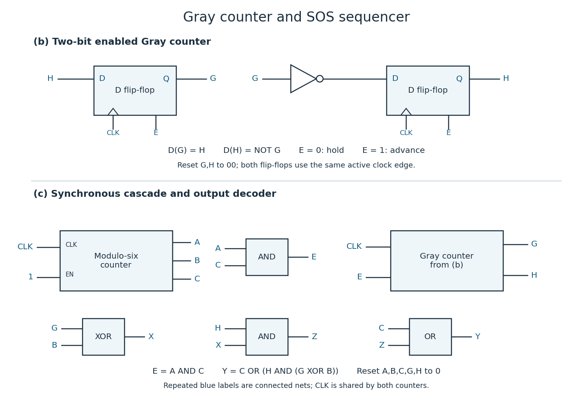

<h1 id="3/b/solution">Solution</h1>

↑ **Parent:** [B](../b.md)

Let the stored [bits](../../../../../bit.md) be $G,H$, with $G$ most significant. The required [Gray code](../../../../../gray-code.md) transitions give

$$
00\to01\to11\to10\to00,\qquad\boxed{D_G=H,\qquad D_H=\overline G.}
$$

Connect $H$ directly to the first [D flip-flop](../../../../../d-flip-flop.md)'s data input and feed $G$ through one [NOT gate](../../../../../not-gate.md) to the second input. Drive both enable inputs with $E$ and both clock inputs with the same clock. Thus $E=0$ holds both stored [bits](../../../../../bit.md); $E=1$ takes the next [Gray-code counter](../../../../../gray-code-counter.md) state at the active [clock edge](../../../../../clock-edge.md). Reset initializes $GH=00$.

**[Figure 1](#3/b/image-enabled-gray-code-counter-and-synchronous-sos-sequencer-all-stored-bits-share-one-clock). Enabled Gray-code counter and synchronous SOS sequencer: all stored bits share one clock**.

With ordinary uncomplemented $Q$ outputs, one [NOT gate](../../../../../not-gate.md) is minimal: wiring alone cannot produce $\overline G$. If a [D flip-flop](../../../../../d-flip-flop.md) already provides a complementary output, that output supplies the inversion without an external [logic gate](../../../../../logic-gate.md). This is a [Moore machine](../../../../../moore-machine.md) because its output $GH$ depends only on stored state; $E$ controls transitions.

## ↑ Ancestors (12)

1. [B](../b.md)
2. [3](../../3.md)
3. [Digital systems, linear algebra, introduction to formal proof](../../../digital-systems-linear-algebra-introduction-to-formal-proof-split.md)
4. [2014](../../../split.md)
5. [Past exam of the year 1 of the computer science course of the University of Oxford](../../../../split.md)
6. [Year 1 of the computer science course of the University of Oxford](../../../../../year-1-of-the-computer-science-course-of-the-university-of-oxford.md)
7. [Computer science course of the University of Oxford](../../../../../computer-science-course-of-the-university-of-oxford.md)
8. [Undergraduate course of the University of Oxford](../../../../../undergraduate-course-of-the-university-of-oxford.md)
9. [Course of the University of Oxford](../../../../../course-of-the-university-of-oxford.md)
10. [University of Oxford](../../../../../university-of-oxford-split.md)
11. [List of universities](../../../../../list-of-universities.md)
12. [Codex Wiki](../../../../../split.md)
