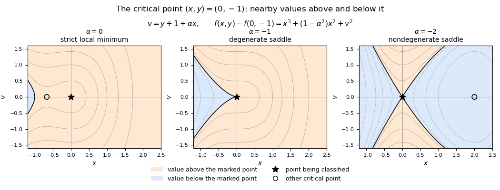

# Discrete mathematics, continuous mathematics and probability

↑ **Parent:** [2014](../2014.md)

Solutions to all nine questions of the examination dated 26 June 2014.[Printed cover, paper 4223; questions on printed pp. 2–10](../../computer-science-bibliography.md#discrete-mathematics-continuous-mathematics-and-probability-examination-paper-by-the-university-of-oxford-2014)

**Table of contents**

- [1](#1)
  - [a](#1/a)
    - [Solution](#1/a/solution)
  - [b](#1/b)
    - [Solution](#1/b/solution)
  - [c](#1/c)
    - [Solution](#1/c/solution)
  - [d](#1/d)
    - [Solution](#1/d/solution)
  - [e](#1/e)
    - [Solution](#1/e/solution)
  - [f](#1/f)
    - [i](#1/f/i)
      - [Solution](#1/f/i/solution)
    - [ii](#1/f/ii)
      - [Solution](#1/f/ii/solution)
- [2](#2)
  - [a](#2/a)
    - [Solution](#2/a/solution)
  - [b](#2/b)
    - [Solution](#2/b/solution)
  - [c](#2/c)
    - [Solution](#2/c/solution)
  - [d](#2/d)
    - [Solution](#2/d/solution)
  - [e](#2/e)
    - [i](#2/e/i)
      - [Solution](#2/e/i/solution)
    - [ii](#2/e/ii)
      - [Solution](#2/e/ii/solution)
- [3](#3)
  - [a](#3/a)
    - [Solution](#3/a/solution)
  - [b](#3/b)
    - [i](#3/b/i)
      - [Solution](#3/b/i/solution)
    - [ii](#3/b/ii)
      - [Solution](#3/b/ii/solution)
  - [c](#3/c)
    - [i](#3/c/i)
      - [Solution](#3/c/i/solution)
    - [ii](#3/c/ii)
      - [Solution](#3/c/ii/solution)
    - [iii](#3/c/iii)
      - [Solution](#3/c/iii/solution)
    - [iv](#3/c/iv)
      - [Solution](#3/c/iv/solution)
  - [d](#3/d)
    - [Solution](#3/d/solution)
  - [e](#3/e)
    - [i](#3/e/i)
      - [Solution](#3/e/i/solution)
    - [ii](#3/e/ii)
      - [Solution](#3/e/ii/solution)
- [4](#4)
  - [a](#4/a)
    - [Solution](#4/a/solution)
  - [b](#4/b)
    - [Solution](#4/b/solution)
  - [c](#4/c)
    - [Solution](#4/c/solution)
  - [d](#4/d)
    - [Solution](#4/d/solution)
- [5](#5)
  - [a](#5/a)
    - [Solution](#5/a/solution)
  - [b](#5/b)
    - [i](#5/b/i)
      - [Solution](#5/b/i/solution)
    - [ii](#5/b/ii)
      - [Solution](#5/b/ii/solution)
    - [iii](#5/b/iii)
      - [Solution](#5/b/iii/solution)
    - [iv](#5/b/iv)
      - [Solution](#5/b/iv/solution)
  - [c](#5/c)
    - [Solution](#5/c/solution)
- [6](#6)
  - [a](#6/a)
    - [i](#6/a/i)
      - [Solution](#6/a/i/solution)
    - [ii](#6/a/ii)
      - [Solution](#6/a/ii/solution)
  - [b](#6/b)
    - [i](#6/b/i)
      - [Solution](#6/b/i/solution)
    - [ii](#6/b/ii)
      - [Solution](#6/b/ii/solution)
    - [iii](#6/b/iii)
      - [Solution](#6/b/iii/solution)
- [7](#7)
  - [a](#7/a)
    - [i](#7/a/i)
      - [Solution](#7/a/i/solution)
    - [ii](#7/a/ii)
      - [Solution](#7/a/ii/solution)
    - [iii](#7/a/iii)
      - [Solution](#7/a/iii/solution)
  - [b](#7/b)
    - [i](#7/b/i)
      - [Solution](#7/b/i/solution)
    - [ii](#7/b/ii)
      - [Solution](#7/b/ii/solution)
    - [iii](#7/b/iii)
      - [Solution](#7/b/iii/solution)
    - [iv](#7/b/iv)
      - [Solution](#7/b/iv/solution)
- [8](#8)
  - [a](#8/a)
    - [i](#8/a/i)
      - [Solution](#8/a/i/solution)
    - [ii](#8/a/ii)
      - [Solution](#8/a/ii/solution)
  - [b](#8/b)
    - [i](#8/b/i)
      - [Solution](#8/b/i/solution)
    - [ii](#8/b/ii)
      - [Solution](#8/b/ii/solution)
    - [iii](#8/b/iii)
      - [Solution](#8/b/iii/solution)
- [9](#9)
  - [a](#9/a)
    - [i](#9/a/i)
      - [Solution](#9/a/i/solution)
    - [ii](#9/a/ii)
      - [Solution](#9/a/ii/solution)
    - [iii](#9/a/iii)
      - [Solution](#9/a/iii/solution)
    - [iv](#9/a/iv)
      - [Solution](#9/a/iv/solution)
  - [b](#9/b)
    - [i](#9/b/i)
      - [Solution](#9/b/i/solution)
    - [ii](#9/b/ii)
      - [Solution](#9/b/ii/solution)

## 1

↑ **Parent:** [Discrete mathematics, continuous mathematics and probability](discrete-mathematics-continuous-mathematics-and-probability.md)

<h3 id="1/a">a</h3>

↑ **Parent:** [1](#1)

<h4 id="1/a/solution">Solution</h4>

↑ **Parent:** [A](#1/a)

By [De Morgan's laws](../../theoretical-computer-science.md#de-morgan-s-laws), taking a [set difference](../../set.md#set-difference) from a [union](../../set.md#set-union) requires exclusion from both [sets](../../set.md), while taking a [set difference](../../set.md#set-difference) from an [intersection](../../set.md#set-intersection) requires exclusion from at least one:

$$
\boxed{A\setminus(B\cup C)=(A\setminus B)\cap(A\setminus C),\qquad A\setminus(B\cap C)=(A\setminus B)\cup(A\setminus C).}
$$

For example, $x$ belongs to the first left-hand side precisely when $x\in A$, $x\notin B$ and $x\notin C$; these are exactly the membership conditions on the first right-hand side. For the second identity, replace the two exclusions by their [logical disjunction](../../mathematical-logic.md#logical-disjunction).

<h3 id="1/b">b</h3>

↑ **Parent:** [1](#1)

<h4 id="1/b/solution">Solution</h4>

↑ **Parent:** [B](#1/b)

Prove both identities by [mathematical induction](../../foundations-of-mathematics.md#mathematical-induction). The base case $n=2$ is the two-set form of [De Morgan's laws](../../theoretical-computer-science.md#de-morgan-s-laws). For the [union](../../set.md#set-union) identity, suppose the result holds for $n$. Applying the two-set identity and then the [inductive hypothesis](../../foundations-of-mathematics.md#induction-hypothesis) gives

$$
\begin{aligned}
A\setminus\bigcup_{i=1}^{n+1}B_i
&=\left(A\setminus\bigcup_{i=1}^{n}B_i\right)\cap(A\setminus B_{n+1})\\
&=\left(\bigcap_{i=1}^{n}(A\setminus B_i)\right)\cap(A\setminus B_{n+1})
=\bigcap_{i=1}^{n+1}(A\setminus B_i).
\end{aligned}
$$

For the [intersection](../../set.md#set-intersection) identity, the corresponding step is

$$
\begin{aligned}
A\setminus\bigcap_{i=1}^{n+1}B_i
&=\left(A\setminus\bigcap_{i=1}^{n}B_i\right)\cup(A\setminus B_{n+1})\\
&=\left(\bigcup_{i=1}^{n}(A\setminus B_i)\right)\cup(A\setminus B_{n+1})
=\bigcup_{i=1}^{n+1}(A\setminus B_i).
\end{aligned}
$$

These close the two inductions.

<h3 id="1/c">c</h3>

↑ **Parent:** [1](#1)

<h4 id="1/c/solution">Solution</h4>

↑ **Parent:** [C](#1/c)

Apply the two identities already proved with $A=\mathcal U$. Every $B_i$ is a [subset](../../set.md#subset) of the common universe, and a [complement](../../set.md#complement-of-a-set) is the [set difference](../../set.md#set-difference) from that universe. Therefore

$$
\mathcal U\setminus\bigcup_{i=1}^nB_i
=\bigcap_{i=1}^n(\mathcal U\setminus B_i),\qquad
\mathcal U\setminus\bigcap_{i=1}^nB_i
=\bigcup_{i=1}^n(\mathcal U\setminus B_i).
$$

Replacing each [set difference](../../set.md#set-difference) from $\mathcal U$ by its [complement](../../set.md#complement-of-a-set) notation gives the claimed finite forms of [De Morgan's laws](../../theoretical-computer-science.md#de-morgan-s-laws).

<h3 id="1/d">d</h3>

↑ **Parent:** [1](#1)

<h4 id="1/d/solution">Solution</h4>

↑ **Parent:** [D](#1/d)

**Function composition is not always commutative.** The reversed [function composition](../../function.md#function-composition) may be undefined when the necessary [domain of a function](../../function.md#domain-of-a-function) and [codomain](../../function.md#codomain) do not match. A counterexample using [functions](../../function.md) $\mathbb R\to\mathbb R$ avoids that issue: let $f(x)=x+1$ and $g(x)=2x$. Then

$$
(g\circ f)(x)=2x+2,\qquad(f\circ g)(x)=2x+1.
$$

Both [function compositions](../../function.md#function-composition) exist, and their values differ at every real $x$.

<h3 id="1/e">e</h3>

↑ **Parent:** [1](#1)

<h4 id="1/e/solution">Solution</h4>

↑ **Parent:** [E](#1/e)

For every $x\in\mathbb R$, the definition of [function composition](../../function.md#function-composition) gives

$$
\bigl(h\circ(g\circ f)\bigr)(x)
=h\bigl((g\circ f)(x)\bigr)
=h(g(f(x)))
=\bigl((h\circ g)\circ f\bigr)(x).
$$

The [functions](../../function.md) agree at every argument, so [function extensionality](../../function.md#function-extensionality) proves the [associative property](../../algebraic-operation.md#associative-property) of [function composition](../../function.md#function-composition).

<h3 id="1/f">f</h3>

↑ **Parent:** [1](#1)

<h4 id="1/f/i">i</h4>

↑ **Parent:** [F](#1/f)

<h5 id="1/f/i/solution">Solution</h5>

↑ **Parent:** [I](#1/f/i)

The real [cube root](../../arithmetic.md#cube-root) in the denominator vanishes at $x=-1$, so the printed rule needs the [domain of a function](../../function.md#domain-of-a-function) $D_1=\mathbb R\setminus\{-1\}$. On its actual [domain of a function](../../function.md#domain-of-a-function), the second [iterated function](../../discrete-dynamical-system.md#iterated-function) simplifies to

$$
f(f(x))=
\frac{x/\sqrt[3]{1+x^3}}{\sqrt[3]{1+x^3/(1+x^3)}}
=\frac{x}{\sqrt[3]{1+2x^3}}.
$$

This suggests

$$
\boxed{f^{(n)}(x)=\frac{x}{\sqrt[3]{1+nx^3}},\qquad
D_n=\mathbb R\setminus\{-j^{-1/3}:1\leq j\leq n\}.}
$$

For the induction step, assume the formula at $n$ and restrict to arguments for which its value is not $-1$. Its cube is $x^3/(1+nx^3)$, so another application gives

$$
f(f^{(n)}(x))
=\frac{x/\sqrt[3]{1+nx^3}}{\sqrt[3]{(1+(n+1)x^3)/(1+nx^3)}}
=\frac{x}{\sqrt[3]{1+(n+1)x^3}}.
$$

Real [cube roots](../../arithmetic.md#cube-root) are multiplicative, including for negative arguments. The newly excluded point satisfies $x^3/(1+nx^3)=-1$, hence $x^3=-1/(n+1)$; all earlier exclusions remain. This proves both the formula and the [domain of a function](../../function.md#domain-of-a-function) by [mathematical induction](../../foundations-of-mathematics.md#mathematical-induction). The inherited exclusions are essential for an [iteration of a partial function](../../discrete-dynamical-system.md#iteration-of-a-partial-function): cancellation in the final expression cannot repair an undefined intermediate application.

<h4 id="1/f/ii">ii</h4>

↑ **Parent:** [F](#1/f)

<h5 id="1/f/ii/solution">Solution</h5>

↑ **Parent:** [Ii](#1/f/ii)

Set $y=f(x)$ and cube the equation. Solving for $x^3$ gives

$$
y^3=\frac{x^3}{1+x^3},\qquad
x^3=\frac{y^3}{1-y^3}.
$$

Consequently the [inverse function](../../function.md#inverse-function) is

$$
\boxed{f^{-1}(y)=\frac{y}{\sqrt[3]{1-y^3}},\qquad y\ne1.}
$$

The value $y=1$ is impossible in the original equation. Conversely, every real $y\ne1$ gives exactly one real $x$ by the displayed [cube root](../../arithmetic.md#cube-root), and this $x$ cannot equal $-1$. Direct substitution verifies both inverse identities. Thus the corrected [bijection](../../function.md#bijection) is $f:\mathbb R\setminus\{-1\}\to\mathbb R\setminus\{1\}$.

## 2

↑ **Parent:** [Discrete mathematics, continuous mathematics and probability](discrete-mathematics-continuous-mathematics-and-probability.md)

<h3 id="2/a">a</h3>

↑ **Parent:** [2](#2)

<h4 id="2/a/solution">Solution</h4>

↑ **Parent:** [A](#2/a)

List the $n$ elements of the [finite set](../../set.md#finite-set) $A$. A [subset](../../set.md#subset) is determined by $n$ membership decisions, each with two possibilities. This is a [bijection](../../function.md#bijection) from the [power set](../../set.md#power-set) to the [set](../../set.md) $\{0,1\}^n$, so

$$
\boxed{|\mathcal P(A)|=2^n.}
$$

The empty [set](../../set.md) case is included: its [power set](../../set.md#power-set) contains the single empty [subset](../../set.md#subset).

<h3 id="2/b">b</h3>

↑ **Parent:** [2](#2)

<h4 id="2/b/solution">Solution</h4>

↑ **Parent:** [B](#2/b)

There are $n(n-1)\cdots(n-k+1)=n!/(n-k)!$ ordered selections of $k$ distinct elements. Every size-$k$ [subset](../../set.md#subset) appears in exactly $k!$ orders, giving the [binomial coefficient](../../binomial-coefficient.md)

$$
\boxed{\binom nk=\frac{n!}{k!(n-k)!},\qquad0\leq k\leq n.}
$$

For $k=0$, both the empty selection and $0!$ contribute one.

<h3 id="2/c">c</h3>

↑ **Parent:** [2](#2)

<h4 id="2/c/solution">Solution</h4>

↑ **Parent:** [C](#2/c)

Partition the [power set](../../set.md#power-set) into disjoint classes according to [subset](../../set.md#subset) size. The class of size-$i$ [subsets](../../set.md#subset) has [cardinality](../../cardinal-number.md#cardinality) $\binom ni$, while the whole [power set](../../set.md#power-set) has [cardinality](../../cardinal-number.md#cardinality) $2^n$. Counting every [subset](../../set.md#subset) once gives

$$
\boxed{\sum_{i=0}^n\binom ni=2^n.}
$$

This is also the [binomial theorem](../../binomial-coefficient.md#binomial-theorem) evaluated at $1+1$, but the counting proof follows directly from the earlier parts.

<h3 id="2/d">d</h3>

↑ **Parent:** [2](#2)

<h4 id="2/d/solution">Solution</h4>

↑ **Parent:** [D](#2/d)

Use [mathematical induction](../../foundations-of-mathematics.md#mathematical-induction) with the defining [Fibonacci recurrence](../../sequence-and-series.md#fibonacci-recurrence). Both identities hold at $n=0$: their two sides are zero. If the first holds at $n$, then

$$
\sum_{i=0}^{n+1}F_i
=F_{n+2}-1+F_{n+1}=F_{n+3}-1.
$$

If the second holds at $n$, then

$$
\sum_{i=0}^{n+1}F_i^2
=F_nF_{n+1}+F_{n+1}^2
=F_{n+1}(F_n+F_{n+1})
=F_{n+1}F_{n+2}.
$$

Each [inductive hypothesis](../../foundations-of-mathematics.md#induction-hypothesis) therefore advances to $n+1$.

<h3 id="2/e">e</h3>

↑ **Parent:** [2](#2)

<h4 id="2/e/i">i</h4>

↑ **Parent:** [E](#2/e)

<h5 id="2/e/i/solution">Solution</h5>

↑ **Parent:** [I](#2/e/i)

For $n\geq2$ and $1\leq k\leq n-1$, the [factorial](../../combinatorics.md#factorial) formula for a [binomial coefficient](../../binomial-coefficient.md) gives

$$
\begin{aligned}
\binom{n-1}k+\binom{n-1}{k-1}
&=\frac{(n-1)!(n-k)}{k!(n-k)!}
+\frac{(n-1)!k}{k!(n-k)!}\\
&=\frac{n!}{k!(n-k)!}=\binom nk.
\end{aligned}
$$

This proves [Pascal's identity](../../binomial-coefficient.md#pascal-s-rule). The boundary cases $k=0,n$ follow for $n\geq1$ using the usual extension $\binom mj=0$ for $j<0$ or $j>m$. The recurrence itself requires $n\geq1$.

<h4 id="2/e/ii">ii</h4>

↑ **Parent:** [E](#2/e)

<h5 id="2/e/ii/solution">Solution</h5>

↑ **Parent:** [Ii](#2/e/ii)

For fixed $n\geq0$, use [mathematical induction](../../foundations-of-mathematics.md#mathematical-induction) on $k$. At $k=0$, both sides equal one. If the [hockey-stick identity](../../binomial-coefficient.md#hockey-stick-identity) holds at $k$, then [Pascal's identity](../../binomial-coefficient.md#pascal-s-rule) gives

$$
\sum_{i=0}^{k+1}\binom{n+i}i
=\binom{n+k+1}k+\binom{n+k+1}{k+1}
=\binom{n+k+2}{k+1}.
$$

This is the required formula with $k$ replaced by $k+1$.

## 3

↑ **Parent:** [Discrete mathematics, continuous mathematics and probability](discrete-mathematics-continuous-mathematics-and-probability.md)

<h3 id="3/a">a</h3>

↑ **Parent:** [3](#3)

<h4 id="3/a/solution">Solution</h4>

↑ **Parent:** [A](#3/a)

The relation is [reflexive](../../set-theory.md#reflexive-relation) because $a-a=2\cdot0$. It is [symmetric](../../set-theory.md#symmetric-relation) because $a-b=2k$ implies $b-a=2(-k)$. It is [transitive](../../set-theory.md#transitive-relation) because $a-b=2k$ and $b-c=2\ell$ imply $a-c=2(k+\ell)$. It is therefore an [equivalence relation](../../set-theory.md#equivalence-relation), namely [congruence modulo an integer](../../modular-arithmetic.md#modular-congruence) for modulus two. Its two [equivalence classes](../../set-theory.md#equivalence-class) consist of the [even integers](../../integer.md#even-number) and the [odd integers](../../integer.md#odd-integer).

<h3 id="3/b">b</h3>

↑ **Parent:** [3](#3)

<h4 id="3/b/i">i</h4>

↑ **Parent:** [B](#3/b)

<h5 id="3/b/i/solution">Solution</h5>

↑ **Parent:** [I](#3/b/i)

The notation means that $n$ divides $a_1-a_2$:

$$
\boxed{a_1\equiv a_2\pmod n\ \Longleftrightarrow\
\text{there exists }k\in\mathbb Z\text{ with }a_1-a_2=kn.}
$$

This is [congruence modulo an integer](../../modular-arithmetic.md#modular-congruence); equivalently, the two [integers](../../integer.md) have the same remainder on division by the positive [integer](../../integer.md) $n$.

<h4 id="3/b/ii">ii</h4>

↑ **Parent:** [B](#3/b)

<h5 id="3/b/ii/solution">Solution</h5>

↑ **Parent:** [Ii](#3/b/ii)

Write $a_1-a_2=kn$ with $k\in\mathbb Z$. The [difference of two squares](../../number-theory.md#difference-of-two-squares) factors as

$$
a_1^2-a_2^2=(a_1-a_2)(a_1+a_2)=n\,k(a_1+a_2).
$$

The final factor is an [integer](../../integer.md), so $n$ divides the difference. By [congruence modulo an integer](../../modular-arithmetic.md#modular-congruence), $\boxed{a_1^2\equiv a_2^2\pmod n}$.

<h3 id="3/c">c</h3>

↑ **Parent:** [3](#3)

<h4 id="3/c/i">i</h4>

↑ **Parent:** [C](#3/c)

<h5 id="3/c/i/solution">Solution</h5>

↑ **Parent:** [I](#3/c/i)

Dividing by $n^2$ gives $10^5/n+2\to2$. Thus the quadratic term controls the growth:

$$
\boxed{10^5n+2n^2=\Theta(n^2),\quad\text{in particular }O(n^2).}
$$

The sharper [Big theta notation](../../real-analysis.md#big-theta-notation) also supplies the requested [Big O notation](../../real-analysis.md#big-o-notation) bound.

<h4 id="3/c/ii">ii</h4>

↑ **Parent:** [C](#3/c)

<h5 id="3/c/ii/solution">Solution</h5>

↑ **Parent:** [Ii](#3/c/ii)

For $n>0$,

$$
\frac{\sqrt{n^6+n^2}}{n^3}=\sqrt{1+n^{-4}}\longrightarrow1.
$$

Consequently $\boxed{\sqrt{n^6+n^2}=\Theta(n^3),\quad\text{in particular }O(n^3)}$ in [Big theta notation](../../real-analysis.md#big-theta-notation) and [Big O notation](../../real-analysis.md#big-o-notation).

<h4 id="3/c/iii">iii</h4>

↑ **Parent:** [C](#3/c)

<h5 id="3/c/iii/solution">Solution</h5>

↑ **Parent:** [Iii](#3/c/iii)

Here $a,b\geq2$ are fixed [integers](../../integer.md). The term $ab^n$ has [exponential growth](../../calculus.md#exponential-growth), whereas $an^b$ has fixed-degree [polynomial growth](../../analysis.md#polynomial-growth) and $nb^a$ is linear. Since a fixed-base exponential eventually dominates every fixed-degree polynomial,

$$
\frac{an^b+ab^n+nb^a}{b^n}\longrightarrow a.
$$

Hence the requested [Big O notation](../../real-analysis.md#big-o-notation) bound, with its matching lower order, is $\boxed{\Theta(b^n),\quad\text{in particular }O(b^n)}$.

<h4 id="3/c/iv">iv</h4>

↑ **Parent:** [C](#3/c)

<h5 id="3/c/iv/solution">Solution</h5>

↑ **Parent:** [Iv](#3/c/iv)

For sufficiently large positive $n$, the [logarithm](../../calculus.md#logarithm) identities give

$$
n\log_2(5n)+\log_2(n^2)+4n
=n\log_2n+(\log_25+4)n+2\log_2n.
$$

After division by $n\log_2n$, the right-hand side tends to one. Thus $\boxed{\Theta(n\log n),\quad\text{in particular }O(n\log n)}$ gives the asymptotic order in [Big theta notation](../../real-analysis.md#big-theta-notation) and [Big O notation](../../real-analysis.md#big-o-notation).

<h3 id="3/d">d</h3>

↑ **Parent:** [3](#3)

<h4 id="3/d/solution">Solution</h4>

↑ **Parent:** [D](#3/d)

The number $K$ is fixed. By [Big O notation](../../real-analysis.md#big-o-notation), for each $i$ there are constants $C_i>0$ and $N_i$ such that $f_i(n)\leq C_i g(n)$ when $n\geq N_i$. Take $N=\max_iN_i$. For $n\geq N$, positivity gives

$$
h(n)\leq\left(\sum_{i=1}^K C_i\right)g(n),
\qquad
l(n)\leq\left(\sum_{i=1}^{K-1}C_iC_{i+1}\right)g(n)^2.
$$

The constants in parentheses are independent of $n$, proving $\boxed{h=O(g),\quad l=O(g^2)}$. If $K=1$, the second sum is empty and $l=0$, which satisfies the same upper bound.

<h3 id="3/e">e</h3>

↑ **Parent:** [3](#3)

<h4 id="3/e/i">i</h4>

↑ **Parent:** [E](#3/e)

<h5 id="3/e/i/solution">Solution</h5>

↑ **Parent:** [I](#3/e/i)

The printed fractional arguments require a size convention. To make the [recurrence relation](../../sequence-and-series.md#recurrence-relation) precise on positive [integers](../../integer.md), take a bounded base case $T(1)=t>0$ and use $m=\lceil n/4\rceil$, $n-m$ for $n\geq2$. This [integer rounding in a divide-and-conquer recurrence](../../algorithm.md#integer-rounding-in-a-divide-and-conquer-recurrence) gives $1/4\leq m/n\leq1/2$. The unrounded calculation is the special split fraction $1/4$.

Prove $T(n)\leq A n\log_2n+B n$ by [strong induction](../../foundations-of-mathematics.md#strong-induction). Put $h_0=H_2(1/4)>0$, choose $A\geq1/h_0$, and choose $B\geq t$. The base case follows. The [entropy potential for a divide-and-conquer recurrence](../../algorithm.md#entropy-potential-for-a-divide-and-conquer-recurrence) gives

$$
\begin{aligned}
T(n)
&\leq A\{m\log_2m+(n-m)\log_2(n-m)\}+Bn+n\\
&=A n\log_2n+Bn+n\{1-AH_2(m/n)\}\\
&\leq A n\log_2n+Bn.
\end{aligned}
$$

The last step uses $H_2(m/n)\geq h_0$. This closes the [inductive hypothesis](../../foundations-of-mathematics.md#induction-hypothesis) and proves $\boxed{T(n)=O(n\log n)}$ in [Big O notation](../../real-analysis.md#big-o-notation).

<h4 id="3/e/ii">ii</h4>

↑ **Parent:** [E](#3/e)

<h5 id="3/e/ii/solution">Solution</h5>

↑ **Parent:** [Ii](#3/e/ii)

Use the same [integer rounding in a divide-and-conquer recurrence](../../algorithm.md#integer-rounding-in-a-divide-and-conquer-recurrence), now with root cost $n^2$. Since $1/4\leq m/n\leq1/2$,

$$
m^2+(n-m)^2\leq\frac58n^2.
$$

Choose $C\geq\max\{T(1),8/3\}$ and use [strong induction](../../foundations-of-mathematics.md#strong-induction) with [inductive hypothesis](../../foundations-of-mathematics.md#induction-hypothesis) $T(j)\leq Cj^2$. Both child sizes are positive and less than $n$, so

$$
T(n)\leq C\{m^2+(n-m)^2\}+n^2
\leq\left(\frac58C+1\right)n^2
\leq Cn^2.
$$

The same factor $5/8$ occurs for the exact fractional split. Therefore $\boxed{T(n)=O(n^2)}$ in [Big O notation](../../real-analysis.md#big-o-notation).

## 4

↑ **Parent:** [Discrete mathematics, continuous mathematics and probability](discrete-mathematics-continuous-mathematics-and-probability.md)

<h3 id="4/a">a</h3>

↑ **Parent:** [4](#4)

<h4 id="4/a/solution">Solution</h4>

↑ **Parent:** [A](#4/a)

Let $I=\int e^x\sin x\,dx$. Two applications of [integration by parts](../../calculus.md#integration-by-parts) give

$$
I=e^x\sin x-\int e^x\cos x\,dx,\qquad
\int e^x\cos x\,dx=e^x\cos x+I,
$$

where additive constants can be absorbed at the end. Solving for $I$ yields

$$
\boxed{\int e^x\sin x\,dx=\frac{e^x}{2}(\sin x-\cos x)+C.}
$$

Differentiating the answer gives $e^x\sin x$.

<h3 id="4/b">b</h3>

↑ **Parent:** [4](#4)

<h4 id="4/b/solution">Solution</h4>

↑ **Parent:** [B](#4/b)

After division by $x>0$, the equation is linear with coefficient $-1/x$ on $y$. Its [integrating factor](../../linear-ordinary-differential-equation.md#integrating-factor) is $1/x$, and the [product rule](../../calculus.md#product-rule) gives

$$
\left(\frac yx\right)'=\frac{xy'-y}{x^2}=e^x\sin x.
$$

Using the [antiderivative](../../integral.md#antiderivative) from the preceding part,

$$
\boxed{y(x)=Cx+\frac{xe^x}{2}(\sin x-\cos x),\qquad x>0.}
$$

The arbitrary constant multiplies the homogeneous solution $x$.

<h3 id="4/c">c</h3>

↑ **Parent:** [4](#4)

<h4 id="4/c/solution">Solution</h4>

↑ **Parent:** [C](#4/c)

The homogeneous [characteristic equation](../../linear-ordinary-differential-equation.md#characteristic-equation-of-a-constant-coefficient-differential-equation) is $r^2-4r+3=(r-1)(r-3)=0$, giving $e^x$ and $e^{3x}$. Since the forcing $e^{3x}$ already appears among these solutions, try a [particular solution](../../linear-ordinary-differential-equation.md#particular-solution) $y_p=Ax e^{3x}$. Differentiation and substitution give

$$
y_p''-4y_p'+3y_p=2Ae^{3x},
$$

so $A=1/2$. The [general solution](../../linear-ordinary-differential-equation.md#general-solution) is

$$
\boxed{y=C_1e^x+C_2e^{3x}+\frac{x}{2}e^{3x}.}
$$

<h3 id="4/d">d</h3>

↑ **Parent:** [4](#4)

<h4 id="4/d/solution">Solution</h4>

↑ **Parent:** [D](#4/d)

Write $Y(t)=y(e^t)$, so $t=\log x$. The [chain rule](../../calculus.md#chain-rule) gives

$$
y'(x)=\frac{Y'(t)}x,\qquad
y''(x)=\frac{Y''(t)-Y'(t)}{x^2}.
$$

Substitution into the [Cauchy-Euler equation](../../linear-ordinary-differential-equation.md#cauchy-euler-equation) therefore gives $Y''+Y'-2Y=0$. Its [characteristic equation](../../linear-ordinary-differential-equation.md#characteristic-equation-of-a-constant-coefficient-differential-equation) factors as $(r-1)(r+2)=0$, so $Y=C_1e^t+C_2e^{-2t}$. Returning to $x$ gives

$$
\boxed{y(x)=C_1x+C_2x^{-2},\qquad x>0.}
$$

## 5

↑ **Parent:** [Discrete mathematics, continuous mathematics and probability](discrete-mathematics-continuous-mathematics-and-probability.md)

<h3 id="5/a">a</h3>

↑ **Parent:** [5](#5)

<h4 id="5/a/solution">Solution</h4>

↑ **Parent:** [A](#5/a)

The [arithmetic-geometric mean inequality](../../mathematical-optimization.md#arithmetic-geometric-mean-inequality) for the positive numbers $x$ and $a/x$ gives

$$
g(x)=\frac12\left(x+\frac ax\right)\geq\sqrt a.
$$

Equality holds precisely when $x=a/x$, hence at $x=\sqrt a$. Thus $\boxed{\min_{x>0}g(x)=\sqrt a}$, attained only at $\boxed{x=\sqrt a}$. Equivalently, the exact identity $g(x)-\sqrt a=(x-\sqrt a)^2/(2x)$ proves the same global bound.

<h3 id="5/b">b</h3>

↑ **Parent:** [5](#5)

<h4 id="5/b/i">i</h4>

↑ **Parent:** [B](#5/b)

<h5 id="5/b/i/solution">Solution</h5>

↑ **Parent:** [I](#5/b/i)

For $f(x)=x^2-a$, its [derivative](../../calculus.md#derivative) is $f'(x)=2x$. Substitution into [Newton's method](../../mathematical-optimization.md#newton-s-method-in-optimization) gives

$$
\boxed{x_n=x_{n-1}-\frac{x_{n-1}^2-a}{2x_{n-1}}
=\frac12\left(x_{n-1}+\frac a{x_{n-1}}\right).}
$$

Every positive input gives another positive input, so a starting value $x_0>0$ keeps the denominator nonzero at every step.

<h4 id="5/b/ii">ii</h4>

↑ **Parent:** [B](#5/b)

<h5 id="5/b/ii/solution">Solution</h5>

↑ **Parent:** [Ii](#5/b/ii)

The update in [Newton's method](../../mathematical-optimization.md#newton-s-method-in-optimization) is exactly $x_n=g(x_{n-1})$. Positivity is preserved, and the [arithmetic-geometric mean inequality](../../mathematical-optimization.md#arithmetic-geometric-mean-inequality) from part (a) applies to every update. Consequently

$$
\boxed{x_n\geq\sqrt a\quad\text{for every }n\geq1.}
$$

This holds even when $0<x_0<\sqrt a$: the first update moves to or above the positive [square root](../../algebra.md#square-root).

<h4 id="5/b/iii">iii</h4>

↑ **Parent:** [B](#5/b)

<h5 id="5/b/iii/solution">Solution</h5>

↑ **Parent:** [Iii](#5/b/iii)

Subtract the previous iterate in [Newton's method](../../mathematical-optimization.md#newton-s-method-in-optimization):

$$
\boxed{x_n-x_{n-1}=\frac{a-x_{n-1}^2}{2x_{n-1}}<0
\quad\text{if }x_{n-1}>\sqrt a.}
$$

The denominator is positive and the numerator is negative. If $x_{n-1}=\sqrt a$, the difference is zero and all subsequent iterates equal the root.

<h4 id="5/b/iv">iv</h4>

↑ **Parent:** [B](#5/b)

<h5 id="5/b/iv/solution">Solution</h5>

↑ **Parent:** [Iv](#5/b/iv)

After the first update, the [sequence](../../sequence-and-series.md#sequence) lies in $[\sqrt a,x_1]$ and is nonincreasing. The [monotone convergence theorem for sequences](../../sequence-and-series.md#bounded-monotone-sequence-theorem) gives a [limit](../../calculus.md#limit-of-a-function) $L\geq\sqrt a$. The update is [continuous](../../calculus.md#continuous-function) on this interval, so passing to the [limit](../../calculus.md#limit-of-a-function) gives

$$
L=\frac12\left(L+\frac aL\right),\qquad L^2=a.
$$

Positivity forces $\boxed{x_n\to\sqrt a\text{ for every }x_0>0}$. If an iterate reaches the root exactly, the constant tail gives the same conclusion. The [Exact Newton error identity for a quadratic](../../numerical-analysis.md#exact-newton-error-identity-for-a-quadratic) here is $x_n-\sqrt a=(x_{n-1}-\sqrt a)^2/(2x_{n-1})$, also showing [quadratic convergence](../../numerical-analysis.md#quadratic-convergence) once the error is small.

<h3 id="5/c">c</h3>

↑ **Parent:** [5](#5)

<h4 id="5/c/solution">Solution</h4>

↑ **Parent:** [C](#5/c)

The constraint implies $x^2=z^2+1$, so $x\ne0$ and its [gradient](../../multivariable-calculus.md#gradient) $(2x,0,-2z)$ never vanishes on the feasible set. The [Lagrange multiplier](../../mathematical-optimization.md#lagrange-multiplier) equations $\nabla f=\lambda\nabla g$ give

$$
2x=2\lambda x,\qquad2y=0,\qquad1=-2\lambda z.
$$

Thus $\lambda=1$, $y=0$, $z=-1/2$, and feasibility gives $x=\pm\sqrt5/2$. The two stationary points and their values are

$$
\boxed{\left(\frac{\sqrt5}{2},0,-\frac12\right),\
\left(-\frac{\sqrt5}{2},0,-\frac12\right),\qquad f=\frac34.}
$$

They are both [global minima](../../analysis.md#global-minimum). Indeed, on the constraint, [completing the square](../../polynomial.md#completing-the-square) gives

$$
f=1+z^2+y^2+z=\left(z+\frac12\right)^2+y^2+\frac34.
$$

Equality holds only at the two displayed points. There are no other constrained stationary points, and the objective is unbounded above as $|y|\to\infty$.

## 6

↑ **Parent:** [Discrete mathematics, continuous mathematics and probability](discrete-mathematics-continuous-mathematics-and-probability.md)

<h3 id="6/a">a</h3>

↑ **Parent:** [6](#6)

<h4 id="6/a/i">i</h4>

↑ **Parent:** [A](#6/a)

<h5 id="6/a/i/solution">Solution</h5>

↑ **Parent:** [I](#6/a/i)

Differentiating the polynomial coordinate map gives

$$
\boxed{x_u=u,\quad x_v=-v,\quad y_u=u,\quad y_v=v.}
$$

Its [Jacobian matrix](../../multivariable-calculus.md#jacobian-matrix) is

$$
\frac{\partial(x,y)}{\partial(u,v)}
=\begin{pmatrix}u&-v\\u&v\end{pmatrix},
\qquad \det\frac{\partial(x,y)}{\partial(u,v)}=2uv.
$$

The determinant identifies where the [inverse function theorem](../../multivariable-calculus.md#inverse-function-theorem) applies.

<h4 id="6/a/ii">ii</h4>

↑ **Parent:** [A](#6/a)

<h5 id="6/a/ii/solution">Solution</h5>

↑ **Parent:** [Ii](#6/a/ii)

On a branch with fixed signs of $u,v$ and $uv\ne0$, use $u^2=x+y$ and $v^2=y-x$. Differentiating these identities, or inverting the [Jacobian matrix](../../multivariable-calculus.md#jacobian-matrix), gives

$$
\boxed{u_x=\frac1{2u},\quad u_y=\frac1{2u},\quad
v_x=-\frac1{2v},\quad v_y=\frac1{2v}.}
$$

The inverse [Jacobian matrix](../../multivariable-calculus.md#jacobian-matrix) is therefore

$$
\frac{\partial(u,v)}{\partial(x,y)}
=\begin{pmatrix}1/(2u)&1/(2u)\\-1/(2v)&1/(2v)\end{pmatrix}.
$$

These are local [partial derivatives](../../multivariable-calculus.md#partial-derivative). Choosing the signs specifies an [inverse function](../../function.md#inverse-function) on $y>|x|$; the original map has four preimages there and has no single global inverse. At $u=0$ or $v=0$, the displayed inverse derivatives are not finite.

<h3 id="6/b">b</h3>

↑ **Parent:** [6](#6)

<h4 id="6/b/i">i</h4>

↑ **Parent:** [B](#6/b)

<h5 id="6/b/i/solution">Solution</h5>

↑ **Parent:** [I](#6/b/i)

The requested [partial derivatives](../../multivariable-calculus.md#partial-derivative) are

$$
\boxed{\begin{aligned}
f_x&=3x^2+2x+2\alpha y+2\alpha,&
f_y&=2\alpha x+2y+2,\\
f_{xx}&=6x+2,&
f_{xy}&=2\alpha,&
f_{yy}&=2.
\end{aligned}}
$$

The last printed derivative has a misplaced superscript on $f$; the second-derivative list and subsequent [Taylor expansion](../../calculus.md#taylor-expansion) use $f_{yy}$.

<h4 id="6/b/ii">ii</h4>

↑ **Parent:** [B](#6/b)

<h5 id="6/b/ii/solution">Solution</h5>

↑ **Parent:** [Ii](#6/b/ii)

Put $h=x-1$ and $k=y-1$. At $(1,1)$, the value is $5+4\alpha$, the [gradient](../../multivariable-calculus.md#gradient) is $(5+4\alpha,4+2\alpha)$, and the [Hessian matrix](../../multivariable-calculus.md#hessian-matrix) is $\begin{pmatrix}8&2\alpha\\2\alpha&2\end{pmatrix}$. Thus the quadratic [Taylor expansion](../../calculus.md#taylor-expansion) is

$$
\boxed{f(1+h,1+k)
=5+4\alpha+(5+4\alpha)h+(4+2\alpha)k
+4h^2+2\alpha hk+k^2+O((|h|+|k|)^3).}
$$

The exact remainder is $h^3$, since the original [polynomial](../../polynomial.md) has only the cubic term $x^3$ beyond degree two.

<h4 id="6/b/iii">iii</h4>

↑ **Parent:** [B](#6/b)

<h5 id="6/b/iii/solution">Solution</h5>

↑ **Parent:** [Iii](#6/b/iii)

Solving $f_y=0$ gives $y=-1-\alpha x$. Substitution into $f_x=0$ gives $x\{3x+2(1-\alpha^2)\}=0$. Therefore $(0,-1)$ is always a [critical point](../../analysis.md#critical-point). When $\alpha\ne-1$ as well as the printed restriction $\alpha\ne1$, there is a second [critical point](../../analysis.md#critical-point)

$$
\boxed{\left(\frac23(\alpha^2-1),\,
-1-\frac{2\alpha}{3}(\alpha^2-1)\right).}
$$

At $(0,-1)$, the [Hessian matrix](../../multivariable-calculus.md#hessian-matrix) is $\begin{pmatrix}2&2\alpha\\2\alpha&2\end{pmatrix}$ with determinant $4(1-\alpha^2)$. The [second-derivative test](../../multivariable-calculus.md#second-derivative-test) gives a strict [local minimum](../../analysis.md#local-minimum) when $|\alpha|<1$ and a [saddle point of a scalar function](../../analysis.md#saddle-point-of-a-scalar-function) when $|\alpha|>1$.

The allowed value $\alpha=-1$ requires higher-order terms. With $v=y+1+\alpha x$, [completing the square](../../polynomial.md#completing-the-square) gives the exact identity

$$
f(x,y)+1=x^3+(1-\alpha^2)x^2+v^2.
$$

The coordinate change is invertible, so the [Hessian at a critical point under a change of coordinates](../../multivariable-calculus.md#hessian-at-a-critical-point-under-a-change-of-coordinates) preserves the classification. At $\alpha=-1$, this is a [cubic degenerate saddle](../../analysis.md#cubic-degenerate-saddle): along $v=0$, the difference from the critical value is $x^3$ and takes both signs. Thus, throughout the printed parameter range,

$$
\boxed{\begin{cases}
\text{strict local minimum},&-1<\alpha<1,\\
\text{saddle point},&\alpha\leq-1\ \text{or}\ \alpha>1.
\end{cases}}
$$

There is no [local maximum](../../analysis.md#local-maximum). When the second point is distinct, it is a [local minimum](../../analysis.md#local-minimum) for $|\alpha|>1$ and a [saddle point of a scalar function](../../analysis.md#saddle-point-of-a-scalar-function) for $|\alpha|<1$: in the $(x,v)$ coordinates its [Hessian matrix](../../multivariable-calculus.md#hessian-matrix) is $\operatorname{diag}(-2(1-\alpha^2),2)$. The printed instruction to split only at $\alpha=1$ misses the negative-parameter cases.

**[Figure 1](#6/b/iii/image-classification-of-a-critical-point-for-alpha-0-1-2). Classification of a critical point for $\alpha=0,-1,-2$**. Original sign diagrams in coordinates $x$ and $v=y+1+\alpha x$. Orange means $f-f(0,-1)>0$ and blue means $f-f(0,-1)<0$; black curves are zero contours. Stars mark the point being classified and open circles mark the other critical point. The three panels use $\alpha=0,-1,-2$.

## 7

↑ **Parent:** [Discrete mathematics, continuous mathematics and probability](discrete-mathematics-continuous-mathematics-and-probability.md)

<h3 id="7/a">a</h3>

↑ **Parent:** [7](#7)

<h4 id="7/a/i">i</h4>

↑ **Parent:** [A](#7/a)

<h5 id="7/a/i/solution">Solution</h5>

↑ **Parent:** [I](#7/a/i)

Let $(B_i)$ be a finite or countable [partition of a sample space](../../probability-space.md#partition-of-a-sample-space) into [events](../../probability-space.md#event) of positive [probability](../../probability-theory.md#probability). The [events](../../probability-space.md#event) $A\cap B_i$ are disjoint and their [union](../../set.md#set-union) is $A$. [Countable additivity](../../measure.md#countable-additivity) and the definition of [conditional probability](../../probability-theory.md#conditional-probability) therefore give the [law of total probability](../../probability-space.md#law-of-total-probability)

$$
\boxed{\mathbb P(A)=\sum_i\mathbb P(A\cap B_i)
=\sum_i\mathbb P(A\mid B_i)\mathbb P(B_i).}
$$

Cells of zero [probability](../../probability-theory.md#probability) contribute zero through $\mathbb P(A\cap B_i)$ and can be omitted rather than assigning an undefined [conditional probability](../../probability-theory.md#conditional-probability).

<h4 id="7/a/ii">ii</h4>

↑ **Parent:** [A](#7/a)

<h5 id="7/a/ii/solution">Solution</h5>

↑ **Parent:** [Ii](#7/a/ii)

The two definitions of [conditional probability](../../probability-theory.md#conditional-probability) give

$$
\mathbb P(B\mid A)=\frac{\mathbb P(A\cap B)}{\mathbb P(A)},
\qquad
\mathbb P(A\mid B)\mathbb P(B)=\mathbb P(A\cap B).
$$

Substitution proves [Bayes' theorem](../../probability-theory.md#bayes-theorem):

$$
\boxed{\mathbb P(B\mid A)=\frac{\mathbb P(A\mid B)\mathbb P(B)}{\mathbb P(A)}.}
$$

The positive [probabilities](../../probability-theory.md#probability) assumed in the question make both conditional expressions defined.

<h4 id="7/a/iii">iii</h4>

↑ **Parent:** [A](#7/a)

<h5 id="7/a/iii/solution">Solution</h5>

↑ **Parent:** [Iii](#7/a/iii)

[Mutual independence](../../probability-theory.md#independent-events) means that for every nonempty $I\subseteq\{1,2,3\}$,

$$
\boxed{\mathbb P\left(\bigcap_{i\in I}A_i\right)=\prod_{i\in I}\mathbb P(A_i).}
$$

Beyond the trivial single-event identities, this requires the three pairwise equalities and the triple equality $\mathbb P(A_1\cap A_2\cap A_3)=\mathbb P(A_1)\mathbb P(A_2)\mathbb P(A_3)$. [Pairwise independence](../../probability-theory.md#pairwise-independent-events) alone omits that last requirement.

<h3 id="7/b">b</h3>

↑ **Parent:** [7](#7)

<h4 id="7/b/i">i</h4>

↑ **Parent:** [B](#7/b)

<h5 id="7/b/i/solution">Solution</h5>

↑ **Parent:** [I](#7/b/i)

Each position is equally likely to receive any coin, so the [law of total probability](../../probability-space.md#law-of-total-probability) gives $\mathbb P(A_i)=(1/3+1/2+2/3)/3=1/2$. For two specified positions, the ordered pair of distinct coin biases is uniform over six possibilities. Assuming independent tosses conditional on the order,

$$
\mathbb P(A_1\cap A_2)
=\frac13\left(\frac13\frac12+\frac13\frac23+\frac12\frac23\right)
=\frac{13}{54}\ne\frac14.
$$

Thus **the events are not independent**, even pairwise. The [covariance of draws without replacement](../../statistical-inference.md#covariance-of-draws-without-replacement) explains the difference: the head [indicator random variables](../../expected-value.md#indicator-random-variable) have [covariance](../../variance.md#covariance) $13/54-1/4=-1/108$. Independent physical tosses given the assigned coins do not imply [independence](../../random-variable.md#independent-random-variables) after that hidden assignment is averaged out.

<h4 id="7/b/ii">ii</h4>

↑ **Parent:** [B](#7/b)

<h5 id="7/b/ii/solution">Solution</h5>

↑ **Parent:** [Ii](#7/b/ii)

Let $C_j$ identify the selected coin and let $H$ be the event of two heads. The prior coin [probabilities](../../probability-theory.md#probability) are equal, and the [conditional probabilities](../../probability-theory.md#conditional-probability) of $H$ are $1/9,1/4,4/9$. By [Bayes' theorem](../../probability-theory.md#bayes-theorem),

$$
\boxed{\mathbb P(C_1\mid H)=
\frac{(1/3)(1/9)}{(1/3)(1/9+1/4+4/9)}
=\frac4{29}.}
$$

The full [posterior distribution](../../bayesian-statistics.md#bayesian-posterior) over the three biases is $(4,9,16)/29$.

<h4 id="7/b/iii">iii</h4>

↑ **Parent:** [B](#7/b)

<h5 id="7/b/iii/solution">Solution</h5>

↑ **Parent:** [Iii](#7/b/iii)

Given the coin, the next toss is independent of its earlier tosses and has that coin's head [probability](../../probability-theory.md#probability). Averaging using the [posterior distribution](../../bayesian-statistics.md#bayesian-posterior) gives the [posterior predictive probability](../../bayesian-statistics.md#posterior-predictive-probability)

$$
\boxed{\mathbb P(\text{next head}\mid H)
=\frac4{29}\frac13+\frac9{29}\frac12+\frac{16}{29}\frac23
=\frac{33}{58}.}
$$

Observing two heads raises the [probability](../../probability-theory.md#probability) of having chosen a high-bias coin.

<h4 id="7/b/iv">iv</h4>

↑ **Parent:** [B](#7/b)

<h5 id="7/b/iv/solution">Solution</h5>

↑ **Parent:** [Iv](#7/b/iv)

If the selected coin has bias $p$, the other two biases sum to $3/2-p$. A uniform choice between those two coins therefore has conditional head [probability](../../probability-theory.md#probability) $3/4-p/2$. Average over the [posterior distribution](../../bayesian-statistics.md#bayesian-posterior), using the previous [posterior predictive probability](../../bayesian-statistics.md#posterior-predictive-probability):

$$
\boxed{\mathbb P(\text{head on another coin}\mid H)
=\frac34-\frac12\frac{33}{58}
=\frac{27}{58}.}
$$

The observation makes a high-bias coin more likely to have been removed from the remaining pair.

## 8

↑ **Parent:** [Discrete mathematics, continuous mathematics and probability](discrete-mathematics-continuous-mathematics-and-probability.md)

<h3 id="8/a">a</h3>

↑ **Parent:** [8](#8)

<h4 id="8/a/i">i</h4>

↑ **Parent:** [A](#8/a)

<h5 id="8/a/i/solution">Solution</h5>

↑ **Parent:** [I](#8/a/i)

Put $q=1-p$. Summing the [geometric series](../../sequence-and-series.md#geometric-series) in the definition of the [probability generating function](../../probability-distribution.md#probability-generating-function) gives

$$
\boxed{G_X(s)=\mathbb E[s^X]
=p\sum_{k=0}^{\infty}(qs)^k
=\frac{p}{1-qs},\qquad|s|<\frac1q.}
$$

This is the zero-based [geometric distribution](../../discrete-probability-distribution.md#geometric-distribution), counting failures before the first success.

<h4 id="8/a/ii">ii</h4>

↑ **Parent:** [A](#8/a)

<h5 id="8/a/ii/solution">Solution</h5>

↑ **Parent:** [Ii](#8/a/ii)

Differentiate the [probability generating function](../../probability-distribution.md#probability-generating-function) to obtain

$$
G_X'(1)=\frac qp,\qquad G_X''(1)=\frac{2q^2}{p^2}.
$$

The first derivative is the [expected value](../../expected-value.md), and the second gives the [factorial moment](../../continuous-time-markov-chain.md#factorial-moment) $\mathbb E[X(X-1)]$. Hence

$$
\boxed{\mathbb E X=\frac{1-p}{p},\qquad
\operatorname{Var}(X)=G_X''(1)+G_X'(1)-G_X'(1)^2
=\frac{1-p}{p^2}.}
$$

In particular, $\mathbb E[X^2]=q(2-p)/p^2$.

<h3 id="8/b">b</h3>

↑ **Parent:** [8](#8)

<h4 id="8/b/i">i</h4>

↑ **Parent:** [B](#8/b)

<h5 id="8/b/i/solution">Solution</h5>

↑ **Parent:** [I](#8/b/i)

Given $X=k$, the score $Y$ has a [binomial distribution](../../discrete-probability-distribution.md#binomial-distribution) with success [probability](../../probability-theory.md#probability) $1/2$. Its conditional [expected value](../../expected-value.md) and [variance](../../variance.md) are $k/2$ and $k/4$. Thus

$$
\boxed{\mathbb E[Y\mid X=k]=\frac k2,\qquad
\mathbb E[Y^2\mid X=k]=\frac k4+\frac{k^2}{4}.}
$$

This is [binomial thinning](../../random-variable.md#binomial-thinning) of the first-round count; the second formula uses the identity $\mathbb E[Y^2\mid X]=\operatorname{Var}(Y\mid X)+\mathbb E[Y\mid X]^2$.

<h4 id="8/b/ii">ii</h4>

↑ **Parent:** [B](#8/b)

<h5 id="8/b/ii/solution">Solution</h5>

↑ **Parent:** [Ii](#8/b/ii)

The [law of total expectation](../../measure-theory.md#law-of-total-expectation) gives $\mathbb E Y=\mathbb E[X/2]=q/(2p)$. The [law of total variance](../../probability-theory.md#law-of-total-variance) separates the two sources of randomness:

$$
\operatorname{Var}(Y)
=\mathbb E[\operatorname{Var}(Y\mid X)]
+\operatorname{Var}(\mathbb E[Y\mid X])
=\frac14\mathbb E X+\frac14\operatorname{Var}(X).
$$

Substitution gives

$$
\boxed{\mathbb E Y=\frac{1-p}{2p},\qquad
\operatorname{Var}(Y)=\frac{q(p+1)}{4p^2}
=\frac{1-p^2}{4p^2}.}
$$

The [binomial thinning of a geometric random variable](../../random-variable.md#binomial-thinning-of-a-geometric-random-variable) identity supplies a further check: $Y$ itself has a zero-based [geometric distribution](../../discrete-probability-distribution.md#geometric-distribution) with success [probability](../../probability-theory.md#probability) $2p/(1+p)$.

<h4 id="8/b/iii">iii</h4>

↑ **Parent:** [B](#8/b)

<h5 id="8/b/iii/solution">Solution</h5>

↑ **Parent:** [Iii](#8/b/iii)

Put $S=X+Y$. Given $X$, its conditional [expected value](../../expected-value.md) is $3X/2$ and its conditional [variance](../../variance.md) is $X/4$, since $X$ is then fixed. The [law of total expectation](../../measure-theory.md#law-of-total-expectation) and [law of total variance](../../probability-theory.md#law-of-total-variance) give

$$
\boxed{\mathbb E S=\frac{3(1-p)}{2p},\qquad
\operatorname{Var}(S)=\frac14\mathbb E X+\frac94\operatorname{Var}(X)
=\frac{(1-p)(p+9)}{4p^2}.}
$$

The two scores are dependent: the [law of total covariance](../../variance.md#law-of-total-covariance) gives $\operatorname{Cov}(X,Y)=\operatorname{Cov}(X,X/2)=q/(2p^2)$. Adding their two [variances](../../variance.md) without that [covariance](../../variance.md#covariance) term would give an incorrect total.

## 9

↑ **Parent:** [Discrete mathematics, continuous mathematics and probability](discrete-mathematics-continuous-mathematics-and-probability.md)

<h3 id="9/a">a</h3>

↑ **Parent:** [9](#9)

<h4 id="9/a/i">i</h4>

↑ **Parent:** [A](#9/a)

<h5 id="9/a/i/solution">Solution</h5>

↑ **Parent:** [I](#9/a/i)

A [probability density function](../../continuous-probability-distribution.md#probability-density-function) must be nonnegative and integrate to one. For $c>0$,

$$
\int_1^\infty c x^{-c-1}\,dx
=\left[-x^{-c}\right]_1^\infty=1.
$$

At $c=0$ the function is identically zero, while $c<0$ makes it negative on $x>1$. Thus $\boxed{c>0}$ is necessary and sufficient. The resulting law is a [Pareto distribution](../../continuous-probability-distribution.md#pareto-distribution) with scale one and shape $c$.

<h4 id="9/a/ii">ii</h4>

↑ **Parent:** [A](#9/a)

<h5 id="9/a/ii/solution">Solution</h5>

↑ **Parent:** [Ii](#9/a/ii)

Integrating the [probability density function](../../continuous-probability-distribution.md#probability-density-function) from the lower endpoint gives the [cumulative distribution function](../../probability-distribution.md#cumulative-distribution-function)

$$
\boxed{F_X(x)=\begin{cases}
0,&x\leq1,\\
1-x^{-c},&x>1.
\end{cases}}
$$

The [cumulative distribution function](../../probability-distribution.md#cumulative-distribution-function) is continuous at $x=1$ and tends to one at infinity.

<h4 id="9/a/iii">iii</h4>

↑ **Parent:** [A](#9/a)

<h5 id="9/a/iii/solution">Solution</h5>

↑ **Parent:** [Iii](#9/a/iii)

For $c>1$, the [expected value](../../expected-value.md) is the convergent improper [integral](../../integral.md)

$$
\boxed{\mathbb E X=\int_1^\infty x\frac{c}{x^{c+1}}\,dx
=c\int_1^\infty x^{-c}\,dx=\frac{c}{c-1}.}
$$

For completeness, when $0<c\leq1$ the same positive [integral](../../integral.md) diverges and the [expected value](../../expected-value.md) is infinite.

<h4 id="9/a/iv">iv</h4>

↑ **Parent:** [A](#9/a)

<h5 id="9/a/iv/solution">Solution</h5>

↑ **Parent:** [Iv](#9/a/iv)

The [logarithm](../../calculus.md#logarithm) is strictly increasing, so $\mathbb P(Y\leq y)=\mathbb P(X\leq e^y)$. Since $X>1$ almost surely,

$$
\boxed{F_Y(y)=\begin{cases}0,&y\leq0,\\1-e^{-cy},&y>0,\end{cases}
\qquad
f_Y(y)=\begin{cases}ce^{-cy},&y>0,\\0,&y\leq0.\end{cases}}
$$

Thus the [logarithm of a Pareto random variable](../../continuous-probability-distribution.md#logarithm-of-a-pareto-random-variable) has an [exponential distribution](../../continuous-probability-distribution.md#exponential-distribution) with rate $c$. Its [probability density function](../../continuous-probability-distribution.md#probability-density-function) value at the single endpoint can be chosen arbitrarily without changing the law.

<h3 id="9/b">b</h3>

↑ **Parent:** [9](#9)

<h4 id="9/b/i">i</h4>

↑ **Parent:** [B](#9/b)

<h5 id="9/b/i/solution">Solution</h5>

↑ **Parent:** [I](#9/b/i)

By [linearity of expectation](../../expected-value.md#linearity-of-expectation) and [independence](../../random-variable.md#independent-random-variables),

$$
\mathbb E W=\mu,\qquad\operatorname{Var}(W)=
\frac1{n^2}\sum_{i=1}^n\operatorname{Var}(X_i)=\frac{\sigma^2}{n}.
$$

For $\sigma>0$, apply [Chebyshev's inequality](../../probability-inequality.md#chebyshev-s-inequality) at threshold $h\sigma$ and take the complementary event:

$$
\boxed{\mathbb P(|W-\mu|\leq h\sigma)
=1-\mathbb P(|W-\mu|>h\sigma)
\geq1-\frac{1}{nh^2}.}
$$

If $\sigma=0$, every $X_i=\mu$ almost surely, so $W=\mu$ almost surely and the bound holds directly. This handles the zero-threshold case without applying [Chebyshev's inequality](../../probability-inequality.md#chebyshev-s-inequality) at an inadmissible threshold.

<h4 id="9/b/ii">ii</h4>

↑ **Parent:** [B](#9/b)

<h5 id="9/b/ii/solution">Solution</h5>

↑ **Parent:** [Ii](#9/b/ii)

Let $X_i$ be the head [indicator random variable](../../expected-value.md#indicator-random-variable) for toss $i$. These are [independent and identically distributed random variables](../../random-variable.md#independent-and-identically-distributed-random-variables) with a [Bernoulli distribution](../../discrete-probability-distribution.md#bernoulli-distribution) of parameter $1/2$, so $\mu=1/2$, $\sigma=1/2$, and $W=N/n$. Taking $h=1/5$ makes $h\sigma=1/10$. The preceding [Chebyshev's inequality](../../probability-inequality.md#chebyshev-s-inequality) bound gives

$$
\boxed{\mathbb P\left(0.4\leq\frac Nn\leq0.6\right)
\geq1-\frac{25}{n}\geq\frac34,\qquad n\geq100.}
$$

The endpoints are included because this event is exactly $|W-1/2|\leq1/10$.

## ↑ Ancestors (9)

1. [2014](../2014.md)
2. [Past exam of the year 1 of the computer science course of the University of Oxford](../../past-exam-of-the-year-1-of-the-computer-science-course-of-the-university-of-oxford.md)
3. [Year 1 of the computer science course of the University of Oxford](../../university-of-oxford.md#year-1-of-the-computer-science-course-of-the-university-of-oxford)
4. [Computer science course of the University of Oxford](../../university-of-oxford.md#computer-science-course-of-the-university-of-oxford)
5. [Undergraduate course of the University of Oxford](../../university-of-oxford.md#undergraduate-course-of-the-university-of-oxford)
6. [Course of the University of Oxford](../../university-of-oxford.md#course-of-the-university-of-oxford)
7. [University of Oxford](../../university-of-oxford.md)
8. [List of universities](../../README.md#list-of-universities)
9. [Codex Wiki](../../README.md)
