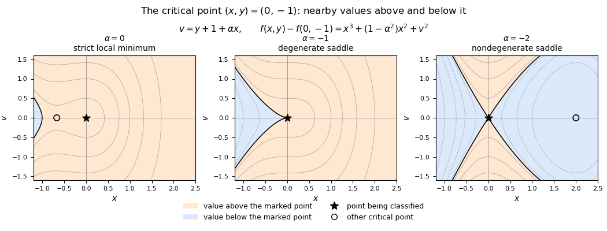

<h1 id="6/b/iii/solution">Solution</h1>

↑ **Parent:** [Iii](../iii.md)

Solving $f_y=0$ gives $y=-1-\alpha x$. Substitution into $f_x=0$ gives $x\{3x+2(1-\alpha^2)\}=0$. Therefore $(0,-1)$ is always a [critical point](../../../../../../critical-point.md). When $\alpha\ne-1$ as well as the printed restriction $\alpha\ne1$, there is a second [critical point](../../../../../../critical-point.md)

$$
\boxed{\left(\frac23(\alpha^2-1),\,
-1-\frac{2\alpha}{3}(\alpha^2-1)\right).}
$$

At $(0,-1)$, the [Hessian matrix](../../../../../../hessian-matrix.md) is $\begin{pmatrix}2&2\alpha\\2\alpha&2\end{pmatrix}$ with determinant $4(1-\alpha^2)$. The [second-derivative test](../../../../../../second-derivative-test.md) gives a strict [local minimum](../../../../../../local-minimum.md) when $|\alpha|<1$ and a [saddle point of a scalar function](../../../../../../saddle-point-of-a-scalar-function.md) when $|\alpha|>1$.

The allowed value $\alpha=-1$ requires higher-order terms. With $v=y+1+\alpha x$, [completing the square](../../../../../../completing-the-square.md) gives the exact identity

$$
f(x,y)+1=x^3+(1-\alpha^2)x^2+v^2.
$$

The coordinate change is invertible, so the [Hessian at a critical point under a change of coordinates](../../../../../../hessian-at-a-critical-point-under-a-change-of-coordinates.md) preserves the classification. At $\alpha=-1$, this is a [cubic degenerate saddle](../../../../../../cubic-degenerate-saddle.md): along $v=0$, the difference from the critical value is $x^3$ and takes both signs. Thus, throughout the printed parameter range,

$$
\boxed{\begin{cases}
\text{strict local minimum},&-1<\alpha<1,\\
\text{saddle point},&\alpha\leq-1\ \text{or}\ \alpha>1.
\end{cases}}
$$

There is no [local maximum](../../../../../../local-maximum.md). When the second point is distinct, it is a [local minimum](../../../../../../local-minimum.md) for $|\alpha|>1$ and a [saddle point of a scalar function](../../../../../../saddle-point-of-a-scalar-function.md) for $|\alpha|<1$: in the $(x,v)$ coordinates its [Hessian matrix](../../../../../../hessian-matrix.md) is $\operatorname{diag}(-2(1-\alpha^2),2)$. The printed instruction to split only at $\alpha=1$ misses the negative-parameter cases.

**[Figure 1](#6/b/iii/image-classification-of-a-critical-point-for-alpha-0-1-2). Classification of a critical point for $\alpha=0,-1,-2$**. Original sign diagrams in coordinates $x$ and $v=y+1+\alpha x$. Orange means $f-f(0,-1)>0$ and blue means $f-f(0,-1)<0$; black curves are zero contours. Stars mark the point being classified and open circles mark the other critical point. The three panels use $\alpha=0,-1,-2$.

## ↑ Ancestors (13)

1. [Iii](../iii.md)
2. [B](../../b.md)
3. [6](../../../6.md)
4. [Discrete mathematics, continuous mathematics and probability](../../../../discrete-mathematics-continuous-mathematics-and-probability-split.md)
5. [2014](../../../../split.md)
6. [Past exam of the year 1 of the computer science course of the University of Oxford](../../../../../split.md)
7. [Year 1 of the computer science course of the University of Oxford](../../../../../../year-1-of-the-computer-science-course-of-the-university-of-oxford.md)
8. [Computer science course of the University of Oxford](../../../../../../computer-science-course-of-the-university-of-oxford.md)
9. [Undergraduate course of the University of Oxford](../../../../../../undergraduate-course-of-the-university-of-oxford.md)
10. [Course of the University of Oxford](../../../../../../course-of-the-university-of-oxford.md)
11. [University of Oxford](../../../../../../university-of-oxford-split.md)
12. [List of universities](../../../../../../list-of-universities.md)
13. [Codex Wiki](../../../../../../split.md)
