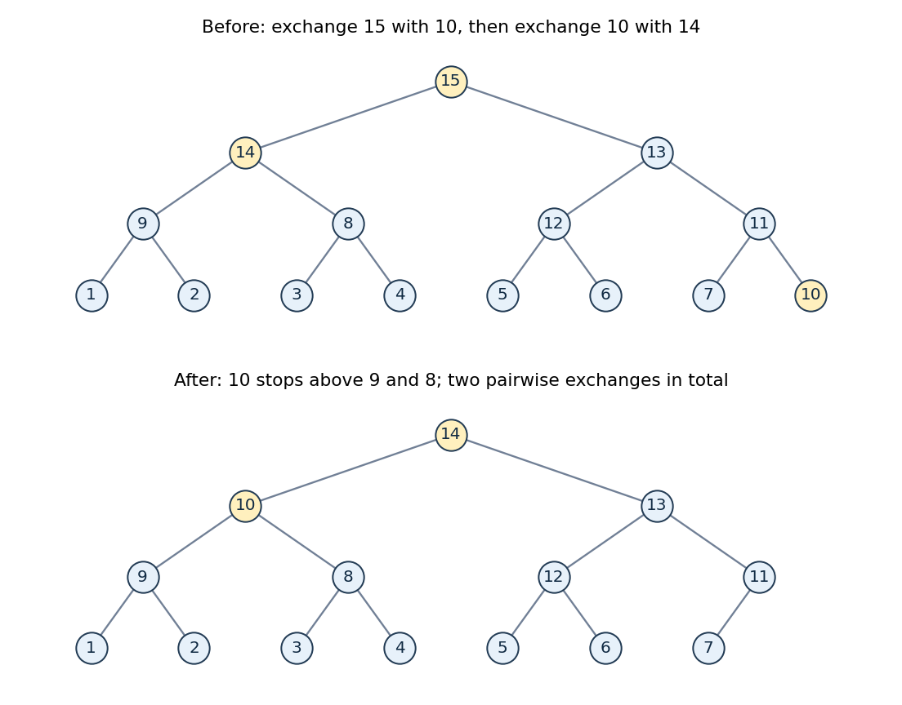

<h1 id="7/c/solution">Solution</h1>

↑ **Parent:** [C](../c.md)

Count pairwise exchanges in the implementation from part (b), including the initial root/final-leaf exchange. For $n\ge4$, the final leaf has a nonroot parent whose key is strictly larger than the leaf's key. That parent remains after deletion. If the moved leaf could stay at the root without a downward exchange, it would dominate both root children and hence every remaining descendant, contradicting that larger remaining parent. Thus at least one [heapify down](../../../../../sift-down.md) exchange is necessary.

One downward exchange suffices. The following level-order [array](../../../../../array-data-structure.md) is a [max-heap](../../../../../max-heap.md) on keys one through fifteen:

$$
H=[15,14,13,9,8,12,11,1,2,3,4,5,6,7,10].
$$

Every parent is larger than both children. Exchange the root key fifteen with the final key ten, remove fifteen, then exchange ten with the larger root child fourteen. Ten now has children nine and eight, so repair stops. The final [array](../../../../../array-data-structure.md) is

$$
[14,10,13,9,8,12,11,1,2,3,4,5,6,7].
$$

**[Figure 1](#7/c/image-a-fifteen-key-max-heap-achieving-the-minimum-two-pairwise-exchanges-during-maximum-deletion). A fifteen-key max-heap achieving the minimum two pairwise exchanges during maximum deletion**.

Hence the [best-case maximum deletion in a binary heap](../../../../../best-case-maximum-deletion-in-a-binary-heap.md) is

$$
\boxed{\text{two pairwise exchanges for }n\ge4:\ \text{one root/last exchange and one downward exchange}.}
$$

This best case can be arranged at any such size: make the root child on the opposite side from the old final leaf the largest remaining key, the old leaf smaller than its own ancestors but larger than all descendants of that opposite child, and fill the remaining positions in decreasing order along each branch. The promoted child then allows the leaf to stop at depth one.

For sizes two and three, one initial exchange can suffice; for size one no exchange between distinct positions is needed. If only exchanges during [heapify down](../../../../../sift-down.md) are counted, the answer for $n\ge4$ is one. In the fifteen-key example the two exchanges involve three distinct keys, namely fifteen, ten and fourteen. An implementation that moves a hole by assignments need not perform literal swaps, so the count is explicitly tied to the exchange implementation. The worst-case [time complexity](../../../../../time-complexity.md) remains logarithmic even though this best-case repair is constant.

## ↑ Ancestors (12)

1. [C](../c.md)
2. [7](../../7.md)
3. [Functional programming, design and analysis of algorithms](../../../functional-programming-design-and-analysis-of-algorithms-split.md)
4. [2014](../../../split.md)
5. [Past exam of the year 1 of the computer science course of the University of Oxford](../../../../split.md)
6. [Year 1 of the computer science course of the University of Oxford](../../../../../year-1-of-the-computer-science-course-of-the-university-of-oxford.md)
7. [Computer science course of the University of Oxford](../../../../../computer-science-course-of-the-university-of-oxford.md)
8. [Undergraduate course of the University of Oxford](../../../../../undergraduate-course-of-the-university-of-oxford.md)
9. [Course of the University of Oxford](../../../../../course-of-the-university-of-oxford.md)
10. [University of Oxford](../../../../../university-of-oxford-split.md)
11. [List of universities](../../../../../list-of-universities.md)
12. [Codex Wiki](../../../../../split.md)
