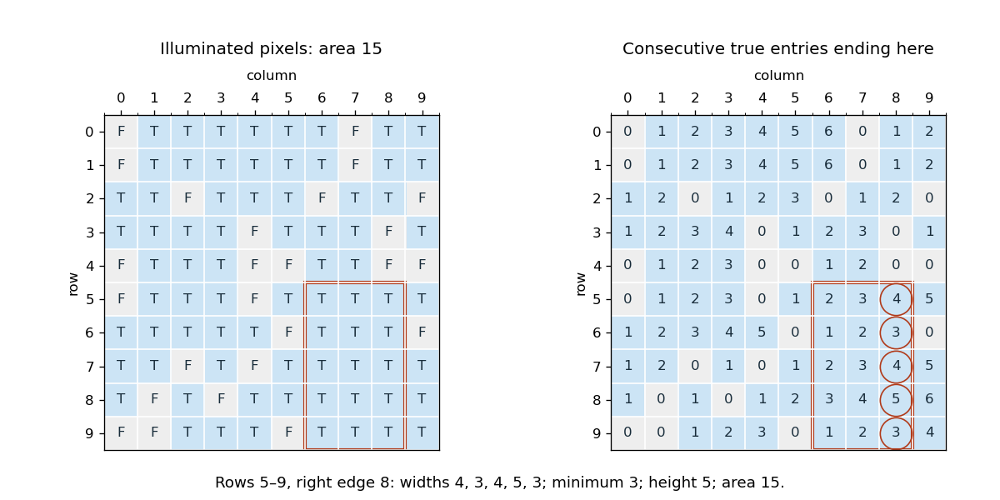

# Imperative programming

↑ **Parent:** [2014](../2014.md)

Solutions to all eight questions of the 18 June 2014 paper. The [Scala](../../programming-language.md#scala) fragments use the paper's Scala 2 style. Unless stated otherwise, [array](../../data-structure.md#array-data-structure) dimensions and [array indices](../../data-structure.md#array-index) meet the supplied preconditions, and size calculations fit `Int`.[Cover and pp. 2–15, Questions 1–8](../../computer-science-bibliography.md#imperative-programming-examination-paper-by-the-university-of-oxford-2014)

**Table of contents**

- [1](#1)
  - [a](#1/a)
    - [Solution](#1/a/solution)
  - [b](#1/b)
    - [i](#1/b/i)
      - [Solution](#1/b/i/solution)
    - [ii](#1/b/ii)
      - [Solution](#1/b/ii/solution)
  - [c](#1/c)
    - [Solution](#1/c/solution)
- [2](#2)
  - [a](#2/a)
    - [Solution](#2/a/solution)
  - [b](#2/b)
    - [Solution](#2/b/solution)
  - [c](#2/c)
    - [Solution](#2/c/solution)
- [3](#3)
  - [a](#3/a)
    - [Solution](#3/a/solution)
  - [b](#3/b)
    - [Solution](#3/b/solution)
  - [c](#3/c)
    - [Solution](#3/c/solution)
  - [d](#3/d)
    - [Solution](#3/d/solution)
  - [e](#3/e)
    - [Solution](#3/e/solution)
  - [f](#3/f)
    - [Solution](#3/f/solution)
- [4](#4)
  - [a](#4/a)
    - [Solution](#4/a/solution)
  - [b](#4/b)
    - [Solution](#4/b/solution)
  - [c](#4/c)
    - [Solution](#4/c/solution)
  - [d](#4/d)
    - [Solution](#4/d/solution)
  - [e](#4/e)
    - [Solution](#4/e/solution)
  - [f](#4/f)
    - [Solution](#4/f/solution)
  - [g](#4/g)
    - [Solution](#4/g/solution)
- [5](#5)
  - [a](#5/a)
    - [Solution](#5/a/solution)
  - [b](#5/b)
    - [Solution](#5/b/solution)
  - [c](#5/c)
    - [Solution](#5/c/solution)
- [6](#6)
  - [a](#6/a)
    - [Solution](#6/a/solution)
  - [b](#6/b)
    - [Solution](#6/b/solution)
- [7](#7)
  - [a](#7/a)
    - [Solution](#7/a/solution)
  - [b](#7/b)
    - [Solution](#7/b/solution)
  - [c](#7/c)
    - [Solution](#7/c/solution)
  - [d](#7/d)
    - [Solution](#7/d/solution)
- [8](#8)
  - [a](#8/a)
    - [Solution](#8/a/solution)
  - [b](#8/b)
    - [Solution](#8/b/solution)
  - [c](#8/c)
    - [Solution](#8/c/solution)

## 1

↑ **Parent:** [Imperative programming](imperative-programming.md)

<h3 id="1/a">a</h3>

↑ **Parent:** [1](#1)

<h4 id="1/a/solution">Solution</h4>

↑ **Parent:** [A](#1/a)

Maintain a processed prefix split into values below the pivot and values at least the pivot. The remaining suffix has not yet been classified. Here `a` and `N` are the given [array](../../data-structure.md#array-data-structure) and its length.
```
def partition(l: Int, r: Int, p: Int): Int = {
  require(0 <= l && l <= r && r <= N)
  var k = l
  var j = l
  while (j < r) {
    if (a(j) < p) {
      val t = a(k); a(k) = a(j); a(j) = t
      k += 1
    }
    j += 1
  }
  k
}
```
The [loop invariant](../../algorithm.md#loop-invariant) is

$$
l\leq k\leq j\leq r,\qquad a[l..k)<p,\qquad a[k..j)\geq p.
$$

In addition, the active segment remains a [permutation](../../combinatorics.md#permutation) of its original contents, and every entry outside it remains unchanged. If `a(j) < p`, swapping it with `a(k)` extends the first region; the displaced entry, when the two positions differ, already belongs in the second region. Otherwise only the second region grows. The [loop variant](../../algorithm.md#loop-variant) is $r-j$. At termination $j=r$, so

$$
\boxed{a[l..k)<p\leq a[k..r),\qquad\text{return }k.}
$$

There are exactly $r-l$ iterations, giving $O(r-l+1)$ [time complexity](../../theoretical-computer-science.md#time-complexity) and constant [auxiliary space](../../algorithm.md#auxiliary-space).

<h3 id="1/b">b</h3>

↑ **Parent:** [1](#1)

<h4 id="1/b/i">i</h4>

↑ **Parent:** [B](#1/b)

<h5 id="1/b/i/solution">Solution</h5>

↑ **Parent:** [I](#1/b/i)

Take an [integer](../../integer.md) pivot $0\leq p\leq N+1$. There are $p$ possible values in $[0,p)$ but only $k$ occurrences of such values in the whole [array](../../data-structure.md#array-data-structure). When $k<p$, the [pigeonhole principle](../../combinatorics.md#pigeonhole-principle) gives

$$
\boxed{\text{Some value in }[0,p)\text{ is missing.}}
$$

Repeated values do not invalidate the argument: they can only reduce the number of distinct values represented by those $k$ occurrences. The other side might also contain a missing value.

<h4 id="1/b/ii">ii</h4>

↑ **Parent:** [B](#1/b)

<h5 id="1/b/ii/solution">Solution</h5>

↑ **Parent:** [Ii](#1/b/ii)

There are $N+1-p$ candidate values in $[p,N+1)$ and exactly $N-k$ occurrences there. If $k\geq p$, then

$$
N-k\leq N-p<N+1-p.
$$

Thus the [pigeonhole principle](../../combinatorics.md#pigeonhole-principle) gives

$$
\boxed{\text{Some value in }[p,N+1)\text{ is missing.}}
$$

This conclusion does not assert that every value on the lower side is present; duplicates may leave both sides deficient.

<h3 id="1/c">c</h3>

↑ **Parent:** [1](#1)

<h4 id="1/c/solution">Solution</h4>

↑ **Parent:** [C](#1/c)

Use [missing-value search by deficient value intervals](../../algorithm.md#missing-value-search-by-deficient-value-intervals): halve the candidate value [interval](../../real-analysis.md#interval-mathematics), and apply [array partitioning](../../algorithm.md#two-way-array-partition) only to the [array](../../data-structure.md#array-data-structure) segment whose entries lie in that [interval](../../real-analysis.md#interval-mathematics).
```
def missing(): Int = {
  require(N < Int.MaxValue)
  var lo = 0; var hi = N + 1
  var l = 0; var r = N
  while (hi - lo > 1) {
    val p = lo + (hi - lo) / 2
    val k = partition(l, r, p)
    if (k - l < p - lo) {
      hi = p; r = k
    } else {
      lo = p; l = k
    }
  }
  lo
}
```
The [loop invariant](../../algorithm.md#loop-invariant) is $0\leq l\leq r\leq N$, $0\leq lo<hi\leq N+1$, and

$$
a[l..r)\subseteq[lo,hi),\qquad r-l<hi-lo.
$$

More precisely, the segment contains **all occurrences** of original values in $[lo,hi)$, and the complete [array](../../data-structure.md#array-data-structure) remains a [permutation](../../combinatorics.md#permutation) of its original state. The occurrences statement is essential: absence from the final segment must imply absence from the original [array](../../data-structure.md#array-data-structure).

After [array partitioning](../../algorithm.md#two-way-array-partition), let $m=r-l$, $W=hi-lo$, $m_L=k-l$, and $W_L=p-lo$. If $m_L<W_L$, retain the left side. Otherwise the right side has

$$
m_R=m-m_L<W-W_L=W_R
$$

occurrences. Either choice preserves the strict deficiency and the all-occurrences condition. The positive [integer](../../integer.md) width $hi-lo$ decreases, proving termination. At width one, the active segment has fewer than one entry and is empty. Therefore

$$
\boxed{\text{return }lo,\quad lo\in[0,N+1),\quad lo\text{ is absent from the original array}.}
$$

For the [time complexity](../../theoretical-computer-science.md#time-complexity), after $t$ splits the width is at most $\lceil(N+1)/2^t\rceil$, and the scan length is smaller than that width. Summing over the $O(\log(N+1))$ levels gives a [geometric series](../../sequence-and-series.md#geometric-series) plus logarithmic overhead, hence $O(N+1)$ overall, conventionally $O(N)$ for $N\geq1$. This proof bounds the retained occurrence count by the retained value width; it does not assume that each [array partitioning](../../algorithm.md#two-way-array-partition) splits the number of occurrences in half. The $N=0$ case returns zero immediately.

## 2

↑ **Parent:** [Imperative programming](imperative-programming.md)

<h3 id="2/a">a</h3>

↑ **Parent:** [2](#2)

<h4 id="2/a/solution">Solution</h4>

↑ **Parent:** [A](#2/a)

For each row, keep the [row run length](../../algorithm.md#row-run-length) of the processed prefix. A false entry resets the length to zero; a true entry extends it by one.
```
val rowCount = Array.ofDim[Int](N, N)
var i = 0
while (i < N) {
  var j = 0
  var run = 0
  while (j < N) {
    if (a(i)(j)) run += 1 else run = 0
    rowCount(i)(j) = run
    j += 1
  }
  i += 1
}
```
The outer [loop invariant](../../algorithm.md#loop-invariant) states that rows before `i` have all their correct [row run lengths](../../algorithm.md#row-run-length). The inner [loop invariant](../../algorithm.md#loop-invariant) states that columns before `j` in row `i` are correct and that `run` is the length of the all-true suffix of `a(i)[0..j)`. Initially this suffix is empty. Updating `run` gives exactly the suffix length ending at column `j`, proving the required formula, including zero at a false entry. Every cell is visited once:

$$
\boxed{\mathrm{rowCount}(i)(j)=\begin{cases}0,&\neg a(i)(j),\\1+\mathrm{rowCount}(i)(j-1),&a(i)(j),\end{cases}\qquad O(N^2),}
$$

where the fictitious value at column $-1$ is zero. The table itself uses $O(N^2)$ storage.

<h3 id="2/b">b</h3>

↑ **Parent:** [2](#2)

<h4 id="2/b/solution">Solution</h4>

↑ **Parent:** [B](#2/b)

Fix the top-right corner $(i,j)$ and a bottom boundary $k$. A width $w$ is feasible precisely when every row $m\in[i,k)$ has at least $w$ consecutive true entries ending at column $j$. Thus the largest feasible width is the minimum of those [row run lengths](../../algorithm.md#row-run-length), and the area is that width times $k-i$.
```
def maxRectangleAt(i: Int, j: Int): Int = {
  var k = i
  var width = j + 1
  var best = 0
  while (k < N) {
    width = math.min(width, rowCount(k)(j))
    k += 1
    best = math.max(best, (k - i) * width)
  }
  best
}
```
At the loop head, the [loop invariant](../../algorithm.md#loop-invariant) is $i\leq k\leq N$,

$$
\begin{aligned}
\mathrm{width}&=\min\bigl(\{j+1\}\cup\{\mathrm{rowCount}(m)(j):i\leq m<k\}\bigr),\\
\mathrm{best}&=\max\bigl(\{0\}\cup\{(h-i)\min_{i\leq m<h}\mathrm{rowCount}(m)(j):i<h\leq k\}\bigr).
\end{aligned}
$$

The initial cap $j+1$ makes the empty-prefix case well-defined and cannot restrict any actual run. Each iteration incorporates one new row and tests its corresponding bottom boundary. The [loop variant](../../algorithm.md#loop-variant) is $N-k$, so

$$
\boxed{\mathrm{best}=\max_{i<k\leq N}(k-i)\min_{i\leq m<k}\mathrm{rowCount}(m)(j),\qquad O(N).}
$$

A zero width contributes area zero, covering the case where no nonempty all-true [rectangle](../../euclidean-geometry.md#rectangle) starts at that corner.

<h3 id="2/c">c</h3>

↑ **Parent:** [2](#2)

<h4 id="2/c/solution">Solution</h4>

↑ **Parent:** [C](#2/c)

Every nonempty axis-aligned [rectangle](../../euclidean-geometry.md#rectangle) has a top-right corner. Enumerate all such corners and retain the greatest area from part (b).
```
var best = 0
var i = 0
while (i < N) {
  var j = 0
  while (j < N) {
    best = math.max(best, maxRectangleAt(i, j))
    j += 1
  }
  i += 1
}
```
The [loop invariant](../../algorithm.md#loop-invariant) is that `best` is the greatest area obtained from the corners processed so far, or zero if there are none. Consequently

$$
\boxed{\text{maximum area}=\mathrm{best},\qquad O(N^3)\text{ time},\quad O(N^2)\text{ storage}.}
$$

The preprocessing cost from part (a) is included. An entirely false [matrix](../../vector-space.md#matrix), or an empty one, returns zero. In the printed example, rows $5$ through $9$ and columns $6$ through $8$ give area $5\times3=15$; exhaustive corner enumeration confirms that no larger all-true [rectangle](../../euclidean-geometry.md#rectangle) exists.[p. 3, example arrays](../../computer-science-bibliography.md#imperative-programming-examination-paper-by-the-university-of-oxford-2014)

<a id="2/c/image-an-area-15-rectangle-and-the-row-run-lengths-that-certify-its-width"></a>


**[Figure 1](#2/c/image-an-area-15-rectangle-and-the-row-run-lengths-that-certify-its-width). An area-15 rectangle and the row run lengths that certify its width**.

## 3

↑ **Parent:** [Imperative programming](imperative-programming.md)

<h3 id="3/a">a</h3>

↑ **Parent:** [3](#3)

<h4 id="3/a/solution">Solution</h4>

↑ **Parent:** [A](#3/a)

Assume `NumLevels >= 1`. Both [sentinel nodes](../../data-structure.md#sentinel-node) occur on every level; the tail ends every [linked list](../../data-structure.md#linked-list).
```
val head = new Node(Int.MinValue)
val tail = new Node(Int.MaxValue)
for (level <- 0 until NumLevels) {
  head.nexts(level) = tail
  tail.nexts(level) = null
}
```
The empty [skip list](../../data-structure.md#skip-list) therefore has

$$
\boxed{\mathrm{head}\longrightarrow\mathrm{tail}\longrightarrow\mathrm{null}\quad\text{at every level}.}
$$

The forbidden data values distinguish the [sentinel nodes](../../data-structure.md#sentinel-node) from genuine entries.

<h3 id="3/b">b</h3>

↑ **Parent:** [3](#3)

<h4 id="3/b/solution">Solution</h4>

↑ **Parent:** [B](#3/b)

Follow the next reference for the desired level, stopping at the tail. This returns the genuine nodes in their [linked list](../../data-structure.md#linked-list) order, excluding both [sentinel nodes](../../data-structure.md#sentinel-node).
```
def nodesAt(level: Int): List[Node] = {
  require(0 <= level && level < NumLevels)
  val out = scala.collection.mutable.ListBuffer.empty[Node]
  var n = head.nexts(level)
  while (n ne tail) {
    out += n
    n = n.nexts(level)
  }
  out.toList
}
```
Write $L_h$ for the resulting [sequence](../../sequence-and-series.md#sequence) of nodes at level $h$. The [abstraction function](../../computer-science.md#abstraction-function) is

$$
\boxed{\alpha=\mathrm{map}(\mathrm{datum},L_0).}
$$

It preserves repetitions, because distinct nodes may carry equal values. A suitable [representation invariant](../../computer-science.md#representation-invariant) requires the following:

- `head` and `tail` are distinct [sentinel nodes](../../data-structure.md#sentinel-node) with the specified extreme values; every node has a `nexts` [array](../../data-structure.md#array-data-structure) of length `NumLevels`.
- For each level, following references from `head` gives a finite acyclic chain ending at `tail`, then `null`; the data along that chain are nondecreasing. Genuine values lie strictly between the [sentinel values](../../data-structure.md#sentinel-value).
- Each $L_{h+1}$ is a subsequence of $L_h$ **by node identity**, so the relative order of equal-valued nodes agrees across levels. Every genuine node occurs in $L_0$ and on a contiguous initial collection of levels.
- A genuine node absent from a level has `null` in that level's slot. Tail slots are all `null`; every other slot on a chain points to the next member of that chain.

These structural requirements make the traversal terminate and make descending through levels valid. A probabilistic height distribution is a performance policy, rather than a condition needed for the [abstraction function](../../computer-science.md#abstraction-function) to describe an ordered [sequence](../../sequence-and-series.md#sequence).

<h3 id="3/c">c</h3>

↑ **Parent:** [3](#3)

<h4 id="3/c/solution">Solution</h4>

↑ **Parent:** [C](#3/c)

Start at the highest level. Move right only while the next key is strictly smaller than `x`, then descend without returning to `head`.
```
def findPreds(x: Int): Array[Node] = {
  require(Int.MinValue < x && x < Int.MaxValue)
  val preds = new Array[Node](NumLevels)
  var n = head
  var level = NumLevels - 1
  while (level >= 0) {
    while (n.nexts(level).datum < x) {
      n = n.nexts(level)
    }
    preds(level) = n
    level -= 1
  }
  preds
}
```
At each inner loop head, `n` belongs to the current level and has key below `x`. Every node already passed has key below `x`. The [representation invariant](../../computer-science.md#representation-invariant) ensures that `n` also belongs to the next lower level. Stopping just before a key at least `x` therefore gives

$$
\boxed{\mathrm{preds}(h).\mathrm{datum}<x\leq\mathrm{preds}(h).\mathrm{nexts}(h).\mathrm{datum}.}
$$

The tail prevents a null dereference during the comparison. Strict comparison makes the predecessor lie before the first occurrence of `x`, including duplicates. On the source diagram, `findPreds(14)` yields data $[11,9,9,-\infty]$, in increasing level order.[p. 4, skiplist diagram and Question 3(c)](../../computer-science-bibliography.md#imperative-programming-examination-paper-by-the-university-of-oxford-2014)

With the customary random-level policy this has expected logarithmic [time complexity](../../theoretical-computer-science.md#time-complexity) for a suitably sized level cap; an unlucky [skip list](../../data-structure.md#skip-list) can require a linear scan. No deterministic logarithmic guarantee is claimed.

<h3 id="3/d">d</h3>

↑ **Parent:** [3](#3)

<h4 id="3/d/solution">Solution</h4>

↑ **Parent:** [D](#3/d)

The level-zero successor of the predecessor is the first node whose value is at least `x`. Thus only one equality test remains.
```
def contains(x: Int): Boolean = {
  if (x == Int.MinValue || x == Int.MaxValue) false
  else {
    val n = findPreds(x)(0).nexts(0)
    (n ne tail) && n.datum == x
  }
}
```
In particular, the tail is never reported as a genuine member:

$$
\boxed{x\text{ occurs}\iff\mathrm{preds}(0).\mathrm{nexts}(0)\ne\mathrm{tail}\ \land\ \mathrm{datum}=x.}
$$

The additional work after the [skip list](../../data-structure.md#skip-list) search is constant.

<h3 id="3/e">e</h3>

↑ **Parent:** [3](#3)

<h4 id="3/e/solution">Solution</h4>

↑ **Parent:** [E](#3/e)

Pick the new node's highest level once, and splice the same node into every level up to that height. `pickLevel` must return a value in `0 until NumLevels`.
```
def add(x: Int): Unit = {
  require(Int.MinValue < x && x < Int.MaxValue)
  val preds = findPreds(x)
  val highest = pickLevel
  require(0 <= highest && highest < NumLevels)
  val n = new Node(x)
  for (level <- 0 to highest) {
    n.nexts(level) = preds(level).nexts(level)
    preds(level).nexts(level) = n
  }
}
```
The fresh [array](../../data-structure.md#array-data-structure) contains `null` above the chosen height. At each changed level the new node lies after a smaller value and before a value at least `x`. Every new occurrence is placed before all previous equal-valued nodes, consistently across levels. Therefore the [representation invariant](../../computer-science.md#representation-invariant) is preserved and

$$
\boxed{\alpha_{\mathrm{new}}=\alpha_{\mathrm{old}}\text{ with one extra occurrence of }x.}
$$

The splice work is $O(\mathrm{highest}+1)$ in addition to one [skip list](../../data-structure.md#skip-list) search.

<h3 id="3/f">f</h3>

↑ **Parent:** [3](#3)

<h4 id="3/f/solution">Solution</h4>

↑ **Parent:** [F](#3/f)

Identify the first matching node at level zero, then bypass **that node** wherever it appears. Comparing keys alone at higher levels could accidentally remove links to a different occurrence with the same key.
```
def delete(x: Int): Unit = {
  if (x != Int.MinValue && x != Int.MaxValue) {
    val preds = findPreds(x)
    val victim = preds(0).nexts(0)
    if ((victim ne tail) && victim.datum == x) {
      for (level <- 0 until NumLevels) {
        if (preds(level).nexts(level) eq victim) {
          preds(level).nexts(level) = victim.nexts(level)
        }
      }
    }
  }
}
```
Because higher-level chains are subsequences of level zero, the predecessor found for any level containing `victim` points directly to it: no earlier equal-valued node can intervene before the first level-zero occurrence. Bypassing it preserves the order and nesting of all the [linked lists](../../data-structure.md#linked-list). Levels lacking it are unchanged. Thus

$$
\boxed{\text{Delete exactly one occurrence of }x\text{ if present; otherwise leave the list unchanged}.}
$$

The additional work is $O(\mathrm{NumLevels})$. With the usual level cap and random heights, updates have the expected logarithmic [time complexity](../../theoretical-computer-science.md#time-complexity) associated with a [skip list](../../data-structure.md#skip-list).

## 4

↑ **Parent:** [Imperative programming](imperative-programming.md)

<h3 id="4/a">a</h3>

↑ **Parent:** [4](#4)

<h4 id="4/a/solution">Solution</h4>

↑ **Parent:** [A](#4/a)

The fresh [array](../../data-structure.md#array-data-structure) initially holds null references, whereas a zero row must be an empty [list](../../data-structure.md#list-abstract-data-type). Initialize every slot explicitly:
```
for (i <- 0 until N) rows(i) = List.empty[Entry]
```
Then

$$
\boxed{\mathrm{rows}(i)=\mathrm{Nil}\text{ for every }i,\qquad A_{ij}=0.}
$$

The following methods belong inside `SparseMatrix`, using the supplied `Entry` and `Row` type aliases.

<h3 id="4/b">b</h3>

↑ **Parent:** [4](#4)

<h4 id="4/b/solution">Solution</h4>

↑ **Parent:** [B](#4/b)

The [representation invariant](../../computer-science.md#representation-invariant) is $N\geq0$, `rows.length == N`, and every `rows(i)` is a nonnull finite [list](../../data-structure.md#list-abstract-data-type) of entries $(j,x)$ satisfying

$$
\boxed{0\leq j<N,\quad x\ne0.0,\quad\text{column indices strictly increase along each row}.}
$$

Strict increase excludes repeated columns. The [abstraction function](../../computer-science.md#abstraction-function) gives $A_{ij}=x$ when the unique entry $(j,x)$ occurs in `rows(i)`, and $A_{ij}=0$ otherwise. Thus omitted positions represent zero; omission does not mean an unknown [matrix](../../vector-space.md#matrix) entry.

<h3 id="4/c">c</h3>

↑ **Parent:** [4](#4)

<h4 id="4/c/solution">Solution</h4>

↑ **Parent:** [C](#4/c)

Select entries having the requested column. The [representation invariant](../../computer-science.md#representation-invariant) ensures that the selected [list](../../data-structure.md#list-abstract-data-type) has length at most one.
```
def get(i: Int, j: Int): Double = {
  require(0 <= i && i < N && 0 <= j && j < N)
  val entries = rows(i).filter(e => e._1 == j)
  if (entries.isEmpty) 0.0 else entries.head._2
}
```
Consequently

$$
\boxed{\mathrm{get}(i,j)=A_{ij}.}
$$

This version follows the hint and has [time complexity](../../theoretical-computer-science.md#time-complexity) linear in the number of stored entries in row `i`. An ordered early-exit scan is also possible.

<h3 id="4/d">d</h3>

↑ **Parent:** [4](#4)

<h4 id="4/d/solution">Solution</h4>

↑ **Parent:** [D](#4/d)

Keep the entries before column `j`, discard any old entry at `j`, and retain those after it. Insert the replacement only when it is nonzero.
```
def set(i: Int, j: Int, x: Double): Unit = {
  require(0 <= i && i < N && 0 <= j && j < N)
  val before = rows(i).takeWhile(e => e._1 < j)
  val after = rows(i).dropWhile(e => e._1 <= j)
  val middle: Row = if (x == 0.0) Nil else List((j, x))
  rows(i) = before ::: middle ::: after
}
```
All indices in `before` are below `j` and all in `after` are above it, so the [representation invariant](../../computer-science.md#representation-invariant) is preserved. Other rows and all other column values remain unchanged:

$$
\boxed{A'_{ij}=x,\qquad A'_{kl}=A_{kl}\text{ when }(k,l)\ne(i,j).}
$$

Assigning zero removes storage for that entry. The [time complexity](../../theoretical-computer-science.md#time-complexity) is linear in the stored row length.

<h3 id="4/e">e</h3>

↑ **Parent:** [4](#4)

<h4 id="4/e/solution">Solution</h4>

↑ **Parent:** [E](#4/e)

Construct a fresh [sparse matrix](../../vector-space.md#sparse-matrix), transform each stored value, and omit products that become zero.
```
def scale(s: Double): SparseMatrix = {
  val out = new SparseMatrix(N)
  for (i <- 0 until N) {
    out.rows(i) = rows(i).map { case (j, x) => (j, s * x) }
      .filter(e => e._2 != 0.0)
  }
  out
}
```
Filtering preserves column order. It handles `s == 0.0` and any [floating point](../../floating-point-arithmetic.md#floating-point-representation) underflow producing zero. Sharing immutable [list](../../data-structure.md#list-abstract-data-type) structure elsewhere would be safe; this code constructs new transformed rows. Within the class, Scala's ordinary `private` permits access to `out.rows`. The result is

$$
\boxed{\mathrm{out}_{ij}=sA_{ij}.}
$$

The [time complexity](../../theoretical-computer-science.md#time-complexity) is $O(N+M)$ for $M$ stored entries. As usual for the supplied `Double` model, arithmetic means machine arithmetic; for a finite-real interpretation assume finite operands and products, excluding infinities and NaNs.

<h3 id="4/f">f</h3>

↑ **Parent:** [4](#4)

<h4 id="4/f/solution">Solution</h4>

↑ **Parent:** [F](#4/f)

Entry $(j,x)$ in source row `i` becomes entry $(i,x)$ in destination row `j`. Visit source rows in descending order and prepend, producing increasing destination column order without a sorting pass.
```
def transpose: SparseMatrix = {
  val out = new SparseMatrix(N)
  var i = N - 1
  while (i >= 0) {
    for ((j, x) <- rows(i)) {
      out.rows(j) = (i, x) :: out.rows(j)
    }
    i -= 1
  }
  out
}
```
Before processing source row `i`, each destination row contains exactly the contributions from source rows with index greater than `i`, in increasing index order. Prepending index `i` preserves that order, and each source position is unique. Hence the [representation invariant](../../computer-science.md#representation-invariant) holds and

$$
\boxed{\mathrm{out}_{ji}=A_{ij},\qquad O(N+M)\text{ time}.}
$$

The source [sparse matrix](../../vector-space.md#sparse-matrix) is unchanged.

<h3 id="4/g">g</h3>

↑ **Parent:** [4](#4)

<h4 id="4/g/solution">Solution</h4>

↑ **Parent:** [G](#4/g)

For each source row, use a temporary dense [array](../../data-structure.md#array-data-structure) to accumulate contributions from nonzero pairs. For every stored $A_{ik}$, traverse stored entries in row $k$ of the other [sparse matrix](../../vector-space.md#sparse-matrix).
```
def mult(that: SparseMatrix): SparseMatrix = {
  require(N == that.N)
  val out = new SparseMatrix(N)
  for (i <- 0 until N) {
    val acc = Array.fill[Double](N)(0.0)
    for ((k, x) <- rows(i)) {
      for ((j, y) <- that.rows(k)) {
        acc(j) += x * y
      }
    }
    var j = N - 1
    var result: Row = Nil
    while (j >= 0) {
      if (acc(j) != 0.0) result = (j, acc(j)) :: result
      j -= 1
    }
    out.rows(i) = result
  }
  out
}
```
During accumulation, `acc(j)` is the sum of the already processed terms contributing to position $(i,j)$. Missing entries multiply to zero, so ignoring them loses no contribution under the finite arithmetic convention of part (e). At completion,

$$
\boxed{\mathrm{out}_{ij}=\sum_{k=0}^{N-1}A_{ik}\,\mathrm{that}_{kj}.}
$$

Descending `j` and prepending produce strictly increasing stored indices. Omitting zero also handles cancellation. The temporary [array](../../data-structure.md#array-data-structure) uses $O(N)$ [auxiliary space](../../algorithm.md#auxiliary-space) beyond the output. The [time complexity](../../theoretical-computer-science.md#time-complexity) is

$$
O\left(N^2+\sum_i\sum_{(k,x)\in\mathrm{rows}(i)}|\mathrm{that.rows}(k)|\right),
$$

at worst $O(N^3)$, but potentially much smaller when the [matrices](../../vector-space.md#matrix) are sparse. The $N^2$ term covers clearing and scanning the row accumulators. Finite-precision rounding can affect the numerical result, as in any `Double` [matrix multiplication](../../vector-space.md#matrix-multiplication).

## 5

↑ **Parent:** [Imperative programming](imperative-programming.md)

<h3 id="5/a">a</h3>

↑ **Parent:** [5](#5)

<h4 id="5/a/solution">Solution</h4>

↑ **Parent:** [A](#5/a)

Interpret `step` as a positive increment, consistent with the increasing [sequence](../../sequence-and-series.md#sequence) and exclusive upper bound. State this precondition explicitly; a zero increment would not define the intended finite progression. Use a wider cursor to avoid [integer overflow](../../programming-language.md#integer-overflow) on the update after the last valid `Int` result.
```
class RangeIter(lower: Int, upper: Int, step: Int) extends Iter[Int] {
  require(step > 0)
  private var current = lower.toLong
  def hasNext: Boolean = current < upper.toLong
  def next(): Int = {
    require(hasNext)
    val answer = current.toInt
    current += step.toLong
    answer
  }
}
```
After $q$ calls to `next`, the [abstraction function](../../computer-science.md#abstraction-function) is the [sequence](../../sequence-and-series.md#sequence) of values $\mathrm{lower}+t\,\mathrm{step}<\mathrm{upper}$ with $t\geq q$, in increasing order. Repeated calls to `hasNext` do not change it; `next` removes precisely its first value. Therefore

$$
\boxed{1,3,5,7,9,11\quad\text{for }\mathrm{RangeIter}(1,13,2).}
$$

If `lower >= upper`, the represented [sequence](../../sequence-and-series.md#sequence) is empty immediately. The paper does not specify a descending-range convention; this implementation exposes its positive-step precondition rather than assigning one implicitly.

<h3 id="5/b">b</h3>

↑ **Parent:** [5](#5)

<h4 id="5/b/solution">Solution</h4>

↑ **Parent:** [B](#5/b)

A [demand-driven filtering iterator](../../data-structure.md#demand-driven-filtering-iterator) needs one cached accepted value. Otherwise `hasNext` would either lose an element or consume another accepted value every time it is queried.
```
def filterIter[T](p: T => Boolean, it: Iter[T]): Iter[T] =
  new Iter[T] {
    private var buffered: Option[T] = None
    private var finished = false
    private def fill(): Unit = {
      while (buffered.isEmpty && !finished) {
        if (!it.hasNext) finished = true
        else {
          val x = it.next()
          if (p(x)) buffered = Some(x)
        }
      }
    }
    def hasNext: Boolean = {
      fill()
      buffered.nonEmpty
    }
    def next(): T = {
      fill()
      require(buffered.nonEmpty)
      val answer = buffered.get
      buffered = None
      answer
    }
  }
```
The [representation invariant](../../computer-science.md#representation-invariant) says that `buffered` holds at most one accepted value. The represented [sequence](../../sequence-and-series.md#sequence) is the buffered value, if present, followed by the subsequence of the underlying remainder satisfying the [predicate](../../analysis-of-boolean-functions.md#predicate). Filling moves the next accepted value into the cache and discards only rejected values, so this abstract [sequence](../../sequence-and-series.md#sequence) is unchanged by `hasNext`. Clearing the cache in `next` removes its head. Thus

$$
\boxed{\alpha(\mathrm{filterIter}(p,it))=\mathrm{filter}(p,\alpha(it)).}
$$

`next` works even when the client has not first called `hasNext`; exhaustion violates its stated precondition. As with ordinary [iterator](../../data-structure.md#iterator) adapters, clients should give this wrapper exclusive consumption of `it`, and the [predicate](../../analysis-of-boolean-functions.md#predicate) should give a stable answer for each element. One call may scan several rejected elements, but across a complete traversal each source element is consumed once. Cache storage is constant.

<h3 id="5/c">c</h3>

↑ **Parent:** [5](#5)

<h4 id="5/c/solution">Solution</h4>

↑ **Parent:** [C](#5/c)

Use the [iterator](../../data-structure.md#iterator) adapter from part (b) with a [primality test](../../theoretical-computer-science.md#primality-testing) by [trial division](../../prime-number.md#trial-division). A composite positive [integer](../../integer.md) has a divisor no greater than its [square root](../../algebra.md#square-root).
```
def primeIter(upperBound: Int): Iter[Int] = {
  def isPrime(n: Int): Boolean = {
    if (n < 2) false
    else {
      var d = 2
      while (d <= n / d && n % d != 0) d += 1
      d > n / d
    }
  }
  filterIter[Int](isPrime _, new RangeIter(2, upperBound, 1))
}
```
Before each [trial division](../../prime-number.md#trial-division) iteration, no [integer](../../integer.md) in $[2,d)$ divides `n`. If division succeeds, the condition becomes false with $d\leq n/d$, and `isPrime` returns false. Otherwise the loop ends with $d>n/d$, so every possible small [divisor](../../divisibility.md#divisor) has been excluded. The quotient comparison is equivalent to $d^2\leq n$ for positive values and avoids [integer overflow](../../programming-language.md#integer-overflow) in `d*d`.

$$
\boxed{\mathrm{primeIter}(23):\quad2,3,5,7,11,13,17,19.}
$$

Bounds at most two give an empty [iterator](../../data-structure.md#iterator). This method tests candidates lazily and uses $O(\sqrt n)$ [trial divisions](../../prime-number.md#trial-division) for candidate $n$; no efficiency requirement in the question forces a [sieve of Eratosthenes](../../prime-number.md#sieve-of-eratosthenes) implementation.

## 6

↑ **Parent:** [Imperative programming](imperative-programming.md)

<h3 id="6/a">a</h3>

↑ **Parent:** [6](#6)

<h4 id="6/a/solution">Solution</h4>

↑ **Parent:** [A](#6/a)

Apply [overload selection followed by dynamic dispatch](../../programming-language.md#overload-selection-followed-by-dynamic-dispatch): the receiver's [static type](../../programming-language.md#static-type) determines visible signatures, and argument [static types](../../programming-language.md#static-type) choose the overload. The receiver's [runtime type](../../programming-language.md#runtime-type) then selects its override. A `super` call starts at the inherited implementation instead of redispatching to the override just entered.

For `c.f1(y)`, the `Y` overload is visible on `C`, so its body in `C` runs. For `a.f2(x)`, the `X` signature is selected and its override in `C` calls `C.f1(X)`. For `a.f2(y)`, the `Y` signature is selected; its body in `C` calls `super.f1(y)`. The superclass `B` has only `f1(X)`, so that call uses `B.f1(X)`.

For `b.f3(y)`, the [static type](../../programming-language.md#static-type) `B` exposes only `f3(X)`. Its override in `C` calls `super.f2(x)`, entering `B.f2(X)`. The unqualified `f1(x)` inside that body still uses [dynamic dispatch](../../programming-language.md#dynamic-dispatch) on the original `C` instance, so it calls `C.f1(X)`.

Finally `c.f4(x)` invokes the [companion object](../../programming-language.md#companion-object) `C`, which is a separate receiver extending `B`. Its `f3(X)` calls inherited `B.f2(X)`, whose `f1` call dispatches to `ObjC.f1(X)`.[p. 10, Question 6(a), method bodies and calls](../../computer-science-bibliography.md#imperative-programming-examination-paper-by-the-university-of-oxford-2014)

The exact five output lines, including the final comma and space on each line, are:
```
f1(y:Y) in C, 
f1(x:X) in C, f2(x:X) in C, 
f1(x:X) in B, f2(y:Y) in C, 
f1(x:X) in C, f2(x:X) in B, f3(x:X) in C, 
f1(x:X) in ObjC, f2(x:X) in B, f3(x:X) in ObjC, f4(x:X) in C, 
```


$$
\boxed{\text{Select the signature statically, then dispatch that signature dynamically}.}
$$

<h3 id="6/b">b</h3>

↑ **Parent:** [6](#6)

<h4 id="6/b/solution">Solution</h4>

↑ **Parent:** [B](#6/b)

In [Scala trait linearization](../../programming-language.md#scala-trait-linearization), the rightmost mixed-in [trait](../../programming-language.md#trait) takes priority. Merge inherited linearizations while retaining a shared ancestor only at its final position; `super` advances to the next implementation in the resulting chain. Ignoring predefined bases, the lookup orders are
```
Life1, Exercise, Work, Life
Life2, Dance, Exercise, Program, Study, Work, Fun, Life
Life3, Program, Study, Work, Dance, Fun, Exercise, Life
```
For example, `Dance` alone has order `Dance, Fun, Exercise, Life`. In `Life2`, the additional `Program` branch already contains `Fun` before `Life`; keeping that shared ancestry in its later position moves `Fun` after `Work`, while `Dance` still takes priority. Reversing the mixins yields the third chain above.

Each `describe` first delegates and then prints, so the lines appear in the reverse of the method lookup order. The exact output, including the two blank lines, is
```
I live.
I work.
I exercise.

I live.
I have fun.
I work.
I study.
I program.
I exercise.
I dance.

I live.
I exercise.
I have fun.
I dance.
I work.
I study.
I program.
```


$$
\boxed{\text{Lookup follows the linearization; these prints occur while the calls return}.}
$$

The `super` inside a [trait](../../programming-language.md#trait) therefore need not call that [trait](../../programming-language.md#trait)'s isolated textual parent; the receiving object's full [Scala trait linearization](../../programming-language.md#scala-trait-linearization) controls the next body.

## 7

↑ **Parent:** [Imperative programming](imperative-programming.md)

<h3 id="7/a">a</h3>

↑ **Parent:** [7](#7)

<h4 id="7/a/solution">Solution</h4>

↑ **Parent:** [A](#7/a)

Store characters in a mutable [dynamic array](../../data-structure.md#dynamic-array). Its length is maintained by the collection, giving constant-time `size`.
```
class DocImpl extends Doc {
  private val text = scala.collection.mutable.ArrayBuffer.empty[Char]
  def insert(x: Char, pos: Int): Unit = {
    require(0 <= pos && pos <= text.length)
    text.insert(pos, x)
  }
  def delete(pos: Int): Char = {
    require(0 <= pos && pos < text.length)
    text.remove(pos)
  }
  def read(pos: Int): Char = {
    require(0 <= pos && pos < text.length)
    text(pos)
  }
  def size: Int = text.length
}
```
The [representation invariant](../../computer-science.md#representation-invariant) requires a nonnull private [dynamic array](../../data-structure.md#dynamic-array) containing a finite [sequence](../../sequence-and-series.md#sequence) of characters, with its internal collection invariant maintained by the library. The [abstraction function](../../computer-science.md#abstraction-function) is

$$
\boxed{\alpha(\mathrm{text})=\langle\mathrm{text}(0),\ldots,\mathrm{text}(\mathrm{length}-1)\rangle.}
$$

Insertion allows the end position and shifts the suffix right; deletion returns exactly the removed character and shifts the suffix left. `read` leaves the abstract state unchanged. `size` equals the abstract [sequence](../../sequence-and-series.md#sequence) length in $O(1)$ [time complexity](../../theoretical-computer-science.md#time-complexity). Indexed reads are also constant time; insertion and deletion may take linear time, which the question permits.

<h3 id="7/b">b</h3>

↑ **Parent:** [7](#7)

<h4 id="7/b/solution">Solution</h4>

↑ **Parent:** [B](#7/b)

Keep 26 cached counts, updating them after a successful delegated edit. Count exactly lowercase letters; the query alphabet does not make uppercase letters the same character.
```
trait CharTrackPlugIn extends Doc {
  private val counts = Array.fill[Int](26)(0)
  private def lower(x: Char): Boolean = 'a' <= x && x <= 'z'
  abstract override def insert(x: Char, pos: Int): Unit = {
    super.insert(x, pos)
    if (lower(x)) counts(x - 'a') += 1
  }
  abstract override def delete(pos: Int): Char = {
    val x = super.delete(pos)
    if (lower(x)) counts(x - 'a') -= 1
    x
  }
  def getCount(x: Char): Int = {
    assert(lower(x))
    counts(x - 'a')
  }
}
```
For an initially empty underlying document that stores inserted arguments unchanged, the [representation invariant](../../computer-science.md#representation-invariant) is

$$
\boxed{\mathrm{counts}(c-\texttt{'a'})=\#\{i:\mathrm{read}(i)=c\}\quad(c=\texttt{'a'},\ldots,\texttt{'z'}).}
$$

Insertion increments precisely the inserted lowercase character's count. Deletion uses the returned character, avoiding an extra indexed read and decrementing the character actually removed. Updating after `super` means a rejected edit leaves the counts unchanged. Both the added update work and `getCount` use $O(1)$ [time complexity](../../theoretical-computer-science.md#time-complexity) and fixed storage.

The `abstract override` methods implement a [stackable trait modification](../../programming-language.md#stackable-trait-modification): they require a concrete document implementation further along the delegation chain. The invariant above depends on subsequent layers preserving inserted characters. Part (d) deliberately composes a transforming layer that can break this assumption; that is the [transform-sensitive trait frequency counter](../../programming-language.md#transform-sensitive-trait-frequency-counter) phenomenon.

<h3 id="7/c">c</h3>

↑ **Parent:** [7](#7)

<h4 id="7/c/solution">Solution</h4>

↑ **Parent:** [C](#7/c)

Convert lowercase alphabet letters before passing them to the next implementation. Already uppercase letters and other characters pass through unchanged.
```
trait CapitalisePlugIn extends Doc {
  abstract override def insert(x: Char, pos: Int): Unit = {
    val y = if ('a' <= x && x <= 'z') ('A' + (x - 'a')).toChar else x
    super.insert(y, pos)
  }
}
```
The character conversion uses the paper's contiguous lowercase and uppercase Latin ranges. Thus

$$
\boxed{\texttt{insert('a',pos)}\text{ delegates as }\texttt{insert('A',pos)}.}
$$

Deletion, reading, and size need no overrides.

<h3 id="7/d">d</h3>

↑ **Parent:** [7](#7)

<h4 id="7/d/solution">Solution</h4>

↑ **Parent:** [D](#7/d)

The rightmost [trait](../../programming-language.md#trait) intercepts insertion first. In `A`, capitalization runs before counting, so the counter receives uppercase `A` and does not increment the lowercase count. In `B`, counting receives lowercase `a`, delegates to capitalization, and then increments the original lowercase argument's counter. Both concrete documents store uppercase `A`.

The exact output is
```
0
1
```


$$
\boxed{d1.\mathrm{getCount}(\texttt{'a'})=0,\qquad d2.\mathrm{getCount}(\texttt{'a'})=1.}
$$

This illustrates an order-sensitive [stackable trait modification](../../programming-language.md#stackable-trait-modification). In the second composition the cached count describes intercepted insertion arguments, and no longer the actual lowercase characters in the stored document. For example, deleting its uppercase `A` would not decrement the lowercase counter. A counter required to track actual contents under arbitrary transforming [mixins](../../programming-language.md#mixin) would need a stronger composition contract or would inspect the stored character after insertion; such a change would alter the intended behavior of this example.

## 8

↑ **Parent:** [Imperative programming](imperative-programming.md)

<h3 id="8/a">a</h3>

↑ **Parent:** [8](#8)

<h4 id="8/a/solution">Solution</h4>

↑ **Parent:** [A](#8/a)

The [interval containment order](../../set.md#interval-containment-order) compares the lower endpoints in reverse and the upper endpoints in their ordinary order. The smallest containing [integer interval](../../integer.md#integer-interval) uses the smaller lower endpoint and the larger upper endpoint.
```
class Interval(val l: Int, val u: Int) extends Ordered[Interval] {
  require(l <= u)
  def <=(that: Interval): Boolean = that.l <= l && u <= that.u
  def lub(that: Interval): Interval =
    new Interval(math.min(l, that.l), math.max(u, that.u))
}
```
Endpoint comparison immediately proves [reflexivity](../../set-theory.md#reflexive-relation), [transitivity](../../set-theory.md#transitive-relation), and [antisymmetry](../../set-theory.md#antisymmetry) on interval values. If two separately allocated instances have the same endpoints, they denote the same abstract [interval](../../real-analysis.md#interval-mathematics); object identity is not the mathematical equality used by this [partial order](../../set.md#partially-ordered-set).

The returned [interval](../../real-analysis.md#interval-mathematics) contains both operands. Every other containing [interval](../../real-analysis.md#interval-mathematics) has a lower endpoint at most both original lower endpoints and an upper endpoint at least both original upper endpoints, so it also contains the returned hull. Hence

$$
\boxed{[l,u]\vee[l',u']=[\min(l,l'),\max(u,u')].}
$$

This [least upper bound](../../set.md#least-upper-bound-in-a-partially-ordered-set) need not equal the ordinary [union](../../set.md#set-union): the hull of $[1,2]$ and $[5,6]$ is $[1,6]$, including the gap.

<h3 id="8/b">b</h3>

↑ **Parent:** [8](#8)

<h4 id="8/b/solution">Solution</h4>

↑ **Parent:** [B](#8/b)

Keep precisely those elements with no strictly smaller element in the input. Express strictness using the [partial order](../../set.md#partially-ordered-set) itself, avoiding reliance on Scala reference equality.
```
def minimal[T <: Ordered[T]](xs: Set[T]): Set[T] =
  xs.filter { x =>
    !xs.exists(y => (y <= x) && !(x <= y))
  }
```
In a [partial order](../../set.md#partially-ordered-set), $y<x$ means $y\leq x$ and $x\not\leq y$. Therefore

$$
\boxed{\mathrm{minimal}(X)=\{x\in X:\nexists y\in X,\ y<x\}.}
$$

The empty [set](../../set.md) produces the empty [set](../../set.md). An incomparable pair is retained in full; a [minimal element](../../set.md#minimal-element-of-a-partially-ordered-set) need not be a least element. At most $O(|X|^2)$ order comparisons are needed, and only the supplied F-bounded generic interface is required.

<h3 id="8/c">c</h3>

↑ **Parent:** [8](#8)

<h4 id="8/c/solution">Solution</h4>

↑ **Parent:** [C](#8/c)

Store the [minimal elements](../../set.md#minimal-element-of-a-partially-ordered-set) of the finite generating [set](../../set.md). The represented [upper set](../../set.md#upper-set) itself may be infinite; the code manipulates its finite basis.
```
class UpSet[T <: Ordered[T]](c: Set[T]) extends Ordered[UpSet[T]] {
  private val basis: Set[T] = minimal(c)
  def contains(x: T): Boolean = basis.exists(a => a <= x)
  def intersection(that: UpSet[T]): UpSet[T] = {
    val generators: Set[T] =
      for (a <- basis; b <- that.basis) yield a.lub(b)
    new UpSet[T](generators)
  }
  def <=(that: UpSet[T]): Boolean = basis.forall(a => that.contains(a))
  def lub(that: UpSet[T]): UpSet[T] =
    new UpSet[T](basis union that.basis)
}
```
The [abstraction function](../../computer-science.md#abstraction-function) and [representation invariant](../../computer-science.md#representation-invariant) are

$$
\boxed{\alpha(B)=\uparrow B=\{x:\exists b\in B,\ b\leq x\},\qquad B\text{ finite with no strictly comparable distinct values}.}
$$

Removing nonminimal generators preserves the upward closure: in a finite generating [set](../../set.md), repeatedly descending below any discarded element must reach a retained [minimal element](../../set.md#minimal-element-of-a-partially-ordered-set). Thus the constructor represents exactly the required [finitely generated upper set](../../set.md#finitely-generated-upper-set).

Membership follows directly from the [abstraction function](../../computer-science.md#abstraction-function). For [intersection](../../set.md#set-intersection), an element $x$ lies above some $a\in B$ and some $b\in C$ exactly when it lies above their [least upper bound](../../set.md#least-upper-bound-in-a-partially-ordered-set):

$$
(a\leq x\land b\leq x)\iff a\vee b\leq x.
$$

The forward implication is the defining leastness property; the reverse uses that $a\vee b$ is an [upper bound](../../set.md#upper-bound-in-a-partially-ordered-set) and [transitivity](../../set-theory.md#transitive-relation). Consequently

$$
\uparrow B\cap\uparrow C=\uparrow\{a\vee b:a\in B,b\in C\}.
$$

Recomputing [minimal elements](../../set.md#minimal-element-of-a-partially-ordered-set) therefore yields a finite basis for the exact [intersection](../../set.md#set-intersection).

For [subset](../../set.md#subset) inclusion, it suffices that every generator of the left-hand [upper set](../../set.md#upper-set) belongs to the right-hand [upper set](../../set.md#upper-set). Necessity holds because each generator belongs to its own closure by [reflexivity](../../set-theory.md#reflexive-relation). Sufficiency holds because the right-hand [set](../../set.md) is upward closed. Finally,

$$
\boxed{\uparrow B\subseteq\uparrow C\iff\forall b\in B,\ \exists c\in C,\ c\leq b,\qquad (\uparrow B)\vee(\uparrow C)=\uparrow(B\cup C).}
$$

Thus `lub` computes [union](../../set.md#set-union), which is the [least upper bound](../../set.md#least-upper-bound-in-a-partially-ordered-set) under [subset](../../set.md#subset) inclusion. The empty basis represents the empty [set](../../set.md); all four methods handle it without a special case. As in part (a), two distinct Scala objects may denote the same abstract ordered value. Retaining several equivalent representatives is harmless: they generate the same upward closure, and the strict-comparison test removes only genuinely nonminimal values.

## ↑ Ancestors (9)

1. [2014](../2014.md)
2. [Past exam of the year 1 of the computer science course of the University of Oxford](../../past-exam-of-the-year-1-of-the-computer-science-course-of-the-university-of-oxford.md)
3. [Year 1 of the computer science course of the University of Oxford](../../university-of-oxford.md#year-1-of-the-computer-science-course-of-the-university-of-oxford)
4. [Computer science course of the University of Oxford](../../university-of-oxford.md#computer-science-course-of-the-university-of-oxford)
5. [Undergraduate course of the University of Oxford](../../university-of-oxford.md#undergraduate-course-of-the-university-of-oxford)
6. [Course of the University of Oxford](../../university-of-oxford.md#course-of-the-university-of-oxford)
7. [University of Oxford](../../university-of-oxford.md)
8. [List of universities](../../README.md#list-of-universities)
9. [Codex Wiki](../../README.md)
