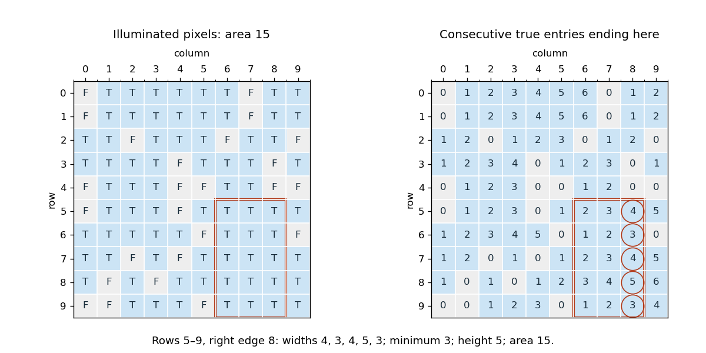

<h1 id="2/c/solution">Solution</h1>

↑ **Parent:** [C](../c.md)

Every nonempty axis-aligned [rectangle](../../../../../rectangle.md) has a top-right corner. Enumerate all such corners and retain the greatest area from part (b).
```
var best = 0
var i = 0
while (i < N) {
  var j = 0
  while (j < N) {
    best = math.max(best, maxRectangleAt(i, j))
    j += 1
  }
  i += 1
}
```
The [loop invariant](../../../../../loop-invariant.md) is that `best` is the greatest area obtained from the corners processed so far, or zero if there are none. Consequently

$$
\boxed{\text{maximum area}=\mathrm{best},\qquad O(N^3)\text{ time},\quad O(N^2)\text{ storage}.}
$$

The preprocessing cost from part (a) is included. An entirely false [matrix](../../../../../matrix.md), or an empty one, returns zero. In the printed example, rows $5$ through $9$ and columns $6$ through $8$ give area $5\times3=15$; exhaustive corner enumeration confirms that no larger all-true [rectangle](../../../../../rectangle.md) exists.[p. 3, example arrays](../../../../../imperative-programming-examination-paper-by-the-university-of-oxford-2014.md)

<a id="2/c/image-an-area-15-rectangle-and-the-row-run-lengths-that-certify-its-width"></a>


**[Figure 1](#2/c/image-an-area-15-rectangle-and-the-row-run-lengths-that-certify-its-width). An area-15 rectangle and the row run lengths that certify its width**.

## ↑ Ancestors (12)

1. [C](../c.md)
2. [2](../../2.md)
3. [Imperative programming](../../../imperative-programming-split.md)
4. [2014](../../../split.md)
5. [Past exam of the year 1 of the computer science course of the University of Oxford](../../../../split.md)
6. [Year 1 of the computer science course of the University of Oxford](../../../../../year-1-of-the-computer-science-course-of-the-university-of-oxford.md)
7. [Computer science course of the University of Oxford](../../../../../computer-science-course-of-the-university-of-oxford.md)
8. [Undergraduate course of the University of Oxford](../../../../../undergraduate-course-of-the-university-of-oxford.md)
9. [Course of the University of Oxford](../../../../../course-of-the-university-of-oxford.md)
10. [University of Oxford](../../../../../university-of-oxford-split.md)
11. [List of universities](../../../../../list-of-universities.md)
12. [Codex Wiki](../../../../../split.md)
