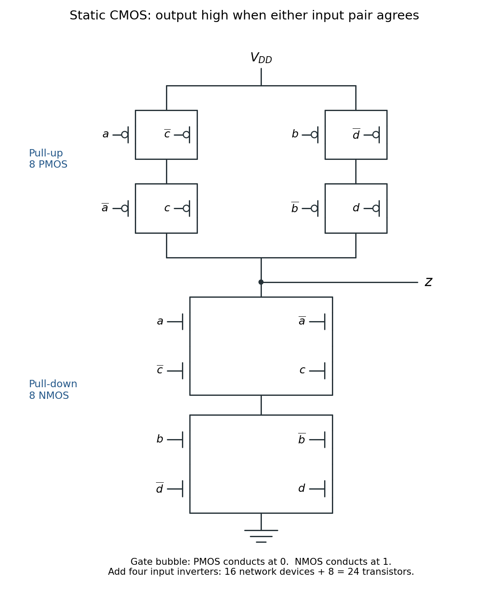

# Digital systems, linear algebra, introduction to formal proof (resit)

↑ **Parent:** [2015](../2015.md)

**Table of contents**

- [1](#1)
  - [a](#1/a)
    - [Solution](#1/a/solution)
  - [b](#1/b)
    - [Solution](#1/b/solution)
  - [c](#1/c)
    - [Solution](#1/c/solution)
  - [d](#1/d)
    - [Solution](#1/d/solution)
  - [e](#1/e)
    - [Solution](#1/e/solution)
- [2](#2)
  - [a](#2/a)
    - [Solution](#2/a/solution)
  - [b](#2/b)
    - [Solution](#2/b/solution)
  - [c](#2/c)
    - [Solution](#2/c/solution)
  - [d](#2/d)
    - [Solution](#2/d/solution)
  - [e](#2/e)
    - [Solution](#2/e/solution)
- [3](#3)
  - [a](#3/a)
    - [Solution](#3/a/solution)
  - [b](#3/b)
    - [i](#3/b/i)
      - [Solution](#3/b/i/solution)
    - [ii](#3/b/ii)
      - [Solution](#3/b/ii/solution)
    - [iii](#3/b/iii)
      - [Solution](#3/b/iii/solution)
    - [iv](#3/b/iv)
      - [Solution](#3/b/iv/solution)
  - [c](#3/c)
    - [Solution](#3/c/solution)
- [4](#4)
  - [a](#4/a)
    - [Solution](#4/a/solution)
  - [b](#4/b)
    - [Solution](#4/b/solution)
  - [c](#4/c)
    - [Solution](#4/c/solution)
- [5](#5)
  - [a](#5/a)
    - [Solution](#5/a/solution)
  - [b](#5/b)
    - [Solution](#5/b/solution)
  - [c](#5/c)
    - [Solution](#5/c/solution)
  - [d](#5/d)
    - [Solution](#5/d/solution)
  - [e](#5/e)
    - [Solution](#5/e/solution)
- [6](#6)
  - [a](#6/a)
    - [Solution](#6/a/solution)
  - [b](#6/b)
    - [Solution](#6/b/solution)
  - [c](#6/c)
    - [Solution](#6/c/solution)
  - [d](#6/d)
    - [Solution](#6/d/solution)
  - [e](#6/e)
    - [Solution](#6/e/solution)
- [7](#7)
  - [a](#7/a)
    - [Solution](#7/a/solution)
  - [b](#7/b)
    - [Solution](#7/b/solution)
  - [c](#7/c)
    - [Solution](#7/c/solution)
  - [d](#7/d)
    - [i](#7/d/i)
      - [Solution](#7/d/i/solution)
    - [ii](#7/d/ii)
      - [Solution](#7/d/ii/solution)
- [8](#8)
  - [a](#8/a)
    - [i](#8/a/i)
      - [Solution](#8/a/i/solution)
    - [ii](#8/a/ii)
      - [Solution](#8/a/ii/solution)
  - [b](#8/b)
    - [Solution](#8/b/solution)
  - [c](#8/c)
    - [i](#8/c/i)
      - [Solution](#8/c/i/solution)
    - [ii](#8/c/ii)
      - [Solution](#8/c/ii/solution)
    - [iii](#8/c/iii)
      - [Solution](#8/c/iii/solution)

## 1

↑ **Parent:** [Digital systems, linear algebra, introduction to formal proof (resit)](digital-systems-linear-algebra-introduction-to-formal-proof-resit.md)

<h3 id="1/a">a</h3>

↑ **Parent:** [1](#1)

<h4 id="1/a/solution">Solution</h4>

↑ **Parent:** [A](#1/a)

In the traditional [Unix](../../operating-system.md#unix) [file system](../../file-system.md) model, a regular [file](../../file-system.md#computer-file) consists of [file metadata](../../file-system.md#file-metadata) in an [inode](../../file-system.md#inode) and an ordered sequence of [bytes](../../computer-memory.md#byte) stored in [file data blocks](../../file-system.md#file-data-block). The [inode](../../file-system.md#inode) records the type, owner, permissions, length, timestamps and [hard link](../../file-system.md#hard-link) count, together with the information locating its [file data blocks](../../file-system.md#file-data-block). A small [file](../../file-system.md#computer-file) can use direct [file data block](../../file-system.md#file-data-block) addresses; a larger [file](../../file-system.md#computer-file) can additionally use [indirect block pointers](../../file-system.md#indirect-block-pointer), whose blocks contain further addresses rather than user data. The final [file data block](../../file-system.md#file-data-block) need not be completely occupied.

An [inode number](../../file-system.md#inode-number) identifies an entry in the [inode table](../../file-system.md#inode-table) of this [file system](../../file-system.md); it identifies the [file](../../file-system.md#computer-file), rather than a particular piece of its contents. A [disk block number](../../file-system.md#disk-block-number) identifies a fixed-size storage region on the volume. Resolving an [inode number](../../file-system.md#inode-number) first obtains the [inode](../../file-system.md#inode); following its direct or [indirect block pointers](../../file-system.md#indirect-block-pointer) then finds the required [file data block](../../file-system.md#file-data-block). The two numbers belong to different address spaces, even though the [inode table](../../file-system.md#inode-table) itself occupies disk blocks.

$$
\boxed{\text{inode number: file identity; block number: storage location.}}
$$

<h3 id="1/b">b</h3>

↑ **Parent:** [1](#1)

<h4 id="1/b/solution">Solution</h4>

↑ **Parent:** [B](#1/b)

The [file-system namespace](../../file-system.md#file-system-namespace) is rooted at the root [file-system directory](../../file-system.md#file-system-directory). Each [directory entry](../../file-system.md#directory-entry) associates a local name with an [inode number](../../file-system.md#inode-number). To resolve a pathname, start at the root for an absolute pathname, or at the process's current [file-system directory](../../file-system.md#file-system-directory) for a relative pathname, and look up successive components in successive [file-system directories](../../file-system.md#file-system-directory). A [file-system directory](../../file-system.md#file-system-directory) is itself a [file](../../file-system.md#computer-file) with a special interpretation for its data.

The [inode table](../../file-system.md#inode-table) stores [file metadata](../../file-system.md#file-metadata) and the information locating contents. The [file-system directory](../../file-system.md#file-system-directory) structure supplies names and the connections used in pathname lookup. Thus the [file](../../file-system.md#computer-file) is the object represented by its [inode](../../file-system.md#inode), whereas a file name is one entry referring to that object. Two [hard links](../../file-system.md#hard-link) can give the same [file](../../file-system.md#computer-file) two names, possibly in different [file-system directories](../../file-system.md#file-system-directory). Renaming a [file](../../file-system.md#computer-file) need not move its contents or change its [inode number](../../file-system.md#inode-number); after [unlinking an open file](../../file-system.md#unlinking-an-open-file), a [file](../../file-system.md#computer-file) can temporarily have no names and still be accessible through an existing [file descriptor](../../operating-system.md#file-descriptor).

$$
\boxed{\text{names locate inodes; inodes describe files and locate contents.}}
$$

<h3 id="1/c">c</h3>

↑ **Parent:** [1](#1)

<h4 id="1/c/solution">Solution</h4>

↑ **Parent:** [C](#1/c)

Use a [block allocation bitmap](../../file-system.md#block-allocation-bitmap), one [bit](../../information-theory.md#bit) per allocatable [disk block number](../../file-system.md#disk-block-number), or a [free-block list](../../file-system.md#free-block-list). Allocation removes a free block from the free representation; deallocation inserts it. Reserved [file system](../../file-system.md) structures, including the [inode table](../../file-system.md#inode-table) and the free-space representation itself, must never be offered as free [file data blocks](../../file-system.md#file-data-block). Free [inodes](../../file-system.md#inode) can be tracked separately by an [inode allocation bitmap](../../file-system.md#inode-allocation-bitmap).

A [file data block](../../file-system.md#file-data-block) becomes reusable when the [file system](../../file-system.md) has removed its ownership from the [file](../../file-system.md#computer-file). This happens, for example, when truncation discards that portion of the [file](../../file-system.md#computer-file), or when the [file](../../file-system.md#computer-file) is finally destroyed. Destruction requires both removal of its last [hard link](../../file-system.md#hard-link) and release of its last live reference: [unlinking an open file](../../file-system.md#unlinking-an-open-file) must not reclaim blocks still needed through an [open file description](../../operating-system.md#open-file-description). A [memory-mapped file](../../virtual-memory.md#memory-mapped-file), if supported, also requires its references to be accounted for. The [indirect block pointers](../../file-system.md#indirect-block-pointer)' own blocks are reclaimed when they are no longer needed.

There are two relevant notions of accessibility. Pathname-accessible [files](../../file-system.md#computer-file) are those reached from the root through valid [directory entries](../../file-system.md#directory-entry), subject to permissions; their allocated blocks are found through their [inodes](../../file-system.md#inode). Already-open [files](../../file-system.md#computer-file) can additionally remain accessible through [file descriptors](../../operating-system.md#file-descriptor) even after their last names disappear. Allocated [file system](../../file-system.md) structures and blocks pinned by an operation must also be excluded from allocation. A [block allocation bitmap](../../file-system.md#block-allocation-bitmap) must therefore describe actual allocation, rather than merely the blocks of currently named regular [files](../../file-system.md#computer-file).

One processor can still run several processes and be interrupted. Updating ownership and the free-space representation must therefore be serialized with respect to competing operations, for example through an appropriate kernel critical section. Persistence across a crash additionally requires [file-system crash consistency](../../file-system.md#file-system-crash-consistency), such as ordered updates or [file-system journaling](../../file-system.md#file-system-journaling).

$$
\boxed{\text{last name removed}\ \not\Rightarrow\ \text{open-file blocks immediately free}.}
$$

<h3 id="1/d">d</h3>

↑ **Parent:** [1](#1)

<h4 id="1/d/solution">Solution</h4>

↑ **Parent:** [D](#1/d)

The [hard link](../../file-system.md#hard-link) count in an [inode](../../file-system.md#inode) duplicates information recoverable by counting [directory entries](../../file-system.md#directory-entry) that refer to its [inode number](../../file-system.md#inode-number). Keeping the count makes the last-name test fast: a [hard link](../../file-system.md#hard-link) removal need not search every [file-system directory](../../file-system.md#file-system-directory). A [file-system consistency checker](../../file-system.md#file-system-consistency-checker) can independently recount the references and compare the result with the stored value.

Likewise, a [block allocation bitmap](../../file-system.md#block-allocation-bitmap) summarizes ownership information recoverable from allocated [inodes](../../file-system.md#inode), their [file data blocks](../../file-system.md#file-data-block), their [indirect block pointers](../../file-system.md#indirect-block-pointer), and reserved [file system](../../file-system.md) structures. This summary makes allocation efficient and supplies an independent consistency check against multiply allocated or lost blocks. Replicated superblock information is another possible form of [data redundancy](../../computer-science.md#data-redundancy), helping recovery if one copy is damaged. These examples have distinct benefits: a cached count or allocation summary saves work, while an independent or replicated representation helps detect or repair corruption. Consistent updating is essential; redundancy alone does not make a [file system](../../file-system.md) crash-safe.

$$
\boxed{\text{redundancy supports efficient lookup, consistency checking and recovery.}}
$$

<h3 id="1/e">e</h3>

↑ **Parent:** [1](#1)

<h4 id="1/e/solution">Solution</h4>

↑ **Parent:** [E](#1/e)

A [file descriptor table](../../operating-system.md#file-descriptor-table) belongs to a process: its small nonnegative [integer](../../integer.md) indices are [file descriptors](../../operating-system.md#file-descriptor), and each occupied entry points to an [open file description](../../operating-system.md#open-file-description). It also holds descriptor-specific information, such as whether the descriptor closes on a successful program replacement. There is **one logical [file descriptor table](../../operating-system.md#file-descriptor-table) per process** in the traditional model; implementations can let processes explicitly share one.

The system-wide [open file table](../../operating-system.md#open-file-table), called the file pointer table here, contains [open file descriptions](../../operating-system.md#open-file-description). Each entry records an opening's access mode, current [file offset](../../file-system.md#file-offset), reference count and reference to an in-memory [inode](../../file-system.md#inode). Duplicated [file descriptors](../../operating-system.md#file-descriptor), including inherited ones, can refer to the same [open file description](../../operating-system.md#open-file-description) and therefore share its [file offset](../../file-system.md#file-offset). Independent opens of the same [file](../../file-system.md#computer-file) normally create separate [open file descriptions](../../operating-system.md#open-file-description) and separate offsets. There is **one logical system-wide [open file table](../../operating-system.md#open-file-table)**, with many entries.

The system-wide in-memory [inode table](../../file-system.md#inode-table) caches the [inodes](../../file-system.md#inode) currently needed, including shared [file metadata](../../file-system.md#file-metadata), locking and reference information. Its identity key must include the [file system](../../file-system.md) as well as the [inode number](../../file-system.md#inode-number) when several volumes are mounted. There is **one logical system-wide active [inode table](../../file-system.md#inode-table)**, distinct from the persistent [inode table](../../file-system.md#inode-table) stored on each volume. These are logical organizations, not requirements for a single contiguous array in memory.

$$
\boxed{\text{process descriptor}\to\text{open-file description}\to\text{active inode}\to\text{disk blocks}.}
$$

## 2

↑ **Parent:** [Digital systems, linear algebra, introduction to formal proof (resit)](digital-systems-linear-algebra-introduction-to-formal-proof-resit.md)

<h3 id="2/a">a</h3>

↑ **Parent:** [2](#2)

<h4 id="2/a/solution">Solution</h4>

↑ **Parent:** [A](#2/a)

For a [CMOS inverter](../../semiconductor.md#cmos-inverter), connect one [PMOS transistor](../../semiconductor.md#pmos-transistor) from the positive supply $V_{DD}$ to the output and one [NMOS transistor](../../semiconductor.md#nmos-transistor) from the output to ground; drive both gates with the input $x$. When $x=0$, the [PMOS transistor](../../semiconductor.md#pmos-transistor) conducts and the [NMOS transistor](../../semiconductor.md#nmos-transistor) is off; when $x=1$, the reverse holds. Thus the output is $\neg x$, using two [transistors](../../semiconductor.md#transistor).

For a four-input [NAND gate](../../theoretical-computer-science.md#nand-gate), use four [NMOS transistors](../../semiconductor.md#nmos-transistor) in series between the output and ground, with gates $a,b,c,d$. Use four [PMOS transistors](../../semiconductor.md#pmos-transistor) in parallel between $V_{DD}$ and the output, with the same gate signals. The [pull-down network](../../semiconductor.md#pull-down-network) conducts exactly when all four inputs are one; the [pull-up network](../../semiconductor.md#pull-up-network) conducts whenever at least one input is zero. Hence

$$
\boxed{y=\neg(a\land b\land c\land d),\qquad N=8\text{ transistors}.}
$$

As usual for static [CMOS](../../semiconductor.md#cmos), tie the [NMOS transistor](../../semiconductor.md#nmos-transistor) bodies to ground and the [PMOS transistor](../../semiconductor.md#pmos-transistor) bodies to $V_{DD}$.

<h3 id="2/b">b</h3>

↑ **Parent:** [2](#2)

<h4 id="2/b/solution">Solution</h4>

↑ **Parent:** [B](#2/b)

Each parenthesized pair in the given [Boolean function](../../analysis-of-boolean-functions.md#boolean-function) tests equality of two input [bits](../../information-theory.md#bit):

$$
(a\lor\neg c)\land(\neg a\lor c)=(a\land c)\lor(\neg a\land\neg c).
$$

This is [logical equivalence](../../mathematical-logic.md#logical-equivalence), or the two-input [XNOR gate](../../theoretical-computer-science.md#xnor-gate) function. Thus $z$ is one whenever either input pair agrees. Generate the four complemented inputs with four [inverters](../../theoretical-computer-science.md#not-gate), and define the following [NAND gate](../../theoretical-computer-science.md#nand-gate) outputs:

$$
\begin{aligned}
u_1&=\operatorname{NAND}(a,c),&u_2&=\operatorname{NAND}(\neg a,\neg c),\\
u_3&=\operatorname{NAND}(b,d),&u_4&=\operatorname{NAND}(\neg b,\neg d).
\end{aligned}
$$

Feed these four outputs into a single four-input [NAND gate](../../theoretical-computer-science.md#nand-gate). [De Morgan's laws](../../theoretical-computer-science.md#de-morgan-s-laws) give

$$
\boxed{z=\operatorname{NAND}(u_1,u_2,u_3,u_4)
=ac\lor\neg a\neg c\lor bd\lor\neg b\neg d.}
$$

Here juxtaposition denotes [logical conjunction](../../mathematical-logic.md#logical-conjunction). The construction uses only [inverters](../../theoretical-computer-science.md#not-gate), two-input [NAND gates](../../theoretical-computer-science.md#nand-gate) and one four-input [NAND gate](../../theoretical-computer-science.md#nand-gate), as required.

<h3 id="2/c">c</h3>

↑ **Parent:** [2](#2)

<h4 id="2/c/solution">Solution</h4>

↑ **Parent:** [C](#2/c)

The four [CMOS inverters](../../semiconductor.md#cmos-inverter) use $4\cdot2$ [transistors](../../semiconductor.md#transistor), the four two-input [NAND gates](../../theoretical-computer-science.md#nand-gate) use $4\cdot4$, and the four-input [NAND gate](../../theoretical-computer-science.md#nand-gate) uses $8$. Therefore this particular design uses

$$
\boxed{N=8+16+8=32\text{ transistors}.}
$$

<h3 id="2/d">d</h3>

↑ **Parent:** [2](#2)

<h4 id="2/d/solution">Solution</h4>

↑ **Parent:** [D](#2/d)

A more economical static [CMOS](../../semiconductor.md#cmos) design follows from factoring the condition for $z=0$. The output is low exactly when both input pairs disagree:

$$
\neg z=(a\oplus c)\land(b\oplus d)
=(a\neg c\lor\neg a c)(b\neg d\lor\neg b d).
$$

Generate $\neg a,\neg b,\neg c,\neg d$ with four [CMOS inverters](../../semiconductor.md#cmos-inverter). Write $n(x)$ or $p(x)$ for an [NMOS transistor](../../semiconductor.md#nmos-transistor) or [PMOS transistor](../../semiconductor.md#pmos-transistor) whose gate receives $x$. In the following network expressions, a dash means a series connection and $\parallel$ means a parallel connection.

Connect this eight-device [pull-down network](../../semiconductor.md#pull-down-network) between $z$ and ground:

$$
\boxed{
\bigl[(n(a)-n(\neg c))\parallel(n(\neg a)-n(c))\bigr]
-\bigl[(n(b)-n(\neg d))\parallel(n(\neg b)-n(d))\bigr].}
$$

The first parallel module conducts exactly when $a\ne c$ and the second exactly when $b\ne d$. Their series connection therefore conducts precisely when $z$ should be zero.

By [complementary CMOS network duality](../../semiconductor.md#complementary-cmos-network-duality), connect this eight-device [pull-up network](../../semiconductor.md#pull-up-network) between $V_{DD}$ and $z$:

$$
\boxed{
\bigl[(p(a)\parallel p(\neg c))-(p(\neg a)\parallel p(c))\bigr]
\parallel
\bigl[(p(b)\parallel p(\neg d))-(p(\neg b)\parallel p(d))\bigr].}
$$

A [PMOS transistor](../../semiconductor.md#pmos-transistor) conducts when its gate is zero. Consequently the first upper branch conducts when $(\neg a\lor c)\land(a\lor\neg c)$, namely $a=c$; the second conducts when $b=d$. Their parallel connection gives the required [logical disjunction](../../mathematical-logic.md#logical-disjunction). For every stable binary input, exactly one of the [pull-up network](../../semiconductor.md#pull-up-network) and [pull-down network](../../semiconductor.md#pull-down-network) conducts.

<a id="2/d/image-complementary-cmos-networks-eight-pmos-transistors-above-the-output-and-eight-nmos-transistors-below-it"></a>


**[Figure 1](#2/d/image-complementary-cmos-networks-eight-pmos-transistors-above-the-output-and-eight-nmos-transistors-below-it). Complementary CMOS networks: eight PMOS transistors above the output and eight NMOS transistors below it**.

The figure labels each [MOSFET](../../semiconductor.md#mosfet) channel by its gate signal; the four input [CMOS inverters](../../semiconductor.md#cmos-inverter) are additional to the devices drawn.

<h3 id="2/e">e</h3>

↑ **Parent:** [2](#2)

<h4 id="2/e/solution">Solution</h4>

↑ **Parent:** [E](#2/e)

The custom [CMOS](../../semiconductor.md#cmos) circuit uses eight [NMOS transistors](../../semiconductor.md#nmos-transistor) and eight [PMOS transistors](../../semiconductor.md#pmos-transistor) in the output networks, plus eight [transistors](../../semiconductor.md#transistor) in the four input [CMOS inverters](../../semiconductor.md#cmos-inverter):

$$
\boxed{N=8+8+4\cdot2=24\text{ transistors}.}
$$

The complementary types give an actively driven output at either supply rail. An [NMOS transistor](../../semiconductor.md#nmos-transistor) provides a strong connection to ground; a [PMOS transistor](../../semiconductor.md#pmos-transistor) provides a strong connection to $V_{DD}$. An [NMOS transistor](../../semiconductor.md#nmos-transistor) used alone to pass a high level loses gate overdrive as the output rises, giving a threshold-degraded high level; the complementary problem affects a [PMOS transistor](../../semiconductor.md#pmos-transistor) passing a low level. Complementary networks avoid these degraded levels and, ideally, have no direct supply-to-ground conducting path for a stable input. Physical leakage and switching current remain, but a resistive load and its continuous static current are unnecessary.

## 3

↑ **Parent:** [Digital systems, linear algebra, introduction to formal proof (resit)](digital-systems-linear-algebra-introduction-to-formal-proof-resit.md)

<h3 id="3/a">a</h3>

↑ **Parent:** [3](#3)

<h4 id="3/a/solution">Solution</h4>

↑ **Parent:** [A](#3/a)

In the pictured single-cycle [MIPS architecture](../../computer-science.md#mips-architecture), `RegDst` selects the write address of the [register file](../../computer-science.md#register-file): zero selects instruction bits $20\ldots16$, the `rt` field used by a load; one selects bits $15\ldots11$, the `rd` field used by an [MIPS R-type instruction](../../computer-science.md#mips-r-type-instruction). `RegWrite` enables the clocked write to the selected [processor register](../../computer-science.md#processor-register).

`ALUSrc` selects the second [ALU](../../computer-science.md#arithmetic-logic-unit) input: zero uses the second [register file](../../computer-science.md#register-file) read output, while one uses the sign-extended 16-[bit](../../information-theory.md#bit) immediate field. The `zero` signal is produced by the [ALU](../../computer-science.md#arithmetic-logic-unit), rather than being an opcode-decoder output: it is one exactly when the [ALU](../../computer-science.md#arithmetic-logic-unit) result is zero. During `beq`, the [ALU](../../computer-science.md#arithmetic-logic-unit) subtracts its operands, so `zero` tests equality. The diagram combines it with `Branch` to select the branch target instead of $PC+4$.

$$
\boxed{\operatorname{TakeBranch}=\operatorname{Branch}\land\operatorname{zero}.}
$$

<h3 id="3/b">b</h3>

↑ **Parent:** [3](#3)

<h4 id="3/b/i">i</h4>

↑ **Parent:** [B](#3/b)

<h5 id="3/b/i/solution">Solution</h5>

↑ **Parent:** [I](#3/b/i)

Run the following two [MIPS instruction](../../computer-science.md#mips-instruction) tests separately from externally prepared states, and inspect the [register file](../../computer-science.md#register-file) after the indicated instruction. External preparation is useful in a manufacturing test: code that initializes [processor registers](../../computer-science.md#processor-register) through the very control line being tested need not work. Assume the one potentially faulty line is `RegDst`; all other lines work normally.

For the first test, preset `$t0=7`, `$t1=5`, `$t2=99`, and execute
```
add $t2, $t0, $t1
```
The encoded `rt` is `$t1`, while `rd` is `$t2`. A healthy line or a line stuck at one writes 12 into `$t2`. A line stuck at zero instead writes 12 into `$t1`, leaving `$t2=99`.

For the second test, preset `$t3=4`, `$s0=L`, and the aligned memory word at $L$ to 37, then execute
```
lw $t3, 0($s0)
```
The zero immediate makes instruction bits $15\ldots11$ zero. A healthy line or a line stuck at zero writes 37 into `$t3`; a line stuck at one attempts to write the [MIPS zero register](../../computer-science.md#mips-zero-register), leaving `$t3=4`. The [MIPS zero register](../../computer-science.md#mips-zero-register) ignores attempted writes. Thus, recording the first test's `$t2` and the second test's `$t3`,

$$
\boxed{\begin{array}{c|c}
\text{RegDst state}&(t2,t3)\\\hline
\text{normal}&(12,37)\\
\text{stuck at 0}&(99,37)\\
\text{stuck at 1}&(12,4)
\end{array}}
$$

<h4 id="3/b/ii">ii</h4>

↑ **Parent:** [B](#3/b)

<h5 id="3/b/ii/solution">Solution</h5>

↑ **Parent:** [Ii](#3/b/ii)

A writing [MIPS instruction](../../computer-science.md#mips-instruction) distinguishes a line stuck at zero. With `$t0=7`, `$t1=5`, `$t2=99`, execute
```
add $t2, $t0, $t1
```
A healthy line or a line stuck at one produces `$t2=12`; a line stuck at zero leaves `$t2=99`.

To distinguish normal operation from stuck at one, execute a normally nonwriting [MIPS instruction](../../computer-science.md#mips-instruction). The following functional test uses the usual concrete controller choice `MemToReg=0` during `sw`, selecting the [ALU](../../computer-science.md#arithmetic-logic-unit) result on the write-data bus. Prepare `$t0=37` and `$s0=L-16384`, for an aligned writable address $L\ne37$, then execute
```
sw $t0, 16384($s0)
```
The [ALU](../../computer-science.md#arithmetic-logic-unit) computes $L$. Here `rt` is register 8 (`$t0`), and immediate $16384=\mathtt{0x4000}$ also puts 8 into bits $15\ldots11$. Thus either value of the otherwise irrelevant `RegDst` selects `$t0`. With a healthy `RegWrite`, `$t0` remains 37. With `RegWrite` stuck at one and the specified write-data selection, the unwanted [register file](../../computer-science.md#register-file) write changes `$t0` to $L$. Combining the two independent observations gives

$$
\boxed{\begin{array}{c|c}
\text{RegWrite state}&(t2\text{ after add},t0\text{ after store})\\\hline
\text{normal}&(12,37)\\
\text{stuck at 0}&(99,37)\\
\text{stuck at 1}&(12,L)
\end{array}}
$$

**Controller qualification.** The source diagram does not specify values of otherwise irrelevant control outputs during a store. `MemToReg` is a [don't-care condition](../../analysis-of-boolean-functions.md#don-t-care-term) when `RegWrite=0`; its chosen implementation matters when that enable line is faulty. The functional test above explicitly fixes this convention instead of assuming that all implementations resolve it identically. A manufacturing fixture can also observe the [register file](../../computer-science.md#register-file) write-enable directly while executing `add` followed by `sw`: the expected pairs are $(1,0)$ normally, $(0,0)$ stuck at zero, and $(1,1)$ stuck at one. This second observation does not depend on unused write-data controls or on whether an unwanted write happens to repeat an old value.

<h4 id="3/b/iii">iii</h4>

↑ **Parent:** [B](#3/b)

<h5 id="3/b/iii/solution">Solution</h5>

↑ **Parent:** [Iii](#3/b/iii)

Again use independent externally initialized [MIPS instruction](../../computer-science.md#mips-instruction) tests. First preset `$t0=7`, `$t1=5`, and execute
```
add $t2, $t0, $t1
```
The normal result, also obtained with `ALUSrc` stuck at zero, is 12. If the line is stuck at one, the second [ALU](../../computer-science.md#arithmetic-logic-unit) operand is the sign-extended low 16 instruction [bits](../../information-theory.md#bit). For this exact instruction they encode `rd=10`, shift amount zero and function $\mathtt{0x20}$, giving $\mathtt{0x5020}=20512$. The erroneous result is therefore $7+20512=20519$.

For the second test, preset `$s0=L`, `$t3=4`, memory at $L$ to 37 and memory at $L+4$ to 99, with both words valid and aligned. Execute
```
lw $t3, 0($s0)
```
Normally, and with `ALUSrc` stuck at one, the address is $L+0$ and the result is 37. With the line stuck at zero, the second [ALU](../../computer-science.md#arithmetic-logic-unit) operand is the old `$t3=4`, so the load reads 99 from $L+4$. Thus

$$
\boxed{\begin{array}{c|c}
\text{ALUSrc state}&(t2\text{ after add},t3\text{ after load})\\\hline
\text{normal}&(12,37)\\
\text{stuck at 0}&(12,99)\\
\text{stuck at 1}&(20519,37)
\end{array}}
$$

<h4 id="3/b/iv">iv</h4>

↑ **Parent:** [B](#3/b)

<h5 id="3/b/iv/solution">Solution</h5>

↑ **Parent:** [Iv](#3/b/iv)

Execute this [MIPS instruction](../../computer-science.md#mips-instruction) fragment twice, once with equal operands and once with unequal operands, and observe whether its conditional branch is taken:
```
beq $t0, $t1, hit
sll $zero, $zero, 0
sll $zero, $zero, 0
hit:
sll $zero, $zero, 0
```
Use `$t0=7,$t1=7` for the first test and `$t0=7,$t1=8` for the second. All padding instructions are explicit harmless [MIPS instructions](../../computer-science.md#mips-instruction). In the pictured single-cycle model, the next [program counter](../../computer-science.md#instruction-pointer) after `beq` is either `hit` or the sequential address. The branch target is deliberately different from the next sequential instruction. The extra padding also keeps a [branch delay slot](../../computer-science.md#branch-delay-slot) harmless if a test fixture uses an implementation with one, although the pictured model itself has none.

A healthy `zero` line reports the first subtraction as zero and the second as nonzero. A line stuck at zero prevents both branches, while a line stuck at one forces both branches. Therefore

$$
\boxed{\begin{array}{c|c}
\text{zero state}&(\text{equal test taken},\text{unequal test taken})\\\hline
\text{normal}&(\text{yes},\text{no})\\
\text{stuck at 0}&(\text{no},\text{no})\\
\text{stuck at 1}&(\text{yes},\text{yes})
\end{array}}
$$

Observe the branch decision or execution trace itself; an alleged unconditional `beq` used to skip result-recording code would also be affected by the fault.

<h3 id="3/c">c</h3>

↑ **Parent:** [3](#3)

<h4 id="3/c/solution">Solution</h4>

↑ **Parent:** [C](#3/c)

The [register file](../../computer-science.md#register-file) in this [datapath](../../computer-science.md#datapath) supplies both read ports combinationally for whatever read addresses the instruction fields present. Reading a [processor register](../../computer-science.md#processor-register) is harmless, and a result that the current [MIPS instruction](../../computer-science.md#mips-instruction) does not need can simply be ignored. Only writes require an explicit enable because writes change architectural state. There is consequently no functional need for `RegRead` in this design.

The data-memory read interface has an explicit `MemRead` enable. Non-load [MIPS instructions](../../computer-science.md#mips-instruction) can present irrelevant or invalid addresses at the memory address input; an external memory transaction should not be initiated merely because those [bits](../../information-theory.md#bit) happen to be present. An explicit enable also permits interfaces with [memory-mapped input-output](../../computer-science.md#memory-mapped-input-output), where a read can have a side effect. It can reduce unnecessary activity even for ordinary memory.

$$
\boxed{\text{register reads are continuously available; memory reads are explicitly requested.}}
$$

This is a distinction in the supplied [datapath](../../computer-science.md#datapath), rather than a universal physical prohibition: other [register files](../../computer-science.md#register-file) can have read enables, and an ideal side-effect-free memory can be modeled with continuous reads.

## 4

↑ **Parent:** [Digital systems, linear algebra, introduction to formal proof (resit)](digital-systems-linear-algebra-introduction-to-formal-proof-resit.md)

<h3 id="4/a">a</h3>

↑ **Parent:** [4](#4)

<h4 id="4/a/solution">Solution</h4>

↑ **Parent:** [A](#4/a)

**Source gap / TODO:** the original printed page 4, confirmed visually, omits the unknown [vector](../../vector-space.md#vector). It literally equates a $3\times3$ [matrix](../../vector-space.md#matrix) with a $3\times1$ [vector](../../vector-space.md#vector), so it does not define a well-formed [system of linear equations](../../linear-algebra.md#system-of-linear-equations). The following answer is conditional on the usual intended interpretation $A\mathbf x=(1,k^2,k)^T$; the missing factor is not present in the source.

Under that interpretation, the rows satisfy $r_1-2r_2+r_3=0$. Applying this [linear relation](../../vector-space.md#linear-relation) to the right-hand side gives the necessary consistency condition

$$
1-2k^2+k=0,\qquad (2k+1)(k-1)=0.
$$

It is sufficient too: the upper-left $2\times2$ [minor](../../vector-space.md#minor-linear-algebra) has [determinant](../../multilinear-algebra.md#determinant) $4-9=-5\ne0$, so the first two rows are [linearly independent](../../vector-space.md#linear-independence). The third row is $2r_2-r_1$, and imposes precisely the condition already found. Therefore

$$
\boxed{k=1\quad\text{or}\quad k=-\tfrac12\qquad\text{if the intended equation is }A\mathbf x=(1,k^2,k)^T.}
$$

For completeness, setting $x_3=t$ gives

$$
x_1=\frac{3k^2-2-4t}{5},\qquad x_2=\frac{3-2k^2+t}{5},\qquad t\in\mathbb R,
$$

and direct substitution satisfies all three [linear equations](../../linear-algebra.md#linear-equation) exactly for those two values of $k$. An unconditional answer to the malformed printed equality awaits a source correction.

<h3 id="4/b">b</h3>

↑ **Parent:** [4](#4)

<h4 id="4/b/solution">Solution</h4>

↑ **Parent:** [B](#4/b)

Apply [flow conservation](../../flow-network.md#flow-conservation) at the four junctions, using the directions in the original diagram:

$$
\begin{array}{rcll}
F_4+150&=&F_1& (A),\\
F_1&=&F_2+200& (B),\\
F_2+100&=&F_3& (C),\\
F_3&=&F_4+50& (D).
\end{array}
$$

The total external inflow and outflow are both 250 cars per hour. Accordingly one of these [linear equations](../../linear-algebra.md#linear-equation) is redundant. Put $F_2=t$. Successive substitution yields

$$
\boxed{(F_1,F_2,F_3,F_4)=(200+t,t,100+t,50+t),\qquad t\ge0,}
$$

in cars per hour. The [nonnegativity](../../arithmetic.md#nonnegativity) restriction expresses clockwise traffic on every arc. Conversely, every $t\ge0$ gives nonnegative flows satisfying all four conservation equations, so this is the whole physically allowable family. Increasing $t$ adds a common [network circulation](../../flow-network.md#circulation-in-a-flow-network) around the roundabout without changing any external inflow or outflow.

<h3 id="4/c">c</h3>

↑ **Parent:** [4](#4)

<h4 id="4/c/solution">Solution</h4>

↑ **Parent:** [C](#4/c)

Since $F_1=200+t$ and $t\ge0$, its [minimum](../../set.md#minimum-of-a-subset-of-a-total-order) is attained at $t=0$:

$$
\boxed{F_1^{\min}=200,\qquad(F_2,F_3,F_4)=(0,100,50)\text{ cars per hour}.}
$$

Zero flow on the $B\to C$ arc is allowed; no strictly positive lower bound was specified.

## 5

↑ **Parent:** [Digital systems, linear algebra, introduction to formal proof (resit)](digital-systems-linear-algebra-introduction-to-formal-proof-resit.md)

<h3 id="5/a">a</h3>

↑ **Parent:** [5](#5)

<h4 id="5/a/solution">Solution</h4>

↑ **Parent:** [A](#5/a)

A [scalar](../../vector-space.md#scalar) $\lambda$ is an [eigenvalue](../../linear-operator-theory.md#eigenvalue) of an $n\times n$ [matrix](../../vector-space.md#matrix) $P$ if there is a nonzero [vector](../../vector-space.md#vector) $\mathbf v$ such that

$$
\boxed{P\mathbf v=\lambda\mathbf v,\qquad\mathbf v\ne\mathbf0.}
$$

Any such [vector](../../vector-space.md#vector) is an [eigenvector](../../linear-operator-theory.md#eigenvector) corresponding to $\lambda$. The requirement that an [eigenvector](../../linear-operator-theory.md#eigenvector) be nonzero is essential: the zero [vector](../../vector-space.md#vector) would satisfy the equation for every [scalar](../../vector-space.md#scalar) and would convey no information.

<h3 id="5/b">b</h3>

↑ **Parent:** [5](#5)

<h4 id="5/b/solution">Solution</h4>

↑ **Parent:** [B](#5/b)

Use the state order Tall, Medium, Short and **column [probability distributions](../../probability-distribution.md)**, so that $\mathbf p_{n+1}=P\mathbf p_n$. The $j$th column records the child's [probability distribution](../../probability-distribution.md) given parent state $j$. Thus the [transition matrix](../../markov-chain.md#stochastic-matrix) is

$$
\boxed{P=\begin{pmatrix}
0.6&0.2&0.1\\
0.2&0.7&0.3\\
0.2&0.1&0.6
\end{pmatrix}.}
$$

Every entry is nonnegative and every column sums to one. This convention also gives the requested property $P^T(1,1,1)^T=(1,1,1)^T$. A row-distribution convention would use the transposed [transition matrix](../../markov-chain.md#stochastic-matrix) consistently instead. The stated [Markov chain](../../markov-chain.md) is the mathematical model to analyze; no additional biological assumptions are needed.

<h3 id="5/c">c</h3>

↑ **Parent:** [5](#5)

<h4 id="5/c/solution">Solution</h4>

↑ **Parent:** [C](#5/c)

Condition on the intermediate parent's height and use the [Markov property](../../markov-chain.md#markov-property). The three mutually exclusive paths through Tall, Medium and Short contribute

$$
\begin{aligned}
\Pr(\text{short grandchild}\mid\text{tall grandparent})
&=0.6\cdot0.2+0.2\cdot0.1+0.2\cdot0.6\\
&=0.12+0.02+0.12.
\end{aligned}
$$

Equivalently, this is entry $(3,1)$ of the [matrix power](../../vector-space.md#matrix-power) $P^2$. Hence

$$
\boxed{\Pr=0.26=26\%.}
$$

<h3 id="5/d">d</h3>

↑ **Parent:** [5](#5)

<h4 id="5/d/solution">Solution</h4>

↑ **Parent:** [D](#5/d)

For $\mathbf1=(1,1,1)^T$, the entries of $P^T\mathbf1$ are the column sums of $P$. Hence

$$
P^T\mathbf1=\begin{pmatrix}1\\1\\1\end{pmatrix}=\mathbf1,
$$

so $1$ is an [eigenvalue](../../linear-operator-theory.md#eigenvalue) of $P^T$, with [eigenvector](../../linear-operator-theory.md#eigenvector) $\mathbf1$.

The [determinant](../../multilinear-algebra.md#determinant) is unchanged by [matrix transposition](../../vector-space.md#transpose), so

$$
\det(P-I)=\det((P-I)^T)=\det(P^T-I)=0.
$$

Thus $P-I$ has a nontrivial [null space](../../kernel-of-a-linear-map.md), giving

$$
\boxed{1\text{ is also an eigenvalue of }P.}
$$

The same argument with $\lambda I$ shows that a [matrix](../../vector-space.md#matrix) and its transpose have the same [characteristic polynomial](../../linear-operator-theory.md#characteristic-polynomial). It does not say that they have the same [eigenvectors](../../linear-operator-theory.md#eigenvector): here $P\mathbf1=(0.9,1.2,0.9)^T\ne\mathbf1$.

<h3 id="5/e">e</h3>

↑ **Parent:** [5](#5)

<h4 id="5/e/solution">Solution</h4>

↑ **Parent:** [E](#5/e)

Find a [stationary distribution](../../markov-chain.md#stationary-distribution) $\boldsymbol\pi=(u,v,w)^T$ from $P\boldsymbol\pi=\boldsymbol\pi$ and $u+v+w=1$. The first two independent [linear equations](../../linear-algebra.md#linear-equation) are

$$
4u-2v-w=0,\qquad -2u+3v-3w=0.
$$

They give $u=9w/8$ and $v=7w/4$. Normalization gives $w=8/31$, hence

$$
\boxed{\boldsymbol\pi=\frac1{31}\begin{pmatrix}9\\14\\8\end{pmatrix},\qquad
P^n\begin{pmatrix}1\\0\\0\end{pmatrix}\longrightarrow\boldsymbol\pi.}
$$

To justify the limit using the assumptions, distinct [eigenvalues](../../linear-operator-theory.md#eigenvalue) give an [eigenbasis](../../linear-operator-theory.md#eigenbasis), over the [complex numbers](../../complex-analysis.md#complex-number) if necessary. Choose $\boldsymbol\pi$ as the [eigenvector](../../linear-operator-theory.md#eigenvector) for 1 and let $\mathbf v_2,\mathbf v_3$ correspond to the other [eigenvalues](../../linear-operator-theory.md#eigenvalue) $\lambda_2,\lambda_3$. Expand the initial [probability distribution](../../probability-distribution.md) as

$$
\mathbf p_0=\alpha\boldsymbol\pi+\beta\mathbf v_2+\gamma\mathbf v_3.
$$

Since $\mathbf1^TP=\mathbf1^T$, each $\lambda_j\ne1$ satisfies

$$
\mathbf1^T\mathbf v_j=\mathbf1^TP\mathbf v_j
=\lambda_j\mathbf1^T\mathbf v_j,
\qquad\text{so}\qquad\mathbf1^T\mathbf v_j=0.
$$

Multiplying the expansion by $\mathbf1^T$ therefore gives $\alpha=1$. It follows that

$$
P^n\mathbf p_0=\boldsymbol\pi+\beta\lambda_2^n\mathbf v_2
+\gamma\lambda_3^n\mathbf v_3\longrightarrow\boldsymbol\pi,
$$

because $|\lambda_2|,|\lambda_3|<1$. The components of the limiting [probability distribution](../../probability-distribution.md) are approximately $0.2903,0.4516,0.2581$.

## 6

↑ **Parent:** [Digital systems, linear algebra, introduction to formal proof (resit)](digital-systems-linear-algebra-introduction-to-formal-proof-resit.md)

<h3 id="6/a">a</h3>

↑ **Parent:** [6](#6)

<h4 id="6/a/solution">Solution</h4>

↑ **Parent:** [A](#6/a)

For a real $m\times n$ [matrix](../../vector-space.md#matrix) $A$, the [row space](../../vector-space.md#row-space) is the [linear span](../../vector-space.md#linear-span) of its rows in $\mathbb R^n$. The [column space](../../vector-space.md#column-space) is the [linear span](../../vector-space.md#linear-span) of its columns in $\mathbb R^m$, equivalently $\{A\mathbf x:\mathbf x\in\mathbb R^n\}$. The [null space](../../kernel-of-a-linear-map.md) is

$$
\ker A=\{\mathbf x\in\mathbb R^n:A\mathbf x=\mathbf0\}.
$$

The [matrix rank](../../vector-space.md#matrix-rank) is the [dimension](../../vector-space.md#dimension-vector-space) of the [column space](../../vector-space.md#column-space), which equals the [dimension](../../vector-space.md#dimension-vector-space) of the [row space](../../vector-space.md#row-space). In particular,

$$
\boxed{\operatorname{rank}A=\dim\operatorname{Row}(A)=\dim\operatorname{Col}(A),\qquad
\dim\ker A=n-\operatorname{rank}A.}
$$

The last equality is the [rank-nullity theorem](../../kernel-of-a-linear-map.md#rank-nullity-theorem).

<h3 id="6/b">b</h3>

↑ **Parent:** [6](#6)

<h4 id="6/b/solution">Solution</h4>

↑ **Parent:** [B](#6/b)

Denote the five rows by $r_1,\ldots,r_5$. They satisfy

$$
r_1=r_2+r_4,\qquad r_5=r_2+r_4-r_3.
$$

Thus $r_2,r_3,r_4$ span the [row space](../../vector-space.md#row-space). They are [linearly independent](../../vector-space.md#linear-independence): in a [linear combination](../../vector-space.md#linear-combination) $\alpha r_2+\beta r_3+\gamma r_4=0$, coordinate 1 gives $\alpha=0$, coordinate 2 then gives $\beta=0$, and coordinate 4 gives $\gamma=0$. Therefore

$$
\boxed{\mathcal B_{\rm row}=\{(1,1,0,0),(0,1,1,0),(0,0,1,1)\},\qquad\operatorname{rank}A=3.}
$$

As an alternative [basis](../../vector-space.md#basis), the nonzero rows of the [reduced row echelon form](../../numerical-linear-algebra.md#reduced-row-echelon-form) are

$$
\operatorname{rref}(A)=\begin{pmatrix}
1&0&0&1\\0&1&0&-1\\0&0&1&1\\0&0&0&0\\0&0&0&0
\end{pmatrix}.
$$

<h3 id="6/c">c</h3>

↑ **Parent:** [6](#6)

<h4 id="6/c/solution">Solution</h4>

↑ **Parent:** [C](#6/c)

Let $c_1,\ldots,c_4$ be the original columns. The first three are [linearly independent](../../vector-space.md#linear-independence): restricting them to rows 2, 3 and 4 gives the triangular [matrix](../../vector-space.md#matrix)

$$
\begin{pmatrix}1&1&0\\0&1&1\\0&0&1\end{pmatrix},
$$

whose [determinant](../../multilinear-algebra.md#determinant) is one. Also $c_4=c_1-c_2+c_3$, so a [basis](../../vector-space.md#basis) for the [column space](../../vector-space.md#column-space) is

$$
\boxed{\mathcal B_{\rm col}=\left\{
\begin{pmatrix}1\\1\\0\\0\\1\end{pmatrix},
\begin{pmatrix}1\\1\\1\\0\\0\end{pmatrix},
\begin{pmatrix}1\\0\\1\\1\\0\end{pmatrix}\right\}.}
$$

These are columns of the original [matrix](../../vector-space.md#matrix). Taking columns of its [reduced row echelon form](../../numerical-linear-algebra.md#reduced-row-echelon-form) would generally give the wrong [column space](../../vector-space.md#column-space).

<h3 id="6/d">d</h3>

↑ **Parent:** [6](#6)

<h4 id="6/d/solution">Solution</h4>

↑ **Parent:** [D](#6/d)

The [reduced row echelon form](../../numerical-linear-algebra.md#reduced-row-echelon-form) gives $x_1+x_4=0$, $x_2-x_4=0$, and $x_3+x_4=0$. With free parameter $x_4=t$,

$$
\mathbf x=t\begin{pmatrix}-1\\1\\-1\\1\end{pmatrix}.
$$

The displayed nonzero [vector](../../vector-space.md#vector) therefore forms a [basis](../../vector-space.md#basis) for the [null space](../../kernel-of-a-linear-map.md):

$$
\boxed{\mathcal B_{\rm null}=\{(-1,1,-1,1)^T\},\qquad\dim\ker A=1.}
$$

This agrees with the [rank-nullity theorem](../../kernel-of-a-linear-map.md#rank-nullity-theorem): there are four columns and [matrix rank](../../vector-space.md#matrix-rank) three.

<h3 id="6/e">e</h3>

↑ **Parent:** [6](#6)

<h4 id="6/e/solution">Solution</h4>

↑ **Parent:** [E](#6/e)

The second, third and fourth [linear equations](../../linear-algebra.md#linear-equation) give

$$
x_1+x_2=2,\qquad x_2+x_3=0,\qquad x_3+x_4=-1.
$$

Setting $x_4=t$ yields $x_3=-1-t$, $x_2=1+t$ and $x_1=1-t$. The first [linear equation](../../linear-algebra.md#linear-equation) then gives $(1-t)+(1+t)+(-1-t)+t=1$, and the fifth gives $(1-t)+t=1$, so both remaining conditions hold for every real $t$. Consequently

$$
\boxed{\mathbf x=\begin{pmatrix}1\\1\\-1\\0\end{pmatrix}
+t\begin{pmatrix}-1\\1\\-1\\1\end{pmatrix},\qquad t\in\mathbb R.}
$$

This is a particular solution plus the whole [null space](../../kernel-of-a-linear-map.md), an [affine line in a vector space](../../vector-space.md#affine-line-in-a-vector-space) of solutions. The derivation both produces solutions and shows that none have been omitted.

## 7

↑ **Parent:** [Digital systems, linear algebra, introduction to formal proof (resit)](digital-systems-linear-algebra-introduction-to-formal-proof-resit.md)

<h3 id="7/a">a</h3>

↑ **Parent:** [7](#7)

<h4 id="7/a/solution">Solution</h4>

↑ **Parent:** [A](#7/a)

The [implication introduction rule](../../mathematical-logic.md#implication-introduction-rule) opens a [subproof](../../mathematical-logic.md#subproof) under a [temporary assumption](../../mathematical-logic.md#temporary-assumption) $\phi$, derives $\psi$, then performs [assumption discharge](../../mathematical-logic.md#assumption-discharge) to conclude $\phi\to\psi$. The [negation introduction rule](../../mathematical-logic.md#negation-introduction-rule) instead derives [logical falsity](../../mathematical-logic.md#logical-falsity) $\bot$ under a [temporary assumption](../../mathematical-logic.md#temporary-assumption) $\phi$, discharges it, and concludes $\neg\phi$:

$$
\boxed{\frac{\Gamma,\phi\vdash\psi}{\Gamma\vdash\phi\to\psi}
\qquad
\frac{\Gamma,\phi\vdash\bot}{\Gamma\vdash\neg\phi}.}
$$

The rectangular boxes delimit these [subproofs](../../mathematical-logic.md#subproof) and the scope of their [temporary assumptions](../../mathematical-logic.md#temporary-assumption). A line depending on the boxed [temporary assumption](../../mathematical-logic.md#temporary-assumption) cannot simply be used outside the box. The relevant introduction rule exports the indicated [logical implication](../../mathematical-logic.md#logical-implication) or [negation](../../theoretical-computer-science.md#negation); other surrounding assumptions $\Gamma$ stay in force.

<h3 id="7/b">b</h3>

↑ **Parent:** [7](#7)

<h4 id="7/b/solution">Solution</h4>

↑ **Parent:** [B](#7/b)

Write $H=(P\land Q)\lor(P\land R)$ and $K=P\land(Q\lor R)$. In the following [natural deduction](../../mathematical-logic.md#natural-deduction) derivations, brackets name [temporary assumptions](../../mathematical-logic.md#temporary-assumption), and cited ranges specify the [subproofs](../../mathematical-logic.md#subproof) discharged. The abbreviations $\land E,\land I,\lor E,\lor I$ denote the corresponding [conjunction elimination rule](../../mathematical-logic.md#conjunction-elimination-rule), [conjunction introduction rule](../../mathematical-logic.md#conjunction-introduction-rule), [disjunction elimination rule](../../mathematical-logic.md#disjunction-elimination-rule) and [disjunction introduction rule](../../mathematical-logic.md#disjunction-introduction-rule).

First use the [disjunction elimination rule](../../mathematical-logic.md#disjunction-elimination-rule) backwards: split the premise into two cases and build the whole conclusion in each case.

$$
\begin{array}{rll}
1&H&\text{premise}\\
2&[P\land Q]^a&\text{assumption}\\
3&\quad P&\land E\ 2\\
4&\quad Q&\land E\ 2\\
5&\quad Q\lor R&\lor I\ 4\\
6&\quad K&\land I\ 3,5\\
7&[P\land R]^b&\text{assumption}\\
8&\quad P&\land E\ 7\\
9&\quad R&\land E\ 7\\
10&\quad Q\lor R&\lor I\ 9\\
11&\quad K&\land I\ 8,10\\
12&K&\lor E\ 1,(2\text{--}6),(7\text{--}11).
\end{array}
$$

Alternatively, use the [conjunction introduction rule](../../mathematical-logic.md#conjunction-introduction-rule) backwards on the conclusion. First obtain $P$ by cases, then obtain $Q\lor R$ by a second case analysis, and finally combine the results:

$$
\begin{array}{rll}
1&H&\text{premise}\\
2&[P\land Q]^a&\text{assumption}\\
3&\quad P&\land E\ 2\\
4&[P\land R]^b&\text{assumption}\\
5&\quad P&\land E\ 4\\
6&P&\lor E\ 1,(2\text{--}3),(4\text{--}5)\\
7&[P\land Q]^c&\text{assumption}\\
8&\quad Q&\land E\ 7\\
9&\quad Q\lor R&\lor I\ 8\\
10&[P\land R]^d&\text{assumption}\\
11&\quad R&\land E\ 10\\
12&\quad Q\lor R&\lor I\ 11\\
13&Q\lor R&\lor E\ 1,(7\text{--}9),(10\text{--}12)\\
14&K&\land I\ 6,13.
\end{array}
$$

The first [proof goal transformation](../../mathematical-logic.md#proof-goal-transformation) starts with case analysis; the second starts by splitting a conjunction goal. Counting only actual applications of the printed [inference rules](../../mathematical-logic.md#inference-rule), both use nine steps: the first has four $\land E$, two $\lor I$, two $\land I$ and one $\lor E$; the second has four $\land E$, two $\lor I$, one $\land I$ and two $\lor E$. The extra case analysis in the second exactly replaces one conjunction construction. If assumption lines are counted as well, the second display has two more lines because it opens four case [subproofs](../../mathematical-logic.md#subproof) rather than two. Thus the apparent difference in display length need not be a difference in inference count.

$$
\boxed{H\vdash P\land(Q\lor R)\quad\text{by either proof; nine primitive inferences each}.}
$$

<h3 id="7/c">c</h3>

↑ **Parent:** [7](#7)

<h4 id="7/c/solution">Solution</h4>

↑ **Parent:** [C](#7/c)

The classical [proof by contradiction](../../foundations-of-mathematics.md#reductio-ad-absurdum) rule, also called reductio ad absurdum, is

$$
\boxed{\frac{\Gamma,\neg\phi\vdash\bot}{\Gamma\vdash\phi}\ \mathrm{RAA},}
$$

with [assumption discharge](../../mathematical-logic.md#assumption-discharge) of the displayed $\neg\phi$. It differs from the [negation introduction rule](../../mathematical-logic.md#negation-introduction-rule) by concluding $\phi$ from a contradictory assumption of its [negation](../../theoretical-computer-science.md#negation).

To derive [double-negation elimination](../../mathematical-logic.md#double-negation-elimination) using this rule, start with $\neg\neg\phi$, assume $\neg\phi$, and apply the [negation elimination rule](../../mathematical-logic.md#negation-elimination-rule) to those two formulas:

$$
\begin{array}{rll}
1&\neg\neg\phi&\text{premise}\\
2&[\neg\phi]^a&\text{assumption}\\
3&\quad\bot&\neg E\ 2,1\\
4&\phi&\mathrm{RAA}\ (2\text{--}3).
\end{array}
$$

No [double-negation elimination](../../mathematical-logic.md#double-negation-elimination) occurs inside this derivation, so the argument is not circular.

<h3 id="7/d">d</h3>

↑ **Parent:** [7](#7)

<h4 id="7/d/i">i</h4>

↑ **Parent:** [D](#7/d)

<h5 id="7/d/i/solution">Solution</h5>

↑ **Parent:** [I](#7/d/i)

Put $F=(\neg P)\to Q$ and $G=(\neg P)\to\neg Q$. Use the printed [implication elimination rule](../../mathematical-logic.md#implication-elimination-rule), [negation elimination rule](../../mathematical-logic.md#negation-elimination-rule), [negation introduction rule](../../mathematical-logic.md#negation-introduction-rule), [double-negation elimination](../../mathematical-logic.md#double-negation-elimination) and [implication introduction rule](../../mathematical-logic.md#implication-introduction-rule):

$$
\begin{array}{rll}
1&F&\text{premise}\\
2&[F]^a&\text{assumption}\\
3&\quad[G]^b&\text{assumption}\\
4&\qquad[\neg P]^c&\text{assumption}\\
5&\qquad\quad Q&\to E\ 4,2\\
6&\qquad\quad\neg Q&\to E\ 4,3\\
7&\qquad\quad\bot&\neg E\ 5,6\\
8&\qquad\neg\neg P&\neg I\ (4\text{--}7)\\
9&\qquad P&\neg\neg E\ 8\\
10&\quad G\to P&\to I\ (3\text{--}9)\\
11&F\to(G\to P)&\to I\ (2\text{--}10).
\end{array}
$$

Line 1 is the given premise; the argument actually establishes the conclusion without needing it, since line 2 supplies its own copy of $F$. Introducing and discharging this separate [temporary assumption](../../mathematical-logic.md#temporary-assumption) preserves the exact printed conclusion.

$$
\boxed{(\neg P)\to Q\ \vdash\ ((\neg P)\to Q)\to(((\neg P)\to\neg Q)\to P).}
$$

<h4 id="7/d/ii">ii</h4>

↑ **Parent:** [D](#7/d)

<h5 id="7/d/ii/solution">Solution</h5>

↑ **Parent:** [Ii](#7/d/ii)

First obtain $A$ by a [double-negation elimination](../../mathematical-logic.md#double-negation-elimination), then obtain $\neg B$ by the [negation introduction rule](../../mathematical-logic.md#negation-introduction-rule). The following [natural deduction](../../mathematical-logic.md#natural-deduction) proof uses only the printed rules, with $\bot E$ denoting the [logical falsity elimination rule](../../mathematical-logic.md#logical-falsity-elimination-rule):

$$
\begin{array}{rll}
1&\neg(A\to B)&\text{premise}\\
2&[\neg A]^a&\text{assumption}\\
3&\quad[A]^b&\text{assumption}\\
4&\qquad\bot&\neg E\ 3,2\\
5&\qquad B&\bot E\ 4\\
6&\quad A\to B&\to I\ (3\text{--}5)\\
7&\quad\bot&\neg E\ 6,1\\
8&\neg\neg A&\neg I\ (2\text{--}7)\\
9&A&\neg\neg E\ 8\\
10&[B]^c&\text{assumption}\\
11&\quad[A]^d&\text{assumption}\\
12&\qquad B&\text{reiteration of 10}\\
13&\quad A\to B&\to I\ (11\text{--}12)\\
14&\quad\bot&\neg E\ 13,1\\
15&\neg B&\neg I\ (10\text{--}14)\\
16&A\land\neg B&\land I\ 9,15.
\end{array}
$$

Reiteration only reuses an available line within its scope. In particular, the unused [temporary assumption](../../mathematical-logic.md#temporary-assumption) on line 11 is legitimately discharged by the [implication introduction rule](../../mathematical-logic.md#implication-introduction-rule).

$$
\boxed{\neg(A\to B)\vdash A\land\neg B.}
$$

## 8

↑ **Parent:** [Digital systems, linear algebra, introduction to formal proof (resit)](digital-systems-linear-algebra-introduction-to-formal-proof-resit.md)

<h3 id="8/a">a</h3>

↑ **Parent:** [8](#8)

<h4 id="8/a/i">i</h4>

↑ **Parent:** [A](#8/a)

<h5 id="8/a/i/solution">Solution</h5>

↑ **Parent:** [I](#8/a/i)

Apply the [negation introduction rule](../../mathematical-logic.md#negation-introduction-rule) to an assumed existential statement and the [existential quantifier elimination rule](../../mathematical-logic.md#existential-quantifier-elimination-rule) with a fresh witness $u$:

$$
\begin{array}{rll}
1&\forall x\,\neg P(x)&\text{premise}\\
2&[\exists x\,P(x)]^a&\text{assumption}\\
3&\quad[P(u)]^b&\text{fresh witness assumption}\\
4&\qquad\neg P(u)&\forall E\ 1\\
5&\qquad\bot&\neg E\ 3,4\\
6&\quad\bot&\exists E\ 2,(3\text{--}5)\\
7&\neg\exists x\,P(x)&\neg I\ (2\text{--}6).
\end{array}
$$

The [eigenvariable condition](../../mathematical-logic.md#eigenvariable-condition) holds: $u$ is absent from the surrounding premise, the existential assumption and the exported conclusion $\bot$. Its local assumption is discharged before the final [negation introduction rule](../../mathematical-logic.md#negation-introduction-rule).

$$
\boxed{\forall x\,\neg P(x)\vdash\neg\exists x\,P(x).}
$$

<h4 id="8/a/ii">ii</h4>

↑ **Parent:** [A](#8/a)

<h5 id="8/a/ii/solution">Solution</h5>

↑ **Parent:** [Ii](#8/a/ii)

The dot after $\forall x$ gives it scope over the following implication: read the premise as $H=\forall x\,(P(x)\to Q(x))$. Choose a fresh arbitrary [eigenvariable](../../mathematical-logic.md#eigenvariable) $u$. A [natural deduction](../../mathematical-logic.md#natural-deduction) proof is

$$
\begin{array}{rll}
1&H&\text{premise}\\
2&[\forall x\,P(x)]^a&\text{assumption}\\
3&\quad P(u)\to Q(u)&\forall E\ 1\\
4&\quad P(u)&\forall E\ 2\\
5&\quad Q(u)&\to E\ 4,3\\
6&\quad\forall x\,Q(x)&\forall I\ 5\\
7&(\forall x\,P(x))\to(\forall x\,Q(x))&\to I\ (2\text{--}6).
\end{array}
$$

At line 6, $u$ is free in no undischarged assumption, so the [universal quantifier introduction rule](../../mathematical-logic.md#universal-quantifier-introduction-rule) is valid.

The proposed variant is not derivable in a sound [first-order logic](../../mathematical-logic.md#first-order-logic). For a [countermodel](../../mathematical-logic.md#countermodel), use the two-element domain $\{0,1\}$, interpret both [predicates](../../analysis-of-boolean-functions.md#predicate) $P,Q$ as $\{0\}$, and assign the free variable $x$ the value 0. Then $\forall x(P(x)\to Q(x))$ is true, as is $P(x)$ under the assignment, but $\forall x\,Q(x)$ is false at element 1. The premise's bound $x$ and the conclusion's free $x$ have different scopes.

$$
\boxed{H\vdash(\forall x\,P(x))\to(\forall x\,Q(x)),\qquad
H\not\vdash P(x)\to(\forall x\,Q(x)).}
$$

Attempting to generalize from $Q(x)$ in the variant would violate the [eigenvariable condition](../../mathematical-logic.md#eigenvariable-condition), because $x$ remains free in the undischarged assumption $P(x)$.

<h3 id="8/b">b</h3>

↑ **Parent:** [8](#8)

<h4 id="8/b/solution">Solution</h4>

↑ **Parent:** [B](#8/b)

Let $H=\forall x\forall y(S(x,y)\lor\neg S(x,y))$ and abbreviate

$$
B(b)=\forall p\,((S(b,p)\to\neg S(p,p))\land(\neg S(p,p)\to S(b,p))).
$$

Assume $\exists b\,B(b)$ and eliminate the [existential quantifier](../../mathematical-logic.md#existential-quantification) using a fresh [eigenvariable](../../mathematical-logic.md#eigenvariable) $u$. Inside that [subproof](../../mathematical-logic.md#subproof), specialize $B(u)$ at $p=u$. Write $s=S(u,u)$. The premise $H$ supplies $s\lor\neg s$, so a [disjunction elimination rule](../../mathematical-logic.md#disjunction-elimination-rule) finishes the contradiction:

$$
\begin{array}{rll}
1&H&\text{premise}\\
2&[\exists b\,B(b)]^a&\text{assumption}\\
3&\quad[B(u)]^b&\text{fresh witness assumption}\\
4&\qquad(s\to\neg s)\land(\neg s\to s)&\forall E\ 3\ (p=u)\\
5&\qquad s\to\neg s&\land E\ 4\\
6&\qquad\neg s\to s&\land E\ 4\\
7&\qquad s\lor\neg s&\forall E\text{ twice on }1\ (x=y=u)\\
8&\qquad[s]^c&\text{assumption}\\
9&\qquad\quad\neg s&\to E\ 8,5\\
10&\qquad\quad\bot&\neg E\ 8,9\\
11&\qquad[\neg s]^d&\text{assumption}\\
12&\qquad\quad s&\to E\ 11,6\\
13&\qquad\quad\bot&\neg E\ 12,11\\
14&\qquad\bot&\lor E\ 7,(8\text{--}10),(11\text{--}13)\\
15&\quad\bot&\exists E\ 2,(3\text{--}14)\\
16&\neg\exists b\,B(b)&\neg I\ (2\text{--}15).
\end{array}
$$

Line 7 abbreviates two consecutive [universal quantifier elimination rule](../../mathematical-logic.md#universal-quantifier-elimination-rule) applications; no new rule is used. The fresh witness $u$ is absent from $H$, the assumed existential statement and the exported $\bot$, so the [existential quantifier elimination rule](../../mathematical-logic.md#existential-quantifier-elimination-rule) satisfies its [eigenvariable condition](../../mathematical-logic.md#eigenvariable-condition). This is the self-application behind the [barber paradox](../../set-theory.md#barber-paradox), written entirely with the supplied rules.

$$
\boxed{H\vdash\neg\exists b\,\forall p\,((S(b,p)\to\neg S(p,p))\land(\neg S(p,p)\to S(b,p))).}
$$

<h3 id="8/c">c</h3>

↑ **Parent:** [8](#8)

<h4 id="8/c/i">i</h4>

↑ **Parent:** [C](#8/c)

<h5 id="8/c/i/solution">Solution</h5>

↑ **Parent:** [I](#8/c/i)

The [equality introduction rule](../../mathematical-logic.md#equality-introduction-rule) is reflexivity, with no premise. The [equality elimination rule](../../mathematical-logic.md#equality-elimination-rule) is substitution of equal [first-order terms](../../mathematical-logic.md#first-order-term) into a [first-order formula](../../mathematical-logic.md#first-order-formula):

$$
\boxed{\frac{}{\Gamma\vdash t=t}\ =I,\qquad
\frac{\Gamma\vdash s=t\qquad\Gamma\vdash\phi(s)}{\Gamma\vdash\phi(t)}\ =E.}
$$

The indicated substitution must be [capture-avoiding substitution in first-order logic](../../mathematical-logic.md#capture-avoiding-first-order-substitution): the [first-order terms](../../mathematical-logic.md#first-order-term) must be free for the replaced variable. One can designate a particular argument occurrence by choosing $\phi(v)$ appropriately; the rule does not demand replacing every occurrence of an identical-looking term in a formula.

<h4 id="8/c/ii">ii</h4>

↑ **Parent:** [C](#8/c)

<h5 id="8/c/ii/solution">Solution</h5>

↑ **Parent:** [Ii](#8/c/ii)

For transitivity of [first-order equality](../../mathematical-logic.md#logical-equality), take $\phi(v)$ to be $T_1=v$. The [equality elimination rule](../../mathematical-logic.md#equality-elimination-rule) applied to $T_2=T_3$ and $\phi(T_2)$ gives

$$
\boxed{\frac{T_2=T_3\qquad T_1=T_2}{T_1=T_3}\ =E.}
$$

For symmetry of [first-order equality](../../mathematical-logic.md#logical-equality), first obtain $T_1=T_1$ by the [equality introduction rule](../../mathematical-logic.md#equality-introduction-rule). Now take $\psi(v)$ to be $v=T_1$ and substitute using $T_1=T_2$:

$$
\boxed{\frac{T_1=T_2\qquad\dfrac{}{T_1=T_1}\ =I}{T_2=T_1}\ =E.}
$$

These choices of formula show exactly which occurrence is replaced, so neither argument assumes the property it is establishing.

<h4 id="8/c/iii">iii</h4>

↑ **Parent:** [C](#8/c)

<h5 id="8/c/iii/solution">Solution</h5>

↑ **Parent:** [Iii](#8/c/iii)

Choose fresh arbitrary [eigenvariables](../../mathematical-logic.md#eigenvariable) $u,v$. Under $u=v$, use the [equality elimination rule](../../mathematical-logic.md#equality-elimination-rule) to transport $P(u)$ to $P(v)$. For the reverse direction, first derive $v=u$ by the symmetry derivation above. In full [natural deduction](../../mathematical-logic.md#natural-deduction) form:

$$
\begin{array}{rll}
1&[u=v]^a&\text{assumption}\\
2&\quad[P(u)]^b&\text{assumption}\\
3&\qquad P(v)&=E\ 1,2\\
4&\quad P(u)\to P(v)&\to I\ (2\text{--}3)\\
5&\quad u=u&=I\\
6&\quad v=u&=E\ 1,5\quad(\phi(w)\equiv w=u)\\
7&\quad[P(v)]^c&\text{assumption}\\
8&\qquad P(u)&=E\ 6,7\\
9&\quad P(v)\to P(u)&\to I\ (7\text{--}8)\\
10&\quad(P(u)\to P(v))\land(P(v)\to P(u))&\land I\ 4,9\\
11&u=v\to((P(u)\to P(v))\land(P(v)\to P(u)))&\to I\ (1\text{--}10)\\
12&\forall y\,(u=y\to((P(u)\to P(y))\land(P(y)\to P(u))))&\forall I\ 11\\
13&\forall x\forall y\,(x=y\to((P(x)\to P(y))\land(P(y)\to P(x))))&\forall I\ 12.
\end{array}
$$

All [temporary assumptions](../../mathematical-logic.md#temporary-assumption) are discharged before either [universal quantifier introduction rule](../../mathematical-logic.md#universal-quantifier-introduction-rule) application, so both [eigenvariable conditions](../../mathematical-logic.md#eigenvariable-condition) hold. No premises remain:

$$
\boxed{\vdash\forall x\forall y\,(x=y\to((P(x)\to P(y))\land(P(y)\to P(x)))).}
$$

## ↑ Ancestors (9)

1. [2015](../2015.md)
2. [Past exam of the year 1 of the computer science course of the University of Oxford](../../past-exam-of-the-year-1-of-the-computer-science-course-of-the-university-of-oxford.md)
3. [Year 1 of the computer science course of the University of Oxford](../../university-of-oxford.md#year-1-of-the-computer-science-course-of-the-university-of-oxford)
4. [Computer science course of the University of Oxford](../../university-of-oxford.md#computer-science-course-of-the-university-of-oxford)
5. [Undergraduate course of the University of Oxford](../../university-of-oxford.md#undergraduate-course-of-the-university-of-oxford)
6. [Course of the University of Oxford](../../university-of-oxford.md#course-of-the-university-of-oxford)
7. [University of Oxford](../../university-of-oxford.md)
8. [List of universities](../../README.md#list-of-universities)
9. [Codex Wiki](../../README.md)
