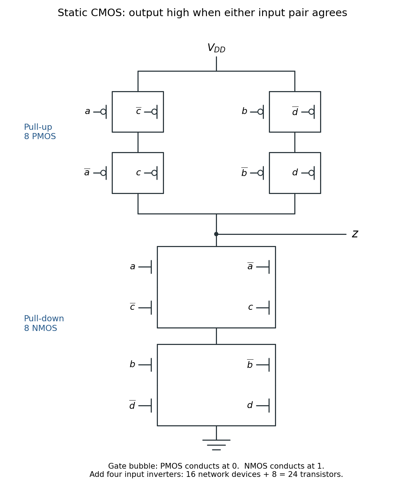

<h1 id="2/d/solution">Solution</h1>

↑ **Parent:** [D](../d.md)

A more economical static [CMOS](../../../../../cmos.md) design follows from factoring the condition for $z=0$. The output is low exactly when both input pairs disagree:

$$
\neg z=(a\oplus c)\land(b\oplus d)
=(a\neg c\lor\neg a c)(b\neg d\lor\neg b d).
$$

Generate $\neg a,\neg b,\neg c,\neg d$ with four [CMOS inverters](../../../../../cmos-inverter.md). Write $n(x)$ or $p(x)$ for an [NMOS transistor](../../../../../nmos-transistor.md) or [PMOS transistor](../../../../../pmos-transistor.md) whose gate receives $x$. In the following network expressions, a dash means a series connection and $\parallel$ means a parallel connection.

Connect this eight-device [pull-down network](../../../../../pull-down-network.md) between $z$ and ground:

$$
\boxed{
\bigl[(n(a)-n(\neg c))\parallel(n(\neg a)-n(c))\bigr]
-\bigl[(n(b)-n(\neg d))\parallel(n(\neg b)-n(d))\bigr].}
$$

The first parallel module conducts exactly when $a\ne c$ and the second exactly when $b\ne d$. Their series connection therefore conducts precisely when $z$ should be zero.

By [complementary CMOS network duality](../../../../../complementary-cmos-network-duality.md), connect this eight-device [pull-up network](../../../../../pull-up-network.md) between $V_{DD}$ and $z$:

$$
\boxed{
\bigl[(p(a)\parallel p(\neg c))-(p(\neg a)\parallel p(c))\bigr]
\parallel
\bigl[(p(b)\parallel p(\neg d))-(p(\neg b)\parallel p(d))\bigr].}
$$

A [PMOS transistor](../../../../../pmos-transistor.md) conducts when its gate is zero. Consequently the first upper branch conducts when $(\neg a\lor c)\land(a\lor\neg c)$, namely $a=c$; the second conducts when $b=d$. Their parallel connection gives the required [logical disjunction](../../../../../logical-disjunction.md). For every stable binary input, exactly one of the [pull-up network](../../../../../pull-up-network.md) and [pull-down network](../../../../../pull-down-network.md) conducts.

**[Figure 1](#2/d/image-complementary-cmos-networks-eight-pmos-transistors-above-the-output-and-eight-nmos-transistors-below-it). Complementary CMOS networks: eight PMOS transistors above the output and eight NMOS transistors below it**.

The figure labels each [MOSFET](../../../../../mosfet.md) channel by its gate signal; the four input [CMOS inverters](../../../../../cmos-inverter.md) are additional to the devices drawn.

## ↑ Ancestors (12)

1. [D](../d.md)
2. [2](../../2.md)
3. [Digital systems, linear algebra, introduction to formal proof (resit)](../../../digital-systems-linear-algebra-introduction-to-formal-proof-resit-split.md)
4. [2015](../../../split.md)
5. [Past exam of the year 1 of the computer science course of the University of Oxford](../../../../split.md)
6. [Year 1 of the computer science course of the University of Oxford](../../../../../year-1-of-the-computer-science-course-of-the-university-of-oxford.md)
7. [Computer science course of the University of Oxford](../../../../../computer-science-course-of-the-university-of-oxford.md)
8. [Undergraduate course of the University of Oxford](../../../../../undergraduate-course-of-the-university-of-oxford.md)
9. [Course of the University of Oxford](../../../../../course-of-the-university-of-oxford.md)
10. [University of Oxford](../../../../../university-of-oxford-split.md)
11. [List of universities](../../../../../list-of-universities.md)
12. [Codex Wiki](../../../../../split.md)
