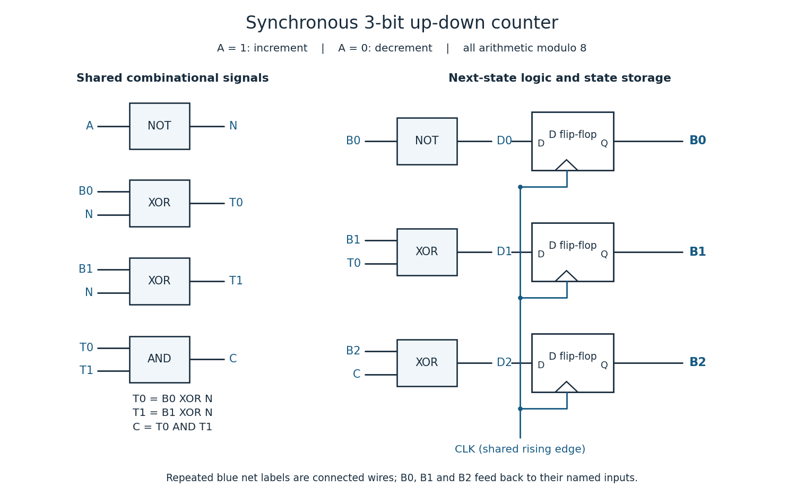

# Digital systems, linear algebra, introduction to formal proof

↑ **Parent:** [2015](../2015.md)

The original cover establishes the date as 19 June 2015. The solutions use the printed question numbering and the [natural deduction](../../mathematical-logic.md#natural-deduction) rules supplied with this paper.[Cover and Figures 1–3, printed pages 1 and 7](../../computer-science-bibliography.md#digital-systems-linear-algebra-introduction-to-formal-proof-examination-paper-by-the-university-of-oxford-2015)

**Table of contents**

- [1](#1)
  - [a](#1/a)
    - [Solution](#1/a/solution)
  - [b](#1/b)
    - [Solution](#1/b/solution)
  - [c](#1/c)
    - [Solution](#1/c/solution)
  - [d](#1/d)
    - [Solution](#1/d/solution)
  - [e](#1/e)
    - [Solution](#1/e/solution)
  - [f](#1/f)
    - [Solution](#1/f/solution)
- [2](#2)
  - [a](#2/a)
    - [Solution](#2/a/solution)
  - [b](#2/b)
    - [Solution](#2/b/solution)
  - [c](#2/c)
    - [Solution](#2/c/solution)
  - [d](#2/d)
    - [Solution](#2/d/solution)
  - [e](#2/e)
    - [Solution](#2/e/solution)
- [3](#3)
  - [a](#3/a)
    - [Solution](#3/a/solution)
  - [b](#3/b)
    - [Solution](#3/b/solution)
  - [c](#3/c)
    - [Solution](#3/c/solution)
  - [d](#3/d)
    - [Solution](#3/d/solution)
- [4](#4)
  - [a](#4/a)
    - [Solution](#4/a/solution)
  - [b](#4/b)
    - [Solution](#4/b/solution)
- [5](#5)
  - [a](#5/a)
    - [Solution](#5/a/solution)
  - [b](#5/b)
    - [Solution](#5/b/solution)
  - [c](#5/c)
    - [Solution](#5/c/solution)
  - [d](#5/d)
    - [Solution](#5/d/solution)
- [6](#6)
  - [a](#6/a)
    - [Solution](#6/a/solution)
  - [b](#6/b)
    - [Solution](#6/b/solution)
  - [c](#6/c)
    - [Solution](#6/c/solution)
  - [d](#6/d)
    - [Solution](#6/d/solution)
  - [e](#6/e)
    - [Solution](#6/e/solution)
- [7](#7)
  - [a](#7/a)
    - [i](#7/a/i)
      - [Solution](#7/a/i/solution)
    - [ii](#7/a/ii)
      - [Solution](#7/a/ii/solution)
  - [b](#7/b)
    - [i](#7/b/i)
      - [Solution](#7/b/i/solution)
    - [ii](#7/b/ii)
      - [Solution](#7/b/ii/solution)
  - [c](#7/c)
    - [i](#7/c/i)
      - [Solution](#7/c/i/solution)
    - [ii](#7/c/ii)
      - [Solution](#7/c/ii/solution)
    - [iii](#7/c/iii)
      - [Solution](#7/c/iii/solution)
    - [iv](#7/c/iv)
      - [Solution](#7/c/iv/solution)
- [8](#8)
  - [a](#8/a)
    - [i](#8/a/i)
      - [Solution](#8/a/i/solution)
    - [ii](#8/a/ii)
      - [Solution](#8/a/ii/solution)
    - [iii](#8/a/iii)
      - [Solution](#8/a/iii/solution)
  - [b](#8/b)
    - [Solution](#8/b/solution)
  - [c](#8/c)
    - [Solution](#8/c/solution)

## 1

↑ **Parent:** [Digital systems, linear algebra, introduction to formal proof](digital-systems-linear-algebra-introduction-to-formal-proof.md)

<h3 id="1/a">a</h3>

↑ **Parent:** [1](#1)

<h4 id="1/a/solution">Solution</h4>

↑ **Parent:** [A](#1/a)

The [transition matrix](../../markov-chain.md#stochastic-matrix) acts on a column [probability vector](../../probability-distribution.md#probability-vector) in the order Central, Headington, Botley. Thus column $j$ records the destinations of buses starting at station $j$. The Central-to-Headington, Headington-to-Botley and Botley-to-Central entries give

$$
\boxed{A=B=C=0.1,\qquad P=\begin{pmatrix}0.6&0.1&0.1\\0.1&0.8&0.2\\0.3&0.1&0.7\end{pmatrix}.}
$$

Each column sums to one, as required for this column convention for a [stochastic matrix](../../markov-chain.md#stochastic-matrix).

<h3 id="1/b">b</h3>

↑ **Parent:** [1](#1)

<h4 id="1/b/solution">Solution</h4>

↑ **Parent:** [B](#1/b)

For a square [matrix](../../vector-space.md#matrix) $M$, an [eigenvalue](../../linear-operator-theory.md#eigenvalue)–[eigenvector](../../linear-operator-theory.md#eigenvector) pair consists of a [scalar](../../vector-space.md#scalar) $\lambda$ and a **nonzero** [vector](../../vector-space.md#vector) $v$ satisfying

$$
\boxed{Mv=\lambda v,\qquad v\ne0.}
$$

The [linear map](../../vector-space.md#linear-map) represented by $M$ therefore scales $v$ by $\lambda$. The exclusion of the zero [vector](../../vector-space.md#vector) matters: otherwise every [scalar](../../vector-space.md#scalar) would satisfy the equation trivially.

<h3 id="1/c">c</h3>

↑ **Parent:** [1](#1)

<h4 id="1/c/solution">Solution</h4>

↑ **Parent:** [C](#1/c)

Use [matrix multiplication](../../vector-space.md#matrix-multiplication) to evolve the [probability vector](../../probability-distribution.md#probability-vector) by $x_{n+1}=Px_n$. With $x_0=(0.4,0.4,0.2)^{\mathsf T}$,

$$
x_1=\begin{pmatrix}0.24+0.04+0.02\\0.04+0.32+0.04\\0.12+0.04+0.14\end{pmatrix}=\begin{pmatrix}0.30\\0.40\\0.30\end{pmatrix},\qquad x_2=\begin{pmatrix}0.18+0.04+0.03\\0.03+0.32+0.06\\0.09+0.04+0.21\end{pmatrix}=\begin{pmatrix}0.25\\0.41\\0.34\end{pmatrix}.
$$

Hence, in Central, Headington, Botley order,

$$
\boxed{\text{day 1: }(30\%,40\%,30\%),\qquad\text{day 2: }(25\%,41\%,34\%).}
$$

Both [probability vectors](../../probability-distribution.md#probability-vector) have nonnegative entries summing to one.

<h3 id="1/d">d</h3>

↑ **Parent:** [1](#1)

<h4 id="1/d/solution">Solution</h4>

↑ **Parent:** [D](#1/d)

Define the [characteristic polynomial](../../linear-operator-theory.md#characteristic-polynomial) using $p(\lambda)=\det(\lambda I-P)$, where $I$ is the [identity matrix](../../vector-space.md#identity-matrix). Expanding the [determinant](../../multilinear-algebra.md#determinant) along the first row gives

$$
\begin{aligned}
p(\lambda)&=(\lambda-0.6)\bigl((\lambda-0.8)(\lambda-0.7)-0.02\bigr)\\
&\quad+0.1\bigl(-0.1(\lambda-0.7)-0.06\bigr)-0.1\bigl(0.01+0.3(\lambda-0.8)\bigr)\\
&=\lambda^3-2.1\lambda^2+1.4\lambda-0.3\\
&=(\lambda-1)(\lambda-0.6)(\lambda-0.5).
\end{aligned}
$$

Thus the [characteristic equation](../../linear-ordinary-differential-equation.md#characteristic-equation-of-a-constant-coefficient-differential-equation) is

$$
\boxed{p(\lambda)=\lambda^3-\frac{21}{10}\lambda^2+\frac75\lambda-\frac3{10}=0.}
$$

The convention $\det(P-\lambda I)$ changes the sign of this cubic [polynomial](../../polynomial.md) but gives the same [roots](../../semisimple-lie-algebra.md#root-of-a-root-system).

<h3 id="1/e">e</h3>

↑ **Parent:** [1](#1)

<h4 id="1/e/solution">Solution</h4>

↑ **Parent:** [E](#1/e)

The factorization of the [characteristic polynomial](../../linear-operator-theory.md#characteristic-polynomial) shows that $\lambda=1$ is an [eigenvalue](../../linear-operator-theory.md#eigenvalue). To find its normalized [eigenvector](../../linear-operator-theory.md#eigenvector), solve $(P-I)v=0$ together with $v_C+v_H+v_B=1$. The first two independent [linear equations](../../linear-algebra.md#linear-equation) are

$$
-4v_C+v_H+v_B=0,\qquad v_C-2v_H+2v_B=0.
$$

The first equation and normalization give $5v_C=1$. The second gives $v_H-v_B=v_C/2=1/10$, while $v_H+v_B=4/5$. Consequently,

$$
\boxed{v=\begin{pmatrix}1/5\\9/20\\7/20\end{pmatrix},\qquad Pv=v.}
$$

All entries are positive and sum to one. This [probability vector](../../probability-distribution.md#probability-vector) is the [stationary distribution](../../markov-chain.md#stationary-distribution).

<h3 id="1/f">f</h3>

↑ **Parent:** [1](#1)

<h4 id="1/f/solution">Solution</h4>

↑ **Parent:** [F](#1/f)

The remaining [eigenvalues](../../linear-operator-theory.md#eigenvalue) are

$$
\boxed{\lambda_2=\frac35,\qquad\lambda_3=\frac12.}
$$

They have absolute value less than one. The three distinct [eigenvalues](../../linear-operator-theory.md#eigenvalue) give a [basis](../../vector-space.md#basis) of [eigenvectors](../../linear-operator-theory.md#eigenvector), which may be chosen as $v$, $u=(0,-1,1)^{\mathsf T}$ and $w=(-1,-1,2)^{\mathsf T}$, with $Pu=(3/5)u$ and $Pw=(1/2)w$. Write an arbitrary initial [probability vector](../../probability-distribution.md#probability-vector) as $x_0=cv+\alpha u+\beta w$. Summing its entries shows $c=1$, because the entries of $v$ sum to one and those of $u,w$ sum to zero. Therefore

$$
P^nx_0=v+\alpha\left(\frac35\right)^nu+\beta\left(\frac12\right)^nw\longrightarrow v.
$$

This proves [convergence](../../calculus.md#convergence) for every initial [probability vector](../../probability-distribution.md#probability-vector), rather than merely identifying a possible limit. In particular,

$$
\boxed{\lim_{n\to\infty}x_n=(20\%,45\%,35\%)^{\mathsf T}.}
$$

For the given initial [probability vector](../../probability-distribution.md#probability-vector), $\alpha=1/4$ and $\beta=-1/5$; substituting $n=1,2$ also recovers the previous answers. The slowest decaying [eigenvector](../../linear-operator-theory.md#eigenvector) component has factor $(3/5)^n$.

## 2

↑ **Parent:** [Digital systems, linear algebra, introduction to formal proof](digital-systems-linear-algebra-introduction-to-formal-proof.md)

<h3 id="2/a">a</h3>

↑ **Parent:** [2](#2)

<h4 id="2/a/solution">Solution</h4>

↑ **Parent:** [A](#2/a)

For an $m\times n$ [matrix](../../vector-space.md#matrix) $A$ with real entries, its [row space](../../vector-space.md#row-space) is the [linear span](../../vector-space.md#linear-span) of its rows, a [linear subspace](../../vector-space.md#vector-subspace) of $\mathbb R^n$. Its [column space](../../vector-space.md#column-space) is the [linear span](../../vector-space.md#linear-span) of its columns, a [linear subspace](../../vector-space.md#vector-subspace) of $\mathbb R^m$ and the [image of a linear map](../../vector-space.md#image-of-a-linear-map) $x\mapsto Ax$. Its [null space](../../kernel-of-a-linear-map.md) is

$$
\ker A=\{x\in\mathbb R^n:Ax=0\},
$$

a [linear subspace](../../vector-space.md#vector-subspace) of $\mathbb R^n$. Finally,

$$
\boxed{\operatorname{rank}A=\dim\operatorname{Col}A=\dim\operatorname{Row}A.}
$$

Thus the [rank of a matrix](../../vector-space.md#matrix-rank) counts the number of [linearly independent](../../vector-space.md#linear-independence) columns, equivalently rows. The [nullity](../../kernel-of-a-linear-map.md#nullity-of-a-linear-map) is $\dim\ker A=n-\operatorname{rank}A$ by the [rank-nullity theorem](../../kernel-of-a-linear-map.md#rank-nullity-theorem).

<h3 id="2/b">b</h3>

↑ **Parent:** [2](#2)

<h4 id="2/b/solution">Solution</h4>

↑ **Parent:** [B](#2/b)

Perform the [elementary row operations](../../numerical-linear-algebra.md#elementary-row-operation) $R_2\gets R_2-R_1$ and $R_3\gets R_3+R_1$, then $R_3\gets R_3-R_2$:

$$
A\sim\begin{pmatrix}1&2&-1&4\\0&0&5&-3\\0&0&5&-3\end{pmatrix}\sim\begin{pmatrix}1&2&-1&4\\0&0&5&-3\\0&0&0&0\end{pmatrix}.
$$

These operations preserve the [row space](../../vector-space.md#row-space). The two nonzero rows of this [row echelon form](../../numerical-linear-algebra.md#row-echelon-form) are [linearly independent](../../vector-space.md#linear-independence): only the first has a nonzero first entry, and the second is nonzero. Hence

$$
\boxed{\text{a row-space basis is }\{(1,2,-1,4),(0,0,5,-3)\},\qquad\operatorname{rank}A=2.}
$$

Further [Gaussian elimination](../../numerical-linear-algebra.md#gaussian-elimination) gives the [reduced row echelon form](../../numerical-linear-algebra.md#reduced-row-echelon-form)

$$
\begin{pmatrix}1&2&0&17/5\\0&0&1&-3/5\\0&0&0&0\end{pmatrix},
$$

which will also identify the [free variables](../../mathematical-logic.md#free-variable) in the [null space](../../kernel-of-a-linear-map.md) calculation.

<h3 id="2/c">c</h3>

↑ **Parent:** [2](#2)

<h4 id="2/c/solution">Solution</h4>

↑ **Parent:** [C](#2/c)

The [pivot columns](../../vector-space.md#pivot-column) in the [row echelon form](../../numerical-linear-algebra.md#row-echelon-form) are columns 1 and 3. Use those columns of the **original** [matrix](../../vector-space.md#matrix) for a [basis](../../vector-space.md#basis) of the original [column space](../../vector-space.md#column-space):

$$
\boxed{\left\{\begin{pmatrix}1\\1\\-1\end{pmatrix},\begin{pmatrix}-1\\4\\6\end{pmatrix}\right\}.}
$$

For a direct spanning check, column 2 is twice column 1 and column 4 is $(17/5)$ times column 1 minus $(3/5)$ times column 3. The displayed columns are [linearly independent](../../vector-space.md#linear-independence), since the first two coordinates of $\alpha c_1+\beta c_3=0$ give $\alpha-\beta=0$ and $\alpha+4\beta=0$, so $\alpha=\beta=0$.

<h3 id="2/d">d</h3>

↑ **Parent:** [2](#2)

<h4 id="2/d/solution">Solution</h4>

↑ **Parent:** [D](#2/d)

The [reduced row echelon form](../../numerical-linear-algebra.md#reduced-row-echelon-form) gives

$$
x_1=-2x_2-\frac{17}{5}x_4,\qquad x_3=\frac35x_4.
$$

Taking the [free variables](../../mathematical-logic.md#free-variable) as $x_2=s$ and $x_4=5t$, the [null space](../../kernel-of-a-linear-map.md) is

$$
\ker A=\left\{s\begin{pmatrix}-2\\1\\0\\0\end{pmatrix}+t\begin{pmatrix}-17\\0\\3\\5\end{pmatrix}:s,t\in\mathbb R\right\}.
$$

The two displayed [vectors](../../vector-space.md#vector) are [linearly independent](../../vector-space.md#linear-independence), as their second and fourth coordinates show, and each satisfies $Ax=0$. Thus

$$
\boxed{\text{a null-space basis is }\{(-2,1,0,0)^{\mathsf T},(-17,0,3,5)^{\mathsf T}\},\quad\dim\ker A=2.}
$$

This also agrees with the [rank-nullity theorem](../../kernel-of-a-linear-map.md#rank-nullity-theorem): $4-2=2$.

<h3 id="2/e">e</h3>

↑ **Parent:** [2](#2)

<h4 id="2/e/solution">Solution</h4>

↑ **Parent:** [E](#2/e)

Apply the same [elementary row operations](../../numerical-linear-algebra.md#elementary-row-operation) to the [augmented matrix](../../linear-algebra.md#augmented-matrix):

$$
\left(\begin{array}{rrrr|r}1&2&-1&4&2\\1&2&4&1&7\\-1&-2&6&-7&3\end{array}\right)\sim\left(\begin{array}{rrrr|r}1&2&-1&4&2\\0&0&5&-3&5\\0&0&0&0&0\end{array}\right).
$$

The last row establishes consistency; equivalently the third original row is the second minus twice the first, and the right-hand entries obey $3=7-2\cdot2$. With $x_2=s$ and $x_4=5t$, the second equation gives $x_3=1+3t$ and the first gives $x_1=3-2s-17t$. All real solutions are therefore

$$
\boxed{x=\begin{pmatrix}3\\0\\1\\0\end{pmatrix}+s\begin{pmatrix}-2\\1\\0\\0\end{pmatrix}+t\begin{pmatrix}-17\\0\\3\\5\end{pmatrix},\qquad s,t\in\mathbb R.}
$$

This [affine solution space](../../linear-algebra.md#affine-solution-space) is one particular solution plus the [null space](../../kernel-of-a-linear-map.md). The two [free variables](../../mathematical-logic.md#free-variable) show that there are no additional restrictions.

## 3

↑ **Parent:** [Digital systems, linear algebra, introduction to formal proof](digital-systems-linear-algebra-introduction-to-formal-proof.md)

<h3 id="3/a">a</h3>

↑ **Parent:** [3](#3)

<h4 id="3/a/solution">Solution</h4>

↑ **Parent:** [A](#3/a)

Let $U,V$ be $n\times n$ [upper triangular matrices](../../linear-algebra.md#upper-triangular-matrix). For an entry below the diagonal, $i>j$, [matrix multiplication](../../vector-space.md#matrix-multiplication) gives

$$
(UV)_{ij}=\sum_{k=1}^nU_{ik}V_{kj}.
$$

If $k<i$, then $U_{ik}=0$. If $k\geq i$, then $k>j$, so $V_{kj}=0$. Every summand is zero, giving

$$
\boxed{i>j\implies(UV)_{ij}=0.}
$$

Thus $UV$ is an [upper triangular matrix](../../linear-algebra.md#upper-triangular-matrix). Equivalently, a potentially nonzero summand would require $i\leq k\leq j$, impossible below the diagonal.

<h3 id="3/b">b</h3>

↑ **Parent:** [3](#3)

<h4 id="3/b/solution">Solution</h4>

↑ **Parent:** [B](#3/b)

Suppose an [invertible matrix](../../linear-algebra.md#invertible-matrix) has two [LU factorizations](../../numerical-linear-algebra.md#lu-decomposition), $A=L_1U_1=L_2U_2$, with $L_1,L_2$ [unit lower triangular matrices](../../linear-algebra.md#unit-lower-triangular-matrix) and $U_1,U_2$ [upper triangular matrices](../../linear-algebra.md#upper-triangular-matrix). All four factors are [invertible matrices](../../linear-algebra.md#invertible-matrix), since their square products are invertible. Multiplication by the appropriate [inverse matrices](../../matrix-inverse.md) gives

$$
L_2^{-1}L_1=U_2U_1^{-1}.
$$

By the supplied closure properties, the left side is a [unit lower triangular matrix](../../linear-algebra.md#unit-lower-triangular-matrix) and the right side is an [upper triangular matrix](../../linear-algebra.md#upper-triangular-matrix). A [matrix](../../vector-space.md#matrix) of both types is diagonal; its diagonal entries are all one. Thus both sides are the [identity matrix](../../vector-space.md#identity-matrix), whence

$$
\boxed{L_1=L_2,\qquad U_1=U_2.}
$$

**Qualification of the printed wording:** this establishes uniqueness **if the specified [LU factorization](../../numerical-linear-algebra.md#lu-decomposition) exists**. Invertibility alone does not guarantee an unpivoted [LU factorization](../../numerical-linear-algebra.md#lu-decomposition). For example $\begin{pmatrix}0&1\\1&0\end{pmatrix}$ is invertible, but in a product $\begin{pmatrix}1&0\\\ell&1\end{pmatrix}\begin{pmatrix}u_{11}&u_{12}\\0&u_{22}\end{pmatrix}$, the zero top-left entry forces $u_{11}=0$, making the bottom-left entry $\ell u_{11}=0$ as well, contrary to the required value one. A [permutation matrix](../../vector-space.md#permutation-matrix) is needed in general, as in [PLU factorization](../../numerical-linear-algebra.md#plu-factorization).

<h3 id="3/c">c</h3>

↑ **Parent:** [3](#3)

<h4 id="3/c/solution">Solution</h4>

↑ **Parent:** [C](#3/c)

Use [Gaussian elimination](../../numerical-linear-algebra.md#gaussian-elimination) without row exchanges. First apply $R_2\gets R_2-3R_1$ and $R_3\gets R_3-2R_1$; then apply $R_3\gets R_3-R_2$:

$$
\begin{pmatrix}1&2&4\\3&8&14\\2&6&13\end{pmatrix}\longrightarrow\begin{pmatrix}1&2&4\\0&2&2\\0&2&5\end{pmatrix}\longrightarrow U=\begin{pmatrix}1&2&4\\0&2&2\\0&0&3\end{pmatrix}.
$$

The elimination multipliers are $m_{21}=3$, $m_{31}=2$ and $m_{32}=1$. Put them below the diagonal of a [unit lower triangular matrix](../../linear-algebra.md#unit-lower-triangular-matrix):

$$
\boxed{L=\begin{pmatrix}1&0&0\\3&1&0\\2&1&1\end{pmatrix},\qquad U=\begin{pmatrix}1&2&4\\0&2&2\\0&0&3\end{pmatrix},\qquad A=LU.}
$$

To see why these multipliers reconstruct the rows, row 2 of $LU$ is three times row 1 of $U$ plus row 2 of $U$, giving $(3,8,14)$. Row 3 of $LU$ is twice row 1 plus row 2 plus row 3 of $U$, giving $(2,6,13)$. This directly verifies the [LU factorization](../../numerical-linear-algebra.md#lu-decomposition).

<h3 id="3/d">d</h3>

↑ **Parent:** [3](#3)

<h4 id="3/d/solution">Solution</h4>

↑ **Parent:** [D](#3/d)

The [elementary row operations](../../numerical-linear-algebra.md#elementary-row-operation) used above add multiples of other rows, so preserve the [determinant](../../multilinear-algebra.md#determinant). The [determinant](../../multilinear-algebra.md#determinant) of an [upper triangular matrix](../../linear-algebra.md#upper-triangular-matrix) is the product of its diagonal entries. Hence

$$
\boxed{\det A=\det U=1\cdot2\cdot3=6.}
$$

Equivalently, $\det L=1$ and [multiplicativity of the determinant](../../multilinear-algebra.md#multiplicativity-of-the-determinant) gives $\det A=\det L\det U=6$.

## 4

↑ **Parent:** [Digital systems, linear algebra, introduction to formal proof](digital-systems-linear-algebra-introduction-to-formal-proof.md)

<h3 id="4/a">a</h3>

↑ **Parent:** [4](#4)

<h4 id="4/a/solution">Solution</h4>

↑ **Parent:** [A](#4/a)

Use three positive-edge-triggered [D flip-flops](../../electrical-engineering.md#d-flip-flop), all driven by the same [clock signal](../../electrical-engineering.md#clock-signal) $CLK$. Write the current [binary representation](../../arithmetic.md#binary-number) as $B2\,B1\,B0$, with $B0$ the [least significant bit](../../integer.md#least-significant-bit). The next state is the current value plus one when $A=1$ and minus one when $A=0$, in each case modulo eight. A [bit](../../information-theory.md#bit) toggles under [exclusive or](../../theoretical-computer-science.md#exclusive-or) with a one.

For upward counting, $B1$ toggles when $B0=1$, while $B2$ toggles when $B1=B0=1$, the respective [carry](../../arithmetic.md#carry-arithmetic) conditions. For downward counting the corresponding [borrow](../../arithmetic.md#borrow) conditions are $B0=0$ and $B1=B0=0$. Define the shared inverted direction $N=\neg A$ and the two direction-match signals

$$
T_0=B0\oplus N,\qquad T_1=B1\oplus N.
$$

Each $T_i$ is one exactly when $Bi=A$: it equals $Bi$ for upward counting and $\neg Bi$ for downward counting. Thus the [Boolean functions](../../analysis-of-boolean-functions.md#boolean-function) for the three D inputs are

$$
\boxed{D_0=\neg B0,\qquad D_1=B1\oplus T_0,\qquad D_2=B2\oplus(T_0\land T_1).}
$$

Implement this with two [NOT gates](../../theoretical-computer-science.md#not-gate) for $N,D_0$, four two-input [exclusive or](../../theoretical-computer-science.md#exclusive-or) gates for $T_0,T_1,D_1,D_2$, and one two-input [AND gate](../../mathematical-logic.md#and-gate). Connect $D_i$ to the [D flip-flop](../../electrical-engineering.md#d-flip-flop) whose output is $Bi$; feed the three outputs back into the indicated gates. All three [flip-flops](../../electrical-engineering.md#flip-flop) capture simultaneously, so each equation uses the old state.

<a id="4/a/image-synchronous-three-bit-up-down-binary-counter-common-clock-signal-explicit-d-inputs-and-feedback"></a>


**[Figure 1](#4/a/image-synchronous-three-bit-up-down-binary-counter-common-clock-signal-explicit-d-inputs-and-feedback). Synchronous three-bit up-down binary counter: common clock signal, explicit D inputs and feedback**.

For completeness, the [state transition table](../../foundations-of-mathematics.md#state-transition-table) is

| Current $B2B1B0$ | Next for $A=1$ | Next for $A=0$ |
| --- | --- | --- |
| `000` | `001` | `111` |
| `001` | `010` | `000` |
| `010` | `011` | `001` |
| `011` | `100` | `010` |
| `100` | `101` | `011` |
| `101` | `110` | `100` |
| `110` | `111` | `101` |
| `111` | `000` | `110` |

Every three-[bit](../../information-theory.md#bit) state is valid. A reset may initialize the [binary counter](../../electrical-engineering.md#binary-counter) to zero if required; counting itself needs no extra state. The direction input must meet the [setup time](../../electrical-engineering.md#setup-time) and [hold time](../../electrical-engineering.md#hold-time) requirements at the active [clock edge](../../computer-science.md#clock-edge).

<h3 id="4/b">b</h3>

↑ **Parent:** [4](#4)

<h4 id="4/b/solution">Solution</h4>

↑ **Parent:** [B](#4/b)

For an estimate, use the usual equal-device [CMOS](../../semiconductor.md#cmos) series-stack model: a $k$-input [NAND gate](../../theoretical-computer-science.md#nand-gate) or [NOR gate](../../theoretical-computer-science.md#nor-gate) has a worst-case [propagation delay](../../theoretical-computer-science.md#propagation-delay) approximately $k$ times that of an inverter, because a conducting path contains $k$ series [transistors](../../semiconductor.md#transistor). An [AND gate](../../mathematical-logic.md#and-gate) or [OR gate](../../mathematical-logic.md#or-gate) adds an output inverter. With a 1 ns inverter this gives, for $k\geq2$,

$$
\boxed{t_{\mathrm{AND},k}\simeq t_{\mathrm{OR},k}\simeq(k+1)\,\mathrm{ns}.}
$$

For $k=2$ it reproduces the stated 3 ns. This is a technology estimate under equal sizing and comparable loading, not a unique physical law inferable from a single measured delay. Actual [propagation delay](../../theoretical-computer-science.md#propagation-delay) also depends on [capacitance](../../electromagnetism.md#capacitance), [fan-out](../../theoretical-computer-science.md#fan-out) and [transistor](../../semiconductor.md#transistor) sizing. If instead only the supplied two-input gates were allowed, a balanced tree would have worst-case depth $\lceil\log_2k\rceil$ and delay $3\lceil\log_2k\rceil$ ns; that is a different construction from a single $k$-input gate.

For the explicit circuit in part (a), the longest [combinational logic](../../theoretical-computer-science.md#combinational-logic) path starts at $A$, passes through the shared inverter, either direction-match [exclusive or](../../theoretical-computer-science.md#exclusive-or), the [AND gate](../../mathematical-logic.md#and-gate), and the final [exclusive or](../../theoretical-computer-science.md#exclusive-or) feeding $D_2$:

$$
\boxed{t_{\max}=1+2+3+2=8\,\mathrm{ns}.}
$$

The path $A\to D_1$ takes 5 ns, the paths from $B0$ or $B1$ to $D_2$ take at most 7 ns, and $B0\to D_0$ takes 1 ns. Both direction-match [exclusive or](../../theoretical-computer-science.md#exclusive-or) gates act in parallel; their delays are not added together. The 8 ns excludes [clock-to-Q delay](../../electrical-engineering.md#clock-to-q-delay), [setup time](../../electrical-engineering.md#setup-time), [hold time](../../electrical-engineering.md#hold-time) and clock-distribution effects, because the question asks only for the [combinational logic](../../theoretical-computer-science.md#combinational-logic) delay.

## 5

↑ **Parent:** [Digital systems, linear algebra, introduction to formal proof](digital-systems-linear-algebra-introduction-to-formal-proof.md)

<h3 id="5/a">a</h3>

↑ **Parent:** [5](#5)

<h4 id="5/a/solution">Solution</h4>

↑ **Parent:** [A](#5/a)

For a normal [half-precision floating-point number](../../floating-point-arithmetic.md#half-precision-floating-point-format), write the stored fields as sign $s$, biased [exponent](../../arithmetic.md#exponent) $E$ and ten-[bit](../../information-theory.md#bit) fraction $f$. The value is $(-1)^s(1.f)_2\,2^{E-15}$ for $1\leq E\leq30$. The leading one is implicit: the ten stored fraction [bits](../../information-theory.md#bit) give eleven significant [binary digits](../../integer.md#binary-digit) including that one. The normalized [binary representations](../../arithmetic.md#binary-number) and stored fields are

| Value | Normalized [binary representation](../../arithmetic.md#binary-number) | Sign, biased [exponent](../../arithmetic.md#exponent), fraction |
| --- | --- | --- |
| $1/2$ | $1.0_2\,2^{-1}$ | `0 01110 0000000000` |
| $5/8$ | $1.01_2\,2^{-1}$ | `0 01110 0100000000` |
| $-3/16$ | $-1.1_2\,2^{-3}$ | `1 01100 1000000000` |
| $15\frac12$ | $1.1111_2\,2^3$ | `0 10010 1111000000` |

Thus the four 16-[bit](../../information-theory.md#bit) words are

$$
\boxed{0011100000000000,\quad0011100100000000,\quad1011001000000000,\quad0100101111000000.}
$$

Every conversion is exact: all four numbers have terminating [binary representations](../../arithmetic.md#binary-number) within the available precision.

<h3 id="5/b">b</h3>

↑ **Parent:** [5](#5)

<h4 id="5/b/solution">Solution</h4>

↑ **Parent:** [B](#5/b)

Both signs are positive, so perform [addition](../../arithmetic.md#addition) of the aligned [significands](../../floating-point-arithmetic.md#significand). The true [exponents](../../arithmetic.md#exponent) are $-1$ and $3$, a difference of four. Shift the smaller [significand](../../floating-point-arithmetic.md#significand) right four places, retaining its low [bits](../../information-theory.md#bit):

$$
\frac58=0.000101_2\,2^3,\qquad15\frac12=1.111100_2\,2^3.
$$

Add at the common [exponent](../../arithmetic.md#exponent):

$$
\begin{array}{r}
1.111100_2\\
+\;0.000101_2\\\hline
10.000001_2
\end{array}
\qquad\text{so}\qquad10.000001_2\,2^3=1.0000001_2\,2^4.
$$

Renormalization raises the true [exponent](../../arithmetic.md#exponent) to $4$ and the biased [exponent](../../arithmetic.md#exponent) to $E=19=10011_2$. There are only seven fraction places to retain, so no [floating-point rounding](../../floating-point-arithmetic.md#floating-point-rounding) changes the result:

$$
\boxed{\frac58+15\frac12=16\frac18,\qquad\text{stored fields }0\;10011\;0000001000.}
$$

The complete word is `0100110000001000`.

<h3 id="5/c">c</h3>

↑ **Parent:** [5](#5)

<h4 id="5/c/solution">Solution</h4>

↑ **Parent:** [C](#5/c)

The smallest positive normal [half-precision floating-point number](../../floating-point-arithmetic.md#half-precision-floating-point-format) uses $E=1$ and a zero fraction, while the largest uses $E=30$ and all ten fraction [bits](../../information-theory.md#bit) equal to one. Hence

$$
\boxed{x_{\min,\mathrm{normal}}=1.0_2\,2^{1-15}=2^{-14},\qquad x_{\max,\mathrm{normal}}=(2-2^{-10})2^{15}=65504.}
$$

The corresponding words are `0 00001 0000000000` and `0 11110 1111111111`. The stored [exponent](../../arithmetic.md#exponent) $31$ is reserved and cannot extend the finite normal range.

For a [subnormal number](../../floating-point-arithmetic.md#subnormal-number), $E=0$ and the implicit leading [bit](../../information-theory.md#bit) becomes zero, while the scale remains $2^{1-15}=2^{-14}$. The least positive nonzero fraction is $0.0000000001_2=2^{-10}$, giving

$$
\boxed{x_{\min,\mathrm{subnormal}}=2^{-10}2^{-14}=2^{-24},\qquad\text{word }0\;00000\;0000000001.}
$$

Using scale $2^{-15}$ here would be incorrect: the [subnormal number](../../floating-point-arithmetic.md#subnormal-number) convention uses the minimum normal scale, not the ordinary biased-[exponent](../../arithmetic.md#exponent) formula at $E=0$.

<h3 id="5/d">d</h3>

↑ **Parent:** [5](#5)

<h4 id="5/d/solution">Solution</h4>

↑ **Parent:** [D](#5/d)

For the [unsigned interpretation](../../arithmetic.md#unsigned-interpretation-of-a-bit-string) of the [binary string](../../theoretical-computer-science.md#binary-string), the set positions have weights $2^{15},2^{13},2^{12},2^{11},2^{10},2^8,2^6,2^5,2^4$. Thus

$$
\boxed{u=2^{15}+2^{13}+2^{12}+2^{11}+2^{10}+2^8+2^6+2^5+2^4=48496.}
$$

In 16-[bit](../../information-theory.md#bit) [two's complement](../../programming-language.md#two-s-complement), the [most significant bit](../../integer.md#most-significant-bit) is set, so subtract $2^{16}$ from that [unsigned interpretation](../../arithmetic.md#unsigned-interpretation-of-a-bit-string):

$$
\boxed{z=48496-65536=-17040.}
$$

For a [half-precision floating-point number](../../floating-point-arithmetic.md#half-precision-floating-point-format), split the fields at their actual boundaries rather than the printed groups of four:

$$
1\;01111\;0101110000.
$$

The sign is negative, the true [exponent](../../arithmetic.md#exponent) is $15-15=0$, and the fraction is $2^{-2}+2^{-4}+2^{-5}+2^{-6}=23/64$. It is a normal finite value, so

$$
\boxed{x=-\left(1+2^{-2}+2^{-4}+2^{-5}+2^{-6}\right)2^0=-\frac{87}{64}=-1.359375.}
$$

## 6

↑ **Parent:** [Digital systems, linear algebra, introduction to formal proof](digital-systems-linear-algebra-introduction-to-formal-proof.md)

<h3 id="6/a">a</h3>

↑ **Parent:** [6](#6)

<h4 id="6/a/solution">Solution</h4>

↑ **Parent:** [A](#6/a)

A [zero-address instruction](../../computer-science.md#zero-address-instruction) has no explicit operand addresses, so its operands and result location must be implicit in the [instruction set architecture](../../computer-science.md#instruction-set-architecture). A [stack machine](../../theoretical-computer-science.md#stack-machine) supplies these naturally: operations remove their inputs from the top of an operand [stack](../../data-structure.md#stack-data-structure) and push the result. A fixed-[processor register](../../computer-science.md#processor-register) design is logically possible, so “almost certainly” is appropriately weaker than a proof that only a [stack machine](../../theoretical-computer-science.md#stack-machine) could work.

Write the [stack](../../data-structure.md#stack-data-structure) from bottom to top, with its top on the right. Let $S$ stand for any unchanged prefix. Suitable effects are

$$
\boxed{\mathrm{add}:S,u,v\mapsto S,u+v,\qquad\mathrm{const}\ c:S\mapsto S,c.}
$$

Thus `add` pops two operands and pushes one [sum](../../arithmetic.md#sum), reducing [stack](../../data-structure.md#stack-data-structure) occupancy by one. The special `const c` instruction pushes its immediate constant and increases occupancy by one. Only `const` needs an explicit value in its encoding.

<h3 id="6/b">b</h3>

↑ **Parent:** [6](#6)

<h4 id="6/b/solution">Solution</h4>

↑ **Parent:** [B](#6/b)

Use two [zero-address instructions](../../computer-science.md#zero-address-instruction) for indirect access to [computer memory](../../computer-memory.md). Define `load` to replace the top [memory address](../../computer-memory.md#memory-address) by the value at that address, and define `store` to pop a value followed by the address just beneath it:

$$
\mathrm{load}:S,p\mapsto S,M[p],\qquad\mathrm{store}:S,p,v\mapsto S\quad\text{with }M[p]\gets v.
$$

Both have no encoded address operand; the [stack](../../data-structure.md#stack-data-structure) supplies it. If the known fixed [memory addresses](../../computer-memory.md#memory-address) of the variables are $p_x,p_y$, implement the assignment with
```
const p_x
const p_y
load
store
```
The successive [stack](../../data-structure.md#stack-data-structure) suffixes are $p_x$, then $p_x,p_y$, then $p_x,M[p_y]$, then empty. Hence

$$
\boxed{M[p_x]\gets M[p_y].}
$$

The surrounding [stack](../../data-structure.md#stack-data-structure) is restored. Other `store` conventions are possible, but the operand order must be stated and used consistently.

<h3 id="6/c">c</h3>

↑ **Parent:** [6](#6)

<h4 id="6/c/solution">Solution</h4>

↑ **Parent:** [C](#6/c)

A computed [memory address](../../computer-memory.md#memory-address) is just another [integer](../../integer.md) on the operand [stack](../../data-structure.md#stack-data-structure). For a [pointer](../../computer-memory.md#pointer-computer-programming) held at fixed address $p$, `const p; load` obtains the pointed-to address; another `load` obtains its contents. More generally, any expression that leaves an address on top may be followed by `load`, or may be retained beneath a computed value for `store`.

For an [array](../../data-structure.md#array-data-structure) whose base address is $b$ and whose element size is $w$ address units, the address of entry $i$ is $b+wM[p_i]$, where $p_i$ stores the index. Add [zero-address instructions](../../computer-science.md#zero-address-instruction) `mul` and `dup`, with `dup` mapping $S,p$ to $S,p,p$. A suitable sequence is
```
const b
const p_i
load
const w
mul
add
dup
load
const 1
add
store
```
The first six instructions leave the element address $p=b+wM[p_i]$. The remaining suffix evolves as

$$
S,p\longmapsto S,p,p\longmapsto S,p,M[p]\longmapsto S,p,M[p],1\longmapsto S,p,M[p]+1\longmapsto S,
$$

with the final effect

$$
\boxed{M[b+wM[p_i]]\gets M[b+wM[p_i]]+1.}
$$

The address is computed once and duplicated, so both accesses refer to the same [array](../../data-structure.md#array-data-structure) element. For unit-sized elements omit `const w; mul`. If the base address is itself held in a variable, replace `const b` by the instructions loading that variable's value. No instruction other than `const` requires an explicit operand.

<h3 id="6/d">d</h3>

↑ **Parent:** [6](#6)

<h4 id="6/d/solution">Solution</h4>

↑ **Parent:** [D](#6/d)

Let $d_e=\operatorname{depth}(e)$ and $d_f=\operatorname{depth}(f)$ measure the extra operand [stack](../../data-structure.md#stack-data-structure) space required from the current base, with each evaluation leaving one result. Evaluating $e$ first uses $d_e$ slots. Its result occupies one slot while evaluating $f$, so that stage uses $1+d_f$ slots. The final `add` reduces two slots to one. Thus

$$
\boxed{d_{e\text{ first}}=\max(d_e,1+d_f),\qquad d_{f\text{ first}}=\max(d_f,1+d_e).}
$$

By [commutativity](../../algebraic-operation.md#commutativity) of [addition](../../arithmetic.md#addition), choose the smaller of these two bounds. Evaluate the child of larger depth first. The optimum recurrence on a [binary expression tree](../../data-structure.md#binary-expression-tree) is

$$
\boxed{\operatorname{depth}(e+f)=\begin{cases}\max(d_e,d_f),&d_e\ne d_f,\\d_e+1,&d_e=d_f.\end{cases}}
$$

Assign depth one to a literal or a simple already-addressable value, and compute the child depths recursively. If $d_e>d_f$, the depths are [integers](../../integer.md), so $d_e\geq1+d_f$; evaluating $e$ first therefore attains $d_e$, while reversing the order needs $d_e+1$. If the depths are equal, whichever child goes second needs the extra retained-result slot. These lower bounds prove the recurrence is optimal for evaluating each child subtree without interleaving or spilling. Apply it at every node to minimize peak operand [stack](../../data-structure.md#stack-data-structure) occupancy for the given [binary expression tree](../../data-structure.md#binary-expression-tree); this is [optimal stack evaluation of a binary expression tree](../../theoretical-computer-science.md#optimal-stack-evaluation-of-a-binary-expression-tree).

This changes child evaluation order, not the parenthesization. For example, a chain-shaped [binary expression tree](../../data-structure.md#binary-expression-tree) can have depth two, whereas a balanced tree of eight leaves has depth four under this model. The reordering assumes expressions have no order-sensitive [side effects](../../programming-language.md#side-effect-computer-science) or observable exceptions. Reassociating [floating-point addition](../../floating-point-arithmetic.md#floating-point-addition) would require additional care because it can change [floating-point rounding](../../floating-point-arithmetic.md#floating-point-rounding).

<h3 id="6/e">e</h3>

↑ **Parent:** [6](#6)

<h4 id="6/e/solution">Solution</h4>

↑ **Parent:** [E](#6/e)

Fix `sub` to mean $S,u,v\mapsto S,u-v$. If the depth-minimizing order evaluates the right operand $f$ before the left operand $e$, the [stack](../../data-structure.md#stack-data-structure) ends in $S,f,e$, so ordinary `sub` would compute the wrong sign. Two possible [instruction set architecture](../../computer-science.md#instruction-set-architecture) extensions are:

- Add `swap`, with $S,u,v\mapsto S,v,u$. After computing $f$ and then $e$, use `swap; sub` to obtain $e-f$. One general [zero-address instruction](../../computer-science.md#zero-address-instruction) handles every noncommutative binary operation and is useful elsewhere, but each reversed evaluation needs an extra instruction and extra execution time. It can be implemented without an additional operand [stack](../../data-structure.md#stack-data-structure) slot.
- Add reverse-operand variants, such as `rsub` with $S,u,v\mapsto S,v-u$, and analogously reverse division and other required operations. After computing $f$ and then $e$, a single `rsub` obtains $e-f$. This avoids the extra executed `swap`, but requires more opcodes and decoder support, usually one reverse form for each affected operation.

Both preserve the same peak operand [stack](../../data-structure.md#stack-data-structure) bound:

$$
\boxed{\text{deeper child first; use either operand swapping or a reverse-operand opcode.}}
$$

The first trades extra dynamic instructions for a smaller instruction set; the second trades a larger instruction set for fewer executed instructions. Neither extension makes order-sensitive [side effects](../../programming-language.md#side-effect-computer-science) safe to reorder.

## 7

↑ **Parent:** [Digital systems, linear algebra, introduction to formal proof](digital-systems-linear-algebra-introduction-to-formal-proof.md)

<h3 id="7/a">a</h3>

↑ **Parent:** [7](#7)

<h4 id="7/a/i">i</h4>

↑ **Parent:** [A](#7/a)

<h5 id="7/a/i/solution">Solution</h5>

↑ **Parent:** [I](#7/a/i)

In [natural deduction](../../mathematical-logic.md#natural-deduction), [conjunction introduction](../../mathematical-logic.md#conjunction-introduction-rule) combines derivations of $\phi$ and $\psi$ under the available assumptions into $\phi\land\psi$. [Disjunction elimination](../../mathematical-logic.md#disjunction-elimination-rule) takes $\phi\lor\psi$ and two [subproofs](../../mathematical-logic.md#subproof) of the same conclusion $\kappa$, one assuming $\phi$ and the other assuming $\psi$, and concludes $\kappa$. [Implication introduction](../../mathematical-logic.md#implication-introduction-rule) takes a [subproof](../../mathematical-logic.md#subproof) deriving $\psi$ from a [temporary assumption](../../mathematical-logic.md#temporary-assumption) $\phi$, and concludes $\phi\to\psi$.

The rectangular boxes mark the scopes of [temporary assumptions](../../mathematical-logic.md#temporary-assumption). The [disjunction elimination rule](../../mathematical-logic.md#disjunction-elimination-rule) discharges its two case assumptions, while the [implication introduction rule](../../mathematical-logic.md#implication-introduction-rule) discharges the antecedent assumption. Other surrounding assumptions remain in force; intermediate results depending on the boxed assumptions cannot be exported arbitrarily. Schematically,

$$
\boxed{\frac{\phi\quad\psi}{\phi\land\psi},\qquad\frac{\phi\lor\psi\quad[\phi]\ \vdots\ \kappa\quad[\psi]\ \vdots\ \kappa}{\kappa},\qquad\frac{[\phi]\ \vdots\ \psi}{\phi\to\psi}.}
$$

Here the square brackets designate the assumptions discharged by the corresponding [inference rule](../../mathematical-logic.md#inference-rule).

<h4 id="7/a/ii">ii</h4>

↑ **Parent:** [A](#7/a)

<h5 id="7/a/ii/solution">Solution</h5>

↑ **Parent:** [Ii](#7/a/ii)

A common-context [sequent](../../mathematical-logic.md#sequent) version of the [disjunction elimination rule](../../mathematical-logic.md#disjunction-elimination-rule) is

$$
\boxed{\frac{\Gamma\vdash\phi\lor\psi\qquad\Gamma,\phi\vdash\kappa\qquad\Gamma,\psi\vdash\kappa}{\Gamma\vdash\kappa}.}
$$

The second and third premises record exactly the two boxed [subproofs](../../mathematical-logic.md#subproof) of the [natural deduction](../../mathematical-logic.md#natural-deduction) presentation. Their additional case assumptions do not occur in the conclusion: that is [assumption discharge](../../mathematical-logic.md#assumption-discharge). The surrounding context $\Gamma$ remains throughout. A formulation with different surrounding contexts is equivalent after retaining their union by [weakening](../../mathematical-logic.md#weakening).

<h3 id="7/b">b</h3>

↑ **Parent:** [7](#7)

<h4 id="7/b/i">i</h4>

↑ **Parent:** [B](#7/b)

<h5 id="7/b/i/solution">Solution</h5>

↑ **Parent:** [I](#7/b/i)

Read chained [logical implications](../../mathematical-logic.md#logical-implication) as right-associative. Use the following [natural deduction](../../mathematical-logic.md#natural-deduction) derivation; indentation bars mark nested [subproofs](../../mathematical-logic.md#subproof) and the last column records rules and discharged line ranges:

$$
\begin{array}{rll}
1&E\to(F\to(G\to H))&\text{premise}\\
2&\vert\ G&\text{assumption}\\
3&\vert\ \vert\ F&\text{assumption}\\
4&\vert\ \vert\ \vert\ E&\text{assumption}\\
5&\vert\ \vert\ \vert\ F\to(G\to H)&\to\text{-elim }1,4\\
6&\vert\ \vert\ \vert\ G\to H&\to\text{-elim }5,3\\
7&\vert\ \vert\ \vert\ H&\to\text{-elim }6,2\\
8&\vert\ \vert\ E\to H&\to\text{-intro }4\text{--}7\\
9&\vert\ F\to(E\to H)&\to\text{-intro }3\text{--}8\\
10&G\to(F\to(E\to H))&\to\text{-intro }2\text{--}9
\end{array}
$$

Each application of the [implication introduction rule](../../mathematical-logic.md#implication-introduction-rule) discharges only its matching [temporary assumption](../../mathematical-logic.md#temporary-assumption). Thus

$$
\boxed{E\to F\to G\to H\ \vdash\ G\to F\to E\to H.}
$$

<h4 id="7/b/ii">ii</h4>

↑ **Parent:** [B](#7/b)

<h5 id="7/b/ii/solution">Solution</h5>

↑ **Parent:** [Ii](#7/b/ii)

Use [conjunction elimination](../../mathematical-logic.md#conjunction-elimination-rule) to extract the three inputs, then apply the [implication elimination rule](../../mathematical-logic.md#implication-elimination-rule) three times:

$$
\begin{array}{rll}
1&E\to(F\to(G\to H))&\text{premise}\\
2&\vert\ (E\land F)\land G&\text{assumption}\\
3&\vert\ E\land F&\land\text{-elim-L }2\\
4&\vert\ G&\land\text{-elim-R }2\\
5&\vert\ E&\land\text{-elim-L }3\\
6&\vert\ F&\land\text{-elim-R }3\\
7&\vert\ F\to(G\to H)&\to\text{-elim }1,5\\
8&\vert\ G\to H&\to\text{-elim }7,6\\
9&\vert\ H&\to\text{-elim }8,4\\
10&((E\land F)\land G)\to H&\to\text{-intro }2\text{--}9
\end{array}
$$

The [implication introduction rule](../../mathematical-logic.md#implication-introduction-rule) closes the only [subproof](../../mathematical-logic.md#subproof), giving

$$
\boxed{E\to F\to G\to H\ \vdash\ ((E\land F)\land G)\to H.}
$$

<h3 id="7/c">c</h3>

↑ **Parent:** [7](#7)

<h4 id="7/c/i">i</h4>

↑ **Parent:** [C](#7/c)

<h5 id="7/c/i/solution">Solution</h5>

↑ **Parent:** [I](#7/c/i)

Extract both [negations](../../theoretical-computer-science.md#negation), assume the [logical disjunction](../../mathematical-logic.md#logical-disjunction), and use [disjunction elimination](../../mathematical-logic.md#disjunction-elimination-rule) to derive [logical falsity](../../mathematical-logic.md#logical-falsity) in either case:

$$
\begin{array}{rll}
1&\neg P\land\neg Q&\text{premise}\\
2&\neg P&\land\text{-elim-L }1\\
3&\neg Q&\land\text{-elim-R }1\\
4&\vert\ P\lor Q&\text{assumption}\\
5&\vert\ \vert\ P&\text{first case assumption}\\
6&\vert\ \vert\ \bot&\neg\text{-elim }5,2\\
7&\vert\ \vert\ Q&\text{second case assumption}\\
8&\vert\ \vert\ \bot&\neg\text{-elim }7,3\\
9&\vert\ \bot&\lor\text{-elim }4,5\text{--}6,7\text{--}8\\
10&\neg(P\lor Q)&\neg\text{-intro }4\text{--}9
\end{array}
$$

The two case [subproofs](../../mathematical-logic.md#subproof) are siblings, not nested within one another. Therefore

$$
\boxed{\neg P\land\neg Q\ \vdash\ \neg(P\lor Q).}
$$

<h4 id="7/c/ii">ii</h4>

↑ **Parent:** [C](#7/c)

<h5 id="7/c/ii/solution">Solution</h5>

↑ **Parent:** [Ii](#7/c/ii)

Use [negation introduction](../../mathematical-logic.md#negation-introduction-rule) separately for each component, introducing the forbidden [logical disjunction](../../mathematical-logic.md#logical-disjunction) in each [subproof](../../mathematical-logic.md#subproof):

$$
\begin{array}{rll}
1&\neg(P\lor Q)&\text{premise}\\
2&\vert\ P&\text{assumption}\\
3&\vert\ P\lor Q&\lor\text{-intro-L }2\\
4&\vert\ \bot&\neg\text{-elim }3,1\\
5&\neg P&\neg\text{-intro }2\text{--}4\\
6&\vert\ Q&\text{assumption}\\
7&\vert\ P\lor Q&\lor\text{-intro-R }6\\
8&\vert\ \bot&\neg\text{-elim }7,1\\
9&\neg Q&\neg\text{-intro }6\text{--}8\\
10&\neg P\land\neg Q&\land\text{-intro }5,9
\end{array}
$$

Both [temporary assumptions](../../mathematical-logic.md#temporary-assumption) have been discharged before the final [conjunction introduction](../../mathematical-logic.md#conjunction-introduction-rule), so

$$
\boxed{\neg(P\lor Q)\ \vdash\ \neg P\land\neg Q.}
$$

<h4 id="7/c/iii">iii</h4>

↑ **Parent:** [C](#7/c)

<h5 id="7/c/iii/solution">Solution</h5>

↑ **Parent:** [Iii](#7/c/iii)

In [proof by contradiction](../../foundations-of-mathematics.md#reductio-ad-absurdum), assume the [negation](../../theoretical-computer-science.md#negation) of the desired conclusion and derive [logical falsity](../../mathematical-logic.md#logical-falsity); discharge that assumption and infer the desired conclusion. Its [sequent](../../mathematical-logic.md#sequent) rule is

$$
\boxed{\frac{\Gamma,\neg\phi\vdash\bot}{\Gamma\vdash\phi}.}
$$

This is a rule of [classical propositional logic](../../mathematical-logic.md#classical-propositional-logic). It follows from the paper's [negation introduction rule](../../mathematical-logic.md#negation-introduction-rule), which first yields $\neg\neg\phi$, and [double-negation elimination](../../mathematical-logic.md#double-negation-elimination), which yields $\phi$. This is stronger than merely deriving $\neg\phi$ by showing that $\phi$ leads to [logical falsity](../../mathematical-logic.md#logical-falsity).

<h4 id="7/c/iv">iv</h4>

↑ **Parent:** [C](#7/c)

<h5 id="7/c/iv/solution">Solution</h5>

↑ **Parent:** [Iv](#7/c/iv)

Use [proof by contradiction](../../foundations-of-mathematics.md#reductio-ad-absurdum), expanding the final classical step explicitly into [negation introduction](../../mathematical-logic.md#negation-introduction-rule) followed by [double-negation elimination](../../mathematical-logic.md#double-negation-elimination). First the assumption $\neg(\neg P\lor\neg Q)$ forces $P$: otherwise $\neg P$ immediately gives the prohibited [logical disjunction](../../mathematical-logic.md#logical-disjunction). It similarly forces $Q$. The formal [natural deduction](../../mathematical-logic.md#natural-deduction) derivation is

$$
\begin{array}{rll}
1&\neg(P\land Q)&\text{premise}\\
2&\vert\ \neg(\neg P\lor\neg Q)&\text{assumption}\\
3&\vert\ \vert\ \neg P&\text{assumption}\\
4&\vert\ \vert\ \neg P\lor\neg Q&\lor\text{-intro-L }3\\
5&\vert\ \vert\ \bot&\neg\text{-elim }4,2\\
6&\vert\ \neg\neg P&\neg\text{-intro }3\text{--}5\\
7&\vert\ P&\neg\neg\text{-elim }6\\
8&\vert\ \vert\ \neg Q&\text{assumption}\\
9&\vert\ \vert\ \neg P\lor\neg Q&\lor\text{-intro-R }8\\
10&\vert\ \vert\ \bot&\neg\text{-elim }9,2\\
11&\vert\ \neg\neg Q&\neg\text{-intro }8\text{--}10\\
12&\vert\ Q&\neg\neg\text{-elim }11\\
13&\vert\ P\land Q&\land\text{-intro }7,12\\
14&\vert\ \bot&\neg\text{-elim }13,1\\
15&\neg\neg(\neg P\lor\neg Q)&\neg\text{-intro }2\text{--}14\\
16&\neg P\lor\neg Q&\neg\neg\text{-elim }15
\end{array}
$$

Hence

$$
\boxed{\neg(P\land Q)\ \vdash\ \neg P\lor\neg Q.}
$$

This direction of [De Morgan's laws](../../theoretical-computer-science.md#de-morgan-s-laws) uses the classical rule supplied on the source rule sheet; it has not been silently treated as an available [inference rule](../../mathematical-logic.md#inference-rule).

## 8

↑ **Parent:** [Digital systems, linear algebra, introduction to formal proof](digital-systems-linear-algebra-introduction-to-formal-proof.md)

<h3 id="8/a">a</h3>

↑ **Parent:** [8](#8)

<h4 id="8/a/i">i</h4>

↑ **Parent:** [A](#8/a)

<h5 id="8/a/i/solution">Solution</h5>

↑ **Parent:** [I](#8/a/i)

A [variable](../../mathematics.md#variable-mathematics) $v$ is fresh for the surrounding context $\Gamma$ when it does not occur free in any undischarged assumption in $\Gamma$. Choose it also distinct from bound variables that would cause [variable capture](../../computability-theory.md#variable-capture) in the intended substitution. The [universal quantifier introduction rule](../../mathematical-logic.md#universal-quantifier-introduction-rule) is

$$
\boxed{\frac{\Gamma\vdash\phi(v)}{\Gamma\vdash\forall x\,\phi(x)}\quad(v\text{ fresh for }\Gamma).}
$$

Its justification is that the [logical derivation](../../mathematical-logic.md#logical-derivation) of $\phi(v)$ used no special information about $v$, so it establishes the property of an arbitrary object. Semantically, changing the assignment of $v$ preserves the truth of $\Gamma$; therefore $\phi(v)$ holds for every possible assigned object. Without the [eigenvariable condition](../../mathematical-logic.md#eigenvariable-condition), the assumption $R(v)$ could incorrectly be generalized to $\forall x\,R(x)$ in an interpretation where only one of two objects satisfies $R$.

<h4 id="8/a/ii">ii</h4>

↑ **Parent:** [A](#8/a)

<h5 id="8/a/ii/solution">Solution</h5>

↑ **Parent:** [Ii](#8/a/ii)

Choose an [eigenvariable](../../mathematical-logic.md#eigenvariable) $v$ fresh for the premise. Use the [existential quantifier introduction rule](../../mathematical-logic.md#existential-quantifier-introduction-rule) to contradict the premise under a [temporary assumption](../../mathematical-logic.md#temporary-assumption) $R(v)$:

$$
\begin{array}{rll}
1&\neg\exists x\,R(x)&\text{premise}\\
2&\vert\ R(v)&\text{assumption; }v\text{ fresh}\\
3&\vert\ \exists x\,R(x)&\exists\text{-intro }2\\
4&\vert\ \bot&\neg\text{-elim }3,1\\
5&\neg R(v)&\neg\text{-intro }2\text{--}4\\
6&\forall y\,\neg R(y)&\forall\text{-intro }5
\end{array}
$$

At line 6 the assumption $R(v)$ has been discharged and the sole remaining premise has no free $v$, satisfying the [eigenvariable condition](../../mathematical-logic.md#eigenvariable-condition). Thus

$$
\boxed{\neg\exists x\,R(x)\ \vdash\ \forall y\,\neg R(y).}
$$

<h4 id="8/a/iii">iii</h4>

↑ **Parent:** [A](#8/a)

<h5 id="8/a/iii/solution">Solution</h5>

↑ **Parent:** [Iii](#8/a/iii)

Choose $v$ fresh. Here [double-negation elimination](../../mathematical-logic.md#double-negation-elimination) is necessary to turn the [negation](../../theoretical-computer-science.md#negation) of a possible counterexample into the positive statement:

$$
\begin{array}{rll}
1&\neg\exists x\,\neg R(x)&\text{premise}\\
2&\vert\ \neg R(v)&\text{assumption; }v\text{ fresh}\\
3&\vert\ \exists x\,\neg R(x)&\exists\text{-intro }2\\
4&\vert\ \bot&\neg\text{-elim }3,1\\
5&\neg\neg R(v)&\neg\text{-intro }2\text{--}4\\
6&R(v)&\neg\neg\text{-elim }5\\
7&\forall y\,R(y)&\forall\text{-intro }6
\end{array}
$$

The remaining context at line 7 contains no free $v$. The [universal quantifier introduction rule](../../mathematical-logic.md#universal-quantifier-introduction-rule) therefore gives

$$
\boxed{\neg\exists x\,\neg R(x)\ \vdash\ \forall y\,R(y).}
$$

<h3 id="8/b">b</h3>

↑ **Parent:** [8](#8)

<h4 id="8/b/solution">Solution</h4>

↑ **Parent:** [B](#8/b)

Use a fresh [existential witness](../../mathematical-logic.md#existential-witness) $v$. Within the assumption of the forbidden [universal quantification](../../mathematical-logic.md#universal-quantification), eliminate the original [existential quantification](../../mathematical-logic.md#existential-quantification) to obtain [logical falsity](../../mathematical-logic.md#logical-falsity):

$$
\begin{array}{rll}
1&\exists x\,R(x)&\text{premise}\\
2&\vert\ \forall y\,\neg R(y)&\text{assumption}\\
3&\vert\ \vert\ R(v)&\text{witness assumption; }v\text{ fresh}\\
4&\vert\ \vert\ \neg R(v)&\forall\text{-elim }2\\
5&\vert\ \vert\ \bot&\neg\text{-elim }3,4\\
6&\vert\ \bot&\exists\text{-elim }1,3\text{--}5\\
7&\neg\forall y\,\neg R(y)&\neg\text{-intro }2\text{--}6
\end{array}
$$

The witness $v$ appears neither in the exported conclusion $\bot$ at line 6 nor in the other undischarged assumptions. The [existential quantifier elimination rule](../../mathematical-logic.md#existential-quantifier-elimination-rule) is therefore valid, and

$$
\boxed{\exists x\,R(x)\ \vdash\ \neg\forall y\,\neg R(y).}
$$

<h3 id="8/c">c</h3>

↑ **Parent:** [8](#8)

<h4 id="8/c/solution">Solution</h4>

↑ **Parent:** [C](#8/c)

The premise limits every possible [existential witness](../../mathematical-logic.md#existential-witness) to the objects named by $c_0,c_1$; it does not assert that these constants name distinct objects. Instantiate it at a fresh witness $v$, then apply [disjunction elimination](../../mathematical-logic.md#disjunction-elimination-rule). In the first case [equality elimination rule](../../mathematical-logic.md#equality-elimination-rule) transfers $R(v)$ to $R(c_0)$; in the second it transfers $R(v)$ to $R(c_1)$, contradicting the assumed [negation](../../theoretical-computer-science.md#negation). The full [natural deduction](../../mathematical-logic.md#natural-deduction) derivation is

$$
\begin{array}{rll}
1&\forall x\,(x=c_0\lor x=c_1)&\text{premise}\\
2&\vert\ \neg R(c_1)&\text{assumption}\\
3&\vert\ \vert\ \exists x\,R(x)&\text{assumption}\\
4&\vert\ \vert\ \vert\ R(v)&\text{witness assumption; }v\text{ fresh}\\
5&\vert\ \vert\ \vert\ v=c_0\lor v=c_1&\forall\text{-elim }1\\
6&\vert\ \vert\ \vert\ \vert\ v=c_0&\text{first case assumption}\\
7&\vert\ \vert\ \vert\ \vert\ R(c_0)&=\text{-elim }6,4\\
8&\vert\ \vert\ \vert\ \vert\ v=c_1&\text{second case assumption}\\
9&\vert\ \vert\ \vert\ \vert\ R(c_1)&=\text{-elim }8,4\\
10&\vert\ \vert\ \vert\ \vert\ \bot&\neg\text{-elim }9,2\\
11&\vert\ \vert\ \vert\ \vert\ R(c_0)&\bot\text{-elim }10\\
12&\vert\ \vert\ \vert\ R(c_0)&\lor\text{-elim }5,6\text{--}7,8\text{--}11\\
13&\vert\ \vert\ R(c_0)&\exists\text{-elim }3,4\text{--}12\\
14&\vert\ (\exists x\,R(x))\to R(c_0)&\to\text{-intro }3\text{--}13\\
15&\neg R(c_1)\to((\exists x\,R(x))\to R(c_0))&\to\text{-intro }2\text{--}14
\end{array}
$$

The sibling case [subproofs](../../mathematical-logic.md#subproof) end before the witness [subproof](../../mathematical-logic.md#subproof) closes. At line 13, $v$ is absent from $R(c_0)$ and from all surrounding assumptions, so no [witness escape](../../mathematical-logic.md#witness-escape) occurs. The final two applications of [implication introduction](../../mathematical-logic.md#implication-introduction-rule) give

$$
\boxed{\forall x\,(x=c_0\lor x=c_1)\ \vdash\ \neg R(c_1)\to(\exists x\,R(x))\to R(c_0).}
$$

The [logical falsity elimination rule](../../mathematical-logic.md#logical-falsity-elimination-rule) is needed to complete the contradictory second case with the same conclusion as the first case.

## ↑ Ancestors (9)

1. [2015](../2015.md)
2. [Past exam of the year 1 of the computer science course of the University of Oxford](../../past-exam-of-the-year-1-of-the-computer-science-course-of-the-university-of-oxford.md)
3. [Year 1 of the computer science course of the University of Oxford](../../university-of-oxford.md#year-1-of-the-computer-science-course-of-the-university-of-oxford)
4. [Computer science course of the University of Oxford](../../university-of-oxford.md#computer-science-course-of-the-university-of-oxford)
5. [Undergraduate course of the University of Oxford](../../university-of-oxford.md#undergraduate-course-of-the-university-of-oxford)
6. [Course of the University of Oxford](../../university-of-oxford.md#course-of-the-university-of-oxford)
7. [University of Oxford](../../university-of-oxford.md)
8. [List of universities](../../README.md#list-of-universities)
9. [Codex Wiki](../../README.md)
