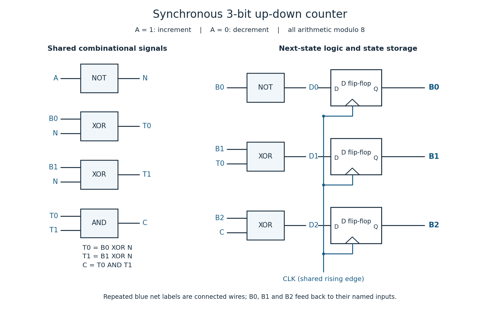

<h1 id="4/a/solution">Solution</h1>

↑ **Parent:** [A](../a.md)

Use three positive-edge-triggered [D flip-flops](../../../../../d-flip-flop.md), all driven by the same [clock signal](../../../../../clock-signal.md) $CLK$. Write the current [binary representation](../../../../../binary-number.md) as $B2\,B1\,B0$, with $B0$ the [least significant bit](../../../../../least-significant-bit.md). The next state is the current value plus one when $A=1$ and minus one when $A=0$, in each case modulo eight. A [bit](../../../../../bit.md) toggles under [exclusive or](../../../../../exclusive-or.md) with a one.

For upward counting, $B1$ toggles when $B0=1$, while $B2$ toggles when $B1=B0=1$, the respective [carry](../../../../../carry-arithmetic.md) conditions. For downward counting the corresponding [borrow](../../../../../borrow.md) conditions are $B0=0$ and $B1=B0=0$. Define the shared inverted direction $N=\neg A$ and the two direction-match signals

$$
T_0=B0\oplus N,\qquad T_1=B1\oplus N.
$$

Each $T_i$ is one exactly when $Bi=A$: it equals $Bi$ for upward counting and $\neg Bi$ for downward counting. Thus the [Boolean functions](../../../../../boolean-function.md) for the three D inputs are

$$
\boxed{D_0=\neg B0,\qquad D_1=B1\oplus T_0,\qquad D_2=B2\oplus(T_0\land T_1).}
$$

Implement this with two [NOT gates](../../../../../not-gate.md) for $N,D_0$, four two-input [exclusive or](../../../../../exclusive-or.md) gates for $T_0,T_1,D_1,D_2$, and one two-input [AND gate](../../../../../and-gate.md). Connect $D_i$ to the [D flip-flop](../../../../../d-flip-flop.md) whose output is $Bi$; feed the three outputs back into the indicated gates. All three [flip-flops](../../../../../flip-flop.md) capture simultaneously, so each equation uses the old state.

**[Figure 1](#4/a/image-synchronous-three-bit-up-down-binary-counter-common-clock-signal-explicit-d-inputs-and-feedback). Synchronous three-bit up-down binary counter: common clock signal, explicit D inputs and feedback**.

For completeness, the [state transition table](../../../../../state-transition-table.md) is

| Current $B2B1B0$ | Next for $A=1$ | Next for $A=0$ |
| --- | --- | --- |
| `000` | `001` | `111` |
| `001` | `010` | `000` |
| `010` | `011` | `001` |
| `011` | `100` | `010` |
| `100` | `101` | `011` |
| `101` | `110` | `100` |
| `110` | `111` | `101` |
| `111` | `000` | `110` |

Every three-[bit](../../../../../bit.md) state is valid. A reset may initialize the [binary counter](../../../../../binary-counter.md) to zero if required; counting itself needs no extra state. The direction input must meet the [setup time](../../../../../setup-time.md) and [hold time](../../../../../hold-time.md) requirements at the active [clock edge](../../../../../clock-edge.md).

## ↑ Ancestors (12)

1. [A](../a.md)
2. [4](../../4.md)
3. [Digital systems, linear algebra, introduction to formal proof](../../../digital-systems-linear-algebra-introduction-to-formal-proof-split.md)
4. [2015](../../../split.md)
5. [Past exam of the year 1 of the computer science course of the University of Oxford](../../../../split.md)
6. [Year 1 of the computer science course of the University of Oxford](../../../../../year-1-of-the-computer-science-course-of-the-university-of-oxford.md)
7. [Computer science course of the University of Oxford](../../../../../computer-science-course-of-the-university-of-oxford.md)
8. [Undergraduate course of the University of Oxford](../../../../../undergraduate-course-of-the-university-of-oxford.md)
9. [Course of the University of Oxford](../../../../../course-of-the-university-of-oxford.md)
10. [University of Oxford](../../../../../university-of-oxford-split.md)
11. [List of universities](../../../../../list-of-universities.md)
12. [Codex Wiki](../../../../../split.md)
