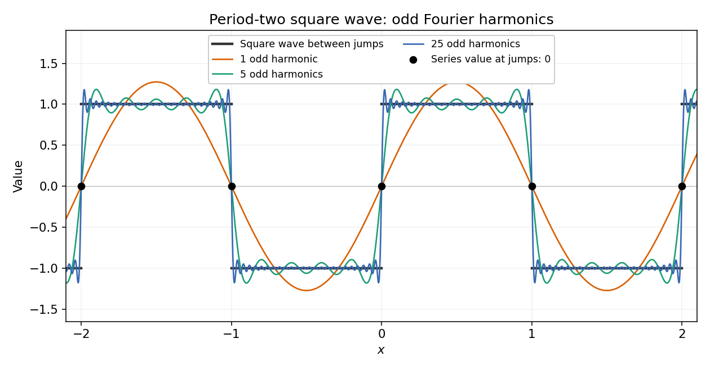

# Discrete mathematics, continuous mathematics, and probability (resit)

↑ **Parent:** [2015](../2015.md)

The original cover identifies the examination as 9 September 2015.[Cover, formal code A10100W1, Long Vacation 2015](../../computer-science-bibliography.md#discrete-mathematics-continuous-mathematics-and-probability-resit-examination-by-the-university-of-oxford-2015)

**Table of contents**

- [1](#1)
  - [a](#1/a)
    - [Solution](#1/a/solution)
  - [b](#1/b)
    - [i](#1/b/i)
      - [Solution](#1/b/i/solution)
    - [ii](#1/b/ii)
      - [Solution](#1/b/ii/solution)
    - [iii](#1/b/iii)
      - [Solution](#1/b/iii/solution)
  - [c](#1/c)
    - [i](#1/c/i)
      - [Solution](#1/c/i/solution)
    - [ii](#1/c/ii)
      - [Solution](#1/c/ii/solution)
    - [iii](#1/c/iii)
      - [Solution](#1/c/iii/solution)
  - [d](#1/d)
    - [i](#1/d/i)
      - [Solution](#1/d/i/solution)
    - [ii](#1/d/ii)
      - [Solution](#1/d/ii/solution)
- [2](#2)
  - [a](#2/a)
    - [i](#2/a/i)
      - [Solution](#2/a/i/solution)
    - [ii](#2/a/ii)
      - [Solution](#2/a/ii/solution)
  - [b](#2/b)
    - [i](#2/b/i)
      - [Solution](#2/b/i/solution)
    - [ii](#2/b/ii)
      - [Solution](#2/b/ii/solution)
  - [c](#2/c)
    - [Solution](#2/c/solution)
  - [d](#2/d)
    - [i](#2/d/i)
      - [Solution](#2/d/i/solution)
    - [ii](#2/d/ii)
      - [Solution](#2/d/ii/solution)
    - [iii](#2/d/iii)
      - [Solution](#2/d/iii/solution)
- [3](#3)
  - [a](#3/a)
    - [i](#3/a/i)
      - [Solution](#3/a/i/solution)
    - [ii](#3/a/ii)
      - [Solution](#3/a/ii/solution)
  - [b](#3/b)
    - [i](#3/b/i)
      - [Solution](#3/b/i/solution)
    - [ii](#3/b/ii)
      - [Solution](#3/b/ii/solution)
  - [c](#3/c)
    - [Solution](#3/c/solution)
  - [d](#3/d)
    - [Solution](#3/d/solution)
  - [e](#3/e)
    - [i](#3/e/i)
      - [Solution](#3/e/i/solution)
    - [ii](#3/e/ii)
      - [Solution](#3/e/ii/solution)
- [4](#4)
  - [a](#4/a)
    - [i](#4/a/i)
      - [Solution](#4/a/i/solution)
    - [ii](#4/a/ii)
      - [Solution](#4/a/ii/solution)
    - [iii](#4/a/iii)
      - [Solution](#4/a/iii/solution)
  - [b](#4/b)
    - [i](#4/b/i)
      - [Solution](#4/b/i/solution)
    - [ii](#4/b/ii)
      - [Solution](#4/b/ii/solution)
    - [iii](#4/b/iii)
      - [Solution](#4/b/iii/solution)
  - [c](#4/c)
    - [i](#4/c/i)
      - [Solution](#4/c/i/solution)
    - [ii](#4/c/ii)
      - [Solution](#4/c/ii/solution)
- [5](#5)
  - [a](#5/a)
    - [i](#5/a/i)
      - [Solution](#5/a/i/solution)
    - [ii](#5/a/ii)
      - [Solution](#5/a/ii/solution)
    - [iii](#5/a/iii)
      - [Solution](#5/a/iii/solution)
  - [b](#5/b)
    - [Solution](#5/b/solution)
  - [c](#5/c)
    - [Solution](#5/c/solution)
- [6](#6)
  - [a](#6/a)
    - [i](#6/a/i)
      - [Solution](#6/a/i/solution)
    - [ii](#6/a/ii)
      - [Solution](#6/a/ii/solution)
    - [iii](#6/a/iii)
      - [Solution](#6/a/iii/solution)
    - [iv](#6/a/iv)
      - [Solution](#6/a/iv/solution)
  - [b](#6/b)
    - [i](#6/b/i)
      - [Solution](#6/b/i/solution)
    - [ii](#6/b/ii)
      - [Solution](#6/b/ii/solution)
    - [iii](#6/b/iii)
      - [Solution](#6/b/iii/solution)
- [7](#7)
  - [a](#7/a)
    - [i](#7/a/i)
      - [Solution](#7/a/i/solution)
    - [ii](#7/a/ii)
      - [Solution](#7/a/ii/solution)
  - [b](#7/b)
    - [i](#7/b/i)
      - [Solution](#7/b/i/solution)
    - [ii](#7/b/ii)
      - [Solution](#7/b/ii/solution)
- [8](#8)
  - [a](#8/a)
    - [i](#8/a/i)
      - [Solution](#8/a/i/solution)
    - [ii](#8/a/ii)
      - [Solution](#8/a/ii/solution)
    - [iii](#8/a/iii)
      - [Solution](#8/a/iii/solution)
  - [b](#8/b)
    - [i](#8/b/i)
      - [Solution](#8/b/i/solution)
    - [ii](#8/b/ii)
      - [Solution](#8/b/ii/solution)
    - [iii](#8/b/iii)
      - [Solution](#8/b/iii/solution)
    - [iv](#8/b/iv)
      - [Solution](#8/b/iv/solution)
- [9](#9)
  - [a](#9/a)
    - [i](#9/a/i)
      - [Solution](#9/a/i/solution)
    - [ii](#9/a/ii)
      - [Solution](#9/a/ii/solution)
    - [iii](#9/a/iii)
      - [Solution](#9/a/iii/solution)
  - [b](#9/b)
    - [i](#9/b/i)
      - [Solution](#9/b/i/solution)
    - [ii](#9/b/ii)
      - [Solution](#9/b/ii/solution)
    - [iii](#9/b/iii)
      - [Solution](#9/b/iii/solution)
    - [iv](#9/b/iv)
      - [Solution](#9/b/iv/solution)
    - [v](#9/b/v)
      - [Solution](#9/b/v/solution)

## 1

↑ **Parent:** [Discrete mathematics, continuous mathematics, and probability (resit)](discrete-mathematics-continuous-mathematics-and-probability-resit.md)

<h3 id="1/a">a</h3>

↑ **Parent:** [1](#1)

<h4 id="1/a/solution">Solution</h4>

↑ **Parent:** [A](#1/a)

The [image of a function](../../set-theory.md#image-of-a-function) $f:A\to B$ is

$$
\boxed{f(A)=\{f(a):a\in A\}\subseteq B.}
$$

The [function](../../function.md) is [surjective](../../algebra.md#surjective-function), or onto, exactly when every $b\in B$ equals $f(a)$ for at least one $a\in A$, equivalently $f(A)=B$. It is [injective](../../algebra.md#injective-function), or one-to-one, exactly when

$$
\boxed{\forall a,a'\in A,\quad f(a)=f(a')\Longrightarrow a=a'.}
$$

Thus [surjectivity](../../algebra.md#surjective-function) concerns whether the entire [codomain](../../function.md#codomain) is reached; [injectivity](../../algebra.md#injective-function) concerns whether distinct inputs have distinct outputs.

<h3 id="1/b">b</h3>

↑ **Parent:** [1](#1)

<h4 id="1/b/i">i</h4>

↑ **Parent:** [B](#1/b)

<h5 id="1/b/i/solution">Solution</h5>

↑ **Parent:** [I](#1/b/i)

Since $x^2+1\geq2|x|$, the [image of a function](../../set-theory.md#image-of-a-function) is contained in $[-1/2,1/2]$. Both endpoints occur, at $x=-1$ and $x=1$. By [continuity](../../calculus.md#continuous-function) and the [intermediate value theorem](../../calculus.md#intermediate-value-theorem) applied on $[-1,1]$, every intermediate value occurs too. Hence

$$
\boxed{f(\mathbb R)=[-1/2,1/2],\qquad f\text{ is neither onto nor one-to-one}.}
$$

It is not [surjective](../../algebra.md#surjective-function) onto $\mathbb R$ because, for example, $1$ is not attained. It is not [injective](../../algebra.md#injective-function) because $f(2)=f(1/2)=2/5$ although $2\ne1/2$.

<h4 id="1/b/ii">ii</h4>

↑ **Parent:** [B](#1/b)

<h5 id="1/b/ii/solution">Solution</h5>

↑ **Parent:** [Ii](#1/b/ii)

If $0\leq x<y$, then $\sqrt x<\sqrt y$ and $x<y$, so $\sqrt x+x<\sqrt y+y$. Thus the [function](../../function.md) is [strictly increasing](../../calculus.md#strictly-increasing-function) on its [domain](../../topology.md#domain-mathematical-analysis) and is [injective](../../algebra.md#injective-function). Its values are nonnegative, so it is not [surjective](../../algebra.md#surjective-function) onto $\mathbb R$:

$$
\boxed{\text{one-to-one, but not onto}.}
$$

If $\mathbb R_+$ means $(0,\infty)$ its [image of a function](../../set-theory.md#image-of-a-function) is $(0,\infty)$; if it includes zero its [image of a function](../../set-theory.md#image-of-a-function) is $[0,\infty)$. Indeed, for any $u>0$, set $t=(\sqrt{1+4u}-1)/2>0$ and $x=t^2$; then $\sqrt x+x=t+t^2=u$. This convention does not change the classification.

<h4 id="1/b/iii">iii</h4>

↑ **Parent:** [B](#1/b)

<h5 id="1/b/iii/solution">Solution</h5>

↑ **Parent:** [Iii](#1/b/iii)

With the convention $\mathbb N=\{0,1,2,\ldots\}$, the even inputs $2j$ map to $j$ for $j\geq0$, while the odd inputs $2j+1$ map to $-(j+1)$ for $j\geq0$. These two [images of a function](../../set-theory.md#image-of-a-function) are disjoint and together equal $\mathbb Z$. Within either class there are no repeated outputs. More explicitly the [inverse function](../../function.md#inverse-function) is

$$
\boxed{f^{-1}(z)=\begin{cases}2z,&z\geq0,\\-2z-1,&z<0.\end{cases}}
$$

Consequently $f$ is both [injective](../../algebra.md#injective-function) and [surjective](../../algebra.md#surjective-function), hence a [bijection](../../function.md#bijection). If instead $\mathbb N=\{1,2,\ldots\}$, the input zero is absent: $f$ remains [injective](../../algebra.md#injective-function) but its [image of a function](../../set-theory.md#image-of-a-function) is $\mathbb Z\setminus\{0\}$, so it is not onto. The printed paper does not specify this convention; the zero-based convention gives the apparent intended [bijection](../../function.md#bijection).

<h3 id="1/c">c</h3>

↑ **Parent:** [1](#1)

<h4 id="1/c/i">i</h4>

↑ **Parent:** [C](#1/c)

<h5 id="1/c/i/solution">Solution</h5>

↑ **Parent:** [I](#1/c/i)

Take every [complement of a set](../../set.md#complement-of-a-set) relative to $\mathcal U$. By [set difference](../../set.md#set-difference), [De Morgan's laws](../../theoretical-computer-science.md#de-morgan-s-laws), and distribution of [set intersection](../../set.md#set-intersection) over [set union](../../set.md#set-union),

$$
\begin{aligned}
A\setminus(B\cap A\cap C)
&=A\cap(B^c\cup A^c\cup C^c)\\
&=(A\cap B^c)\cup(A\cap A^c)\cup(A\cap C^c)\\
&=A\cap(B^c\cup C^c)\\
&=\boxed{A\setminus(B\cap C)}.
\end{aligned}
$$

Here the middle term is the [empty set](../../set.md#empty-set), since a [set](../../set.md) and its [complement of a set](../../set.md#complement-of-a-set) are disjoint.

<h4 id="1/c/ii">ii</h4>

↑ **Parent:** [C](#1/c)

<h5 id="1/c/ii/solution">Solution</h5>

↑ **Parent:** [Ii](#1/c/ii)

Use [set difference](../../set.md#set-difference), associativity of [set intersection](../../set.md#set-intersection), and [De Morgan's laws](../../theoretical-computer-science.md#de-morgan-s-laws):

$$
\begin{aligned}
(A\setminus B)\setminus C
&=(A\cap B^c)\cap C^c\\
&=A\cap(B^c\cap C^c)\\
&=A\cap(B\cup C)^c\\
&=\boxed{A\setminus(B\cup C)}.
\end{aligned}
$$

<h4 id="1/c/iii">iii</h4>

↑ **Parent:** [C](#1/c)

<h5 id="1/c/iii/solution">Solution</h5>

↑ **Parent:** [Iii](#1/c/iii)

The commutativity and associativity of [set intersection](../../set.md#set-intersection) give

$$
\begin{aligned}
(A\setminus B)\setminus C
&=A\cap B^c\cap C^c\\
&=A\cap C^c\cap B^c\\
&=\boxed{(A\setminus C)\setminus B}.
\end{aligned}
$$

Equivalently, part (ii) reduces both sides to removal of the same [set union](../../set.md#set-union) $B\cup C=C\cup B$.

<h3 id="1/d">d</h3>

↑ **Parent:** [1](#1)

<h4 id="1/d/i">i</h4>

↑ **Parent:** [D](#1/d)

<h5 id="1/d/i/solution">Solution</h5>

↑ **Parent:** [I](#1/d/i)

For every [set](../../set.md) $S$, the definition of a [power set](../../set.md#power-set) gives

$$
\begin{aligned}
S\in\mathcal P(A\cap B)
&\Longleftrightarrow S\subseteq A\cap B\\
&\Longleftrightarrow (S\subseteq A\text{ and }S\subseteq B)\\
&\Longleftrightarrow S\in\mathcal P(A)\cap\mathcal P(B).
\end{aligned}
$$

Equality by identical membership therefore proves

$$
\boxed{\mathcal P(A\cap B)=\mathcal P(A)\cap\mathcal P(B).}
$$

The essential observation is that being a [subset](../../set.md#subset) of a [set intersection](../../set.md#set-intersection) means being a [subset](../../set.md#subset) of both factors.

<h4 id="1/d/ii">ii</h4>

↑ **Parent:** [D](#1/d)

<h5 id="1/d/ii/solution">Solution</h5>

↑ **Parent:** [Ii](#1/d/ii)

First suppose the [sets](../../set.md) are finite, with [cardinalities](../../cardinal-number.md#cardinality) $a=|A|\geq2$ and $b=|B|\geq2$. The [power set](../../set.md#power-set) and [Cartesian product](../../set-theory.md#cartesian-product) counting rules give

$$
|\mathcal P(A\times B)|=2^{ab},\qquad
|\mathcal P(A)\times\mathcal P(B)|=2^{a+b}.
$$

Since $ab-a-b=(a-1)(b-1)-1\geq0$, the desired inequality follows.

The [power-set product cardinality inequality](../../set.md#power-set-product-cardinality-inequality) also has an [injection](../../algebra.md#injective-function) proof that does not assume finiteness. Choose distinct $a_0,a_1\in A$ and distinct $b_0,b_1\in B$. For $S\subseteq A$ and $T\subseteq B$, define the [subset](../../set.md#subset) of $A\times B$

$$
\Phi(S,T)=(S\times\{b_0\})\cup(\{a_0\}\times(T\setminus\{b_0\}))\cup E_T,
\qquad
E_T=\begin{cases}\{(a_1,b_1)\},&b_0\in T,\\\varnothing,&b_0\notin T.\end{cases}
$$

These three encoding regions are disjoint. The row with second coordinate $b_0$ recovers $S$; the column with first coordinate $a_0$ and second coordinate different from $b_0$ recovers $T\setminus\{b_0\}$; the extra position $(a_1,b_1)$ records whether $b_0\in T$. Thus $\Phi$ is [injective](../../algebra.md#injective-function), proving for arbitrary [sets](../../set.md)

$$
\boxed{|\mathcal P(A\times B)|\geq|\mathcal P(A)\times\mathcal P(B)|.}
$$

Encoding by $S\times T$ alone would fail: all pairs with either factor empty would have the same output.

## 2

↑ **Parent:** [Discrete mathematics, continuous mathematics, and probability (resit)](discrete-mathematics-continuous-mathematics-and-probability-resit.md)

<h3 id="2/a">a</h3>

↑ **Parent:** [2](#2)

<h4 id="2/a/i">i</h4>

↑ **Parent:** [A](#2/a)

<h5 id="2/a/i/solution">Solution</h5>

↑ **Parent:** [I](#2/a/i)

Let $x_i$ be the number of objects in box $i$. The arrangements correspond exactly to nonnegative [integer](../../integer.md) solutions of $x_1+\cdots+x_k=n$. By [stars and bars](../../combinatorics.md#stars-and-bars-combinatorics), place $n$ stars and $k-1$ separating bars in a row. The number of stars between consecutive bars records the occupancy of each distinguishable box, with adjacent bars allowing an empty box. Choosing the bar positions gives

$$
\boxed{\binom{n+k-1}{k-1}}\qquad(k\geq1).
$$

<h4 id="2/a/ii">ii</h4>

↑ **Parent:** [A](#2/a)

<h5 id="2/a/ii/solution">Solution</h5>

↑ **Parent:** [Ii](#2/a/ii)

Put one object into each box first. The remaining $n-k$ objects can be distributed without restrictions, so [stars and bars](../../combinatorics.md#stars-and-bars-combinatorics) gives

$$
\boxed{\binom{(n-k)+k-1}{k-1}=\binom{n-1}{k-1}.}
$$

Equivalently, the substitution $u_i=x_i-1$ gives a [bijection](../../function.md#bijection) between positive [integer](../../integer.md) solutions of $\sum_i x_i=n$ and nonnegative [integer](../../integer.md) solutions of $\sum_i u_i=n-k$.

<h3 id="2/b">b</h3>

↑ **Parent:** [2](#2)

<h4 id="2/b/i">i</h4>

↑ **Parent:** [B](#2/b)

<h5 id="2/b/i/solution">Solution</h5>

↑ **Parent:** [I](#2/b/i)

Use [mathematical induction](../../foundations-of-mathematics.md#mathematical-induction). For $n=1$, the left side is $2^0=1=2^1-1$. If the identity holds at $n$, then

$$
\sum_{k=0}^{n}2^k
=\left(\sum_{k=0}^{n-1}2^k\right)+2^n
=(2^n-1)+2^n
=2^{n+1}-1.
$$

The base case and induction step establish the [geometric series](../../sequence-and-series.md#geometric-series) identity

$$
\boxed{\sum_{k=0}^{n-1}2^k=2^n-1\quad(n\geq1).}
$$

<h4 id="2/b/ii">ii</h4>

↑ **Parent:** [B](#2/b)

<h5 id="2/b/ii/solution">Solution</h5>

↑ **Parent:** [Ii](#2/b/ii)

For the base case $n=2$, $1+1/\sqrt2>\sqrt2$, since multiplying by $\sqrt2$ reduces this to $\sqrt2+1>2$. Suppose the claimed inequality holds for some $n\geq2$. The identity

$$
\sqrt{n+1}-\sqrt n=\frac1{\sqrt{n+1}+\sqrt n}<\frac1{\sqrt{n+1}}
$$

then gives

$$
\sum_{k=1}^{n+1}\frac1{\sqrt k}
>\sqrt n+\frac1{\sqrt{n+1}}
>\sqrt{n+1}.
$$

Thus [mathematical induction](../../foundations-of-mathematics.md#mathematical-induction) proves

$$
\boxed{\sqrt n<\sum_{k=1}^{n}\frac1{\sqrt k}\quad(n\geq2).}
$$

<h3 id="2/c">c</h3>

↑ **Parent:** [2](#2)

<h4 id="2/c/solution">Solution</h4>

↑ **Parent:** [C](#2/c)

The initial values of the two [sequences](../../sequence-and-series.md#sequence) agree: $c_0=d_0=1$ and $c_1=-1+c_0=0=d_1$. For $n\geq2$, use the first-order [recurrence relation](../../sequence-and-series.md#recurrence-relation) at $n$ and $n-1$:

$$
\begin{aligned}
c_n-(n-1)(c_{n-1}+c_{n-2})
&=(-1)^n+c_{n-1}-(n-1)c_{n-2}\\
&=(-1)^n+(-1)^{n-1}=0.
\end{aligned}
$$

Therefore $c_n$ satisfies exactly the same [derangement recurrence](../../combinatorics.md#derangement-recurrence) as $d_n$. By [strong induction](../../foundations-of-mathematics.md#strong-induction), equality of the preceding two terms implies equality of the next term. Consequently

$$
\boxed{c_n=d_n\quad\text{for every }n\geq0.}
$$

The first-order [recurrence relation](../../sequence-and-series.md#recurrence-relation) therefore also counts [derangements](../../combinatorics.md#derangement-of-a-permutation).

<h3 id="2/d">d</h3>

↑ **Parent:** [2](#2)

For a [binary relation](../../set-theory.md#binary-relation) $R\subseteq A\times A$, [reflexivity](../../set-theory.md#reflexive-relation) means $aRa$ for every $a\in A$; a [symmetric relation](../../set-theory.md#symmetric-relation) satisfies $aRb\Rightarrow bRa$ for every $a,b\in A$; an [antisymmetric relation](../../set-theory.md#antisymmetric-relation) satisfies $(aRb\text{ and }bRa)\Rightarrow a=b$ for every $a,b\in A$; [transitivity](../../set-theory.md#transitive-relation) means $(aRb\text{ and }bRc)\Rightarrow aRc$ for every $a,b,c\in A$; an [irreflexive relation](../../set-theory.md#irreflexive-relation) satisfies $\neg(aRa)$ for every $a\in A$. In particular, failure of [reflexivity](../../set-theory.md#reflexive-relation) means at least one missing diagonal pair, whereas [irreflexivity](../../set-theory.md#irreflexive-relation) requires every diagonal pair to be missing.

<h4 id="2/d/i">i</h4>

↑ **Parent:** [D](#2/d)

<h5 id="2/d/i/solution">Solution</h5>

↑ **Parent:** [I](#2/d/i)

There are $n^2$ possible ordered pairs and hence $2^{n^2}$ [binary relations](../../set-theory.md#binary-relation). A [reflexive relation](../../set-theory.md#reflexive-relation) must contain the $n$ diagonal pairs, while its remaining $n^2-n$ pairs are unrestricted. Subtracting the [reflexive relations](../../set-theory.md#reflexive-relation) gives

$$
\boxed{2^{n^2}-2^{n^2-n}}
$$

[binary relations](../../set-theory.md#binary-relation) that are not [reflexive](../../set-theory.md#reflexive-relation).

<h4 id="2/d/ii">ii</h4>

↑ **Parent:** [D](#2/d)

<h5 id="2/d/ii/solution">Solution</h5>

↑ **Parent:** [Ii](#2/d/ii)

A [symmetric relation](../../set-theory.md#symmetric-relation) has $n$ independent choices on the diagonal. For each of the $\binom n2$ unordered pairs $\{a,b\}$ of distinct elements, either both ordered pairs are included or neither is. Thus there are $2^{n+\binom n2}$ [symmetric relations](../../set-theory.md#symmetric-relation), so the requested number is

$$
\boxed{2^{n^2}-2^{n+\binom n2}=2^{n^2}-2^{n(n+1)/2}.}
$$

<h4 id="2/d/iii">iii</h4>

↑ **Parent:** [D](#2/d)

<h5 id="2/d/iii/solution">Solution</h5>

↑ **Parent:** [Iii](#2/d/iii)

For each unordered pair $\{a,b\}$ with $a\ne b$, [antisymmetry](../../set-theory.md#antisymmetry) allows three choices: neither direction, only $(a,b)$, or only $(b,a)$. This contributes $3^{\binom n2}$. The diagonal is unrestricted by [antisymmetry](../../set-theory.md#antisymmetry), but being not [irreflexive](../../set-theory.md#irreflexive-relation) requires a nonempty [subset](../../set.md#subset) of the $n$ diagonal pairs. There are $2^n-1$ such choices. Hence

$$
\boxed{(2^n-1)3^{\binom n2}.}
$$

This allows some diagonal pairs to be absent; “not [irreflexive](../../set-theory.md#irreflexive-relation)” does not require a [reflexive relation](../../set-theory.md#reflexive-relation).

## 3

↑ **Parent:** [Discrete mathematics, continuous mathematics, and probability (resit)](discrete-mathematics-continuous-mathematics-and-probability-resit.md)

<h3 id="3/a">a</h3>

↑ **Parent:** [3](#3)

<h4 id="3/a/i">i</h4>

↑ **Parent:** [A](#3/a)

<h5 id="3/a/i/solution">Solution</h5>

↑ **Parent:** [I](#3/a/i)

Because $T$ is positive, the definition of [big O notation](../../real-analysis.md#big-o-notation) becomes

$$
\boxed{\exists C>0\ \exists n_0\in\mathbb N_+\ \forall n\geq n_0:\quad T(n)\leq Cn^2.}
$$

Here $C$ and $n_0$ are fixed independently of $n$.

<h4 id="3/a/ii">ii</h4>

↑ **Parent:** [A](#3/a)

<h5 id="3/a/ii/solution">Solution</h5>

↑ **Parent:** [Ii](#3/a/ii)

We prove the stronger bound $T(n)\leq2n^2$ for every $n\geq1$ by [strong induction](../../foundations-of-mathematics.md#strong-induction). The initial case is $T(1)=1\leq2$. For $n\geq2$, put $m=\lfloor n/2\rfloor$. Then $1\leq m<n$, so the induction hypothesis and the defining [recurrence relation](../../sequence-and-series.md#recurrence-relation) give

$$
T(n)=2T(m)+n^2\leq4m^2+n^2\leq4(n/2)^2+n^2=2n^2.
$$

Thus

$$
\boxed{T(n)\leq2n^2\ (n\geq1),\qquad T(n)=O(n^2).}
$$

The [recurrence relation](../../sequence-and-series.md#recurrence-relation) must be read as applying for $n\geq2$; applying it at $n=1$ would invoke $T(0)$ outside the printed [domain](../../topology.md#domain-mathematical-analysis). No value of $T(0)$ is needed.

<h3 id="3/b">b</h3>

↑ **Parent:** [3](#3)

<h4 id="3/b/i">i</h4>

↑ **Parent:** [B](#3/b)

<h5 id="3/b/i/solution">Solution</h5>

↑ **Parent:** [I](#3/b/i)

By [modular arithmetic](../../modular-arithmetic.md), $a_1-b_1=nu$ and $a_2-b_2=nv$ for some [integers](../../integer.md) $u,v$. Adding gives

$$
(a_1+a_2)-(b_1+b_2)=n(u+v).
$$

Since $u+v$ is an [integer](../../integer.md), this proves

$$
\boxed{a_1+a_2\equiv b_1+b_2\pmod n.}
$$

<h4 id="3/b/ii">ii</h4>

↑ **Parent:** [B](#3/b)

<h5 id="3/b/ii/solution">Solution</h5>

↑ **Parent:** [Ii](#3/b/ii)

Using $a_i=b_i+nu_i$ with [integers](../../integer.md) $u_i$,

$$
\begin{aligned}
a_1a_2-b_1b_2
&=(b_1+nu_1)(b_2+nu_2)-b_1b_2\\
&=n(b_1u_2+b_2u_1+nu_1u_2).
\end{aligned}
$$

The quantity in parentheses is an [integer](../../integer.md), so the [divisibility](../../divisibility.md) criterion for [modular arithmetic](../../modular-arithmetic.md) gives

$$
\boxed{a_1a_2\equiv b_1b_2\pmod n.}
$$

<h3 id="3/c">c</h3>

↑ **Parent:** [3](#3)

<h4 id="3/c/solution">Solution</h4>

↑ **Parent:** [C](#3/c)

By [Euclidean division](../../integer.md#euclidean-division), write $a=qn+r$ and $b=sn+t$, with [integers](../../integer.md) $q,s$ and $0\leq r,t<n$. The hypothesis is $a\equiv b\pmod n$. Apply the addition rule from part (b)(i) with $-qn\equiv-sn\equiv0\pmod n$ to obtain

$$
r=a-qn\equiv b-sn=t\pmod n.
$$

Therefore $n\mid r-t$. But $-n<r-t<n$, and the only multiple of $n$ in that interval is zero. Hence

$$
\boxed{r=t,}
$$

so the two [remainders](../../integer.md#remainder) agree.

<h3 id="3/d">d</h3>

↑ **Parent:** [3](#3)

<h4 id="3/d/solution">Solution</h4>

↑ **Parent:** [D](#3/d)

The decimal expansion is $a=\sum_{i=0}^m a_i10^i$. Since $10\equiv1\pmod3$, repeated use of the multiplication rule in part (b)(ii) gives $10^i\equiv1\pmod3$ for every $i\geq0$. Repeated use of the addition rule in part (b)(i) now gives

$$
a=\sum_{i=0}^m a_i10^i\equiv\sum_{i=0}^m a_i\pmod3.
$$

If $3\mid a$, the left side is congruent to zero, whence

$$
\boxed{3\mid\sum_{i=0}^m a_i.}
$$

This is the [decimal digit-sum divisibility test](../../divisibility.md#decimal-digit-sum-divisibility-test) for three, derived directly from [modular arithmetic](../../modular-arithmetic.md).

<h3 id="3/e">e</h3>

↑ **Parent:** [3](#3)

<h4 id="3/e/i">i</h4>

↑ **Parent:** [E](#3/e)

<h5 id="3/e/i/solution">Solution</h5>

↑ **Parent:** [I](#3/e/i)

Set $k=\lfloor x\rfloor$. The definition of the [floor function](../../calculus.md#floor-function) gives $k\leq x<k+1$. Adding the [integer](../../integer.md) $m$ yields

$$
k+m\leq x+m<k+m+1.
$$

Since $k+m$ is an [integer](../../integer.md), it is exactly the [floor](../../calculus.md#floor-function) of $x+m$. Thus

$$
\boxed{\lfloor x+m\rfloor=\lfloor x\rfloor+m.}
$$

<h4 id="3/e/ii">ii</h4>

↑ **Parent:** [E](#3/e)

<h5 id="3/e/ii/solution">Solution</h5>

↑ **Parent:** [Ii](#3/e/ii)

Put $k=\lfloor y^{1/n}\rfloor$. Because $y>0$, $k$ is a nonnegative [integer](../../integer.md), and

$$
k\leq y^{1/n}<k+1.
$$

The [function](../../function.md) $t\mapsto t^n$ is [strictly increasing](../../calculus.md#strictly-increasing-function) for $t\geq0$, so $k^n\leq y<(k+1)^n$. Both powers are [integers](../../integer.md). Taking the [floor function](../../calculus.md#floor-function) therefore gives

$$
k^n\leq\lfloor y\rfloor<(k+1)^n.
$$

Taking nonnegative $n$th roots now gives $k\leq\lfloor y\rfloor^{1/n}<k+1$. Consequently

$$
\boxed{\left\lfloor\lfloor y\rfloor^{1/n}\right\rfloor=k=\left\lfloor y^{1/n}\right\rfloor.}
$$

The argument also covers $0<y<1$, when both outer [floors](../../calculus.md#floor-function) are zero.

## 4

↑ **Parent:** [Discrete mathematics, continuous mathematics, and probability (resit)](discrete-mathematics-continuous-mathematics-and-probability-resit.md)

<h3 id="4/a">a</h3>

↑ **Parent:** [4](#4)

<h4 id="4/a/i">i</h4>

↑ **Parent:** [A](#4/a)

<h5 id="4/a/i/solution">Solution</h5>

↑ **Parent:** [I](#4/a/i)

By the [fundamental theorem of calculus](../../calculus.md#fundamental-theorem-of-calculus),

$$
\boxed{\int_0^1 3x^2\,dx=[x^3]_0^1=1.}
$$

<h4 id="4/a/ii">ii</h4>

↑ **Parent:** [A](#4/a)

<h5 id="4/a/ii/solution">Solution</h5>

↑ **Parent:** [Ii](#4/a/ii)

For the [composite trapezoidal rule](../../runge-kutta-method.md#composite-trapezoidal-rule), the mesh width is $h=1/N$ and the nodes are $x_n=n/N$. The endpoint weights are halves and the interior weights are ones, so

$$
\boxed{T_N=\frac1N\left[\frac{3(0)^2}{2}+\sum_{n=1}^{N-1}3\left(\frac nN\right)^2+\frac{3(1)^2}{2}\right]
=\frac3{N^3}\sum_{n=1}^{N-1}n^2+\frac3{2N}.}
$$

This formula is an approximation to the [definite integral](../../integral.md#definite-integral), not an exact equality with it for finite $N$.

<h4 id="4/a/iii">iii</h4>

↑ **Parent:** [A](#4/a)

<h5 id="4/a/iii/solution">Solution</h5>

↑ **Parent:** [Iii](#4/a/iii)

Let $S_N=N^{-3}\sum_{n=1}^N n^2$. The expression in part (ii) gives

$$
T_N=3\left(S_N-\frac1N\right)+\frac3{2N}=3S_N-\frac3{2N}.
$$

Because $3x^2$ is [continuous](../../calculus.md#continuous-function) on $[0,1]$, the [composite trapezoidal rule](../../runge-kutta-method.md#composite-trapezoidal-rule) converges to its [definite integral](../../integral.md#definite-integral), which is $1$ by part (i). In fact its standard [composite trapezoidal error bound](../../runge-kutta-method.md#composite-trapezoidal-error-bound) is $|T_N-1|\leq1/(2N^2)$, since $f''=6$. Therefore

$$
\boxed{\lim_{N\to\infty}S_N=\lim_{N\to\infty}\left(\frac{T_N}{3}+\frac1{2N}\right)=\frac13.}
$$

<h3 id="4/b">b</h3>

↑ **Parent:** [4](#4)

<h4 id="4/b/i">i</h4>

↑ **Parent:** [B](#4/b)

<h5 id="4/b/i/solution">Solution</h5>

↑ **Parent:** [I](#4/b/i)

Taking the [partial derivatives](../../multivariable-calculus.md#partial-derivative) of the [parabolic coordinates](../../multivariable-calculus.md#parabolic-coordinates) transformation, holding the other coordinate fixed each time, gives

$$
\boxed{x_s=t,\qquad x_t=s,\qquad y_s=-s,\qquad y_t=t.}
$$

Thus its [Jacobian matrix](../../multivariable-calculus.md#jacobian-matrix) is $J=\begin{pmatrix}t&s\\-s&t\end{pmatrix}$.

<h4 id="4/b/ii">ii</h4>

↑ **Parent:** [B](#4/b)

<h5 id="4/b/ii/solution">Solution</h5>

↑ **Parent:** [Ii](#4/b/ii)

The [determinant](../../multilinear-algebra.md#determinant) of the [Jacobian matrix](../../multivariable-calculus.md#jacobian-matrix) is $s^2+t^2$. Wherever $(s,t)\ne(0,0)$, the [inverse function theorem](../../multivariable-calculus.md#inverse-function-theorem) permits a local inverse of the [parabolic coordinates](../../multivariable-calculus.md#parabolic-coordinates) transformation, and

$$
\frac{\partial(s,t)}{\partial(x,y)}
=J^{-1}
=\frac1{s^2+t^2}\begin{pmatrix}t&-s\\s&t\end{pmatrix}.
$$

Reading off its entries gives

$$
\boxed{s_x=\frac t{s^2+t^2},\quad s_y=-\frac s{s^2+t^2},\quad
 t_x=\frac s{s^2+t^2},\quad t_y=\frac t{s^2+t^2}.}
$$

These are local formulas on a chosen branch: $(s,t)$ and $(-s,-t)$ have the same image, and at the origin the [Jacobian matrix](../../multivariable-calculus.md#jacobian-matrix) is singular, so this inverse-derivative formula does not apply there.

<h4 id="4/b/iii">iii</h4>

↑ **Parent:** [B](#4/b)

<h5 id="4/b/iii/solution">Solution</h5>

↑ **Parent:** [Iii](#4/b/iii)

Apply the multivariable [chain rule](../../calculus.md#chain-rule) to a differentiable [function](../../function.md) $f(s,t)$ on the chosen local branch of the [parabolic coordinates](../../multivariable-calculus.md#parabolic-coordinates):

$$
\frac{\partial f}{\partial x}
=\frac{\partial f}{\partial s}\frac{\partial s}{\partial x}
+\frac{\partial f}{\partial t}\frac{\partial t}{\partial x}.
$$

Substituting part (ii) gives

$$
\boxed{\frac{\partial f}{\partial x}=\frac{t f_s+s f_t}{s^2+t^2},\qquad(s,t)\ne(0,0).}
$$

<h3 id="4/c">c</h3>

↑ **Parent:** [4](#4)

<h4 id="4/c/i">i</h4>

↑ **Parent:** [C](#4/c)

<h5 id="4/c/i/solution">Solution</h5>

↑ **Parent:** [I](#4/c/i)

For $y=1+x^2$, the [derivatives](../../calculus.md#derivative) are $y'=2x$ and $y''=2$. Its endpoint values are $y(0)=1$ and $y(2)=5$, so it satisfies both the [ordinary differential equation](../../differential-equation.md#ordinary-differential-equation) and the [boundary conditions](../../differential-equation.md#boundary-condition). Moreover any solution of $y''=2$ has the form $x^2+Ax+B$; the [boundary conditions](../../differential-equation.md#boundary-condition) force $B=1$ and $A=0$. Thus the unique solution of the [boundary value problem](../../boundary-value-problem.md) is

$$
\boxed{y(x)=1+x^2.}
$$

<h4 id="4/c/ii">ii</h4>

↑ **Parent:** [C](#4/c)

<h5 id="4/c/ii/solution">Solution</h5>

↑ **Parent:** [Ii](#4/c/ii)

The endpoint [boundary conditions](../../differential-equation.md#boundary-condition) are

$$
\boxed{y_0=1,\qquad y_N=5.}
$$

The [finite difference](../../finite-difference.md) equation can be written $y_{n+1}-2y_n+y_{n-1}=2h^2$. Set $d_n=y_n-y_{n-1}$. Then $d_{n+1}-d_n=2h^2$, so $d_n=d_1+2h^2(n-1)$. Summing from $1$ to $n$ gives

$$
y_n=1+nd_1+h^2n(n-1).
$$

Using $y_N=5$ and $h=2/N$ yields $Nd_1=4-h^2N(N-1)=4/N$, hence $d_1=4/N^2=h^2$. Therefore

$$
\boxed{y_n=1+h^2n^2=1+\left(\frac{2n}{N}\right)^2=y(x_n),\qquad 0\leq n\leq N.}
$$

This also covers $N=1$, where there are no interior equations. Uniqueness follows because the difference of two solutions has zero second [finite difference](../../finite-difference.md), hence is linear in $n$, and vanishes at both endpoints. This is an [exact finite difference solution for constant second derivative](../../finite-difference.md#exact-finite-difference-solution-for-constant-second-derivative): the method is exact at the nodes here because the centered second [finite difference](../../finite-difference.md) differentiates this quadratic [polynomial](../../polynomial.md) exactly.

## 5

↑ **Parent:** [Discrete mathematics, continuous mathematics, and probability (resit)](discrete-mathematics-continuous-mathematics-and-probability-resit.md)

<h3 id="5/a">a</h3>

↑ **Parent:** [5](#5)

<h4 id="5/a/i">i</h4>

↑ **Parent:** [A](#5/a)

<h5 id="5/a/i/solution">Solution</h5>

↑ **Parent:** [I](#5/a/i)

The [characteristic equation](../../linear-ordinary-differential-equation.md#characteristic-equation-of-a-constant-coefficient-differential-equation) of the constant-coefficient [linear ordinary differential equation](../../linear-ordinary-differential-equation.md) is

$$
4r^2+8r+5=0,
$$

whose [roots of a polynomial](../../polynomial.md#root-of-a-polynomial) are $r=-1\pm i/2$. Taking real and imaginary parts of the corresponding [exponential functions](../../calculus.md#exponential-function) gives the real general solution

$$
\boxed{y_h(x)=e^{-x}\left(A\cos\frac x2+B\sin\frac x2\right),\qquad A,B\in\mathbb R.}
$$

<h4 id="5/a/ii">ii</h4>

↑ **Parent:** [A](#5/a)

<h5 id="5/a/ii/solution">Solution</h5>

↑ **Parent:** [Ii](#5/a/ii)

For a [particular solution](../../linear-ordinary-differential-equation.md#particular-solution), try $y_p=a\sin x+b\cos x$. Substitution gives

$$
4y_p''+8y_p'+5y_p=(a-8b)\sin x+(8a+b)\cos x.
$$

Matching coefficients requires $a-8b=1$ and $8a+b=8$, so $a=1$ and $b=0$. Adding the [homogeneous solution](../../linear-ordinary-differential-equation.md#homogeneous-solution) from part (i), the general solution is

$$
\boxed{y(x)=\sin x+e^{-x}\left(A\cos\frac x2+B\sin\frac x2\right).}
$$

<h4 id="5/a/iii">iii</h4>

↑ **Parent:** [A](#5/a)

<h5 id="5/a/iii/solution">Solution</h5>

↑ **Parent:** [Iii](#5/a/iii)

Put $a=\pi/2$. Substituting $x=-a$ and $x=a$ into part (ii), using $\cos(\pi/4)=\sin(\pi/4)=1/\sqrt2$, gives

$$
-1+\frac{e^a}{\sqrt2}(A-B)=e^a,
\qquad
1+\frac{e^{-a}}{\sqrt2}(A+B)=e^{-a}.
$$

Thus $A-B=\sqrt2(1+e^{-a})$ and $A+B=\sqrt2(1-e^a)$. Solving these two [linear equations](../../linear-algebra.md#linear-equation) gives

$$
A=\sqrt2(1-\sinh a),\qquad B=-\sqrt2\cosh a.
$$

Consequently the solution of the [boundary value problem](../../boundary-value-problem.md) is

$$
\boxed{y(x)=\sin x+\sqrt2 e^{-x}\left[\left(1-\sinh\frac\pi2\right)\cos\frac x2-\cosh\frac\pi2\sin\frac x2\right].}
$$

The two independent [boundary conditions](../../differential-equation.md#boundary-condition) determine $A,B$ uniquely.

<h3 id="5/b">b</h3>

↑ **Parent:** [5](#5)

<h4 id="5/b/solution">Solution</h4>

↑ **Parent:** [B](#5/b)

Since $x>-1$, divide by $x+1$ to obtain the first-order [linear ordinary differential equation](../../linear-ordinary-differential-equation.md)

$$
y'-\frac3{x+1}y=(x+1)^4.
$$

An [integrating factor](../../linear-ordinary-differential-equation.md#integrating-factor) is $\mu(x)=e^{-3\log(x+1)}=(x+1)^{-3}$. Multiplication by this factor gives

$$
\frac{d}{dx}\left[(x+1)^{-3}y\right]=x+1.
$$

After [integration](../../integral.md), $(x+1)^{-3}y=\tfrac12(x+1)^2+C$, so

$$
\boxed{y(x)=\frac12(x+1)^5+C(x+1)^3,\qquad C\in\mathbb R,\quad x>-1.}
$$

<h3 id="5/c">c</h3>

↑ **Parent:** [5](#5)

<h4 id="5/c/solution">Solution</h4>

↑ **Parent:** [C](#5/c)

Let $g_1=x^2+y^2+z^2-4$ and $g_2=(x-3)^2+y^2+z^2-4$. Subtracting the two constraint equations gives $-6x+9=0$, hence $x=3/2$ and $y^2+z^2=7/4$. The feasible [set](../../set.md) is therefore a [circle](../../topology.md#circle).

For [Lagrange multipliers](../../mathematical-optimization.md#lagrange-multiplier) $\lambda,\mu$, the stationarity equation $\nabla f=\lambda\nabla g_1+\mu\nabla g_2$ becomes

$$
0=2\lambda x+2\mu(x-3),\qquad
1=2(\lambda+\mu)y,\qquad
0=2(\lambda+\mu)z.
$$

At $x=3/2$, the first equation gives $\lambda=\mu$. The second ensures $\lambda+\mu\ne0$ and $y\ne0$, so the third gives $z=0$. The constraints then force $y=\pm\sqrt7/2$. Both points do satisfy the multiplier equations, taking $\lambda=\mu=1/(4y)$.

There are no missing singular constraint points: on the feasible [circle](../../topology.md#circle), the two constraint [gradients](../../multivariable-calculus.md#gradient) $(3,2y,2z)$ and $(-3,2y,2z)$ are [linearly independent](../../vector-space.md#linear-independence), since $y^2+z^2=7/4>0$. Thus the complete list of constrained [critical points](../../analysis.md#critical-point) and [critical values](../../differential-geometry.md#critical-value) is

$$
\boxed{(x,y,z)=\left(\frac32,\pm\frac{\sqrt7}{2},0\right),\qquad f=\pm\frac{\sqrt7}{2}.}
$$

The bound $|y|\leq\sqrt7/2$ on the feasible [circle](../../topology.md#circle) shows that the positive value is the global [maximum](../../set.md#maximum-of-a-subset-of-a-total-order) and the negative value is the global [minimum](../../set.md#minimum-of-a-subset-of-a-total-order).

## 6

↑ **Parent:** [Discrete mathematics, continuous mathematics, and probability (resit)](discrete-mathematics-continuous-mathematics-and-probability-resit.md)

<h3 id="6/a">a</h3>

↑ **Parent:** [6](#6)

<h4 id="6/a/i">i</h4>

↑ **Parent:** [A](#6/a)

<h5 id="6/a/i/solution">Solution</h5>

↑ **Parent:** [I](#6/a/i)

A [function](../../function.md) $f:\mathbb R\to\mathbb R$ is [periodic](../../function.md#periodic-function) with period $\alpha>0$ when

$$
\boxed{f(x+\alpha)=f(x)\quad\text{for every }x\in\mathbb R.}
$$

The period need not be the smallest positive one; for example, every positive [integer](../../integer.md) multiple of a period is also a period.

<h4 id="6/a/ii">ii</h4>

↑ **Parent:** [A](#6/a)

<h5 id="6/a/ii/solution">Solution</h5>

↑ **Parent:** [Ii](#6/a/ii)

Use the period-two [Fourier series](../../fourier-series.md) convention

$$
f(x)\sim\frac{a_0}{2}+\sum_{n=1}^{\infty}\bigl[a_n\cos(n\pi x)+b_n\sin(n\pi x)\bigr].
$$

Away from its jumps this [square wave](../../fourier-series.md#square-wave) is an [odd function](../../calculus.md#odd-function), so $a_0=a_n=0$. Its [Fourier sine coefficients](../../fourier-series.md#fourier-sine-coefficient) are

$$
b_n=\int_{-1}^1f(x)\sin(n\pi x)\,dx
=2\int_0^1\sin(n\pi x)\,dx
=\frac{2(1-(-1)^n)}{n\pi}.
$$

Only odd [Fourier harmonics](../../fourier-series.md#fourier-harmonic) remain. Therefore

$$
\boxed{f(x)\sim\frac4\pi\sum_{j=0}^{\infty}\frac{\sin((2j+1)\pi x)}{2j+1}.}
$$

The [Fourier series](../../fourier-series.md) equals $f(x)$ away from the jumps; at a jump it gives the midpoint of the one-sided limits by [Dirichlet's theorem on Fourier series](../../fourier-series.md#dirichlet-s-theorem-on-fourier-series). The printed definition leaves the values at the integers unspecified. Choosing finite values there consistent with period two changes neither the [Fourier coefficients](../../fourier-series.md#fourier-coefficient) nor these limiting values.

**[Figure 1](#6/a/ii/image-odd-fourier-harmonics-approximate-the-period-two-square-wave-and-vanish-at-every-jump). Odd Fourier harmonics approximate the period-two square wave and vanish at every jump**.

<h4 id="6/a/iii">iii</h4>

↑ **Parent:** [A](#6/a)

<h5 id="6/a/iii/solution">Solution</h5>

↑ **Parent:** [Iii](#6/a/iii)

The left and right limits at zero are $-1$ and $1$. By [Dirichlet's theorem on Fourier series](../../fourier-series.md#dirichlet-s-theorem-on-fourier-series), the [Fourier series](../../fourier-series.md) converges to

$$
\boxed{\frac{f(0^-)+f(0^+)}2=\frac{-1+1}{2}=0.}
$$

Indeed every term $\sin((2j+1)\pi x)$ is zero at $x=0$.

<h4 id="6/a/iv">iv</h4>

↑ **Parent:** [A](#6/a)

<h5 id="6/a/iv/solution">Solution</h5>

↑ **Parent:** [Iv](#6/a/iv)

At $x=1$, the left limit is $1$. The right limit is $-1$ because of the period-two extension. Therefore [Dirichlet's theorem on Fourier series](../../fourier-series.md#dirichlet-s-theorem-on-fourier-series) gives the [Fourier series](../../fourier-series.md) limit

$$
\boxed{\frac{f(1^-)+f(1^+)}2=\frac{1-1}{2}=0.}
$$

Every [Fourier partial sum](../../fourier-series.md#fourier-partial-sum) is also exactly zero there because $\sin((2j+1)\pi)=0$.

<h3 id="6/b">b</h3>

↑ **Parent:** [6](#6)

<h4 id="6/b/i">i</h4>

↑ **Parent:** [B](#6/b)

<h5 id="6/b/i/solution">Solution</h5>

↑ **Parent:** [I](#6/b/i)

The [derivative](../../calculus.md#derivative) factors as

$$
g'(x)=4x^3-24x^2+36x=4x(x-3)^2.
$$

The [polynomial](../../polynomial.md) is differentiable everywhere, so its [critical points](../../analysis.md#critical-point) occur precisely where this [derivative](../../calculus.md#derivative) vanishes. Hence

$$
\boxed{x=0\quad\text{and}\quad x=3.}
$$

Their values are $g(0)=5$ and $g(3)=32$.

<h4 id="6/b/ii">ii</h4>

↑ **Parent:** [B](#6/b)

<h5 id="6/b/ii/solution">Solution</h5>

↑ **Parent:** [Ii](#6/b/ii)

The relevant [derivatives](../../calculus.md#derivative) at $x=3$ are

$$
g(3)=32,\qquad g'(3)=0,\qquad
g''(3)=0,\qquad g'''(3)=24.
$$

Thus the cubic [Taylor polynomial](../../calculus.md#taylor-polynomial) is

$$
\boxed{T_3(x)=32+4(x-3)^3.}
$$

In fact the exact expansion is $g(x)=32+4(x-3)^3+(x-3)^4$, so the omitted term has order $O((x-3)^4)$ in [big O notation](../../real-analysis.md#big-o-notation).

<h4 id="6/b/iii">iii</h4>

↑ **Parent:** [B](#6/b)

<h5 id="6/b/iii/solution">Solution</h5>

↑ **Parent:** [Iii](#6/b/iii)

At $x=0$, $g''(0)=36>0$, so the [second-derivative test](../../multivariable-calculus.md#second-derivative-test) gives a strict local [minimum](../../set.md#minimum-of-a-subset-of-a-total-order). In fact $g'(x)=4x(x-3)^2$ is negative for $x<0$ and positive for $x>0$ except at $x=3$, so $g(0)=5$ is the global [minimum](../../set.md#minimum-of-a-subset-of-a-total-order) as well.

At $x=3$, the [second-derivative test](../../multivariable-calculus.md#second-derivative-test) is inconclusive because $g''(3)=0$. But $g''(x)=12(x-1)(x-3)$ changes from negative to positive across $3$, while $g'(3)=0$. Hence this is a [stationary inflection point](../../topology.md#stationary-inflection-point). Equivalently, the leading nonconstant term $4(x-3)^3$ in the [Taylor polynomial](../../calculus.md#taylor-polynomial) changes sign across $3$. The paper explicitly uses “saddle point” to mean an [inflection point](../../topology.md#inflection-point), so in its terminology the classification is

$$
\boxed{x=0:\text{ minimum};\qquad x=3:\text{ saddle point};\qquad\text{no maxima}.}
$$

Here the “saddle point” is a one-dimensional [stationary inflection point](../../topology.md#stationary-inflection-point), rather than the usual multivariable use of [saddle point of a scalar function](../../analysis.md#saddle-point-of-a-scalar-function).[Page 8, Question 6(b)(iii), explicit definition of “saddle point”](../../computer-science-bibliography.md#discrete-mathematics-continuous-mathematics-and-probability-resit-examination-by-the-university-of-oxford-2015)

## 7

↑ **Parent:** [Discrete mathematics, continuous mathematics, and probability (resit)](discrete-mathematics-continuous-mathematics-and-probability-resit.md)

<h3 id="7/a">a</h3>

↑ **Parent:** [7](#7)

<h4 id="7/a/i">i</h4>

↑ **Parent:** [A](#7/a)

<h5 id="7/a/i/solution">Solution</h5>

↑ **Parent:** [I](#7/a/i)

For [events](../../probability-space.md#event) $A,B$ with $\mathbb P(B)>0$, the [conditional probability](../../probability-theory.md#conditional-probability) is

$$
\boxed{\mathbb P(A\mid B)=\frac{\mathbb P(A\cap B)}{\mathbb P(B)}.}
$$

This renormalizes the [probability](../../probability-theory.md#probability) of $A$ within $B$. The elementary ratio definition does not assign a value when $\mathbb P(B)=0$.

<h4 id="7/a/ii">ii</h4>

↑ **Parent:** [A](#7/a)

<h5 id="7/a/ii/solution">Solution</h5>

↑ **Parent:** [Ii](#7/a/ii)

Since the $B_i$ form a [partition of a set](../../set.md#partition-of-a-set) of the [sample space](../../probability-space.md#sample-space), the [events](../../probability-space.md#event) $A\cap B_i$ are pairwise disjoint and their [set union](../../set.md#set-union) is $A$. By [countable additivity](../../measure.md#countable-additivity) of [probability](../../probability-theory.md#probability), followed by the definition of [conditional probability](../../probability-theory.md#conditional-probability),

$$
\mathbb P(A)=\sum_{i=1}^{\infty}\mathbb P(A\cap B_i)
=\boxed{\sum_{i=1}^{\infty}\mathbb P(A\mid B_i)\mathbb P(B_i)}.
$$

Every ratio is legitimate because each $\mathbb P(B_i)>0$. This proves the countable [law of total probability](../../probability-space.md#law-of-total-probability).

<h3 id="7/b">b</h3>

↑ **Parent:** [7](#7)

<h4 id="7/b/i">i</h4>

↑ **Parent:** [B](#7/b)

<h5 id="7/b/i/solution">Solution</h5>

↑ **Parent:** [I](#7/b/i)

To obtain the $(k+1)$st head on toss $n+1$, the first $n$ tosses must contain exactly $k$ heads, and the last toss must be a head. There are $\binom nk$ choices of the first $k$ head positions. By [independence](../../random-variable.md#independent-random-variables), each such arrangement followed by a head has [probability](../../probability-theory.md#probability) $r^k(1-r)^{n-k}r$. The arrangements are disjoint, so

$$
\boxed{h_{n,k}(r)=\binom nk(1-r)^{n-k}r^{k+1},\qquad n\geq k\geq0.}
$$

This is the [negative binomial stopping argument](../../discrete-probability-distribution.md#negative-binomial-stopping-argument), with $n+1$ counting all tosses up to and including the $(k+1)$st success. It is not merely the [probability](../../probability-theory.md#probability) of $k+1$ heads somewhere among $n+1$ tosses: the last toss is prescribed to be a head.

<h4 id="7/b/ii">ii</h4>

↑ **Parent:** [B](#7/b)

<h5 id="7/b/ii/solution">Solution</h5>

↑ **Parent:** [Ii](#7/b/ii)

Put $D=1-(1-p)(1-q)=p+q-pq$. By the [law of total probability](../../probability-space.md#law-of-total-probability),

$$
\begin{aligned}
\mathbb P(Y=k)
&=\sum_{n=k}^{\infty}p(1-p)^n\binom nkq^k(1-q)^{n-k}\\
&=p[(1-p)q]^k\sum_{n=k}^{\infty}\binom nk[(1-p)(1-q)]^{n-k}.
\end{aligned}
$$

For $0\leq t<1$, termwise differentiation of the [geometric series](../../sequence-and-series.md#geometric-series), valid inside its [radius of convergence](../../sequence-and-series.md#radius-of-convergence), gives

$$
\sum_{n=k}^{\infty}\binom nk t^{n-k}
=\frac1{k!}\frac{d^k}{dt^k}\frac1{1-t}
=\frac1{(1-t)^{k+1}}.
$$

Taking $t=(1-p)(1-q)$ therefore yields

$$
\boxed{\mathbb P(Y=k)=\frac pD\left(\frac{(1-p)q}{D}\right)^k,\qquad k\geq0.}
$$

Since $D-p=(1-p)q$, this is the zero-based [geometric distribution](../../discrete-probability-distribution.md#geometric-distribution) with parameter

$$
\boxed{p_* =\frac{p}{p+q-pq},\qquad \mathbb P(Y=k)=p_*(1-p_*)^k.}
$$

This illustrates [Bernoulli thinning of a geometric count](../../discrete-probability-distribution.md#geometric-count-under-bernoulli-thinning). Here $0<p_*<1$, as $0<p,q<1$.

For the reverse [conditional distribution](../../probability-theory.md#conditional-distribution), [Bayes' theorem](../../probability-theory.md#bayes-theorem) gives, for $n\geq k$,

$$
\begin{aligned}
\mathbb P(X=n\mid Y=k)
&=\frac{p(1-p)^n\binom nkq^k(1-q)^{n-k}}
{p[(1-p)q]^k/D^{k+1}}\\
&=\binom nk[(1-p)(1-q)]^{n-k}D^{k+1}.
\end{aligned}
$$

Thus

$$
\boxed{\mathbb P(X=n\mid Y=k)=h_{n,k}(r),\qquad r=D=p+q-pq.}
$$

For $n<k$ the [conditional probability](../../probability-theory.md#conditional-probability) is zero. The [conditional distribution](../../probability-theory.md#conditional-distribution) of $X-k$ is the failure-count form of a [negative binomial distribution](../../discrete-probability-distribution.md#negative-binomial-distribution), with $k+1$ successes and success parameter $r$: the [geometric-binomial posterior is shifted negative binomial](../../discrete-probability-distribution.md#geometric-binomial-posterior-is-shifted-negative-binomial).

## 8

↑ **Parent:** [Discrete mathematics, continuous mathematics, and probability (resit)](discrete-mathematics-continuous-mathematics-and-probability-resit.md)

<h3 id="8/a">a</h3>

↑ **Parent:** [8](#8)

<h4 id="8/a/i">i</h4>

↑ **Parent:** [A](#8/a)

<h5 id="8/a/i/solution">Solution</h5>

↑ **Parent:** [I](#8/a/i)

The [probability generating function](../../probability-distribution.md#probability-generating-function) of a nonnegative [integer](../../integer.md)-valued [random variable](../../random-variable.md) is

$$
\boxed{G_X(s)=\mathbb E[s^X]=\sum_{k=0}^{\infty}p_X(k)s^k,}
$$

using $s^0=1$ also at $s=0$. It is always defined for $0\leq s\leq1$, and indeed the [power series](../../sequence-and-series.md#power-series) converges absolutely for all real or complex $s$ with $|s|\leq1$, because

$$
\sum_{k=0}^{\infty}p_X(k)|s|^k\leq\sum_{k=0}^{\infty}p_X(k)=1.
$$

It may be defined beyond the unit disk where this [power series](../../sequence-and-series.md#power-series) converges absolutely; such a larger [domain](../../topology.md#domain-mathematical-analysis) depends on the [distribution](../../distribution-theory.md#distribution-mathematical-analysis). In particular $G_X(0)=\mathbb P(X=0)$ and $G_X(1)=1$.

<h4 id="8/a/ii">ii</h4>

↑ **Parent:** [A](#8/a)

<h5 id="8/a/ii/solution">Solution</h5>

↑ **Parent:** [Ii](#8/a/ii)

Let $S_n=\sum_{i=1}^nX_i$. By [independence](../../random-variable.md#independent-random-variables), the [expectation of a product of independent random variables](../../expected-value.md#expectation-of-a-product-of-independent-random-variables) factors, and the identical [distributions](../../distribution-theory.md#distribution-mathematical-analysis) give

$$
\boxed{G_{S_n}(s)=\mathbb E\left[\prod_{i=1}^n s^{X_i}\right]
=\prod_{i=1}^n\mathbb E[s^{X_i}]=[G_X(s)]^n.}
$$

This is valid for $|s|\leq1$ and wherever the required absolute [expectations](../../expected-value.md) exist. It is the [probability generating function of an independent sum](../../probability-distribution.md#probability-generating-function-of-an-independent-sum).

<h4 id="8/a/iii">iii</h4>

↑ **Parent:** [A](#8/a)

<h5 id="8/a/iii/solution">Solution</h5>

↑ **Parent:** [Iii](#8/a/iii)

For $0\leq s\leq1$, condition on $N=n$. Its [independence](../../random-variable.md#independent-random-variables) from the $X_i$ preserves their independent common [distribution](../../distribution-theory.md#distribution-mathematical-analysis), so part (ii) gives

$$
\mathbb E[s^Y\mid N=n]=[G_X(s)]^n.
$$

For $n=0$, this is $1$, agreeing with $Y=0$. By the [law of total expectation](../../measure-theory.md#law-of-total-expectation),

$$
G_Y(s)=\sum_{n=0}^{\infty}\mathbb P(N=n)[G_X(s)]^n
=\boxed{G_N(G_X(s))}.
$$

This proves the [probability generating function of an independent random sum](../../probability-distribution.md#probability-generating-function-of-an-independent-random-sum). For nonnegative $s$ outside $[0,1]$, the same argument is valid whenever the right side is finite, by [Tonelli's theorem](../../measure-theory.md#tonelli-theorem) for nonnegative sums. For signed or complex $s$, a sufficient absolute-convergence condition is $G_N(G_X(|s|))<\infty$; it holds automatically on $|s|\leq1$. Outside this domain, mere evaluation of an analytically extended expression is not a substitute for existence of the [probability generating function](../../probability-distribution.md#probability-generating-function).

<h3 id="8/b">b</h3>

↑ **Parent:** [8](#8)

<h4 id="8/b/i">i</h4>

↑ **Parent:** [B](#8/b)

<h5 id="8/b/i/solution">Solution</h5>

↑ **Parent:** [I](#8/b/i)

Using the two masses of the [Bernoulli distribution](../../discrete-probability-distribution.md#bernoulli-distribution),

$$
\boxed{G_X(s)=(1-p)s^0+ps=1-p+ps.}
$$

This [probability generating function](../../probability-distribution.md#probability-generating-function) is a [polynomial](../../polynomial.md), so it exists for every finite $s$.

<h4 id="8/b/ii">ii</h4>

↑ **Parent:** [B](#8/b)

<h5 id="8/b/ii/solution">Solution</h5>

↑ **Parent:** [Ii](#8/b/ii)

Let $I_i$ indicate that student $i$ stays awake. These indicators have independent [Bernoulli distributions](../../discrete-probability-distribution.md#bernoulli-distribution) with parameter $p$, and $W=\sum_{i=1}^M I_i$. The [Poisson distribution](../../discrete-probability-distribution.md#poisson-distribution) has [probability generating function](../../probability-distribution.md#probability-generating-function)

$$
G_M(u)=\sum_{m=0}^{\infty}e^{-\lambda}\frac{\lambda^m}{m!}u^m
=e^{\lambda(u-1)}.
$$

The [probability generating function of an independent random sum](../../probability-distribution.md#probability-generating-function-of-an-independent-random-sum) now gives

$$
G_W(s)=G_M(1-p+ps)=e^{\lambda p(s-1)}.
$$

Recognizing the [Poisson distribution](../../discrete-probability-distribution.md#poisson-distribution),

$$
\boxed{W\sim\operatorname{Poisson}(\lambda p),\qquad
\mathbb P(W=w)=e^{-\lambda p}\frac{(\lambda p)^w}{w!},\quad w\geq0.}
$$

This is [Poisson thinning](../../poisson-process.md#poisson-thinning).

<h4 id="8/b/iii">iii</h4>

↑ **Parent:** [B](#8/b)

<h5 id="8/b/iii/solution">Solution</h5>

↑ **Parent:** [Iii](#8/b/iii)

For each student, the [probability](../../probability-theory.md#probability) of both falling asleep and dreaming about [mathematics](../../mathematics.md) is $(1-p)q$. These indicators are independent across students, so the same [Poisson thinning](../../poisson-process.md#poisson-thinning) calculation gives, for the requested count $D$,

$$
\boxed{D\sim\operatorname{Poisson}(\lambda(1-p)q).}
$$

Explicitly $G_D(s)=\exp(\lambda(1-p)q(s-1))$, the [probability generating function](../../probability-distribution.md#probability-generating-function) of that [Poisson distribution](../../discrete-probability-distribution.md#poisson-distribution).

<h4 id="8/b/iv">iv</h4>

↑ **Parent:** [B](#8/b)

<h5 id="8/b/iv/solution">Solution</h5>

↑ **Parent:** [Iv](#8/b/iv)

Given $M=m$, there are exactly $m$ independent opportunities to stay awake, each with [probability](../../probability-theory.md#probability) $p$. Hence

$$
\boxed{W\mid M=m\sim\operatorname{Binomial}(m,p).}
$$

The standard [binomial distribution](../../discrete-probability-distribution.md#binomial-distribution) formulas are $\mathbb E[W\mid M]=pM$ and $\operatorname{var}(W\mid M)=Mp(1-p)$. The [Poisson distribution](../../discrete-probability-distribution.md#poisson-distribution) formulas are $\mathbb E[M]=\lambda$, $\operatorname{var}(M)=\lambda$, and therefore $\mathbb E[M^2]=\lambda^2+\lambda$. By the [law of total expectation](../../measure-theory.md#law-of-total-expectation),

$$
\mathbb E[WM]=\mathbb E\bigl[M\mathbb E[W\mid M]\bigr]
=p\mathbb E[M^2]=p(\lambda^2+\lambda),
\qquad \mathbb E[W]=p\lambda.
$$

Using the definition of [covariance](../../variance.md#covariance),

$$
\boxed{\operatorname{cov}(W,M)=\mathbb E[WM]-\mathbb E[W]\mathbb E[M]=p\lambda.}
$$

Thus $W$ and $M$ are not independent, even though the separate awake and asleep counts produced by [Poisson thinning](../../poisson-process.md#poisson-thinning) are independent.

## 9

↑ **Parent:** [Discrete mathematics, continuous mathematics, and probability (resit)](discrete-mathematics-continuous-mathematics-and-probability-resit.md)

<h3 id="9/a">a</h3>

↑ **Parent:** [9](#9)

<h4 id="9/a/i">i</h4>

↑ **Parent:** [A](#9/a)

<h5 id="9/a/i/solution">Solution</h5>

↑ **Parent:** [I](#9/a/i)

A [probability density function](../../continuous-probability-distribution.md#probability-density-function) must be nonnegative and have [definite integral](../../integral.md#definite-integral) one. Here

$$
\int_{-\infty}^{\infty}f(x)\,dx=\alpha\int_0^2x^2\,dx=\frac{8\alpha}{3}.
$$

Therefore

$$
\boxed{\alpha=\frac38,\qquad f\text{ is a valid density}.}
$$

This value is positive, so the nonnegativity requirement also holds.

<h4 id="9/a/ii">ii</h4>

↑ **Parent:** [A](#9/a)

<h5 id="9/a/ii/solution">Solution</h5>

↑ **Parent:** [Ii](#9/a/ii)

The [cosine function](../../geometry-and-topology.md#cosine) is positive on $(0,\pi/2)$ and negative on $(\pi/2,2)$. Thus any nonzero $\alpha$ makes $\alpha\cos x$ negative on an interval of positive length. Taking $\alpha=0$ makes the total [definite integral](../../integral.md#definite-integral) zero. Hence

$$
\boxed{\text{No real value of }\alpha\text{ gives a probability density.}}
$$

Normalization alone would suggest $\alpha=1/\sin2$, but that candidate still violates nonnegativity and therefore is not a [probability density function](../../continuous-probability-distribution.md#probability-density-function).

<h4 id="9/a/iii">iii</h4>

↑ **Parent:** [A](#9/a)

<h5 id="9/a/iii/solution">Solution</h5>

↑ **Parent:** [Iii](#9/a/iii)

We need $0<\alpha<2$. Indeed, if $\alpha<0$, the [function](../../function.md) is negative on $(\alpha,0)$; if $\alpha=0$, the [improper integral](../../real-analysis.md#improper-integral) diverges at zero; and if $\alpha\geq2$, its support interval is empty. For $0<\alpha<2$,

$$
\int_\alpha^2\frac{dx}{x}=\log\frac2\alpha.
$$

Setting this equal to one gives the unique admissible value

$$
\boxed{\alpha=\frac2e.}
$$

On this interval $1/x>0$, so both requirements for a [probability density function](../../continuous-probability-distribution.md#probability-density-function) are met.

<h3 id="9/b">b</h3>

↑ **Parent:** [9](#9)

<h4 id="9/b/i">i</h4>

↑ **Parent:** [B](#9/b)

<h5 id="9/b/i/solution">Solution</h5>

↑ **Parent:** [I](#9/b/i)

Since $X$ is nonnegative, $F_X(x)=0$ for $x<0$. For $x\geq0$, use $\frac{d}{dt}e^{-t^2/2}=-te^{-t^2/2}$ to obtain

$$
F_X(x)=\int_0^xte^{-t^2/2}\,dt=1-e^{-x^2/2}.
$$

Thus the [cumulative distribution function](../../probability-distribution.md#cumulative-distribution-function) is

$$
\boxed{F_X(x)=\begin{cases}0,&x<0,\\1-e^{-x^2/2},&x\geq0.\end{cases}}
$$

In particular it tends to one as $x\to\infty$, confirming normalization of this unit-scale [Rayleigh distribution](../../continuous-probability-distribution.md#rayleigh-distribution).

<h4 id="9/b/ii">ii</h4>

↑ **Parent:** [B](#9/b)

<h5 id="9/b/ii/solution">Solution</h5>

↑ **Parent:** [Ii](#9/b/ii)

The [cumulative distribution function](../../probability-distribution.md#cumulative-distribution-function) is [continuous](../../calculus.md#continuous-function) and [strictly increasing](../../calculus.md#strictly-increasing-function) for $x>0$, so the [median](../../probability-distribution.md#median) is the unique positive $c$ satisfying $F_X(c)=1/2$. Consequently $e^{-c^2/2}=1/2$, giving

$$
\boxed{c=\sqrt{2\log2}.}
$$

There is no atom at $c$, so $\mathbb P(X>c)=1-F_X(c)=1/2$ as required.

<h4 id="9/b/iii">iii</h4>

↑ **Parent:** [B](#9/b)

<h5 id="9/b/iii/solution">Solution</h5>

↑ **Parent:** [Iii](#9/b/iii)

Since $X\geq0$, the [function](../../function.md) $X\mapsto X^2$ is [strictly increasing](../../calculus.md#strictly-increasing-function) on its support. For $y\geq0$,

$$
F_Y(y)=\mathbb P(X^2\leq y)=F_X(\sqrt y)=1-e^{-y/2},
$$

and $F_Y(y)=0$ for $y<0$. Differentiating the [cumulative distribution function](../../probability-distribution.md#cumulative-distribution-function) gives

$$
\boxed{f_Y(y)=\begin{cases}\tfrac12e^{-y/2},&y\geq0,\\0,&y<0.\end{cases}}
$$

The density value at the single point $y=0$ is immaterial. Hence $Y$ has an [exponential distribution](../../continuous-probability-distribution.md#exponential-distribution) with rate $1/2$. Direct [integration by parts](../../calculus.md#integration-by-parts), or its standard [expected value](../../expected-value.md), yields

$$
\boxed{\mathbb E[X^2]=\mathbb E[Y]=\int_0^\infty\frac y2e^{-y/2}\,dy=2.}
$$

<h4 id="9/b/iv">iv</h4>

↑ **Parent:** [B](#9/b)

<h5 id="9/b/iv/solution">Solution</h5>

↑ **Parent:** [Iv](#9/b/iv)

By the density formula for [expected value](../../expected-value.md),

$$
\mathbb E[X]=\int_0^\infty x^2e^{-x^2/2}\,dx.
$$

For the standard [normal distribution](../../probability-distribution.md#normal-distribution), the integrand in the second [moment](../../expected-value.md#moment) is even, so

$$
\mathbb E[Z^2]=\frac1{\sqrt{2\pi}}\int_{-\infty}^{\infty}z^2e^{-z^2/2}\,dz
=\frac2{\sqrt{2\pi}}\int_0^\infty z^2e^{-z^2/2}\,dz.
$$

Comparing these two [integrals](../../integral.md) gives

$$
\boxed{\mathbb E[X]=\sqrt{\frac\pi2}\,\mathbb E[Z^2],\qquad\beta=\sqrt{\frac\pi2}.}
$$

<h4 id="9/b/v">v</h4>

↑ **Parent:** [B](#9/b)

<h5 id="9/b/v/solution">Solution</h5>

↑ **Parent:** [V](#9/b/v)

The standard [normal distribution](../../probability-distribution.md#normal-distribution) has [mean](../../expected-value.md) zero and [variance](../../variance.md) one, so $\mathbb E[Z^2]=\operatorname{var}(Z)+(\mathbb E[Z])^2=1$. Part (iv) therefore gives

$$
\boxed{\mathbb E[X]=\sqrt{\frac\pi2}.}
$$

Using the second [moment](../../expected-value.md#moment) from part (iii),

$$
\boxed{\operatorname{var}(X)=\mathbb E[X^2]-(\mathbb E[X])^2=2-\frac\pi2=\frac{4-\pi}{2}.}
$$

## ↑ Ancestors (9)

1. [2015](../2015.md)
2. [Past exam of the year 1 of the computer science course of the University of Oxford](../../past-exam-of-the-year-1-of-the-computer-science-course-of-the-university-of-oxford.md)
3. [Year 1 of the computer science course of the University of Oxford](../../university-of-oxford.md#year-1-of-the-computer-science-course-of-the-university-of-oxford)
4. [Computer science course of the University of Oxford](../../university-of-oxford.md#computer-science-course-of-the-university-of-oxford)
5. [Undergraduate course of the University of Oxford](../../university-of-oxford.md#undergraduate-course-of-the-university-of-oxford)
6. [Course of the University of Oxford](../../university-of-oxford.md#course-of-the-university-of-oxford)
7. [University of Oxford](../../university-of-oxford.md)
8. [List of universities](../../README.md#list-of-universities)
9. [Codex Wiki](../../README.md)
