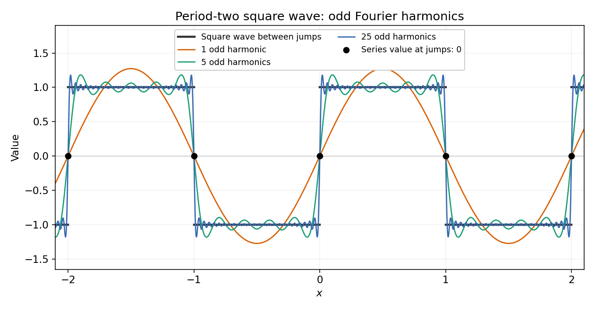

<h1 id="6/a/ii/solution">Solution</h1>

↑ **Parent:** [Ii](../ii.md)

Use the period-two [Fourier series](../../../../../../fourier-series-split.md) convention

$$
f(x)\sim\frac{a_0}{2}+\sum_{n=1}^{\infty}\bigl[a_n\cos(n\pi x)+b_n\sin(n\pi x)\bigr].
$$

Away from its jumps this [square wave](../../../../../../square-wave.md) is an [odd function](../../../../../../odd-function.md), so $a_0=a_n=0$. Its [Fourier sine coefficients](../../../../../../fourier-sine-coefficient.md) are

$$
b_n=\int_{-1}^1f(x)\sin(n\pi x)\,dx
=2\int_0^1\sin(n\pi x)\,dx
=\frac{2(1-(-1)^n)}{n\pi}.
$$

Only odd [Fourier harmonics](../../../../../../fourier-harmonic.md) remain. Therefore

$$
\boxed{f(x)\sim\frac4\pi\sum_{j=0}^{\infty}\frac{\sin((2j+1)\pi x)}{2j+1}.}
$$

The [Fourier series](../../../../../../fourier-series-split.md) equals $f(x)$ away from the jumps; at a jump it gives the midpoint of the one-sided limits by [Dirichlet's theorem on Fourier series](../../../../../../dirichlet-s-theorem-on-fourier-series.md). The printed definition leaves the values at the integers unspecified. Choosing finite values there consistent with period two changes neither the [Fourier coefficients](../../../../../../fourier-coefficient.md) nor these limiting values.

**[Figure 1](#6/a/ii/image-odd-fourier-harmonics-approximate-the-period-two-square-wave-and-vanish-at-every-jump). Odd Fourier harmonics approximate the period-two square wave and vanish at every jump**.

## ↑ Ancestors (13)

1. [Ii](../ii.md)
2. [A](../../a.md)
3. [6](../../../6.md)
4. [Discrete mathematics, continuous mathematics, and probability (resit)](../../../../discrete-mathematics-continuous-mathematics-and-probability-resit-split.md)
5. [2015](../../../../split.md)
6. [Past exam of the year 1 of the computer science course of the University of Oxford](../../../../../split.md)
7. [Year 1 of the computer science course of the University of Oxford](../../../../../../year-1-of-the-computer-science-course-of-the-university-of-oxford.md)
8. [Computer science course of the University of Oxford](../../../../../../computer-science-course-of-the-university-of-oxford.md)
9. [Undergraduate course of the University of Oxford](../../../../../../undergraduate-course-of-the-university-of-oxford.md)
10. [Course of the University of Oxford](../../../../../../course-of-the-university-of-oxford.md)
11. [University of Oxford](../../../../../../university-of-oxford-split.md)
12. [List of universities](../../../../../../list-of-universities.md)
13. [Codex Wiki](../../../../../../split.md)
