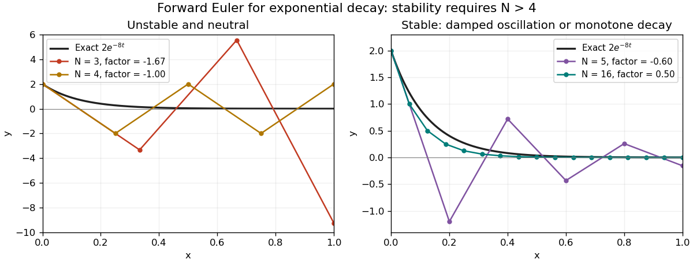

# Discrete mathematics, continuous mathematics, and probability

↑ **Parent:** [2015](../2015.md)

**Table of contents**

- [1](#1)
  - [a](#1/a)
    - [i](#1/a/i)
      - [Solution](#1/a/i/solution)
    - [ii](#1/a/ii)
      - [Solution](#1/a/ii/solution)
  - [b](#1/b)
    - [i](#1/b/i)
      - [Solution](#1/b/i/solution)
    - [ii](#1/b/ii)
      - [Solution](#1/b/ii/solution)
  - [c](#1/c)
    - [i](#1/c/i)
      - [Solution](#1/c/i/solution)
    - [ii](#1/c/ii)
      - [Solution](#1/c/ii/solution)
    - [iii](#1/c/iii)
      - [Solution](#1/c/iii/solution)
  - [d](#1/d)
    - [i](#1/d/i)
      - [Solution](#1/d/i/solution)
    - [ii](#1/d/ii)
      - [Solution](#1/d/ii/solution)
- [2](#2)
  - [a](#2/a)
    - [i](#2/a/i)
      - [Solution](#2/a/i/solution)
    - [ii](#2/a/ii)
      - [Solution](#2/a/ii/solution)
  - [b](#2/b)
    - [i](#2/b/i)
      - [Solution](#2/b/i/solution)
    - [ii](#2/b/ii)
      - [Solution](#2/b/ii/solution)
  - [c](#2/c)
    - [Solution](#2/c/solution)
  - [d](#2/d)
    - [Solution](#2/d/solution)
  - [e](#2/e)
    - [i](#2/e/i)
      - [Solution](#2/e/i/solution)
    - [ii](#2/e/ii)
      - [Solution](#2/e/ii/solution)
    - [iii](#2/e/iii)
      - [Solution](#2/e/iii/solution)
- [3](#3)
  - [a](#3/a)
    - [i](#3/a/i)
      - [Solution](#3/a/i/solution)
    - [ii](#3/a/ii)
      - [Solution](#3/a/ii/solution)
    - [iii](#3/a/iii)
      - [Solution](#3/a/iii/solution)
    - [iv](#3/a/iv)
      - [Solution](#3/a/iv/solution)
  - [b](#3/b)
    - [i](#3/b/i)
      - [Solution](#3/b/i/solution)
    - [ii](#3/b/ii)
      - [Solution](#3/b/ii/solution)
  - [c](#3/c)
    - [i](#3/c/i)
      - [Solution](#3/c/i/solution)
    - [ii](#3/c/ii)
      - [Solution](#3/c/ii/solution)
    - [iii](#3/c/iii)
      - [Solution](#3/c/iii/solution)
  - [d](#3/d)
    - [i](#3/d/i)
      - [Solution](#3/d/i/solution)
    - [ii](#3/d/ii)
      - [Solution](#3/d/ii/solution)
    - [iii](#3/d/iii)
      - [Solution](#3/d/iii/solution)
- [4](#4)
  - [a](#4/a)
    - [Solution](#4/a/solution)
  - [b](#4/b)
    - [Solution](#4/b/solution)
  - [c](#4/c)
    - [Solution](#4/c/solution)
  - [d](#4/d)
    - [Solution](#4/d/solution)
- [5](#5)
  - [a](#5/a)
    - [i](#5/a/i)
      - [Solution](#5/a/i/solution)
    - [ii](#5/a/ii)
      - [Solution](#5/a/ii/solution)
    - [iii](#5/a/iii)
      - [Solution](#5/a/iii/solution)
  - [b](#5/b)
    - [i](#5/b/i)
      - [Solution](#5/b/i/solution)
    - [ii](#5/b/ii)
      - [Solution](#5/b/ii/solution)
    - [iii](#5/b/iii)
      - [Solution](#5/b/iii/solution)
  - [c](#5/c)
    - [Solution](#5/c/solution)
- [6](#6)
  - [a](#6/a)
    - [i](#6/a/i)
      - [Solution](#6/a/i/solution)
    - [ii](#6/a/ii)
      - [Solution](#6/a/ii/solution)
  - [b](#6/b)
    - [i](#6/b/i)
      - [Solution](#6/b/i/solution)
    - [ii](#6/b/ii)
      - [Solution](#6/b/ii/solution)
    - [iii](#6/b/iii)
      - [Solution](#6/b/iii/solution)
- [7](#7)
  - [a](#7/a)
    - [i](#7/a/i)
      - [Solution](#7/a/i/solution)
    - [ii](#7/a/ii)
      - [Solution](#7/a/ii/solution)
  - [b](#7/b)
    - [i](#7/b/i)
      - [Solution](#7/b/i/solution)
    - [ii](#7/b/ii)
      - [Solution](#7/b/ii/solution)
  - [c](#7/c)
    - [i](#7/c/i)
      - [Solution](#7/c/i/solution)
    - [ii](#7/c/ii)
      - [Solution](#7/c/ii/solution)
- [8](#8)
  - [a](#8/a)
    - [i](#8/a/i)
      - [Solution](#8/a/i/solution)
    - [ii](#8/a/ii)
      - [Solution](#8/a/ii/solution)
    - [iii](#8/a/iii)
      - [Solution](#8/a/iii/solution)
    - [iv](#8/a/iv)
      - [Solution](#8/a/iv/solution)
  - [b](#8/b)
    - [i](#8/b/i)
      - [Solution](#8/b/i/solution)
    - [ii](#8/b/ii)
      - [Solution](#8/b/ii/solution)
    - [iii](#8/b/iii)
      - [Solution](#8/b/iii/solution)
    - [iv](#8/b/iv)
      - [Solution](#8/b/iv/solution)
- [9](#9)
  - [a](#9/a)
    - [i](#9/a/i)
      - [Solution](#9/a/i/solution)
    - [ii](#9/a/ii)
      - [Solution](#9/a/ii/solution)
  - [b](#9/b)
    - [i](#9/b/i)
      - [Solution](#9/b/i/solution)
    - [ii](#9/b/ii)
      - [Solution](#9/b/ii/solution)
  - [c](#9/c)
    - [i](#9/c/i)
      - [Solution](#9/c/i/solution)
    - [ii](#9/c/ii)
      - [Solution](#9/c/ii/solution)
    - [iii](#9/c/iii)
      - [Solution](#9/c/iii/solution)

## 1

↑ **Parent:** [Discrete mathematics, continuous mathematics, and probability](discrete-mathematics-continuous-mathematics-and-probability.md)

<h3 id="1/a">a</h3>

↑ **Parent:** [1](#1)

<h4 id="1/a/i">i</h4>

↑ **Parent:** [A](#1/a)

<h5 id="1/a/i/solution">Solution</h5>

↑ **Parent:** [I](#1/a/i)

The [set difference](../../set.md#set-difference) consists of elements belonging to the first [set](../../set.md) but not the second:

$$
\boxed{A\setminus B=\{x\in\mathcal U:x\in A\text{ and }x\notin B\}.}
$$

The [symmetric difference](../../set.md#symmetric-difference) consists of elements belonging to exactly one of the two [sets](../../set.md):

$$
\boxed{A\oplus B=(A\setminus B)\cup(B\setminus A).}
$$

In particular, the two [sets](../../set.md) in this [union](../../set.md#set-union) are [disjoint sets](../../set.md#disjoint-sets).

<h4 id="1/a/ii">ii</h4>

↑ **Parent:** [A](#1/a)

<h5 id="1/a/ii/solution">Solution</h5>

↑ **Parent:** [Ii](#1/a/ii)

Every [complement of a set](../../set.md#complement-of-a-set) is taken in the same [universal set](../../set.md#universal-set) $\mathcal U$. Apply [De Morgan's laws](../../theoretical-computer-science.md#de-morgan-s-laws) for [propositional logic](../../mathematical-logic.md#propositional-logic) to the membership propositions. For every $x\in\mathcal U$,

$$
\begin{aligned}
x\in\overline{A\cap B}
&\iff\neg(x\in A\land x\in B)\\
&\iff(x\notin A\lor x\notin B)
\iff x\in\overline A\cup\overline B,\\
x\in\overline{A\cup B}
&\iff\neg(x\in A\lor x\in B)\\
&\iff(x\notin A\land x\notin B)
\iff x\in\overline A\cap\overline B.
\end{aligned}
$$

Equality of membership for every element proves the [set identities](../../set.md#set-identity)

$$
\boxed{\overline{A\cap B}=\overline A\cup\overline B,
\qquad\overline{A\cup B}=\overline A\cap\overline B.}
$$

<h3 id="1/b">b</h3>

↑ **Parent:** [1](#1)

<h4 id="1/b/i">i</h4>

↑ **Parent:** [B](#1/b)

<h5 id="1/b/i/solution">Solution</h5>

↑ **Parent:** [I](#1/b/i)

Using [set difference](../../set.md#set-difference) as an [intersection](../../set.md#set-intersection) with a [complement of a set](../../set.md#complement-of-a-set), and using [double negation](../../mathematical-logic.md#double-negation), gives

$$
\begin{aligned}
\overline A\oplus\overline B
&=(\overline A\cap B)\cup(\overline B\cap A)\\
&=(B\setminus A)\cup(A\setminus B)
=A\oplus B.
\end{aligned}
$$

Interchanging the two [sets](../../set.md) simply interchanges the two terms of this [union](../../set.md#set-union), whose [commutativity](../../algebraic-operation.md#commutativity) gives

$$
\boxed{\overline A\oplus\overline B=A\oplus B,
\qquad A\oplus B=B\oplus A.}
$$

<h4 id="1/b/ii">ii</h4>

↑ **Parent:** [B](#1/b)

<h5 id="1/b/ii/solution">Solution</h5>

↑ **Parent:** [Ii](#1/b/ii)

We use a [double inclusion proof](../../set.md#double-inclusion-proof). First, let $x\in\overline{A\oplus B}$. If $x\in A$, then $x\in B$, since otherwise $x\in A\setminus B\subseteq A\oplus B$. Hence in this case $x\in A\cap B$. If $x\notin A$, then $x\notin B$, since otherwise $x\in B\setminus A\subseteq A\oplus B$. Hence in this case $x\in\overline{A\cup B}$. This proves the first [set inclusion](../../set.md#set-inclusion).

Conversely, an element of $A\cap B$ belongs to neither $A\setminus B$ nor $B\setminus A$. An element of $\overline{A\cup B}$ also belongs to neither [set difference](../../set.md#set-difference). Thus every element of $(A\cap B)\cup\overline{A\cup B}$ lies outside $A\oplus B$, proving the reverse [set inclusion](../../set.md#set-inclusion). Therefore

$$
\boxed{\overline{A\oplus B}=(A\cap B)\cup\overline{A\cup B}.}
$$

<h3 id="1/c">c</h3>

↑ **Parent:** [1](#1)

<h4 id="1/c/i">i</h4>

↑ **Parent:** [C](#1/c)

<h5 id="1/c/i/solution">Solution</h5>

↑ **Parent:** [I](#1/c/i)

The [identity function](../../function.md#identity-function) fixes every element, and [function composition](../../function.md#function-composition) means applying the inner [function](../../function.md) first:

$$
\boxed{\operatorname{id}_A:A\longrightarrow A,\quad x\longmapsto x,}
\qquad
\boxed{f\circ f:A\longrightarrow A,\quad x\longmapsto f(f(x)).}
$$

<h4 id="1/c/ii">ii</h4>

↑ **Parent:** [C](#1/c)

<h5 id="1/c/ii/solution">Solution</h5>

↑ **Parent:** [Ii](#1/c/ii)

If $f(x)=f(y)$, applying the [function](../../function.md) $f$ gives $f(f(x))=f(f(y))$. Since $f\circ f=\operatorname{id}_A$, this implies $x=y$, proving [injectivity](../../algebra.md#injective-function). Also every $y\in A$ is the image of $f(y)$, because $f(f(y))=y$, proving [surjectivity](../../algebra.md#surjective-function).

Thus $f$ is a [bijection](../../function.md#bijection) and its [inverse function](../../function.md#inverse-function) is itself:

$$
\boxed{f^{-1}=f.}
$$

Such a [function](../../function.md) is an [involution](../../group-theory.md#involution).

<h4 id="1/c/iii">iii</h4>

↑ **Parent:** [C](#1/c)

<h5 id="1/c/iii/solution">Solution</h5>

↑ **Parent:** [Iii](#1/c/iii)

Take the [function](../../function.md)

$$
\boxed{f:\mathbb R\longrightarrow\mathbb R,\qquad f(x)=-x.}
$$

Then $f(f(x))=-(-x)=x$ for every [real number](../../arithmetic.md#real-number) $x$, while $f(1)=-1\ne1$. Thus it is an [involution](../../group-theory.md#involution) different from the [identity function](../../function.md#identity-function).

<h3 id="1/d">d</h3>

↑ **Parent:** [1](#1)

<h4 id="1/d/i">i</h4>

↑ **Parent:** [D](#1/d)

<h5 id="1/d/i/solution">Solution</h5>

↑ **Parent:** [I](#1/d/i)

Seek an [affine function](../../vector-space.md#affine-function) $f(x)=cx+d$. Its [function composition](../../function.md#function-composition) with itself is

$$
f(f(x))=c^2x+(c+1)d.
$$

Equating coefficients requires $c^2=a$ and $(c+1)d=b$. Because $a>0$ and $a\ne1$, either choice $c=\sqrt a$ or $c=-\sqrt a$ has $c+1\ne0$. Thus two valid [functions](../../function.md) are

$$
\boxed{f(x)=\sqrt a\,x+\frac{b}{1+\sqrt a}}
\qquad\text{and}\qquad
\boxed{f(x)=-\sqrt a\,x+\frac{b}{1-\sqrt a}.}
$$

Substitution into $c^2x+(c+1)d$ verifies each answer. These provide the requested maps; no assumption that every possible solution is [affine function](../../vector-space.md#affine-function) is needed.

<h4 id="1/d/ii">ii</h4>

↑ **Parent:** [D](#1/d)

<h5 id="1/d/ii/solution">Solution</h5>

↑ **Parent:** [Ii](#1/d/ii)

Try a [linear function](../../vector-space.md#linear-function) $f(x)=cx$. The [functional equation](../../analysis.md#functional-equation) becomes $c^2x=(c+1)x$ for all $x$, so $c$ must be a [root of a polynomial](../../polynomial.md#root-of-a-polynomial) $c^2-c-1$. Its two [roots of a polynomial](../../polynomial.md#root-of-a-polynomial) give

$$
\boxed{f(x)=\frac{1+\sqrt5}{2}x}
\qquad\text{or}\qquad
\boxed{f(x)=\frac{1-\sqrt5}{2}x.}
$$

For either choice, $c^2=c+1$ proves the required equality directly. The positive coefficient is the [golden ratio](../../algebra.md#golden-ratio).

## 2

↑ **Parent:** [Discrete mathematics, continuous mathematics, and probability](discrete-mathematics-continuous-mathematics-and-probability.md)

<h3 id="2/a">a</h3>

↑ **Parent:** [2](#2)

<h4 id="2/a/i">i</h4>

↑ **Parent:** [A](#2/a)

<h5 id="2/a/i/solution">Solution</h5>

↑ **Parent:** [I](#2/a/i)

There are $n(n-1)\cdots(n-k+1)$ ordered selections without replacement. Each unordered $k$-element [subset](../../set.md#subset) occurs in exactly $k!$ orders, so the [binomial coefficient](../../binomial-coefficient.md) is

$$
\boxed{\binom nk=\frac{n!}{k!(n-k)!}.}
$$

One precise specification of its [domain](../../topology.md#domain-mathematical-analysis), [codomain](../../function.md#codomain), and map is

$$
\boxed{C:D\longrightarrow\mathbb N_0,\qquad
D=\{(n,k)\in\mathbb N_0^2:0\le k\le n\},\qquad
(n,k)\longmapsto\frac{n!}{k!(n-k)!}.}
$$

Here $\mathbb N_0=\{0,1,2,\ldots\}$, and $0!=1$ includes the single empty selection. The actual values on $D$ are positive, so $\mathbb N_+$ is also a valid [codomain](../../function.md#codomain). For fixed $n$, one can instead use the [function](../../function.md) $C_n:\{0,\ldots,n\}\to\mathbb N_+$ with $C_n(k)=\binom nk$.

<h4 id="2/a/ii">ii</h4>

↑ **Parent:** [A](#2/a)

<h5 id="2/a/ii/solution">Solution</h5>

↑ **Parent:** [Ii](#2/a/ii)

Apply the factorial formula for the [binomial coefficients](../../binomial-coefficient.md):

$$
\binom n2+\binom{n+1}2
=\frac{n(n-1)}2+\frac{n(n+1)}2
=\boxed{n^2}.
$$

For $n=0$ or $n=1$, the same equality holds with the conventional zero value when the lower index exceeds the upper index.

<h3 id="2/b">b</h3>

↑ **Parent:** [2](#2)

<h4 id="2/b/i">i</h4>

↑ **Parent:** [B](#2/b)

<h5 id="2/b/i/solution">Solution</h5>

↑ **Parent:** [I](#2/b/i)

For $0\le k\le n$, the adjacent [binomial coefficients](../../binomial-coefficient.md) obey

$$
\binom n{k+1}=\binom nk\frac{n-k}{k+1},
\qquad
g(k)=\binom nk\frac{n-2k-1}{k+1}.
$$

Since $\binom nk>0$ and $k+1>0$, the sign is determined by the numerator:

$$
\boxed{g(k)>0\iff0\le k<\frac{n-1}{2}.}
$$

The printed [codomain](../../function.md#codomain) $\mathbb N_+$ is inconsistent with the displayed map: $g(n)=-1$, and when $n$ is odd, $g((n-1)/2)=0$. With the usual extension $\binom nk=0$ for $k>n$, $g$ is a [function](../../function.md) $\mathbb N_0\to\mathbb Z$, and $g(k)=0$ for $k>n$; the positive range above remains unchanged. Without that extension, the natural [domain](../../topology.md#domain-mathematical-analysis) is $\{0,\ldots,n\}$.[Printed page 3, Question 2(b): the map is printed with codomain N+](../../computer-science-bibliography.md#discrete-mathematics-continuous-mathematics-and-probability-examination-2015-by-university-of-oxford)

<h4 id="2/b/ii">ii</h4>

↑ **Parent:** [B](#2/b)

<h5 id="2/b/ii/solution">Solution</h5>

↑ **Parent:** [Ii](#2/b/ii)

In the intended range $0\le k\le n$, division by the positive [binomial coefficient](../../binomial-coefficient.md) $\binom nk$ gives

$$
\frac{n-2k-1}{k+1}=1,
\qquad n=3k+2.
$$

Consequently the intended [remainder](../../integer.md#remainder) is

$$
\boxed{n\bmod3=2.}
$$

There is a necessary qualification to the printed unrestricted [domain](../../topology.md#domain-mathematical-analysis). If [binomial coefficients](../../binomial-coefficient.md) outside $0\le k\le n$ are extended by zero, then every $k>n$ satisfies $g(k)=\binom nk=0$, regardless of $n\bmod3$. For example, $n=3,k=4$ satisfies the literal equality but has $n\bmod3=0$. Thus the literal extended-domain premise alone does not determine a [remainder](../../integer.md#remainder); the boxed conclusion requires $0\le k\le n$, or equivalently here $\binom nk\ne0$.

<h3 id="2/c">c</h3>

↑ **Parent:** [2](#2)

<h4 id="2/c/solution">Solution</h4>

↑ **Parent:** [C](#2/c)

For adjacent [binomial coefficients](../../binomial-coefficient.md), the [ratio](../../arithmetic.md#ratio)

$$
\frac{\binom n{k+1}}{\binom nk}=\frac{n-k}{k+1}
$$

is greater than $1$ when $k<(n-1)/2$, equal to $1$ at $k=(n-1)/2$, and less than $1$ afterwards. For odd $n$, the row is therefore increasing up to its two equal central entries and decreasing after them. The [maximum](../../set.md#maximum-of-a-subset-of-a-total-order) is attained exactly at

$$
\boxed{k^*=\frac{n-1}{2}\quad\text{or}\quad k^*=\frac{n+1}{2}.}
$$

They are distinct, including when $n=1$, so $k^*$ is **not unique**. This is the [unimodality of binomial coefficients](../../binomial-coefficient.md#unimodality-of-binomial-coefficients).

<h3 id="2/d">d</h3>

↑ **Parent:** [2](#2)

<h4 id="2/d/solution">Solution</h4>

↑ **Parent:** [D](#2/d)

We prove [Cassini's identity](../../sequence-and-series.md#cassini-s-identity) by [mathematical induction](../../foundations-of-mathematics.md#mathematical-induction). At $n=1$,

$$
F_0F_2-F_1^2=0\cdot1-1=-1=(-1)^1.
$$

Suppose $D_n=F_{n-1}F_{n+1}-F_n^2=(-1)^n$. The [Fibonacci recurrence](../../sequence-and-series.md#fibonacci-recurrence) gives $F_{n-1}=F_{n+1}-F_n$ and hence

$$
\begin{aligned}
D_{n+1}
&=F_nF_{n+2}-F_{n+1}^2\\
&=F_n(F_{n+1}+F_n)-F_{n+1}^2\\
&=-\bigl((F_{n+1}-F_n)F_{n+1}-F_n^2\bigr)
=-D_n=(-1)^{n+1}.
\end{aligned}
$$

The induction proves

$$
\boxed{F_{n-1}F_{n+1}-F_n^2=(-1)^n\qquad(n\ge1).}
$$

<h3 id="2/e">e</h3>

↑ **Parent:** [2](#2)

<h4 id="2/e/i">i</h4>

↑ **Parent:** [E](#2/e)

<h5 id="2/e/i/solution">Solution</h5>

↑ **Parent:** [I](#2/e/i)

For a nonzero [geometric sequence](../../sequence-and-series.md#geometric-progression), substitute $H_n=cq^n$ into the [linear recurrence](../../algebra.md#linear-recurrence-relation) and cancel $cq^{n-1}$:

$$
q^2=q+1.
$$

The [characteristic equation of a linear recurrence](../../algebra.md#characteristic-equation-of-a-linear-recurrence) therefore has roots

$$
\boxed{q=\phi=\frac{1+\sqrt5}{2}\quad\text{or}\quad
q=\psi=\frac{1-\sqrt5}{2}.}
$$

The zero [sequence](../../sequence-and-series.md#sequence) $c=0$ is a degenerate solution for any $q$ for which the displayed expression is defined. A nonzero [sequence](../../sequence-and-series.md#sequence) with $q=0$ cannot satisfy the recurrence at $n=1$, since it would require $0=0+H_0$.

<h4 id="2/e/ii">ii</h4>

↑ **Parent:** [E](#2/e)

<h5 id="2/e/ii/solution">Solution</h5>

↑ **Parent:** [Ii](#2/e/ii)

The [linearity](../../vector-space.md#linearity) of the [Fibonacci recurrence](../../sequence-and-series.md#fibonacci-recurrence) allows a [linear combination](../../vector-space.md#linear-combination)

$$
F_n=A\phi^n+B\psi^n.
$$

The [initial conditions](../../differential-equation.md#initial-condition) give $A+B=0$ and $A\phi+B\psi=1$. Since $\phi-\psi=\sqrt5$, we obtain $A=1/\sqrt5$ and $B=-1/\sqrt5$. Thus [Binet's formula](../../sequence-and-series.md#binet-formula) is

$$
\boxed{F_n=\frac{\phi^n-\psi^n}{\sqrt5}
=\frac1{\sqrt5}\left[\left(\frac{1+\sqrt5}{2}\right)^n-
\left(\frac{1-\sqrt5}{2}\right)^n\right].}
$$

<h4 id="2/e/iii">iii</h4>

↑ **Parent:** [E](#2/e)

<h5 id="2/e/iii/solution">Solution</h5>

↑ **Parent:** [Iii](#2/e/iii)

Use [mathematical induction](../../foundations-of-mathematics.md#mathematical-induction) with two base cases. At $n=0$, the formula gives $(1-1)/\sqrt5=0=F_0$. At $n=1$, it gives $(\phi-\psi)/\sqrt5=1=F_1$.

If it holds at $n-1$ and $n$, then the [Fibonacci recurrence](../../sequence-and-series.md#fibonacci-recurrence) gives

$$
F_{n+1}=\frac{\phi^n+\phi^{n-1}-\psi^n-\psi^{n-1}}{\sqrt5}.
$$

The identities $\phi^2=\phi+1$ and $\psi^2=\psi+1$ turn the numerator into $\phi^{n+1}-\psi^{n+1}$. Thus

$$
\boxed{F_n=(\phi^n-\psi^n)/\sqrt5\quad\text{for every }n\ge0.}
$$

## 3

↑ **Parent:** [Discrete mathematics, continuous mathematics, and probability](discrete-mathematics-continuous-mathematics-and-probability.md)

<h3 id="3/a">a</h3>

↑ **Parent:** [3](#3)

<h4 id="3/a/i">i</h4>

↑ **Parent:** [A](#3/a)

<h5 id="3/a/i/solution">Solution</h5>

↑ **Parent:** [I](#3/a/i)

For [functions](../../function.md) $f,g:\mathbb N\to\mathbb R$, [big O notation](../../real-analysis.md#big-o-notation) means

$$
\boxed{f=O(g)\iff\exists C>0\ \exists N\ \forall n\ge N:
|f(n)|\le C|g(n)|.}
$$

Using the [natural logarithm](../../calculus.md#natural-logarithm) and [exponential function](../../calculus.md#exponential-function), $3^{\log n}=n^{\log3}$. Since $\log3>1$, for every $n\ge1$ we have $n\le n^{\log3}$. The witnesses $C=1,N=1$ therefore prove

$$
\boxed{n=O(3^{\log n}).}
$$

<h4 id="3/a/ii">ii</h4>

↑ **Parent:** [A](#3/a)

<h5 id="3/a/ii/solution">Solution</h5>

↑ **Parent:** [Ii](#3/a/ii)

For $n\ge1$, $\log3<2$ implies $3^{\log n}=n^{\log3}\le n^2$, and also $n\le n^2$. Consequently

$$
0\le(n+3^{\log n})^2\le(2n^2)^2=4n^4.
$$

The definition of [big O notation](../../real-analysis.md#big-o-notation) holds with $C=4,N=1$:

$$
\boxed{(n+3^{\log n})^2=O(n^4).}
$$

<h4 id="3/a/iii">iii</h4>

↑ **Parent:** [A](#3/a)

<h5 id="3/a/iii/solution">Solution</h5>

↑ **Parent:** [Iii](#3/a/iii)

Suppose the definition of [big O notation](../../real-analysis.md#big-o-notation) held with constants $C>0,N$. Choose an odd [integer](../../integer.md) $n>\max(C,N)$. At this input, $f(n)=n$ and $g(n)=1$, so the required [inequality](../../arithmetic.md#inequality-mathematics) would be $n\le C$, a contradiction. Thus

$$
\boxed{f\ne O(g).}
$$

The infinitely many even inputs, where $f(n)/g(n)=1/n$, cannot repair the failure on odd inputs because the bound must hold for **every** sufficiently large input.

<h4 id="3/a/iv">iv</h4>

↑ **Parent:** [A](#3/a)

<h5 id="3/a/iv/solution">Solution</h5>

↑ **Parent:** [Iv](#3/a/iv)

A direct [mathematical induction](../../foundations-of-mathematics.md#mathematical-induction) proves $0\le F_n\le2^n$. The base cases $F_0=0\le1$ and $F_1=1\le2$ hold. If the bound holds at $n-1$ and $n$, then the [Fibonacci recurrence](../../sequence-and-series.md#fibonacci-recurrence) gives

$$
F_{n+1}=F_n+F_{n-1}\le2^n+2^{n-1}\le2^{n+1}.
$$

Thus the definition of [big O notation](../../real-analysis.md#big-o-notation) holds with $C=1$, proving

$$
\boxed{F_n=O(2^n).}
$$

<h3 id="3/b">b</h3>

↑ **Parent:** [3](#3)

<h4 id="3/b/i">i</h4>

↑ **Parent:** [B](#3/b)

<h5 id="3/b/i/solution">Solution</h5>

↑ **Parent:** [I](#3/b/i)

By [divisibility](../../divisibility.md), write $a=nu$ and $b=nv$ for positive [integers](../../integer.md) $u,v$. Then

$$
a^2-b^2=n^2(u^2-v^2).
$$

The factor $u^2-v^2$ is an [integer](../../integer.md), so

$$
\boxed{n^2\mid(a^2-b^2).}
$$

<h4 id="3/b/ii">ii</h4>

↑ **Parent:** [B](#3/b)

<h5 id="3/b/ii/solution">Solution</h5>

↑ **Parent:** [Ii](#3/b/ii)

The [Euclidean division](../../integer.md#euclidean-division) gives $a=qb+r$ with $q\in\mathbb N_0$ and $0\le r<b$. Writing $a=nu,b=nv$ gives

$$
r=a-qb=n(u-qv).
$$

Since $u-qv$ is an [integer](../../integer.md), this proves the [divisibility](../../divisibility.md)

$$
\boxed{n\mid r,}
$$

including $r=0$.

<h3 id="3/c">c</h3>

↑ **Parent:** [3](#3)

<h4 id="3/c/i">i</h4>

↑ **Parent:** [C](#3/c)

<h5 id="3/c/i/solution">Solution</h5>

↑ **Parent:** [I](#3/c/i)

The [greatest common divisor](../../divisibility.md#greatest-common-divisor) is the largest positive [integer](../../integer.md) dividing both inputs:

$$
\boxed{\gcd(a,b)=\max\{d\in\mathbb N_+:d\mid a\text{ and }d\mid b\}.}
$$

This [maximum](../../set.md#maximum-of-a-subset-of-a-total-order) exists because $1$ belongs to the [set](../../set.md) and all its elements are at most $b$.

<h4 id="3/c/ii">ii</h4>

↑ **Parent:** [C](#3/c)

<h5 id="3/c/ii/solution">Solution</h5>

↑ **Parent:** [Ii](#3/c/ii)

Write $a=qb+r$ using the [Euclidean division](../../integer.md#euclidean-division). If $d\mid a$ and $d\mid b$, then $d\mid(a-qb)=r$. Conversely, if $d\mid b$ and $d\mid r$, then $d\mid(qb+r)=a$. Therefore $(a,b)$ and $(b,r)$ have exactly the same positive [common divisors](../../divisibility.md#common-divisor), proving

$$
\boxed{\gcd(a,b)=\gcd(b,r).}
$$

For $r=0$, this agrees with $\gcd(b,0)=b$.

<h4 id="3/c/iii">iii</h4>

↑ **Parent:** [C](#3/c)

<h5 id="3/c/iii/solution">Solution</h5>

↑ **Parent:** [Iii](#3/c/iii)

Set $(a_0,b_0)=(a,b)$. At each iteration with $b_i>0$, compute the [remainder](../../integer.md#remainder) $r_i=a_i\bmod b_i$, then set

$$
\boxed{(a_{i+1},b_{i+1})=(b_i,r_i).}
$$

Stop at the first index $n$ with $b_n=0$ and return $a_n$. The positive second coordinates strictly decrease, so [algorithm termination](../../algorithm.md#algorithm-termination) follows from the [well-ordering principle](../../arithmetic.md#well-ordering-principle-for-the-natural-numbers). The equality of [greatest common divisors](../../divisibility.md#greatest-common-divisor) established in (ii) is a [loop invariant](../../algorithm.md#loop-invariant), and at termination it gives

$$
\boxed{a_n=\gcd(a_n,0)=\gcd(a,b).}
$$

<h3 id="3/d">d</h3>

↑ **Parent:** [3](#3)

<h4 id="3/d/i">i</h4>

↑ **Parent:** [D](#3/d)

<h5 id="3/d/i/solution">Solution</h5>

↑ **Parent:** [I](#3/d/i)

Consider one iteration with $a_i>b_i>0$ and $r_i=a_i\bmod b_i$. If $b_i\le a_i/2$, then $r_i<b_i\le a_i/2$. If $b_i>a_i/2$, the [quotient](../../arithmetic.md#quotient) is $1$, so $r_i=a_i-b_i<a_i/2$. In either case $r_i<a_i/2$, whence

$$
a_{i+1}b_{i+1}=b_ir_i<\frac{a_ib_i}{2}.
$$

Repeated application, or [mathematical induction](../../foundations-of-mathematics.md#mathematical-induction), proves

$$
\boxed{a_nb_n<\frac{ab}{2^n}\qquad(n\ge1\text{ performed iterations}).}
$$

This also holds for the final iteration, whose left side is zero. For zero iterations the correct relation is equality $a_0b_0=ab$, rather than a strict [inequality](../../arithmetic.md#inequality-mathematics).

<h4 id="3/d/ii">ii</h4>

↑ **Parent:** [D](#3/d)

<h5 id="3/d/ii/solution">Solution</h5>

↑ **Parent:** [Ii](#3/d/ii)

Count the final division producing zero as an iteration, and let the total be $n$. The terminal product $a_nb_n=0$ alone gives no useful bound. Instead apply (i) to each nonterminal product, which is a positive [integer](../../integer.md) and hence at least $1$.

If $n\ge2$, the penultimate product satisfies

$$
1\le a_{n-1}b_{n-1}<\frac{ab}{2^{n-1}},
\qquad n-1<\log_2(ab).
$$

As $n$ is an [integer](../../integer.md), this implies

$$
\boxed{n\le\lceil\log_2(ab)\rceil.}
$$

For $n=1$, the same bound holds since $a>b\ge1$ implies $ab\ge2$. In particular the [Euclidean algorithm](../../number-theory.md#euclidean-algorithm) uses $O(\log a+\log b)$ divisions, in [big O notation](../../real-analysis.md#big-o-notation). The convention that includes the final zero-producing division explains the one-step offset in the argument.

<h4 id="3/d/iii">iii</h4>

↑ **Parent:** [D](#3/d)

<h5 id="3/d/iii/solution">Solution</h5>

↑ **Parent:** [Iii](#3/d/iii)

The second coordinate after two iterations satisfies

$$
b_{i+2}=b_i\bmod b_{i+1}<\frac{b_i}{2}
$$

whenever those two divisions are needed, by the same [remainder](../../integer.md#remainder) bound, now applied to $b_i>b_{i+1}>0$. Let $m=\lfloor\log_2 b\rfloor$. If the [Euclidean algorithm](../../number-theory.md#euclidean-algorithm) has not already stopped after $2m$ iterations, then its positive second coordinate is at most $1$: for $m\ge1$,

$$
0<b_{2m}<\frac b{2^m}<2.
$$

For $m=0$ the original $b$ is already $1$. A second coordinate of $1$ requires just one more division. Consequently

$$
\boxed{n\le2\lfloor\log_2 b\rfloor+1,\qquad n=O(\log b)\text{ as }b\to\infty.}
$$

This removes dependence on the potentially much larger input $a$. It improves the scale $\log_2(ab)$ to one involving only the smaller input; the rounded numerical bound need not be smaller for every pair. One may always take the minimum of the bounds in (ii) and (iii).

## 4

↑ **Parent:** [Discrete mathematics, continuous mathematics, and probability](discrete-mathematics-continuous-mathematics-and-probability.md)

<h3 id="4/a">a</h3>

↑ **Parent:** [4](#4)

<h4 id="4/a/solution">Solution</h4>

↑ **Parent:** [A](#4/a)

Assume the [homogeneous function](../../real-analysis.md#homogeneous-function) is [differentiable](../../analysis.md#differentiable-function). Applying the [multivariable chain rule](../../calculus.md#multivariable-chain-rule) to $f(tx,ty)=t^mf(x,y)$ gives, for $t$ near $1$,

$$
x f_x(tx,ty)+y f_y(tx,ty)=mt^{m-1}f(x,y).
$$

Setting $t=1$ proves [Euler theorem for homogeneous functions](../../real-analysis.md#euler-theorem-for-homogeneous-functions):

$$
\boxed{x\frac{\partial f}{\partial x}+y\frac{\partial f}{\partial y}=mf.}
$$

Only positive $t$ near $1$ are needed, so the derivation remains valid even when a noninteger $m$ makes the printed phrase “all real $t$” require qualification.

<h3 id="4/b">b</h3>

↑ **Parent:** [4](#4)

<h4 id="4/b/solution">Solution</h4>

↑ **Parent:** [B](#4/b)

The [linear ordinary differential equation](../../linear-ordinary-differential-equation.md) has differential operator $(D-3)^2$. Put $y=e^{3x}v$ and use the [product rule](../../calculus.md#product-rule) twice:

$$
y'=e^{3x}(3v+v'),\qquad
y''=e^{3x}(9v+6v'+v'').
$$

Substitution cancels the $v$ and $v'$ terms, leaving $v''=4$. Two [integrations](../../integral.md) give $v=2x^2+C_1x+C_2$. Hence the [general solution](../../linear-ordinary-differential-equation.md#general-solution) is

$$
\boxed{y(x)=e^{3x}(2x^2+C_1x+C_2),\qquad C_1,C_2\in\mathbb R.}
$$

The two arbitrary constants account for the order of the [differential equation](../../differential-equation.md); the $x^2$ factor in the particular term reflects the [repeated root](../../polynomial.md#multiple-root) $3$ of the [characteristic polynomial](../../linear-operator-theory.md#characteristic-polynomial).

<h3 id="4/c">c</h3>

↑ **Parent:** [4](#4)

<h4 id="4/c/solution">Solution</h4>

↑ **Parent:** [C](#4/c)

On an interval with $x\ne0$, set $y=xv$. The [product rule](../../calculus.md#product-rule) gives $y'=v+xv'$, and substitution gives

$$
x^2(v+xv')=x^2+x^2v+x^2v^2,
\qquad\boxed{xv'=1+v^2.}
$$

This is a [separable differential equation](../../differential-equation.md#separable-differential-equation). Since $1+v^2>0$ for real $v$, separation loses no real constant solution:

$$
\frac{dv}{1+v^2}=\frac{dx}{x},
\qquad \arctan v=\log|x|+C.
$$

Thus the [general solution](../../linear-ordinary-differential-equation.md#general-solution) on any interval avoiding zero and the poles of the [tangent function](../../geometry-and-topology.md#tangent-function) is

$$
\boxed{y(x)=x\tan(\log|x|+C).}
$$

At $x=0$ the original [differential equation](../../differential-equation.md) forces $y(0)=0$, but no real solution from this family extends over a whole interval through zero: $\log|x|+C$ encounters infinitely many poles as $x\to0$.

<h3 id="4/d">d</h3>

↑ **Parent:** [4](#4)

<h4 id="4/d/solution">Solution</h4>

↑ **Parent:** [D](#4/d)

For $x\ne\pm1$, write the [linear ordinary differential equation](../../linear-ordinary-differential-equation.md) as

$$
y'+\frac{2x}{1-x^2}y=\frac{x(1-x)}{1-x^2}.
$$

An [integrating factor](../../linear-ordinary-differential-equation.md#integrating-factor) on each interval avoiding $\pm1$ is $\mu(x)=1/(1-x^2)$; multiplication by a nonzero constant, including a sign, is immaterial. Therefore

$$
\left(\frac{y}{1-x^2}\right)'
=\frac{x(1-x)}{(1-x^2)^2}
=\frac{x}{(1-x)(1+x)^2}.
$$

The [partial fraction decomposition](../../isolated-singularity.md#partial-fraction-decomposition) is

$$
\frac{x}{(1-x)(1+x)^2}
=\frac{1}{4(1-x)}+\frac{1}{4(1+x)}-\frac{1}{2(1+x)^2}.
$$

Integrating gives the [general solution](../../linear-ordinary-differential-equation.md#general-solution)

$$
\boxed{y(x)=\frac{1-x}{2}+
(1-x^2)\left(C+\frac14\log\left|\frac{1+x}{1-x}\right|\right),
\qquad x\ne\pm1.}
$$

The constant is independent on each connected interval of definition. At the singular points the undivided [differential equation](../../differential-equation.md) forces $y(1)=0$ and $y(-1)=1$. The displayed family tends to these values, but its [derivative](../../calculus.md#derivative) has a logarithmic divergence there, so no member extends as a [differentiable function](../../analysis.md#differentiable-function) through either singular point.

## 5

↑ **Parent:** [Discrete mathematics, continuous mathematics, and probability](discrete-mathematics-continuous-mathematics-and-probability.md)

<h3 id="5/a">a</h3>

↑ **Parent:** [5](#5)

<h4 id="5/a/i">i</h4>

↑ **Parent:** [A](#5/a)

<h5 id="5/a/i/solution">Solution</h5>

↑ **Parent:** [I](#5/a/i)

The [chain rule](../../calculus.md#chain-rule) gives

$$
f'(x)=e^{x^3-x^5}(3x^2-5x^4)
=e^{x^3-x^5}x^2(3-5x^2).
$$

The [exponential function](../../calculus.md#exponential-function) never vanishes, so all [critical points](../../analysis.md#critical-point) are

$$
\boxed{x=0,\qquad x=\sqrt{3/5},\qquad x=-\sqrt{3/5}.}
$$

In particular $f'(0)=0$.

<h4 id="5/a/ii">ii</h4>

↑ **Parent:** [A](#5/a)

<h5 id="5/a/ii/solution">Solution</h5>

↑ **Parent:** [Ii](#5/a/ii)

Use the [Taylor series](../../calculus.md#taylor-series) $e^u=1+u+u^2/2+\cdots$ with $u=x^3-x^5$. Since $u$ begins at cubic order and $u^2$ begins at sixth order, through cubic terms the [Taylor series](../../calculus.md#taylor-series) is

$$
\boxed{f(x)=1+x^3+O(x^5).}
$$

The linear and quadratic coefficients are zero. The stronger remainder $O(x^5)$, in [big O notation](../../real-analysis.md#big-o-notation), follows because the fourth-order term is also zero; the next term is $-x^5$.

<h4 id="5/a/iii">iii</h4>

↑ **Parent:** [A](#5/a)

<h5 id="5/a/iii/solution">Solution</h5>

↑ **Parent:** [Iii](#5/a/iii)

Near zero, $x^3-x^5=x^3(1-x^2)$ has the sign of $x$, so $f(x)<1$ just to the left and $f(x)>1$ just to the right. Thus the [critical point](../../analysis.md#critical-point) is neither a [local minimum](../../analysis.md#local-minimum) nor a [local maximum](../../analysis.md#local-maximum). Moreover the [Taylor series](../../calculus.md#taylor-series) gives $f''(x)=6x+O(x^3)$, which changes sign at zero. Therefore

$$
\boxed{(0,1)\text{ is a stationary inflection point}.}
$$

This is the point called a “saddle point” in the question; [stationary inflection point](../../topology.md#stationary-inflection-point) specifies the one-variable meaning.

<h3 id="5/b">b</h3>

↑ **Parent:** [5](#5)

<h4 id="5/b/i">i</h4>

↑ **Parent:** [B](#5/b)

<h5 id="5/b/i/solution">Solution</h5>

↑ **Parent:** [I](#5/b/i)

Solving the [linear ordinary differential equation](../../linear-ordinary-differential-equation.md) and imposing the [initial condition](../../differential-equation.md#initial-condition) gives

$$
\boxed{y(x)=2e^{-\lambda x}.}
$$

As $\lambda>0$, the requested [limit](../../calculus.md#limit-of-a-function) is

$$
\boxed{\lim_{\lambda\to\infty}y(1)=\lim_{\lambda\to\infty}2e^{-\lambda}=0.}
$$

<h4 id="5/b/ii">ii</h4>

↑ **Parent:** [B](#5/b)

<h5 id="5/b/ii/solution">Solution</h5>

↑ **Parent:** [Ii](#5/b/ii)

Let $h=1/N$, $x_j=jh$, and let $y_j$ approximate $y(x_j)$. The [forward Euler method](../../numerical-analysis.md#euler-method) gives the [difference equation](../../sequence-and-series.md#difference-equation)

$$
\boxed{y_{j+1}=y_j+h(-\lambda y_j)
=\left(1-\frac\lambda N\right)y_j,\qquad y_0=2.}
$$

This [geometric sequence](../../sequence-and-series.md#geometric-progression) has solution

$$
\boxed{y_j=2\left(1-\frac\lambda N\right)^j\quad(0\le j\le N),
\qquad y_N=2\left(1-\frac\lambda N\right)^N.}
$$

For fixed $\lambda$, the [limit](../../calculus.md#limit-of-a-function) as $N\to\infty$ is $2e^{-\lambda}$, as required by the exact solution.

<h4 id="5/b/iii">iii</h4>

↑ **Parent:** [B](#5/b)

<h5 id="5/b/iii/solution">Solution</h5>

↑ **Parent:** [Iii](#5/b/iii)

The [amplification factor](../../finite-difference.md#amplification-factor) is $R=1-\lambda/N$. To reproduce decay, the [forward Euler method](../../numerical-analysis.md#euler-method) requires $|R|<1$, equivalently

$$
-1<1-\frac\lambda N<1
\quad\Longleftrightarrow\quad
\boxed{N>\lambda/2.}
$$

At $N=\lambda/2$, $R=-1$ and the approximations alternate with constant magnitude $2$; for $N<\lambda/2$, $|R|>1$ and the magnitude grows. This is the condition of [absolute stability](../../numerical-analysis.md#linear-stability-domain) for this decaying [differential equation](../../differential-equation.md).

Stability is only a minimum requirement. Values just inside the bound can still give a poor endpoint approximation; resolving the decay accurately generally requires a smaller [step size](../../convex-optimization.md#step-size). If positivity at every step is desired, the stronger condition $N\ge\lambda$ ensures $R\ge0$. The figure shows the difference between decay of the exact solution and numerical oscillation.

**[Figure 1](#5/b/iii/image-forward-euler-approximation-to-exponential-decay-instability-neutral-oscillation-and-stable-decay). Forward Euler approximation to exponential decay: instability, neutral oscillation, and stable decay**.

<h3 id="5/c">c</h3>

↑ **Parent:** [5](#5)

<h4 id="5/c/solution">Solution</h4>

↑ **Parent:** [C](#5/c)

For positive edge lengths the [volume](../../geometry-and-topology.md#volume) is $V=abc$ and the [surface area](../../differential-geometry.md#surface-area) constraint is $2(ab+ac+bc)=S$. Introduce a [Lagrange multiplier](../../mathematical-optimization.md#lagrange-multiplier) $\mu$:

$$
\mathcal L=abc-\mu\bigl(2ab+2ac+2bc-S\bigr).
$$

The [stationary point](../../calculus-of-variations.md#stationary-point) equations are

$$
bc=2\mu(b+c),\qquad ac=2\mu(a+c),\qquad ab=2\mu(a+b).
$$

Multiplying these by $a,b,c$, respectively, and equating their left sides gives $\mu c(a-b)=0$ and $\mu b(a-c)=0$. Because all edge lengths are positive, the equations imply $\mu>0$; hence $a=b=c$. The constraint gives $6a^2=S$.

To establish a global [maximum](../../set.md#maximum-of-a-subset-of-a-total-order), rather than only a [stationary point](../../calculus-of-variations.md#stationary-point), apply the [arithmetic-geometric mean inequality](../../mathematical-optimization.md#arithmetic-geometric-mean-inequality) to $ab,ac,bc$:

$$
\frac S6=\frac{ab+ac+bc}{3}\ge\bigl((ab)(ac)(bc)\bigr)^{1/3}
=(abc)^{2/3}.
$$

Equality holds exactly when $ab=ac=bc$, or $a=b=c$. Therefore

$$
\boxed{V_{\max}=\left(\frac S6\right)^{3/2},\qquad
 a=b=c=\sqrt{S/6}.}
$$

## 6

↑ **Parent:** [Discrete mathematics, continuous mathematics, and probability](discrete-mathematics-continuous-mathematics-and-probability.md)

<h3 id="6/a">a</h3>

↑ **Parent:** [6](#6)

<h4 id="6/a/i">i</h4>

↑ **Parent:** [A](#6/a)

<h5 id="6/a/i/solution">Solution</h5>

↑ **Parent:** [I](#6/a/i)

With [step size](../../convex-optimization.md#step-size) $h=1/N$ and nodes $x_j=j/N$, the [composite trapezoidal rule](../../runge-kutta-method.md#composite-trapezoidal-rule) gives

$$
\boxed{T_N=\frac1N\left[\frac12+
\sum_{j=1}^{N-1}\frac{1}{1+(j/N)^2}+\frac14\right]
=\frac{3}{4N}+\sum_{j=1}^{N-1}\frac{N}{N^2+j^2},\qquad I\approx T_N.}
$$

The endpoint weights are half the interior weights, and the endpoint values are $1$ and $1/2$.

<h4 id="6/a/ii">ii</h4>

↑ **Parent:** [A](#6/a)

<h5 id="6/a/ii/solution">Solution</h5>

↑ **Parent:** [Ii](#6/a/ii)

Write the sum in the question as the right [Riemann sum](../../real-analysis.md#riemann-sum)

$$
S_N=\sum_{j=1}^N\frac{N}{N^2+j^2}
=\frac1N\sum_{j=1}^N\frac{1}{1+(j/N)^2}.
$$

Relative to the [composite trapezoidal rule](../../runge-kutta-method.md#composite-trapezoidal-rule), the only change is in the two endpoint weights:

$$
S_N-T_N=\frac{1}{2N}\bigl(f(1)-f(0)\bigr)=-\frac1{4N}.
$$

The [integrand](../../integral.md#integrand) $f(x)=1/(1+x^2)$ is [continuous](../../calculus.md#continuous-function) on $[0,1]$, so $T_N\to I$. Since an [antiderivative](../../integral.md#antiderivative) is $\arctan x$,

$$
I=\arctan1-\arctan0=\frac\pi4.
$$

Thus

$$
\boxed{\lim_{N\to\infty}S_N=\frac\pi4.}
$$

<h3 id="6/b">b</h3>

↑ **Parent:** [6](#6)

<h4 id="6/b/i">i</h4>

↑ **Parent:** [B](#6/b)

<h5 id="6/b/i/solution">Solution</h5>

↑ **Parent:** [I](#6/b/i)

For a nonzero [separable solution](../../partial-differential-equation.md#separable-solution) $u=XT$, [separation of variables](../../partial-differential-equation.md#separation-of-variables) gives

$$
\frac{T'}{DT}=\frac{X''}{X}=-\kappa,
\qquad
\boxed{X''+\kappa X=0,\qquad X(0)=X(L)=0.}
$$

These [Dirichlet boundary conditions](../../differential-equation.md#dirichlet-boundary-condition) follow because $T$ is not identically zero. If $\kappa=0$, the [affine function](../../vector-space.md#affine-function) $X=A+Bx$ obeys both conditions only when $A=B=0$. If $\kappa=-\rho^2<0$, $X=A\cosh(\rho x)+B\sinh(\rho x)$ also has only the zero solution under both conditions.

For $\kappa=\omega^2>0$, $X=A\cos(\omega x)+B\sin(\omega x)$. The first [boundary condition](../../differential-equation.md#boundary-condition) forces $A=0$, and the second forces $\omega L=n\pi$ for a nonzero solution. Hence all nonzero spatial modes are

$$
\boxed{\kappa_n=\left(\frac{n\pi}{L}\right)^2,\qquad
X_n(x)=B_n\sin\frac{n\pi x}{L},\quad n=1,2,\ldots,\quad B_n\ne0.}
$$

The identically zero [function](../../function.md) is also a solution. Allowing $B_n=0$ includes it in the displayed family. Here $L>0$ is the interval length and $n$ labels the [eigenvalues](../../linear-operator-theory.md#eigenvalue) of the operator $-d^2/dx^2$ with these [boundary conditions](../../differential-equation.md#boundary-condition).

<h4 id="6/b/ii">ii</h4>

↑ **Parent:** [B](#6/b)

<h5 id="6/b/ii/solution">Solution</h5>

↑ **Parent:** [Ii](#6/b/ii)

For the spatial mode with [eigenvalue](../../linear-operator-theory.md#eigenvalue) $\kappa_n=(n\pi/L)^2$, the temporal [ordinary differential equation](../../differential-equation.md#ordinary-differential-equation) is

$$
\boxed{T_n'+D\left(\frac{n\pi}{L}\right)^2T_n=0.}
$$

Its [general solution](../../linear-ordinary-differential-equation.md#general-solution) is

$$
\boxed{T_n(t)=C_n\exp\left(-\frac{Dn^2\pi^2}{L^2}t\right),\qquad C_n\in\mathbb R.}
$$

The printed reference to “each solution $X(x)$ ... in part (b)” refers to (b)(i). The zero spatial mode gives $u=0$ irrespective of $T$ and contributes no additional nonzero solution.[Printed page 7, Question 6(b)(ii), internal part reference](../../computer-science-bibliography.md#discrete-mathematics-continuous-mathematics-and-probability-examination-2015-by-university-of-oxford)

<h4 id="6/b/iii">iii</h4>

↑ **Parent:** [B](#6/b)

<h5 id="6/b/iii/solution">Solution</h5>

↑ **Parent:** [Iii](#6/b/iii)

The [heat equation](../../diffusion-equation.md#heat-equation) and its homogeneous [Dirichlet boundary conditions](../../differential-equation.md#dirichlet-boundary-condition) are [linear](../../vector-space.md#linearity), so [superposition](../../vector-space.md#superposition-principle) of the separated modes gives

$$
\boxed{u(x,t)=\sum_{n=1}^{\infty}\alpha_n\sin\frac{n\pi x}{L}
\exp\left(-\frac{Dn^2\pi^2t}{L^2}\right).}
$$

The [Fourier sine basis](../../fourier-series.md#fourier-sine-basis) represents the initial profile on the interior of the interval. At $t=0$ its [Fourier sine series](../../fourier-series.md#fourier-sine-series) must equal $x(1-x)$. Multiplying by $\sin(m\pi x/L)$, integrating from $0$ to $L$, and using [orthogonality](../../inner-product.md#orthogonal-vectors) gives

$$
\int_0^L\sin\frac{n\pi x}{L}\sin\frac{m\pi x}{L}\,dx
=\begin{cases}L/2,&n=m,\\0,&n\ne m.\end{cases}
$$

Therefore the required [Fourier sine coefficients](../../fourier-series.md#fourier-sine-coefficient) are

$$
\boxed{\alpha_n=\frac2L\int_0^L x(1-x)\sin\frac{n\pi x}{L}\,dx,
\qquad n=1,2,\ldots.}
$$

For every $t>0$, the exponential factors ensure convergence of the differentiated series, and every term satisfies the [partial differential equation](../../partial-differential-equation.md) and the [boundary conditions](../../differential-equation.md#boundary-condition). The [Fourier sine series](../../fourier-series.md#fourier-sine-series) recovers the smooth initial profile at every $0<x<L$ as $t\downarrow0$.

The scan explicitly prints $x(1-x)$ on $(0,L)$; it must not silently become $x(L-x)$. For $L\ne1$, the interior profile tends to $L(1-L)\ne0$ at the right endpoint, whereas the prescribed [boundary condition](../../differential-equation.md#boundary-condition) is zero for $t>0$. The solution is therefore not continuous at the corner $(L,0)$, although it satisfies every condition on the printed open ranges. A solution continuous on the closed space-time domain with these data would require $L=1$.[Printed page 7, Question 6(b), initial profile and ranges](../../computer-science-bibliography.md#discrete-mathematics-continuous-mathematics-and-probability-examination-2015-by-university-of-oxford)

## 7

↑ **Parent:** [Discrete mathematics, continuous mathematics, and probability](discrete-mathematics-continuous-mathematics-and-probability.md)

<h3 id="7/a">a</h3>

↑ **Parent:** [7](#7)

<h4 id="7/a/i">i</h4>

↑ **Parent:** [A](#7/a)

<h5 id="7/a/i/solution">Solution</h5>

↑ **Parent:** [I](#7/a/i)

A [partition of a sample space](../../probability-space.md#partition-of-a-sample-space) is a finite or countable family of nonempty [events](../../probability-space.md#event) such that

$$
\boxed{B_i\cap B_j=\varnothing\quad(i\ne j),\qquad
\bigcup_iB_i=\Omega.}
$$

Thus exactly one event in the family occurs in each outcome. To use ordinary event-conditioned [conditional expectations](../../measure-theory.md#conditional-expectation), one usually assumes $\mathbb P(B_i)>0$; any zero-[probability](../../probability-theory.md#probability) blocks can instead be omitted from the expectation formula.

<h4 id="7/a/ii">ii</h4>

↑ **Parent:** [A](#7/a)

<h5 id="7/a/ii/solution">Solution</h5>

↑ **Parent:** [Ii](#7/a/ii)

For an [integrable random variable](../../expected-value.md#integrable-random-variable) $X$ and a [partition of a sample space](../../probability-space.md#partition-of-a-sample-space) $(B_i)$, the [law of total expectation](../../measure-theory.md#law-of-total-expectation) states

$$
\boxed{\mathbb E[X]=\sum_{i:\mathbb P(B_i)>0}
\mathbb E[X\mid B_i]\,\mathbb P(B_i).}
$$

It follows by writing $X=\sum_iX\mathbf1_{B_i}$ and using $\mathbb E[X\mathbf1_{B_i}]=\mathbb P(B_i)\mathbb E[X\mid B_i]$. Integrability justifies the countable sum. The same equality is valid with nonnegative, possibly infinite expectations when $X\ge0$.

<h3 id="7/b">b</h3>

↑ **Parent:** [7](#7)

<h4 id="7/b/i">i</h4>

↑ **Parent:** [B](#7/b)

<h5 id="7/b/i/solution">Solution</h5>

↑ **Parent:** [I](#7/b/i)

Let $\tau$ be the [absorption time](../../markov-chain.md#absorption-time). Its [expectation](../../expected-value.md) is finite: from every interior state, a string of at most $n$ successive left moves reaches $0$, and the [probability](../../probability-theory.md#probability) of such a string is at least $p=3^{-n}$. Hence the [Markov property](../../markov-chain.md#markov-property) gives $\mathbb P_k(\tau>jn)\le(1-p)^j$, a geometric tail bound, and $\mathbb E_k[\tau]<\infty$.

For $1\le k\le n-1$, one step is always spent before absorption or the remaining walk. Apply [first-step analysis](../../analysis.md#first-step-analysis) and the [law of total expectation](../../measure-theory.md#law-of-total-expectation) to the three possible first moves. The [conditional expectations](../../measure-theory.md#conditional-expectation) of the remaining [absorption time](../../markov-chain.md#absorption-time) are $e_{k+1},e_k,e_{k-1}$, respectively; independence of future moves gives the same law as a fresh [random walk](../../random-walk.md) from the new position. Thus

$$
e_k=1+\frac13e_{k+1}+\frac13e_k+\frac13e_{k-1},
$$

which rearranges to

$$
\boxed{\frac13e_{k+1}-\frac23e_k+\frac13e_{k-1}=-1.}
$$

The term $1$ also appears when the walk stays at $k$, because staying still consumes a step.

<h4 id="7/b/ii">ii</h4>

↑ **Parent:** [B](#7/b)

<h5 id="7/b/ii/solution">Solution</h5>

↑ **Parent:** [Ii](#7/b/ii)

The [absorbing states](../../markov-chain.md#absorbing-state) give $e_0=e_n=0$. Multiplying the [difference equation](../../sequence-and-series.md#difference-equation) in (i) by $3$ gives

$$
e_{k+1}-2e_k+e_{k-1}=-3.
$$

The second [finite difference](../../finite-difference.md) of $k^2$ is $2$, so a [particular solution](../../linear-ordinary-differential-equation.md#particular-solution) is $-3k^2/2$; the homogeneous solutions are $A+Bk$. Imposing the two [boundary conditions](../../differential-equation.md#boundary-condition) gives $A=0,B=3n/2$. Therefore

$$
\boxed{e_k=\frac32k(n-k),\qquad0\le k\le n.}
$$

Uniqueness follows because the difference of any two solutions has zero second [finite difference](../../finite-difference.md), hence is [affine function](../../vector-space.md#affine-function), and vanishes at both endpoints. This is the [mean absorption time of a lazy symmetric random walk](../../random-walk.md#mean-absorption-time-of-a-lazy-symmetric-random-walk) with holding probability $1/3$.

<h3 id="7/c">c</h3>

↑ **Parent:** [7](#7)

<h4 id="7/c/i">i</h4>

↑ **Parent:** [C](#7/c)

<h5 id="7/c/i/solution">Solution</h5>

↑ **Parent:** [I](#7/c/i)

For each [random variable](../../random-variable.md), the [probability mass function](../../probability-distribution.md#probability-mass-function) gives

$$
\mathbb E[X_i]=\frac{-1+0+1}{3}=0,
\qquad \mathbb E[X_i^2]=\frac{1+0+1}{3}=\frac23,
\qquad\operatorname{var}(X_i)=\frac23.
$$

Let $S_m=\sum_{i=1}^mX_i$. By [linearity of expectation](../../expected-value.md#linearity-of-expectation) and [variance additivity for independent random variables](../../variance.md#variance-additivity-for-independent-random-variables),

$$
\boxed{\mathbb E[S_m]=0,\qquad\operatorname{var}(S_m)=\frac{2m}{3}.}
$$

The [independence](../../random-variable.md#independent-random-variables) is needed for the [variance](../../variance.md) calculation, but not for the [mean](../../expected-value.md).

<h4 id="7/c/ii">ii</h4>

↑ **Parent:** [C](#7/c)

<h5 id="7/c/ii/solution">Solution</h5>

↑ **Parent:** [Ii](#7/c/ii)

Each $X_i$ has the same [probability distribution](../../probability-distribution.md) as $-X_i$. By [independence](../../random-variable.md#independent-random-variables), the entire vector and its negative have the same joint law, so $S_m$ has a [symmetric distribution](../../probability-distribution.md#symmetric-distribution) about zero. The two disjoint tail [events](../../probability-space.md#event) consequently have equal [probabilities](../../probability-theory.md#probability):

$$
\mathbb P(S_m>m/2)=\mathbb P(S_m<-m/2)
=\frac12\mathbb P(|S_m|>m/2).
$$

Apply [Chebyshev's inequality](../../probability-inequality.md#chebyshev-s-inequality) with the [mean](../../expected-value.md) and [variance](../../variance.md) from (i):

$$
\mathbb P(S_m>m/2)
\le\frac12\frac{2m/3}{(m/2)^2}
=\boxed{\frac4{3m}}.
$$

Using only containment in the two-sided event would give $8/(3m)$; the [symmetry](../../physics.md#symmetry-physics) supplies the necessary extra factor $1/2$.

## 8

↑ **Parent:** [Discrete mathematics, continuous mathematics, and probability](discrete-mathematics-continuous-mathematics-and-probability.md)

<h3 id="8/a">a</h3>

↑ **Parent:** [8](#8)

<h4 id="8/a/i">i</h4>

↑ **Parent:** [A](#8/a)

<h5 id="8/a/i/solution">Solution</h5>

↑ **Parent:** [I](#8/a/i)

The [probability generating function](../../probability-distribution.md#probability-generating-function) of a nonnegative [integer-valued random variable](../../random-variable.md#integer-valued-random-variable) is

$$
\boxed{G(s)=\mathbb E[s^X]=\sum_{j=0}^{\infty}p(j)s^j.}
$$

Use $s^0=1$, including at $s=0$. The [power series](../../sequence-and-series.md#power-series) converges absolutely for every real $s\in[-1,1]$, since $\sum_jp(j)|s|^j\le1$. In particular it is always defined on the usual probability-generating interval $[0,1]$. It may also be defined for $|s|>1$, depending on the [radius of convergence](../../sequence-and-series.md#radius-of-convergence) and convergence at its endpoints; the precise real [domain](../../topology.md#domain-mathematical-analysis) of finite expectation is $\{s\in\mathbb R:\sum_jp(j)|s|^j<\infty\}$.

<h4 id="8/a/ii">ii</h4>

↑ **Parent:** [A](#8/a)

<h5 id="8/a/ii/solution">Solution</h5>

↑ **Parent:** [Ii](#8/a/ii)

By hypothesis the [power series](../../sequence-and-series.md#power-series) converges at every positive real argument, so its [radius of convergence](../../sequence-and-series.md#radius-of-convergence) is infinite. Termwise [differentiation of a power series](../../sequence-and-series.md#termwise-differentiation-of-a-power-series) is therefore valid in a neighborhood of $s=1$. For $k\ge1$,

$$
G^{(k)}(s)=\sum_{j=k}^{\infty}
j(j-1)\cdots(j-k+1)p(j)s^{j-k}.
$$

At $s=1$, the right side is the [expectation](../../expected-value.md) of the [falling factorial](../../combinatorics.md#falling-factorial) of $X$:

$$
\boxed{G^{(k)}(1)=\mathbb E[X(X-1)\cdots(X-k+1)].}
$$

The special case $k=1$ gives

$$
\boxed{G'(1)=\mathbb E[X].}
$$

For $k=0$, take the empty product as $1$; the equality becomes $G(1)=1$. These are the [factorial moments](../../continuous-time-markov-chain.md#factorial-moment).

<h4 id="8/a/iii">iii</h4>

↑ **Parent:** [A](#8/a)

<h5 id="8/a/iii/solution">Solution</h5>

↑ **Parent:** [Iii](#8/a/iii)

Since $X^2=X(X-1)+X$, the [probability generating function](../../probability-distribution.md#probability-generating-function) identities give

$$
\mathbb E[X^2]=G''(1)+G'(1).
$$

Subtracting the squared [mean](../../expected-value.md) yields the [variance](../../variance.md)

$$
\boxed{\operatorname{var}(X)=G''(1)+G'(1)-\bigl(G'(1)\bigr)^2.}
$$

<h4 id="8/a/iv">iv</h4>

↑ **Parent:** [A](#8/a)

<h5 id="8/a/iv/solution">Solution</h5>

↑ **Parent:** [Iv](#8/a/iv)

For the [Poisson distribution](../../discrete-probability-distribution.md#poisson-distribution) with parameter $1$, the [exponential series](../../calculus.md#exponential-series) gives

$$
G(s)=\sum_{j=0}^{\infty}\frac{e^{-1}s^j}{j!}
=\boxed{e^{s-1}},\qquad s\in\mathbb R.
$$

Every [derivative](../../calculus.md#derivative) is $G^{(k)}(s)=e^{s-1}$, so the [factorial moments](../../continuous-time-markov-chain.md#factorial-moment) are

$$
\boxed{\mathbb E[X(X-1)\cdots(X-k+1)]=1\qquad(k\ge0).}
$$

In particular $G'(1)=G''(1)=1$, and the [variance](../../variance.md) is

$$
\boxed{\operatorname{var}(X)=1+1-1^2=1.}
$$

<h3 id="8/b">b</h3>

↑ **Parent:** [8](#8)

<h4 id="8/b/i">i</h4>

↑ **Parent:** [B](#8/b)

<h5 id="8/b/i/solution">Solution</h5>

↑ **Parent:** [I](#8/b/i)

Each of the $n$ distinguishable elements has $x$ independent choices of colour. By the [multiplication principle](../../combinatorics.md#rule-of-product), the number of [functions](../../function.md) from the $n$-element [set](../../set.md) to the $x$-element colour [set](../../set.md) is

$$
\boxed{x^n.}
$$

<h4 id="8/b/ii">ii</h4>

↑ **Parent:** [B](#8/b)

<h5 id="8/b/ii/solution">Solution</h5>

↑ **Parent:** [Ii](#8/b/ii)

Group the elements of a colouring by equality of colour. This creates a unique [partition of a set](../../set.md#partition-of-a-set) into nonempty unlabelled blocks, each of one colour, with distinct blocks assigned distinct colours.

For a [partition of a set](../../set.md#partition-of-a-set) with $k$ blocks, assigning distinct colours to the blocks gives the [falling factorial](../../combinatorics.md#falling-factorial) $x(x-1)\cdots(x-k+1)$ possibilities. To see that no extra factor $k!$ is needed, order the blocks canonically by their smallest elements, then assign colours in that order. There are $A(n,k)$ possible [set partitions](../../combinatorics.md#set-partition) with $k$ blocks; these numbers are the [Stirling numbers of the second kind](../../combinatorics.md#stirling-numbers-of-the-second-kind).

Every colouring is counted exactly once in exactly one value of $k$, so

$$
\boxed{x^n=\sum_{k=1}^n A(n,k)x(x-1)\cdots(x-k+1).}
$$

For $k>x$, no colouring of the blocks is possible and the displayed [falling factorial](../../combinatorics.md#falling-factorial) is zero, because one factor is $x-x$.

<h4 id="8/b/iii">iii</h4>

↑ **Parent:** [B](#8/b)

<h5 id="8/b/iii/solution">Solution</h5>

↑ **Parent:** [Iii](#8/b/iii)

Using the [probability mass function](../../probability-distribution.md#probability-mass-function) of the [Poisson distribution](../../discrete-probability-distribution.md#poisson-distribution) directly gives

$$
\boxed{\mathbb E[X^n]=\frac1e\sum_{j=0}^{\infty}\frac{j^n}{j!}.}
$$

For each fixed positive [integer](../../integer.md) $n$, this [series](../../sequence-and-series.md#series-mathematics) converges: the [ratio](../../arithmetic.md#ratio) of successive nonzero terms is $(1+1/j)^n/(j+1)$, which tends to zero. Equivalently, using the [polynomial identity](../../polynomial.md#polynomial-identity) in (ii) and the [factorial moments](../../continuous-time-markov-chain.md#factorial-moment) from (a)(iv) gives $\mathbb E[X^n]=\sum_{k=1}^nA(n,k)$; the extension of that identity to $X=0,1$ is justified in (iv).

<h4 id="8/b/iv">iv</h4>

↑ **Parent:** [B](#8/b)

<h5 id="8/b/iv/solution">Solution</h5>

↑ **Parent:** [Iv](#8/b/iv)

Both sides of (ii) are [polynomials](../../polynomial.md) in the colour count, and they agree at every [integer](../../integer.md) $x\ge2$. A nonzero [polynomial](../../polynomial.md) has only finitely many roots, so this is a [polynomial identity](../../polynomial.md#polynomial-identity) and holds also at $x=0,1$. It can therefore be evaluated at every possible value of the [Poisson random variable](../../discrete-probability-distribution.md#poisson-distribution) $X$.

Take [expectations](../../expected-value.md) and use the [factorial moments](../../continuous-time-markov-chain.md#factorial-moment) from (a)(iv). The sum over $k$ is finite, so [linearity of expectation](../../expected-value.md#linearity-of-expectation) gives

$$
\mathbb E[X^n]
=\sum_{k=1}^nA(n,k)\mathbb E[X(X-1)\cdots(X-k+1)]
=\sum_{k=1}^nA(n,k)=B(n).
$$

Combining this with (iii) proves [Dobiński's formula](../../combinatorics.md#dobinski-s-formula) for the [Bell numbers](../../combinatorics.md#bell-number):

$$
\boxed{B(n)=\frac1e\sum_{j=0}^{\infty}\frac{j^n}{j!}\qquad(n\ge1).}
$$

For completeness, the empty [set](../../set.md) has one [partition of a set](../../set.md#partition-of-a-set), giving $B(0)=1$; that case uses the empty-product conventions $0^0=1$ in this identity and a $k=0$ term in the partition sum.

## 9

↑ **Parent:** [Discrete mathematics, continuous mathematics, and probability](discrete-mathematics-continuous-mathematics-and-probability.md)

<h3 id="9/a">a</h3>

↑ **Parent:** [9](#9)

<h4 id="9/a/i">i</h4>

↑ **Parent:** [A](#9/a)

<h5 id="9/a/i/solution">Solution</h5>

↑ **Parent:** [I](#9/a/i)

For a [continuous random variable](../../random-variable.md#continuous-random-variable) with [probability density function](../../continuous-probability-distribution.md#probability-density-function) $f_X$, its [mean](../../expected-value.md) is

$$
\boxed{\mu=\mathbb E[X]=\int_{-\infty}^{\infty}x f_X(x)\,dx,}
$$

provided $\int_{-\infty}^{\infty}|x|f_X(x)\,dx<\infty$. Its [variance](../../variance.md) is the [expectation](../../expected-value.md) of the squared deviation from its [mean](../../expected-value.md):

$$
\boxed{\operatorname{var}(X)=\mathbb E[(X-\mu)^2]
=\int_{-\infty}^{\infty}(x-\mu)^2f_X(x)\,dx.}
$$

This is finite when $\mathbb E[X^2]<\infty$; otherwise it may be $+\infty$ if the finite [mean](../../expected-value.md) exists.

<h4 id="9/a/ii">ii</h4>

↑ **Parent:** [A](#9/a)

<h5 id="9/a/ii/solution">Solution</h5>

↑ **Parent:** [Ii](#9/a/ii)

Assume a finite second [moment](../../expected-value.md#moment), so the following [expectations](../../expected-value.md) are finite. Expand the square and use [linearity of expectation](../../expected-value.md#linearity-of-expectation):

$$
\begin{aligned}
\operatorname{var}(X)
&=\mathbb E[X^2-2\mu X+\mu^2]\\
&=\mathbb E[X^2]-2\mu\mathbb E[X]+\mu^2
=\mathbb E[X^2]-\mu^2.
\end{aligned}
$$

Thus

$$
\boxed{\operatorname{var}(X)=\mathbb E[X^2]-(\mathbb E[X])^2.}
$$

The same equality holds in the extended sense when the [mean](../../expected-value.md) is finite and the second [moment](../../expected-value.md#moment) is infinite.

<h3 id="9/b">b</h3>

↑ **Parent:** [9](#9)

<h4 id="9/b/i">i</h4>

↑ **Parent:** [B](#9/b)

<h5 id="9/b/i/solution">Solution</h5>

↑ **Parent:** [I](#9/b/i)

The [normalization of a probability distribution](../../probability-distribution.md#normalization-of-a-probability-distribution) requires

$$
1=\int_0^b ax\,dx=\frac{ab^2}{2},
\qquad a=\frac2{b^2}.
$$

The prescribed [mean](../../expected-value.md) then gives

$$
1=\mathbb E[X]=\int_0^b x\cdot ax\,dx
=\frac{ab^3}{3}=\frac{2b}{3}.
$$

As $a,b>0$, these equations have the unique solution

$$
\boxed{b=\frac32,\qquad a=\frac89.}
$$

<h4 id="9/b/ii">ii</h4>

↑ **Parent:** [B](#9/b)

<h5 id="9/b/ii/solution">Solution</h5>

↑ **Parent:** [Ii](#9/b/ii)

The second [moment](../../expected-value.md#moment) is

$$
\mathbb E[X^2]=\int_0^b x^2\cdot ax\,dx
=\frac{ab^4}{4}=\frac{b^2}{2}=\frac98.
$$

Subtracting the squared [mean](../../expected-value.md) gives the [variance](../../variance.md)

$$
\boxed{\operatorname{var}(X)=\frac98-1^2=\frac18.}
$$

<h3 id="9/c">c</h3>

↑ **Parent:** [9](#9)

<h4 id="9/c/i">i</h4>

↑ **Parent:** [C](#9/c)

<h5 id="9/c/i/solution">Solution</h5>

↑ **Parent:** [I](#9/c/i)

The [random variable](../../random-variable.md) $Y=Z^2/2$ is nonnegative, so its [cumulative distribution function](../../probability-distribution.md#cumulative-distribution-function) is zero for $y<0$. If $y\ge0$, then

$$
\begin{aligned}
F_Y(y)&=\mathbb P(Z^2/2\le y)
=\mathbb P(-\sqrt{2y}\le Z\le\sqrt{2y})\\
&=\Phi(\sqrt{2y})-\Phi(-\sqrt{2y})
=2\Phi(\sqrt{2y})-1.
\end{aligned}
$$

The last step uses the [symmetry](../../physics.md#symmetry-physics) of the [standard normal distribution](../../probability-distribution.md#standard-normal-distribution), $\Phi(-z)=1-\Phi(z)$. Hence

$$
\boxed{F_Y(y)=\begin{cases}
2\Phi(\sqrt{2y})-1,&y\ge0,\\
0,&y<0.
\end{cases}}
$$

<h4 id="9/c/ii">ii</h4>

↑ **Parent:** [C](#9/c)

<h5 id="9/c/ii/solution">Solution</h5>

↑ **Parent:** [Ii](#9/c/ii)

Differentiate the [cumulative distribution function](../../probability-distribution.md#cumulative-distribution-function) for $y>0$ using the [chain rule](../../calculus.md#chain-rule) and the [standard normal density](../../probability-distribution.md#standard-normal-density):

$$
\begin{aligned}
f_Y(y)&=2\Phi'(\sqrt{2y})\frac1{\sqrt{2y}}\\
&=\frac{2}{\sqrt{2\pi}\sqrt{2y}}e^{-y}
=\frac{e^{-y}}{\sqrt{\pi y}}.
\end{aligned}
$$

Thus a [probability density function](../../continuous-probability-distribution.md#probability-density-function) is

$$
\boxed{f_Y(y)=\begin{cases}
\dfrac{e^{-y}}{\sqrt{\pi y}},&y>0,\\
0,&y\le0.
\end{cases}}
$$

The value assigned at zero is immaterial. The [probability density function](../../continuous-probability-distribution.md#probability-density-function) is unbounded near zero, but $F_Y(0)=0$ and continuity of the [cumulative distribution function](../../probability-distribution.md#cumulative-distribution-function) there show that there is no point mass. This is a [gamma distribution](../../continuous-probability-distribution.md#gamma-distribution) with shape $1/2$ and rate $1$.

<h4 id="9/c/iii">iii</h4>

↑ **Parent:** [C](#9/c)

<h5 id="9/c/iii/solution">Solution</h5>

↑ **Parent:** [Iii](#9/c/iii)

The source prints bare differentials $\mathrm d$ in both [integrals](../../integral.md); the integration variable is $t$, so we write them as $dt$.[Printed page 10, Question 9(c)(iii), both displayed differentials omit the variable](../../computer-science-bibliography.md#discrete-mathematics-continuous-mathematics-and-probability-examination-2015-by-university-of-oxford)

The [normalization of a probability distribution](../../probability-distribution.md#normalization-of-a-probability-distribution) for $Y$ gives

$$
1=\int_0^\infty f_Y(t)\,dt
=\frac1{\sqrt\pi}\int_0^\infty t^{-1/2}e^{-t}\,dt.
$$

Therefore

$$
\boxed{\int_0^\infty t^{-1/2}e^{-t}\,dt=\sqrt\pi.}
$$

Next, the [standard normal distribution](../../probability-distribution.md#standard-normal-distribution) has $\mathbb E[Z]=0$ and $\operatorname{var}(Z)=1$, so the second [moment](../../expected-value.md#moment) is $\mathbb E[Z^2]=1$. Since $Y=Z^2/2$, [linearity of expectation](../../expected-value.md#linearity-of-expectation) yields $\mathbb E[Y]=1/2$. Expressing this [expectation](../../expected-value.md) using the [probability density function](../../continuous-probability-distribution.md#probability-density-function) gives

$$
\frac12=\int_0^\infty t f_Y(t)\,dt
=\frac1{\sqrt\pi}\int_0^\infty t^{1/2}e^{-t}\,dt.
$$

Consequently

$$
\boxed{\int_0^\infty t^{1/2}e^{-t}\,dt=\frac{\sqrt\pi}{2}.}
$$

These evaluate the [gamma function](../../complex-analysis.md#gamma-function) at $1/2$ and $3/2$, respectively, directly from a transformed [normal random variable](../../probability-distribution.md#gaussian-random-variable).

## ↑ Ancestors (9)

1. [2015](../2015.md)
2. [Past exam of the year 1 of the computer science course of the University of Oxford](../../past-exam-of-the-year-1-of-the-computer-science-course-of-the-university-of-oxford.md)
3. [Year 1 of the computer science course of the University of Oxford](../../university-of-oxford.md#year-1-of-the-computer-science-course-of-the-university-of-oxford)
4. [Computer science course of the University of Oxford](../../university-of-oxford.md#computer-science-course-of-the-university-of-oxford)
5. [Undergraduate course of the University of Oxford](../../university-of-oxford.md#undergraduate-course-of-the-university-of-oxford)
6. [Course of the University of Oxford](../../university-of-oxford.md#course-of-the-university-of-oxford)
7. [University of Oxford](../../university-of-oxford.md)
8. [List of universities](../../README.md#list-of-universities)
9. [Codex Wiki](../../README.md)
