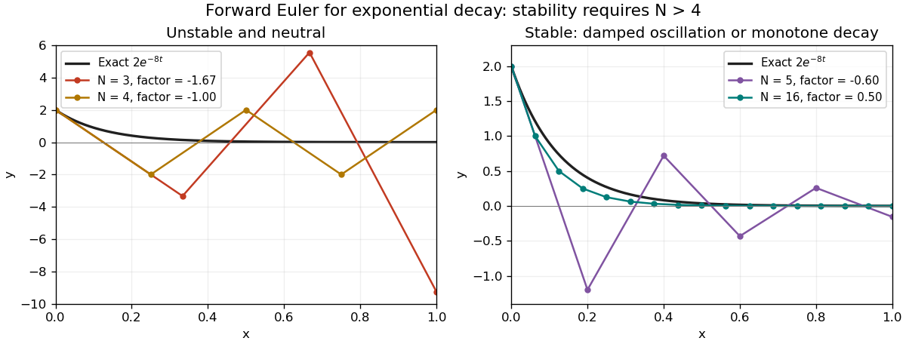

<h1 id="5/b/iii/solution">Solution</h1>

↑ **Parent:** [Iii](../iii.md)

The [amplification factor](../../../../../../amplification-factor.md) is $R=1-\lambda/N$. To reproduce decay, the [forward Euler method](../../../../../../euler-method.md) requires $|R|<1$, equivalently

$$
-1<1-\frac\lambda N<1
\quad\Longleftrightarrow\quad
\boxed{N>\lambda/2.}
$$

At $N=\lambda/2$, $R=-1$ and the approximations alternate with constant magnitude $2$; for $N<\lambda/2$, $|R|>1$ and the magnitude grows. This is the condition of [absolute stability](../../../../../../linear-stability-domain.md) for this decaying [differential equation](../../../../../../differential-equation-split.md).

Stability is only a minimum requirement. Values just inside the bound can still give a poor endpoint approximation; resolving the decay accurately generally requires a smaller [step size](../../../../../../step-size.md). If positivity at every step is desired, the stronger condition $N\ge\lambda$ ensures $R\ge0$. The figure shows the difference between decay of the exact solution and numerical oscillation.

**[Figure 1](#5/b/iii/image-forward-euler-approximation-to-exponential-decay-instability-neutral-oscillation-and-stable-decay). Forward Euler approximation to exponential decay: instability, neutral oscillation, and stable decay**.

## ↑ Ancestors (13)

1. [Iii](../iii.md)
2. [B](../../b.md)
3. [5](../../../5.md)
4. [Discrete mathematics, continuous mathematics, and probability](../../../../discrete-mathematics-continuous-mathematics-and-probability-split.md)
5. [2015](../../../../split.md)
6. [Past exam of the year 1 of the computer science course of the University of Oxford](../../../../../split.md)
7. [Year 1 of the computer science course of the University of Oxford](../../../../../../year-1-of-the-computer-science-course-of-the-university-of-oxford.md)
8. [Computer science course of the University of Oxford](../../../../../../computer-science-course-of-the-university-of-oxford.md)
9. [Undergraduate course of the University of Oxford](../../../../../../undergraduate-course-of-the-university-of-oxford.md)
10. [Course of the University of Oxford](../../../../../../course-of-the-university-of-oxford.md)
11. [University of Oxford](../../../../../../university-of-oxford-split.md)
12. [List of universities](../../../../../../list-of-universities.md)
13. [Codex Wiki](../../../../../../split.md)
