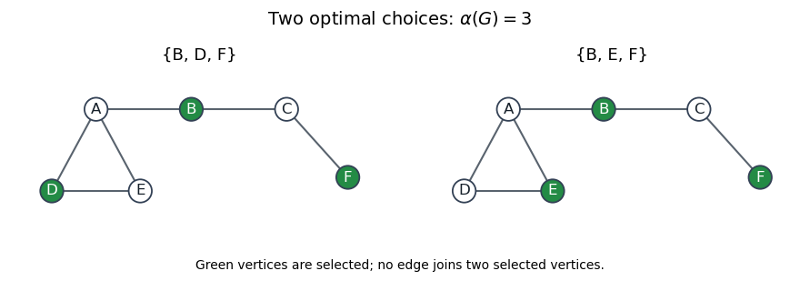
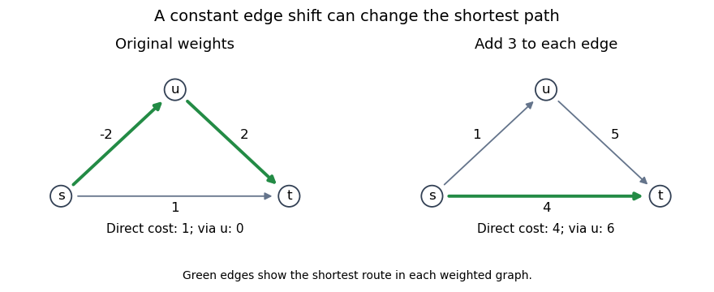

# Functional programming, design and analysis of algorithms

↑ **Parent:** [2015](../2015.md)

Source paper: [released examination archive](https://www.whatdotheyknow.com/request/computer_science_past_exam_paper/response/956037/attach/3/Lawrence%20Attachment.zip?cookie_passthrough=1), member `2015-fpdaa.pdf`. The printed cover dates this examination to 16 June 2015.

**Table of contents**

- [1](#1)
  - [a](#1/a)
    - [Solution](#1/a/solution)
  - [b](#1/b)
    - [Solution](#1/b/solution)
  - [c](#1/c)
    - [Solution](#1/c/solution)
  - [d](#1/d)
    - [Solution](#1/d/solution)
- [2](#2)
  - [a](#2/a)
    - [Solution](#2/a/solution)
  - [b](#2/b)
    - [Solution](#2/b/solution)
  - [c](#2/c)
    - [Solution](#2/c/solution)
  - [d](#2/d)
    - [Solution](#2/d/solution)
- [3](#3)
  - [a](#3/a)
    - [Solution](#3/a/solution)
  - [b](#3/b)
    - [Solution](#3/b/solution)
  - [c](#3/c)
    - [Solution](#3/c/solution)
  - [d](#3/d)
    - [Solution](#3/d/solution)
  - [e](#3/e)
    - [Solution](#3/e/solution)
- [4](#4)
  - [a](#4/a)
    - [Solution](#4/a/solution)
  - [b](#4/b)
    - [Solution](#4/b/solution)
  - [c](#4/c)
    - [Solution](#4/c/solution)
  - [d](#4/d)
    - [Solution](#4/d/solution)
- [5](#5)
  - [a](#5/a)
    - [Solution](#5/a/solution)
  - [b](#5/b)
    - [Solution](#5/b/solution)
  - [c](#5/c)
    - [Solution](#5/c/solution)
  - [d](#5/d)
    - [Solution](#5/d/solution)
- [6](#6)
  - [a](#6/a)
    - [Solution](#6/a/solution)
  - [b](#6/b)
    - [Solution](#6/b/solution)
  - [c](#6/c)
    - [Solution](#6/c/solution)
  - [d](#6/d)
    - [Solution](#6/d/solution)
  - [e](#6/e)
    - [Solution](#6/e/solution)
- [7](#7)
  - [a](#7/a)
    - [Solution](#7/a/solution)
  - [b](#7/b)
    - [Solution](#7/b/solution)
  - [c](#7/c)
    - [Solution](#7/c/solution)
- [8](#8)
  - [a](#8/a)
    - [Solution](#8/a/solution)
  - [b](#8/b)
    - [Solution](#8/b/solution)
  - [c](#8/c)
    - [Solution](#8/c/solution)
  - [d](#8/d)
    - [Solution](#8/d/solution)
  - [e](#8/e)
    - [Solution](#8/e/solution)

## 1

↑ **Parent:** [Functional programming, design and analysis of algorithms](functional-programming-design-and-analysis-of-algorithms.md)

<h3 id="1/a">a</h3>

↑ **Parent:** [1](#1)

<h4 id="1/a/solution">Solution</h4>

↑ **Parent:** [A](#1/a)

The [principal types](../../programming-language.md#principal-type) and definitions are:
```
map :: (a -> b) -> [a] -> [b]
map _ []     = []
map f (x:xs) = f x : map f xs

foldr :: (a -> b -> b) -> b -> [a] -> b
foldr _ e []     = e
foldr f e (x:xs) = f x (foldr f e xs)

(.) :: (b -> c) -> (a -> b) -> a -> c
(.) f g x = f (g x)
```
The [map function](../../programming-language.md#map-higher-order-function) preserves the [list](../../data-structure.md#list-abstract-data-type) shape while changing element type from `a` to `b`. The [right fold](../../programming-language.md#list-fold) replaces the empty [list](../../data-structure.md#list-abstract-data-type) by `e` and each constructor by `f`, whose second argument and result therefore share the accumulator type `b`. [Function composition](../../function.md#function-composition) requires the output type of `g` to agree with the input type of `f`. No [Haskell type class](../../programming-language.md#haskell-type-class) constraints arise: these definitions never compare elements or perform arithmetic on them.

<h3 id="1/b">b</h3>

↑ **Parent:** [1](#1)

<h4 id="1/b/solution">Solution</h4>

↑ **Parent:** [B](#1/b)

Take **`h = (.)`**:
```
h :: (b -> c) -> (a -> b) -> a -> c
h f g x = f (g x)
```
This is its standalone [principal type](../../programming-language.md#principal-type); in the [right fold](../../programming-language.md#list-fold), `c` specializes to the type of a function from the accumulator to itself.

For fixed `f`, `g` and `e`, prove equality pointwise by [structural induction](../../foundations-of-mathematics.md#structural-induction) on the [list](../../data-structure.md#list-abstract-data-type). At `[]` both sides return `e`. For `x:xs`, assume the equality for `xs` and calculate:
```
foldr f e (map g (x:xs))
  = f (g x) (foldr f e (map g xs))
  = f (g x) (foldr (h f g) e xs)
  = h f g x (foldr (h f g) e xs)
  = foldr (h f g) e (x:xs)
```
The second equality is the [induction hypothesis](../../foundations-of-mathematics.md#induction-hypothesis). [Function extensionality](../../function.md#function-extensionality) gives the required equality of composed functions. This is an instance of the [right-fold fusion law](../../programming-language.md#right-fold-fusion-law).

For the full lazy [Haskell](../../programming-language.md#haskell) interpretation, include a [bottom value](../../programming-language.md#bottom-value) for an undefined list spine: both sides are bottom there. The same constructor argument covers every finite approximation with an undefined tail. The [Scott continuity](../../set.md#scott-continuity) of the list operations then extends equality to their limits, including infinite [lists](../../data-structure.md#list-abstract-data-type). Ordinary induction on finite total [lists](../../data-structure.md#list-abstract-data-type) alone proves only that restricted case.

<h3 id="1/c">c</h3>

↑ **Parent:** [1](#1)

<h4 id="1/c/solution">Solution</h4>

↑ **Parent:** [C](#1/c)

Let `x :: a` and `g :: a -> b`, as required by the inner application `g x`. Using `g x` as the next argument of that same `g` forces `b = a`. Thus `g (g x) :: a`. Applying that result to `x` requires a function type `a -> c`, giving

$$
\boxed{a=a\to c.}
$$

This equation fails the [occurs check](../../programming-language.md#occurs-check): the type variable `a` occurs inside the type with which it would be unified. These constraints have no solution in the [Hindley-Milner type system](../../programming-language.md#hindley-milner-type-system). Therefore **the definition has no type in ordinary [Haskell](../../programming-language.md#haskell)**. The obstruction is to [type inference](../../programming-language.md#type-inference), independently of which particular values might later be supplied.

<h3 id="1/d">d</h3>

↑ **Parent:** [1](#1)

<h4 id="1/d/solution">Solution</h4>

↑ **Parent:** [D](#1/d)

The expression parses as `g . (g x)`. Initially write `g :: a -> r` and `x :: a`. In the [function composition](../../function.md#function-composition), `g x` must itself be a function whose result can be passed to `g`. Hence `r = b -> a` for a fresh type `b`, so
```
g :: a -> b -> a
g x :: b -> a
g . g x :: b -> b -> a
```
Consequently the [principal type](../../programming-language.md#principal-type) is
```
f :: (a -> b -> a) -> a -> b -> b -> a
```
One can check the constraints by expanding the composition:
```
f g x y z = g (g x y) z
```
Here `g x y` has type `a`, and the second application accepts it and the final `b`-typed argument `z`. The two type variables remain independent; no [Haskell type class](../../programming-language.md#haskell-type-class) constraints are required.

## 2

↑ **Parent:** [Functional programming, design and analysis of algorithms](functional-programming-design-and-analysis-of-algorithms.md)

<h3 id="2/a">a</h3>

↑ **Parent:** [2](#2)

<h4 id="2/a/solution">Solution</h4>

↑ **Parent:** [A](#2/a)

Use a [sum type](../../programming-language.md#tagged-union) whose two constructors distinguish a number from an operator:
```
data Elem = Number Int | Operator Op
```
Then the supplied `Polish` and `RPolish` aliases can both be [lists](../../data-structure.md#list-abstract-data-type) of `Elem`. Constructor tags distinguish tokens without attempting to encode operators as special numeric values. The numeric type `Int` agrees with the supplied [abstract syntax tree](../../programming-language.md#abstract-syntax-tree).

<h3 id="2/b">b</h3>

↑ **Parent:** [2](#2)

<h4 id="2/b/solution">Solution</h4>

↑ **Parent:** [B](#2/b)

Pass an already constructed suffix through the traversal:
```
convert :: Expr -> RPolish
convert e = go e []
  where
    go :: Expr -> RPolish -> RPolish
    go (Num n) rest = Number n : rest
    go (App op left right) rest =
      go left (go right (Operator op : rest))
```
The invariant is that `go e rest` is the [reverse Polish notation](../../mathematics.md#reverse-polish-notation) of `e` followed by `rest`. It holds at a numeric leaf. At an application, the result is the left subtree's tokens, then the right subtree's tokens, then the operator, then `rest`, exactly as required.

Each [vertex](../../graph.md#vertex-graph-theory) of the [abstract syntax tree](../../programming-language.md#abstract-syntax-tree) creates one output [list](../../data-structure.md#list-abstract-data-type) cell and performs constant local work. Thus producing the complete result takes **$O(n)$ time** for an expression with $n$ vertices. No repeated [list concatenation](../../data-structure.md#list-concatenation) copies a previously traversed subtree. This suffix-passing construction is a [difference list](../../data-structure.md#difference-list) traversal.

<h3 id="2/c">c</h3>

↑ **Parent:** [2](#2)

<h4 id="2/c/solution">Solution</h4>

↑ **Parent:** [C](#2/c)

Use an auxiliary [parser](../../programming-language.md#parser) that returns both a value and the unconsumed suffix. The arithmetic helper is:
```
applyOp :: Op -> Int -> Int -> Int
applyOp Add x y = x + y
applyOp Sub x y = x - y
applyOp Mul x y = x * y
applyOp Div x y = x `div` y
```
For the integer-valued expression language, this chooses [integer division](../../arithmetic.md#integer-division) with `div`'s rounding convention. The result is evaluated under the intended arithmetic model; bounded-`Int` overflow is separate from parsing.
```
evalP :: Polish -> Int
evalP input =
  case parse input of
    (value, []) -> value
    _           -> error "trailing tokens"
  where
    parse :: Polish -> (Int, Polish)
    parse [] = error "missing operand"
    parse (Number n : rest) = (n, rest)
    parse (Operator op : rest) =
      let (left, rest1)  = parse rest
          (right, rest2) = parse rest1
      in (applyOp op left right, rest2)
```
A number consumes one token. An operator consumes the two successive complete expressions that follow it, so nested operators are handled by [recursion](../../algorithm.md#recursion-computer-science). [Structural induction](../../foundations-of-mathematics.md#structural-induction) on the expression proves that `parse` consumes exactly its [Polish notation](../../mathematics.md#polish-notation) and returns its value. Keeping the suffix is essential: neither operand has a fixed token count. Division by zero need not be treated separately under the stated input convention.

<h3 id="2/d">d</h3>

↑ **Parent:** [2](#2)

<h4 id="2/d/solution">Solution</h4>

↑ **Parent:** [D](#2/d)

Maintain a [stack](../../data-structure.md#stack-data-structure) of values of the complete subexpressions encountered so far, with the newest value at its head:
```
evalRP :: RPolish -> Int
evalRP = finish . foldl push []
  where
    push :: [Int] -> Elem -> [Int]
    push stack (Number n) = n : stack
    push (right:left:stack) (Operator op) =
      applyOp op left right : stack
    push _ (Operator _) = error "missing operand"

    finish :: [Int] -> Int
    finish [value] = value
    finish _       = error "malformed expression"
```
The [left fold](../../programming-language.md#left-fold) processes tokens in their order. A number pushes its own value; an operator replaces the two latest subexpression values by their combination. The top value is the **right** operand, so preserving the order in `applyOp op left right` is necessary for [subtraction](../../arithmetic.md#subtraction) and [division](../../arithmetic.md#division-mathematics). Induction on the consumed token prefix proves this [stack machine](../../theoretical-computer-science.md#stack-machine) invariant. A complete valid expression finishes with exactly one value.

## 3

↑ **Parent:** [Functional programming, design and analysis of algorithms](functional-programming-design-and-analysis-of-algorithms.md)

<h3 id="3/a">a</h3>

↑ **Parent:** [3](#3)

<h4 id="3/a/solution">Solution</h4>

↑ **Parent:** [A](#3/a)

Collect the matching replacements and distinguish all three possible multiplicities:
```
applyRule :: [Rule] -> Char -> String
applyRule rules c =
  case [replacement | (key, replacement) <- rules, key == c] of
    []          -> error ("no rule for " ++ [c])
    [result]    -> result
    (_:_:_)     -> error ("multiple rules for " ++ [c])
```
The [list comprehension](../../programming-language.md#list-comprehension) selects precisely the rules whose left-hand character is `c`. A singleton is the required unique match. The third branch also rejects duplicate rules with identical right-hand sides: there are still two matching rules. Finiteness of the rule list makes the uniqueness test decidable. The returned replacement may itself be empty.

<h3 id="3/b">b</h3>

↑ **Parent:** [3](#3)

<h4 id="3/b/solution">Solution</h4>

↑ **Parent:** [B](#3/b)

Apply one replacement to each original character and concatenate the results:
```
step :: [Rule] -> State -> State
step rules = concatMap (applyRule rules)
```
The [concatMap](../../programming-language.md#haskell-concatmap-function) operation combines a [map function](../../programming-language.md#map-higher-order-function) and [list concatenation](../../data-structure.md#list-concatenation). Replacements occur in original-character order, so a character produced by a replacement is not processed again during the same step. This is parallel [string rewriting](../../foundations-of-mathematics.md#string-rewriting). In particular `step rules "" = ""`, with no rule lookup required for the empty state.

<h3 id="3/c">c</h3>

↑ **Parent:** [3](#3)

<h4 id="3/c/solution">Solution</h4>

↑ **Parent:** [C](#3/c)

Generate successive states lazily and take exactly their initial nonempty segment:
```
runSystem :: (State, [Rule]) -> [State]
runSystem (state, rules) =
  takeWhile (not . null) (iterate (step rules) state)
```
The [iterate function](../../programming-language.md#haskell-iterate-function) starts with `state` itself and repeatedly applies `step rules`. The [takeWhile function](../../programming-language.md#haskell-takewhile-function) excludes the first empty state and everything after it. If the initial state is empty, the result is `[]`. If the process never reaches an empty state, the answer is a potentially infinite [list](../../data-structure.md#list-abstract-data-type) whose finite prefixes can be observed through [lazy evaluation](../../programming-language.md#lazy-evaluation). No artificial maximum number of rewriting steps is introduced.

<h3 id="3/d">d</h3>

↑ **Parent:** [3](#3)

<h4 id="3/d/solution">Solution</h4>

↑ **Parent:** [D](#3/d)

The [principal type](../../programming-language.md#principal-type) needs an [equality type class](../../programming-language.md#eq-type-class) constraint:
```
isPrefix :: Eq a => [a] -> [a] -> Bool
isPrefix [] _ = True
isPrefix (_:_) [] = False
isPrefix (x:xs) (y:ys) = x == y && isPrefix xs ys
```
The empty [list](../../data-structure.md#list-abstract-data-type) is a [prefix](../../data-structure.md#prefix-of-a-list) of every [list](../../data-structure.md#list-abstract-data-type), witnessed by the second list itself as the remaining suffix. A nonempty prefix cannot fit in the empty [list](../../data-structure.md#list-abstract-data-type). Otherwise the first elements must agree, and the remaining first list must be a [prefix](../../data-structure.md#prefix-of-a-list) of the remaining second list. These cases prove correctness by [structural induction](../../foundations-of-mathematics.md#structural-induction) on the candidate prefix. The `Eq a` constraint is required by `x == y`; no ordering constraint is needed.

<h3 id="3/e">e</h3>

↑ **Parent:** [3](#3)

<h4 id="3/e/solution">Solution</h4>

↑ **Parent:** [E](#3/e)

Attach zero-based indices before filtering:
```
findStates :: [State] -> String -> [(State, Integer)]
findStates states str =
  [(state, i) |
     (state, i) <- zip states [0..],
     isPrefix str state]
```
The [zip function](../../programming-language.md#haskell-zip-function) pairs each state with its position in the original sequence. The [list comprehension](../../programming-language.md#list-comprehension) retains exactly those pairs satisfying the [prefix](../../data-structure.md#prefix-of-a-list) test, preserving their order and their original indices. The declared result makes `[0..]` a stream of `Integer` indices. An empty search string matches every state, including an empty state, because the empty [list](../../data-structure.md#list-abstract-data-type) is a [prefix](../../data-structure.md#prefix-of-a-list) of every [list](../../data-structure.md#list-abstract-data-type).

## 4

↑ **Parent:** [Functional programming, design and analysis of algorithms](functional-programming-design-and-analysis-of-algorithms.md)

<h3 id="4/a">a</h3>

↑ **Parent:** [4](#4)

<h4 id="4/a/solution">Solution</h4>

↑ **Parent:** [A](#4/a)

[Lazy evaluation](../../programming-language.md#lazy-evaluation) is evaluation by need: an expression is deferred until its value is demanded, and its computed value is shared for subsequent demands of the same suspended computation.

Its two key properties here are **avoiding evaluation of unused expressions** and **sharing demanded computations**. For example, the first component of `(3, undefined)` can be obtained without evaluating the second. A suspended expression is represented by a [thunk](../../programming-language.md#thunk); after evaluation its result can be reused. This supports productive infinite [lists](../../data-structure.md#list-abstract-data-type): `take 5 [0..]` demands only a finite prefix. It does not guarantee that a demanded computation terminates.

<h3 id="4/b">b</h3>

↑ **Parent:** [4](#4)

<h4 id="4/b/solution">Solution</h4>

↑ **Parent:** [B](#4/b)

Enumerate finite shells of constant coordinate sum:
```
triples :: [(Integer, Integer, Integer)]
triples =
  [(a, b, k-a-b) |
     k <- [0..],
     a <- [0..k],
     b <- [0..k-a]]
```
Here [natural numbers](../../arithmetic.md#natural-number) include zero. Every generated coordinate is nonnegative. Conversely, a given triple $(a,b,c)$ occurs in exactly the shell $k=a+b+c$ and at exactly those loop indices $a,b$. Each shell contains only finitely many triples, so every triple is reached after finitely many earlier outputs. This is [fair enumeration](../../algorithm.md#fair-enumeration), unlike nesting three unrestricted infinite lists. For the positive-integer convention, add one to each generated coordinate.

<h3 id="4/c">c</h3>

↑ **Parent:** [4](#4)

<h4 id="4/c/solution">Solution</h4>

↑ **Parent:** [C](#4/c)

For the requested `Int`-typed operation, remove the first element as well as its later multiples:
```
sieve :: [Int] -> [Int]
sieve [] = []
sieve (p:xs) = [x | x <- xs, x `rem` p /= 0]
```
On its intended input, `p` is positive, so the [remainder](../../integer.md#remainder) is defined. An arbitrary list headed by zero lies outside this convention.

To enumerate literally all [prime numbers](../../prime-number.md), use unbounded `Integer` arithmetic:
```
primes :: [Integer]
primes = go [2..]
  where
    go :: [Integer] -> [Integer]
    go [] = []
    go (p:xs) =
      p : go [x | x <- xs, x `rem` p /= 0]
```
At each stage, the smallest remaining number has no smaller [prime divisor](../../prime-number.md#prime-factor) and is therefore prime. Removing its larger multiples preserves every later prime and removes any [composite number](../../number-theory.md#composite-number) once its least [prime divisor](../../prime-number.md#prime-factor) is processed. [Lazy evaluation](../../programming-language.md#lazy-evaluation) makes each requested finite prefix available. This implements the given repeated-filtering form of the [sieve of Eratosthenes](../../prime-number.md#sieve-of-eratosthenes). A bounded `Int` stream can only cover representable values; `Integer` supplies the all-primes interpretation.

<h3 id="4/d">d</h3>

↑ **Parent:** [4](#4)

<h4 id="4/d/solution">Solution</h4>

↑ **Parent:** [D](#4/d)

Enumerate by the hypotenuse and test finitely many shorter legs:
```
primitiveTriples :: [(Integer, Integer, Integer)]
primitiveTriples =
  [(a, b, c) |
     c <- [1..],
     b <- [1..c-1],
     a <- [1..b-1],
     a*a + b*b == c*c,
     gcd a (gcd b c) == 1]
```
The equality selects [Pythagorean triples](../../euclidean-geometry.md#pythagorean-triple), and the [greatest common divisor](../../divisibility.md#greatest-common-divisor) test makes them primitive. The bounds enforce $0<a<b<c$, removing the duplicate obtained by exchanging the legs. Each fixed $c$ has a finite search, so the outer loop gives ascending hypotenuse order and reaches every qualifying triple. Infinite families supplied by [Euclid's formula](../../euclidean-geometry.md#euclid-s-formula-for-pythagorean-triples) ensure that the stream has arbitrarily many outputs. Its first five entries are
```
[(3,4,5),(5,12,13),(8,15,17),(7,24,25),(20,21,29)]
```
Using `Integer` avoids overflow in the squared values. The construction prioritizes a direct correctness argument; it does not claim an optimal enumeration cost.

## 5

↑ **Parent:** [Functional programming, design and analysis of algorithms](functional-programming-design-and-analysis-of-algorithms.md)

<h3 id="5/a">a</h3>

↑ **Parent:** [5](#5)

<h4 id="5/a/solution">Solution</h4>

↑ **Parent:** [A](#5/a)

The standard three-case [master theorem](../../sequence-and-series.md#master-theorem) concerns

$$
T(n)=aT(n/b)+f(n),\qquad a\geq1,\quad b>1,
$$

with constant base-case cost and eventually nonnegative $f$. Put $d=\log_b a$.

- If $f(n)=O(n^{d-\epsilon})$ for some $\epsilon>0$, then $T(n)=\Theta(n^d)$.
- If $f(n)=\Theta(n^d)$, then $T(n)=\Theta(n^d\log n)$.
- If $f(n)=\Omega(n^{d+\epsilon})$ for some $\epsilon>0$ and $a f(n/b)\leq c f(n)$ eventually for a constant $c<1$, then $T(n)=\Theta(f(n))$.

In a [divide-and-conquer algorithm](../../algorithm.md#divide-and-conquer-algorithm), $a$ counts recursive subproblems, $n/b$ is their size, and $f$ accounts for splitting and combining. The comparison with $n^{\log_b a}$ identifies whether leaves, all levels, or the upper levels dominate the [running time](../../algorithm.md#running-time). The polynomial gap and the third case's regularity condition are part of this version of the theorem.

<h3 id="5/b">b</h3>

↑ **Parent:** [5](#5)

<h4 id="5/b/solution">Solution</h4>

↑ **Parent:** [B](#5/b)

Build a balanced [comparison tournament](../../algorithm.md#comparison-tournament), retaining the record of each value's direct defeats. A record stores a key and a list of records that it directly defeated:
```
tournament(S):
    if |S| = 1:
        return Node(the element of S, [])
    split S into equally sized L and R
    a = tournament(L)
    b = tournament(R)
    if a.key < b.key:
        exchange a and b
    prepend b to a.losers
    return a
```
There is one key comparison at each merge. Because $S$ is a [set](../../set.md), all keys are distinct, so the greater winner is unambiguous. Retaining the losing record also retains its own earlier comparison history; it does not merely retain the losing root's value.

Let the returned root have value $M$. Define

$$
\boxed{\max(S)=M,\quad
\operatorname{second}(S)=\{r.\mathrm{key}:r\in\mathrm{root.losers}\},\quad
\operatorname{third}(S)=S\setminus(\{M\}\cup\operatorname{second}(S)).}
$$

The second-largest value can only lose to $M$, so it occurs among those direct losers. This proves the required partition and the exclusion of the second-largest value from the third part. For $n=2^m$, the winner participates in exactly $m$ merges, so $\lvert\operatorname{second}(S)\rvert=m$. The other part can be materialized by marking the original element identities in this list and scanning the original inputs, using $O(n)$ additional operations without more comparisons between keys.

<h3 id="5/c">c</h3>

↑ **Parent:** [5](#5)

<h4 id="5/c/solution">Solution</h4>

↑ **Parent:** [C](#5/c)

The first value is the tournament winner $M$. Find the second value $s$ by taking the [maximum](../../set.md#maximum-of-a-subset-of-a-total-order) of the direct-loser set $\operatorname{second}(S)$, retaining its associated tournament record.

The third-largest value must have lost directly to either $M$ or $s$: any other value is smaller and could not defeat it. Therefore it belongs to

$$
C=\bigl(\operatorname{second}(S)\setminus\{s\}\bigr)
\ \cup\ \{r.\mathrm{key}:r\in s.\mathrm{losers}\}.
$$

Conversely, every value in $C$ is distinct from $M,s$. Thus **the third-largest value is $\max C$**. This is [tournament selection of the three largest elements](../../algorithm.md#tournament-selection-of-the-three-largest-elements); it uses the retained defeat records while computing the requested three-part partition.

Three largest elements exist only for $n\geq3$. With the paper's power-of-two assumption this means $n\geq4$. The partition in part (b) remains meaningful for $n=2$, but a third output cannot be supplied in that case.

<h3 id="5/d">d</h3>

↑ **Parent:** [5](#5)

<h4 id="5/d/solution">Solution</h4>

↑ **Parent:** [D](#5/d)

The balanced [comparison tournament](../../algorithm.md#comparison-tournament) uses

$$
C(n)=2C(n/2)+1,\qquad C(1)=0,
$$

so $C(n)=n-1$. The second-largest search compares $m=\log_2n$ direct losers, using $m-1$ comparisons. The record of $s$ contains at most $m-1$ direct losers, because $s$ loses before becoming the overall winner. Hence the third candidate set has size at most $2m-2$, requiring at most $2m-3$ comparisons.

For $n=2^m\geq4$, the complete comparison count is therefore

$$
\boxed{(n-1)+(m-1)+(2m-3)=n+3\log_2n-5.}
$$

This is $n+O(\log n)$ and therefore meets the requested $O(n+\log^2n)$ bound. The defeat-record lists can be linked in constant local work per merge; flattening the final partition takes $O(n)$ work. Thus the method also has linear overall [running time](../../algorithm.md#running-time) under constant-cost key comparisons.

## 6

↑ **Parent:** [Functional programming, design and analysis of algorithms](functional-programming-design-and-analysis-of-algorithms.md)

<h3 id="6/a">a</h3>

↑ **Parent:** [6](#6)

<h4 id="6/a/solution">Solution</h4>

↑ **Parent:** [A](#6/a)

[Dynamic programming](../../mathematical-optimization.md#dynamic-programming) describes a problem by reusable subproblem states and a recurrence, computing each required state once through [memoization](../../algorithm.md#memoization) or a bottom-up order. Its benefit comes from sharing answers to overlapping subproblems.

The [principle of optimality](../../mathematical-optimization.md#principle-of-optimality) says that, after the information needed by a state has been fixed, the remaining part of an optimal solution is optimal for that state. Otherwise replacing it by a better subsolution would improve the whole solution. A correct state must retain every constraint that can affect later choices.

<h3 id="6/b">b</h3>

↑ **Parent:** [6](#6)

<h4 id="6/b/solution">Solution</h4>

↑ **Parent:** [B](#6/b)

Both [divide-and-conquer algorithms](../../algorithm.md#divide-and-conquer-algorithm) and [dynamic programming](../../mathematical-optimization.md#dynamic-programming) derive answers from smaller problems. A typical [divide-and-conquer algorithm](../../algorithm.md#divide-and-conquer-algorithm), such as [merge sort](../../algorithm.md#merge-sort), splits an instance into separate parts and combines their answers. [Dynamic programming](../../mathematical-optimization.md#dynamic-programming) additionally identifies repeated states across different decompositions and reuses their answers; [matrix-chain multiplication](../../algorithm.md#matrix-chain-multiplication) is a standard example.

Thus a recursion tree may repeatedly solve the same state, whereas a [dynamic programming](../../mathematical-optimization.md#dynamic-programming) table or [memoization](../../algorithm.md#memoization) stores it once. The resulting recurrence and dependency order determine the [running time](../../algorithm.md#running-time). The [principle of optimality](../../mathematical-optimization.md#principle-of-optimality) supports combining optimal state answers; it does not by itself justify a [greedy algorithm](../../algorithm.md#greedy-algorithm).

<h3 id="6/c">c</h3>

↑ **Parent:** [6](#6)

<h4 id="6/c/solution">Solution</h4>

↑ **Parent:** [C](#6/c)

Three examples of [independent sets](../../graph-theory.md#independent-set-graph-theory) are $\{A,C\}$, $\{B,D\}$ and $\{C,E\}$: none contains both endpoints of an edge. The [maximum independent sets](../../graph-theory.md#maximum-independent-set) are

$$
\boxed{\{B,D,F\}\quad\text{and}\quad\{B,E,F\},\qquad \alpha(G)=3.}
$$

The triangle on $\{A,D,E\}$ contributes at most one vertex, and the path on $\{B,C,F\}$ contributes at most two, giving the upper bound three. Both displayed sets attain it. A three-element choice cannot use $A$, since that excludes $B$ and leaves at most one of the adjacent vertices $C,F$. Consequently it must use $D$ or $E$, together with both $B,F$; these are the only two choices. In particular, **the maximum independent set is not unique**.

<a id="6/c/image-the-two-maximum-independent-sets-of-size-three"></a>


**[Figure 1](#6/c/image-the-two-maximum-independent-sets-of-size-three). The two maximum independent sets of size three**.

Highlighted vertices give the two possible optimal choices. The third side of the left triangle rules out choosing both $D$ and $E$.

<h3 id="6/d">d</h3>

↑ **Parent:** [6](#6)

<h4 id="6/d/solution">Solution</h4>

↑ **Parent:** [D](#6/d)

**No.** A [tree](../../tree-graph-theory.md) consisting of a single edge $uv$ has the two [maximum independent sets](../../graph-theory.md#maximum-independent-set) $\{u\}$ and $\{v\}$. Each has size one, and neither can be enlarged because $u,v$ are adjacent. Thus even a two-vertex [tree](../../tree-graph-theory.md) gives a counterexample to uniqueness.

<h3 id="6/e">e</h3>

↑ **Parent:** [6](#6)

<h4 id="6/e/solution">Solution</h4>

↑ **Parent:** [E](#6/e)

Choose a root. For each vertex $v$, define $I(v)$ as the maximum size in its descendant [subtree](../../data-structure.md#subtree) when $v$ is included, and $O(v)$ as that size when $v$ is excluded. For its children $w$,

$$
\boxed{I(v)=1+\sum_{w}O(w),\qquad
O(v)=\sum_w\max\{I(w),O(w)\}.}
$$

A leaf has $I=1,O=0$. If $v$ is included, all its children must be excluded. If $v$ is excluded, either child state is allowed. Different child subtrees have no edges between them because the graph is a [tree](../../tree-graph-theory.md), so their contributions can be optimized independently. This proves the recurrence by [structural induction](../../foundations-of-mathematics.md#structural-induction).

Evaluate the two states in [postorder traversal](../../tree-graph-theory.md#postorder-traversal). At root $r$, the answer is $\max\{I(r),O(r)\}$. For reconstruction, pick an attaining root state; an included vertex forces every child to its excluded state, while an excluded vertex permits each child to choose its larger state. Record the included vertices during this second traversal, breaking ties consistently.

With [adjacency lists](../../data-structure.md#adjacency-list), rooting, state evaluation and reconstruction each take **$O(|V|+|E|)=O(n)$ time**, with $O(n)$ stored states and output. This is [maximum independent set in a tree](../../graph-theory.md#maximum-independent-set-in-a-tree).

The source describes an [independent set](../../graph-theory.md#independent-set-graph-theory) as a proper subset. For a tree with at least one edge, every independent set is automatically proper, so the algorithm meets that convention. If it is enforced literally for the single-vertex tree, return the empty set of size zero there; the usual non-strict subset convention would instead return its one vertex.

## 7

↑ **Parent:** [Functional programming, design and analysis of algorithms](functional-programming-design-and-analysis-of-algorithms.md)

<h3 id="7/a">a</h3>

↑ **Parent:** [7](#7)

<h4 id="7/a/solution">Solution</h4>

↑ **Parent:** [A](#7/a)

[Depth-first search](../../algorithm.md#depth-first-search) marks a vertex when first reached, then recursively explores each still-unvisited neighbour before returning. To cover the whole graph, restart from every vertex not reached by earlier searches:
```
visit(v):
    visited[v] = true
    for w in adjacency[v]:
        if not visited[w]:
            visit(w)

for v in V:
    if not visited[v]:
        visit(v)
```
For a [directed graph](../../graph-theory.md#directed-graph), use outgoing neighbours; for an [undirected graph](../../graph-theory.md#undirected-graph), use both incidences of each edge. Each vertex is discovered once and each stored incidence is inspected once. Thus with [adjacency lists](../../data-structure.md#adjacency-list) the [running time](../../algorithm.md#running-time) is **$O(|V|+|E|)$** and the visited information and recursion stack use $O(|V|)$ space. An [adjacency matrix](../../graph-theory.md#adjacency-matrix) representation instead requires scanning $|V|$ possible neighbours per visited vertex, giving $O(|V|^2)$ time.

<h3 id="7/b">b</h3>

↑ **Parent:** [7](#7)

<h4 id="7/b/solution">Solution</h4>

↑ **Parent:** [B](#7/b)

In a [bipartite graph](../../bipartite-graph.md), successive vertices along an edge lie in opposite parts. Following a [cycle](../../finite-group-theory.md#permutation-cycle) alternates parts at each step, so returning to the starting part requires an [even](../../calculus.md#even-function) number of edges. Thus a bipartite graph contains no [odd cycle](../../graph-theory.md#odd-cycle).

Conversely, choose a rooted [spanning forest](../../graph-theory.md#spanning-forest) and colour each vertex by the parity of its depth in its component's tree. Suppose an edge $uv$ had equally coloured endpoints. The unique tree path from $u$ to $v$ has length

$$
\operatorname{depth}(u)+\operatorname{depth}(v)
-2\operatorname{depth}(\operatorname{LCA}(u,v)),
$$

which is even. Adjoining $uv$ makes an [odd cycle](../../graph-theory.md#odd-cycle). Therefore, if there are no odd cycles, every edge joins opposite colours, which supplies the required [bipartition](../../bipartite-graph.md#bipartition-of-a-graph).

$$
\boxed{G\text{ is bipartite}\iff G\text{ has no odd cycle}.}
$$

This is the [odd-cycle characterization of bipartite graphs](../../bipartite-graph.md#odd-cycle-characterization-of-bipartite-graphs). The argument applies separately to every [connected component](../../geometry-and-topology.md#connected-component).

<h3 id="7/c">c</h3>

↑ **Parent:** [7](#7)

<h4 id="7/c/solution">Solution</h4>

↑ **Parent:** [C](#7/c)

Augment [depth-first search](../../algorithm.md#depth-first-search) with a two-valued colour:
```
paint(v, c):
    colour[v] = c
    for w in adjacency[v]:
        if colour[w] is unset:
            if not paint(w, 1-c):
                return false
        else if colour[w] == c:
            return false
    return true

for v in V:
    if colour[v] is unset:
        if not paint(v, 0):
            return false
return true
```
Each tree edge receives opposite endpoint colours. If an inspected edge has equal colours, the preceding parity argument produces an [odd cycle](../../graph-theory.md#odd-cycle), so the graph is not [bipartite](../../bipartite-graph.md). If the procedure succeeds, every edge has differently coloured endpoints, and the two colour classes are a [bipartition](../../bipartite-graph.md#bipartition-of-a-graph). The outer loop handles disconnected graphs and isolated vertices.

Each vertex is coloured once and each edge incidence is checked once, giving **$O(|V|+|E|)$ time** and $O(|V|)$ extra space with [adjacency lists](../../data-structure.md#adjacency-list). No separate cycle enumeration is required.

## 8

↑ **Parent:** [Functional programming, design and analysis of algorithms](functional-programming-design-and-analysis-of-algorithms.md)

<h3 id="8/a">a</h3>

↑ **Parent:** [8](#8)

<h4 id="8/a/solution">Solution</h4>

↑ **Parent:** [A](#8/a)

[Dijkstra's algorithm](../../shortest-path-problem.md#dijkstra-algorithm) solves the [single-source shortest-path problem](../../shortest-path-problem.md#single-source-shortest-path-problem) with nonnegative edge weights: it finds minimum path lengths from the source to all reachable vertices and can store predecessor edges. With [adjacency lists](../../data-structure.md#adjacency-list) and a binary-heap [priority queue](../../data-structure.md#priority-queue), it takes **$O((|V|+|E|)\log|V|)$ time**; a direct array implementation takes $O(|V|^2)$.

The [Bellman-Ford algorithm](../../shortest-path-problem.md#bellman-ford-algorithm) allows negative edge weights. If no negative-weight cycle is reachable from the source, it computes the finite shortest-path distances to reachable vertices and identifies unreachable ones. Otherwise it can report a reachable [negative cycle](../../graph-theory.md#negative-cycle), whose repeated traversal makes distances to some reachable vertices unbounded below. It performs at most $|V|-1$ full relaxation rounds and one further detection round, taking **$O(|V||E|+|V|)$ time**, conventionally written $O(|V||E|)$ for nontrivial edge sets. A negative cycle unreachable from the source does not affect its distance problem.

<h3 id="8/b">b</h3>

↑ **Parent:** [8](#8)

<h4 id="8/b/solution">Solution</h4>

↑ **Parent:** [B](#8/b)

**No: equal-length shortest paths permit different trees.** Consider edges $s\to a,s\to b,a\to t,b\to t$, all of weight one. Both routes to $t$ have length two. A [shortest-path tree](../../shortest-path-problem.md#shortest-path-tree) may therefore choose either $a$ or $b$ as the predecessor of $t$.

The processing order and tie-breaking rules of [Dijkstra's algorithm](../../shortest-path-problem.md#dijkstra-algorithm) and the [Bellman-Ford algorithm](../../shortest-path-problem.md#bellman-ford-algorithm) need not agree, so either tree can result while all [shortest-path distances](../../shortest-path-problem.md#shortest-path-distance) agree. If every reachable vertex has a unique shortest path from $s$, then both correct algorithms must select those same paths.

<h3 id="8/c">c</h3>

↑ **Parent:** [8](#8)

<h4 id="8/c/solution">Solution</h4>

↑ **Parent:** [C](#8/c)

**No.** For a path $P$ with $k$ edges, adding $C$ to every edge changes its cost to

$$
w'(P)=w(P)+Ck.
$$

Different paths can have different numbers of edges, so this transformation need not preserve their order.

For a concrete [Directed acyclic graph](../../combinatorics.md#directed-acyclic-graph), use edges $s\to t$ of weight $1$, $s\to u$ of weight $-2$, and $u\to t$ of weight $2$. Originally the route through $u$ has cost $0$ and beats the direct edge of cost $1$. Adding $C=3$ makes every edge positive, but the direct route now costs $4$, while the route through $u$ costs $1+5=6$. [Dijkstra's algorithm](../../shortest-path-problem.md#dijkstra-algorithm) on the modified graph therefore returns a path that is not shortest in the original graph.

<a id="8/c/image-adding-a-constant-to-edge-weights-reverses-the-shortest-path-choice"></a>


**[Figure 2](#8/c/image-adding-a-constant-to-edge-weights-reverses-the-shortest-path-choice). Adding a constant to edge weights reverses the shortest-path choice**.

The two-edge path receives the added constant twice; the direct path receives it once. This is the [failure of uniform edge shifts to preserve shortest paths](../../shortest-path-problem.md#failure-of-uniform-edge-shifts-to-preserve-shortest-paths).

<h3 id="8/d">d</h3>

↑ **Parent:** [8](#8)

<h4 id="8/d/solution">Solution</h4>

↑ **Parent:** [D](#8/d)

A [topological sort](../../combinatorics.md#topological-sorting) of a [Directed acyclic graph](../../combinatorics.md#directed-acyclic-graph) is a linear ordering of its vertices in which the tail of every directed edge precedes its head. Along a path $v_0\to v_1\to\cdots\to v_k$, this property successively gives

$$
v_0<v_1<\cdots<v_k
$$

in that ordering. Thus the vertices of every directed path occur in [topological order](../../combinatorics.md#topological-order). The acyclicity condition is necessary, since a directed cycle would force its first vertex to precede itself.

<h3 id="8/e">e</h3>

↑ **Parent:** [8](#8)

<h4 id="8/e/solution">Solution</h4>

↑ **Parent:** [E](#8/e)

Process outgoing edges in [topological order](../../combinatorics.md#topological-order):
```
order = topological_sort(G)
for v in V:
    distance[v] = infinity
    predecessor[v] = none
distance[s] = 0

for u in order:
    if distance[u] != infinity:
        for edge (u,v) of weight w:
            if distance[u] + w < distance[v]:
                distance[v] = distance[u] + w
                predecessor[v] = u
```
For correctness, argue by induction through the [topological sort](../../combinatorics.md#topological-sorting). Every path ending at a vertex $v\ne s$ reaches it through some incoming edge $uv$. All such predecessors $u$ occur earlier, so their finalized shortest-path distances have already been considered when $v$ is processed. Taking the minimum of $\operatorname{distance}(u)+w(u,v)$ over these edges therefore gives exactly the shortest-path distance to $v$. Unreachable vertices retain infinity. Negative edge weights cause no difficulty because a later vertex cannot lead back to an earlier one.

This is the [DAG shortest-path algorithm](../../shortest-path-problem.md#dag-shortest-path-algorithm). [Topological sorting](../../combinatorics.md#topological-sorting) and the single pass of [edge relaxation](../../shortest-path-problem.md#edge-relaxation) each take **$O(|V|+|E|)$ time** with [adjacency lists](../../data-structure.md#adjacency-list); distances, predecessors and the order use $O(|V|)$ auxiliary space. Following predecessors reconstructs a shortest path to any reachable target.

## ↑ Ancestors (9)

1. [2015](../2015.md)
2. [Past exam of the year 1 of the computer science course of the University of Oxford](../../past-exam-of-the-year-1-of-the-computer-science-course-of-the-university-of-oxford.md)
3. [Year 1 of the computer science course of the University of Oxford](../../university-of-oxford.md#year-1-of-the-computer-science-course-of-the-university-of-oxford)
4. [Computer science course of the University of Oxford](../../university-of-oxford.md#computer-science-course-of-the-university-of-oxford)
5. [Undergraduate course of the University of Oxford](../../university-of-oxford.md#undergraduate-course-of-the-university-of-oxford)
6. [Course of the University of Oxford](../../university-of-oxford.md#course-of-the-university-of-oxford)
7. [University of Oxford](../../university-of-oxford.md)
8. [List of universities](../../README.md#list-of-universities)
9. [Codex Wiki](../../README.md)
