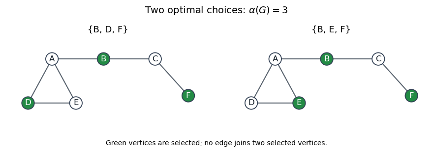

<h1 id="6/c/solution">Solution</h1>

↑ **Parent:** [C](../c.md)

Three examples of [independent sets](../../../../../independent-set-graph-theory.md) are $\{A,C\}$, $\{B,D\}$ and $\{C,E\}$: none contains both endpoints of an edge. The [maximum independent sets](../../../../../maximum-independent-set.md) are

$$
\boxed{\{B,D,F\}\quad\text{and}\quad\{B,E,F\},\qquad \alpha(G)=3.}
$$

The triangle on $\{A,D,E\}$ contributes at most one vertex, and the path on $\{B,C,F\}$ contributes at most two, giving the upper bound three. Both displayed sets attain it. A three-element choice cannot use $A$, since that excludes $B$ and leaves at most one of the adjacent vertices $C,F$. Consequently it must use $D$ or $E$, together with both $B,F$; these are the only two choices. In particular, **the maximum independent set is not unique**.

**[Figure 1](#6/c/image-the-two-maximum-independent-sets-of-size-three). The two maximum independent sets of size three**.

Highlighted vertices give the two possible optimal choices. The third side of the left triangle rules out choosing both $D$ and $E$.

## ↑ Ancestors (12)

1. [C](../c.md)
2. [6](../../6.md)
3. [Functional programming, design and analysis of algorithms](../../../functional-programming-design-and-analysis-of-algorithms-split.md)
4. [2015](../../../split.md)
5. [Past exam of the year 1 of the computer science course of the University of Oxford](../../../../split.md)
6. [Year 1 of the computer science course of the University of Oxford](../../../../../year-1-of-the-computer-science-course-of-the-university-of-oxford.md)
7. [Computer science course of the University of Oxford](../../../../../computer-science-course-of-the-university-of-oxford.md)
8. [Undergraduate course of the University of Oxford](../../../../../undergraduate-course-of-the-university-of-oxford.md)
9. [Course of the University of Oxford](../../../../../course-of-the-university-of-oxford.md)
10. [University of Oxford](../../../../../university-of-oxford-split.md)
11. [List of universities](../../../../../list-of-universities.md)
12. [Codex Wiki](../../../../../split.md)
