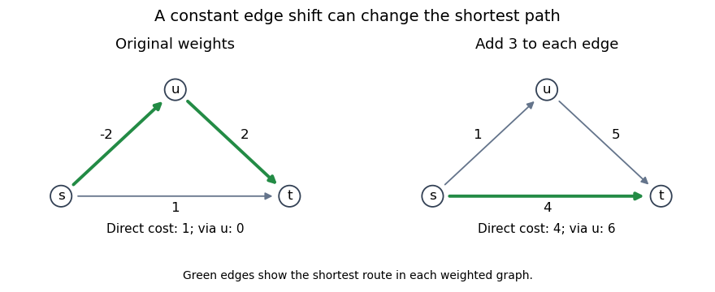

<h1 id="8/c/solution">Solution</h1>

↑ **Parent:** [C](../c.md)

**No.** For a path $P$ with $k$ edges, adding $C$ to every edge changes its cost to

$$
w'(P)=w(P)+Ck.
$$

Different paths can have different numbers of edges, so this transformation need not preserve their order.

For a concrete [Directed acyclic graph](../../../../../directed-acyclic-graph.md), use edges $s\to t$ of weight $1$, $s\to u$ of weight $-2$, and $u\to t$ of weight $2$. Originally the route through $u$ has cost $0$ and beats the direct edge of cost $1$. Adding $C=3$ makes every edge positive, but the direct route now costs $4$, while the route through $u$ costs $1+5=6$. [Dijkstra's algorithm](../../../../../dijkstra-algorithm.md) on the modified graph therefore returns a path that is not shortest in the original graph.

**[Figure 2](#8/c/image-adding-a-constant-to-edge-weights-reverses-the-shortest-path-choice). Adding a constant to edge weights reverses the shortest-path choice**.

The two-edge path receives the added constant twice; the direct path receives it once. This is the [failure of uniform edge shifts to preserve shortest paths](../../../../../failure-of-uniform-edge-shifts-to-preserve-shortest-paths.md).

## ↑ Ancestors (12)

1. [C](../c.md)
2. [8](../../8.md)
3. [Functional programming, design and analysis of algorithms](../../../functional-programming-design-and-analysis-of-algorithms-split.md)
4. [2015](../../../split.md)
5. [Past exam of the year 1 of the computer science course of the University of Oxford](../../../../split.md)
6. [Year 1 of the computer science course of the University of Oxford](../../../../../year-1-of-the-computer-science-course-of-the-university-of-oxford.md)
7. [Computer science course of the University of Oxford](../../../../../computer-science-course-of-the-university-of-oxford.md)
8. [Undergraduate course of the University of Oxford](../../../../../undergraduate-course-of-the-university-of-oxford.md)
9. [Course of the University of Oxford](../../../../../course-of-the-university-of-oxford.md)
10. [University of Oxford](../../../../../university-of-oxford-split.md)
11. [List of universities](../../../../../list-of-universities.md)
12. [Codex Wiki](../../../../../split.md)
