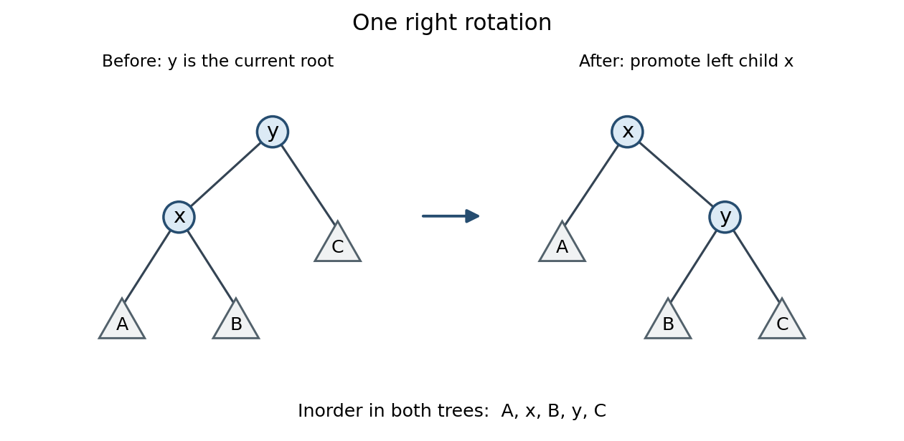

<h1 id="1/f/solution">Solution</h1>

↑ **Parent:** [F](../f.md)

Use [destructive inorder traversal by right rotations](../../../../../destructive-inorder-traversal-by-right-rotations.md). A [right tree rotation](../../../../../right-tree-rotation.md) preserves [inorder traversal](../../../../../inorder-traversal.md) but moves the first unvisited node closer to the root:
```
PROCEDURE InorderDestructive(t: Tree; p: Visit);
VAR q: Tree;
BEGIN
  WHILE t # NIL DO
    WHILE t.left # NIL DO
      q := t.left;
      t.left := q.right;
      q.right := t;
      t := q
    END;
    p(t.label);
    t := t.right
  END
END InorderDestructive;
```
The outer [loop invariant](../../../../../loop-invariant.md) states that the labels already passed to `p`, followed by the [inorder traversal](../../../../../inorder-traversal.md) of `t`, equal the original [inorder traversal](../../../../../inorder-traversal.md). The remaining nodes form a [binary tree](../../../../../binary-tree.md) disjoint from the nodes already visited. The inner [loop invariant](../../../../../loop-invariant.md) preserves the remaining [inorder traversal](../../../../../inorder-traversal.md): if the old root is $y$, its left child is $x$, and the three unchanged [subtrees](../../../../../subtree.md) are $A,B,C$, then both shapes have order $A,x,B,y,C$.

<a id="1/f/image-a-right-tree-rotation-preserves-inorder-traversal-and-exposes-the-next-node"></a>


**[Figure 1](#1/f/image-a-right-tree-rotation-preserves-inorder-traversal-and-exposes-the-next-node). A right tree rotation preserves inorder traversal and exposes the next node**.

At inner-loop exit, `t.left = NIL`, so the root is the first remaining node. Visiting it and replacing `t` by `t.right` preserves the outer [loop invariant](../../../../../loop-invariant.md). The procedure changes child [pointers](../../../../../pointer-computer-programming.md) and makes the old root reference unusable as the original [binary tree](../../../../../binary-tree.md). Assume `p` neither changes the [binary tree](../../../../../binary-tree.md) nor depends on its old shape.

$$
\boxed{\text{Every label is visited in inorder using }O(1)\text{ auxiliary space}.}
$$

## ↑ Ancestors (12)

1. [F](../f.md)
2. [1](../../1.md)
3. [Imperative programming (resit)](../../../imperative-programming-resit-split.md)
4. [2015](../../../split.md)
5. [Past exam of the year 1 of the computer science course of the University of Oxford](../../../../split.md)
6. [Year 1 of the computer science course of the University of Oxford](../../../../../year-1-of-the-computer-science-course-of-the-university-of-oxford.md)
7. [Computer science course of the University of Oxford](../../../../../computer-science-course-of-the-university-of-oxford.md)
8. [Undergraduate course of the University of Oxford](../../../../../undergraduate-course-of-the-university-of-oxford.md)
9. [Course of the University of Oxford](../../../../../course-of-the-university-of-oxford.md)
10. [University of Oxford](../../../../../university-of-oxford-split.md)
11. [List of universities](../../../../../list-of-universities.md)
12. [Codex Wiki](../../../../../split.md)
