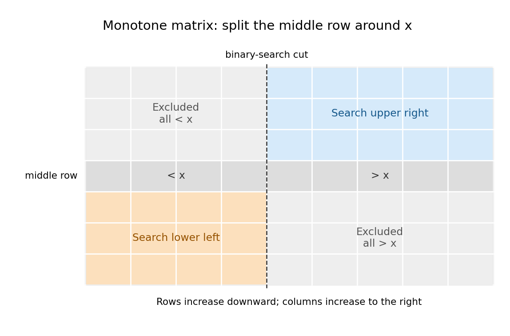

# Imperative programming

↑ **Parent:** [2015](../2015.md)

**Table of contents**

- [1](#1)
  - [a](#1/a)
    - [Solution](#1/a/solution)
  - [b](#1/b)
    - [Solution](#1/b/solution)
  - [c](#1/c)
    - [Solution](#1/c/solution)
  - [d](#1/d)
    - [Solution](#1/d/solution)
  - [e](#1/e)
    - [Solution](#1/e/solution)
- [2](#2)
  - [a](#2/a)
    - [Solution](#2/a/solution)
  - [b](#2/b)
    - [Solution](#2/b/solution)
  - [c](#2/c)
    - [Solution](#2/c/solution)
  - [d](#2/d)
    - [Solution](#2/d/solution)
  - [e](#2/e)
    - [Solution](#2/e/solution)
  - [f](#2/f)
    - [Solution](#2/f/solution)
- [3](#3)
  - [a](#3/a)
    - [Solution](#3/a/solution)
  - [b](#3/b)
    - [Solution](#3/b/solution)
  - [c](#3/c)
    - [Solution](#3/c/solution)
  - [d](#3/d)
    - [Solution](#3/d/solution)
  - [e](#3/e)
    - [Solution](#3/e/solution)
  - [f](#3/f)
    - [Solution](#3/f/solution)
  - [g](#3/g)
    - [Solution](#3/g/solution)
- [4](#4)
  - [a](#4/a)
    - [Solution](#4/a/solution)
  - [b](#4/b)
    - [Solution](#4/b/solution)
  - [c](#4/c)
    - [Solution](#4/c/solution)
  - [d](#4/d)
    - [Solution](#4/d/solution)
  - [e](#4/e)
    - [Solution](#4/e/solution)
- [5](#5)
  - [a](#5/a)
    - [Solution](#5/a/solution)
  - [b](#5/b)
    - [Solution](#5/b/solution)
- [6](#6)
  - [a](#6/a)
    - [Solution](#6/a/solution)
  - [b](#6/b)
    - [Solution](#6/b/solution)
  - [c](#6/c)
    - [Solution](#6/c/solution)
- [7](#7)
  - [a](#7/a)
    - [Solution](#7/a/solution)
  - [b](#7/b)
    - [Solution](#7/b/solution)
  - [c](#7/c)
    - [Solution](#7/c/solution)
- [8](#8)
  - [a](#8/a)
    - [Solution](#8/a/solution)
  - [b](#8/b)
    - [Solution](#8/b/solution)
  - [c](#8/c)
    - [Solution](#8/c/solution)
  - [d](#8/d)
    - [Solution](#8/d/solution)

## 1

↑ **Parent:** [Imperative programming](imperative-programming.md)

<h3 id="1/a">a</h3>

↑ **Parent:** [1](#1)

<h4 id="1/a/solution">Solution</h4>

↑ **Parent:** [A](#1/a)

In executable [Haskell](../../programming-language.md#haskell), the [algebraic data type](../../programming-language.md#algebraic-data-type) declaration uses `data`, rather than the printed `type`. A [leaf of a rooted tree](../../tree-graph-theory.md#leaf-of-a-rooted-tree) contributes `False`; a fork contributes `True` followed by its left and right [subtrees](../../data-structure.md#subtree) in that order.
```
data Tree = Leaf | Fork Tree Tree

preorder :: Tree -> [Bool]
preorder Leaf       = [False]
preorder (Fork l r) = True : (preorder l ++ preorder r)
```
This is a [preorder traversal](../../tree-graph-theory.md#preorder-traversal) of a [full binary tree](../../data-structure.md#full-binary-tree), including the [leaves](../../tree-graph-theory.md#leaf-of-a-rooted-tree). [Structural induction](../../foundations-of-mathematics.md#structural-induction) proves correctness: the [leaf of a rooted tree](../../tree-graph-theory.md#leaf-of-a-rooted-tree) case has precisely one output, and the fork case concatenates the correct [preorder traversals](../../tree-graph-theory.md#preorder-traversal) of its two [subtrees](../../data-structure.md#subtree) after its own marker.

An equivalent version avoids repeatedly copying the left [list](../../data-structure.md#list-abstract-data-type) through [list concatenation](../../data-structure.md#list-concatenation):
```
preorder t = walk t []
  where
    walk Leaf rest       = False : rest
    walk (Fork l r) rest = True : walk l (walk r rest)
```
Its strengthening is `walk t rest = preorder t ++ rest`. Each [vertex](../../graph.md#vertex-graph-theory) constructs one [list](../../data-structure.md#list-abstract-data-type) cell, so this version has linear [time complexity](../../theoretical-computer-science.md#time-complexity). The concise result is

$$
\boxed{P(\mathrm{Leaf})=[\mathrm{False}],\quad P(\mathrm{Fork}(l,r))=[\mathrm{True}]\mathbin{+\!+}P(l)\mathbin{+\!+}P(r).}
$$

<h3 id="1/b">b</h3>

↑ **Parent:** [1](#1)

<h4 id="1/b/solution">Solution</h4>

↑ **Parent:** [B](#1/b)

For parts (b)–(e), use [array indices](../../data-structure.md#array-index) as [tree](../../tree-graph-theory.md) handles. This also makes the shared storage in part (d) type-correct: both pending handles and output markers occupy [integer](../../integer.md) cells. Zero denotes a [leaf of a rooted tree](../../tree-graph-theory.md#leaf-of-a-rooted-tree); a positive handle $t$ denotes a fork whose children are in `nodes[t-1]`. Only finite acyclic structures are admitted. An allocated fork's children are themselves valid handles.
```
CONST MaxForks = 100000;
TYPE Tree = INTEGER;
     Node = RECORD left, right: Tree END;
     Arena = ARRAY MaxForks OF Node;
VAR nodes: Arena;
    used: INTEGER;

PROCEDURE NewFork(left, right: Tree): Tree;
BEGIN
  ASSERT(used < MaxForks);
  nodes[used].left := left; nodes[used].right := right;
  INC(used);
  RETURN used
END NewFork;

PROCEDURE Preorder(t: Tree; VAR out: ARRAY OF INTEGER;
                   VAR count: INTEGER);
  PROCEDURE Visit(p: Tree);
  BEGIN
    IF p = 0 THEN
      out[count] := 0; INC(count)
    ELSE
      out[count] := 1; INC(count);
      Visit(nodes[p-1].left); Visit(nodes[p-1].right)
    END
  END Visit;
BEGIN
  count := 0; Visit(t)
END Preorder;
```
Initialize `used := 0` before constructing any [trees](../../tree-graph-theory.md); `NewFork` allocates within this arena. The fixed capacity is an implementation parameter and may be replaced by a dynamically allocated arena. The returned prefix `out[0..count)` encodes [Boolean](../../programming-language.md#boolean-data-type) values by $0=\mathrm{False}$ and $1=\mathrm{True}$. This encoding is part of the chosen representation, not a conversion of a [pointer](../../computer-memory.md#pointer-computer-programming) into a [Boolean](../../programming-language.md#boolean-data-type) value.

The [recursion invariant](../../algorithm.md#recursion-invariant) is that `Visit(p)` appends exactly the [preorder traversal](../../tree-graph-theory.md#preorder-traversal) of the [subtree](../../data-structure.md#subtree) represented by `p`. If the [full binary tree](../../data-structure.md#full-binary-tree) has $I$ forks, it has $I+1$ [leaves](../../tree-graph-theory.md#leaf-of-a-rooted-tree); hence

$$
\boxed{\mathrm{count}=2I+1,\qquad \mathrm{out}[0..\mathrm{count})=P(t)\text{ encoded by }0,1.}
$$

Each occurrence is visited once, using linear [time complexity](../../theoretical-computer-science.md#time-complexity) and a [call stack](../../data-structure.md#call-stack) bounded by the [height of a binary tree](../../data-structure.md#height-of-a-binary-tree). The arena is the input representation, not an extra copy made by the traversal.

<h3 id="1/c">c</h3>

↑ **Parent:** [1](#1)

<h4 id="1/c/solution">Solution</h4>

↑ **Parent:** [C](#1/c)

Use an explicit [stack](../../data-structure.md#stack-data-structure) of handles. Push the right [subtree](../../data-structure.md#subtree) first, so that the left [subtree](../../data-structure.md#subtree) is removed first by the [LIFO stack](../../data-structure.md#stack-data-structure).
```
PROCEDURE PreorderIter(t: Tree; VAR out: ARRAY OF INTEGER;
                       VAR count: INTEGER;
                       VAR stack: ARRAY OF Tree);
VAR top: INTEGER; p: Tree;
BEGIN
  count := 0; top := 1; stack[0] := t;
  WHILE top > 0 DO
    DEC(top); p := stack[top];
    IF p = 0 THEN
      out[count] := 0; INC(count)
    ELSE
      out[count] := 1; INC(count);
      stack[top] := nodes[p-1].right; INC(top);
      stack[top] := nodes[p-1].left; INC(top)
    END
  END
END PreorderIter;
```
The [loop invariant](../../algorithm.md#loop-invariant) says that the already written prefix, followed by the [preorder traversals](../../tree-graph-theory.md#preorder-traversal) of the pending [subtrees](../../data-structure.md#subtree) in top-to-bottom [stack](../../data-structure.md#stack-data-structure) order, equals the entire required output. Popping a [leaf of a rooted tree](../../tree-graph-theory.md#leaf-of-a-rooted-tree) transfers one marker to the prefix. Popping a fork transfers its marker and replaces its remaining work by left then right [subtree](../../data-structure.md#subtree) work. Both preserve the [loop invariant](../../algorithm.md#loop-invariant). The number of as-yet-unwritten [vertices](../../graph.md#vertex-graph-theory) decreases by one per iteration, proving termination.

$$
\boxed{\text{Push right, push left; pop and emit until the stack is empty.}}
$$

The [time complexity](../../theoretical-computer-science.md#time-complexity) is linear in the output length. The maximum [stack](../../data-structure.md#stack-data-structure) size is at most one plus the [height of a binary tree](../../data-structure.md#height-of-a-binary-tree).

<h3 id="1/d">d</h3>

↑ **Parent:** [1](#1)

<h4 id="1/d/solution">Solution</h4>

↑ **Parent:** [D](#1/d)

Let $L$ be the final output length, $k$ the number of emitted markers, and $s$ the number of pending handles. Each pending [subtree](../../data-structure.md#subtree) contributes at least one future marker, so

$$
k+s\leq L\leq\operatorname{LEN}(\mathrm{out}).
$$

Store output from the low end and the [stack](../../data-structure.md#stack-data-structure) from the high end of the same [array](../../data-structure.md#array-data-structure). A pop frees one cell before the next write. For a fork, the two pushed children each account for at least one of the remaining markers. Thus the two regions never overlap.
```
PROCEDURE PreorderShared(t: Tree; VAR out: ARRAY OF INTEGER;
                         VAR count: INTEGER);
VAR top, cap: INTEGER; p: Tree;
BEGIN
  cap := LEN(out); count := 0;
  top := cap-1; out[top] := t;
  WHILE top < cap DO
    p := out[top]; INC(top);
    IF p = 0 THEN
      out[count] := 0; INC(count)
    ELSE
      out[count] := 1; INC(count);
      DEC(top); out[top] := nodes[p-1].right;
      DEC(top); out[top] := nodes[p-1].left
    END
  END
END PreorderShared;
```
The [loop invariant](../../algorithm.md#loop-invariant) includes `count <= top`, with pending handles in `out[top..cap)` and final markers in `out[0..count)`. The preceding accounting proves every intermediate write also respects [array bounds](../../data-structure.md#array-bounds). This uses the [integer](../../integer.md) handle representation chosen in part (b). Simply putting a [pointer](../../computer-memory.md#pointer-computer-programming) into a genuinely [Boolean](../../programming-language.md#boolean-data-type)-typed cell would not be valid [Oberon](../../programming-language.md#oberon-programming-language).

$$
\boxed{\text{One result array suffices; additional working storage is }O(1).}
$$

<h3 id="1/e">e</h3>

↑ **Parent:** [1](#1)

<h4 id="1/e/solution">Solution</h4>

↑ **Parent:** [E](#1/e)

Maintain a cursor to the first unread marker. A fork consumes its own marker and then two complete encodings, in left-to-right order.
```
PROCEDURE Decode(VAR code: ARRAY OF INTEGER;
                 VAR pos: INTEGER): Tree;
VAR marker: INTEGER; left, right: Tree;
BEGIN
  marker := code[pos]; INC(pos);
  IF marker = 0 THEN RETURN 0 END;
  ASSERT(marker = 1);
  left := Decode(code, pos);
  right := Decode(code, pos);
  RETURN NewFork(left, right)
END Decode;
```
Start with `pos := 0; t := Decode(code, pos)`, with sufficient unused arena space. The valid-input [precondition](../../algorithm.md#precondition) ensures that every read exists and every fork has two encoded [subtrees](../../data-structure.md#subtree). Evaluating the two recursive calls in separate statements fixes their order.

[Structural induction](../../foundations-of-mathematics.md#structural-induction) shows that decoding $P(t)$ reconstructs the same [binary tree](../../data-structure.md#binary-tree) shape and leaves the cursor just after its encoding. The [tree](../../tree-graph-theory.md) handles need not coincide with the original handles: the abstract [tree](../../tree-graph-theory.md) does. The result is

$$
\boxed{\operatorname{Decode}(P(t))\cong t,\quad\mathrm{pos}=|P(t)|.}
$$

The [time complexity](../../theoretical-computer-science.md#time-complexity) is linear in the encoding length, with [call stack](../../data-structure.md#call-stack) space bounded by the [height of a binary tree](../../data-structure.md#height-of-a-binary-tree).

## 2

↑ **Parent:** [Imperative programming](imperative-programming.md)

<h3 id="2/a">a</h3>

↑ **Parent:** [2](#2)

<h4 id="2/a/solution">Solution</h4>

↑ **Parent:** [A](#2/a)

With the fixed [array](../../data-structure.md#array-data-structure) `f` visible to the procedures, use a [Boolean](../../programming-language.md#boolean-data-type) result for success and two output [array indices](../../data-structure.md#array-index):
```
TYPE Search = PROCEDURE(x: INTEGER; VAR i, j: INTEGER): BOOLEAN;
```
On success, $0\leq i<M$, $0\leq j<N$, and $f[i,j]=x$. On failure there is no occurrence; the output indices are unspecified. Thus

$$
\boxed{\mathrm{TRUE}\Longrightarrow f[i,j]=x;\qquad\mathrm{FALSE}\Longrightarrow x\text{ is absent}.}
$$

<h3 id="2/b">b</h3>

↑ **Parent:** [2](#2)

<h4 id="2/b/solution">Solution</h4>

↑ **Parent:** [B](#2/b)

Use a [linear search](../../algorithm.md#linear-search) over every pair of [array indices](../../data-structure.md#array-index).
```
PROCEDURE SearchAll(x: INTEGER; VAR i, j: INTEGER): BOOLEAN;
VAR r, c: INTEGER;
BEGIN
  FOR r := 0 TO M-1 DO
    FOR c := 0 TO N-1 DO
      IF f[r,c] = x THEN i := r; j := c; RETURN TRUE END
    END
  END;
  RETURN FALSE
END SearchAll;
```
For a worst-case lower bound, consider an input in which every inspected element differs from $x$. If an element remains uninspected, changing just that element to $x$ gives an indistinguishable execution requiring the opposite answer. Therefore a correct exact [search algorithm](../../algorithm.md#search-algorithm) must inspect all $MN$ elements in the worst case.

The printed phrase “at least $O(MN)$” uses the upper-bound notation for a lower-bound claim. Its precise interpretation is

$$
\boxed{\text{Worst-case lower bound }\Omega(MN);\quad\text{the scan takes }\Theta(MN).}
$$

This is an [adversary argument](../../algorithm.md#adversary-argument) for access to arbitrary independent [array](../../data-structure.md#array-data-structure) entries.

<h3 id="2/c">c</h3>

↑ **Parent:** [2](#2)

<h4 id="2/c/solution">Solution</h4>

↑ **Parent:** [C](#2/c)

Write $v=f[0,N-1]$, assuming $M,N>0$. By [monotonicity](../../calculus.md#monotonic-function), $v$ is at least every value in the first row and at most every value in the last column. Hence

$$
\boxed{\begin{aligned}
v=x&\implies (0,N-1)\text{ is a solution},\\
v<x&\implies \text{discard row }0,\\
v>x&\implies \text{discard column }N-1.
\end{aligned}}
$$

The same observation applies to the top-right corner of any remaining rectangular [subarray](../../data-structure.md#subarray) of this [monotone matrix](../../vector-space.md#monotone-matrix).

<h3 id="2/d">d</h3>

↑ **Parent:** [2](#2)

<h4 id="2/d/solution">Solution</h4>

↑ **Parent:** [D](#2/d)

Implement [staircase matrix search](../../algorithm.md#staircase-matrix-search) from the top-right corner. In the following [Oberon](../../programming-language.md#oberon-programming-language)-style code, `&` denotes short-circuit conjunction; all guarded accesses respect [array bounds](../../data-structure.md#array-bounds).
```
PROCEDURE Staircase(x: INTEGER; VAR i, j: INTEGER): BOOLEAN;
VAR r, c: INTEGER;
BEGIN
  r := 0; c := N-1;
  WHILE (r < M) & (c >= 0) DO
    IF f[r,c] = x THEN i := r; j := c; RETURN TRUE
    ELSIF f[r,c] < x THEN INC(r)
    ELSE DEC(c)
    END
  END;
  RETURN FALSE
END Staircase;
```
The [loop invariant](../../algorithm.md#loop-invariant) is that every occurrence not yet returned lies in

$$
[r,M)\times[0,c+1).
$$

Initially this is the whole [array](../../data-structure.md#array-data-structure). If $f[r,c]<x$, every entry of row $r$ in the candidate rectangle is smaller than $x$, so increasing $r$ discards no possible answer. If $f[r,c]>x$, every entry of column $c$ in that rectangle is greater than $x$, so decreasing $c$ is safe. These conclusions follow from [monotonicity](../../calculus.md#monotonic-function) even when repeated values occur.

The [loop variant](../../algorithm.md#loop-variant) $(M-r)+(c+1)$ decreases on every unsuccessful iteration. If a dimension becomes empty, the [loop invariant](../../algorithm.md#loop-invariant) proves absence. For positive dimensions the path inspects at most $M+N-1$ entries; an initially empty dimension causes no inspection. Thus

$$
\boxed{\text{Time }O(M+N),\qquad\text{auxiliary space }O(1).}
$$

<h3 id="2/e">e</h3>

↑ **Parent:** [2](#2)

<h4 id="2/e/solution">Solution</h4>

↑ **Parent:** [E](#2/e)

[Monotonicity](../../calculus.md#monotonic-function) gives two excluded rectangles:

$$
\boxed{\begin{aligned}
0\leq r\leq i,\quad 0\leq c<j&\implies f[r,c]<x,\\
i\leq r<M,\quad j\leq c<N&\implies f[r,c]>x.
\end{aligned}}
$$

Indeed the first entries are at most $f[i,j-1]$, and the second are at least $f[i,j]$. In particular, the entire splitting row $i$ contains no answer. The only remaining candidates are the upper-right rectangle $r<i,c\geq j$ and the lower-left rectangle $r>i,c<j$. These are the exclusions guaranteed by the given adjacent inequalities; further comparisons may exclude more.

<h3 id="2/f">f</h3>

↑ **Parent:** [2](#2)

<h4 id="2/f/solution">Solution</h4>

↑ **Parent:** [F](#2/f)

Use half-open rectangles $[r_0,r_1)\times[c_0,c_1)$. Split the longer dimension at its middle. If rows are the longer dimension, [binary search](../../algorithm.md#binary-search) the middle row for its first entry at least $x$. Equality returns immediately; otherwise part (e) leaves only an upper-right and a lower-left rectangle. A middle-column split uses the transposed argument.
```
PROCEDURE SearchRect(x, r0, r1, c0, c1: INTEGER;
                     VAR i, j: INTEGER): BOOLEAN;
VAR mid, lo, hi, k: INTEGER;
BEGIN
  IF (r0 >= r1) OR (c0 >= c1) THEN RETURN FALSE END;
  IF r1-r0 >= c1-c0 THEN
    mid := r0 + (r1-r0) DIV 2;
    lo := c0; hi := c1;
    WHILE lo < hi DO
      k := lo + (hi-lo) DIV 2;
      IF f[mid,k] < x THEN lo := k+1 ELSE hi := k END
    END;
    IF lo < c1 THEN
      IF f[mid,lo] = x THEN i := mid; j := lo; RETURN TRUE END
    END;
    IF SearchRect(x, r0, mid, lo, c1, i, j) THEN
      RETURN TRUE
    END;
    RETURN SearchRect(x, mid+1, r1, c0, lo, i, j)
  ELSE
    mid := c0 + (c1-c0) DIV 2;
    lo := r0; hi := r1;
    WHILE lo < hi DO
      k := lo + (hi-lo) DIV 2;
      IF f[k,mid] < x THEN lo := k+1 ELSE hi := k END
    END;
    IF lo < r1 THEN
      IF f[lo,mid] = x THEN i := lo; j := mid; RETURN TRUE END
    END;
    IF SearchRect(x, r0, lo, mid+1, c1, i, j) THEN
      RETURN TRUE
    END;
    RETURN SearchRect(x, lo, r1, c0, mid, i, j)
  END
END SearchRect;

PROCEDURE DivideSearch(x: INTEGER; VAR i, j: INTEGER): BOOLEAN;
BEGIN
  RETURN SearchRect(x, 0, M, 0, N, i, j)
END DivideSearch;
```
The [lower-bound binary search invariant](../../algorithm.md#lower-bound-binary-search-invariant) says that entries before `lo` are smaller than $x$ and entries from `hi` onward are at least $x$, within the splitting row or column. At its end, either equality is found or the splitting line is strictly separated around $x$. Endpoint cuts `lo=c0`, `lo=c1`, `lo=r0`, or `lo=r1` are valid and merely make one candidate rectangle empty.

The [recursion invariant](../../algorithm.md#recursion-invariant) is that the current rectangle contains every still-possible answer assigned to that call. The discarded rectangles are excluded by [monotonicity](../../calculus.md#monotonic-function); both retained rectangles inherit [monotonicity](../../calculus.md#monotonic-function). Each nonempty child has a strictly smaller longest dimension after at most two levels, so the [recursion](../../algorithm.md#recursion-computer-science) terminates, including one-row and one-column cases. The concise construction is

$$
\boxed{\text{Bisect the longer dimension, binary-search the splitting line, recurse on the two opposite rectangles.}}
$$

<a id="2/f/image-two-complementary-rectangles-survive-a-middle-row-search"></a>


**[Figure 1](#2/f/image-two-complementary-rectangles-survive-a-middle-row-search). Two complementary rectangles survive a middle-row search**. For a [monotone matrix](../../vector-space.md#monotone-matrix), the middle row's [binary search](../../algorithm.md#binary-search) separates entries smaller than $x$ from entries greater than $x$ when no equality is found. The upper-left and lower-right rectangles are excluded by [monotonicity](../../calculus.md#monotonic-function); only the blue and orange rectangles require further [search algorithm](../../algorithm.md#search-algorithm).

## 3

↑ **Parent:** [Imperative programming](imperative-programming.md)

<h3 id="3/a">a</h3>

↑ **Parent:** [3](#3)

<h4 id="3/a/solution">Solution</h4>

↑ **Parent:** [A](#3/a)

For finite acyclic chains, define the [abstraction function](../../computer-science.md#abstraction-function) recursively by

$$
\boxed{\alpha(\mathrm{NIL})=[],\qquad\alpha(p)=[p]\mathbin{+\!+}\alpha(p.\mathrm{tail})\quad(p\ne\mathrm{NIL}).}
$$

Here the [list](../../data-structure.md#list-abstract-data-type) contains [linked list nodes](../../data-structure.md#linked-list-node) themselves. For an extension storing a value `value`, its value-level [abstraction function](../../computer-science.md#abstraction-function) is $\alpha_v(p)=[p.\mathrm{value}]\mathbin{+\!+}\alpha_v(p.\mathrm{tail})$. Finiteness and absence of a [graph cycle](../../graph-theory.md#cycle-in-a-graph) ensure that these recursive definitions terminate. A [dummy header node](../../data-structure.md#sentinel-node) is excluded by applying $\alpha$ to its `tail`.

<h3 id="3/b">b</h3>

↑ **Parent:** [3](#3)

<h4 id="3/b/solution">Solution</h4>

↑ **Parent:** [B](#3/b)

A [dummy header node](../../data-structure.md#sentinel-node) gives the first actual [linked list node](../../data-structure.md#linked-list-node) a predecessor, just like every other element. [Linked-list deletion](../../data-structure.md#linked-list-deletion) and insertion at the front can therefore update a predecessor's `tail` with the same code used in the middle. An empty [linked list](../../data-structure.md#linked-list) is represented by a header whose `tail` is `NIL`.

$$
\boxed{\text{A permanent predecessor removes special cases at the head.}}
$$

<h3 id="3/c">c</h3>

↑ **Parent:** [3](#3)

<h4 id="3/c/solution">Solution</h4>

↑ **Parent:** [C](#3/c)

The [representation invariant](../../computer-science.md#representation-invariant) is

$$
\boxed{p\ne\mathrm{NIL},\quad p.\mathrm{count}=|\alpha(p.\mathrm{tail})|\geq0,\quad p.\mathrm{tail}\text{ is a finite acyclic chain excluding }p.}
$$

Every reachable non-`NIL` [pointer](../../computer-memory.md#pointer-computer-programming) designates an allocated [linked list node](../../data-structure.md#linked-list-node) of the appropriate extension type. The header is not a data element. In operations consuming two separate [linked lists](../../data-structure.md#linked-list), their headers and data chains must additionally be disjoint; this ownership [precondition](../../algorithm.md#precondition) prevents accidental aliasing during a destructive [merge algorithm](../../algorithm.md#merge-algorithm).

<h3 id="3/d">d</h3>

↑ **Parent:** [3](#3)

<h4 id="3/d/solution">Solution</h4>

↑ **Parent:** [D](#3/d)

Reuse `p` as `q`'s header and allocate one new header for `r`. Cut after $k=\lfloor n/2\rfloor$ data elements, allowing $k=0$.
```
PROCEDURE Split(p: List; VAR q, r: List);
VAR n, k, i: INTEGER; last: Tail;
BEGIN
  n := p.count; k := n DIV 2;
  q := p; NEW(r);
  last := q;
  FOR i := 1 TO k DO last := last.tail END;
  r.tail := last.tail; last.tail := NIL;
  q.count := k; r.count := n-k
END Split;
```
The traversal starts at the [dummy header node](../../data-structure.md#sentinel-node), so after $k$ steps `last` precedes the suffix assigned to `r`. Cutting that link produces two finite disjoint [linked lists](../../data-structure.md#linked-list). Their concatenated [abstraction function](../../computer-science.md#abstraction-function) is the original [list](../../data-structure.md#list-abstract-data-type), with order preserved, and

$$
\boxed{|q|=\lfloor n/2\rfloor,\quad |r|=\lceil n/2\rceil,\quad\alpha(p_{\mathrm{old}}.\mathrm{tail})=\alpha(q.\mathrm{tail})\mathbin{+\!+}\alpha(r.\mathrm{tail}).}
$$

Both empty and singleton inputs work without special traversal cases. The [time complexity](../../theoretical-computer-science.md#time-complexity) is $O(n)$ and only one header is allocated.

<h3 id="3/e">e</h3>

↑ **Parent:** [3](#3)

<h4 id="3/e/solution">Solution</h4>

↑ **Parent:** [E](#3/e)

Assume `less` is a lawful strict comparison, for example a [strict weak order](../../set.md#strict-weak-order), and the two input [linked lists](../../data-structure.md#linked-list) are disjoint and sorted by it. Allocate a result header and move existing data [linked list nodes](../../data-structure.md#linked-list-node); do not copy their values.
```
PROCEDURE Merge(less: LESS; q, r: List; VAR p: List);
VAR result: List; last, a, b: Tail;
BEGIN
  NEW(result); result.count := q.count + r.count;
  result.tail := NIL; last := result;
  a := q.tail; b := r.tail;
  WHILE (a # NIL) & (b # NIL) DO
    IF less(b,a) THEN
      last.tail := b; b := b.tail
    ELSE
      last.tail := a; a := a.tail
    END;
    last := last.tail
  END;
  IF a # NIL THEN last.tail := a ELSE last.tail := b END;
  q.tail := NIL; q.count := 0;
  r.tail := NIL; r.count := 0;
  p := result
END Merge;
```
The [loop invariant](../../algorithm.md#loop-invariant) says that the segment from `result.tail` through `last` is a sorted prefix of the desired [merge algorithm](../../algorithm.md#merge-algorithm), containing exactly the nodes already removed from the two unread chains. Every element of this prefix is no greater than either unread head. Choosing the smaller unread head maintains this property; choosing from `q` on a tie also gives [stable sorting](../../algorithm.md#stable-sorting).

At exit, at most one unread chain is nonempty, and its sorted suffix can be attached as a whole. Each original data [linked list node](../../data-structure.md#linked-list-node) occurs exactly once in the result, and its saved count is correct. Clearing the consumed headers prevents them from claiming ownership of the result's nodes.

$$
\boxed{\text{Sorted stable merge; time }O(|q|+|r|),\text{ one new header.}}
$$

<h3 id="3/f">f</h3>

↑ **Parent:** [3](#3)

<h4 id="3/f/solution">Solution</h4>

↑ **Parent:** [F](#3/f)

Use [merge sort](../../algorithm.md#merge-sort), stopping before an empty or singleton [linked list](../../data-structure.md#linked-list) would be split.
```
PROCEDURE MergeSort(less: LESS; VAR p: List);
VAR q, r: List;
BEGIN
  IF p.count > 1 THEN
    Split(p, q, r);
    MergeSort(less, q); MergeSort(less, r);
    Merge(less, q, r, p)
  END
END MergeSort;
```
By [induction](../../foundations-of-mathematics.md#mathematical-induction) on the length, each recursive call returns a sorted [permutation](../../combinatorics.md#permutation) of its input. Part (d) makes both child lengths smaller than the parent whenever the parent length exceeds one; part (e) combines the sorted children. No data [linked list nodes](../../data-structure.md#linked-list-node) are newly allocated or lost. Unreachable headers may be reclaimed by [garbage collection](../../computer-memory.md#garbage-collection).

At each level the total splitting and [merge algorithm](../../algorithm.md#merge-algorithm) work is linear; approximately equal halves give logarithmic depth. Consequently

$$
\boxed{\text{Stable ascending sort in }O(n\log(n+1))\text{ time, with }O(\log(n+1))\text{ call-stack depth}.}
$$

There are $O(n)$ header allocations over the whole execution; those allocations should not be confused with the logarithmic [call stack](../../data-structure.md#call-stack) bound.

<h3 id="3/g">g</h3>

↑ **Parent:** [3](#3)

<h4 id="3/g/solution">Solution</h4>

↑ **Parent:** [G](#3/g)

Extend the data [linked list node](../../data-structure.md#linked-list-node) type by a [real number](../../arithmetic.md#real-number) field and compare that field through an [Oberon](../../programming-language.md#oberon-programming-language) [type guard](../../programming-language.md#type-guard).
```
TYPE RealNode = RECORD (Node) value: REAL END;
     RealTail = POINTER TO RealNode;

PROCEDURE RealLess(p, q: Tail): BOOLEAN;
BEGIN
  RETURN p(RealTail).value < q(RealTail).value
END RealLess;
```
Construct the data chain from `RealTail` nodes, retain the ordinary `Header` for its header, set its count correctly, and call
```
MergeSort(RealLess, p)
```
Only data nodes reach `RealLess`, so the header needs no real-valued field. Its [precondition](../../algorithm.md#precondition) is that every data node has the `RealNode` extension. With ordinary [real numbers](../../arithmetic.md#real-number), the comparison supplies a [total order](../../set.md#total-order); machine values such as `NaN` must be excluded if the machine [floating-point number](../../floating-point-arithmetic.md#floating-point-number) type admits them.

$$
\boxed{\mathrm{RealLess}(p,q)\iff p.\mathrm{value}<q.\mathrm{value};\quad\mathrm{MergeSort}(\mathrm{RealLess},p).}
$$

## 4

↑ **Parent:** [Imperative programming](imperative-programming.md)

<h3 id="4/a">a</h3>

↑ **Parent:** [4](#4)

<h4 id="4/a/solution">Solution</h4>

↑ **Parent:** [A](#4/a)

Represent the [zero polynomial](../../polynomial.md#zero-polynomial) by `degree = -1`, with an allocated one-element [array](../../data-structure.md#array-data-structure) whose element is zero. Its coefficient prefix is empty; the spare cell is merely convenient storage. For every nonzero [polynomial](../../polynomial.md), require `degree >= 0`, sufficient allocated capacity, and a nonzero leading [polynomial coefficient](../../polynomial.md#coefficient-of-a-polynomial).
```
PROCEDURE Zero(VAR p: Poly);
BEGIN
  p.degree := -1; NEW(p.coeff, 1); p.coeff[0] := 0.0
END Zero;

PROCEDURE Normalize(VAR p: Poly);
BEGIN
  WHILE p.degree >= 0 DO
    IF p.coeff[p.degree] # 0.0 THEN RETURN END;
    DEC(p.degree)
  END
END Normalize;
```
Thus

$$
\boxed{\deg_{\mathrm{stored}}0=-1;\qquad p\ne0\Longrightarrow p_{p.\mathrm{degree}}\ne0.}
$$

The sentinel $-1$ is a representation convention, not an assertion that the mathematical [degree of the zero polynomial](../../polynomial.md#degree-of-the-zero-polynomial) is an ordinary integer. In parts (b)–(e), algebraic correctness uses exact arithmetic on [real numbers](../../arithmetic.md#real-number); ordinary [floating-point arithmetic](../../floating-point-arithmetic.md) introduces rounding and needs an additional numerical policy if exact zero tests are to be replaced.

<h3 id="4/b">b</h3>

↑ **Parent:** [4](#4)

<h4 id="4/b/solution">Solution</h4>

↑ **Parent:** [B](#4/b)

Allocate a fresh coefficient [array](../../data-structure.md#array-data-structure), add matching [polynomial coefficients](../../polynomial.md#coefficient-of-a-polynomial), and normalize to remove any cancellation of leading terms.
```
PROCEDURE Add(VAR sum: Poly; a, b: Poly);
VAR result: Poly; d, cap, i: INTEGER;
BEGIN
  d := a.degree;
  IF b.degree > d THEN d := b.degree END;
  cap := d+1; IF cap < 1 THEN cap := 1 END;
  result.degree := d; NEW(result.coeff, cap);
  result.coeff[0] := 0.0;
  FOR i := 0 TO d DO
    result.coeff[i] := 0.0;
    IF i <= a.degree THEN
      result.coeff[i] := result.coeff[i] + a.coeff[i]
    END;
    IF i <= b.degree THEN
      result.coeff[i] := result.coeff[i] + b.coeff[i]
    END
  END;
  Normalize(result); sum := result
END Add;
```
The [loop invariant](../../algorithm.md#loop-invariant) says that every completed coefficient equals the corresponding coefficient of $a+b$, treating missing coefficients as zero. `Normalize` changes no represented [polynomial](../../polynomial.md), and can reduce the result to the [zero polynomial](../../polynomial.md#zero-polynomial).

$$
\boxed{(a+b)_i=a_i+b_i;\quad\text{time }O(1+\max(\deg a,\deg b)).}
$$

Neither input coefficient [array](../../data-structure.md#array-data-structure) is changed. Output variables are separate from input record variables; the fresh result also remains safe when the two inputs share a coefficient [array](../../data-structure.md#array-data-structure).

<h3 id="4/c">c</h3>

↑ **Parent:** [4](#4)

<h4 id="4/c/solution">Solution</h4>

↑ **Parent:** [C](#4/c)

Use [polynomial convolution](../../polynomial.md#polynomial-convolution). If either input is the [zero polynomial](../../polynomial.md#zero-polynomial), return the [zero polynomial](../../polynomial.md#zero-polynomial) immediately.
```
PROCEDURE Mul(VAR prod: Poly; a, b: Poly);
VAR result: Poly; d, i, j: INTEGER;
BEGIN
  IF (a.degree < 0) OR (b.degree < 0) THEN
    Zero(result)
  ELSE
    d := a.degree+b.degree;
    result.degree := d; NEW(result.coeff, d+1);
    FOR i := 0 TO d DO result.coeff[i] := 0.0 END;
    FOR i := 0 TO a.degree DO
      FOR j := 0 TO b.degree DO
        result.coeff[i+j] := result.coeff[i+j]
                              + a.coeff[i]*b.coeff[j]
      END
    END;
    Normalize(result)
  END;
  prod := result
END Mul;
```
Each pair of terms contributes $a_i b_j x^{i+j}$, so the final [polynomial coefficient](../../polynomial.md#coefficient-of-a-polynomial) of $x^k$ is

$$
\boxed{(ab)_k=\sum_{i+j=k}a_i b_j.}
$$

With exact arithmetic on [real numbers](../../arithmetic.md#real-number), the product of the leading nonzero [polynomial coefficients](../../polynomial.md#coefficient-of-a-polynomial) is nonzero, giving degree $\deg a+\deg b$. The nested loops implement precisely this sum, preserve the input coefficient [arrays](../../data-structure.md#array-data-structure), and take $O((\deg a+1)(\deg b+1))$ time for nonzero inputs.

<h3 id="4/d">d</h3>

↑ **Parent:** [4](#4)

<h4 id="4/d/solution">Solution</h4>

↑ **Parent:** [D](#4/d)

Require a nonzero divisor. [Polynomial long division](../../polynomial.md#polynomial-long-division) repeatedly subtracts the multiple of $b$ that cancels the leading term of the current [polynomial remainder](../../polynomial.md#remainder-of-polynomial-division). Use fresh [arrays](../../data-structure.md#array-data-structure) for both outputs.
```
PROCEDURE DivMod(VAR div, mod: Poly; a, b: Poly);
VAR q, r: Poly; cap, i, j, k, old: INTEGER; t: REAL;
BEGIN
  ASSERT(b.degree >= 0);
  cap := a.degree+1; IF cap < 1 THEN cap := 1 END;
  r.degree := a.degree; NEW(r.coeff, cap);
  r.coeff[0] := 0.0;
  FOR i := 0 TO a.degree DO r.coeff[i] := a.coeff[i] END;
  IF a.degree < b.degree THEN
    Zero(q)
  ELSE
    q.degree := a.degree-b.degree;
    NEW(q.coeff, q.degree+1);
    FOR i := 0 TO q.degree DO q.coeff[i] := 0.0 END;
    WHILE r.degree >= b.degree DO
      old := r.degree; k := old-b.degree;
      t := r.coeff[old]/b.coeff[b.degree];
      q.coeff[k] := q.coeff[k]+t;
      FOR j := 0 TO b.degree-1 DO
        r.coeff[k+j] := r.coeff[k+j]-t*b.coeff[j]
      END;
      r.coeff[old] := 0.0;
      DEC(r.degree); Normalize(r)
    END;
    Normalize(q)
  END;
  div := q; mod := r
END DivMod;
```
The [loop invariant](../../algorithm.md#loop-invariant) is the [polynomial identity](../../polynomial.md#polynomial-identity) $a=qb+r$. Setting $t=r_{\mathrm{old}}/b_{\deg b}$ and $k=\mathrm{old}-\deg b$ replaces $q$ by $q+tx^k$ and $r$ by $r-tx^kb$, preserving this identity. The leading coefficient of that difference is exactly zero, so setting its stored value to zero and decreasing `degree` implements its exact cancellation. Each iteration strictly decreases the degree of the [polynomial remainder](../../polynomial.md#remainder-of-polynomial-division).

At termination,

$$
\boxed{a=\mathrm{div}\,b+\mathrm{mod},\qquad\mathrm{mod}=0\text{ or }\deg\mathrm{mod}<\deg b.}
$$

The [zero polynomial](../../polynomial.md#zero-polynomial) dividend, a lower-degree dividend, and a constant divisor are all covered. Division by the [zero polynomial](../../polynomial.md#zero-polynomial) is undefined. The two output record variables must be distinct and separate from the input record variables; no input coefficient [array](../../data-structure.md#array-data-structure) is written. For $\deg a\geq\deg b$, the work is $O((\deg a-\deg b+1)(\deg b+1))$.

<h3 id="4/e">e</h3>

↑ **Parent:** [4](#4)

<h4 id="4/e/solution">Solution</h4>

↑ **Parent:** [E](#4/e)

Scan the [polynomial coefficients](../../polynomial.md#coefficient-of-a-polynomial) from highest degree downward. Omit zero terms, omit coefficient magnitude one on nonconstant terms, print `-` for negative terms, and print `+` only before a positive term after the first. A helper prints small integral magnitudes without a decimal suffix; other [real numbers](../../arithmetic.md#real-number) use `Out.Real`.
```
PROCEDURE OutMagnitude(c: REAL);
VAR n: INTEGER;
BEGIN
  IF c < MAX(INTEGER) THEN
    n := ENTIER(c);
    IF c = n THEN Out.Int(n, 0) ELSE Out.Real(c, 0) END
  ELSE
    Out.Real(c, 0)
  END
END OutMagnitude;

PROCEDURE OutPoly(p: Poly);
VAR i: INTEGER; c, magnitude: REAL; first: BOOLEAN;
BEGIN
  IF p.degree < 0 THEN Out.String("0"); RETURN END;
  first := TRUE; i := p.degree;
  WHILE i >= 0 DO
    c := p.coeff[i];
    IF c # 0.0 THEN
      IF c < 0.0 THEN Out.Char("-")
      ELSIF ~first THEN Out.Char("+")
      END;
      magnitude := ABS(c);
      IF (i = 0) OR (magnitude # 1.0) THEN
        OutMagnitude(magnitude)
      END;
      IF i > 0 THEN
        Out.Char("x");
        IF i > 1 THEN Out.Char("^"); Out.Int(i, 0) END
      END;
      first := FALSE
    END;
    DEC(i)
  END
END OutPoly;
```
The [representation invariant](../../computer-science.md#representation-invariant) ensures a nonzero [polynomial](../../polynomial.md) prints at least one term. Constant $1$ and $-1$ retain their coefficients, whereas $x$ and $-x$ omit magnitude one. Thus the requested example prints

$$
\boxed{x^4-3x^2+7x-1.}
$$

Different `Out.Real` implementations may use decimal or scientific notation for nonintegral coefficients; either denotes the appropriate [real number](../../arithmetic.md#real-number). The number of coefficient inspections is linear in the stored [polynomial degree](../../polynomial.md#degree-of-a-polynomial).

## 5

↑ **Parent:** [Imperative programming](imperative-programming.md)

<h3 id="5/a">a</h3>

↑ **Parent:** [5](#5)

<h4 id="5/a/solution">Solution</h4>

↑ **Parent:** [A](#5/a)

Apply [overload selection followed by dynamic dispatch](../../programming-language.md#overload-selection-followed-by-dynamic-dispatch): [method overloading](../../programming-language.md#method-overloading) chooses a signature from the receiver's [static type](../../programming-language.md#static-type) and argument [static types](../../programming-language.md#static-type), then [dynamic dispatch](../../programming-language.md#dynamic-dispatch) chooses an override of that signature using the receiver's [runtime type](../../programming-language.md#runtime-type). A `super` call selects the inherited implementation; a call on the [companion object](../../programming-language.md#companion-object) `B` uses that object's own methods.[Static overload resolution; this and super](../../computer-science-bibliography.md#scala-2-11-expressions-specification)

The output, in order, is
```
f(x:X) in B
f(y:Y) in A
f(x:X) in A, g(x:X) in B
f(x:X) in ObjB, g(y:Y) in ObjB, h(y:Y) in B, h(z:Z) in C
f(y:Y) in C, m(a:A) in Y, k(x:X) in C
```
For `a.f(x)`, the argument's [static type](../../programming-language.md#static-type) is `X`, selecting `f(X)`; the receiver's [runtime type](../../programming-language.md#runtime-type) `B` selects `B.f(X)`. For `a.f(z)`, the receiver's [static type](../../programming-language.md#static-type) `A` exposes only `f(X)` and `f(Y)`. The `Z` argument fits both, and `f(Y)` is more specific. `B` does not override that signature, so `A.f(Y)` runs. The additional overload `B.f(Z)` is invisible through `a`.

For `c.g(z)`, the inherited instance `B.g(X)` calls `super.f(x)`, which is `A.f(X)`. For `c.h(z)`, [method overloading](../../programming-language.md#method-overloading) selects `C.h(Z)`. Its `super.h(z)` calls `B.h(Y)`, where the local parameter has [static type](../../programming-language.md#static-type) `Y`. Consequently `B.g(y)` selects `g(Y)` on the [companion object](../../programming-language.md#companion-object), whose only `f` signature is `f(X)`.

Finally, `c.k(x)` calls `x.m(this)`. The receiver `x` has [runtime type](../../programming-language.md#runtime-type) `Y`, so [dynamic dispatch](../../programming-language.md#dynamic-dispatch) enters `Y.m(A)`. Inside that method, `this` has [static type](../../programming-language.md#static-type) `Y`, selecting `a.f(Y)`; the actual argument object is `c`, so [dynamic dispatch](../../programming-language.md#dynamic-dispatch) reaches `C.f(Y)`. Therefore

$$
\boxed{\texttt{c.k(x)}\text{ produces }\texttt{f(y:Y) in C, m(a:A) in Y, k(x:X) in C}.}
$$

<h3 id="5/b">b</h3>

↑ **Parent:** [5](#5)

<h4 id="5/b/solution">Solution</h4>

↑ **Parent:** [B](#5/b)

Write each [Scala trait linearization](../../programming-language.md#scala-trait-linearization) from most specific to least specific. Merge the parents' [Scala trait linearizations](../../programming-language.md#scala-trait-linearization) right-to-left, removing a duplicate from the earlier portion when it also appears in the later portion. This retains every base once while respecting its required position after derived [traits](../../programming-language.md#trait).[Class Linearization](../../computer-science-bibliography.md#scala-2-11-classes-and-objects-specification)
```
CityMan, City, Earth, Man, Mammal, Animal, Describe

BirdMan, City, Earth, Man, Mammal, Bird, Animal, Describe

BatMan, Man, Gotham, City, US, Earth, Bat, Mammal, Bird, Animal, Describe
```
For example, combining the final `City` with `Gotham` does not put `City` before its derived [trait](../../programming-language.md#trait) `Gotham`; duplicate removal places it after `Gotham`. Similarly `Mammal` and `Bird` remain after `Bat`, despite their occurrence through other parents.

Each `describe` calls `super.describe` before appending its own label. Thus execution enters implementations along the displayed [Scala trait linearization](../../programming-language.md#scala-trait-linearization), and appends labels in reverse order when calls return. The three printed lines are
```
Describe, Animal, Mammal, Man, Earth, City, 
Describe, Animal, Bird, Mammal, Man, Earth, City, 
Describe, Animal, Bird, Mammal, Bat, Earth, US, City, Gotham, Man, 
```
Each line has a final comma and space, because every printed [string](../../foundations-of-mathematics.md#string) fragment includes them. The essential result is

$$
\boxed{\text{Output labels follow the reverse linearization, excluding the concrete class.}}
$$

## 6

↑ **Parent:** [Imperative programming](imperative-programming.md)

<h3 id="6/a">a</h3>

↑ **Parent:** [6](#6)

<h4 id="6/a/solution">Solution</h4>

↑ **Parent:** [A](#6/a)

Use the [representation invariant](../../computer-science.md#representation-invariant) that each input occurs at most once in `data`. It is an immutable finite [partial function](../../function.md#partial-function), so extending or removing an input returns a new object. The source comment `get(x) returns Some(x)` contradicts both the [type signature](../../programming-language.md#type-signature) `Option[U]` and the input-output semantics: it must return `Some(y)` when $f(x)=y$.
```
class PartialFn[T,U](val data: List[(T,U)]) {
  require(data.map(_._1).distinct.size == data.size)

  def get(x: T): Option[U] =
    data.find(p => p._1 == x).map(_._2)

  def add(x: T, y: U): PartialFn[T,U] =
    new PartialFn[T,U]((x,y) :: data.filterNot(p => p._1 == x))

  def remove(x: T): PartialFn[T,U] =
    new PartialFn[T,U](data.filterNot(p => p._1 == x))

  def compose[V](that: PartialFn[U,V]): PartialFn[T,V] = {
    val pairs: List[(T,V)] = data.flatMap { case (x,y) =>
      that.get(y).toList.map(z => (x,z))
    }
    new PartialFn[T,V](pairs)
  }
}
```
`get` returns an [optional value](../../data-structure.md#optional-value) rather than inventing a result outside the [domain of a function](../../function.md#domain-of-a-function). `add` removes any old pair for its input before inserting the replacement; `remove` retains exactly the other pairs. In `compose`, undefined intermediate outputs contribute an empty [list](../../data-structure.md#list-abstract-data-type); defined outputs contribute one pair. Hence uniqueness of input keys is preserved.

The printed composition order is deliberately followed:

$$
\boxed{\mathrm{this.compose(that)}=\mathrm{that}\circ\mathrm{this},\qquad x\mapsto\mathrm{that}(\mathrm{this}(x)).}
$$

This is the stated [function composition](../../function.md#function-composition), even though some libraries use the name `compose` for the opposite order.

<h3 id="6/b">b</h3>

↑ **Parent:** [6](#6)

<h4 id="6/b/solution">Solution</h4>

↑ **Parent:** [B](#6/b)

A [covariant type parameter](../../programming-language.md#covariant-type-parameter) may be produced but not consumed directly. Widen the output type of `add` through a [lower type bound](../../programming-language.md#lower-type-bound). In `compose`, the first parameter of `CoPartialFn` is invariant, so replace its occurrence of `U` by a fresh [type parameter](../../programming-language.md#type-parameter) `W` with [lower type bound](../../programming-language.md#lower-type-bound) `U`.
```
class CoPartialFn[T,+U](val data: List[(T,U)]) {
  require(data.map(_._1).distinct.size == data.size)

  def get(x: T): Option[U] =
    data.find(p => p._1 == x).map(_._2)

  def add[V >: U](x: T, y: V): CoPartialFn[T,V] = {
    val old: List[(T,V)] = data.filterNot(p => p._1 == x)
    new CoPartialFn[T,V]((x,y) :: old)
  }

  def remove(x: T): CoPartialFn[T,U] =
    new CoPartialFn[T,U](data.filterNot(p => p._1 == x))

  def compose[V, W >: U](that: CoPartialFn[W,V]): CoPartialFn[T,V] = {
    val pairs: List[(T,V)] = data.flatMap { case (x,y) =>
      that.get(y).toList.map(z => (x,z))
    }
    new CoPartialFn[T,V](pairs)
  }
}
```
`List`, `Tuple2`, and `Option` are covariant in their element/output parameters, so `data`, `get`, and `remove` are valid producers. The [variance-position rule](../../programming-language.md#variance-position-rule) permits `U` in the [lower type bounds](../../programming-language.md#lower-type-bound); every value of `U` can be passed to `that.get`, since $U<:W$. No cast or mutation through a widened reference is needed.[Variance Annotations: variance positions and lower-bound widening](../../computer-science-bibliography.md#scala-2-11-basic-declarations-and-definitions-specification)

$$
\boxed{\texttt{add[V >: U]},\qquad\texttt{compose[V, W >: U](that: CoPartialFn[W,V])}.}
$$

The input-key [representation invariant](../../computer-science.md#representation-invariant) and the [partial function](../../function.md#partial-function) semantics are unchanged.

<h3 id="6/c">c</h3>

↑ **Parent:** [6](#6)

<h4 id="6/c/solution">Solution</h4>

↑ **Parent:** [C](#6/c)

Because `Set` is invariant in the specified [Scala](../../programming-language.md#scala) library, even returning `Set[U]` would place the class's [covariant type parameter](../../programming-language.md#covariant-type-parameter) in an invariant position. Introduce a fresh widened type for each lifting.
```
class CoPartialFnExt[T,+U](data: List[(T,U)])
    extends CoPartialFn[T,U](data) {

  def forwardLift[V >: U](s: Set[T]): Set[V] = {
    val ys: List[V] = this.data.collect {
      case (x,y) if s.contains(x) => y
    }
    ys.toSet
  }

  def backwardLift[V >: U](s: Set[V]): Set[T] =
    this.data.collect {
      case (x,y) if s.contains(y) => x
    }.toSet
}
```
The [lower type bound](../../programming-language.md#lower-type-bound) gives $U<:V$, so stored output values can be widened into `List[V]` or passed to `s.contains`. Both exposed `Set` types use invariant method [type parameters](../../programming-language.md#type-parameter), not the class's `U`. Calling `forwardLift[U]` or `backwardLift[U]` when the concrete output type is known recovers the exact output universe; a broader admissible universe is also safe.

For a [partial function](../../function.md#partial-function), the forward formula is understood only for inputs in its [domain of a function](../../function.md#domain-of-a-function). The implementations therefore compute

$$
\boxed{F(S)=\{y\mid(x,y)\in\mathrm{data},\ x\in S\},\qquad B(R)=\{x\mid(x,y)\in\mathrm{data},\ y\in R\}.}
$$

The conversion to a [set](../../set.md) removes repeated images. Inputs not in the [domain of a function](../../function.md#domain-of-a-function) contribute nothing to either lifting.

## 7

↑ **Parent:** [Imperative programming](imperative-programming.md)

<h3 id="7/a">a</h3>

↑ **Parent:** [7](#7)

<h4 id="7/a/solution">Solution</h4>

↑ **Parent:** [A](#7/a)

The source comment saying that `hasNext` checks whether the sequence is empty is read in the standard sense “whether another element exists”; the method must return true for a nonempty logical sequence. The example fixes the meaning: skip $n$ source elements and return the next one, repeatedly. Require $n\geq0$. A [lookahead iterator](../../data-structure.md#lookahead-iterator) must determine whether a complete group of $n+1$ elements exists, since a short final group contributes no result.
```
def skipIter[T](it: Iter[T], n: Int): Iter[T] = {
  require(n >= 0)
  new Iter[T] {
    private var prepared = false
    private var cached: Option[T] = None

    private def prepare(): Unit = {
      if (!prepared) {
        var skipped = 0
        while (skipped < n && it.hasNext) {
          it.next(); skipped += 1
        }
        cached =
          if (skipped == n && it.hasNext) Some(it.next())
          else None
        prepared = true
      }
    }

    def hasNext: Boolean = { prepare(); cached.nonEmpty }

    def next(): T = {
      prepare()
      cached match {
        case Some(v) =>
          cached = None; prepared = false; v
        case None => throw new NoSuchElementException("skipIter.next")
      }
    }
  }
}
```
The [iterator](../../data-structure.md#iterator) owns consumption of `it`; clients must not independently advance the wrapped source. A prepared `Some(v)` is exactly the next selected source element, and `None` means no complete group remains. Repeated `hasNext` calls use the cached decision, and `next` also works without a preceding `hasNext`. Using `Option[T]` avoids an invalid generic sentinel value, including when a valid element is `null`.

For source elements $a_1,\ldots,a_m$, the result is

$$
\boxed{a_{n+1},a_{2(n+1)},\ldots,a_{\lfloor m/(n+1)\rfloor(n+1)}.}
$$

The extra storage is $O(1)$ and each source element is consumed at most once. `hasNext` may physically consume and cache source elements: an arbitrary [iterator](../../data-structure.md#iterator) has no non-consuming length query.

<h3 id="7/b">b</h3>

↑ **Parent:** [7](#7)

<h4 id="7/b/solution">Solution</h4>

↑ **Parent:** [B](#7/b)

Use a history [dynamic array](../../data-structure.md#dynamic-array) and a cursor between elements. If the cursor is behind the history's end, `next` replays history; otherwise it pulls a new element from the source. `prev` moves the cursor left and returns the element crossed, so `prev` followed by `next` returns the same element twice and restores the cursor.
```
def genBiIter[T](it: Iter[T]): BiIter[T] = new BiIter[T] {
  private val history = scala.collection.mutable.ArrayBuffer.empty[T]
  private var pos = 0

  def hasPrev: Boolean = pos > 0
  def hasNext: Boolean = pos < history.length || it.hasNext

  def next(): T = {
    if (pos < history.length) {
      val v = history(pos); pos += 1; v
    } else if (it.hasNext) {
      val v = it.next()
      history += v; pos += 1; v
    } else {
      throw new NoSuchElementException("BiIter.next")
    }
  }

  def prev(): T = {
    if (!hasPrev) throw new NoSuchElementException("BiIter.prev")
    pos -= 1
    history(pos)
  }
}
```
The [representation invariant](../../computer-science.md#representation-invariant) is $0\leq\mathrm{pos}\leq|\mathrm{history}|$, with history exactly the prefix already consumed from the original source. The logical unread [sequence](../../sequence-and-series.md#sequence) is the history suffix starting at `pos`, followed by the source's remaining [sequence](../../sequence-and-series.md#sequence). The logical backward history is the prefix before `pos`. Every operation preserves this model, including alternating backward and forward moves after source exhaustion.

$$
\boxed{\text{Memoize the consumed prefix; move a cursor through it before fetching new elements.}}
$$

This [bidirectional iterator](../../data-structure.md#bidirectional-iterator) uses $O(k)$ storage after consuming $k$ distinct source elements. Replay and backward moves take constant time; appending has [amortized time complexity](../../theoretical-computer-science.md#amortized-time-complexity) $O(1)$ under the usual [dynamic array](../../data-structure.md#dynamic-array) model. The input [iterator](../../data-structure.md#iterator) must not be advanced separately.

<h3 id="7/c">c</h3>

↑ **Parent:** [7](#7)

<h4 id="7/c/solution">Solution</h4>

↑ **Parent:** [C](#7/c)

Adapt one machine update into one forward [iterator](../../data-structure.md#iterator) element, then apply the skipping [iterator](../../data-structure.md#iterator) of part (a) with $n=\mathrm{step}-1$ and the [bidirectional iterator](../../data-structure.md#bidirectional-iterator) of part (b). Require a positive step and reset once on construction.
```
trait StateMachineIter[T] extends StateMachine[T] {
  def getBiIter(step: Int): BiIter[T] = {
    require(step > 0)
    val machine = this
    machine.reset()
    val everyUpdate = new Iter[T] {
      def hasNext: Boolean = !machine.shouldStop
      def next(): T = {
        if (!hasNext)
          throw new NoSuchElementException("StateMachine.next")
        machine.update()
        machine.getValue
      }
    }
    genBiIter(skipIter(everyUpdate, step-1))
  }
}
```
After $j$ forward results at the unexplored frontier, the returned value is the machine's value after exactly $j\,\mathrm{step}$ updates. A partial final block contributes no element, and `update` is never called after `shouldStop` becomes true. For the printed `Add` example, the first three observed states are

$$
\boxed{1+2=3,\quad1+2+3+4=10,\quad1+2+3+4+5+6=21.}
$$

Because the [state machine](../../theoretical-computer-science.md#state-machine) interface exposes no copy or rollback operation, determining whether enough updates remain generally requires executing them. Thus `hasNext` may advance the physical machine and cache the next observation. Backward traversal replays stored observations; it does not undo machine effects. This is a trace [iterator](../../data-structure.md#iterator), with the ordinary cursor semantics of part (b). Assume exclusive use of the machine while this [iterator](../../data-structure.md#iterator) is active, and that returned values remain valid observations rather than mutable views overwritten by later updates.

Each physical update is executed at most once. Previously observed values can be revisited without rerunning the machine, and repeated `hasNext` calls do not perform duplicate updates once the next result is prepared.

## 8

↑ **Parent:** [Imperative programming](imperative-programming.md)

<h3 id="8/a">a</h3>

↑ **Parent:** [8](#8)

<h4 id="8/a/solution">Solution</h4>

↑ **Parent:** [A](#8/a)

For `Uniform`, require a nonempty [integer interval](../../integer.md#integer-interval). Compute its size in `Long` before converting to `Double`, avoiding [integer overflow](../../programming-language.md#integer-overflow) in `u-l+1`. For `Flip`, require $0\leq p\leq1$, and omit zero-[probability](../../probability-theory.md#probability) outcomes from the reported support.
```
class Uniform(l: Int, u: Int) extends FiniteDist[Int] {
  require(l <= u)
  private val size = u.toLong - l.toLong + 1L
  def getDom: List[Int] = {
    val result = List.newBuilder[Int]
    var x = l.toLong
    while (x <= u.toLong) { result += x.toInt; x += 1L }
    result.result()
  }
  def getProb(x: Int): Double =
    if (l <= x && x <= u) 1.0 / size.toDouble else 0.0
}

class Flip(p: Double) extends FiniteDist[Boolean] {
  require(0.0 <= p && p <= 1.0)
  def getDom: List[Boolean] =
    if (p == 0.0) List(false)
    else if (p == 1.0) List(true)
    else List(true, false)
  def getProb(x: Boolean): Double = if (x) p else 1.0-p
}
```
The first is a [discrete uniform distribution](../../discrete-probability-distribution.md#discrete-uniform-distribution); the second is a [Bernoulli distribution](../../discrete-probability-distribution.md#bernoulli-distribution) on [Boolean](../../programming-language.md#boolean-data-type) values. Their exact mathematical [probability mass functions](../../probability-distribution.md#probability-mass-function) are

$$
\boxed{p_U(x)=\begin{cases}\dfrac1{u-l+1}&l\leq x\leq u,\\0&\text{otherwise},\end{cases}\qquad p_F(\mathrm{true})=p,\quad p_F(\mathrm{false})=1-p.}
$$

Each support contains exactly the positive-[probability](../../probability-theory.md#probability) outcomes once, and the [probabilities](../../probability-theory.md#probability) sum to one. `Double` approximates these exact values by [floating-point arithmetic](../../floating-point-arithmetic.md). Materializing a huge support is limited by available memory; the `Long` calculation keeps its cardinality and endpoints arithmetically correct.

<h3 id="8/b">b</h3>

↑ **Parent:** [8](#8)

<h4 id="8/b/solution">Solution</h4>

↑ **Parent:** [B](#8/b)

Reject the empty [string](../../foundations-of-mathematics.md#string), because the given formula would divide by zero and no normalized [probability distribution](../../probability-distribution.md) exists on its empty observed support. Remove repeated characters from `getDom`, but include all their occurrences when computing [probability](../../probability-theory.md#probability).
```
class DistFromString(s: String) extends FiniteDist[Char] {
  require(s.nonEmpty)
  private val chars = s.toList
  private val dom = chars.distinct
  def getDom: List[Char] = dom
  def getProb(x: Char): Double =
    chars.count(c => c == x).toDouble / chars.length.toDouble
}
```
The [probability mass function](../../probability-distribution.md#probability-mass-function) is an [empirical probability distribution](../../probability-distribution.md#empirical-probability-distribution):

$$
\boxed{p(c)=\frac{\#\{i:s_i=c\}}{|s|}.}
$$

Every character occurrence contributes exactly once to the total count, so the [probabilities](../../probability-theory.md#probability) sum to one. Absent characters have count zero. For `"Scala"`, the support is `List('S','c','a','l')`, with [probabilities](../../probability-theory.md#probability) $1/5,1/5,2/5,1/5$ respectively. Here `Char` means the language's UTF-16 code unit, matching the supplied interface rather than assuming one [Unicode](../../computer-science.md#unicode) code point per element.

<h3 id="8/c">c</h3>

↑ **Parent:** [8](#8)

<h4 id="8/c/solution">Solution</h4>

↑ **Parent:** [C](#8/c)

Define an [implicit conversion](../../programming-language.md#implicit-conversion) in the scope where client code uses the added methods:
```
import scala.language.implicitConversions

implicit def stringToDist(s: String): DistFromString =
  new DistFromString(s)
```
Then, for example,
```
val support = "Scala".getDom
val p = "Scala".getProb('a')
```
The [Scala](../../programming-language.md#scala) [compiler](../../programming-language.md#compiler) can convert the receiver to `DistFromString` when the requested member is absent from `String`. The conversion must be imported or otherwise visible, and constructing the [finite probability distribution](../../probability-distribution.md#finite-probability-distribution) retains the nonempty-[string](../../foundations-of-mathematics.md#string) [precondition](../../algorithm.md#precondition) of part (b).

$$
\boxed{\texttt{implicit def stringToDist(s: String): DistFromString}.}
$$

<h3 id="8/d">d</h3>

↑ **Parent:** [8](#8)

<h4 id="8/d/solution">Solution</h4>

↑ **Parent:** [D](#8/d)

For the [product of finite probability distributions](../../probability-distribution.md#product-of-finite-probability-distributions), enumerate the [Cartesian product](../../set-theory.md#cartesian-product) of the two supports and multiply the two [probability masses](../../probability-distribution.md#probability-mass).
```
def product[T,U](d: FiniteDist[T], d2: FiniteDist[U]): FiniteDist[(T,U)] =
  new FiniteDist[(T,U)] {
    private val dom = for (x <- d.getDom; y <- d2.getDom) yield (x,y)
    def getDom: List[(T,U)] = dom
    def getProb(p: (T,U)): Double = d.getProb(p._1) * d2.getProb(p._2)
  }
```
Each pair appears once because both original supports have no duplicates. Exact [probabilities](../../probability-theory.md#probability) are positive on that support, and normalization follows by finite distributivity:

$$
\sum_{x,y}p_1(x)p_2(y)=\left(\sum_xp_1(x)\right)\left(\sum_yp_2(y)\right)=1.
$$

For the [pushforward of a finite probability distribution](../../probability-distribution.md#pushforward-of-a-finite-probability-distribution), sum all masses in each [fiber of a function](../../function.md#fiber-of-a-function); simply overwriting repeated image values would lose [probability](../../probability-theory.md#probability).
```
def image[T,U](d: FiniteDist[T], f: T => U): FiniteDist[U] =
  new FiniteDist[U] {
    private val weighted = d.getDom.map(x => (f(x), d.getProb(x)))
    private val dom = weighted.map(_._1).distinct
    def getDom: List[U] = dom
    def getProb(y: U): Double =
      weighted.foldLeft(0.0) { case (total, (z,p)) =>
        if (z == y) total+p else total
      }
  }
```
Assume the given [finite probability distributions](../../probability-distribution.md#finite-probability-distribution) are fixed and `f` is a pure total [function](../../function.md) on the source support. Distinct image values form exactly the positive-mass support. The [fibers](../../function.md#fiber-of-a-function) partition the original support, proving

$$
\boxed{p_{\mathrm{product}}(x,y)=p_1(x)p_2(y),\qquad p_{\mathrm{image}}(z)=\sum_{x:f(x)=z}p_1(x),\qquad\sum_zp_{\mathrm{image}}(z)=1.}
$$

For example, sending a [discrete uniform distribution](../../discrete-probability-distribution.md#discrete-uniform-distribution) on $\{1,2,3,4\}$ to parity produces masses $1/2$ and $1/2$, not four distinct outcomes. Exact algebra establishes the [finite probability distribution](../../probability-distribution.md#finite-probability-distribution) laws; `Double` computes approximations, with the usual possibility of rounding and [floating-point underflow](../../floating-point-arithmetic.md#floating-point-underflow) for very small products.

## ↑ Ancestors (9)

1. [2015](../2015.md)
2. [Past exam of the year 1 of the computer science course of the University of Oxford](../../past-exam-of-the-year-1-of-the-computer-science-course-of-the-university-of-oxford.md)
3. [Year 1 of the computer science course of the University of Oxford](../../university-of-oxford.md#year-1-of-the-computer-science-course-of-the-university-of-oxford)
4. [Computer science course of the University of Oxford](../../university-of-oxford.md#computer-science-course-of-the-university-of-oxford)
5. [Undergraduate course of the University of Oxford](../../university-of-oxford.md#undergraduate-course-of-the-university-of-oxford)
6. [Course of the University of Oxford](../../university-of-oxford.md#course-of-the-university-of-oxford)
7. [University of Oxford](../../university-of-oxford.md)
8. [List of universities](../../README.md#list-of-universities)
9. [Codex Wiki](../../README.md)
