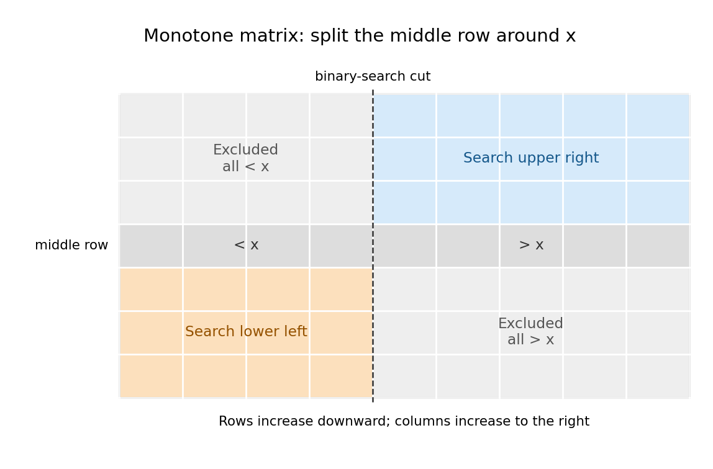

<h1 id="2/f/solution">Solution</h1>

↑ **Parent:** [F](../f.md)

Use half-open rectangles $[r_0,r_1)\times[c_0,c_1)$. Split the longer dimension at its middle. If rows are the longer dimension, [binary search](../../../../../binary-search.md) the middle row for its first entry at least $x$. Equality returns immediately; otherwise part (e) leaves only an upper-right and a lower-left rectangle. A middle-column split uses the transposed argument.
```
PROCEDURE SearchRect(x, r0, r1, c0, c1: INTEGER;
                     VAR i, j: INTEGER): BOOLEAN;
VAR mid, lo, hi, k: INTEGER;
BEGIN
  IF (r0 >= r1) OR (c0 >= c1) THEN RETURN FALSE END;
  IF r1-r0 >= c1-c0 THEN
    mid := r0 + (r1-r0) DIV 2;
    lo := c0; hi := c1;
    WHILE lo < hi DO
      k := lo + (hi-lo) DIV 2;
      IF f[mid,k] < x THEN lo := k+1 ELSE hi := k END
    END;
    IF lo < c1 THEN
      IF f[mid,lo] = x THEN i := mid; j := lo; RETURN TRUE END
    END;
    IF SearchRect(x, r0, mid, lo, c1, i, j) THEN
      RETURN TRUE
    END;
    RETURN SearchRect(x, mid+1, r1, c0, lo, i, j)
  ELSE
    mid := c0 + (c1-c0) DIV 2;
    lo := r0; hi := r1;
    WHILE lo < hi DO
      k := lo + (hi-lo) DIV 2;
      IF f[k,mid] < x THEN lo := k+1 ELSE hi := k END
    END;
    IF lo < r1 THEN
      IF f[lo,mid] = x THEN i := lo; j := mid; RETURN TRUE END
    END;
    IF SearchRect(x, r0, lo, mid+1, c1, i, j) THEN
      RETURN TRUE
    END;
    RETURN SearchRect(x, lo, r1, c0, mid, i, j)
  END
END SearchRect;

PROCEDURE DivideSearch(x: INTEGER; VAR i, j: INTEGER): BOOLEAN;
BEGIN
  RETURN SearchRect(x, 0, M, 0, N, i, j)
END DivideSearch;
```
The [lower-bound binary search invariant](../../../../../lower-bound-binary-search-invariant.md) says that entries before `lo` are smaller than $x$ and entries from `hi` onward are at least $x$, within the splitting row or column. At its end, either equality is found or the splitting line is strictly separated around $x$. Endpoint cuts `lo=c0`, `lo=c1`, `lo=r0`, or `lo=r1` are valid and merely make one candidate rectangle empty.

The [recursion invariant](../../../../../recursion-invariant.md) is that the current rectangle contains every still-possible answer assigned to that call. The discarded rectangles are excluded by [monotonicity](../../../../../monotonic-function.md); both retained rectangles inherit [monotonicity](../../../../../monotonic-function.md). Each nonempty child has a strictly smaller longest dimension after at most two levels, so the [recursion](../../../../../recursion-computer-science.md) terminates, including one-row and one-column cases. The concise construction is

$$
\boxed{\text{Bisect the longer dimension, binary-search the splitting line, recurse on the two opposite rectangles.}}
$$

<a id="2/f/image-two-complementary-rectangles-survive-a-middle-row-search"></a>


**[Figure 1](#2/f/image-two-complementary-rectangles-survive-a-middle-row-search). Two complementary rectangles survive a middle-row search**. For a [monotone matrix](../../../../../monotone-matrix.md), the middle row's [binary search](../../../../../binary-search.md) separates entries smaller than $x$ from entries greater than $x$ when no equality is found. The upper-left and lower-right rectangles are excluded by [monotonicity](../../../../../monotonic-function.md); only the blue and orange rectangles require further [search algorithm](../../../../../search-algorithm.md).

## ↑ Ancestors (12)

1. [F](../f.md)
2. [2](../../2.md)
3. [Imperative programming](../../../imperative-programming-split.md)
4. [2015](../../../split.md)
5. [Past exam of the year 1 of the computer science course of the University of Oxford](../../../../split.md)
6. [Year 1 of the computer science course of the University of Oxford](../../../../../year-1-of-the-computer-science-course-of-the-university-of-oxford.md)
7. [Computer science course of the University of Oxford](../../../../../computer-science-course-of-the-university-of-oxford.md)
8. [Undergraduate course of the University of Oxford](../../../../../undergraduate-course-of-the-university-of-oxford.md)
9. [Course of the University of Oxford](../../../../../course-of-the-university-of-oxford.md)
10. [University of Oxford](../../../../../university-of-oxford-split.md)
11. [List of universities](../../../../../list-of-universities.md)
12. [Codex Wiki](../../../../../split.md)
