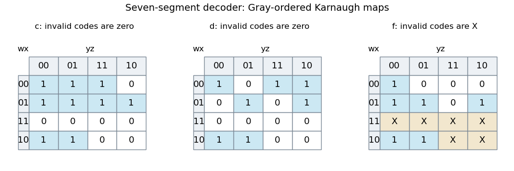
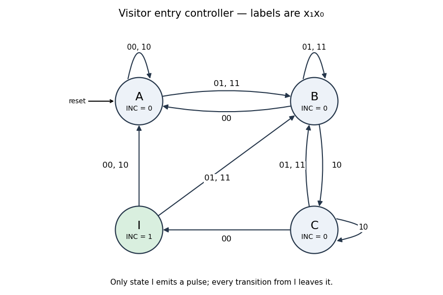
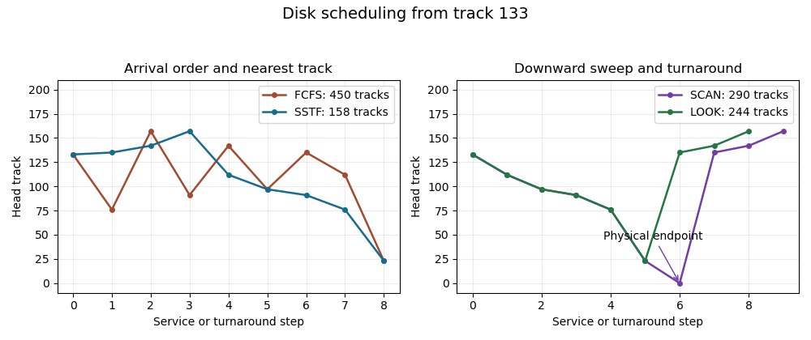
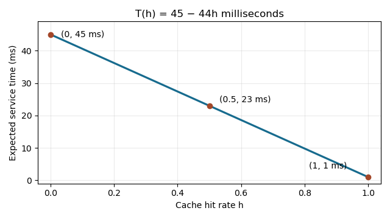

# Digital systems, linear algebra, introduction to formal proof (resit)

↑ **Parent:** [2016](../2016.md)

Source paper: [released examination archive](https://www.whatdotheyknow.com/request/past_exam_papers_for_1st_year_of/response/1398416/attach/2/Fakour%20Zip%20Final%201.zip?cookie_passthrough=1), member `a10101w1-2.pdf`; original cover dated 2016-09-15.

**Table of contents**

- [1](#1)
  - [a](#1/a)
    - [Solution](#1/a/solution)
  - [b](#1/b)
    - [Solution](#1/b/solution)
  - [c](#1/c)
    - [Solution](#1/c/solution)
  - [d](#1/d)
    - [Solution](#1/d/solution)
- [2](#2)
  - [a](#2/a)
    - [Solution](#2/a/solution)
  - [b](#2/b)
    - [Solution](#2/b/solution)
  - [c](#2/c)
    - [Solution](#2/c/solution)
- [3](#3)
  - [a](#3/a)
    - [Solution](#3/a/solution)
  - [b](#3/b)
    - [i](#3/b/i)
      - [Solution](#3/b/i/solution)
    - [ii](#3/b/ii)
      - [Solution](#3/b/ii/solution)
    - [iii](#3/b/iii)
      - [Solution](#3/b/iii/solution)
  - [c](#3/c)
    - [Solution](#3/c/solution)
  - [d](#3/d)
    - [Solution](#3/d/solution)
  - [e](#3/e)
    - [Solution](#3/e/solution)
- [4](#4)
  - [a](#4/a)
    - [Solution](#4/a/solution)
  - [b](#4/b)
    - [Solution](#4/b/solution)
  - [c](#4/c)
    - [Solution](#4/c/solution)
  - [d](#4/d)
    - [Solution](#4/d/solution)
- [5](#5)
  - [a](#5/a)
    - [Solution](#5/a/solution)
  - [b](#5/b)
    - [Solution](#5/b/solution)
  - [c](#5/c)
    - [Solution](#5/c/solution)
  - [d](#5/d)
    - [Solution](#5/d/solution)
- [6](#6)
  - [a](#6/a)
    - [Solution](#6/a/solution)
  - [b](#6/b)
    - [Solution](#6/b/solution)
  - [c](#6/c)
    - [Solution](#6/c/solution)
  - [d](#6/d)
    - [Solution](#6/d/solution)
  - [e](#6/e)
    - [Solution](#6/e/solution)
- [7](#7)
  - [a](#7/a)
    - [Solution](#7/a/solution)
  - [b](#7/b)
    - [Solution](#7/b/solution)
  - [c](#7/c)
    - [Solution](#7/c/solution)
  - [d](#7/d)
    - [Solution](#7/d/solution)
  - [e](#7/e)
    - [i](#7/e/i)
      - [Solution](#7/e/i/solution)
    - [ii](#7/e/ii)
      - [Solution](#7/e/ii/solution)
- [8](#8)
  - [a](#8/a)
    - [Solution](#8/a/solution)
  - [b](#8/b)
    - [Solution](#8/b/solution)
  - [c](#8/c)
    - [Solution](#8/c/solution)

## 1

↑ **Parent:** [Digital systems, linear algebra, introduction to formal proof (resit)](digital-systems-linear-algebra-introduction-to-formal-proof-resit.md)

<h3 id="1/a">a</h3>

↑ **Parent:** [1](#1)

<h4 id="1/a/solution">Solution</h4>

↑ **Parent:** [A](#1/a)

Take $w,x,y,z$ as the four input [bits](../../information-theory.md#bit), of weights $8,4,2,1$, and let 1 light a segment of the [seven-segment display](../../electrical-engineering.md#seven-segment-display). The required [truth table](../../mathematical-logic.md#truth-table) is
```
value   wxyz   abcdefg
 0      0000   1111110
 1      0001   0110000
 2      0010   1101101
 3      0011   1111001
 4      0100   0110011
 5      0101   1011011
 6      0110   1011111
 7      0111   1110000
 8      1000   1111111
 9      1001   1111011
10      1010   0000000
11      1011   0000000
12      1100   0000000
13      1101   0000000
14      1110   0000000
15      1111   0000000
```
Here [binary-coded decimal](../../electrical-engineering.md#binary-coded-decimal) represents one decimal digit per group of four bits. The six unused codes must be zeros in every output for this part; they are not [don't-care conditions](../../analysis-of-boolean-functions.md#don-t-care-term).

<h3 id="1/b">b</h3>

↑ **Parent:** [1](#1)

<h4 id="1/b/solution">Solution</h4>

↑ **Parent:** [B](#1/b)

Use [Karnaugh maps](../../analysis-of-boolean-functions.md#karnaugh-map) with rows $wx$ and columns $yz$, both in [Gray code](../../graph.md#gray-code) order $00,01,11,10$. Juxtaposition means [Boolean conjunction](../../mathematical-logic.md#logical-conjunction), $+$ means [Boolean disjunction](../../mathematical-logic.md#logical-disjunction), and a bar means [Boolean negation](../../theoretical-computer-science.md#negation). The minimal [sum of products](../../theoretical-computer-science.md#disjunctive-normal-form) forms are

$$
\boxed{c=\bar wx+\bar wz+\bar x\bar y,}
$$

and

$$
\boxed{d=w\bar x\bar y+\bar w\bar xy+\bar wy\bar z+\bar w\bar x\bar z+\bar wx\bar yz.}
$$

For $c$, the groups are $\{4,5,6,7\}$, $\{1,3,5,7\}$ and $\{0,1,8,9\}$. For $d$, take $\{8,9\}$, $\{2,3\}$, $\{2,6\}$, $\{0,2\}$ and the isolated minterm $\{5\}$. Every group contains only required ones. The last $c$ group wraps between the top and bottom map rows.

These covers are minimal: $c$ needs its three essential groups, forced by inputs 6, 3 and 8. For $d$, input 5 is isolated, while 9, 3 and 6 each force their respective pair; input 0 still needs a further group. These five groups also attain the minimum literal count of 16.

<a id="1/b/image-karnaugh-maps-for-the-three-decoder-outputs-used-in-the-solution"></a>


**[Figure 1](#1/b/image-karnaugh-maps-for-the-three-decoder-outputs-used-in-the-solution). Karnaugh maps for the three decoder outputs used in the solution**. Original maps in Gray order. Invalid inputs are fixed to zero for $c$ and $d$; only the $f$ map in part (d) treats them as X. Blue cells are required ones.

<h3 id="1/c">c</h3>

↑ **Parent:** [1](#1)

<h4 id="1/c/solution">Solution</h4>

↑ **Parent:** [C](#1/c)

Use $w,x,y$ as the three select [bits](../../information-theory.md#bit) of the 8-to-1 [multiplexer](../../theoretical-computer-science.md#multiplexer), so address $i=4w+2x+y$ selects data input $D_i$. Connect

$$
\boxed{(D_0,D_1,D_2,D_3,D_4,D_5,D_6,D_7)=(\bar z,1,z,\bar z,1,0,0,0).}
$$

A single [NOT gate](../../theoretical-computer-science.md#not-gate) produces $\bar z$, shared by $D_0$ and $D_3$; the other connections are wires and constant logic levels. For each fixed select address the data input reproduces the corresponding two rows of the [truth table](../../mathematical-logic.md#truth-table), including zeros for all invalid codes.

<h3 id="1/d">d</h3>

↑ **Parent:** [1](#1)

<h4 id="1/d/solution">Solution</h4>

↑ **Parent:** [D](#1/d)

Only now may the invalid codes 10–15 be marked as [don't-care conditions](../../analysis-of-boolean-functions.md#don-t-care-term). The $f$ [Karnaugh map](../../analysis-of-boolean-functions.md#karnaugh-map) gives

$$
\boxed{f=w+x\bar y+x\bar z+\bar y\bar z.}
$$

The groups are $\{8,\ldots,15\}$, $\{4,5,12,13\}$, $\{4,6,12,14\}$ and $\{0,4,8,12\}$. They cover all required ones, avoid valid-digit zeros, and may assign either output to invalid codes. The valid inputs 0, 5, 6 and 9 cannot share a valid implicant with each other, so at least four product terms are necessary. The displayed four-term cover uses only seven literals.

## 2

↑ **Parent:** [Digital systems, linear algebra, introduction to formal proof (resit)](digital-systems-linear-algebra-introduction-to-formal-proof-resit.md)

<h3 id="2/a">a</h3>

↑ **Parent:** [2](#2)

<h4 id="2/a/solution">Solution</h4>

↑ **Parent:** [A](#2/a)

Use a four-state [Moore machine](../../foundations-of-mathematics.md#moore-machine). In state $A$ wait for an outer-sensor activation; $B$ combines the outer-only and both-sensors phases; $C$ records that the visitor has reached the inner-only phase; $I$ emits the one-cycle count pulse. Only $I$ has `INC = 1`.

The complete [state transition table](../../foundations-of-mathematics.md#state-transition-table), with input order $x_1x_0$, is
```
state    00    01    11    10    INC
 A        A     B     B     A      0
 B        A     B     B     C      0
 C        I     B     B     C      0
 I        A     B     B     A      1
```
For a normal entry the states are $A\to B\to B\to C\to I$; retreat after the first sensor instead gives $A\to B\to A$ with no pulse. Repeated samples at one sensor remain in the corresponding phase. State $I$ always exits on the next edge, so its output lasts exactly one clock period; an outer activation on that next edge goes directly to $B$, allowing the next visitor to start immediately.

This follows the question's single-visitor entry model and merges the two outer-active phases as its hint requests. Inputs are sampled synchronously; the table also specifies deterministic recovery for other sampled combinations. It is not a specification of a bidirectional occupancy counter for arbitrary overlapping entry and exit traffic.

<a id="2/a/image-four-state-visitor-entry-moore-machine-with-a-one-clock-output-pulse"></a>


**[Figure 2](#2/a/image-four-state-visitor-entry-moore-machine-with-a-one-clock-output-pulse). Four-state visitor-entry Moore machine with a one-clock output pulse**. Original state diagram. Edge labels use $x_1x_0$. State I emits the count pulse; its transitions can accept the next visitor without an extra idle clock.

<h3 id="2/b">b</h3>

↑ **Parent:** [2](#2)

<h4 id="2/b/solution">Solution</h4>

↑ **Parent:** [B](#2/b)

Encode $(q_1q_0)$ by $A=00$, $B=01$, $C=11$, $I=10$, with reset to $A$. Two positive-edge-triggered [D flip-flops](../../electrical-engineering.md#d-flip-flop) store the state. Minimizing the [Boolean functions](../../analysis-of-boolean-functions.md#boolean-function) from the complete table gives

$$
\boxed{D_0=x_0+q_0x_1,\qquad D_1=\bar x_0q_0(x_1+q_1),\qquad INC=q_1\bar q_0.}
$$

Equivalently, the minimal [sum of products](../../theoretical-computer-science.md#disjunctive-normal-form) form of $D_1$ is $\bar x_0q_0x_1+\bar x_0q_0q_1$. The displayed factorization saves duplicated logic. The equations use only [AND gates](../../mathematical-logic.md#and-gate), [OR gates](../../mathematical-logic.md#or-gate) and [NOT gates](../../theoretical-computer-science.md#not-gate); connect $D_j$ to the corresponding flip-flop data input and use one common clock.

For example, $C$ with input $00$ gives $(D_1D_0)=10$, entering the pulse state. In $I$, either $x_0=1$ gives $01$ or $x_0=0$ gives $00$, independently of $x_1$; the pulse cannot persist. The four states are distinguishable by their current output or future response to inputs $00$ and $10,00$, so two state bits are also necessary.

<h3 id="2/c">c</h3>

↑ **Parent:** [2](#2)

<h4 id="2/c/solution">Solution</h4>

↑ **Parent:** [C](#2/c)

Address a [read-only memory](../../computer-memory.md#read-only-memory) with the two state [bits](../../information-theory.md#bit) and two input [bits](../../information-theory.md#bit). Each word stores the two next-state bits and `INC`, so a direct replacement for all the combinational logic is **$16\times3$ bits, or 48 bits**. Program its 16 words from the state table, duplicating a state's output over all four input addresses. The two [D flip-flops](../../electrical-engineering.md#d-flip-flop) and clock remain outside the ROM.

If `INC` retains its separate two-state-bit decoder, only the next-state logic needs a **$16\times2$-bit ROM**, plus that output gate. Storing output in a separate state-only ROM would use $4\times1$ further bits. These factored options have a different boundary from replacing all the combinational logic with one ROM.

## 3

↑ **Parent:** [Digital systems, linear algebra, introduction to formal proof (resit)](digital-systems-linear-algebra-introduction-to-formal-proof-resit.md)

<h3 id="3/a">a</h3>

↑ **Parent:** [3](#3)

<h4 id="3/a/solution">Solution</h4>

↑ **Parent:** [A](#3/a)

[Device independence](../../computer-science.md#device-independence) lets an application request [input-output](../../computer-science.md#input-output) through a uniform interface without depending on a particular device's control registers, instruction protocol or geometry. A [device driver](../../operating-system.md#device-driver) translates the abstract requests into device-specific operations. Replacing one supported disk model with another can then preserve the application's file-reading interface.

<h3 id="3/b">b</h3>

↑ **Parent:** [3](#3)

<h4 id="3/b/i">i</h4>

↑ **Parent:** [B](#3/b)

<h5 id="3/b/i/solution">Solution</h5>

↑ **Parent:** [I](#3/b/i)

[First-come-first-served disk scheduling](../../computer-science.md#first-come-first-served-disk-scheduling) follows the arrival order:
```
133 -> 76 -> 157 -> 91 -> 142 -> 97 -> 135 -> 112 -> 23
```
The total [seek distance](../../computer-science.md#seek-distance) is

$$
\boxed{57+81+66+51+45+38+23+89=450\text{ tracks}.}
$$

The initial position is 133; the earlier completed request at 135 is used to determine direction for the elevator policy, not added again to this total.

<h4 id="3/b/ii">ii</h4>

↑ **Parent:** [B](#3/b)

<h5 id="3/b/ii/solution">Solution</h5>

↑ **Parent:** [Ii](#3/b/ii)

[Shortest-seek-time-first disk scheduling](../../computer-science.md#shortest-seek-time-first-disk-scheduling) chooses the nearest remaining track after each service:
```
133 -> 135 -> 142 -> 157 -> 112 -> 97 -> 91 -> 76 -> 23
```
The distances are $2,7,15,45,15,6,15,53$, giving **158 tracks**. There are no distance ties along this service sequence.

<h4 id="3/b/iii">iii</h4>

↑ **Parent:** [B](#3/b)

<h5 id="3/b/iii/solution">Solution</h5>

↑ **Parent:** [Iii](#3/b/iii)

The previous motion from 135 to 133 fixes the initial direction as downward. Under [SCAN disk scheduling](../../computer-science.md#scan-disk-scheduling), the head continues to the physical endpoint 0 before reversing:
```
133 -> 112 -> 97 -> 91 -> 76 -> 23 -> 0 -> 135 -> 142 -> 157
```
Thus **SCAN crosses $133+157=290$ tracks**, stopping once the final pending request has been served.

If “elevator” means [LOOK disk scheduling](../../computer-science.md#look-disk-scheduling), reversal occurs at the lowest pending request, 23, rather than track 0. Its route omits 0, and the total is **$(133-23)+(157-23)=244$ tracks**. Stating the turnaround convention is necessary to make the numerical answer unambiguous.

<a id="3/b/iii/image-disk-scheduling-service-paths-and-the-scan-look-turnaround-distinction"></a>


**[Figure 3](#3/b/iii/image-disk-scheduling-service-paths-and-the-scan-look-turnaround-distinction). Disk scheduling service paths and the SCAN–LOOK turnaround distinction**. Original paths from the given starting position. The extra zero-track endpoint in SCAN is a movement step rather than a serviced request. Totals measure absolute track displacement.

<h3 id="3/c">c</h3>

↑ **Parent:** [3](#3)

<h4 id="3/c/solution">Solution</h4>

↑ **Parent:** [C](#3/c)

Conditioning on a [cache hit](../../computer-memory.md#cache-hit) or [cache miss](../../computer-memory.md#cache-miss), the [expected latency](../../computer-science.md#expected-latency) is

$$
\boxed{T(h)=h\cdot1+(1-h)\cdot45=45-44h\text{ ms},\qquad0\leq h\leq1.}
$$

This is a straight line from $(0,45)$ to $(1,1)$; at hit rate $1/2$, the mean is 23 ms. The 45 ms is already the complete miss-service time in the question, so another cache-lookup millisecond is not added to it.

<a id="3/c/image-mean-service-time-as-a-function-of-cache-hit-rate"></a>


**[Figure 4](#3/c/image-mean-service-time-as-a-function-of-cache-hit-rate). Mean service time as a function of cache hit rate**. Original plot of $T(h)=45-44h$ milliseconds, including the endpoint and midpoint values.

<h3 id="3/d">d</h3>

↑ **Parent:** [3](#3)

<h4 id="3/d/solution">Solution</h4>

↑ **Parent:** [D](#3/d)

At 6000 revolutions per minute the disk makes 100 revolutions per second, so one turn takes 10 ms and the mean [rotational latency](../../computer-science.md#rotational-latency) is 5 ms. Adding [seek time](../../computer-science.md#seek-time), [data transfer time](../../computer-science.md#data-transfer-time) and controller overhead gives, using decimal MB,

$$
\boxed{12+5+\frac{512}{5\cdot10^6}\,10^3+2=19.1024\text{ ms}\approx19.1\text{ ms}.}
$$

Using $1\mathrm{MB}=2^{20}$ bytes instead gives 19.09765625 ms, with the same rounded answer. The calculation assumes the stated rate applies to the sector transfer and that the seek and overhead are each paid once.

<h3 id="3/e">e</h3>

↑ **Parent:** [3](#3)

<h4 id="3/e/solution">Solution</h4>

↑ **Parent:** [E](#3/e)

Use binary units $1\mathrm{KB}=2^{10}$ bytes and $1\mathrm{MB}=2^{20}$ bytes, consistent with the given binary GB convention. Reading one average file takes seek plus rotation plus transfer; moving it requires the same costs again on the write:

$$
\boxed{t_{\rm file}=2\left(0.005+0.004+\frac{8\cdot2^{10}}{8\cdot2^{20}}\right)=0.019953125\text{ s}\approx20\text{ ms}.}
$$

A half-full 16 GB disk contains $8\cdot2^{30}$ used bytes, or $N=2^{20}$ average files. Under the stated per-file [disk compaction](../../file-system.md#disk-compaction) model,

$$
\boxed{T=N t_{\rm file}=20922.368\text{ s}\approx5.81\text{ hours}.}
$$

A calculation with decimal KB and MB changes the unrounded figures, so the unit convention must be retained consistently. This model charges one seek and rotational delay on each read and each write; it does not assume a single streaming pass over the whole disk.

## 4

↑ **Parent:** [Digital systems, linear algebra, introduction to formal proof (resit)](digital-systems-linear-algebra-introduction-to-formal-proof-resit.md)

<h3 id="4/a">a</h3>

↑ **Parent:** [4](#4)

<h4 id="4/a/solution">Solution</h4>

↑ **Parent:** [A](#4/a)

As written, the assertion needs a **nonzero-vector assumption**: the singleton set containing the [zero vector](../../vector-space.md#zero-vector) is mutually orthogonal but is [linearly dependent](../../vector-space.md#linear-dependence). For the [linear independence of nonzero orthogonal vectors](../../inner-product.md#linear-independence-of-nonzero-orthogonal-vectors), suppose $\sum_{i=1}^k\alpha_iq_i=0$. Taking the [inner product](../../inner-product.md) with $q_j$ gives

$$
0=\sum_i\alpha_i\langle q_i,q_j\rangle=\alpha_j\lVert q_j\rVert^2.
$$

Since $q_j\ne0$, positive definiteness gives $\lVert q_j\rVert^2>0$, hence $\alpha_j=0$. This holds for every $j$, proving [linear independence](../../vector-space.md#linear-independence) under the necessary assumption.

<h3 id="4/b">b</h3>

↑ **Parent:** [4](#4)

<h4 id="4/b/solution">Solution</h4>

↑ **Parent:** [B](#4/b)

The [Gram-Schmidt process](../../inner-product.md#gram-schmidt-process) constructs the vectors in order:

$$
v_j=x_j-\sum_{i<j}\langle q_i,x_j\rangle q_i,\qquad q_j=\frac{v_j}{\lVert v_j\rVert},\qquad j=1,\ldots,k.
$$

The empty sum at $j=1$ is zero. Each subtraction removes the projection onto one previous [unit vector](../../vector-space.md#unit-vector), so $v_j$ is orthogonal to their span. [Linear independence](../../vector-space.md#linear-independence) of the inputs ensures $v_j\ne0$ in exact arithmetic, and normalization gives unit length.

In [floating-point arithmetic](../../floating-point-arithmetic.md), subtracting nearly equal projections can amplify roundoff and cause loss of orthogonality, especially for nearly dependent columns. [Modified Gram-Schmidt](../../inner-product.md#modified-gram-schmidt), reorthogonalization, or [Householder QR factorization](../../numerical-linear-algebra.md#householder-qr-decomposition) can improve numerical behaviour; no implementation can remove the underlying sensitivity of nearly dependent input data.

<h3 id="4/c">c</h3>

↑ **Parent:** [4](#4)

<h4 id="4/c/solution">Solution</h4>

↑ **Parent:** [C](#4/c)

In the column convention used for [QR factorization](../../inner-product.md#qr-decomposition), an $m\times k$ real matrix has [orthonormal columns](../../inner-product.md#matrix-with-orthonormal-columns) when $Q^TQ=I_k$. This says that each column has unit norm and distinct columns have zero [inner product](../../inner-product.md). If $Q$ is square, then $Q^TQ=I$ provides a left inverse; a square matrix with a left inverse is invertible, so **$Q^{-1}=Q^T$**, and also $QQ^T=I$. Such a square matrix is an [orthogonal matrix](../../linear-algebra.md#orthogonal-matrix). A rectangular matrix with orthonormal columns generally has no two-sided inverse.

<h3 id="4/d">d</h3>

↑ **Parent:** [4](#4)

<h4 id="4/d/solution">Solution</h4>

↑ **Parent:** [D](#4/d)

The first two columns are already orthogonal and have norms 15 and 5. Their normalized versions are $q_1=(3,4,0,0)^T/5$ and $q_2=(0,0,4,-3)^T/5$. Their [inner products](../../inner-product.md) with the third column are 10 and 5. Subtracting these projections leaves $(20,-15,0,0)^T$, whose norm is 25. Thus an economy-size [QR factorization](../../inner-product.md#qr-decomposition) is

$$
\boxed{Q=\frac15\begin{pmatrix}3&0&4\\4&0&-3\\0&4&0\\0&-3&0\end{pmatrix},\qquad R=\begin{pmatrix}15&0&10\\0&5&5\\0&0&25\end{pmatrix}.}
$$

Direct multiplication gives $Q^TQ=I_3$ and $QR=A$. If a full square $Q$ is required, append $q_4=(0,0,3,4)^T/5$ and append a zero fourth row to $R$; the product is unchanged and the completed $Q$ is an [orthogonal matrix](../../linear-algebra.md#orthogonal-matrix).

## 5

↑ **Parent:** [Digital systems, linear algebra, introduction to formal proof (resit)](digital-systems-linear-algebra-introduction-to-formal-proof-resit.md)

<h3 id="5/a">a</h3>

↑ **Parent:** [5](#5)

<h4 id="5/a/solution">Solution</h4>

↑ **Parent:** [A](#5/a)

An [elementary matrix](../../numerical-linear-algebra.md#elementary-matrix) acts on rows by left multiplication. In the stated order, the three matrices are

$$
\boxed{E_s=\begin{pmatrix}1&0&0&0\\0&1&0&0\\0&0&3&0\\0&0&0&1\end{pmatrix},\quad E_a=\begin{pmatrix}1&0&0&0\\0&1&0&0\\0&0&1&0\\0&-3&0&1\end{pmatrix},\quad E_p=\begin{pmatrix}0&0&0&1\\0&1&0&0\\0&0&1&0\\1&0&0&0\end{pmatrix}.}
$$

The first scales row 3, the second adds $-3$ times row 2 to row 4, and the third swaps rows 1 and 4. Right multiplication would instead perform column operations.

<h3 id="5/b">b</h3>

↑ **Parent:** [5](#5)

<h4 id="5/b/solution">Solution</h4>

↑ **Parent:** [B](#5/b)

Undo each [elementary row operation](../../numerical-linear-algebra.md#elementary-row-operation): divide row 3 by 3, add 3 times row 2 to row 4, and repeat the same swap. Hence

$$
\boxed{E_s^{-1}=\begin{pmatrix}1&0&0&0\\0&1&0&0\\0&0&1/3&0\\0&0&0&1\end{pmatrix},\quad E_a^{-1}=\begin{pmatrix}1&0&0&0\\0&1&0&0\\0&0&1&0\\0&3&0&1\end{pmatrix},\quad E_p^{-1}=E_p.}
$$

Multiplying each inverse by its original matrix gives the [identity matrix](../../vector-space.md#identity-matrix).

<h3 id="5/c">c</h3>

↑ **Parent:** [5](#5)

<h4 id="5/c/solution">Solution</h4>

↑ **Parent:** [C](#5/c)

First add row 1 to rows 2 and 3. This is the product of two [elementary matrices](../../numerical-linear-algebra.md#elementary-matrix), written compactly as

$$
E_1=\begin{pmatrix}1&0&0&0\\1&1&0&0\\1&0&1&0\\0&0&0&1\end{pmatrix},\qquad E_1A=\begin{pmatrix}1&-1&0&1\\0&0&0&2\\0&-1&1&2\\0&-2&-1&2\end{pmatrix}.
$$

Swap rows 2 and 4 with $P$, then subtract half of the new row 2 from row 3 with $E_2$:

$$
P=\begin{pmatrix}1&0&0&0\\0&0&0&1\\0&0&1&0\\0&1&0&0\end{pmatrix},\qquad E_2=\begin{pmatrix}1&0&0&0\\0&1&0&0\\0&-1/2&1&0\\0&0&0&1\end{pmatrix}.
$$

This gives the upper triangular matrix

$$
\boxed{U=E_2PE_1A=\begin{pmatrix}1&-1&0&1\\0&-2&-1&2\\0&0&3/2&1\\0&0&0&2\end{pmatrix}.}
$$

Because $P^{-1}=P$, rearranging yields the convention **$A=PLU$**, where

$$
\boxed{L=PE_1^{-1}PE_2^{-1}=\begin{pmatrix}1&0&0&0\\0&1&0&0\\-1&1/2&1&0\\-1&0&0&1\end{pmatrix}.}
$$

The conjugation by $P$ moves the earlier elimination multipliers to the appropriate rows. Ignoring this permutation when forming $L$ would give an incorrect [PLU factorization](../../numerical-linear-algebra.md#plu-factorization). Here the same permutation is its own inverse, so $PA=LU$ also holds.

<h3 id="5/d">d</h3>

↑ **Parent:** [5](#5)

<h4 id="5/d/solution">Solution</h4>

↑ **Parent:** [D](#5/d)

The [determinant](../../multilinear-algebra.md#determinant) of the [unit lower triangular matrix](../../linear-algebra.md#unit-lower-triangular-matrix) $L$ is 1. There is one row swap, so $\det P=-1$, and the [upper triangular matrix](../../linear-algebra.md#upper-triangular-matrix) has determinant $1\cdot(-2)\cdot(3/2)\cdot2=-6$. Therefore

$$
\boxed{\det A=\det P\det L\det U=6.}
$$

## 6

↑ **Parent:** [Digital systems, linear algebra, introduction to formal proof (resit)](digital-systems-linear-algebra-introduction-to-formal-proof-resit.md)

<h3 id="6/a">a</h3>

↑ **Parent:** [6](#6)

<h4 id="6/a/solution">Solution</h4>

↑ **Parent:** [A](#6/a)

For an $m\times n$ matrix, its [row space](../../vector-space.md#row-space) is the span of its rows, a subspace of $\mathbb R^n$; its [column space](../../vector-space.md#column-space) is the span of its columns, a subspace of $\mathbb R^m$. Its [null space](../../kernel-of-a-linear-map.md) is $\ker A=\{x\in\mathbb R^n:Ax=0\}$. The [rank of a matrix](../../vector-space.md#matrix-rank) is the dimension of its column space, equal to the dimension of its row space. The [rank-nullity theorem](../../kernel-of-a-linear-map.md#rank-nullity-theorem) gives $\dim\ker A=n-\operatorname{rank}A$.

<h3 id="6/b">b</h3>

↑ **Parent:** [6](#6)

<h4 id="6/b/solution">Solution</h4>

↑ **Parent:** [B](#6/b)

Let the original rows be $r_1,\ldots,r_5$. Begin with rows $r_2$, $r_3-r_2$ and $r_4$:

$$
(1,1,0,0),\qquad(0,1,1,0),\qquad(0,0,1,1).
$$

Subtract the third from the second, then subtract that new second row from the first. The resulting rows are

$$
\boxed{(1,0,0,1),\quad(0,1,0,-1),\quad(0,0,1,1).}
$$

They are linearly independent because their first three coordinates form the [identity matrix](../../vector-space.md#identity-matrix). All original rows lie in their span: $r_1=2r_2+r_4$ and $r_5=r_2-(r_3-r_2)+r_4$. Thus they form a [basis](../../vector-space.md#basis) of the [row space](../../vector-space.md#row-space), and **$\operatorname{rank}A=3$**. Equivalently, these are the nonzero rows of the reduced row echelon form, with two further zero rows.

<h3 id="6/c">c</h3>

↑ **Parent:** [6](#6)

<h4 id="6/c/solution">Solution</h4>

↑ **Parent:** [C](#6/c)

The pivot columns are columns 1, 2 and 3 of the original matrix. A [basis](../../vector-space.md#basis) for its [column space](../../vector-space.md#column-space) is therefore

$$
\boxed{\left\{\begin{pmatrix}2\\1\\1\\0\\1\end{pmatrix},\begin{pmatrix}2\\1\\2\\0\\0\end{pmatrix},\begin{pmatrix}1\\0\\1\\1\\0\end{pmatrix}\right\}.}
$$

Use the original columns, rather than the columns of the row-reduced matrix: [elementary row operations](../../numerical-linear-algebra.md#elementary-row-operation) preserve column dependence relations, but can change the column space as a subspace of $\mathbb R^5$.

<h3 id="6/d">d</h3>

↑ **Parent:** [6](#6)

<h4 id="6/d/solution">Solution</h4>

↑ **Parent:** [D](#6/d)

The reduced homogeneous system is $x_1+x_4=0$, $x_2-x_4=0$, $x_3+x_4=0$. Set $x_4=t$ to obtain

$$
\boxed{\ker A=\operatorname{span}\left\{\begin{pmatrix}-1\\1\\-1\\1\end{pmatrix}\right\},\qquad\dim\ker A=1.}
$$

The [rank-nullity theorem](../../kernel-of-a-linear-map.md#rank-nullity-theorem) confirms $3+1=4$, and substitution verifies that the displayed vector is annihilated by $A$.

<h3 id="6/e">e</h3>

↑ **Parent:** [6](#6)

<h4 id="6/e/solution">Solution</h4>

↑ **Parent:** [E](#6/e)

A particular solution is $x_p=(1,0,-1,0)^T$, as direct substitution into all five equations verifies. Add any vector in the [null space](../../kernel-of-a-linear-map.md) to obtain every solution:

$$
\boxed{x=\begin{pmatrix}1\\0\\-1\\0\end{pmatrix}+t\begin{pmatrix}-1\\1\\-1\\1\end{pmatrix},\qquad t\in\mathbb R.}
$$

Conversely, the difference of any two solutions is annihilated by $A$, so there are no further solutions. This is the [affine solution space](../../linear-algebra.md#affine-solution-space) of a consistent [linear system](../../linear-algebra.md#system-of-linear-equations).

## 7

↑ **Parent:** [Digital systems, linear algebra, introduction to formal proof (resit)](digital-systems-linear-algebra-introduction-to-formal-proof-resit.md)

<h3 id="7/a">a</h3>

↑ **Parent:** [7](#7)

<h4 id="7/a/solution">Solution</h4>

↑ **Parent:** [A](#7/a)

[Implication introduction](../../mathematical-logic.md#implication-introduction-rule) assumes $\phi$ temporarily, derives $\psi$, and discharges that assumption to conclude $\phi\to\psi$. [Disjunction elimination](../../mathematical-logic.md#disjunction-elimination-rule) starts from $\phi\lor\psi$ and derives the same conclusion $\kappa$ in two separate branches, one assuming $\phi$ and the other assuming $\psi$.

The boxes delimit [subproofs](../../mathematical-logic.md#subproof): a locally assumed formula is available inside its box but cannot be used unconditionally outside it. Discharging a box records exactly which dependency has been removed. The proofs below use a vertical bar to mark each active box.

<h3 id="7/b">b</h3>

↑ **Parent:** [7](#7)

<h4 id="7/b/solution">Solution</h4>

↑ **Parent:** [B](#7/b)

Apply [negation introduction](../../mathematical-logic.md#negation-introduction-rule) separately to the two disjuncts, then [conjunction introduction](../../mathematical-logic.md#conjunction-introduction-rule):
```
 1  ¬(E ∨ F)      premise
 2  | E           assumption
 3  | E ∨ F       ∨-intro-L 2
 4  | ⊥           ¬-elim 3,1
 5  ¬E            ¬-intro 2–4
 6  | F           assumption
 7  | E ∨ F       ∨-intro-R 6
 8  | ⊥           ¬-elim 7,1
 9  ¬F            ¬-intro 6–8
10  ¬E ∧ ¬F       ∧-intro 5,9
```
No assumption from either branch remains open in the conclusion apart from the original premise.

<h3 id="7/c">c</h3>

↑ **Parent:** [7](#7)

<h4 id="7/c/solution">Solution</h4>

↑ **Parent:** [C](#7/c)

The derived [proof by contradiction](../../foundations-of-mathematics.md#reductio-ad-absurdum) rule is

$$
\frac{\Gamma,\neg\phi\vdash\bot}{\Gamma\vdash\phi}\quad\mathrm{RAA},
$$

where the displayed assumption $\neg\phi$ is discharged. Replace each use by [negation introduction](../../mathematical-logic.md#negation-introduction-rule), giving $\Gamma\vdash\neg\neg\phi$, followed by [double-negation elimination](../../mathematical-logic.md#double-negation-elimination), giving $\Gamma\vdash\phi$. Applying this replacement recursively removes all RAA occurrences while preserving the final conclusion and open premises. This uses the classical double-negation rule already supplied in the paper; it is not a general derivation of classical RAA from intuitionistic rules alone.

<h3 id="7/d">d</h3>

↑ **Parent:** [7](#7)

<h4 id="7/d/solution">Solution</h4>

↑ **Parent:** [D](#7/d)

A derivation of the [law of excluded middle](../../mathematical-logic.md#law-of-excluded-middle) using only the supplied primitive rules is
```
1  | ¬(A ∨ ¬A)    assumption
2  | | A          assumption
3  | | A ∨ ¬A     ∨-intro-L 2
4  | | ⊥          ¬-elim 3,1
5  | ¬A           ¬-intro 2–4
6  | A ∨ ¬A       ∨-intro-R 5
7  | ⊥            ¬-elim 6,1
8  ¬¬(A ∨ ¬A)     ¬-intro 1–7
9  A ∨ ¬A         ¬¬-elim 8
```
Both boxes have been discharged, so the final formula has no undischarged assumptions.

<h3 id="7/e">e</h3>

↑ **Parent:** [7](#7)

<h4 id="7/e/i">i</h4>

↑ **Parent:** [E](#7/e)

<h5 id="7/e/i/solution">Solution</h5>

↑ **Parent:** [I](#7/e/i)

Split on the [law of excluded middle](../../mathematical-logic.md#law-of-excluded-middle) for $A$, then use [disjunction elimination](../../mathematical-logic.md#disjunction-elimination-rule):
```
 1  D ∧ E          premise
 2  (A ∧ D) → B    premise
 3  (¬A ∧ E) → B   premise
 4  D              ∧-elim-L 1
 5  E              ∧-elim-R 1
 6  A ∨ ¬A         excluded middle
 7  | A            assumption
 8  | A ∧ D        ∧-intro 7,4
 9  | B            →-elim 2,8
10  | ¬A           assumption
11  | ¬A ∧ E       ∧-intro 10,5
12  | B            →-elim 3,11
13  B              ∨-elim 6,7–9,10–12
```
The two occurrences of $B$ have identical type and depend only on the corresponding temporary branch assumption and the original premises.

<h4 id="7/e/ii">ii</h4>

↑ **Parent:** [E](#7/e)

<h5 id="7/e/ii/solution">Solution</h5>

↑ **Parent:** [Ii](#7/e/ii)

Now derive the needed $D$ or $E$ inside its respective [subproof](../../mathematical-logic.md#subproof):
```
 1  A → D          premise
 2  ¬A → E         premise
 3  (A ∧ D) → B    premise
 4  (¬A ∧ E) → B   premise
 5  A ∨ ¬A         excluded middle
 6  | A            assumption
 7  | D            →-elim 1,6
 8  | A ∧ D        ∧-intro 6,7
 9  | B            →-elim 3,8
10  | ¬A           assumption
11  | E            →-elim 2,10
12  | ¬A ∧ E       ∧-intro 10,11
13  | B            →-elim 4,12
14  B              ∨-elim 5,6–9,10–13
```
[Implication elimination](../../mathematical-logic.md#implication-elimination-rule) supplies the branch-specific premise before [conjunction introduction](../../mathematical-logic.md#conjunction-introduction-rule) packages it for the final implication.

## 8

↑ **Parent:** [Digital systems, linear algebra, introduction to formal proof (resit)](digital-systems-linear-algebra-introduction-to-formal-proof-resit.md)

<h3 id="8/a">a</h3>

↑ **Parent:** [8](#8)

<h4 id="8/a/solution">Solution</h4>

↑ **Parent:** [A](#8/a)

In a finite domain, an [existential quantifier](../../mathematical-logic.md#existential-quantification) says that at least one candidate satisfies $\phi$. Reason with a fresh name $v$ for such an unspecified witness. If the same conclusion $\kappa$ follows using only $\phi(v)$ and the original premises, without depending on which candidate $v$ names, then $\kappa$ follows from the existential premise itself.

This is exactly [existential elimination](../../mathematical-logic.md#existential-quantifier-elimination-rule) in boxed form: the sequent $\Gamma,\phi(v)\vdash\kappa$ is the branch inside the box. The [eigenvariable](../../mathematical-logic.md#eigenvariable) $v$ must not occur free in the original undischarged context or in the exported conclusion $\kappa$. Otherwise the proof could smuggle in information about a specially chosen individual or export a fact about a witness whose name has just left scope. Freshness does not mean that the domain contains an additional object; it means that its temporary name carries no other assumptions.

<h3 id="8/b">b</h3>

↑ **Parent:** [8](#8)

<h4 id="8/b/solution">Solution</h4>

↑ **Parent:** [B](#8/b)

A uniform witness can serve every particular input. Two [natural deduction](../../mathematical-logic.md#natural-deduction) proofs differ in whether [universal introduction](../../mathematical-logic.md#universal-quantifier-introduction-rule) happens outside or inside the existential witness box.
```
Proof 1:
1  ∃y ∀x R(x,y)      premise
2  | ∀x R(x,b)       assumption, b fresh
3  | R(a,b)          ∀-elim 2, with a arbitrary
4  | ∃y R(a,y)       ∃-intro 3
5  ∃y R(a,y)         ∃-elim 1,2–4
6  ∀x ∃y R(x,y)      ∀-intro 5

Proof 2:
1  ∃y ∀x R(x,y)      premise
2  | ∀x R(x,b)       assumption, b fresh
3  | R(a,b)          ∀-elim 2, with a arbitrary
4  | ∃y R(a,y)       ∃-intro 3
5  | ∀x ∃y R(x,y)    ∀-intro 4
6  ∀x ∃y R(x,y)      ∃-elim 1,2–5
```
In both proofs $a$ is absent from the original premise. In the second it is also absent from the witness assumption, whose $x$ is bound; universal generalization is therefore legal inside that box. The exported conclusions contain no free $b$.

The converse is **not valid**. On the domain $\{0,1\}$, interpret $R(x,y)$ as $x=y$. For each $x$, choose $y=x$, so $\forall x\exists yR(x,y)$ holds. Neither single choice of $y$ equals both 0 and 1, so $\exists y\forall xR(x,y)$ fails. This is the distinction between a [pointwise witness](../../mathematical-logic.md#pointwise-witness) and a [uniform witness](../../mathematical-logic.md#uniform-witness).

<h3 id="8/c">c</h3>

↑ **Parent:** [8](#8)

<h4 id="8/c/solution">Solution</h4>

↑ **Parent:** [C](#8/c)

**The proposed proof is invalid:** its existential-elimination step exports $Q(x_0)$ while the witness name $x_0$ still occurs free in that conclusion. Introducing an existential quantifier later does not retrospectively repair that scope error.

Introduce the existential quantifier before discharging the witness box:
```
1  ∀x (P(x) → Q(x))   premise
2  ∃x P(x)            premise
3  | P(a)             assumption, a fresh
4  | P(a) → Q(a)      ∀-elim 1
5  | Q(a)             →-elim 4,3
6  | ∃x Q(x)          ∃-intro 5
7  ∃x Q(x)            ∃-elim 2,3–6
```
The conclusion of [existential elimination](../../mathematical-logic.md#existential-quantifier-elimination-rule) now has no free occurrence of $a$, and the name occurs in neither original premise, satisfying the [eigenvariable](../../mathematical-logic.md#eigenvariable) condition.

## ↑ Ancestors (9)

1. [2016](../2016.md)
2. [Past exam of the year 1 of the computer science course of the University of Oxford](../../past-exam-of-the-year-1-of-the-computer-science-course-of-the-university-of-oxford.md)
3. [Year 1 of the computer science course of the University of Oxford](../../university-of-oxford.md#year-1-of-the-computer-science-course-of-the-university-of-oxford)
4. [Computer science course of the University of Oxford](../../university-of-oxford.md#computer-science-course-of-the-university-of-oxford)
5. [Undergraduate course of the University of Oxford](../../university-of-oxford.md#undergraduate-course-of-the-university-of-oxford)
6. [Course of the University of Oxford](../../university-of-oxford.md#course-of-the-university-of-oxford)
7. [University of Oxford](../../university-of-oxford.md)
8. [List of universities](../../README.md#list-of-universities)
9. [Codex Wiki](../../README.md)
