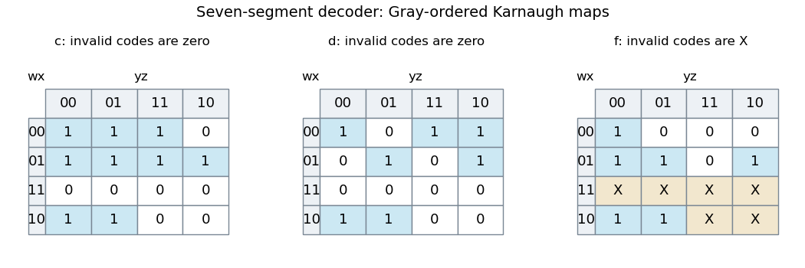

<h1 id="1/b/solution">Solution</h1>

↑ **Parent:** [B](../b.md)

Use [Karnaugh maps](../../../../../karnaugh-map.md) with rows $wx$ and columns $yz$, both in [Gray code](../../../../../gray-code.md) order $00,01,11,10$. Juxtaposition means [Boolean conjunction](../../../../../logical-conjunction.md), $+$ means [Boolean disjunction](../../../../../logical-disjunction.md), and a bar means [Boolean negation](../../../../../negation.md). The minimal [sum of products](../../../../../disjunctive-normal-form.md) forms are

$$
\boxed{c=\bar wx+\bar wz+\bar x\bar y,}
$$

and

$$
\boxed{d=w\bar x\bar y+\bar w\bar xy+\bar wy\bar z+\bar w\bar x\bar z+\bar wx\bar yz.}
$$

For $c$, the groups are $\{4,5,6,7\}$, $\{1,3,5,7\}$ and $\{0,1,8,9\}$. For $d$, take $\{8,9\}$, $\{2,3\}$, $\{2,6\}$, $\{0,2\}$ and the isolated minterm $\{5\}$. Every group contains only required ones. The last $c$ group wraps between the top and bottom map rows.

These covers are minimal: $c$ needs its three essential groups, forced by inputs 6, 3 and 8. For $d$, input 5 is isolated, while 9, 3 and 6 each force their respective pair; input 0 still needs a further group. These five groups also attain the minimum literal count of 16.

**[Figure 1](#1/b/image-karnaugh-maps-for-the-three-decoder-outputs-used-in-the-solution). Karnaugh maps for the three decoder outputs used in the solution**. Original maps in Gray order. Invalid inputs are fixed to zero for $c$ and $d$; only the $f$ map in part (d) treats them as X. Blue cells are required ones.

## ↑ Ancestors (12)

1. [B](../b.md)
2. [1](../../1.md)
3. [Digital systems, linear algebra, introduction to formal proof (resit)](../../../digital-systems-linear-algebra-introduction-to-formal-proof-resit-split.md)
4. [2016](../../../split.md)
5. [Past exam of the year 1 of the computer science course of the University of Oxford](../../../../split.md)
6. [Year 1 of the computer science course of the University of Oxford](../../../../../year-1-of-the-computer-science-course-of-the-university-of-oxford.md)
7. [Computer science course of the University of Oxford](../../../../../computer-science-course-of-the-university-of-oxford.md)
8. [Undergraduate course of the University of Oxford](../../../../../undergraduate-course-of-the-university-of-oxford.md)
9. [Course of the University of Oxford](../../../../../course-of-the-university-of-oxford.md)
10. [University of Oxford](../../../../../university-of-oxford-split.md)
11. [List of universities](../../../../../list-of-universities.md)
12. [Codex Wiki](../../../../../split.md)
