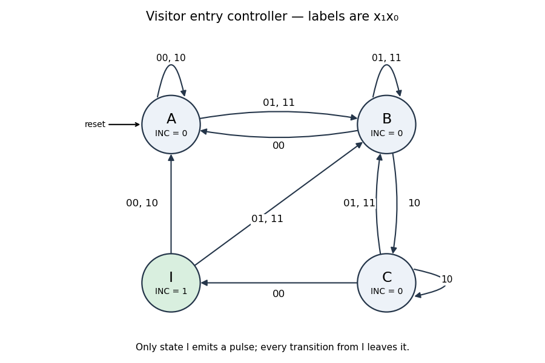

<h1 id="2/a/solution">Solution</h1>

↑ **Parent:** [A](../a.md)

Use a four-state [Moore machine](../../../../../moore-machine.md). In state $A$ wait for an outer-sensor activation; $B$ combines the outer-only and both-sensors phases; $C$ records that the visitor has reached the inner-only phase; $I$ emits the one-cycle count pulse. Only $I$ has `INC = 1`.

The complete [state transition table](../../../../../state-transition-table.md), with input order $x_1x_0$, is
```
state    00    01    11    10    INC
 A        A     B     B     A      0
 B        A     B     B     C      0
 C        I     B     B     C      0
 I        A     B     B     A      1
```
For a normal entry the states are $A\to B\to B\to C\to I$; retreat after the first sensor instead gives $A\to B\to A$ with no pulse. Repeated samples at one sensor remain in the corresponding phase. State $I$ always exits on the next edge, so its output lasts exactly one clock period; an outer activation on that next edge goes directly to $B$, allowing the next visitor to start immediately.

This follows the question's single-visitor entry model and merges the two outer-active phases as its hint requests. Inputs are sampled synchronously; the table also specifies deterministic recovery for other sampled combinations. It is not a specification of a bidirectional occupancy counter for arbitrary overlapping entry and exit traffic.

<a id="2/a/image-four-state-visitor-entry-moore-machine-with-a-one-clock-output-pulse"></a>


**[Figure 2](#2/a/image-four-state-visitor-entry-moore-machine-with-a-one-clock-output-pulse). Four-state visitor-entry Moore machine with a one-clock output pulse**. Original state diagram. Edge labels use $x_1x_0$. State I emits the count pulse; its transitions can accept the next visitor without an extra idle clock.

## ↑ Ancestors (12)

1. [A](../a.md)
2. [2](../../2.md)
3. [Digital systems, linear algebra, introduction to formal proof (resit)](../../../digital-systems-linear-algebra-introduction-to-formal-proof-resit-split.md)
4. [2016](../../../split.md)
5. [Past exam of the year 1 of the computer science course of the University of Oxford](../../../../split.md)
6. [Year 1 of the computer science course of the University of Oxford](../../../../../year-1-of-the-computer-science-course-of-the-university-of-oxford.md)
7. [Computer science course of the University of Oxford](../../../../../computer-science-course-of-the-university-of-oxford.md)
8. [Undergraduate course of the University of Oxford](../../../../../undergraduate-course-of-the-university-of-oxford.md)
9. [Course of the University of Oxford](../../../../../course-of-the-university-of-oxford.md)
10. [University of Oxford](../../../../../university-of-oxford-split.md)
11. [List of universities](../../../../../list-of-universities.md)
12. [Codex Wiki](../../../../../split.md)
